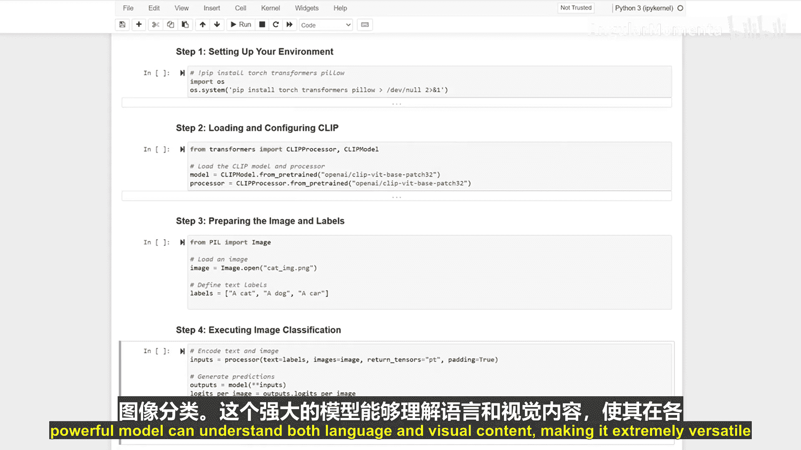

# 【Coursera】生成式人工智能与大语言模型-｜-Generative-AI-and-Large-Language-Models-p29-05_02_03_基于CLIP的零样本图像分类--BV1SMFgzoEh9_p29-

Welcome back， everyone。 Today day， We're exploring how to perform0 shot image classification using C L I P。

 First， let's set up our environment。 We'll install the necessary libraries， including torch。

 transformers and pillow， suppressing unnecessary outputs to ensure compatibility with collab。😊。

We're setting up our CLIP model， we load the CLIP model in processor。

 which can handle text and images for zero shot classification。

Let's prepare our image and labels for0 shot classification。

 We'll load an image using pillow and define text labels for classification。 Finally。

 we'll perform the classification using C IP and print the predicted label。In today's session。

 we learned how to use C L IP for0 shot image classification。

 This powerful model can understand both language and visual content。

 making it extremely versatile for various applications。😊。

🎼。

