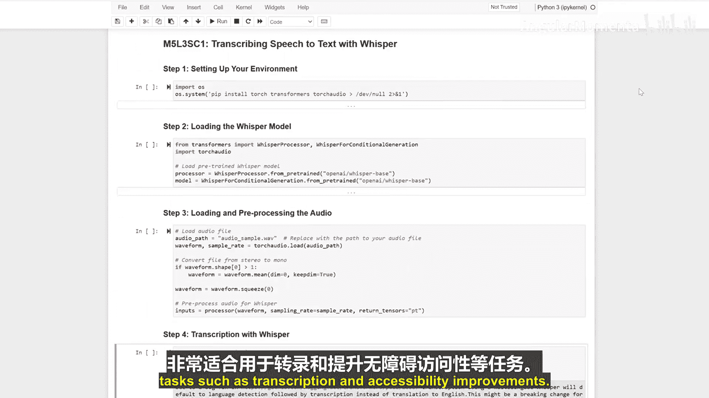

# 【Coursera】生成式人工智能与大语言模型-｜-Generative-AI-and-Large-Language-Models-p30-05_03_02_使用Whisper将语音转录为文本--BV1SMFgzoEh9_p30-

Welcome back everyone， Today we're learning how to transcribe speech to text using Whi。

Imagine a model that can convert audio recordings into accurate textual transcripts effortlessly。

 First， let's set up our environment。We'll install the necessary libraries， including torch。

 transformers and Libbrosa。Suppressing unnecessary outputs。Next。

 we'll load the pre trained W model and processor， which will help us transcribe audio to text accurately。

Let's load the audio file and pre process it using torch audio and the W processor。

Now we'll generate the transcription using W and print the transcribed text。Finally。

 let's evaluate the output and customize the transcription by adjusting parameters for improved results。

In today's session， we learned how to useWhi to transcribe speech to text。

 This powerful model can accurately convert audio into text。

 making it ideal for tasks such as transcription and accessibility improvements。

🎼。

