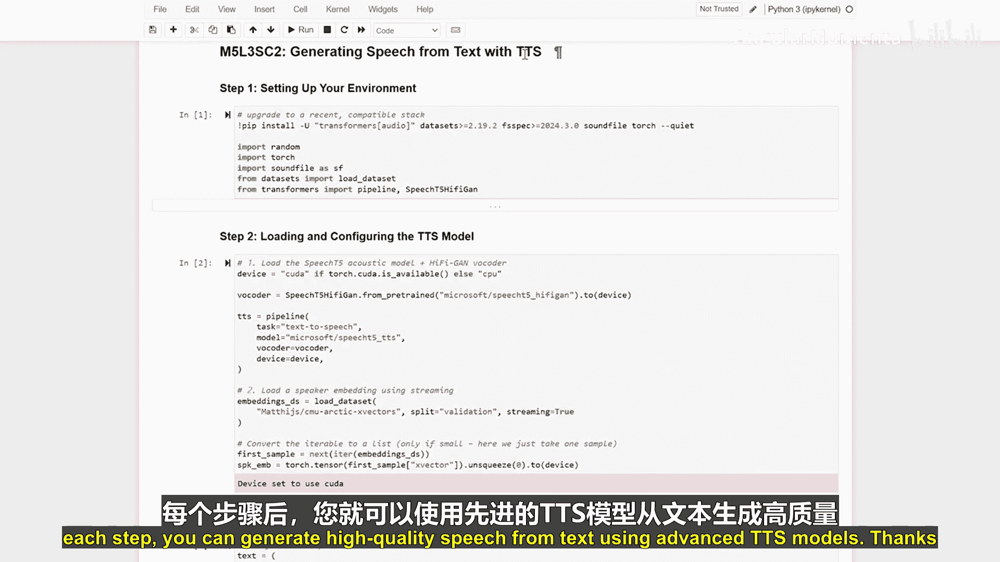

# 【Coursera】生成式人工智能与大语言模型-｜-Generative-AI-and-Large-Language-Models-p31-05_03_03_利用文本转语音技术生成语音--BV1SMFgzoEh9_p31-

Welcome back today we're going to explore how to generate speech from text using text to speech。

 TTS technology。We'll set up the environment， load and configure the TTS model。

 synthesize text into speech， and customize the audio output First。

 let's set up our environment by installing the required packages for TTS。Next。

 we'll load the Spee T5 acoustic model and the high PhiGAN Vocoder。

Which are essential for generating high quality speech。Now。

 let's synthesize speech from a given text and save the output as a wave file。Finally。

 let's customize the audio output by adjusting generation settings such as maximum length and number of beams。

In this lesson， we've learned how to set up the environment， load and configure that TTS model。

 synthesize text into speech， and customize audio output。

Understanding each step you can generate high quality speech from text using advanced TTS models thanks for watching。

