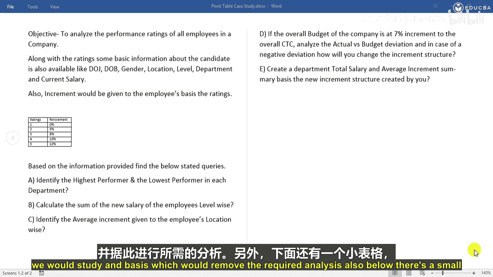
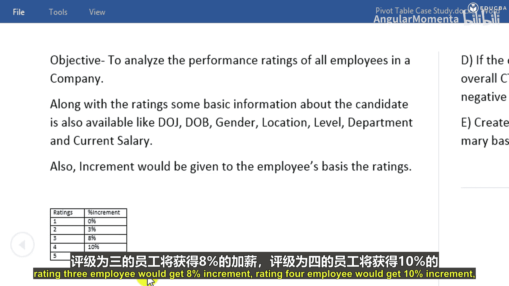
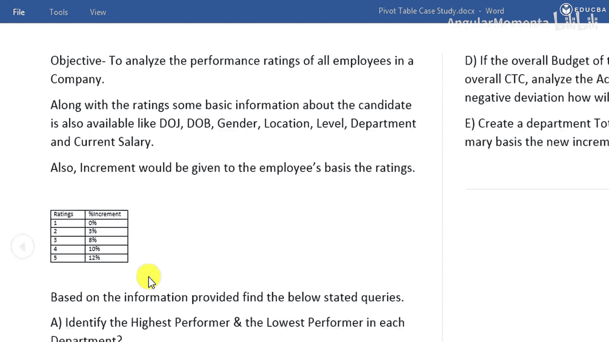
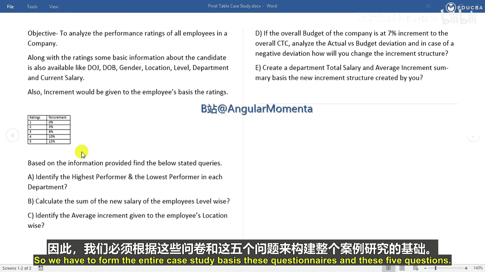

# 【EDUCBA】使用Excel数据透视表分析员工绩效-｜-Analyze-Employee-Performance-Using-Excel-Pivot-Tabl-p01-01_01_01_Excel智能图形与图表入门--BV14EcTz7EM4_p1-

Hello everyone today we are going to take you through the pivot table case study。

 So in this particular case study we are going to take a real life scenario and find out the solutions to the same using Excel pivot table so your in front of us is a dummy case study where。

Which replicates a real life scenario through which we will be using the pivot table So what is this case study all about So this case study is generally related to some employee information the employee information in this particular case study includes date of joining。

 date of birth， gender， location， level， department and current salary along with this there are a certain number of more columns that we would study。

And basis which would remove the required analysis。

Also below there is a small table which basically states what increment a person would get according to his ratings。

So say a rating one employee would get0% increment， a rating2 employee would get 3% increment。

 a rating 3 employee would get a 8% increment， rating  for employee would get 10% increment and finally rating 5 employee would get 12% increment。

Based on the information provided， we have to find solution to the below queries。So first of all。

 identify the highest performer and the lowest performer in each department。

 so we have to analyze who is the highest performer and the lowest performer in each category of employment So the second question would be calculate the sum of the new salary of the employee level wise so after the increment therell be a new salary or new to cC that would be received by these employees have to calculate the sum of the salary employee wise and level wise。

The third question， identify the average increment given to the employees location wise。

 so analyze the average increment which would be given to the employee location wise average increment in terms of percentage and in terms of salary。

 if the oral budget so now comes a case study based on inference and analysis。

If the overallal budget of the company is say 7% to the overall CTC analyze the actual versus budget deviation and in case of negative deviation。

 how will you change the increment structure so what's happening here so company has 7% increment budget okay that is the budget of the company say the budget is 700 rupees now we have to analyze actual versuss of budget deviation so according to the ratings given to the employee we have to then analyze how much the entire salary we are getting so say the sum of salary increment is 800 so over 100 of the budget so in that case we have to change the increment structure to match or keep the actual level below the budget rate level so that way we have to have to change the increment structure create a department total salary and average increment summary base the new increment structure once you have created a new increment structure。

Then you have to basically show the entire new structure in basis of total salary and average increment。

 so this is a case study that is in front of us for this case study there will be an obviously a database that would be we would be using which I would take you through in each detailed step so we have to form the entire case study basis these questionnaires and these five questions。

