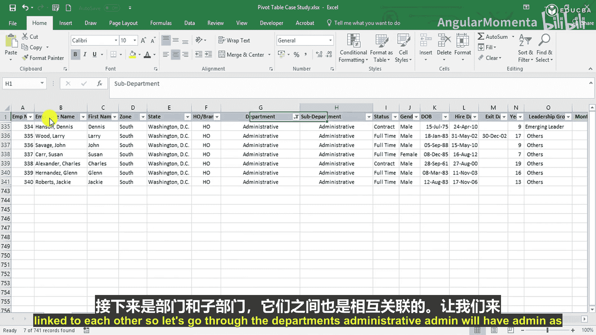

# 【EDUCBA】使用Excel数据透视表分析员工绩效-｜-Analyze-Employee-Performance-Using-Excel-Pivot-Tabl-p02-01_01_02_数据导论--BV14EcTz7EM4_p2-

Now we'll take you through the database， so this is the database that we are going to use to study and analyze the pivottable case study。

 so as you can see this is an employee database which is quite similar to the ones that you will get in your company as well。

 so let's check what the fields are first is the employee number employee name employee number for by employee name first name the S okay so with Sn employee from the state。

I see from head office or branch， as you can see， head office is located in Washington。

 DC and each location or each state is linked to a specific zone。

 so Midwessh will have a particular state。Northeast will have one more particular state。

South will have。These were Florida， Georgiagia， Mississippi， Tennessee and Washington， D。

West will have， Arizona and Colorado。So moving forward again department sub departmentpartment which is again linked to each other。

 so lets go through the departments admin and admin will have admin as a sub departmentpartment。

Business support group will have creative I and system development as their group。

Cporate responsibility Group will have En compliance。

 environmental health safetyfe and green building。Followed by finance。

 which have an an account management team and analyst team。

Followed by human resources which have training， professional training group and training。Operations。

Marketing and sales will have market branding， media and sales。Production will have ADDC facilities。

 major manufacturing projects， manufacturing。Vundolo。

Followed by research and quality Group which will have qualityity assuranceur。

 qualityity Control research center and research development。

So these subdepartments are linked to particular departments now we move ahead with status。

So each employee will have contract full time have frame or early employment。

Gender would be a a male female。Date of birth of the employee。Followed by his date of joining。

 which is also known as higher date。D starts from 98。

Then followed by yours if there is an exit date of employers leaving the organization。

Followed by your tenure。Leadership group， advancing leader， emerging leader。

 others and senior leader， So all companies have some specific leadership groups that employees are tied to。

 some may be tied to some group and some may not。Moving ahead the most important part is， of course。

 the monthly salary， so this is the monthly salary of the employee， the bonus he will。

During the year for employment his year salary， his basic salary。His HRRA。

 which is house rent allowance， his conveyance， followed by special allowance， Pf and operating。

The job rating is the rating which we would。Be using to analyze the increment。

 So I'll give you few logics of the salary。 So basic salary is usually 50% of the early salary。

 So if the half of this is this。HRA is 50% of basic salary。

 so half of 327300 is 13920 almost conveyance。Is again a specific amount given to the employee specific threshold allowance is the balancing figure between all others and the total salary P F is 12% of the basic salary and finally the job intake。

 So this is the data that we would be using to analyze the particular case study。

So very essential this database which would be using to analyze this case study。

 so youll be using different columns we will be creating more columns versus formula。

 creating more pivot tables according to our questions。

