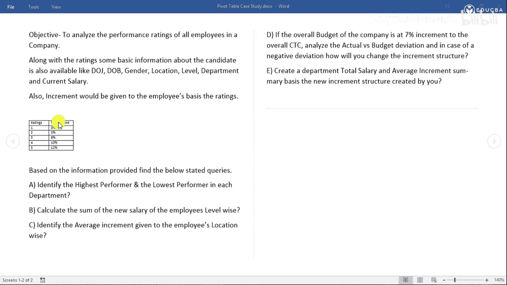
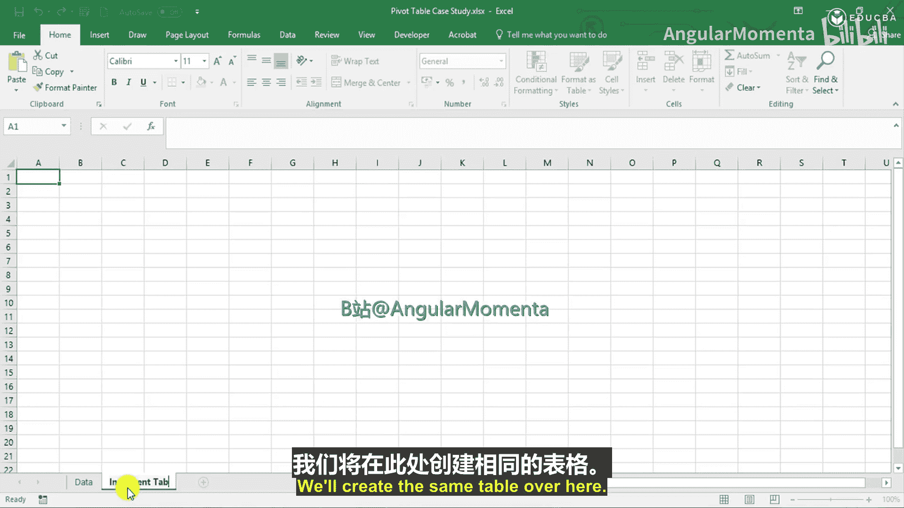
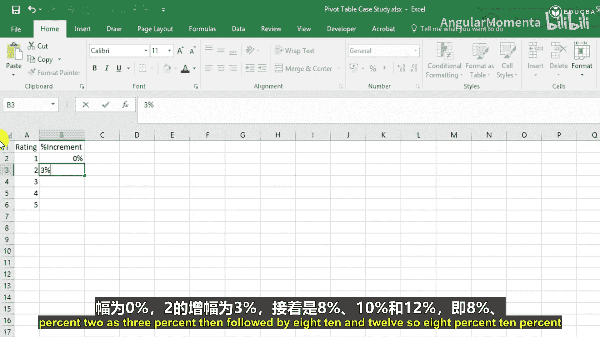
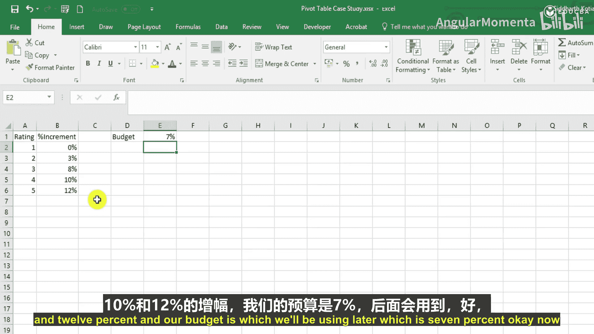
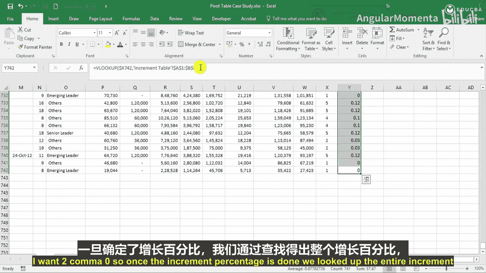
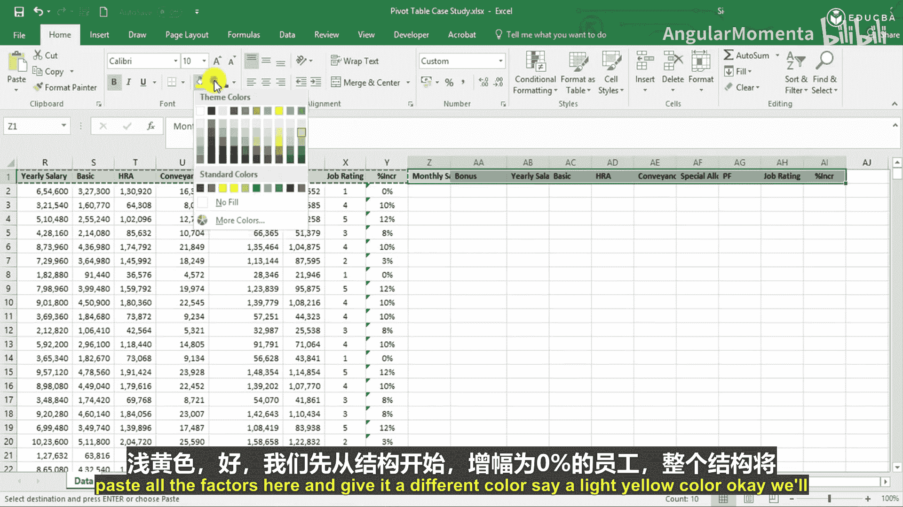
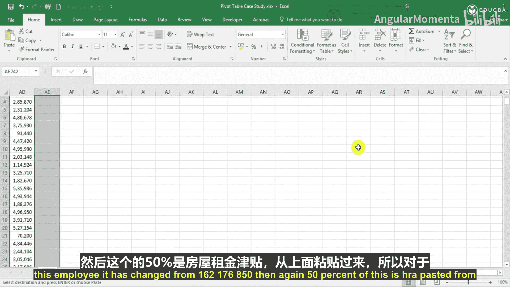

# 【EDUCBA】使用Excel数据透视表分析员工绩效-｜-Analyze-Employee-Performance-Using-Excel-Pivot-Tabl-p03-01_02_01_增量计算--BV14EcTz7EM4_p3-

Now we would be getting on with a case study， so our first question is identify the highest perform at lowest from former each department。

 Before that， let's move this table into our sheet some opening the Excel。

K creating a new sheet or this will in as data。This as incrimement。

Table will create the same table over here。

Okay， this is reading Ding。This is increment。Percentage encouragement。Now，1，2，3，4， and 5。

 So one has 0%。2 as 3%。

Then followed by 8，10 and 12， so 8%。10% and 12 percent。 And our budget is which we'll be using later。

 which is 7%。

Okay， now we will add the increment percentage over here。

So first we will create the entire base over first with the entire new salary structure according to the encrement。

So we are using a formula known as VlookU to find the increment percentage。

 so this is a very simple table which will be using a Vlookup。Sttu。

And your our increment table is there。 lock the cell。2， comma， 0， so 2 is the column we want。

 so 1 and 2， so this is the table I've selected column 2 is what I want2 comma。C路。

So once the increment percentage is done。we looked up the entire increment percentage。

 this is the percentage。

Give a same formatting to this。 convert this into percentage。Once that is done。

 we then now move to create the structure of salary okay so first we will start by creating the new structure so tell doers。

 Ill basically color this separately， I'll paste all the factors here and give it a different color say。

A light yellow color okay， we'll start with the structure first。

So employees getting 0% their entire structure would be same。this is again。Good this。Okay。So。Oh。

 sorry， the monthly salary is divide by this， okay。I will obviously round this off。

 Ill put a round formula for this round till basically round it up to the highest digit or the lowest digit。

 whatever is applicable on 。5， so Ive put the multi salary。Okay。

 bonus would remain the same as we have no instruction on the bonus。

 so I'm directly putting a equal to one bonus employees not getting bonus will remain the same so this will be。

Into 12， basically。Okay。Okay， into。Yeah。So dear， basically， we will。Put the increment amount。

 So this is the increment amount that person will get。Okay， this into this 0。

P should this is the increment amount well get。What difference would that make to a salary。Okay。

So adding the increment amount to this salary， so this will 2695 after 10% return to 29475。

After which we will create a year salary， which would be basically into 12。

The entire salary into 12 okay， then followed by basic salary， which is into。50%。So。

For a lot of employees， it would remain the same for this employee， it has changed from 162176，82850。

Then again，50% of this。Is HR。

Fste it from top。So that is the amount for 0% increment， it will actually remain the same。

So this is basically 40% HRRA。1So 40% HR， not 50% in this particular structure。

 the HR is 40% of basic。Then， followed by。Conveyance， which again will find the percentage too。

Which is basically。2。5% so convince that's 2。5% of your lease salary。So， into。2。

5% of early salary is conveyance。Again paste it， then followed by special allowance。

 which is basically the tall amount， the difference of amounts before that you will have to add Pf。

 which is at 12 percent。Okay。Of basic salary。Also 24% which is 12 plus company and the employee。

 that's why it comes as 24%。Then large， but not the least special allowance。

 which is year salary minus some of all other factors。And paste it below。Last one is job rating。

 which is not applicable for next year。