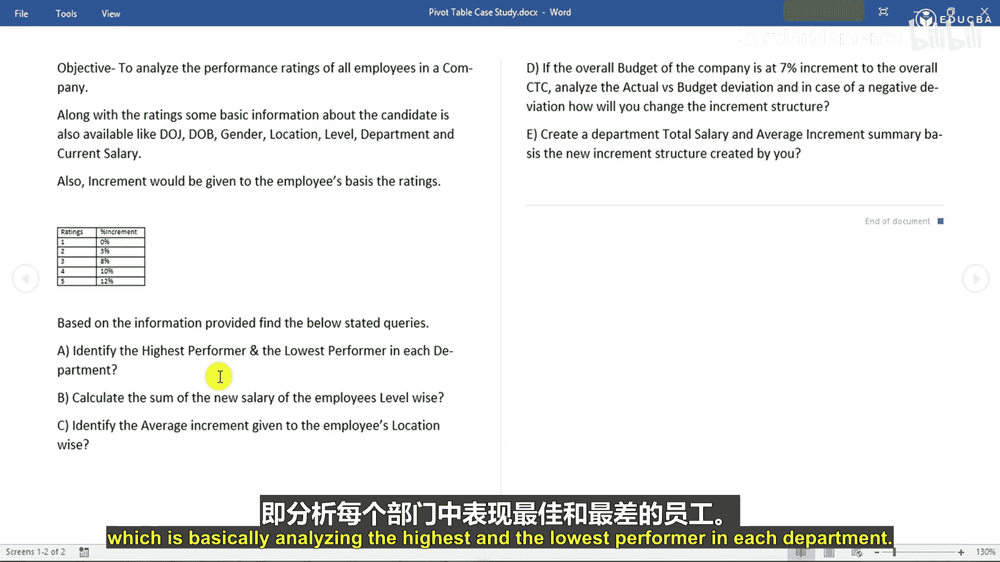
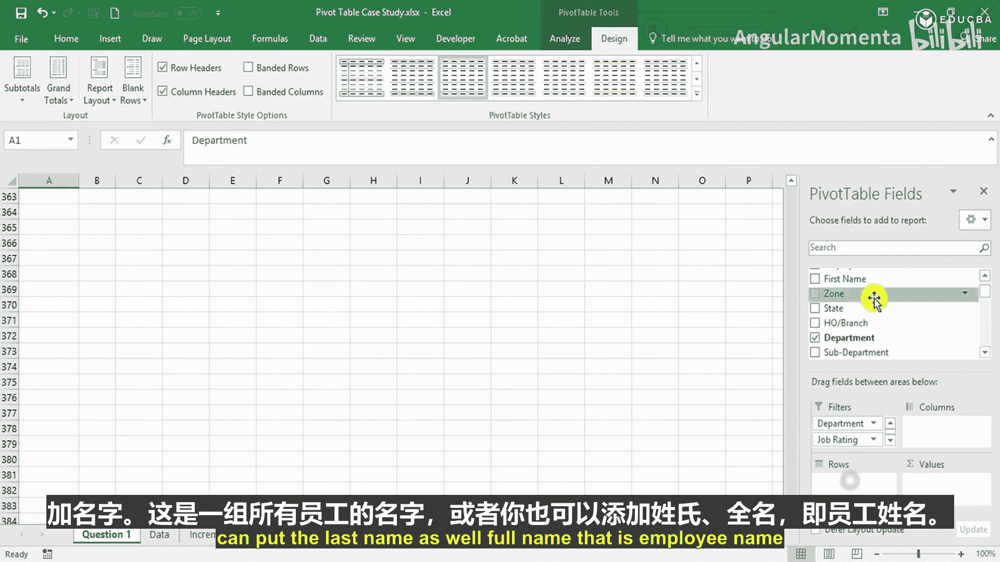

# 【EDUCBA】使用Excel数据透视表分析员工绩效-｜-Analyze-Employee-Performance-Using-Excel-Pivot-Tabl-p04-01_02_02_创建用于绩效分析的数据透视表--BV14EcTz7EM4_p4-

Once the database is done， we then move on to the first part of our case study。

 which is basically analyzing the highest and the lowest performer in each department。

 so what we will do is first of all we will create a pivot table for the first question so what we have to do is select the entire data。

Till down the entire data sheet。Click on insert。Pavvot table， now a box for the pivot table appears。

 which basically states create pivot table。Choose the data you want to analyze。And click on。

Ex New external data， new worksheet。Or external existing worksheet。

 So you click on new worksheet and do okay。Nure， you rename the sheet as I'll say， question1。

And save the file once the pivot table has been created。And you click on the pivott table box。

 you can see the pivot table fields。So here is the entire list of columns available in our database。

 so salary 2 is the new increment salary。On the right hand side， you can see filters， columns。Rose。

 here and values。Along with that you can see the settings。

 so once you change the settings the view of the table changes， for example。

 if I click on field section and areas section track。You can see。Fills bow and aspects below o。

If I change it to field sections only， you can only seal the fields。

Area section only you can see only the area。Aa section only1 by 4 you can see the area by rowwise。

 so I'll keep it on say。The fields and area section aspect okay along with that you will also see two more options on top which is we see analyze here we can see the pivot table name。

Active field， drill down， drill up， group section and group group field slicer and timeline。

 This is basically filters。 You can change the data source。 Currently。

 it's connected to the data sheet。Refresh pivot table， clear， select and move pivot table。

 some calculation aspects once you have created the pivot table which is field item and sets。

 OLab tools and relationshiplong with that you can see pivot chart， recommended pivot tables。

 field list over your plus minus button and field headers。

Then comes the other aspect of design where you can see subtotals， do not show subtotal。

 show all subtotals at bottom of group， show all subtotals at top of group。

Grant total on off for rows and columns， or on for rows and columns。

 on for rows only on for columns only， report layout which show in compact form。

 show in outline form， show in tabular form， repeat all item labels， and do not repeat item labels。

Blank row， insert blank line after each item， remove blank line after each item。

Followed by row headers and column headers is basically the pivot table style option。

 banded rows and banded columns。Bandit rows we see once that pivot table has been created and the last would not theleash the pivot table style。

 the type of style you want for the pivot table now we move on to the first question which is basically to find out the highest and the lowest return in the department。

So you can do two aspects over year， Ill create two pivot tables over here。

 first let us find the department on the filter wise。Sell select department on filter。And put。

Job rating also on the filter， which is basically down below your where I can add and select the job rating and put it on the filter。

Then， Id。Fush name。안대로。Now this is the set of names of all employees。

 or you can put the last name as well， full name， that is employee name。

