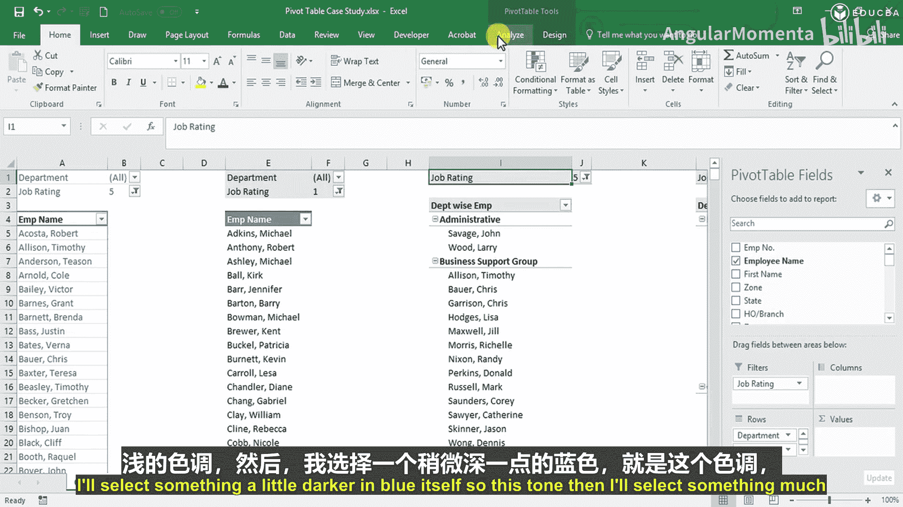
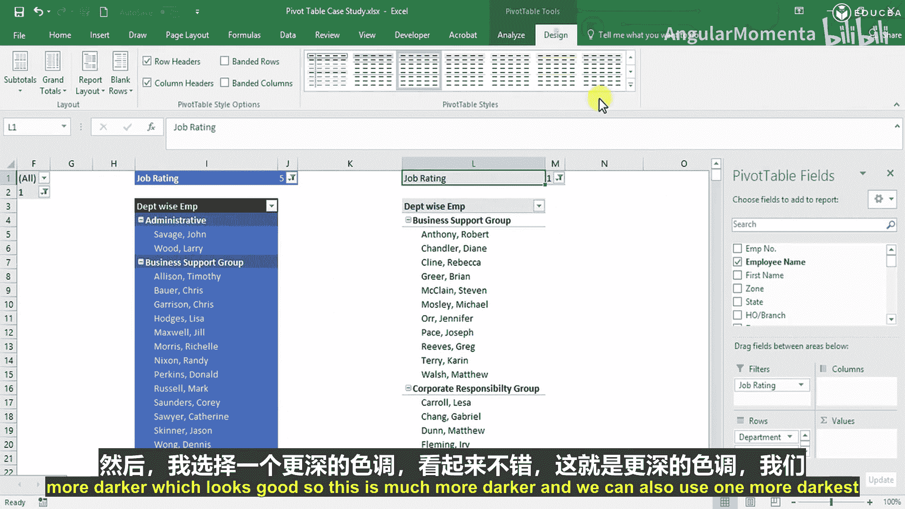
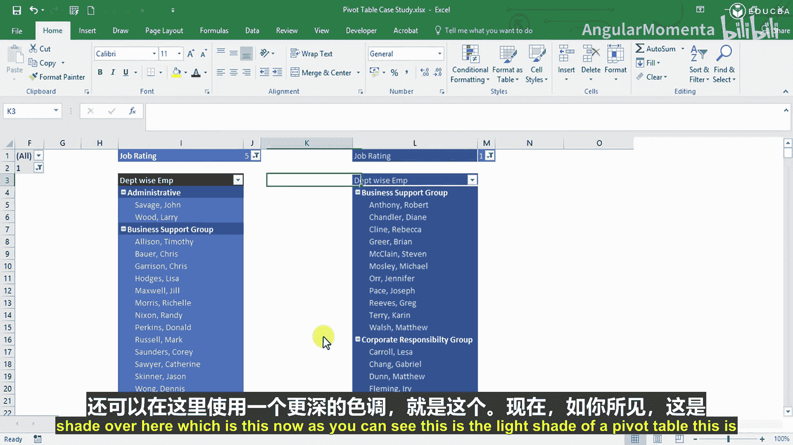
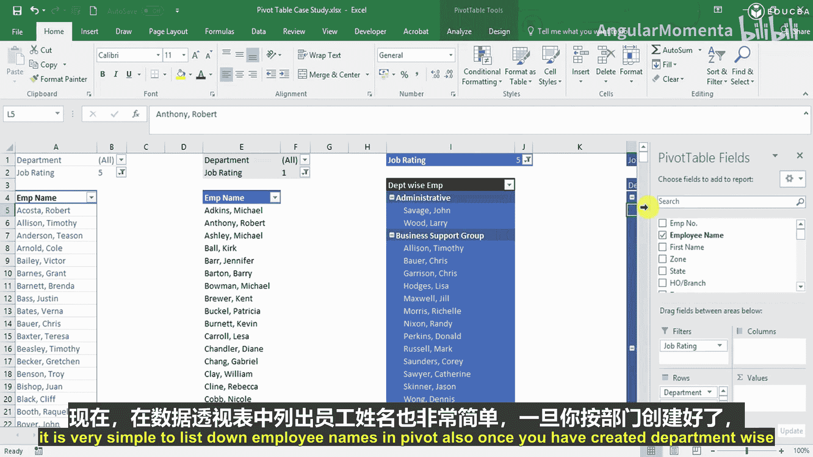
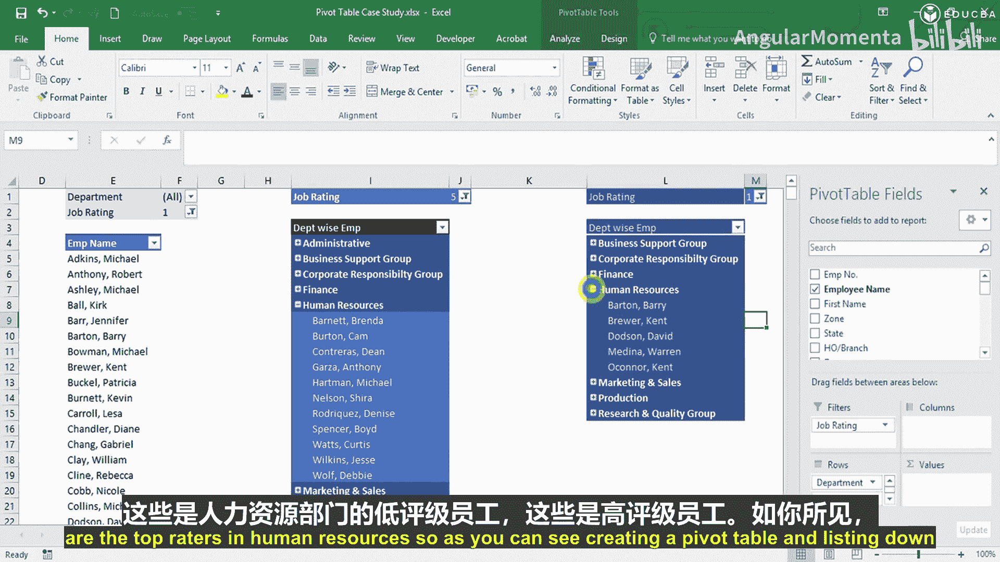
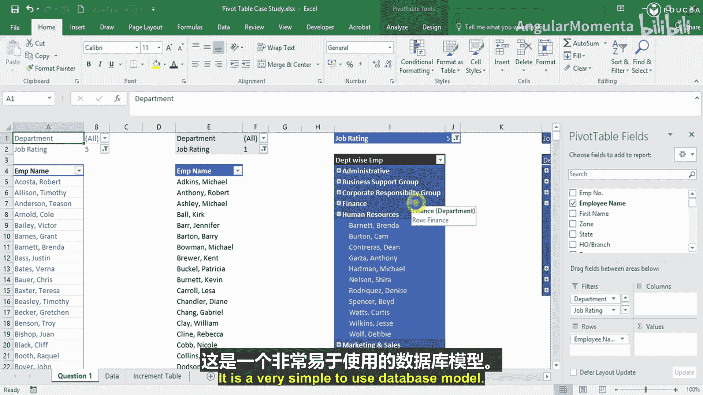

# 【EDUCBA】使用Excel数据透视表分析员工绩效-｜-Analyze-Employee-Performance-Using-Excel-Pivot-Tabl-p05-02_01_01_利用计算增强数据透视表--BV14EcTz7EM4_p5-

As you can see， we have listed all the employees here through the pivot table。

 so this is the entire employee list。So this is alphabetical vice so as you can see the entire employer is 745 and in the data also you can see it's 741。

The total count is at 741， right。So this is basically the employee name。So as per our first question。

 we have to find out who are the top operators and the bottom rate department wise， so we have two。

 three ways to do it so we will use the first way so here I basically put department a job rating as filter。

Then I basically list on the employee name after that I select the job rating。

 so I select the highest job rating that is5 and do enter。

So these are the employees who have been rated 5， so it's approximately 182 employees。

 so 182 employees in total have been rated as 5 now similarly if I want to do for the lower rating。

 you do not need to create the entire pivot table again。

 you can simply just copy this pivot table and paste it besides this。And change the job rating too。1。

Now， these are the bottom raters which is approximately 74 employees。Now， as you can see。

 we have listed down the top。And the bottom raters。

 Now what we want to do is you want to show this department noise。 you can either add a filter。

 say I want to see admin， who is the highest rater at administrative Department which is to employees John Savage and Larry Wood。

 or if you want to see who is the highest rated in human resources， Its there are 11 employees。

 So similarly， you can。Do any filter for any department you need。For lower rating again， finance。

 there is around 15 employees。In marketing and sales。There are seven employees。

 so as you can see I am using the filters and depicting who is the highest and lowest rater in each department Now what if I want to compare one another。

 one department to another department， what I'll do is you can basically now create one more pivot table。

Right to the bottom。Insert。Pvot table。Existing works Streetet question1。

Place your tableier and press enter。 Now you want to see department wise。

 What I'll do is at employee wise department first。Here you can see theEmploy Vi department list。Now。

 if you want to see who is the highest and lowest rater。

 I'll put the rating in the filter column now。Job rating。And I'll select。Fhi， as you can see。

 I have a list of all fires in each department right from amin。Business support group。Finance， et。

 etc cetera， etc cetera。 What you can also see here is addamin total。

 So we don't require any total field over year because there is no numerical field value here。

 So what Ill do is I'll right click on the pivot table。I'll say remove。

 so it's ticked as sub total employee name， remove it。

Now the total has gone What if you also want to remove the grand total， you can simply go to setting。

Your right leg setting。To table options， total and filters。

 I don't want total for row either rows or columns and O。Now， as you can see。

 I have job rating5 and I have department department voice employee。Now。

 what if I were to see lower ratingating， I simply copy this pivot again over。Select。One。

 and you have a list of all one0 employees。As you can see。

 the first part of creating a pivot table and listing down names department noise is very simple；

 you don't require any mathematical knowledge over。

 this is simply a list that you are deriving using the job rating。So this is quite clear。

So as you can see we have created the structure now what if you want to give it some look and feel first going into view remove grid lines。

 I' make the entire sheet blank。Then what I'll do is I'll go into design and select a very nice design for this pivot table。

 It is the designs are divided into three parts， which is light。Medium and dark。

 it's up to your personal choice。 You can select anyone will select each one。

So first I'll select say a very light tone。So this is the existing tones that there that's there。

 I'll select a very light tone for this then followed by I'll select something a little darker in blue itself。

So this stone， then I'll select something much more darker， which looks good。

So this is much more darker and we can also use one more darker shade over here， which is this。

能。As you can see。

This is the light shade of。A pivot table。 This is a medium shade of pivot table。 This is dark。

 and this is the darkest shade of the pivot table。Now it is very simple to list down employments in pivot。

Also， once you have created department twice， there is a small button over。

 a minus button which you can see， which you can basically reduce the entire le to。

The department so。Expand and collapse as you can see once you do a right click also there's one option。

 expand and collapse， collapse entire field， everything has collapsed here also right click。Collapse。

 entire field。Now， from here， you can see there is no lo returnator in admin。

There are no there is okay， all other department have lower rateators。

 but admin has no lower rateator。If I want to receive human resource side to side。

 I can list it down these are the bottom Ras and these are the top operators in human resources。

So， as you can see。Creating a pivot table and listing down the needs is very， very simple。

 The usage is also very simple。 This can be used for multiple persons where purposes be it be it finance。

 HR marketing and finance， you can list down the companies from which we are peers were raised or any other loan companies。

 etc cetera， for marketing， you can list down your client marketing and sales you can list down your clients。

 top clients， bottom clients， clients you need to achieve。 So a list is very important。

Pivvot is very useful to create a list as per your need， as you can see。

 you cannot create a huge list from this database。 You cannot copy the entire list。

 You want to cut this list。 so that Pi is very， very important。

 It basically helps you create your entire database in according to your view and nothing much more than that。

 It is a very simple to use database model。

