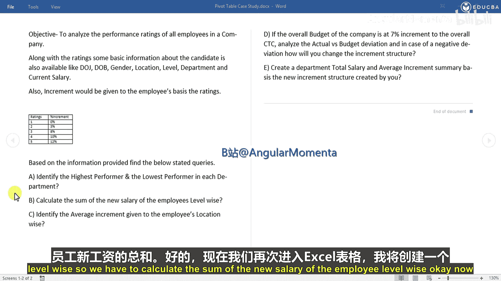
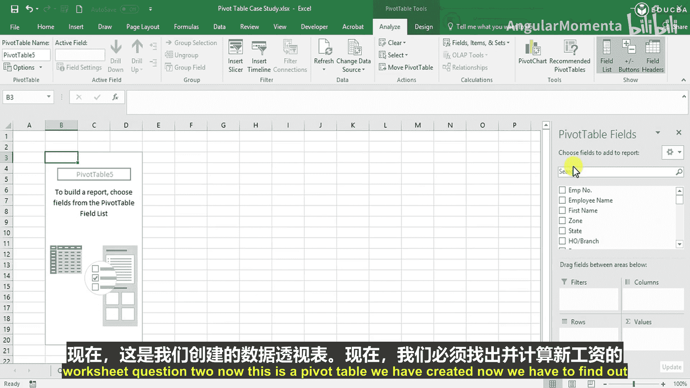
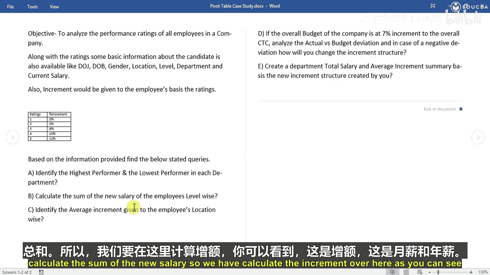
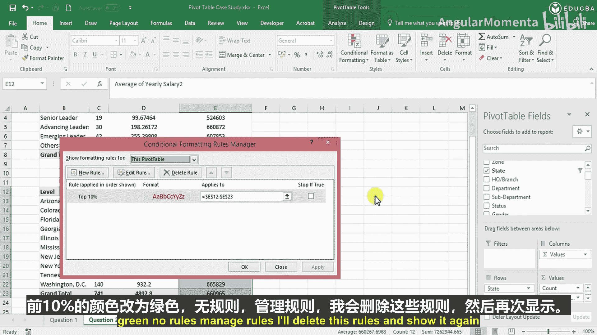

# 【EDUCBA】使用Excel数据透视表分析员工绩效-｜-Analyze-Employee-Performance-Using-Excel-Pivot-Tabl-p06-02_01_02_按部门划分绩效总结--BV14EcTz7EM4_p6-

Now moving to the next question so we have completed the first question。

 identify the highest and the lowest performer in each department list wise so we we have used the list method for that now moving on to the second question which is calculate the sum of the new salary of the employees level wise so we have to calculate the sum of the new salary of the employee level wise okay now we'll move to the Excel sheet again I'll create a new sheet and well name it question2 okay we'll come back to the data again create a simple pivot table so insert pivot table existing worksheet question2。

。Now， this is a pivot table we have created。 now we have to find out。

Calculate sum of the new salary。 So we have。

Calculate the increment over year， as you can see， this is the increment。

 this is the monthly and the early salary。So in a simple way， we have to calculate。

Monthly salary level wise is so level we have leadership group over year。Okay。

 so through this leadership group we will calculate the sum of salary。

Okay now what I'll do is first list the leadership group in rows。

 so this is the first thing we have to do， we will keep senior leaders above followed by advancing emerging and the last is others willll remove blanks from here。

 always remove blanks we name this as level。Now we have to find the new salary， some of new salary。

 So what I'll do is。I will add the。Ely salary2， which is the new salary over year。

 this is the count okay we can also use the count first yeah。

 so this is the count of how many employees are there， so 19 employees are then advancing。

 30 in advancing， 19 in senior， 42 in emerging 566，15 others。I'll again pitched down below oh。

 this would be the sum。Okay， and now right click。Summarize value by sum okay。

Some of your lease salary。 So this is the new salary。No， this is the sum。Which is that。

 as you can see。So this is at around 9 la 9099 la 610，0464， so this basically will tell you。

What is the value of the sum of the salary if you want to see this in Act las。

 you can always use a new function， which is there an analyze fee items calculated field Now what I want is I want new salary。

New salary lax， okay。No。Ely salary you2。Divide by one lack。1 leg。Add now， okay。

Now let's see the new salary。In las， so this is basically 99。67 las。

 as you can see I've put this in las gives you a much better angle。 if you want this in corros。

 that is also possible。 So the total in lags is 4897 las you can reduce the points from your。

So this is basically the decimal points。 you can keep it at one。

 So this is basically the total salary。 Now you can remove the total salary if you don't need。

So very clear， senior leaders， 19 employees having 99。7 la salary， some advancing leaders。

 30 employees having 198。3 lacks a salary。Emerging leaders as 42 employees having 255。3 like salary。

Others at 650 employees at 4344。5 lack salary Now if you want to put an average salary。

 so paste the salary below， I'll do a right click summarize by average。

 so this is basically what you can do is you can use the la here as well。Okay。New salary lacks。Okay。

 I think I have removed the other part。 okay， I'll remove the average salary from here and put new salary again。

And do N。Yeah。Okay， so it's not letting me do an average for this。 No problem。 We can。Use。

The year salary tap for average， as well。So rightly。

 summarize value by average calc fields sometimes have some limitations。

 pure fields have no limitations at all。So this is the average salaries。

 The average salary for senior leaders is at 5ac 24603 Adv leaders at6 like 60072 Em leaders at 6 like 78。

5，3 and others at 6，683，87。 This is not the standard level like mid senior junior。

 This is the concept is slightly different over。 thats so I can see the salary band average not going as per the logic of senior mid and junior。

 So this is basically leadership rules that you have divided into and average salary for that leadership group。

T as you can see。Very clearly stating， count some of salary。

 average salary below you will have count some of the new salary average of your salary。

So the total amount that company is to give yearly it is four4897 las which roughly amounts to as you can see 48 corros 97 las so use amount that the company has to pay for the new employee so as you can see this is the framework which we are going to use for in this special case you can just copy this and paste it down and change the raw fields according to your wish if I don't want leadership group you can simply add。

Your state， so this is your state and state by Sc。Remove the blanks。

 So this is the statewide Council。As you can see， this is the state I which is purely stating。

The sum of salary， okay。So the highest amount of salary goes to Washington DC。

 that is because it is the head office， the average highest salary is in New Jersey。

 which is around7 like 8000 and the lowest salary is at around。New York 62860。

 so one more way to basically state how which is the lowest and the highest salary is doing the conditional formatting。

 which basically I writes。Top 10%。Okay， sorry so well change the colors to top 10% to green。No rules。

Mage rules， help delete these rules and show it again。

Great。