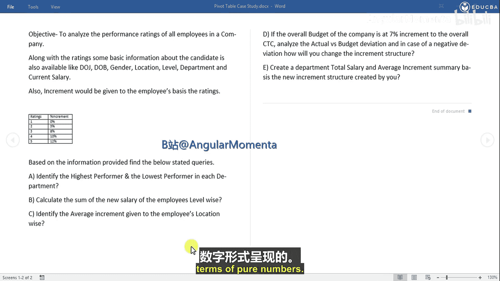
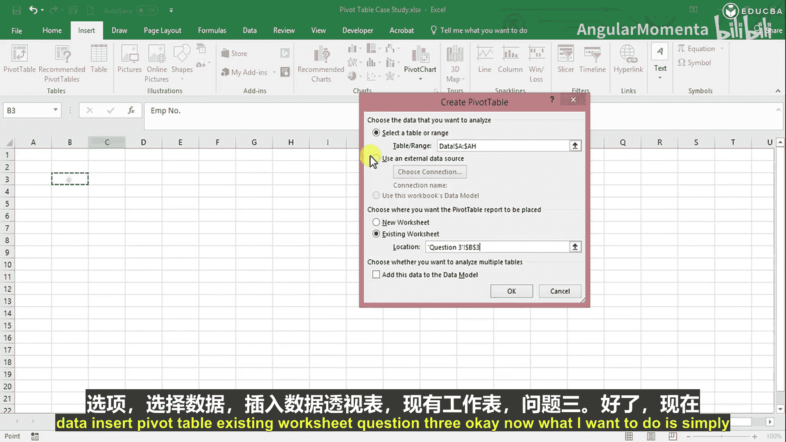
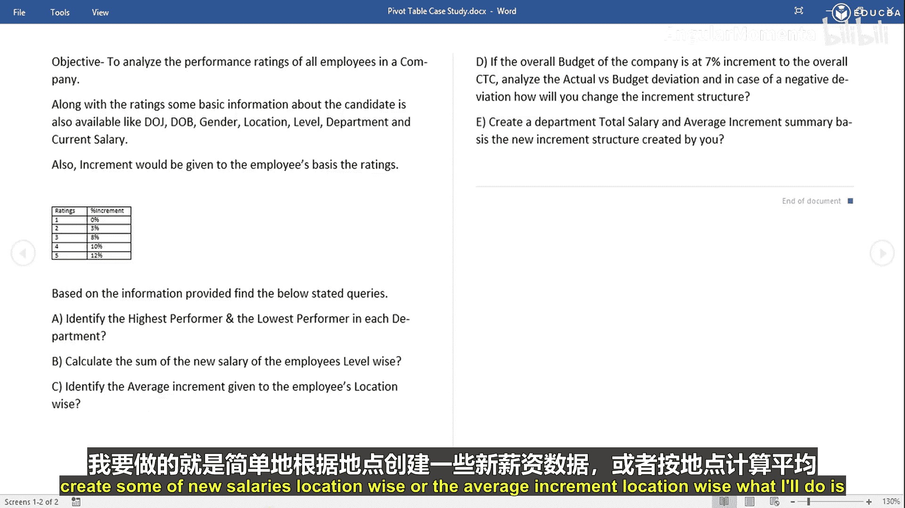
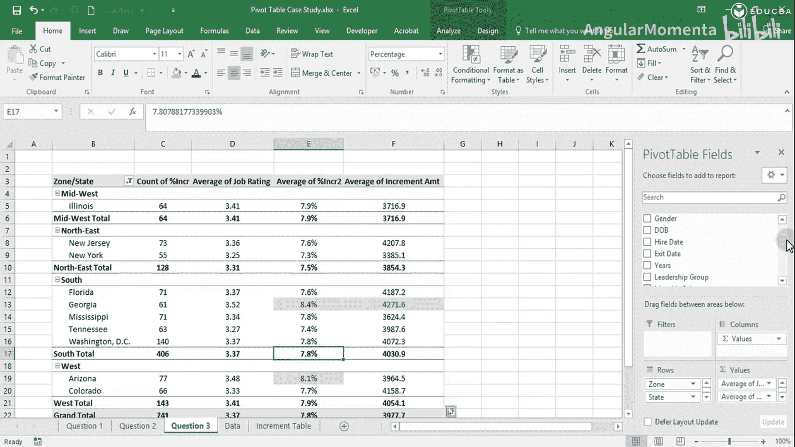
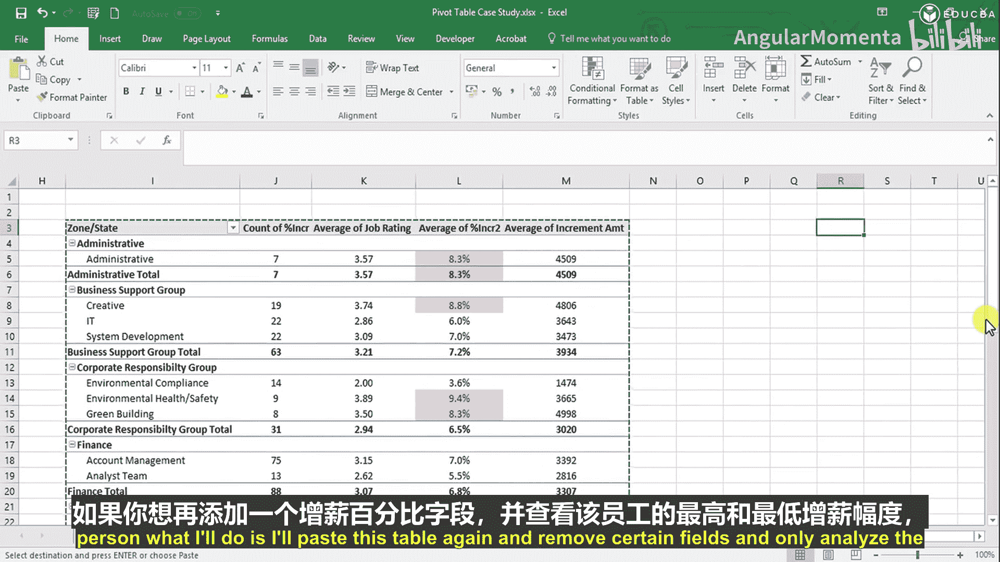
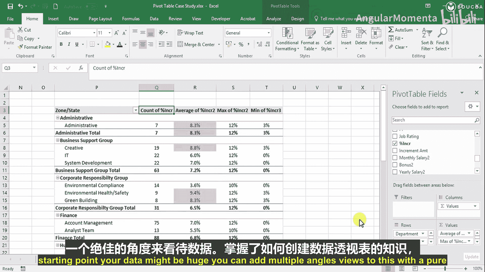
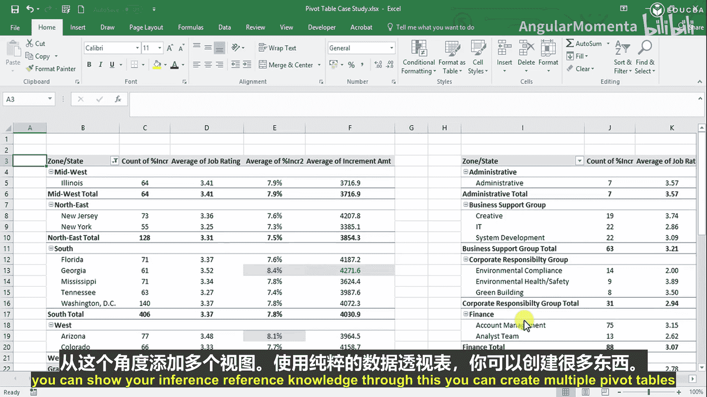
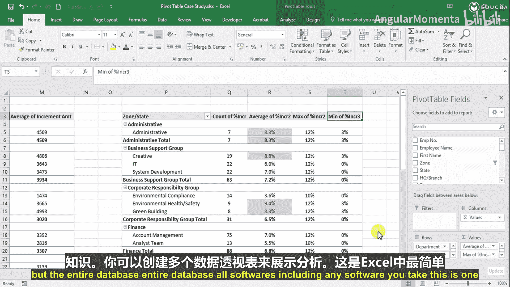
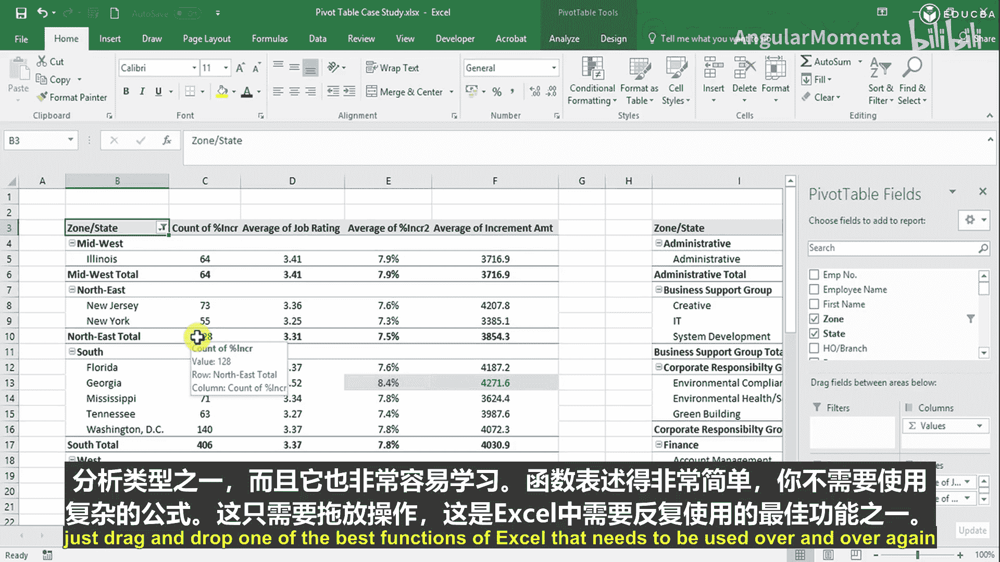

# 【EDUCBA】使用Excel数据透视表分析员工绩效-｜-Analyze-Employee-Performance-Using-Excel-Pivot-Tabl-p07-02_02_01_地理位置性能对比--BV14EcTz7EM4_p7-

Now moving to the next question which is the third question。

 identify the average increment given to the employee's location wise。

 so we have now calculated the sum of new salary now we are going to check the average increment given to the employee's location wise so you might have a fair idea on how to do this question because a similar type of solution we had done on the earlier question as well。

 but I'll show you to the entire process because this is in terms of percentage and that was in terms of pure numbers。

Let's go to the database。Create a new sheet。Question3， okay， now go to the data， select the data。

Insert。Pt table。Existing worksheet， question 3。

Okay， now what I want to do is simply。Create some of new salaries， location wisey average increment。

 location wise。

Tot I do is select。The state and the zone as well， okay。

After which I will basically add the increment percentage that you have calculated according to the increment table now increment percentage values this as you can see is convey count。

 let the count be count is always useful， put the increment picture again。

Now right click on the second line item and do a average now this as you can see will always come in pure numbers。

 you want to convert this into percentage there are two ways select the entire row。

As you can see there' is a percentage tile oy， click on that or you can do a dropdown and do a percentage from here as well。

 or else if you want to use the shortcut you can simply select the column do control shift and5 and now one decimal point so as you can see the entire picture is painted oy year。

In Midwesh， there is one state having 64 employees with an average increment of 7。9%。Yeah。

In northeast， there are two states， New Jersey，73 employ 7。6% increment。New York，55 employees， 7。

3% increment。South has five states， Florida 717。6%。Average increment， Georgia 61，8。

4% average increment， Mississippi 71，7。8%。Tennessee 63，7。4%， Washington， D C at 7。8%。

 Arizona at 77 employees 8。1% with a total of West at 143 employees 7。

9 percentage remove the blanks from the table。Just to deselect this。Grand total is also there。

 now you can change this to zone slash date。Very simple bifurcation zone s8。Okay。

 gives you a very clean picture。Now here you can use the conditional formatting as well。

 go to conditional formatting， highlightlight cell rules。

 so I'll use a different cell rule now highlight cell rules， which has increment greater than 8%。

Greater than 8%。 let's see， greater than 8%。Greater than。8%。

 only two states have greater than 8% increment。Now， as you can see。

 this increment is basis the rating。 Now， let's analyze the data a bit more。

 Let's go beyond the question， like in your organization or in your college。

 you have to always go beyond the question and give something new to the company。

 Then you have a better chance of getting selected or getting better performance ratings。

 So I'll now add job rating to this。In between o year and to a average rating。So。

 this is the average rating for the。Btch of people。 Now， let's see。 what is。

 I'll keep it at a do two decimal。嗯。Okay， as you can see the highest increment states are also getting ratings as higher。

 so Georgiaia having 8。54% increment is directly proportion to the rating they are getting which is 3。

52 okay again 3。48 and 8。1 so these are the two highest rater having rating increments now again but the rating may not be in accordance to the average increment that you are getting so the increment as a sum of salary may differ now lets as add the increment amount as well。

Okay， in count of now we will do a average of increment amount because increment is dependent on your previous salary if your previous salary is higher and your rating is lower。

 you may get the increment amount as higher than a person having lower salary and greater increment amount now。

 as you can see。This is the increment amount。 Now， let's put a conditional formatting here as well before the。

Highest bottom， top 10%。With Greenfield。Now， as you can see。Highest is Georgia。 Okay。

 Now the second highest as you can see is not Arizona。 it is。New Jersey at 4 to0，7。

 those increment percentage less， but the average salary is greater。 That's why the correlation。

 So average increment amount always depends on your previous salary。

 but your increment percentage will always depend on your job rating。

 so that is the logic that you need to follow always。 So it the directly proportional thing。

 The regression line is positive in this cases。Now， as you can see。The average we have put count。

 we have put job rating average， we have put average increment。

 now we put average increment amount as well。Now， these are all linked。😡。

Aspect that you have to analyze。Now， as you can see。

Average increment for the whole company is at 3。8%。

 and average increment amount is at approximately 4000。 So this gives you a very， very clear picture。

 Lo and state wise。 What is the current scenario。 Now。

 what if you want to replicate this entirely and should department wise。 Very simple。

 Don't need to create the entire pivot table again。 Just paste it over your。

Remove the zone and state and use department and sub departmentpartment very simple。

 as you can see Now， the entire scenario has changed again。Keeping it at a two point。

Average increment again。Keeping it at one point， now， as you can see。

Highest increment is for environment， health and safety， and 9。4%。No， the greatest is marketing and。

Research center has got an 11。2% increment， with a very greater。Increment amount as well。

Now what if you want to add one more field of increment per is then check which is the highest and the lowest increment getting for that person。

 what I'll do is I'll paste the table again and remove certain fields and only analyze the fields that we want。

Okay， now let's remove the average increment。mount average increment per let move operating。

 Let's keep average increment will again put average increment now below。Okay， again。

 put average increment below。Now， do a summarize value as max。Summarize value by min。

 so as you can see， the max and the min is quite constant as expected。

No one in creative has got one rating。And the lowest increment 1 research center。

 the everyone has got4 and 5 rating。 so that that is the angle that you can see， as you can see。

 five employees having four and5 rating highest and lowest。

Gives you one more great angle to look the data at with a beautiful know how of how to create the pivot table you can do many analysis。

 We are just a starting point， your data might be used。 you can add multiple angles。

 views to this with a pure pivot table， you can create lot of things。 not only this。

 you can crack interviews also with this， you can show your inference reference knowledge to this you can create multiple pivot tables show the analysis。

 This is one of the most。

Sst and the most useful。Aspect of X not only Excel， but the entire database， entire database。

 all softwares， including any software you， this is one of the most simplest type of analysis that you can do。

 and it is also very easy to learn the functions are very simply stated you don't have complicated formulas to use in this is it just drag and drop。

 One of the best functions of Excel that needs to be used over and over again。

