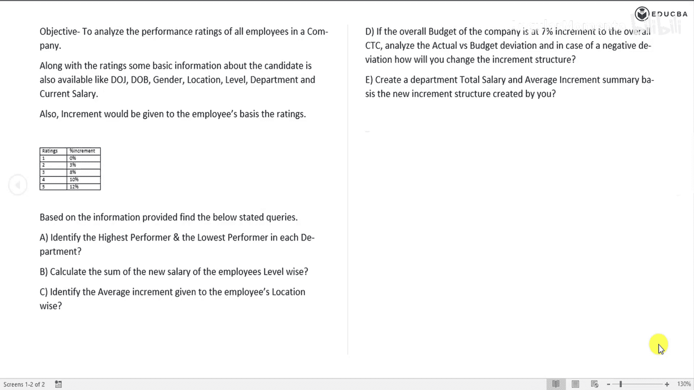
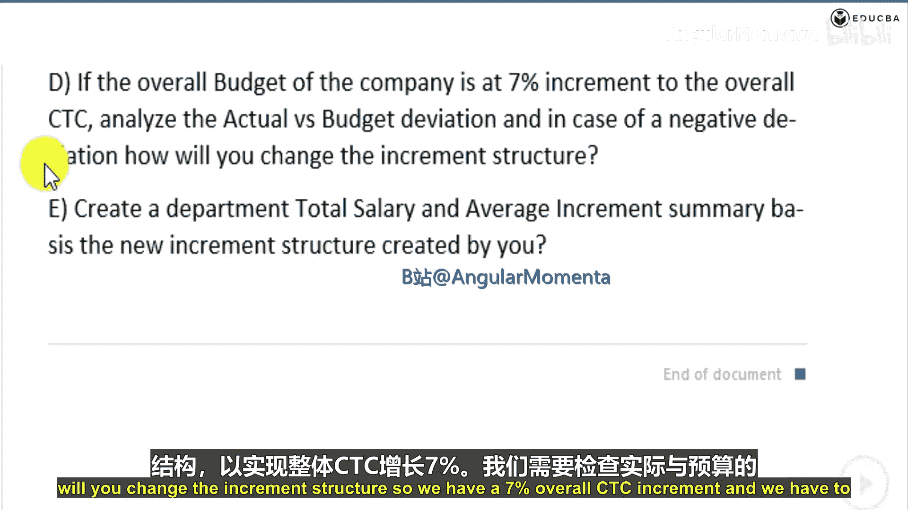
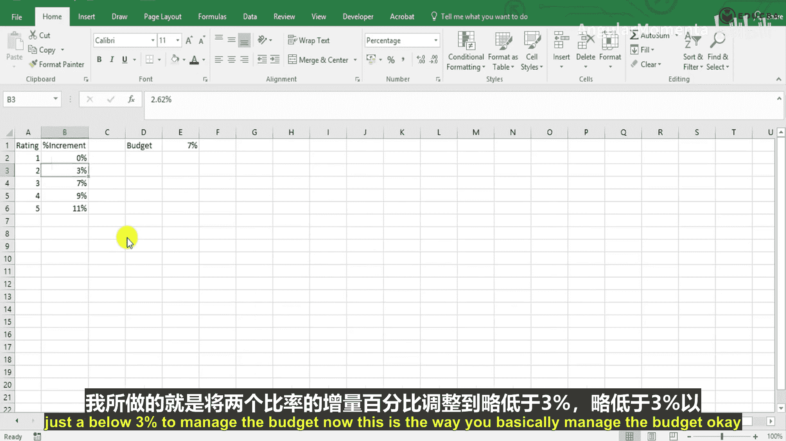
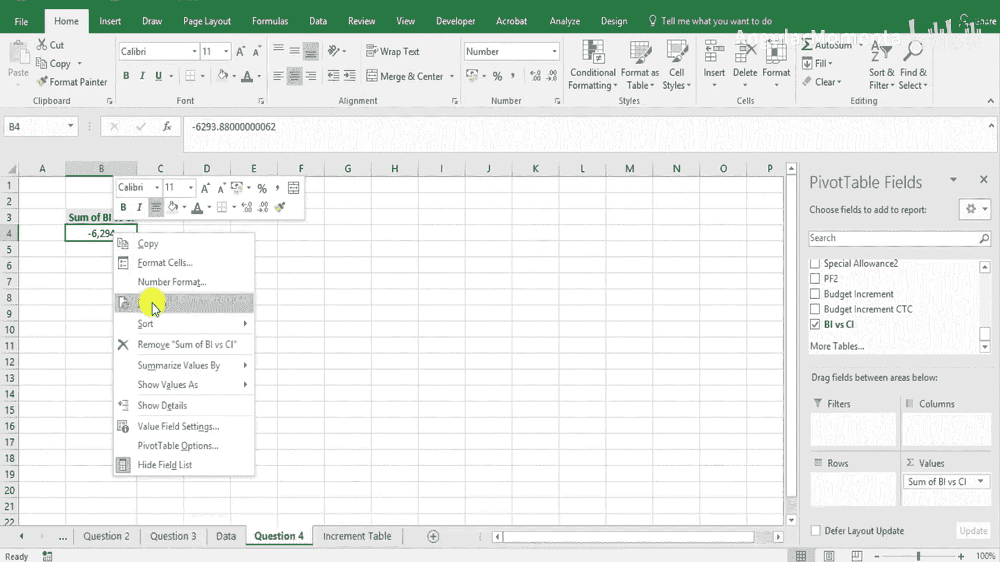
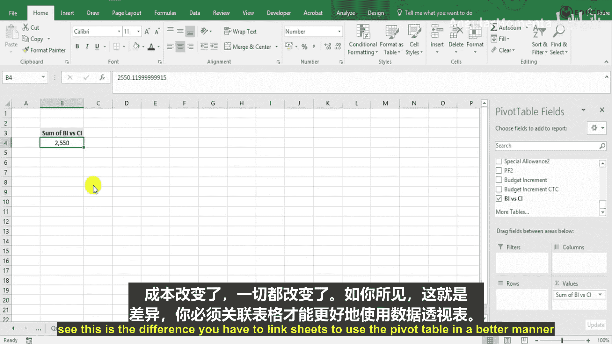

# 【EDUCBA】使用Excel数据透视表分析员工绩效-｜-Analyze-Employee-Performance-Using-Excel-Pivot-Tabl-p08-02_02_02_预算与实际绩效分析对比--BV14EcTz7EM4_p8-

Now， moving to the fourth question， which is if the oral budget of the company is at 7% to the oral CC。

Analyze the actual versus budget deviation。 and in case of a negative deviation。

 how will you change the increment structure， So we have a 7% oral cities increment。

 and we have to check the actual and the budget deviation。 Now we move on to the。

Database where we would put the budget increment okay， which is at 7%。So。

This into your salary into 7%。Okay， 7% it is now pasted below。

 then budget increment CTC that would be budget increment plus the early CTC。

So this is budget increment CTC will color it a bit different。Be a red color now pasted below。

Now this is the budget CTC。 Now let's check the deviations of BI versus。Current increment。 Okay。

 let let's check the cC difference。If everyone had the budgeted CTC。Okay， as you can see。

 there is a total difference of。35 like 61，000 versus the CTC。Okay。

 the total difference is at minus 35 x now which says that our CTC is the budget CTC is greater。

 okay。Did this。Or led to a reverse minus this， basically he has lesser salary than the budget。

 minus45，000 salary。Then the budget， a person who has got more than the budget is this she's got 3，5。

6 to8 more。 So now the oral CTC is going 35 a 610618 greater。

 So the total amount greater is 35 like 618。 Now we have to tally that figure。

 Now I'll put a new sheet。Question。Question 4。Okay， now what I'll do is I'll take a pivot again。

 insert。Pvot table。Question4， sorry。😔，Insert pivottable， existing worksheet。Question4。Okay。Now。

 I'll put this oer the count。Actually， need the sum。

Wwhich is 35 las is the difference so what I have to do is I will somehow have have to reduce the increment because it is going over and above it's actually at 35 las 16000 greater。

 so the total cC is at around。For the company is at around 48。Crodes 97 las。 Okay。

 it's going above 35 las。 Now we have to manage that thing。

So this is our increment table oyer rating12 34， we will try and reduce this o year and lets see the after effects okay so what if I reduce the rating2 to 3% to this to say 7% this to 9% this to 11% everything by 11% now lets see what the difference is okay now the difference that could Ill just refresh this sheet。

See as you can see it's at minus now so it's very simple I have linked everything。

 I am just changing the table o year and automatically this has become different Now you can see I've just change the percentage and once I refresh the pivot everything is back to the refreshing part after just change the increment table percentage Now what if I put so as you can see this is at minus5 likes now what if I put 3% o keep the two rate at 3 percentage only now it set positive3 la for1000 and what if I reduce this to 10% now let's see the difference there might be a use difference so let's say again go to minus so I'll try and adjust the two rate to 2。

5 now it's again at minus so use difference we have to keep on working This is like this 11%。

This is actually like a goal seek thing where you do log in to 2。

5% over and let's check now there minus1 lag I can give a bit more to the2 rate say 2。6 percentage。

Now minus-15，000 orified give。We can keep a barrier where we can just check and see how much closer we can get and then overall do the difference a bit more is okay rather than bit less32。

64 is going too much about 2。64 let's check。Is that 2002。63 is at。Lets shake off 112。62。Is at。20550。

 I think so this is the closest we can get。You can't actually get closer than this now。6。

1 can't get closer than this very， very close。 I'll keep it at 2。62。 Okay，61。

 I think so we'll go negative。Yes， its a negative， I'll keep a 2。62。

 so what I've done is I've changed the increment percentage of2 return2 below 3% just below 3% to manage the budget。

Now this is the way you basically manage the budget okay I'll just refresh this so there is a difference of say 20515 now now this is the way you manage the budget increment what you do is basically you link every sheet together so as you can see my existing CTC produce my rating produces an increment through which my new CTC comes by the count of existing CTC。

Now I put a budget increment and a column of deviation which basically is everything a link to everything Now if I just change the reading entire row changes。

 if you see I've just put five this changes the budget increment is CTC changes everything changes as you can see this is the difference you have to link sheets to use the pivot table in a better manner。

