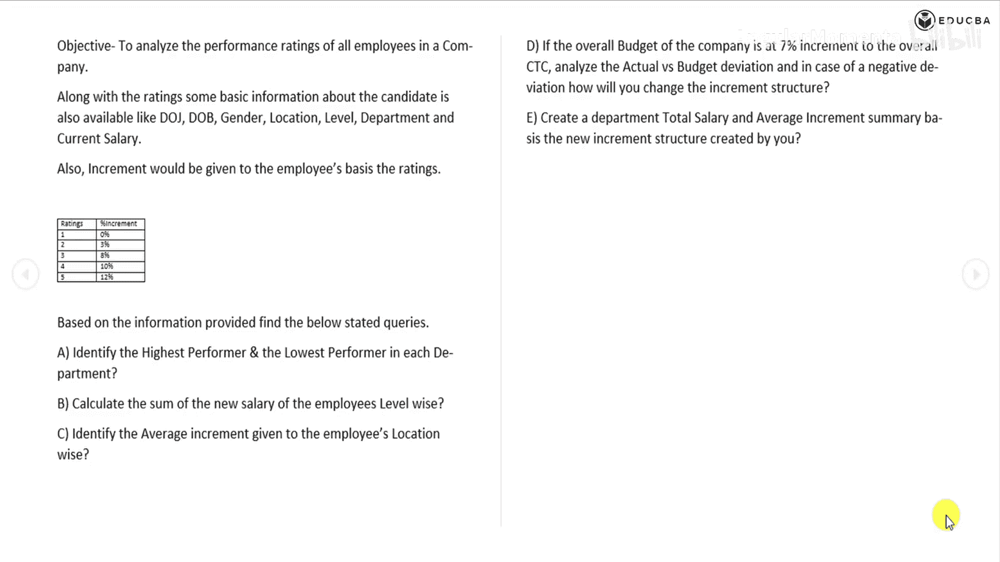
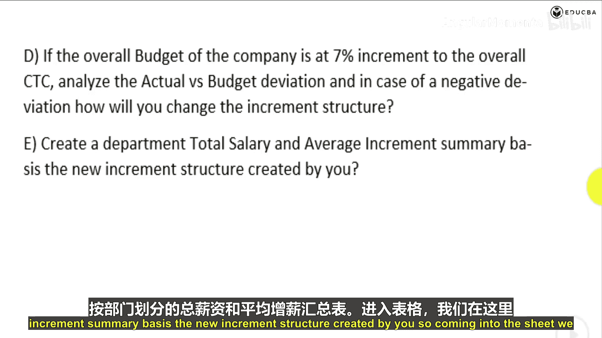
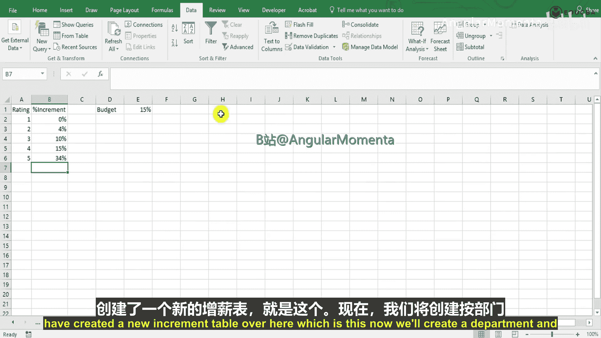
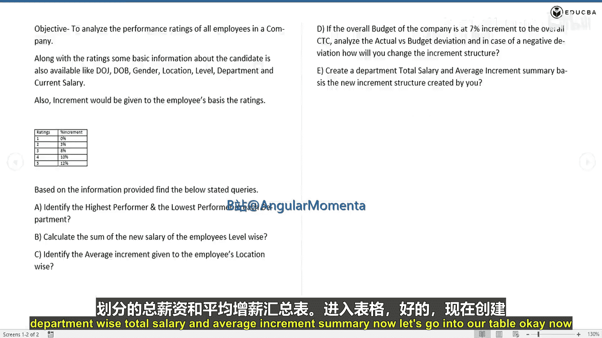
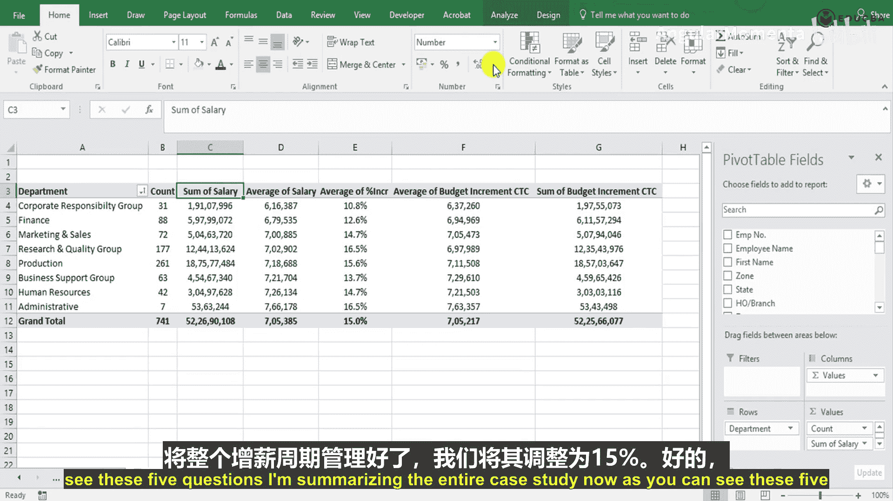
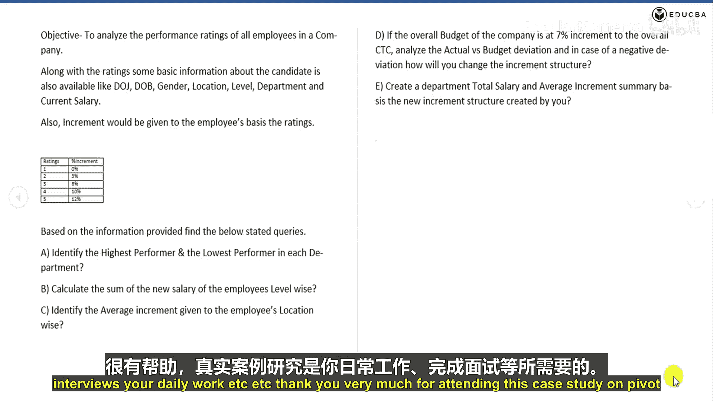

# 【EDUCBA】使用Excel数据透视表分析员工绩效-｜-Analyze-Employee-Performance-Using-Excel-Pivot-Tabl-p10-02_03_02_最终表现洞见：数据透视表应用--BV14EcTz7EM4_p10-

Now moving to the last question which is create a departmentized total salary and average increment summary this is the new increment structure created by you So coming into the sheet we have created a new increment table layer。

 which is this now we will create a department。

And department wise total salary and average increment summary and now lets go into our table okay。

Now， we'll create a new。C Dc， okay。So according to this， this is our。New budget now， new CDC。

Insert pivotver table。You can do a new worksheet， Okay， which is basically。Question。Fe。

Now we will put a department filter。Now， followed by。😔，Your lease salary， Okay。

 this is the sum of salary。 We Ill also put a count to give a better understanding sum count。

7 people this much as the salary。Now， this is count。 This is。Total salary or sum of salary。

Some of salary， okay。So we've got this department wise。Now we'll do a average， also here。

Just basically。Average or salary。Average。Salary。Okay， there's some an average of salary。So。

If you want to sort it， say。Your average salary wise， so the lowest average salary is at6 las。Okay。

6 legs。61000 for corporate responsibility group for finance at6 like 79 highest is for admin at 7 like 66000 after the increment。

 okay and。HR is somewhere at second at 7 like 26000。

 Now we will also add increment average of increment here as well。So this is sum we put a average。

Now this is the average increment for each company。

 so though corporate responsibility group has a higher average increment at 16。

5 percentage which is highest better than every other department but its salary is still low because the base of the salary was low because the base of their salary previous year salary is low that's why their increment value is also lower so the average salary is also lower lowest desire at corporate responsibility group at 10。

8 percentage。So as you can see， now everything is linked to everything over we have added count some of salary average and average increment。

 if you want to give another angle you can also add the budget increment CTC gives you one more angle。

Right， I'll put a average of your this also here。So average of budget increment was 6，37，6。

16 given 6，94，6，7，9 given 7，0，5，7， like given 6，97，7，0，2 given 7 like 11 is 7，18 given7，29。

 so your it lesser amount is given7，21，726，763，766。

 Now as you can see all angles are covered your we have given you count of employees sum of salary average of salary average of increment and average of budgeted increment。

 So as you can see， everything is between everything， the average is also not much different。

 you can also add。 one more。Some here， if you want to add the sum， so。Painter， okay。Yeah。

Adding the sum of salary as well， the budgeted was 52 kros and we have achieved our entire cycle Act 52 like c26。

 a mere difference of1 like， which is not much given the percentage if you want to see the percentage of difference C G12 divide by C12 minus1 which is。

Very low at 0。02 like 0。02 is very low。 very low deviation， not greater than 1% also，0 per 1% also。

 So we have managed an entire increment cycle in accordance to the。

The picture we have given the budgeted increment that we have been given。

 we had changed it of 15% Okay you can so I have shown you how to manage the entire pivot table So this act as you can see these five questions I am summarizing the entire case study now as you can see these five questions or a pure example of real life case study where you will get a data set you have to use。

Your Excel skills to basically complete the data set。

And through which you will also analyze your data set through the pivot table。Alread。

Classic example and a classic case study which will be useful for you going forward。

This is a real life scenario that we have showcased and a similar database will also be provided to you while in your work or in your interview and thank you very much for attending this case study I hope this is very useful for you and as you can see there are many more courses in our website which will be useful for you and a real life example studies are things that you require for your daily work and to complete your interviews your daily work etc etc Thank you very much for attending this case study on pivot tables。

