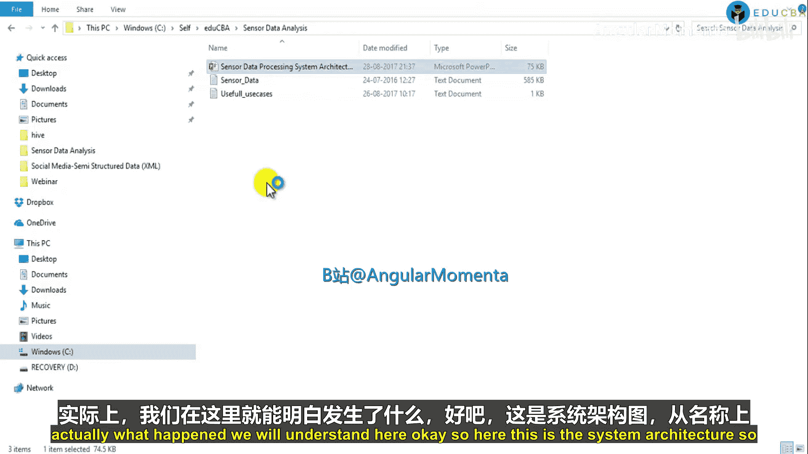
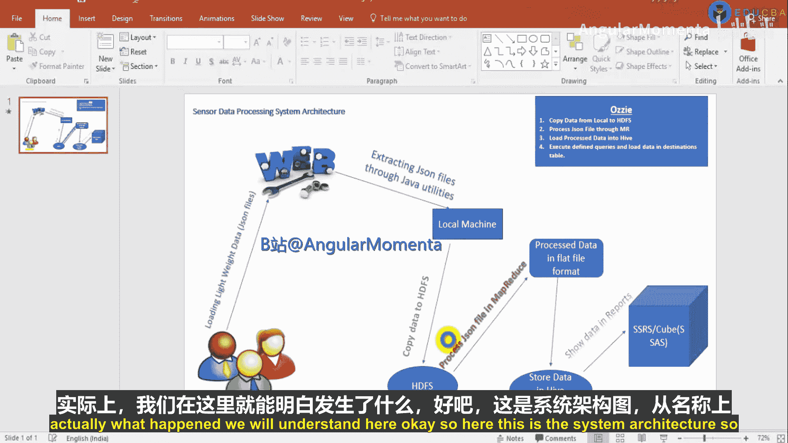
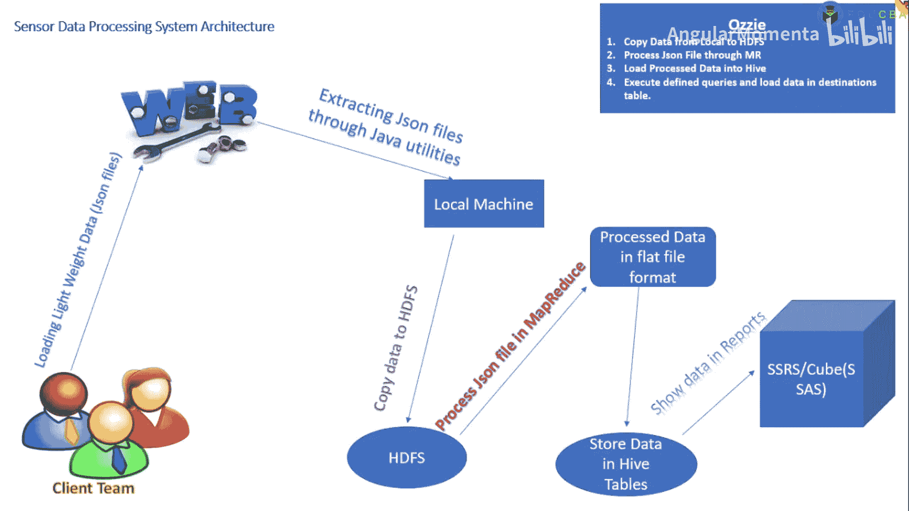
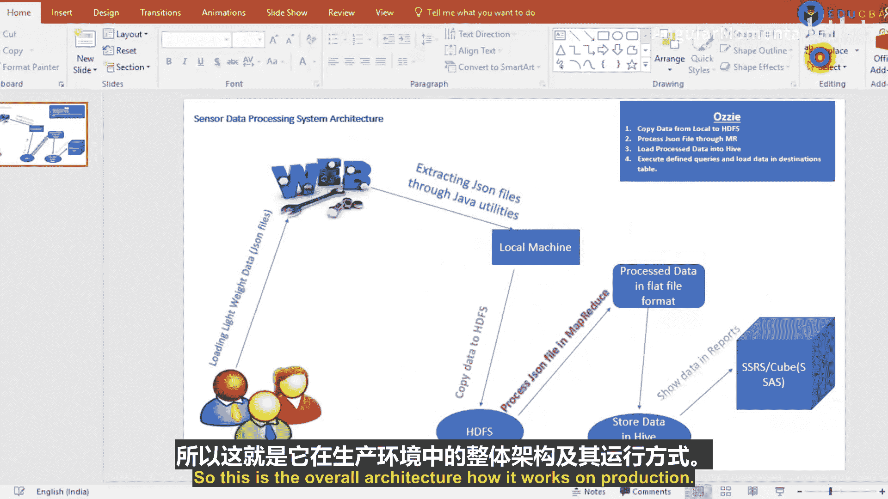
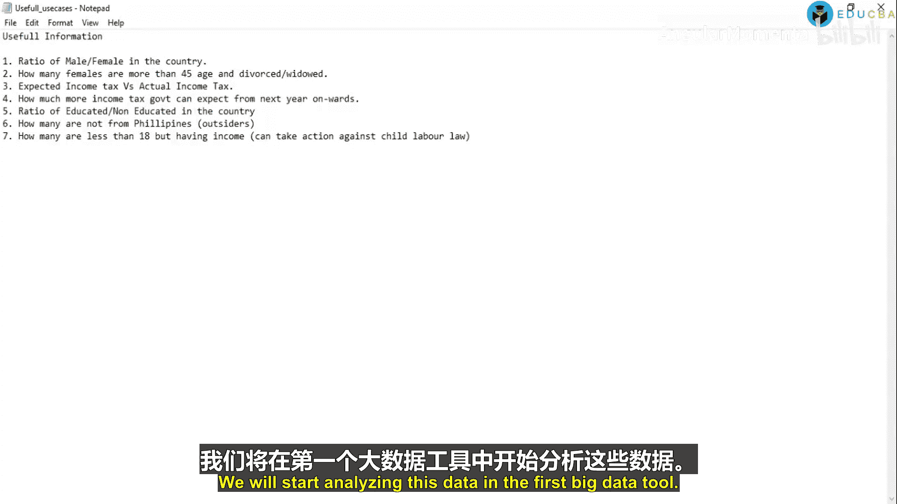

# 【EDUCBA】使用Hadoop处理大数据：应用MapReduce、Pig和Hive-｜-Big-Data-with-Hadoop：-Apply-MapRedu-p01-01_01_01_传感器数据分析导论--BV1KrFozQEPf_p1-

We are going to work on a new project that is called sensor data analysis。So， basically。

We will analyze this sensor data。Aban of the country， called Philippines。So， here。你嗰。Actually。

 in this project。We will just get the input file from the customer。

 and then we need to generate the meaningful information for the particular country。

AndInform should be meaningful by which they can take some strategic decision。

In order to country growth， in order to country development。So in this project。Actually。

 this is one of my live project on which currently I am working on。😊。

So just I took the small part of the huge project， which is a very huge project and we are analyzing that data bus for this。

Demo and for this videos and for this assignment， I just took this small part so we will have a basic idea how Hadoop is you know。

 playing a role。In data analytics and data science， so here the input file will be in JS format。

So I believe that you move most of。You guys are aware about different format。

It's a very light format which is very popular in the market nowadays。

And client clients are preferring to have a data in this format。

Because it' is easy to transport from one one location to another location through the network and its a very lightweight。

Inta format it。So here if we open the input file， so we will have input file like this。这是要律边来。

The eight go long。Education column。Meal statuss。That part of。Candidate or the。

Person of country is married or not。嗯。Whatever it is， it's without the divorce。Okay。

 what is the gender of that guy， iss a female or male。What the text filing is status。

He or she is filing tax or not filing tax for the income。Ps。ok。A country of birth。

 So in which country they belongs to citizenship and。我。Big vote。So how many week they work。So。These7。

8 columns。We will analyze， and all。This data is in J format。 So basically what upon。Alan。

Tam you know， go door to door and they collect this information and they load this information on their web portal。

Solect me。Let us understand it by one P P Ive created for you guys。Certainly， what happened。

You will understand here。O。

So here this is the system architecture。So the name you can understand sensor data processing system architecture。

So我太 fun。We have one web portal。Fromwhere we load this data to our local machine。But how。

 So here this is a local machine。And we are interacting with this web portal。Okay。

 and extracting Jel files through some Java utilities。

So basically we have created a some Java utilitieslit。Okay。

 which interact with this web portal and store or what we can say download this file。

Do what local machine。So we are understanding the understanding the whole architecture。

 how it is working in mind。Exctual project。 Okay， but in this。Demo， I mean， part of this。

For this project， we will implement those， you know， scenarios in Merreduce big and high。

 But here I'm telling you the whole architecture how it's looking on production。

So we will have a local machine， so we are extracting those DS files through some Java utilities。

 okay， and we are storing。我路况不行。But how data is coming on this web portal， Who is loading。そう。

We have plan。 So those， these candidates are。The client team members。Who belongs to the Philippines。

 They basically belongs to Philippines content。 So here。

 because these retires belongs to Philippines。Okay， so they guys。

Go to door to door and collect collect those information or on the daily basis or weekly basis or monthly。

 So it depends on。They client how frequently they want to upload that Jason files。

Input files to their web portal。And our Java utilities continuously。Used to pink on the web portal。

So we have。Suppose。Pt is loading data on the daily basis so they can ask the utilities。

In technical term， what we can say， you can schedule。

That Java utilities to interact with the on with the portal once in a day。We can decide any time 6，7。

 okay， so。Number of files which clients had uploaded on their particular day。

 we will extract those file。是的。😊，Enjoy utilities。You can download those files into our local machine。

嗱。Once we have client data on the daily basis。What we are doing， So here。

Now we have written on our local machine and we need to analyze this data。So for that。

 we need to copy this data into our SGFs。So SDgfs is nothing but the Hadoop distributed file system。

 it's the unique box so we can say it should be a button work。

 it should be a cloud error or it should be our unique box there we have installed Hadoop so Hadoop means we have installed all the。

Relevant tool like reproduce produceuce big hive scoop， Asie flu。

 whatever is needed for that particular project。Okay， so。那。On a certain time。呃诶。

I told you the client is loading that file on a daily basis。

Like Java Java U utility downloading those file on the daily basis。And。😊，So in the same way。

 we will copies those file those files， whatever we have downloaded to our SDGFS for the processing。

So it' is not a manual process it is automated Ill tell you how we are doing it。

 So here I am assuming that we all have a basic idea what is S Gfs， what is big data。

 what is mapduce and what is all other tools。Of the data and why big guitar is more popular in the market。

So we don't have any basic idea so my next video Ill give you the basic idea about big data SgFs okay and map produceduce because first we will process the data mapduce so in this video we are just understanding how it works on production how it works in the actually so what is the system architecture so once we have loaded this data to SDGFs we need to process it。

So we will process those Jel file in Maroduce。So in my produceuce， I believe you have basic idea。

But we don't have so dont if we don't have so no worries。

 I'll give you brief about about it when we will start working on map， but for the information。

Let me tell you something in Maduce we have basically three classes， Maper， reducer and driver。

In me class， basically we read that input file land by line or it depends on our input format。

 what format we are using so here we are using J just nothing but a simple text format。

 so we will read the land by lines， we will use text input format。Okay， so where。

The key for that map class will be the part of set which will which will be in long longritable type and the value will be a whole line which will be in text。

Data format。 Okay， so we so as a next step。We will process those J file， which we are done。

For pay towards GFS from local machine on the daily basis。

You will process the J file in reproduceuce。So。And then we will have process data。

In the flat file format。So if we are using map only， so the output profile name will be。

Part hyphen M， hyphen， some unique Id。 And if you are reading if you are executing map， it both。Then。

output file name will be part iPhone R iPhone some in。Okay， so once we are done with the processing。

In mapreuce。We can store the data in hive。I here。Okay， but we can， we will analyze this。

 this data in。All the two like my produce pig help separately。But， but in actual production。

We are processing the file in mepeduce， and then we are storing the data in hive。

 So here instead of mepedduce， we can use big also。So Mepedduce and P both are same。

 but in Mepedduce we need to write a lines of code， maybe 10 a thousand or more than that。

 but but pig is a litful language so if。Our development team is not aware about any coding language like Java。

 Python or Scala， then we can ask them to process with this data and pick。

But here our team is the lever about Java language， so theyve implemented this thing in。

Mam produceuce。So once we processed it they mapuce。遇见个 b。

We are copying those procedure into hi table and then finally we are analyzing this data so analyzing means we are generating some meaningful information for that particular client。

Okay。And then。We are showinging the data。A meaningful data。你啲放冇。Sequence over reporting services or。

In form of cube， that is equalQl server。A services。

So if you don't have any basic idea about these two， let me review few。日报听。

Sequ of our reporting services is nothing but the。The voting layer of s over。Okay。

 so we should have1 is 12 equals。We when we install Vi studio， it comes。By default with this， okay。

And。😊，没跟。Show the process data， whatever data we are coveringing to our five table。

 you can show that data to our。In our reports so client client can rely through their data on daily basis monthly weekly。

So on the it depends on their mood on their requirement， okay。Or they can look at the cube。 Okay。

 once we refresh the data， refreshments cube always refresh。 So here refreshments。

A new data got loaded into the queue。And on the basis of that， they can take some strategic decision。

For their country's development。哦，问对个。But how， how high is getting connected through。SS Iで SSS A。

If so。几钱。So so far in the market， I did not see。Any， I'm not sure。

A tool available Europe by which we can connect directly reporting services。To height over S D FS。

So what we are doing。They have downloaded。Highvol driver。 Okay。

 we have installed it and we have configured it through DNS。 that is domain name server。

And then we have created one link server。Link servers basically by which you can connect one database to。

Another database， even when they both are on the separate server。

So we have treated one link server in SQL server， which is getting connected to over a five server and we are querying in the SQL server。

 but basically through that through that link server link server， but basically what。

what happens分 say啊。We are adding a hi query because we are using link server。 So query goes to hive。

 Okay， so that link server So the network and executes on the hi server and data comes back to the SQL server。

 the resulted data。 and then that that data which we are showing on the on on the reports。

Because SRS is connected with the sequence server。Both are Microsoft2equ server services and Sequ server management studio。

So when we install SQL server， the reporting services analysis services and integration services。

Installed automatically on your。不事。So we here we understood the system architecture。

 how it is working on a production server。But this is not manual thing， you know， noting data to the。

This thing is manual， maybe I am not sure a decline side what they are doing or they are using some utilities something。

But from here， once we have data up from on the web。To download the data to a local machine till。

Show the data in the reports， it's not a manual task。Itser。Automated task So。

 but how it is automated it is automated through Oz。Oie， I'm assuming you know。

 you have a basic idea about Ousie also。Oie is a thing but the shadow doing。Tool。

 which is provided by big data。ok。So whatever we we process data in reproduceuce big high。

Again can to do all these steps through Oz so it will it will be automated so all the things will be。

Its good。1 by one， in the automated fashion。So as a first step when we schedule a workflow workflow。

Nothing but which we create inside the Oz So in that work workflow， we define all these steps。Okay。

 so as a first step， we will copy data from local machine to SDFs。Okayッ。So。

 so here we write the command。To copy that data from local to HJFS。

And we should do that command on true。So if the first command gets success， then。Second step process。

 dis and file through reproduce produce。So map produceuce， we have to done the code in Java， okay。

 and we compiled that code and we exported the J file and then we are executing Hado command。

And we are giving that jar file an input and output location。

So input location is where we have kept our input file in SDFs and our output directory is where we want to keep our processed data。

So that command wave also scheduled。In the ozy， if。

Our first step with copy data from local to JFs was successful， then second command executes。Okay。

 so now once we are done with a second command， so now we have process data in SGFS。So as a thirder。

 we load that data including the five table。So first secondary step was successful in the3 step you load。

Not that data into the hive table okay we have created some few tables in the hive。

 we load that data into the hi table， we have written the load commands okay and we have schedule it through Oz as then third step。

Okay。And then， finally。So that。They time to over never reports or cubes。

So this is the overall architecture。Out it works on production。

Okay， so now here are one thing which I want to discuss with you guys。I。

What we can analyze by looking at this information。What we can think。Okay， what we can think is。

What meaningful data we can generate for the client。We have gender， they have me status。

You have text filing status。ok，你接 one。What are the age。Education and all these things。

So what is the information。So。To analyze the raw data and get some meaningful information out of it is called data science or data analytics。

And we and that Hadoop perform this operation for us and that is why how Hadoop is very popular in the market when we talk about data science or data processing。

So。We use our brain and we think about this data。What meaningful information we can generate for decline clients。

And that information should be very useful for the client so they can take some strategic decision。

In terms of their country growth and development。 So here I have generated few few use cases。

你 can 년 내。O。First of all， we have general column in the gender。

So we can tell the client how many males and females are there in your country。

So how this information will be useful for the client。So， basically。Every country。

Every country maintain this issue。ok。So， you know， they have some ratio like 60% males should be there and 40% female should be there or 5050 or 55。

45。 So it depends on the company of country to country it variess。From country to country。

 but all the countries maintain this ratio。ok。😊，Second thing is。So。

 so if suppose ratio is not for the expectation of the countries， then they can take some decision。

To maintain that。Okay， so if you can recall in the few years back， China announced。That。We will。

 we will provide a subsidy， if。Family， you know， having only two kids。Not more than that。

 so it means they are they took some decision in order to control the populations。顺哋想咩。

If the issue is not as per the expectation of country so they can take some decisions。 Okay。

 they can announce something。In their country's population， and they can work on it。

 So this information could be is useful for the country。

 Second thing is what we can provide to the client is how many females are more than 45 years of age and they are divorce and widowed。

So what does it mean。So we will first， we will look at this data。 We will analyze how many females。

They who who， who are more than 45 years of age。 So basically。

 they they will not come in the youth category。They will comes in the a one they will they will start getting into the a one category。

 so 45 plus a people， okay。And if they are divorced in widows， So it means。They don't have any。

They don't have any， you know， a family， anyone in their family who can take care of them， them。

 okay。So in that case， a government can take some D like they can open some collaborations or some everything。

 you know， there where they can， you know， allow them to stay and work。So。Okay。

 so it will be it will also be beneficial with beneficial data for the client so they can maintain this thing。

 third thing we can provide is， you know， what is expected income tax versus versus actual income tax。

So we all stay in a country and where we feel the， you know， we pay the income tax。

So here we have all the information of what is the income of that particular candidate So they can。

 you know， summarize aggregate data and they can， you know， generate the。Information。

 and they can compare。 Okay， we were expecting。X income tax。This year， but we get x minus2。

 so it means there are a few person are not filling the income tax so they can take actions against them。

ok。你个你安力度。Paid income tax。In order to for the country growth and development。Okay。

 so these things also can be useful for the。For that country。

 we can provide this information to the client。 The next thing next thing what we can do is。

How much more income tax government can expect from next year onwards。

So suppose in today's day into in this year， we're expecting X income tax。So next year。

 how much it will be increased like so we can analyze data we can check how many peoples are 18 years or 18 plus。

ok。And they are working okay， so next year we can add them， we can add them data。

 we can summarize the data and we can add those income tax in the current income tax status。

So we can ask that government。Government of the country。 Okay， next year， you can expect X plus 2。

Okay and then again they can again go back to the third column and they can compare okay this year we were expecting x to what we are getting x plus  one or x so they can take some decisions。

 they can take actions against those people who are not filling the income tax。

The next thing we can provide next information is。Rio of educated and non educated。播送人的工主。

So we have education column in that data so we can provide this information。To that country。

 government of this country， like this many people are educated in your country and this many。

A need to be educated。Okay， so they can open the， they can first find a find。

 they can first try to find the root cause why people not people are people are not get not getting educated。

Because of money problem or something else。 Okay， so they can open these schools or any then another。

 you know。Os who can work in that directions。Or they can take the actions。 So by which so this。

Information also for the development of that particular country。Next。

 we can provide like how many are not from Philippinines。

So we have one column called citizenship and。Col of birth。 So we can。

Analyze that data we can provide like how many peoples are not belong to silly pines。

Our outsiders are stayinging that country low and their earn。So they can take some。

 they can analyze this thing and they can take some decision because our peoples are staying。

The peoples don the peoples who are not belong to that particular country and staying in that country who came from outsides and they are earning so by which the person who basically belongs to this country they are not getting jobs。

我点。So they they can also maintain this issue。So now every year company， you know， all the countries。

 you know， open their slots， visa slots。So they can take some action like， you know， okay。

 this year we already have a lot of member from outsiders。

So this time we will not open these many slot for this year。

So they can take some this kind of decisions。For the country， growth and development。

The next we can provide is how many are less than 18 but having income。So the person who is below 18。

So according to the child labor law， child labor law， they should not， you know， earn。

There have that comes in the child category because if you are 18 plus。

 then you are allowed to work anywhere。But you are lessating then we should not earn。You。

 you cannot work。 You should。In ocean。Right， so we can provide this information。

 then they can take some this they can。Take the action against the person who are doing all these kind of things。

The person who are providing jobs。For those who are less than 18。

So these are some scenarios which I generated。From this。Information， so we can generate many more。

 So in the real term in the real scenario， in my production， we are generating a。

Lots of information for the client。And client says， you know， very happy and they。

Getting a good information for the country growth。你。So when we start working on this。

 we will write the actual code to analyze this data on that time we can analyze it more and we can write few more use cases okay which we can process through Hadoop。

So， this was a session of this about this project， so I hope we understood it when what is the system architecture。

Okay， what we have to do， What is the input file。But useful information we can generate out of it。

Okay。So in my next video we will start with the basic of big data as GFs and mapreduce and then we will analyze this data we will start analyzing this data in the first big data tool which will be mapres。

