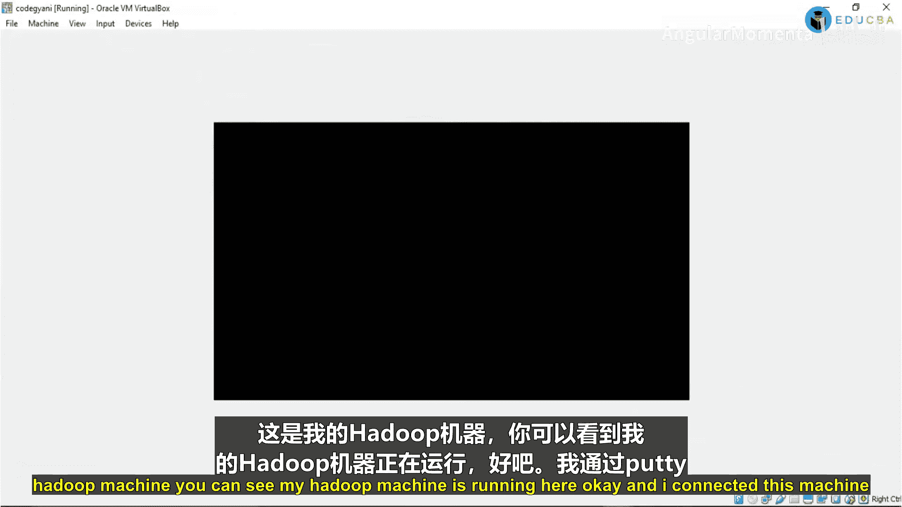
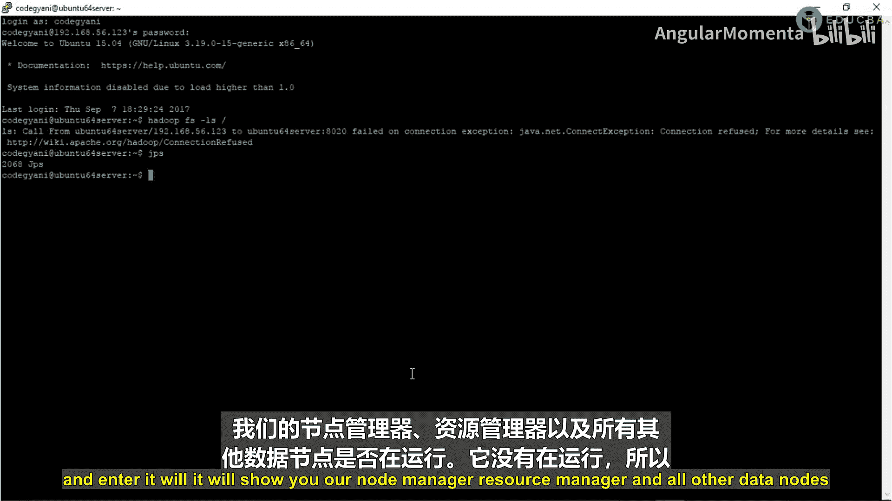
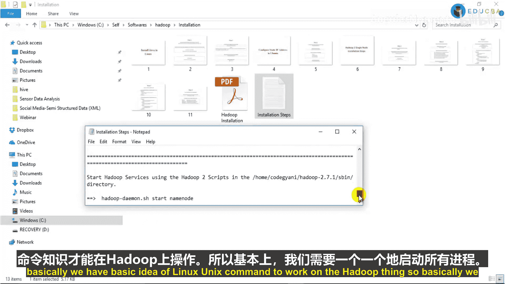
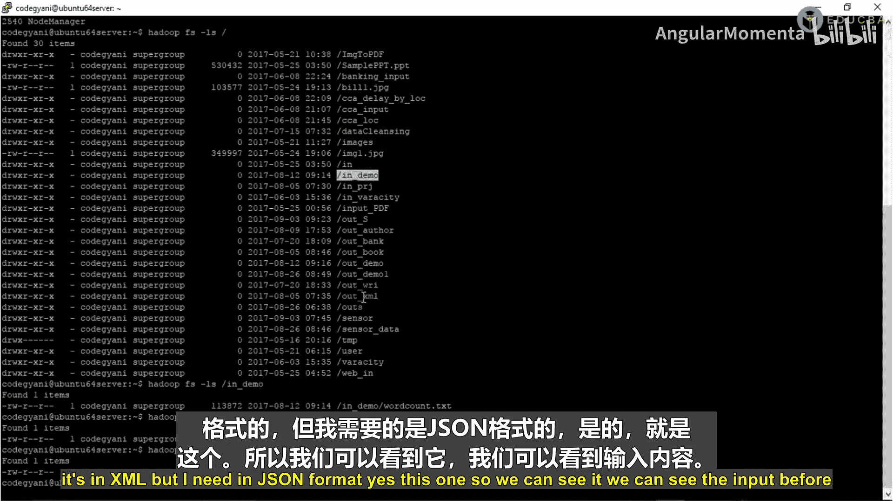
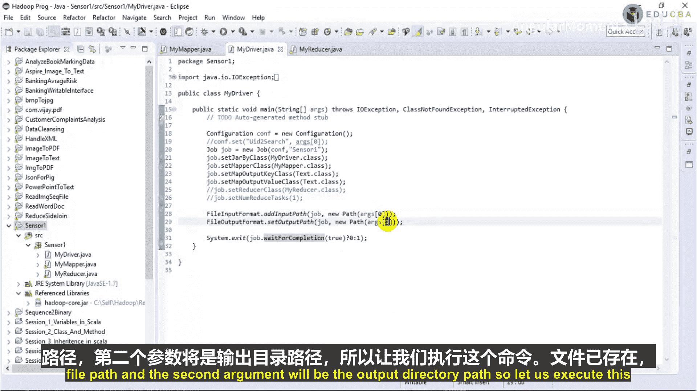
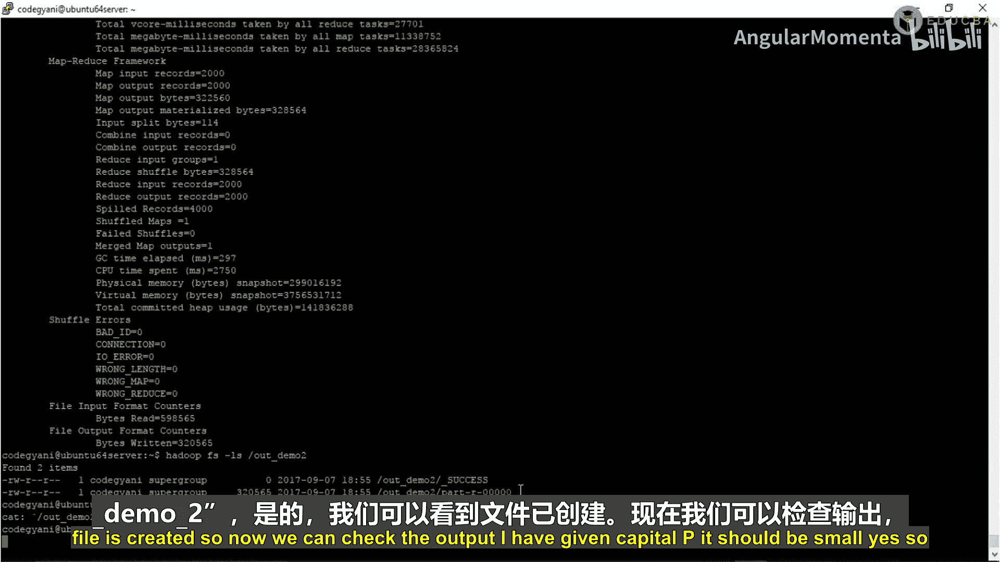
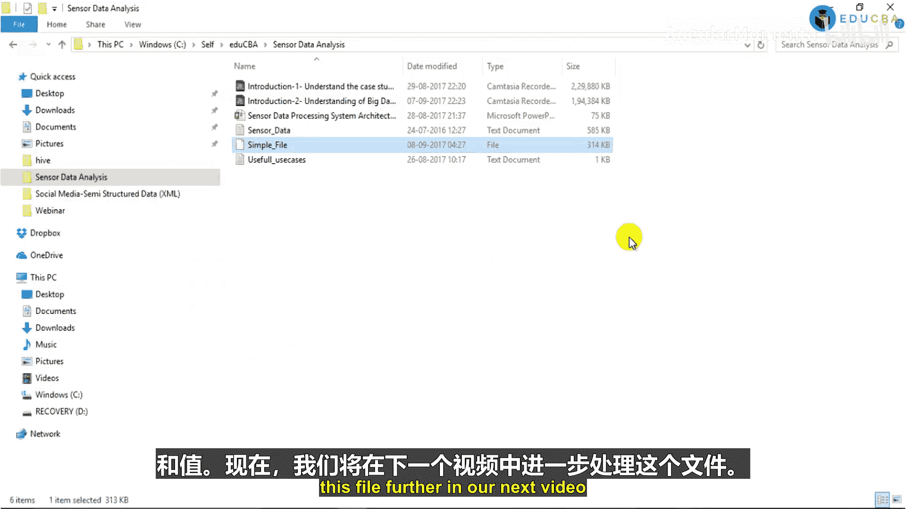

# 【EDUCBA】使用Hadoop处理大数据：应用MapReduce、Pig和Hive-｜-Big-Data-with-Hadoop：-Apply-MapRedu-p02-01_02_01_理解大数据与MapReduce基础--BV1KrFozQEPf_p2-

Hello friends in the last session we understood the problem statement we have seen the input file and we have seen the system architecture how actually it is running on the production so client loads the data on one web portal and we download that you know Excel that file that is in the Json format through some Java utility and then we process that file through the medies。

Lland， okay， so this is the file， which we can see。On my screen。

 So now before I start processing it in mapreuce first we will understand the basics of big data。

 though Im assuming that we all have a basic idea， but still I want to take one session on the basics of big data mapreuce okay and all these stuff so basically。

What is。Big data。 We always think that。Or we can understand by the name big data or we predict by the name big big means it is some framework or the tool。

 you know， which used to process big amount of data。 but that's partially correct。

 It's not completely。was if we want to process only the large volume of data。

 then we can go for other tools also liketerra data or we can increase the hard disk and ram into system and we can process the data in any of the you technology。

Like we can use an AL， we can use Java code or anything。

 but big data is basically something different and nobody can you know define it perfectly but I IBM has given a nice definition of big data。

That is any datata， which contains4 v that comes in big guitarta category。 So what is that for v。

 Okay， before。Go to that for we。 we can see， you know， we have an I DC。 I。

 I think I believe that we all have heard this name I DC that is international data corporation。

 which predict the number， which are， you know increasing day by day。 so they have predict。

The number， you know， will be reached up to 40 zabytes Zb by 2020 by 2020 so you can see this graph in 200 2005。

 it was 0，2006 it was till more 2007 and 209 it reached up to you know1 thousand00 gb Zb and if we go we can see in 20052015 it reaches somewhere between 6000 to 7000zeabytes and they predict they predicted that you know by 2020 it will be reached till 40000 and it is about the unstructured data which is basically videos images Excel file we can say Excel file it somewhere between unstructure and semi semistructure but semistructure you know X is the proper semi structure data。

But Excel comes between these two。 So we consider consider that data in an Excel file award documents。

 okay。So now the data is going， you know， keep on increasing day by day。 So we need some technology。

 some framework by which。You know， by which we should be able to process that data very fast and with the accurate output。

As per our business recommend and with the four tolerance should be 04 term tolerance here means。

Data， we should not lose our data in between if system fails or something happen in in between like network issue or some code issue。

So we should not lose our data。 So big data is， you know。

 a framework or we can say environment we provide all these things。

 and that is why it is very popular in the market。 So basically what I personally believe if we want to process large volume of data then we can go for other tools also But for me why I'm a fan of big data because we can process unstructured data are very easily like images and videos。

 if someone ask us okay， so get the text from the image。

 So it's very difficult to get it you know in any other language。

 but we can do it in the big data or someone ask us okay。

 So this video file into the byte format by and then find the uniqueness of the video if we have four or five videos。

 we want to find how many are unique out of them so that we can do it by big data。

 So big data basically is why it is so popular in the market because。It's two major major properties。

 Our first one is to process data in a distributed fashion。

 distributed fashion means it does not you know process whole data or a single machine。

 it process data in a different different node So that is called distributed node So and that is that is why it has ability to process data in a distributed fashion and as well as it also the second characteristics or we can see major properties it process data parallel So it is not I mean if we have two。

3 file So its not like one will complete and it will take another it will process all in the parallel So it is a fast and third thing which is very important is it you know works on the commodity hardware so we don't need to spend a lot of money on you know to set up the data environment we can just put our master server we should have enough memory that is Ram and the data nodes which are connected with。

Master machine should have a good amount of hard disk because the slabs machines that is data nodes basically process that data and you know so data locally stored on that server so they need a good amount of hard disk and the master is should have a brain that is memory which monitor everything who is running what process you know and which data node is active which is down in all these things So there is a basic of big big data。

 but we should understand what IBM has given us So IBM has given the basic a very nice definition Senate data any data which consists of4 that comes under big data category So4 we means the first is volume that we were talking about big so if we have large amount of data like on some dataytes or gigabytes or datates then we can go for then we can go for big data technologies or framework。

If the second grade velocity velocity means data is keep on increasing on daily basis。 for example。

 today I have 0 gb data tomorrow will be110 day after it will be 120 and so on So data is keep on increasing so in some day will be 500 then thousand and then20 and it will be petabte data 10 more so that is called velocity because any system can handle a certain amount of data I mean they have some limit but in big data environment we just need to more data node and we need to increase the memory in the master master machine so then we can control the velocity part we can process the velocity part So volume velocity third variety which I personally believe and I personally like the property know that is whym a fan of big data and I started working on the big data I choose variety means。

We can process any logs file dot D file， videos， audio， images， sensor data anything。

 So in this assignment， we are processing sensor data。

 So we will see how we can do that in using framework or know bigger tool the last verity So verity means basically veracity means we cannot predict what input will come what input will come in which format like suppose now in the current situation in the current condition we are getting input data into the text format but we don't know tomorrow in which format data will come So tomorrow suppose as an input if we get image or video and next day we get exc file and the next day we get word file then it's very difficult to handle So that is called verity uncertainty of the data that is called veracity So we can easily handle all these change in big data So these are the4 So。

ta scenario I mean here it is， you know where it is where we can use it so we can go for any retailing site like ebay so customers use to you know or find a product and they used to purchase the product from any website so we can use bigta hair so for example like a recommendation in so suppose today I go to ebay or Amazon or any flip card any website I purchase shoes。

And tomorrow， the next time when I log in。 So flip card， no， okay。

 last time this guy purchase shoes of editors on Nikke or， you know， a puma。 so they will。

Show me the ad on the sidebar。 you know， this is just like you know discount is running on these pu my shoes or discount is going on the shoes or this is or this is the nice nice shoes。

 a new collection all these thing So they will give me some recommendations because they know what is when this user comes which thing it you know it basically search on this or thing it basically look at the at their website so that is so big can be can play a powerful role in recommendations in。

searcharch quality we can another example is search quality we can use to improve search quality。

 you know， we can minimize minimal the fraud detection if something happening on this server we can you know for example。

 we we take the example suppose but do any online transaction okay so what we can do in this example what we can do if suppose Im purchasing something from India so we can we can process this data。

 we can put some checks like if something has been purchased between 9 a to 6 or 9 pm then it could if not then highlight that transaction as a risk okay or I swap my card three times four times in a day then it could be a risk or today I mean Boay So I purchase something on Boay and tomorrow and after two hours my card used from Bangal location daily location So it could be a it could。

be a you know， risk so we can we can filter out their data and we can handle what is data to another team so they can basically verify with the customer that。

 you know， you purchase these things or it it is it's a forward reduction。

Or so they can verify this thing with the customer。 I mean。

 they really did the transaction or it's a fraud thing somebody else somebody else is doing the transaction from someone else card So that is that is called fraud detection so we can use big data in that case also the same thing we can use in tele communication government。

 we can also use big data， health and life science， even bank and financial services， the example。

 which you talk fraud detection， it comes under bank and financial services。

So we can we can use it for retail side， banking， finance。

And so these are the company which basically is using all these things。

 The name you can see JP Morgan chase Seas holding， they all are using the big data。

Currently okay those are limitations。 it's okay the which is Hadop Okay so so basically here we can understand the component all we can see architecture of big data。

 So in big data the lowest lowest level of layer is called s that is Hadop distributed file system which is basically nothing but storage unit So our file the input file decides and it store the data and top of that we have resource manager and all these things So resource manager basically a memory part the master machine which basically handle all these node So here we have two layer one is yarn another one is So lower one is So here part the name node is a master and they have corresponding sales machine that is called data node and the top upper layer we have resource manager is a master and we have their corresponding。

The ss machine that is called node manager。 So that is basically called yarn。

 So here those two things yarn and Sgfs we known all these two things are as a unit yarn unit or Sgfs unit So S Gf is basically a data student unit and yarn is a data a processing unit Okay。

 so we can understand resource manager and then name node manager part a brain and Sgs part is the hard disk。

Okay， so yeah it's a summary。 Okay， so this is all about the basics of big data right like all the advanced stock topics。

😔，傻系啊。😔，I'm assuming we have now we have basic idea。 Okay。

 so we'll process that file in the mapres now。 So map I can give you a basic idea about mapreuce before we start processing。

SoWhen mapuce we basically have three classes over is mapper another one is reducer and the last one is driver so map class we basically takes read the input file so whatever file we have as an input so we can take the example like if we have text file okay so we can read that file so whole mapuce jobs works on the key value key value pair so for the mapper map class the key will be by offset by of set is nothing but the line from where it is the number of the line from where it is the it is start reading the file contains so basically it read the data if we are taking the example of text input format that is a flat file so it will read the data line by line so suppose first line is starting from first。

O then the by set will be one a second line you know starting with the123 look by it it will be by will be 123 for that and the value for the first line will be the whole line for second line will be the whole second line so key is he will be in the longritable format that is the number from where the line is getting started the value will be the whole line so map read the file input file and it execute the business logic as per business requirement So whatever logic we have in the class like we need only filter data okay suppose for example we are processing input file which contains financial data across the globe okay so okay let make it more understandable we are processing input file where we have the loan data all the loan data。

accross the globe okay so we have the customers who who has taken loan from North America location。

 we have customer who has taken loan from India we have customers who have taken loan from Germany okay and we want to process the data only for the Germany location and we can put this filter intoma class so first we will read the file and we can put that filter So it's a business logic we have putting filter and and the records which belongs to belong to Germany location will get processed and will get passed to the next class that is reducer and then reducer。

Again。It works on the key value pair things。So key will be whatever we are passing from the member class and the value will be again whatever we are passing to the reducer from map so and then we can perform the aggregation so member class we basically process the business logic with the input file and then reduce the class we basically perform the aggregation or summar we can we can generate the reports。

And then finally， we can save our output today。Out put director your own。SGFs had beed file system。

 The last class is the driver class So driver class basically in nothing but the main class like we have main class in all any any other language we have main main function in Java we have main function in C。

So class contains the main function where we define all the parameters like what is the name of our member class。

 what is the name of our reducer class， the number of reducer。

 how many reducer we want to set okay the what is the key output key from the member class what is the output value from the member class and what is the input file what what will be the you know the argument number for the input file what argument number will be for output directory you know of these things。

That is the main class。 So now we understood basics of big data basics of method use。

And then we can process our input file。That we have for that we have today。

 So this is our input file。 and now we will process it in our next video。 Hello friends。

 So in this video we will process our input file and map produce So here we can see our input data is in jason format So there are two ways by which we can process this file first we can import the json loader classes into our eclipse in ja code editor and then we can use the method which is provided which is there in the json loader class okay the library and we can make a use of them and we can process it so that is very easy way and another ways is we use we write our custom code and we can convert this file into the simple flat file and then we can process process it further So Jasonson format anybody can use it and if you if you don't know how to process you can search it on Google it's very easy but here I will。

This file without Jasonson library so we we will be able to understand we don't know Jasonson format library the method which is there in the json library or you know and how we can process it in a simple manner so here we can see we have age education status gender and all these things we will extract all these things and we will output all these data we will output all these simple flat file which will be limited so we can process that file further as per business requirement so first we will convert this file into the simple text format so let me open my clips so my clip so you can see my package image sensor one so here we can see project also sensor one okay and here we have three classes map reduce and driver but as a first step we are converting this。

A just format file。Into the sample file format， So we dont need reducer here。

 So mapper reducer and driver so we can go for the we can see the reference library。

So here I have added the reference libraries okay， so here we are workinging on Hadoop。

 so we have Hadoop core dot chart which you can download it from Google and you can import it in your project so you will have all the methods。

 all the all things all the things available in the in your eclipse so how you can do that you can write a clip on the reference libraries。

You can go to build path。 You can click on configure build path。 You can configure it。

 You can go to library tab。 And here you can see I have imported it。 You can click on。

Add external jar and here all the jars available which I have downloaded from Google so you can download it also and you can import in your program Okay。

 so we understood。好，买不买不做播光。Give a We things， so。This。

The things which we have in the triangle bracket is called generics。 So here basically denotes。

What input key and value we are getting and what input key and value we are passing。

 So starting two parameter are input key and value and and last two parameter are output key and value class name is my map。

And I extend say to base class that is mapper and once you extend it we are to overwride this method map okay。

 we to write a map method。Wwhichhich executes for all the line because here we are reading that Jason file format is a F file format。

 So its a tax input format， okay。So the key for this program for this file will be in the long readtable format。

 So what will be the key So our line will is starting from here So suppose here the line is starting from zero index it will be 0 and second is starting from 153 suppose it will be 153 and the value will be whole line this whole line out consider the whole line it find enter so here we have enter like this。

So till the new line characteror that is enter， it consider consider the value for the。Part。

Iteration so it will read all the files line by line。 So key will be in the longable format。

 that is nothing but a bit of set the value is the whole line。

 So the so that will be in the text format。And this is the context there is a global job variable。

 which is nothing but the global job variable。And with the help of it。

 we pass input to the reducer and from reducer to the output file。

 So basically data is flowing from map to reducer or from reducer to output file with the help of this context variable。

 So now let us understand the quote what we have written to convert this。

Json format file into the flat file。So here we have defined one variable called J data。

Which we which you lead。store the whole line So this map function will execute for all the lines if we have hundred lines in the file so the map function will execute 0 times because it read the input line by line。

 So first you get converting that value which is in the text format。

We are converting this value into the string format， and then we are replacing this cur bracket。

 this one， we have hair and we have the hair so we can。Because here we are not using just a library。

 we are writing our own custom code。To convert this。Jen file into the simple flood flat file。

 and then we can process it further。 So first I am removing。This curly bracket。

Cracter from the input file。 And then we are replacing forward flash。 Okay， and it says escape value。

 So we need to provide double code。 So basically in few lines， we have。Forward says。

 So we are replacing data also because we don't need here。 And then we are splitting。And this。

The ja data。买啲号嘛。So here we can see this is one key value，8，73。And then， we have education。

And then we have metal statusators， so all the key values are delimit by commma all are separated by commma。

 so first we are delimiting that input file by commma so we have this value in the array on the zeroth index education will come on the first index of that array metal statusators will come on the second index of the array gender will come on third part third index of that array okay and then we have defined when a single。

Final result。 And then we have all the values， all the key values in this array。

 So we are iterating through the forage loop。 Okay， and then we are splitting that。

Value which we have on the in the array So0 index。 we have age， age， Poland。73 h colon，73。

 So here we are spliting this value by colon。 So now we have h on the zero synax and 73 on the。

First index of this of this array。 So here we define one array to store the value， which are。

Wwhichch we are delimating by comma So here we are again def binary here we are st the value。

 which we are delimating by sc。 Okay， and then you can see we are st only first part。

 So here basically the in the first part， we have value。

 we don't have key like a is a key for 73 high school graduate is a key for education。Okay。

 widow is a key for。Miital status。 so weidow high school graduate 73。

You are a straight and all these things are value， so we are ignoring here key。Con story， value。

And we are passing it to the。But werecomma， like 73ma。A high school， graduate commmado commmaon。Okay。

 so we are just。Expecting only value part。regno啲机板。And then， we are finally。It's昨有比较 find。

Passing the output。Through that context variable I told you we can flow the data from map to reducer and from reducer to driver and from you know and to store the output into the output directly in all these things we can do it by context global job variable so here we we don't need key so we are passing null as a value we are passing the whole value which which we have stored final result okay so the map function executes for all the lines we have hundred lines in the input file execute 0 times so we have hundred lines of output but we will have only values by format separated our comma delim here we don't need key so we are passing null but we have kept it as a text format and that is the reason we have kept here the generic in the generics the output key is text okay now it's reducer class but we don't need reduce。

These are in this case， because we are just convertverting this file into the。Simple flat file。

 We donate key best storing value cover separated。 So now we will process the。Value part。

 So here we don't need reducer。 So let's come on the driver driver class Here we define the job variable configuration configuration okay。

 configuration variable con。Very ready to set this variable today the。

Job variable and the name of the job。 So basically， when we execute a program in reproduce。

It goes to the resource manager。 job gets submitted to the resource manager。

As a source manager provide a unique I to that。Job that is called job Uni ID and how we can identify that job in the name node browser。

 So the name which we which we have given is sensor one here now we have set rest of the parameter like what is the name of the driver class my driver here you can see my driver what is the name of the member class it's my mapper the output key that is text output value again text here we can see key output keys text output value text so we have set all these things here we have commented this part because we don't we are not using reducer So we have also commented this part set number of set number of reduce task that was one but we have commented because we donate donate reducer here here while executinging this code we will pass to parameter。

So first parameter will be the input file path and the second parameter will be the output we want to store it and this is that the system will be exit once the job is completed。

 So once we are done with it， we can compile it。You can see only sensor one is selected。Okay。

 and then we can export the which are fine。Like this。 right click on the project。 click on export。J啡。

Here you can see we are exporting the Ja file by the name sensor one dot jar so I can say it because I I have already exported it you can see here okay。

 and this is a local machine this is my Hadop machine you can see。

My hop machine is running here okay， and I connected this machine through my p session。

And this is the this software is within SCp which basically used to copy our file from local machine to Unix block。

 so here I have given the path of the file local machine path where I exported my jar file and then I drag it my J file here you can see sensor1 okay so now we have our jar file available on the Hadoop machine so now we will execute this code so let us see we have input file or not so to check that we can write this command。

First first， we are looking at， you know what folder we have on the。Haoop machine。 okay。

 it's taking time。 I think my processes processes are not running。 Yeah， I was correct。

 So before running any program， you can type GPS and enter it will it will show you our node manager resource manager and all other data node running not such not running。

 So let us start all these things have command for that。

 So basically we have basic idea of Linux Uni command to work on Hadoop thing。

So basically we need to start the chart all the processes one by one。

 so here I am starting my name node then we need data node。

 then we need resource manager then finally we need node manager so all processes should be up and running to work on the Hadto。

😔。

Now we can type GPS and check yeah。Now data node， name node。

Resource manager and node manager all the running。 Now， we can see what folder we have on our Haddo。

Box， okay， so I think in this folder， we have our input file。 we can check no sensor。 Okay。

 we have one folder called sensor data。I believe， I。

I have kept an input file in this folder its an Xtl。

 but I need inson format Yes this one so we can see it we can see the input before starting the job yes you can see we have same data age education matter status gender and all these things so now we can execute Hadoop security program we need to write this command Hadoop jar our J file name so that is sensor1 do jar sensor1 dot jar our input file path。

That is sensoror。In the output directory。谁啊。Here람 giving name。How demo1。 Okay。

 so this time I'm giving。So it will process the input file and will restore the output in this directory out demo 1。

 So here we can see in the driver class we have mentioned。

The first argument will be the input file part and the second argument will be。

诶。😊，Output directory path。 So let us execute this command file already exist。 Okay。

 this folder will already exist so we can give name to。

Also remember our output folder name is out demo2 So this folder it will create the output file。

 which will be the comm separated output value See here you can see。

I told you job summary to resource manager and it provides a unique ID that is called job I so this is the job I it has given to this job and the name of the job will be sensor one which we can see if we go to name node browser but we don't need that part here so here you can see map is completed 100 percent okay so map job is running wait for a while it will completed。

Okay， its completed。Now， we can go to this auto directory。How the冇。It's created or not。So for that。

 we can write the one Hadoop F。IPhone L。And the directory name that is out demo2。

 yes we can see the file is created。So now we can check the output。 I have given capital P。

 It should be small。 Yes， output。 now we have output。😔。

Okay。Soon they starting， we are getting age， comma， children， comma， the mestrs， gender。

 textstrators， who are comma separated。But the starting in the starting。

 we have one form also so that we can。Remove when we execute our when we process this file further。

 but we can keep it also we can write our code in that way you know so we can ignore it or we can remove it all up to us So let us get this file to our local machine So to get this file what we can do we can write command Hadoop F。

I forget。The source file part。等等。We you able to copy it。So I want to copy it to my through directory。

That is home called Guni and hyphen get one will copy the output file。

And will and paste to the rule directory of my unique pro。 Let us check。Click on your。Yeah。

 we got our input file our file。 So here we can see。

We have command this starting and then we have all the value command separated。

 so now we have converted this file into the the file into the simple flat file common de file format okay。

So we can copy this copy this file， because we will。Okay。

 we can copy this file from there to our exported jar。😔，Here we have。 we can cut this file。

Do what donate here this file。你见。Fsted drawer product folderers。And we can rename this file， too。

Simple file， okay。So now。We have sampleensor data in the j format。

 Now we have converted this file into the simple file。Not not in the J format。

 it is in the simple file format， which is。Coma separated， separated and the value。

 So now we will process this file further in our next video。

