# 【EDUCBA】使用Hadoop处理大数据：应用MapReduce、Pig和Hive-｜-Big-Data-with-Hadoop：-Apply-MapRedu-p03-01_03_01_MapReduce中男女比例--BV1KrFozQEPf_p3-

Hello friends in the last video we converted our JN input file into the plain text format so this was the output which you can see on my screen so it's a plain text format file now we can work on our use cases so here I have return few use cases which we will try to generate first in reproduce produceduce and then other bigger tools so first we are taking first energy that is ratio of male and female in the country So this first use case we will get the count of male and females in the Philippines country because it this data which we have is belongs to Philippines so let me open my clip here it is so this was the program which we use to convert Jason file format into the plain text file so I'll make the changes in the same program and then we can export the jar and then we will execute our program so here。

We can see we have okay let me open that file。That will more more clear。

So we have age what we will do the input key will come as a long write table what will be a by offset the value will be a whole line that will be in the text format so now we will comment this code we don't need this we dont need this as well and then our input is comm element so we split we we can split our file by comma and command this part as well here we can define few string。

String edge。Okay。Here， we will restore。Our age。Decent parts。

It is fetching this element it is running。J part so here we can see simple file so first will be nothing second will be age。

 so it will be stored on。First in do to straight。So now we have age we can have education that will be on the second index and then we have we can open this file age education meritital status this one and then we have so miital statusiters will be stored on the third index third index now we can have。

Gender gender that will be on the fourth index。 So now look at our file age on the first index then education then administrators and then gender。

 So here we need to get the count of males and females in this in this country。

So we will deal with only with the gender part okay。

 so we have gender so if you know if you know the paradigm of map produce so whatever we will pass as a key it will grow by it will perform the aggregation on the same column so I will remove this part now here we will pass gender。

As attached to the， and。Value nothing okay though we generated age education middle status。

 but we dont need those three columns in this program。

 but it is okay if we have generated but we will deal with the gender part so here we can check the generics。

Our text input key is text。Map input key is text which is text key is longer table which is coming so this is the general X so input key was long right table。

 this was the value this is the output key which we are passing which is text and it is a text here and this is the output value here we are passing nothing blank。

Now we' will go to reducer。Andput will come as。Text， text， text。N incredibleible。Okay。

 so we lose Nate。Okay。No， here we will pass no。And here will pass gender because you want to perform agregation on this column and I will go to reducer。

 both are text， it will be text， it will be text okay for each loop， we can it trade it through。

So the will come here。Now， we can increase the。Gund。

Or it will be simple what we can do we can pass text here。And。In right table here。

So I'll tell you what I'm doing here。 I'll pass one， so this will be。😔。

Intritable actually here we need to count the males and females。

 So for single male we are associating one as a value。So we have100 mill。

 So it will be like mail  one mail  one mail 1 till00 times and then in the reducer we can count it。

 Okay， I hope you got it so it will be entable。Intritable， it will be tax。 It will be intable。 Okay。

 now we can。 it will be intable。Okay， now we can but the。Allligation。What we can do。

 we can do the sum。 we can change the variable of sum， and here we can type sum equals  to。Sng plus。

Where it taught。不离边。Okay， do。Okay。So whatever whatever we are passing with male and female because they are passing gender as a key so it will perform the group by I mean aggregation on the gender part so it is a male and female and with all the genders we are associating one so I told you like male one female one male one female two and then we can count the。

Then we can do the aggregation， I mean， we can sum of all the value with that particular key。

So it will provide the count with the males and the females and then。As the output。rein。

Pass some hair， so attached in。Text in red。We are getting input key in the text that is gender from Ma and is a one which we are passing from Ma。

Text is the key from the usersel output we are passing text and enter table is。Submission that is。

 again， the intable and which is the value which we are passing from reducer。

 So here the name will be sensor one。My Ja class name will be my driver that is saying upper class name aort class text output values entry table。

Entrytable and we need reducer here to my reduce and we are setting number of reduced tasks is one so first will be the input file path。

 second will be the output directory where we want to store our output。Now we can。

Comple this project。For compile you can go to project and click on clean here we can see only one project is selected that is sensor  one。

So it is compiled， nor Ill click on the project。WeGo to export。And jar file。Zofein。

I'm giving the same name， sensor one。Next。Next， define the my driver class。

The programme start executing from the main class and we have main function in our driver class。Okay。

Already exist， okay。It' asking me to save it， so let me save it okay。And then we can again clean。😔。

And we can export。Thefin the minute class。It was already there。What about it。Ask me。

That it's already exist。 and you want to。Over I did。Okay， any else。Maybe I missed that part。

Okay so we can go here and we can see sensor1， we can see the timing 109 to171043 so we just just now we exported we can copy it from our local to Hadoop machine here it is saying already exists you want over it years because when we converted about file the j file from the last session we use the same jar now jar file name is same so that is the reason it is already exist and we over it now we need to copy this simple file where our Hadoop machine so go to the directory。

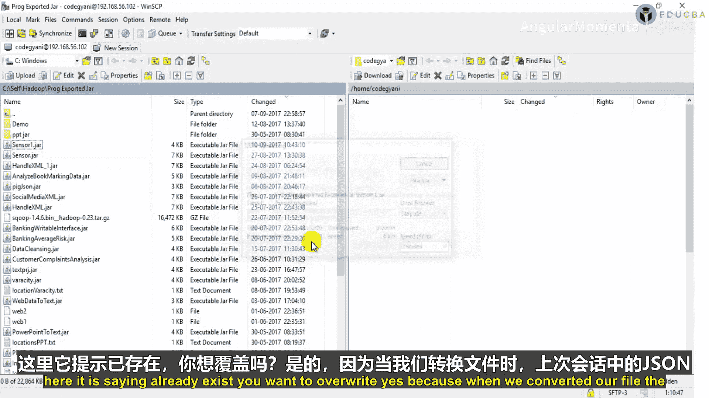

Since the。Simple file。It's the blue machine。They can check all boxes are running yes resource manager data node name node and not node managers are running we can create one folderer call Hadoop F。

 iPhone， MkDIR gender ratio。Okay， this is the directory name I'm giving here。

We need to copy our input sensor file here。

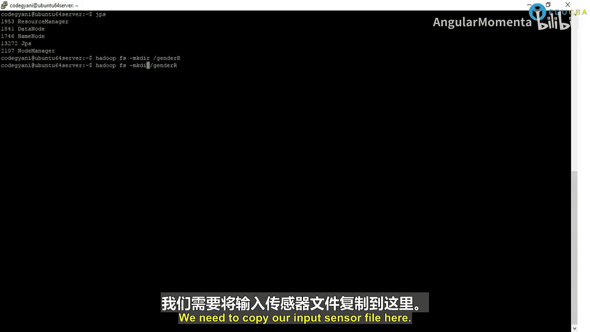

IPhone port， what is the name of the file， simple code file。

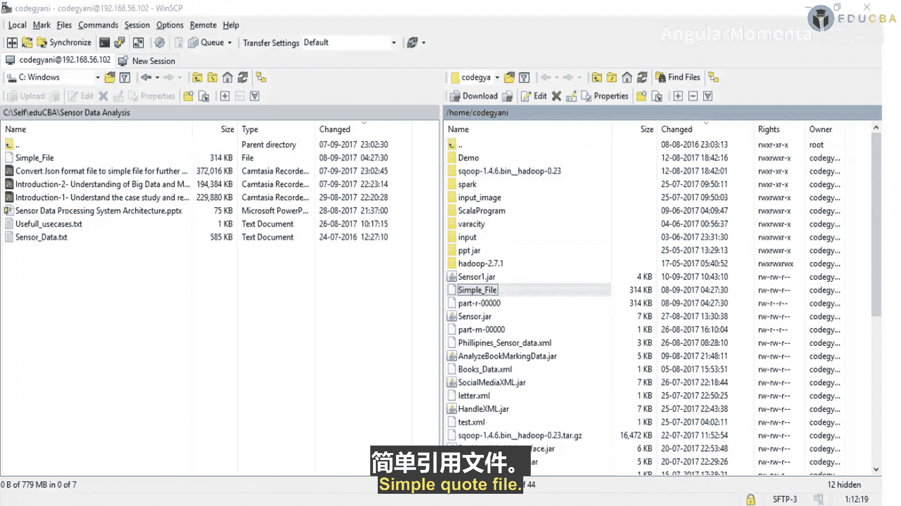

Simple underscore file in the directory its copied。You can check it， loop， F， hyphen。

AlSo we should have basically idea about the Linux command。

do those are the simple command so here we can see our far is copied now we can execute this so to execute this program。

A do。你家。John find。That is self server1 not jar how it is coming here。

 the project exists or our route directory on route。

 you can directly type the name it will come automatically here we can define the input file path。

That that is gender R because our input file exists in this folder。And then。

Output directory name I am creating one director we call out the G to let us execute this program。

 let us see how it goes。Ne executing you can see job ID so all programs get submitted to resource manager it provide a unique ID to this program to this job so that is called a job ID so they can see the job ID and job name if we go to name node browser here map period is started map completed 100% okay running map completed 100% the is running。

It its completed。So now we can check the output we have got the output file or not yes。

 we have output file now we can see the output did we get the count of males send female yes。

 now we got the count female is 10，61。And mail is 9，3，9。 So now we understood。

How we can generate the useful information for from this route data for that particular country So now that country can you know take some strategic decision or a decision for the country growth because every country has some you know ratio of males and females so here we got the ratio so this was the first use case which we created and which can be which which already performed it so now we can we will work on the second use case in my second video so second second use case will be how many females are more than 45 weeks and divorce widow so we work on this use case in my next video hellello friends so in this session we will work on the second use case so in the last video we understood how we can generate the ratio of males and female so here we got this output female and male so now we will work on the second use case which。

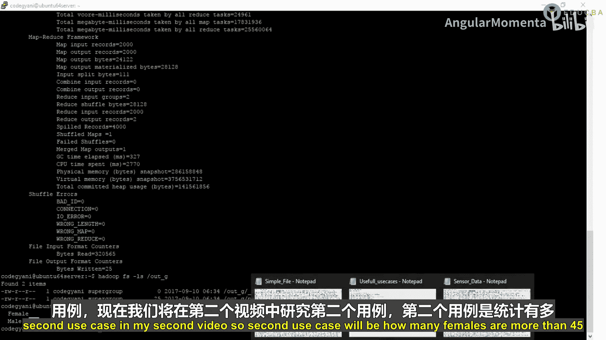

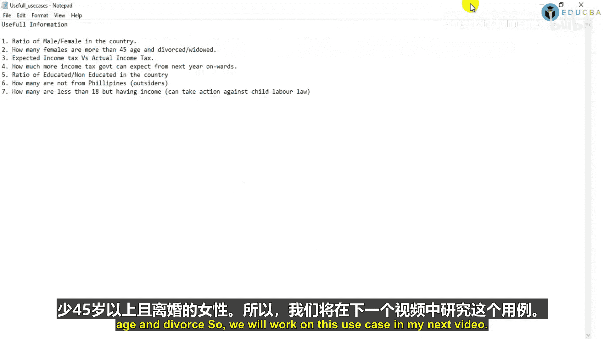

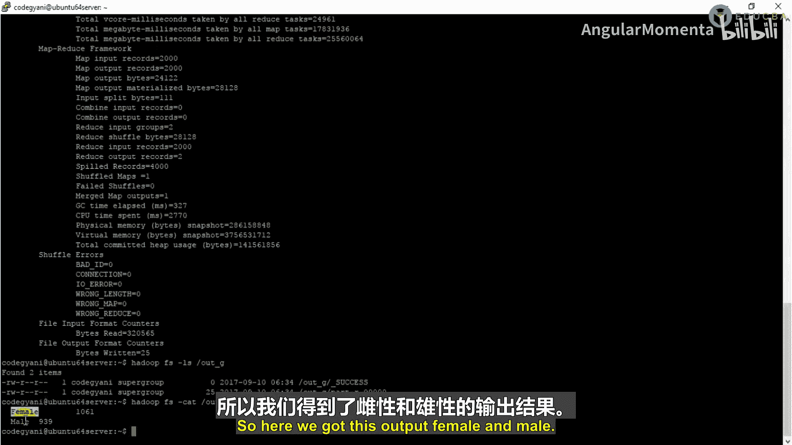

How many females are more than  for5 age and divorced so basically how this information will be useful for this country so we will provide this data to that country so that that country can take some you know a decision I mean they can open some organizations or NGU there they can take care of this kind of women which who don't have any dependent and nobody is there to take care of them so you know so because they are 45 plug and they don't have they have no one to take care of themselves。

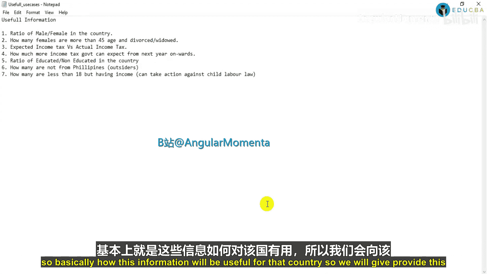

So country can open some organization some NGs。To take care of that kind of peoples so now if we look at the sensor data we have age and we have gender female okay and we need to provide information like how many females are more than 45 age and divorce and weidow and metaes beidowed or divorce so here we can openically and we can make the changes in the same program so here we have age。

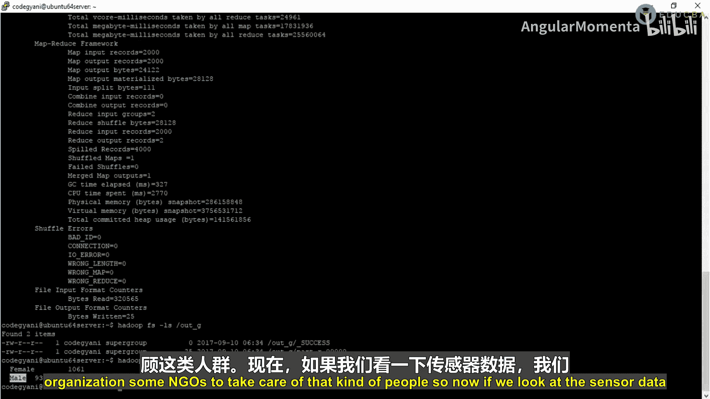

Education mental status and gender so now in this program we will make a use of mental status and age so first we can filter out the data on the bits of gender if what if if gender dot equal female okay and come inside this code here we can check if so here we can convert the age and because age is a number and single dot and dot。

In your percent like this so now we have aging and teacher and we can check ages greater than 45。

Then come to the sport and then marry telestrators equals to what is that widow and divorced so here we have Buidow。

I'm using trim， so if we have any space unwanted monitor a space， we can remove that。

Dorced where we have divorced this。 we can remove that case as part to may remove the confusion。😔。

Two lowers and widow and here。罗几。Dvod so basically here we are filter filter our filtering the records as per our business requirement。

 so first we are getting those records you know who are female in that input file and then we are checking。

And if on all those females f the persons who are more than 45 years of age and then how many of weidow are divorced so what are going to generate how many females count again we to perform the tongue so here we can pass the same thing。

You can pass anything gender or anything or and then in register we don't need to make any change because we have to get the count。

So we are associating one。With all that kind of report who falls down in this criteria。

We are associating one that is in value。And in the dessert class。

We can sum up all these media value and we can generate count okay and then we can display how many females are there so it will they not like female and do some。

So are females mins， not all the females， females means the females who are more than 4 45 years of age and who are widows。

For divorce able we told to make any change， my background we have already changed。我 from lift做。

It's compile。Then we can export the J file。The fundamental class。

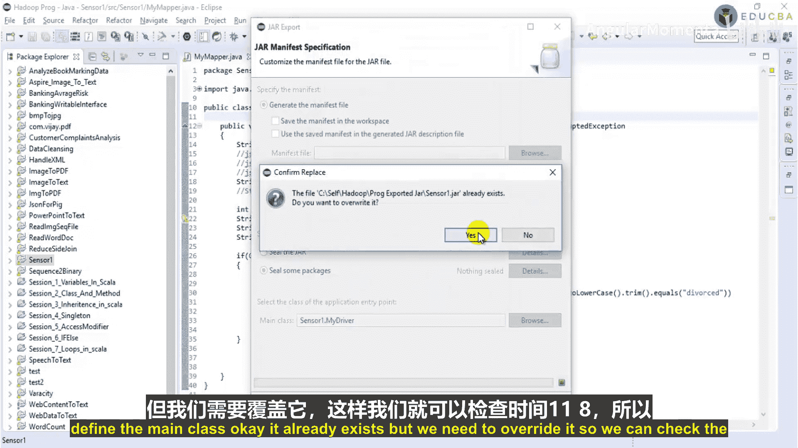

Okay， it already exists。But we need to override it so we can check the timing 118， so it's 118。

S ways you just exported these jar files。 Let me pop pop it from。Our local machine to SDGFS its cop。

Here we can see timing。118， now we can execute this program here old age female。

The jar file name is same sensor1 ro jar， we have input file in the same location。

An output file output rec I am giving out underscore ofF ofF males old females。

So let us execute this program， so this one is the job ID methodology started we got the error for input producing one number format exception for input producing one what mistake we did。

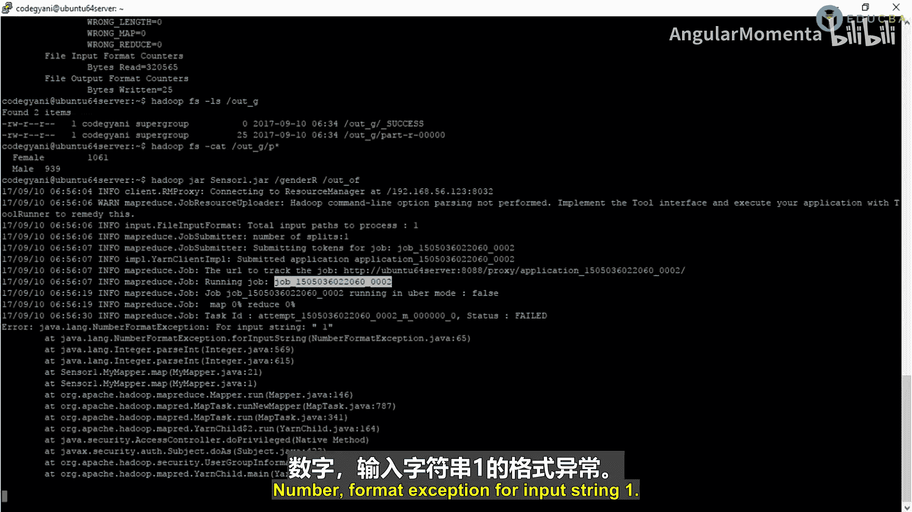

Okay， for now， let's remove this part。 Okay， check how many widows。嗯。你 was。

Because I think it's giving。走匿明啲。Once in order。你得等唔接。

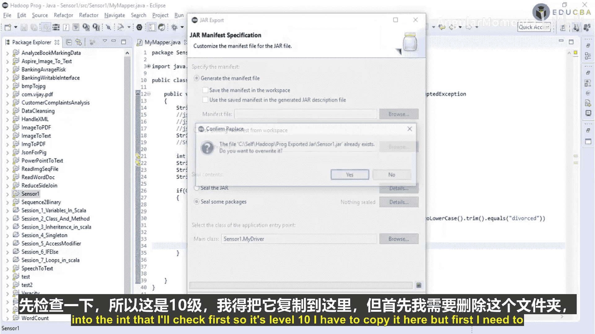

First。So's no done。P cop here。But first， I need to believe this folder。Sers deleted。

 not check if you get the same error again。😔。

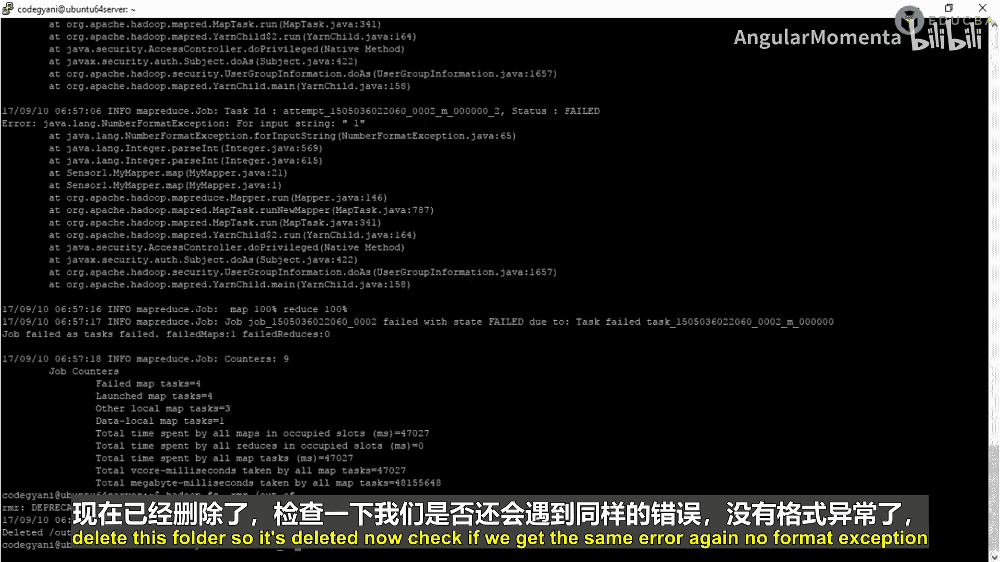

Number formal exception。 Again， we get the same at。On pressing one， okay， we have age， okay。

 education， minus status， we can do one thing。 Okay， we can check this area what we can do。😔，For now。

Com this reduceive class okay let me check it we will discuss on this issue on this issue in my next video let me check it hellello friends so I resolved that issue basically we have a space while converting to converting from string to teacherger we have a space and a space we not convert a space you know from space is nothing I mean。

It's a blank thing， it's not a string it' is not a integer maybe we can consider consider that that thing into the string。

 but we cannot convert that blank thing in integer and that is the reason we were getting the issue so what I did I just use trim we can use value of or we can use。

Pcent so both used to convert string to a teaser， so I use trim to remove that space。

And then we have convert we can easily convert string to in Tj。

W we are why we are convert because we have。We are reading landber line and we are from stringery。

 we are attracting those value， age， education， metro statuss and gender。

So here age we need to compare this thing， it should be greater greater than 45 more than 45。

So we need to convert it from is string 2 in teaser。So now it will work properly。Their education。

Madistators， gender， okay。So no。We can do that。We can check how many females we have and then for those females we can filter out on the basis of local age。

 females， more than 45 years of age。How many of are widowed and divorced then we need count of those people and we can hand over this output to the Philippines government。

To take some decision。4our。In order to take care of those kind of people in the is a class。

 we don't need to check make range changes it's the same thing we are counting。Driver is same。

We can just save this program， we can compile it。And then we can export B。Grified。

Theine our main class， it's solid there， it's okay。

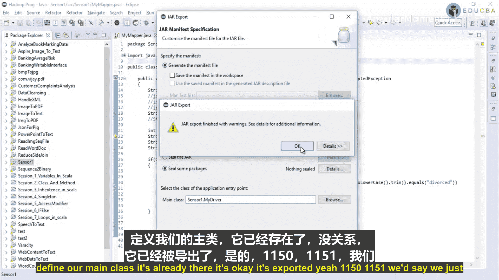

Its exported。Yeah， then 1150，1151。So it's same we just exported the jar fine it can。

Move it to move it to a Y office。And then you go people up here。Okay。

 so this is the same Im creating an director called out underscore Of that is old female and gender R we have our input file and sensor button do jar is the jar file name press center。

Now its a job I a source manager given a unique job I now we can see map is completed in the last time when we were getting this one error。

The map was not executing successfully the reducer also completed the program gets completed completed successfully we can check our output file is created or not it is created now we can see the output。

Yes， so now we have 100 females。Who are more than 45 years of age and。嗯。Weidow or divorced Okay。

 so now we can handle this output to go to the government and then government can take the。

DN some decision， they can open some organizations or Ngo who can take care of those kind of people。

 So we are done with this use case now we will move it on to the next one。

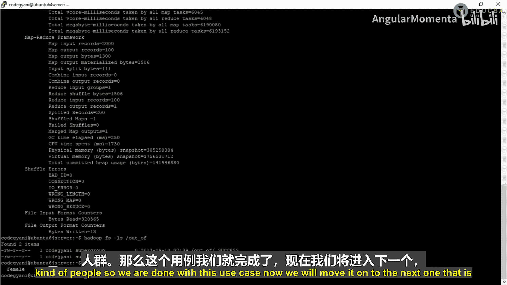

That is expected income tax versus actual income tax so every government has their own income tax calculation criteria like in India we have 2 half legs we don't need to do any tax and then from 2 half leg to five its 10% from5 to 10 legs it should be 20% and so on。

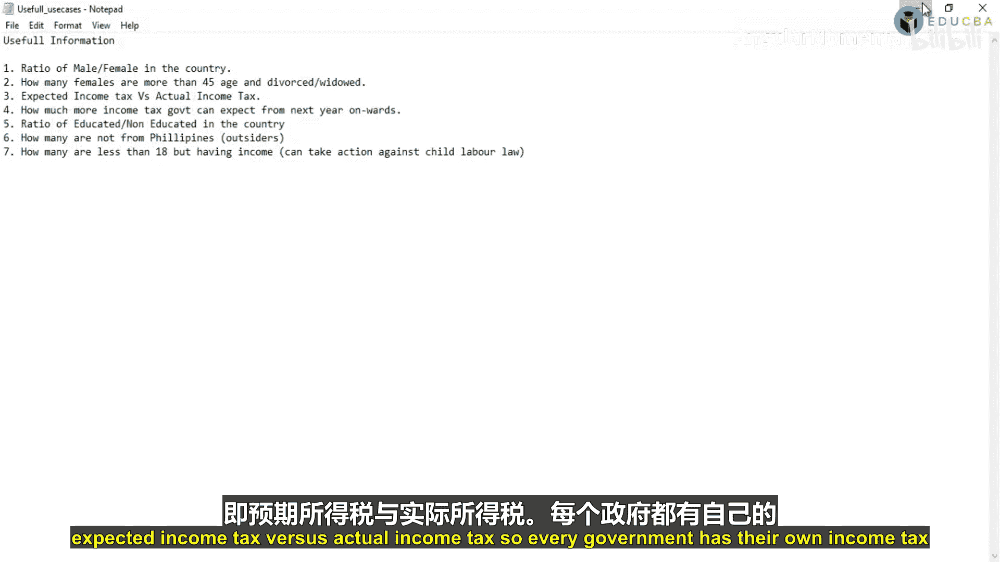

In the same way in the US the flat direct 30% tax irrespective of this salary how much that Port guy is you know earning in the same way flippan has their own criteria so in this case we don't know that criteria we can calculate income tax what we can do we have income column here in yeah this one。

To begin can give。What is the income for this particular input file， so then they have。

All the income， and then they can。Performly they can find a tax on that on the basis of their rules and then they can check so they have suppose they have X amount X that they have expected that we should get X income tax for this year。

So， we can。So then once we provide this output， they can。

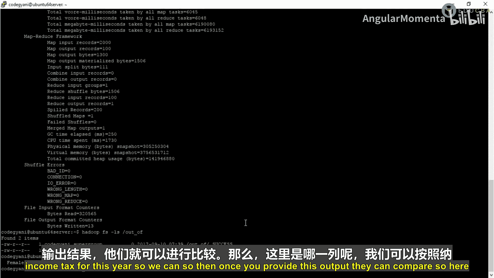

From bare。So here which column is this， we can tax file status and income。

So we can make it changes in this program。X for status x。Final status。你准备。Tth index of this string。

 and then。你 have唔 done见。You to define the。convert this。It should be6。

Then frame so now we have income and they can commandend this board because we don't know this。😔。

In this time， you just need to find it。So， here we don't need。😔。

K so what we can do we can give null here， though will be in the text format。

 but we can provide nonell and here it will be long righttable。

So which will basically be income relatively。longong ride。

So now longer table and text input can value。Which we are getting from input file。

Text key we are passing blank because we just we do we dont we need to calculate the total income for this input file。

So we don't need key here switch a blank and we are passing in this long item format because tutorial can be more it can pass the limit threshold value of inte。

That is32，7， six，7 bytes， I think so here it will be long right table。Okay， and it will be。

Long right table。There will be long right table。😔，And then。me know what I one so here。

We are adding all the income， okay， and then we are passing easy input put files。So instead of key。

 we can pass， We can type。路灯。诶，我铁啊。We can do one thing。Next and。Next。

So here we can type something like。Total income。And this sum。So we can display this output。And yes。

 in driver here its text longritable text text。My driver text long later。long right。

Because here we need to define the map key and have output class soon the last program it was inritable。

 but here we have tech longri table now we can clean this。And then we can export it。Yes。

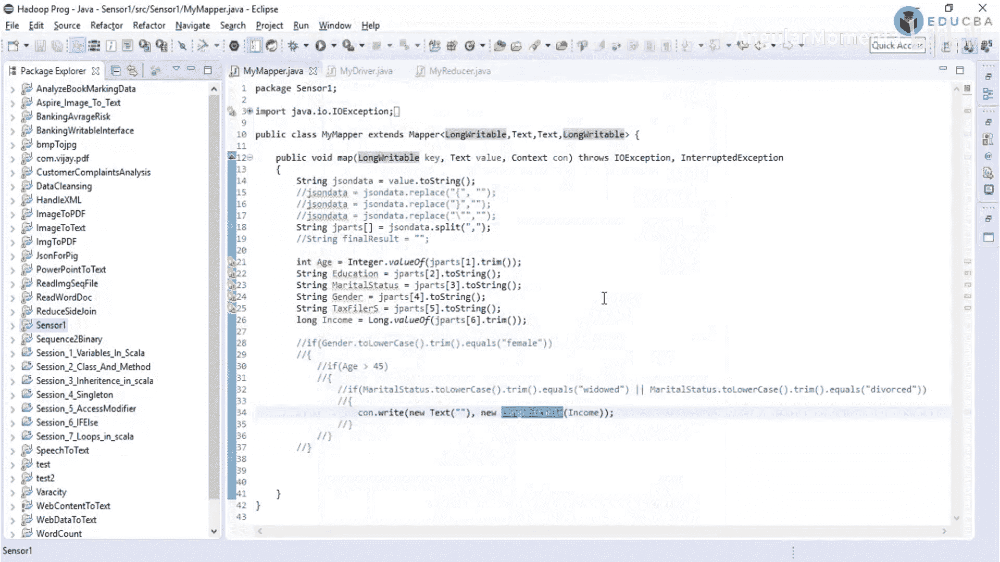

You can generate the output in the same folder， you can delete it and then input file output file in the name okay you have both let us execute this program and check the output so it a method launches started it's a job ID or double one job submitted to the source manager。

Now map started find put string 5，62。84 number format exception Okay on an issue。

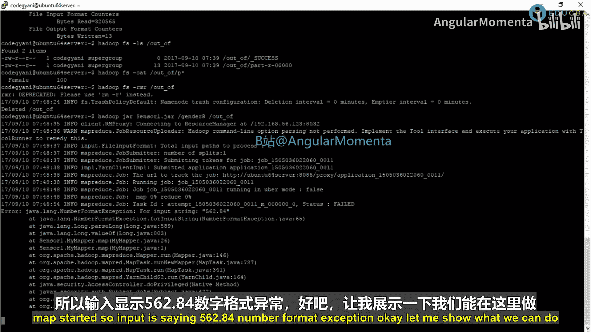

What we can do here when of time。 we got the err appetite。 What would be the issue here。

 if we take in here。 Let's check it forward。😔，And and。In the right table， okay。

Interger value of this one。For now， we can check if it is working with it。😔，In long。

 I don't think we can use double。哦， we are。都放企啊。喺几。It should be double。

Look the value we have in the points decimal。😔，嗯嗯。Double item。 Okay。

 now we are passing double our reducer。Not st。 Okay， every stborn and driver， it should be。嗯。😊。

Now we can check。The pass or value is in double format， right except except DCiml。

So it should it should be double。😔。

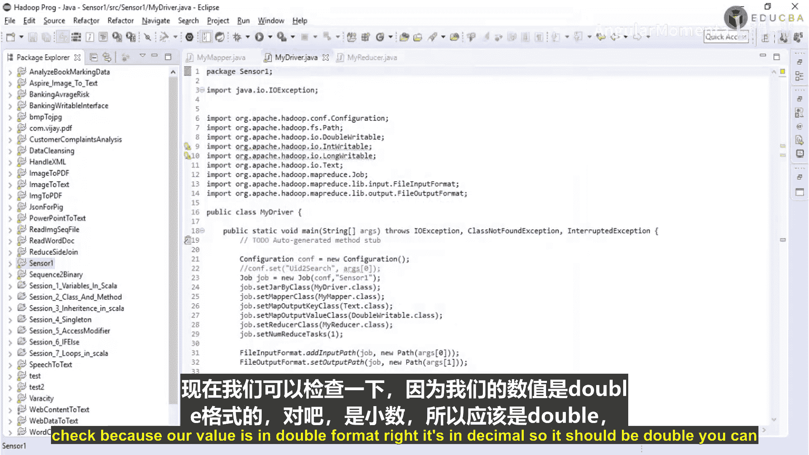

You can copy what jar file here。😔，And then。We can institute。This program deleted the folder。

Let's see how it goes this time it this time map completed。

 it is also completed program ran successfully。So we were good。

We can check output for this created or not， it is created。

Let us check the output so here we can see total income is3，4，5， six，523 point。

Something so now they can provide this data to the government and then they can calculate the income income tax according to the their rules。

And then。They can compare it with their expected income tax so this income thing if they want how many tax are here。

 how many tax nonfa are there like this。They wont raise data how many text nonfa are there。

 how many people are filing text so they can。Get the count of this thing so these both columns are related to income tax so depends what their government is asking I mean we can provide both the option so depends what if they are looking for more data we can provide both so in but the is way how we can calculate the。

Income tax so in the next video we can work on the next use case how much more income tax government can expect from next year onward okay so what does it mean how we can calculate。

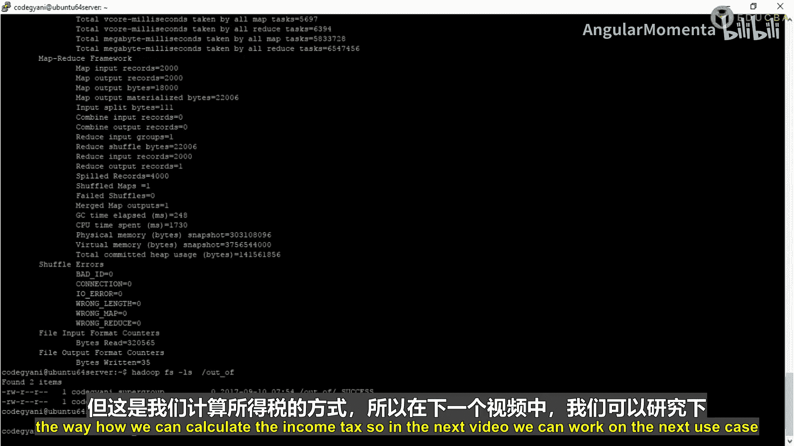

So we know that every country has their rules like in India。It it be。

People are 18 years old or more than its there going to be 18。They are entering into the 18th year。

 then they can start working。So here we can provide a data to government like this in this year。

These many number of people who are entering into this number of age so according to that they can they can decide some minimum amount。

 okay the1000 or total $400。The minimum salary there so then they can increase their expected income tax range accordingly and then they can compare next year they can compare that income tax with the actual income tax。

Then they can check where。In the downfall。SoFor this scenario。

 but we can provide the government how many person are。Going to be 18th or。

More than that so in this scenario we will work on my next video hellello friends so in this video we will work on the fourth scenario fourth scenario that is how much more income tax government can expect from next year onwards so if if we understand that you know the people is person is about 18 and who is earning is able to fill the income tax so basically what we need to calculate in this scenario you know to calculate how many people are going to be 18 or are 18 okay so we need to get the count of those people so then government can you know based on their calculation they can expect some amount of tax based on their calculation formula according to their country rule so basically what we have。

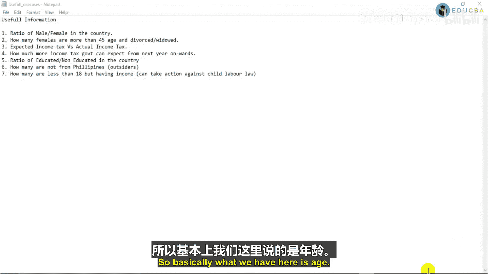

Here is age age 73， age 73， okay， and income， so here in this code。

 we can age is equal to 18 okay and income。

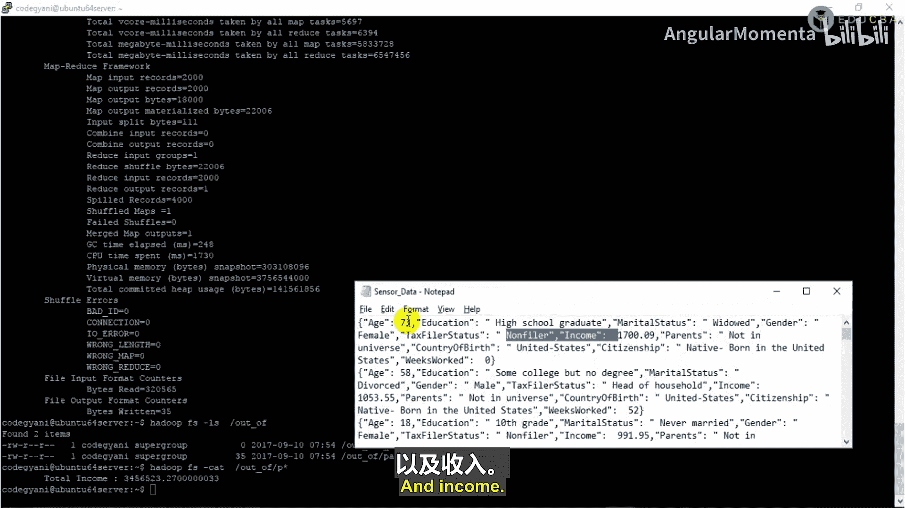

Not equal to not equal to0， basically not equal to means this one the person is 18 years of age。

And the income is not zero， then he or she should fill the income tax in the coming year。Coming here。

 so we need to get the count count of those people so here count in table。

 we can use in table for the count。And we can associate it。

 associate one with those with those kind of value inritable so it will be。Incrable， inable。

 intable here， we can type。到。You can type anything but Im just typing so you are going to make a little change here also its inritable class because we are passing intritable is the output value so lets compile it。

Exported with the same name。

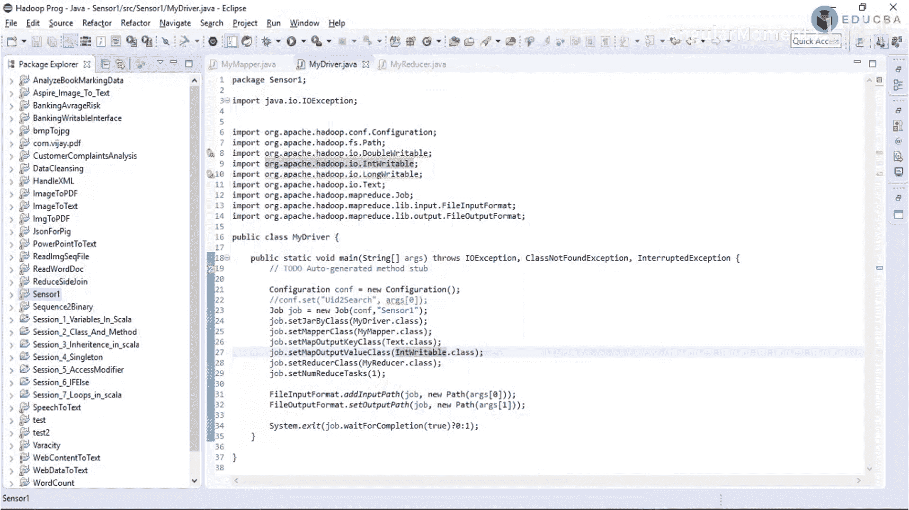

Propy it from local to SDGFS。And here I'm deleting this folder first， and then we will。

Execut our go on。The Java file La is same input directory is same output directory which are keeping the same which we have used for last programs so wheredue launches started Java IDD it assigned to this program map completed that is completed now they can check output for is created or not it is created let's see the output so the count is 27 so government can expect 27 more people should fill the income tax this year so they can expect a minimum tax like 10% 20% or。

As per their government rule okay and they can increase the expected amount accordingly and then they can check next year onward expected。

Versus actual and then they can take some actions against those people who are not falling tech very simple we just。

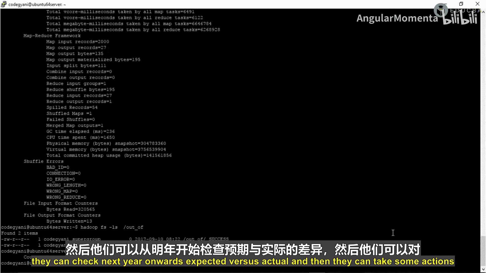

Such all these values and here we put the filter criteria if age is equal to 18 means people just enter into 1th 18th years of age and those are income earning something so income are not zero so it means they got the job and they are earning something and then we are passing those value to the reducer and here we just associating one。

With those kind of record。So here we have 27， the 27 times abundant will be associated。

With those kind of people。Then reducer。We have that value and then we are counting those number and then we are generating those number in the output output file so here input key is long longritable as usual。

The value will be holdline is text， the text we are passing from output。

As a map key because we don't need k， so we are passing blank。

The value is intable that we are passing one reduce the key is coming text format inable the value yes。

And in the output， we are passing text blanks and output。

Value is second text we are just right V of this written count in the sum and in this move we are counting that sum so that is how we can calculate the factored income tax this year so in the next session we will start we will work on the next scenario that is education I in ratio of educated and then educated people in the country。

So we will work on this in my next session hello friends so in this video in this session we will work on this use case that is the ratio of educated and then non educated in the country so let us look at the input file we have education column here okay so its a high school graduate and some college so how we will find non educated people we have non educated。

Let me check No we don't have this value。 We can look at this input file children children means it's a nonedatedgrade so we can do one thing in this case we don't have like noneggrade because it's a a file So what we can do we can get how many children are here and rest of our educated or if we get the file like something an education column we have noneducated then we can use by there but I can here I can tell you the idea how we can do that So my clip So what we can do we have education column right so we don't need here we don't need this here we can pass education is a key and we can associate one So what are the category we have in this column like educated or 10th degree or children we have corresponding count from this file So basically we are grouping it by education okay so all these things are same long righttable。

Text text entrytable， because here we are passing either text and value is one。

 we are associateci Okay， and if we go to reduce the class tax is coming from map value is coming inside entrytable。

 we are passing tax tax， okay， we all are good So sensor entrytable Okay， we do not make any change。

 I hope you understood basically we are not doing anything。

We dont have educated a noned column kind of column in the input file so what we can do we can give complete data what category we have in this column and we can give corresponding counts to that government like how many are 10th degree holder how many are college holder how many are children and so on so so on this information based on this information they can calculate it how many educateded people they have in their country so we can compile it。

We can export it。We are giving the same name。Pro exists it is okay we are overriding it time is 1245 okay。

 let me copy it here， lets go to our put session。

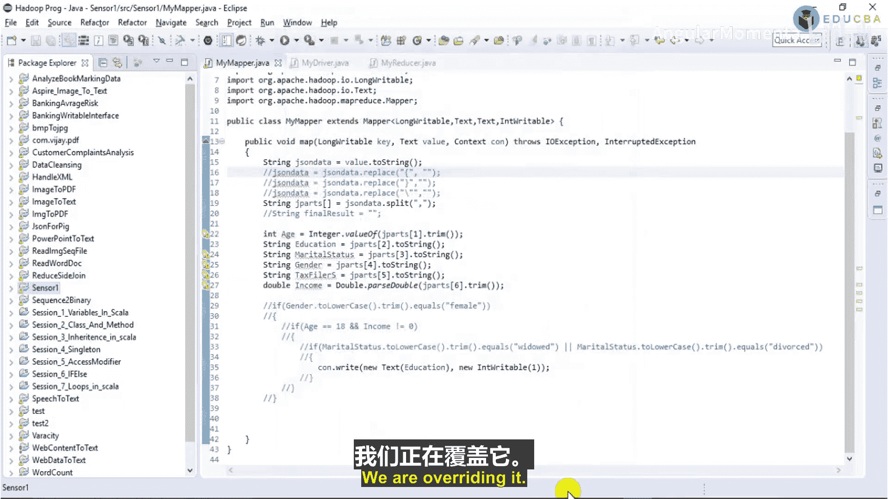

You can delete this folder because we will create the output in the same directory now we can execute the program。

J file name is same input file name input input file directory is same output directory we are keeping the same they have deleted it so we will create the same directory again lets execute it it execute so Jo id map is launches started map completed。

Reduce completed so program is completed， let us check file is created or not yes it is created。

Let us check the okay basically let me tell you one more thing here file is part hyphen r hyphen a unique ID so what does it mean what does it mean of R the mean is is our meaning is we have a reducer in our program。

If we don not have reducer only mapable execute so the file name will be part hyphen M。

 but we have reducer so that is why it is created a file like part hyphen R。

Let us check the output8 even0， okay we have defined the count。

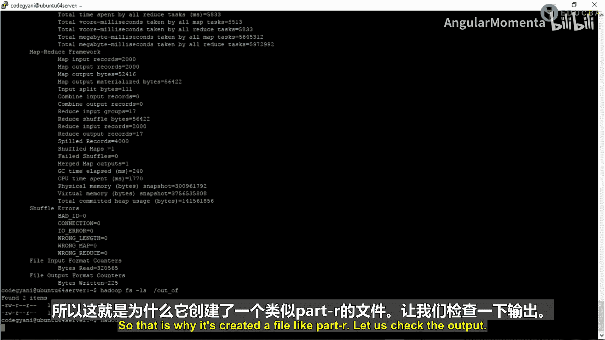

So here's what we can do。Here。Instead of count， okay， let define the count。But。

With the out key Okay so basically we did not get key in this program。

 we did not get 1 grade or children or something like that because we just passed nu in the key so that is a mistake which we did So here I'm passing key。

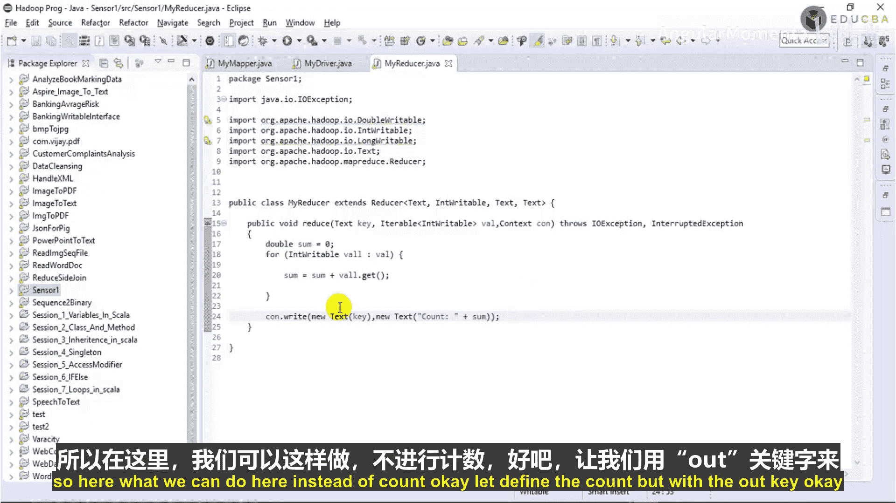

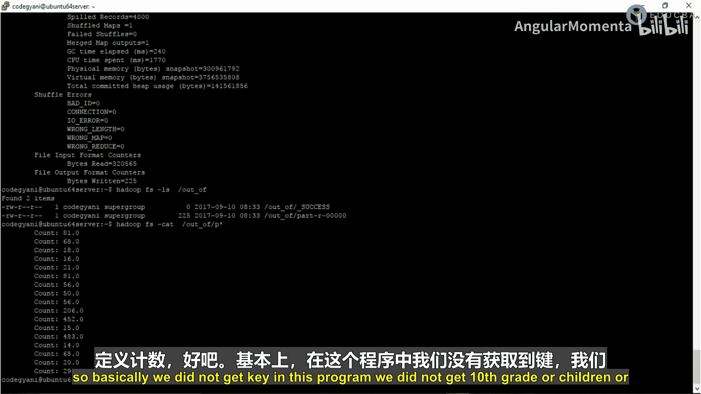

So based on this， it will。Perform the operation， and it will show the corresponding key。

Let's export it。

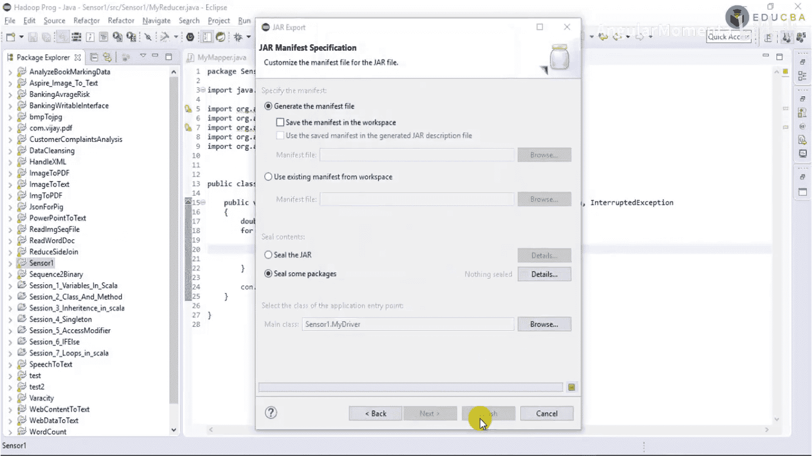

Only exists， okay。Go to win S software。Propeed from。Local towards the Fs。We to put this session。

 the need this folder。Excutive program， same input directory。

 same output directory and same job memory is started it is a job I。

We 00 when completed completed let check file created or not it is created part hyphen up so reducer we have in this program so let us check the output what we get this time yes。

's a correct output so 10th grade people we have 81 count11th grade 68，12th grade no diploma。

18 first second third and fourth grade，16 fifth or6 grade 217。

 third grade81 and so on we have more count for children children is 42 doctorate we have 15 high school less than first grade so all these things so now we have got how many people we have in the retrospective category so that is how we can calculate so now we can work on our next scenario that is how many are not from Philippines。

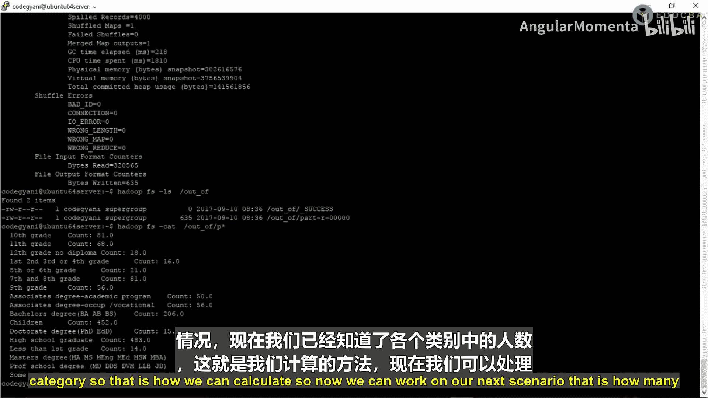

And how many are less than 18 having income， okay， so。How many hours are not from Philippines。

So here we have a column called citizenship so we can group it biociship and we can get the corresponding output so that we can work on my next video so so far we worked on five scenario two remaining in meppeds and then we can perform the same operation in pig and hi other bacteria tools okay okay issue okay so only two is remaining for meppedduce so we will work on the six scenario in my next session hellello friends so now in this session we will work on the six scenario that is how many are not from Philipine I mean how many people are we belong to some other country and staying in Philipine so if we can look at our input file we have on column called country of birth so here we have United States okay we have Philippines also in furs we have some other countries in furs what we can do suppose we have 10 course in the input file。

So we can get the account like the person who belongs to US。

Our count is 40 the person who are who belongs to Philippininees itself the bound is 40 total is 90 and 10 people belongs to some other countries Okay so here we will deal with this column country of birth so we have income okay。

 and then parents and then country of birth okay， we will make it change in the same program here。

We will add few more variable。For parent， that will be the。6 element。哦であ they。

And then we can begin add one more entry of bar。So that will be the seventh element of this。没。

We need to get the count on the country of birth column so this will be the key for this program。

 so here we can pass this。Plong value is a key。And we will associate one。

With all the record so when they reduce your class we can take the count the rest of the program will be same the key the map is reading file and by line so the key will be by offset。

the value will be the whole line search in the text format these are generics so here we are passing the map output key。

I text because we are passing country of above and the value is en righttable because we are associating one with each record so we can take the account so here we commem the string the value which in the text format。

 the value which is in the text format we convert into the string。

And we store that design this variable， and then we。Is splitting。It is variable by because。

If we look at our input file the old data is separated by and then we extracted we fetched all these column from that array。

 so here we are dealing with country above column。So we are passing country of birth and one with each。

So come to a reducer class it will be same we are getting key in a text from map the value we are getting entrytable we are passing key which is text and some also we are passing a text value because we are ssociating count in this。

if we don't want to associate count， then you can。Type entry table or double write table along okay so and rest of the program will be same in this loop we are adding all the value。

 all the ones which we are associating with each record and student will de to the variable which we define sum which is double type。

Here we can define it as an entire type also because it will be if it will not be a float value and like let us look at the driver class。

 the program name is same sensor one， my driver class member class member output key that is text。

We intable reducer class and number of reducer input and output directly arguments。So， on first。

Argument which will pass where executing this program will be the input directory and the first argument will be the output directory we are want to keep our output file so let us save this program and then compile it。

So to compile it， go to project， click on claim。Make sure that only this program is got selected click OK。

 right click on the project。Look export。Next。We need to export the Jaite to give the program so the name of Java we are giving sensor one。

 which is same as earlier。It's same next。Definine the driver class。

 which is my driver because we have main function inside it。

And every parallel execute is start execute with the main function。You can't finish already exist。

 okay， we want to override it。It's okay。冇。

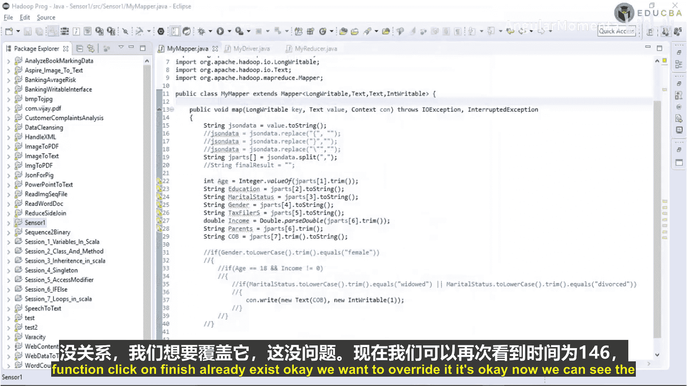

You can see the timing。46 here again here it the same46 so this is a file。Which we just exported。

Drag it。我问了。Is GFS？Now we can match the timing for 16。Now go to our put session。

 this is the output of our last program， which we。Executed so I'm storing the output of our this program execution in the same folder so' de the output directory now let us execute the program so this is the command ado jar jar file which is sensor1 or jar so it exists on our route directory so that so that desire we don't need to give we can access the access is it directly we need to provide input location which you have defined in the zeroth argument and this is the output location which is the first argument of this command so once this program gets completed。

It will create this directlyy and inside it it will keep our output fine not us executed which is started this is the job ID job job gets submitted to the source manager and the source manager has given the unique ID that is job ID map produce launches started map 0% reduce is 0% map completed 00%。

Reduce running so now our job got completed we can see the output actually is created or not so this is the command so we should have basic idea about Uni command to check the output then we can see the file name is part H R it means we have a reduce user class in our program now we can check the output okay。

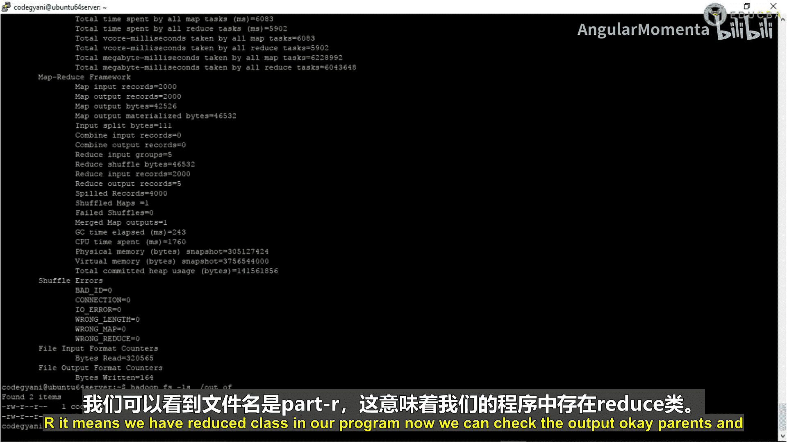

Parents and country your about。 Okay， here， we did little mistake。 It should be seventh argument。

 That should be8， because。On seventh argument， we have parents。Not deep until your birth。

If it' is not a big deal， we can again compile the program， we can export the jar。Same name。

Defin the driver class， you can finish。You will over it。

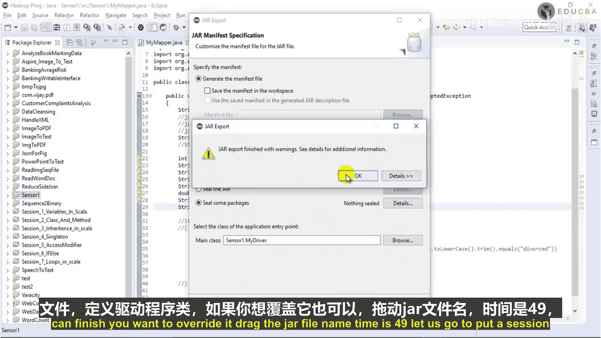

Drg guitar name time is 49。Would't go to police session。Delete this folder。

Because we will keep our output in the same directory。Is a good command。

So now we will get the proper output。We should get we will check it once the program grab is completed so my started my 100 percent。

Ps got completed。We can check the output。Diirecty file is created or not。This file is created。

Iphon R is reducer。Now we can check the output。So now we can see Cambodia，1， Canada to China，6。

 Colombia。9 Cuba 11， Dominican Republic 2012 and so on， Japan won so quoot mark means。

Few records are blank United state 1769， so the interesting things are we have only eight peoples who basically basically belong to Fpi which means the rest of them are outside flipine so this data we can share it with the government。

And they can。Take some strategic decision like they they should allow the visa or not they have fulfilled the quota for this year every country has a quota so they allow few people to come from outside country so depending on this result they can take it take the decision and work on it okay so we are done with this scenario use case only one use case left that is how many are less than 18 but having income so government can take extra against action against child labor law so that we will see in my next video hell friends we will work on the seventh which is the last use case that is how many are less than eight of age but having income so it means basically here we are talking about children's according to the child labor law the government does not allow people who are less than 18 and they should work so government doesn't allow this thing so we can get this kind of records。

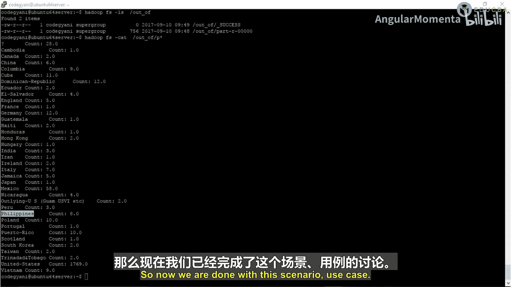

get the count and you can provide this data to their government so they they can you know take the action against the against those children and their owner the people who are providing the job to those kind of children so it basically it comes under the it comes under against child labor law so here if we look at our input fund。

We have one column H， and we have another column called income。So with the help of these two。

 we can get this data so let us look at our eclipse so its the same thing。

The reading records land by line。We are fetching age， education， metro status。

So here we are converting that input。L， which is。Read by map class into this string and then we are splitting that line line by comma because we have data comma separated and then we are fetching all this required value as per our use case requirement so here we need age。

嗯能懂。So here I have already already written the code。Here we can see。

We have one filter call if led if age less than 18。An income not culture zero。

 it means the person belongs to those the people， the person are basically childrens are less than 18。

 but they are working somewhere because they are in earning。Okay。

 then we are passing those record to reducer and they are associating one with each record because we need count only if we look at the use case。

How many are less dense， how many means we need count we can get the data also instead of count we can pass whole line。

But。Here we are looking for the con so we can associate burn with each and every record and rest of the thing will be saved and it will red defile the key for this map will be a long right table that that is the byte of set。

The value will be hold text。Output figure passing signal none。Blank， but it's a text。

the value is intable， which is1 let us look at our reduce class。

So here text we are getting from map in that is one text。

 we are passing blank and then text again because we are。

We have written count so the design it converted into into the text otherwise we can actually pass some other entire table also okay so we have a defined one variable called double to get the flow data but we can change it to either but it is okay。

But we don't have a decimal value in this。And here， we have adding。

All levelss measure are passing through。This record。From here。sent1 class。

So we have the name is sensor1， driver plus， my， left of the things are same。

The output key which are passing from map text。Thatput value which are passing is entire table。

 my reducer class is meritr number of reducer is1， the input director will be the first argument the output director will be the second argument and system will exit。

Once the program gets completed。So let us save it， let us compile it。Click on clean。

 make sure only sensor one is selected。It's compile， no matter。Exported。So。

Sensor one same name defined main class。That is my driver because we have main function in this class。

And。Proograms start executing from the main function。We can' finish， you want to override it， Yes。

 we want to override it。

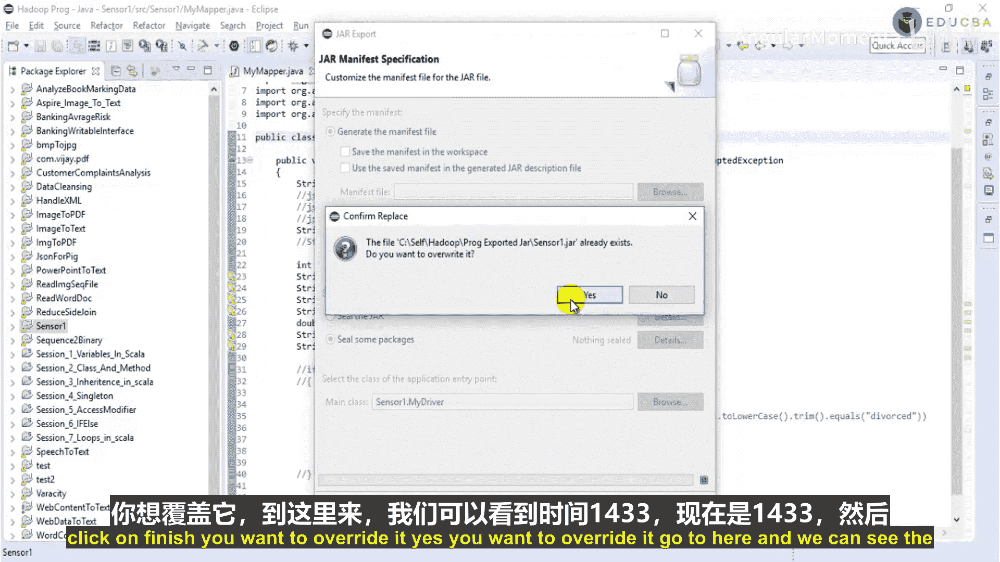

我仲去啊。And we can see the timinging， 1433 is 1433。And then we can drag the sign here。😔。

It's 14 to 33 now let us go to a book session。This is the output of our last program。

So delete the output directory。Because we will keep our output in the same directiony。

That us executive the command， our final name is Jamesman。

Input location is same gender R output director the same out and as of。So as as executives program。

 it started， it's a job I job that submitted to the source manager whenever started。

 its a job I which you can see on the name node right browser。We have completed。

Reducuce running jobs completed。That doesn't go our full directly。

We can check if we have file or not your file is there， we can see the output， so we have 535。

Children's。Who are working。So now we can submit this data to their government if they are looking for the actual data。

I mean都。Like if they support we have the file we have the person name， address。

 all these things so instead of one， we can pass full line as a value and we can get the data and we can provide to the government but this is a this file we have only we don't have name and the address。

So we can provide the count。So now they can check who are the 535 members。Basically our children。

 but working and they earn the they're earning some money because it comes under the against the child labor law。

So they can take some。Strategal or they going to take the decision against。

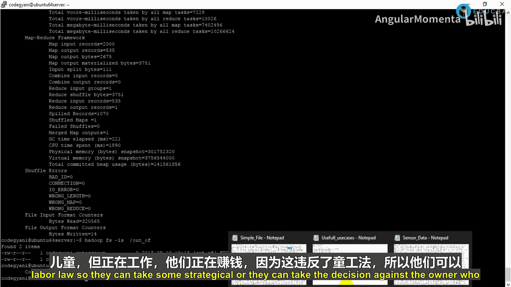

The owner were providing a job to the children so now we are done with all the seven use cases which you written we can write more also。

 but now we have basic idea how we can perform how we can enlarge sensor data so if we don't have the use cases。

We have a simple profile file， but。We are looking for the data scientists and data。

Analytics kind of from then need to generate the useful information from that input file which we did so first we generated the use cases what actually the information we can provide to their government for their country growth they can they can take some decisions strategic decisions or any decision by which they can improve they can develop their country。

And they can。Reduce， reduce the crime and all this things。 Okay， they can control the visa part。

 they can educate the more。People there they can check the income text part and all these things。

 so these are the few use cases which we generated by analyzing this data now we have performed how we can execute this scenario in they reproduceuce we have seen。

We have executed all seven scenarios and now we will perform all this operation in the another big tool that is called big。

In my next session so first I will give you a basic idea what is big and how it works and then you can take the same scenario and then we can。

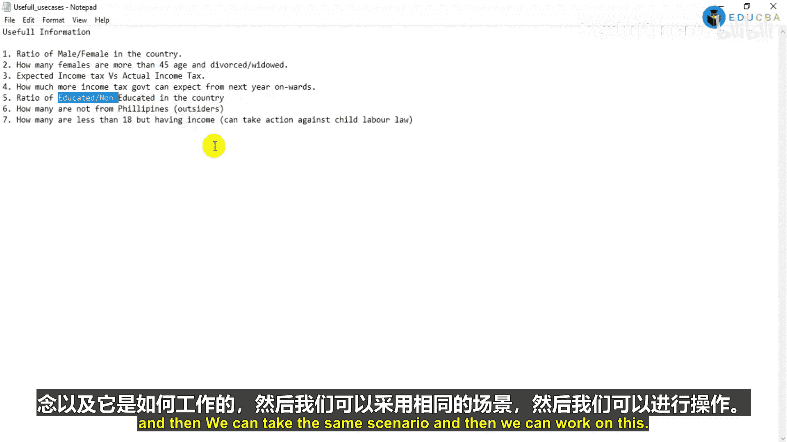

But on this。