# 【EDUCBA】使用Hadoop处理大数据：应用MapReduce、Pig和Hive-｜-Big-Data-with-Hadoop：-Apply-MapRedu-p04-02_01_01_Pig-MapReduce与Hive之间的区别--BV1KrFozQEPf_p4-

Hello friends， So in the last session， we processed our JSO input file。In Mapedduce。

 and he worked on。These seven scenarios， which you can see on my screen now。

 so basically we just got the raw data。Which was not useful。But we。

We perform the data scientist and data analytics kind of role。

And we generated some meaningful information for the clients。

 So with the help of that information our client。Can take some strategic decision。In order。

To development of their country。Okay。So so far， we have seen the basic swaps， big data maprouce。

we have seen how we can process j format。we don't have just libraries so how we can convert it into the plain text format file and then we can process it。

Further， so we have already implemented these seven use cases in Meppeduce。

Now we are going to implement the same n pig。 so before we start first let me brief you about pig pig is basically。

A pig is nothing but the abstraction of maproduce。So the person who are not familiar with the Java Escalala or Python so they can use the pig to process the file。

So mappedduce and pig are same， but in Mapedduce we have to write a long code。

Maybe1 hundred lines or maybe more than that， or maybe thousand lines。But in P， we need to write。

A big Latinin script， which is。A very similar to the kind of database query。

And we can process that file as comparative pig is a little bit easy。Then， reproduce produceuce。So。

What is paid page is nothing but the data flow language。

whichch basically developed only because of the persons who are not familiar with any Java language so person who don not want to write a code they can go for pig so pig just built。

To keep in mind of those kind of people so in pig we basically write a scripting language that is called pigative script。

And pig is nothing but a data flow language， so basically pig works on relations。

Relation means relations are nothing but they is steps。So in pig， we have few steps like S1 S2。

 So all these relations are。Liinked all。So what does it mean。So suppose in elation 1。

 suppose we have named it like S1， step1， so in step  one， we can load the data into the pig。

Pig in into the pig shell。And in a step2， we can process that loaded data。

 we can perform any operation like filter group by core group。OrJo or anything。

 So big works on relations and all the relations are。Liinked all。So， and if we。

 if we look at the comparison， you know， what are the。Comparison between pig and high。Pig map high。

 so we can go with。I have an Excel file。There I have written differences。 so now we can。

Have a look of it and then we will have a basic idea。

About the differences where we can go for mapreduce。

Where we can go for pig and where we can we can go for hive so if you want to learn more about pig you can just type big tutorials on Google you will get a partial tutorial link and you will have。

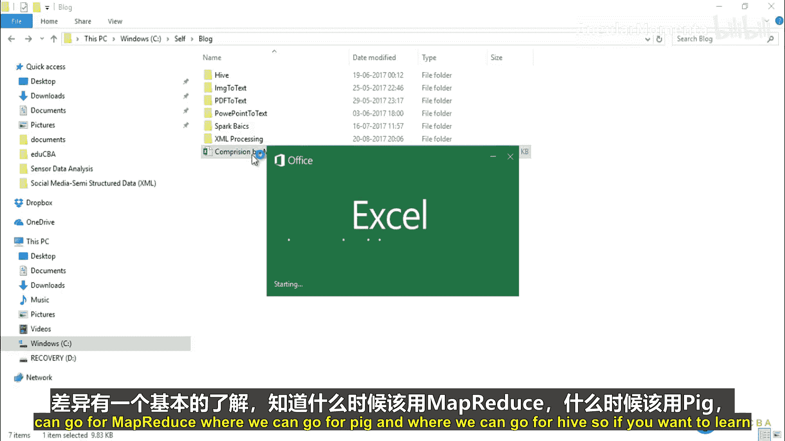

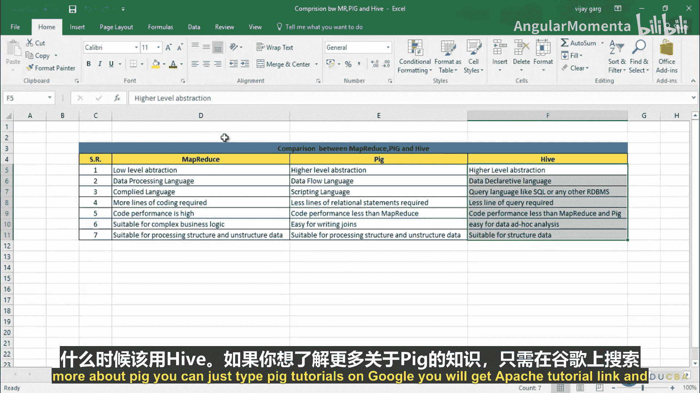

You know， then you can go go through it。And you would understand lip pig。

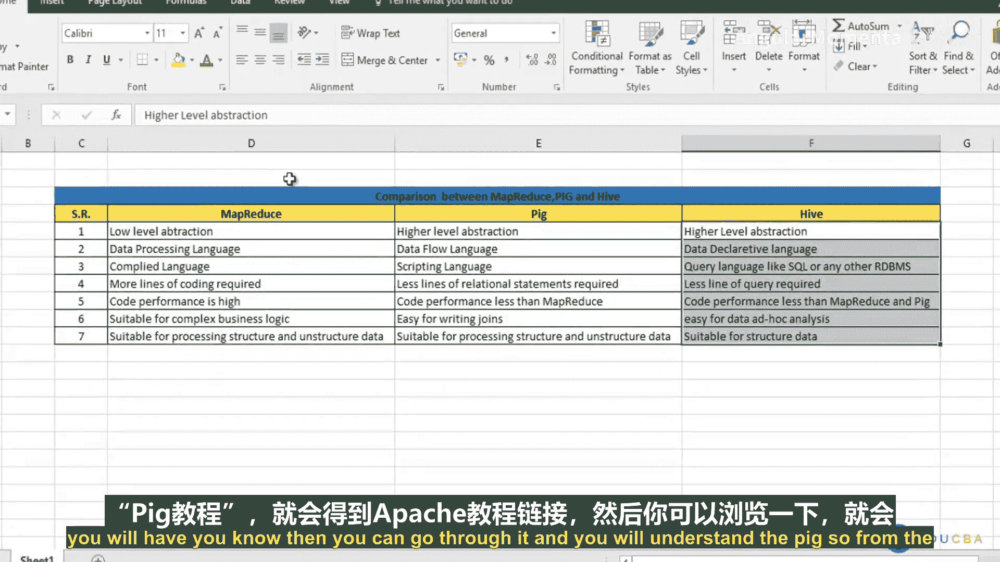

So from the project tutorial。You can see how to write the node command， how to use the filter。

 how to use the join， how to code group， how to group， how to split data and how to。If多了。

Data into the S the Fs。Record in P。 if you are working on pink。

We should be very very careful about you st the data。

If we are we don't destroy the data the next next time when we log in into the picture。

 we won't be able to see that result so because it pick is only for that particular station。

So this is one of the disadvantage of pig。So， I will tell you we will see all these things。

 how we can load， how we can perform the transformations and how we can store the result into the SdFs。

So， here we can see see the difference difference between reproduceduce。

 big and high so we can have a basic idea and we can decide when we we have to use what tool of big data so the first difference which we can see is。

Maroduce is a low level abstraction。Vilow label。Because in medies， we write everything。

 everything we need to write in a form of code。So there is no abstractstruction。

 There is nothing hidden。Whatever we we want to perform any if condition， any case statement。

 anything we need to write a code for it。そう。There is no abstraction So that is why it's a low level abstraction。

 same thing in pig its a high level of abstraction， So you can perform the you know。

1 thousand lines of。Or whatever we perform in mappreduce by writing with how thousands line of code。

 we can perform the same thing in pig in4 or5 pig statement。Because everything is hidden。

 paid internally internally execute the mappeduce programs。

There is no difference in processing just it is a high level of abstraction now most of the complex things are hidden from us。

And the design is very easy for the developer。😊，As compared to mappedduce。Okay， hi。

 we will look after peak， but here we can see the differences。Again， in home。It's a highly。

 high level of abstraction。So， have is nothing but the。

Secl kind of language and that is called hi Qn in big data high query language if we come the second difference that is data processing language so map produceuce。

Is nothing but that data processing language where we process the file like we have seen we got the J input in the Js format。

We processed it， we converted the data into a plain text format。

 and then we processed the data and we and we performed。That's several use cases。

 which we have written。So maproduce is nothing but the data processing language。There is。别。😊。

Is a data flow language。What does that mean data flow because in pink。We have all the control。

It is developer who will decide the flow of data like in a first relation what he or she wants to do in second relation what they want to do so the flow of data will be decided by the developer and that is it is known as data flow language。

The same thing in hive hive is a data decative language。Because it's aque language。So。

 we can write a query， but we don not turn in control how it internally will get executed。

How the hive engine will execute that query。So it's a data decative language。Next thing is maporduce。

It's a compiled language。So when we are at a code， we need to compile it if you can remember after writing a code。

We just click on project and we click don clean so clean was the。Compiling part of that code。

 what we have written。So map compile language。Pig， pig is a scripting language。

So pig has this its own language that is call that is called pig letter script。

So it is a scripting language， we need to write a a script to perform， to process any file。嗯北。

Where is hi this。A SQL kind of language like we write a query in any RDBMS。

That is where query in any relation database Melvin system and I mean it it could be a Swall it could be a oracle or it could be a Db2 or it could be any other RDBm。

So hive， use this same。对啲靓。So。Next we can see more lines of code codinging is required。So。

 in Med we have already seen we need to write complete program I mean whatever task we want to perform。

 we need to write everything in the form of code。In P， the same thing can be done。

In the few lines of a script because it is a abstraction， it is a high level of abstraction。

 most of the things are hidden。

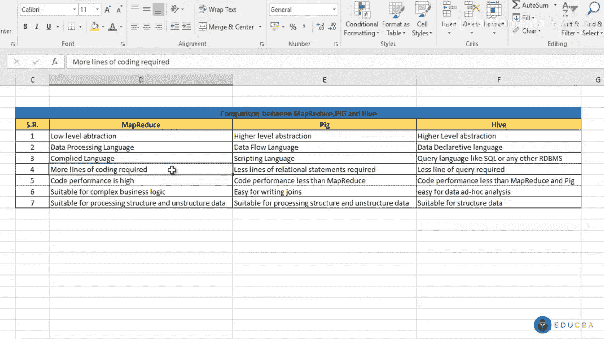

I mean， for example。We can group by we can directly write group by and the column name in pig。

 but how internally it is the pig Indian is doing its abstractse， it is hidden from us。

So you are going to perform the same thing in pay less number of lines of code。Hi again。

 we just write the query and how it internally executing we don't have any control so again。

We need to write a last number of code here。The next difference is what performance is high。

Why code performance is he。There was everything written by us。And it's。

The developer who can optimize its code and so it can utilize the。

And he or she can get a maximum performance of the code which they have he or she has written。So。

 that is why it's a。In Meloddes， court performance is high。Where is in pay。

What performance is less than the mapro？😊，Because most of the things are hidden and we don't have any control。

Those particular things。Same thing in hive， we just write the sQL statement and we don' not have any control on it how hive query in June is executing that particular query。

So， again， you here。The quote performances， Le than map and pink。The next is suitable for。

Complex with this logic。 So what does that mean。Maaprenism is basically suitable her。😊。

Complex pen logiconic。So mapuce， we can process images， we can process videos， we can process Xls。

 we can process Excel file， Word document， flat file， PowerPoint， file， anything。

So basically in reproduceduce， they can process any kind of。Any kind of format data。

ItWe what we don't need to bother about？In which format we have data。

And we can process the same in methoduce。That is why it very suitable for the complex business logic。

But we should know how we how what code we need to write to process that particular format data。

So when we can， we can process anything in reproducepedduce。Where is P？

You can also perform the same thing in P。But it is not as easy as it is in mapuce。

So here button pick is easy for writing a joint。If we perform the joints in Mebduce。

We need to write map side of joints， we need to write reduce side of joints。

We need to understand distributed caching in mappedduce。But NP P。

 we just need to write a true statement joins。I mean we will be to write a single shape join。

E by employee and commerce C on any column。所以说省本。Ex scripting language and we need to write a single statement to join two files or two data sets。

But method need to write a whole code for this sale。

So that is Np easy for adding joints and me disease photograph complex business logic。

Hve is for data adopt analysis。What did it mean。So。We can understand。

A mapduce is for data processing high pick is again for data。

Processing and high is for data analysis why high why high is for analysis because in high。

We just load the data into the tables and we can perform aggregation。

 we can summarize the data and we can generate a report for the analysis。And that reports。

Can be used by decline and then they can analyze the growth or they can analyze that report。

From multiple point of from the multiple angles， I mean。

So they can improve the performance in their industry， in their country。

So it depends on the database which have the table， it belongs to country。

 it belongs to organization or if it belongs to what。So they can take the decision then。So in high。

 we dont perform， you know， we don't process anything， we just is for data analytics。Okay。

So the next and the lot differences。Maap bridge is suitable for structured and unstructured data。

So here I took the example， we can process images， we can process videos。

 we can process Excel file Word document。PowerPoint。

 so all are the unstructurestructed data so we can process the same in mapreduce。

So we can also process this simple flat file。In mapduce， so map is suitable suitable for。

Procesedsing is structured and unstructured data。P is nothing but the me。

 but it is a high level of abstraction so we can perform the same thing in pig also。

 so P is also suitable for processing structure and unstructured data。

Well hi is full instruction data。Because once we are done with the data processing we can load that data into the hie tables and then we can perform the aggregation。

 we can generate the reports and we can summarize the data for the further analysis so now we have basic idea where we can go for map produceuce and where we can go for pig and when we can go for height。

So， if we have a。we have to perform like for example， if we have Xl file and we have to process it。

So， we are very very very well aware about you know the Java language or scholarala of Python so we can easily write a mappeddice program for it so in that case we should go for mapreduce。

But if we don't do how to write。The Java code or scalar of Python， then we should go for P。

Because in click also， we can process the external file。That is same structure data。

And where we can go for hive where we have to just perform the analysis so we can create the table。

 we can create the views， we can create the any database is object and we can load the data into the tables and we can。

😊，Perform the analysis。So I is for return analytics。

 so now we understood where we can go for those two。

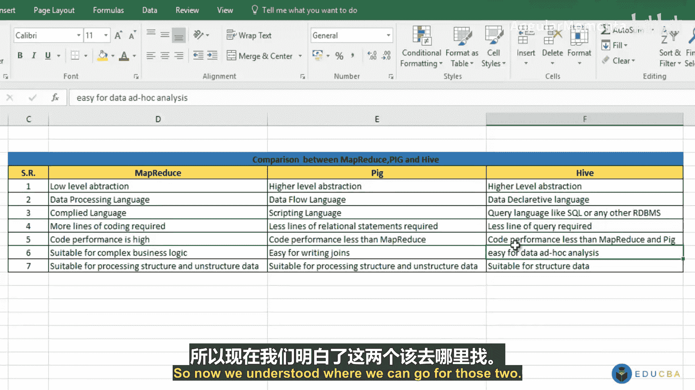

No。Let's come to a scenario。Now， we have to perform。This file， J format file in P。

 So if you can remember。Before starting with the Meuce。

 we have just gone through this Powerpoint slide。Which I have created for the basics understanding of。

The system， how would execution the production。So same thing is here we have on the web portal where clients upload their data on the daily basis。

 on the weekly basis only。On the monthly basis， the sequence is dependent on the client。And we are。

Extracting that js file through some Java utilities。A local machine。Okay。

Local machine is not the SDGFs。It's our local machine on the system。そ。

Client is loading the flight with data validation。野生飞。Depending upon their frequency。

 it could be a delay。 It could be a。Weekly fortnightly or monthly name and in the same frequency we are loading that data downloading the data into our logo。

Machine。Now， we are。我病。Those data， which we have downloaded。From the client from the web portal。

 which is provided by the client。We are copying those funnel into the SGFs that is Hadoop distributed student5 system。

And then we prophon in map produce， but here。This time we will not use mepeduce， we will use pin。

Because in materials， we have already seen how we can perform all these operations。

 how we can analyze or how we can perform all these scenarios。

Which we have generated from that raw data。Okay， so this time we are going to use take so should up this line。

 which is。Wten over here in the red fonts， pro and foreign meice， it could be a。

Roson is on filing pig。Iello嗯。We can process data in。Ft file， once we are better in the。Flat file。

We can store the return to the hive tables。And we can show that data in the form of reports or cubes or we can use any reporting or analytics tool。

you know， which is preferred by the client so client can easily view the data which is processed by us。

So， everything is happening through the Oz， everything is scheduled， nothing is manual here。

 but is second step which you can see pro file through maproduce so sheet of maproduce this time we will use。

对。Okay， so now we system because in big， the system is same only。Instead of methodies， we are using。

对。And all this。And we are working only this part from Sgfs 2 process process data because all these things are very simple。

 we can cooperate it from local to SGFs and then once we are done we can store the return to hyp that we will see once we are we will start working on the hive tables。

Okay。And then， you can easily。Show the data in the form of reports。So we are looking only S JF 2。

From LJFs， we are processing that file from LGfs and converting that file into the processed data format that is very flat file that is nothing but the flat file format。

And then we are noting that funding to be have tables。So this time instead of mapped。

 we will use pink。

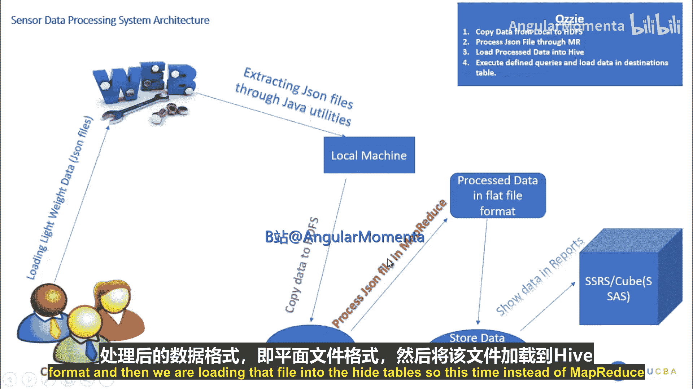

So let me close it， so we have to perform this operation。So this time， how we are doing。

 how we will do that。So in Meeduce， we converted that flat file。Andto the symbol file format。

 because we did not use any。You know。What we call。Json libraries， you know。

 we did not use any J libraries and we process that data。

let me open the paint so we can understand it much much better。So， suppose。This is over as GFS。Okay。

And we have。The J file is here。Okay， so now this time in P in mapdes we converted that j file format into a single simple file format。

this time， we will not do the same。Here。I have return。One thing， we have one middle layer。That is。

Basically。Is called。被告方。That is， that is nothing but the big function。So， what。

What will happen this time now？Now we will create one function if in pig and we will register that function into。

As Gfs in P Latin in is scrap， okay。Once we were， we are done with it， we will ask， we will。Use。

 we will call this file。Through big function。Okay。So in that big function， we we will pass。

 we will pass basically one parameter how we will do that， we will create。

This single thing is a key value pair。Okay， this single thing again is a。He will repair。So， we pass8。

住 that function。Okay， if you will pass 8。In the pick function。

 So this pick function will interact with this file and will get all the data。

All the value of for the key edge。So。It will get all the edges。Which we have here， 73， 58， 18，9。

10 and so。Same thing if will pass if if you will pass education as a key。

 then it will return high school graduate。And some college， but no degree。

And all the values for the corresponding key and here the key education。

So it will return all the values for the。軸春機。The same thing will happen for all this column。

And you can pass required key。Okay。And then。We can get the get that data and here。

Once we have required data from that file。We can perform required action here。Okay。Whatever action。

 depending upon the upon our use case。For example。If we have about given one first one。

 that is the ratio of male， female in the country。Then。We we we can pass gender as a key。And then。

We will have all the genders， male and females， what whatever records we have in the input in the input file。

 we have all the genders from that file。And then we can get the we can perform the group by and we can get the count。

Okay， so how many males we have and how many， how many females we have。And Wednesday of data。

So this basically now on track with this part。And here again。你gan。Istore that data to the。2。分丝。

For the。Reports on the further processing。Thestore。Later。It do SJFS。

So that is how we will use big function。 So this time， we will not convert that file into the。

Simple flat file， which we have done the reproduce produceuce。

So this time we will not convert that file into the simple flat flat file， we will。Process the file。

 as it is。The file we have in the JL format， so we will close the file as it is we will not make any changes in the file。

And we can get the required data from the file and we can then we can perform the operations depending upon。

A business use cases。And then we can process the data and once we are done with that。

 we can store that output into the Sgfs so that output， if we are done with the output。

 we dont need to proceed further。So we can easily handle that output to the client or we can。

Loow that data into the hi tables and we can show that output in the form of reports。

Or you can directly handle the output in form of Excel or anything。

So that is depend how band is expecting in which format。So you can。

Provide that output to the client and then they can take some。I mean。

 they can take that output for their business。So so that is how we will perform。So now in this video。

 we understood the。What is free。What is the difference between medes p and high where we can use what biggerette tools？

Okay， we have understood the system。There is， there is just only a slight change that is this time。

We are instead of map， we are going to use big。And in map。

 we converted our adjacent file format into the flat file。

But here we will not convert that file in any format， we will just simply。Process it， as it is。

And then。So there are two differences we will not convert the file。And we are using space。Okay。

So in my next video。I'll tell you how we can write peak function。And how we can make a use of it。

And we will start with these scenarios。

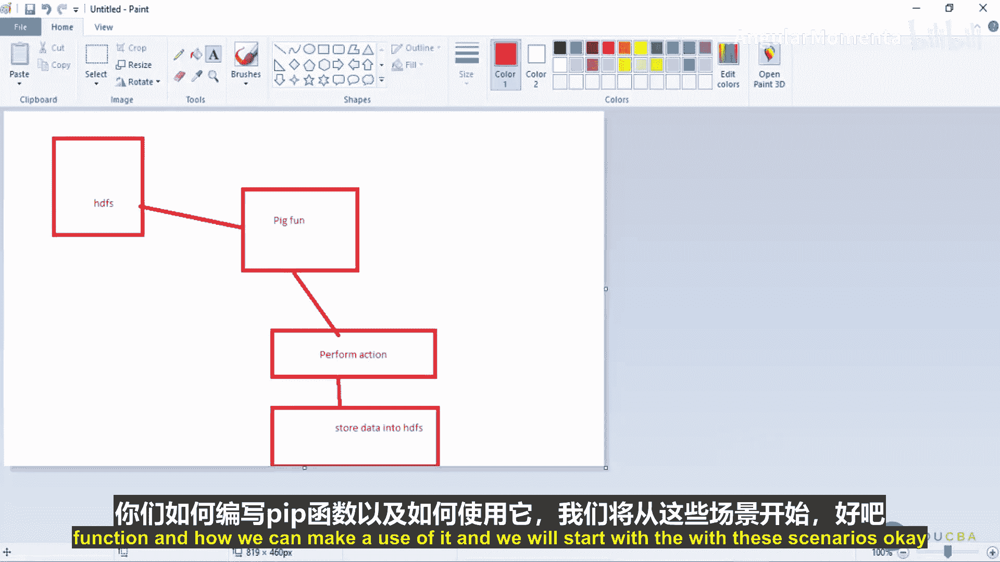

Okay。

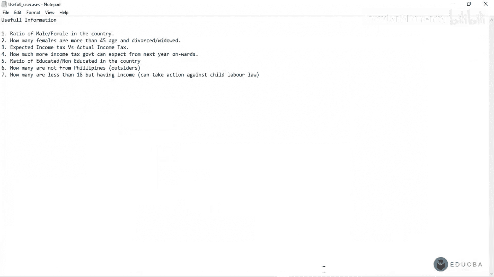

Hello， friends。So， in the last session。We understood。

What is big waves in the differences when they understood where we can use mapreduce where we can go for pig and where we can go for。

Hi， so we understood the basic of ps。So in this session。We will。AW deep peak function。

Because we understood how we will interact。That file。

And this time we are not going to convert that jsson file into the flat file format。

Which we did in mappreduce， so this time we are we will write a pick function。

And with the help of this function， we will interact with the file and we will get the required data and then we can perform any transformation and once we are done with the。

Process， we can store the output in into the SgFs okay。

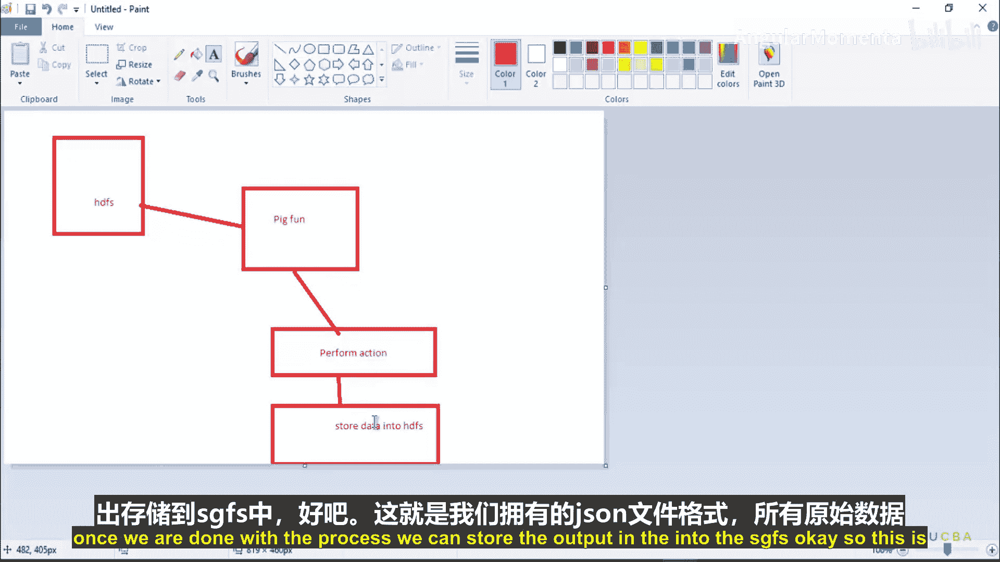

So they see the Json file format， which we have， we have all the raw data here。Now， let me。

Open my eclipse。It is opening。It takes little time， it will take a while， be patient。So。

 here you can see。I have one project called Jason for pig。So I have already written the code。Okay。So。

 let me。De。This part， because it is little confusing。So here I created one project。

 I named it as Jason 4 pay。I have a package inside it。With the same name。And then inside it。

 I have this file call。Jason for pig。The class name is again same and we can you can have a different class name。

 so it depends upon you， so I just given the same name。So， once we are。

Done with the project once we created the project。We can export this jar file。

 so this is for logging， but I am not using any logging here log。But we need to write to。

 we need to import。Load to their file。What is Hadoop？

It's the same thing which you imported in mappedduce。And here we need to add one more called pig。

So it's a older older version。 So now you can download delete version from Google。Okay。

 and how you will load it。You can right click on the project。You can go to build path。

And click on configurefi build path。And here UK， if we have tab called libraries。

So here you can click on add external jars。And there you， you should have a list of jars。

 which you want to。Import。And add it here and click， O。Okay。

 so I have already written the code to say over time。

So now we can go go through it what we are doing here。So， basically， we have two types of。

So first we need to understand what is functions in pig and how many types of functions we have。

So function is nothing again but delete Java code， Java program。

So we can write any UDf UDf is nothing but the user defined functions。ok。

So we can write the Java code， which basically interact with our input。

And it will perform the same operation whatever we have written in our code。

So we have two types of functions one is。E well functions。And another one is filter function in pink。

So we talk about filter function filter function we can understand by its name filter。So basically。

 this function returns true or forms。So for example， behavior input file。And。Suppose。Agenda， okay。

 and we are passing mail。 So if mail is there in the input file， it will return true and if not。

 then it will return false。So we can use that filter in the where condition in the big la script so and depending depending upon the。

Result of that function we can filter out the result from our input file which we have loaded in our big share so that is called filter function in P another function we have called evil function。

So evil filter function only returns true and false。Whereas evil function returns a complete string。

 So we have some scenarios where we want to perform some operations。And once the operation is done。

 we want it to be resulted a string or some text。Then， we can go for。Eval function。

 That is by basically a evaluate function。 The name is evaluate。Okay。

So two types of function we have in P one is filter and one is even and we can make a use of anything anyone depending upon our requirement。

小黑。We are using evil function。Because we will pass something。To that function。Okay。And。

That functions。Will interact with the input file input data， which will pass into that function。

 and then it will return the result。After the。Locessing。As per our code， which we have written。So。

 here。As you know。Tuple is nothing budy。Hlo。In Hadoop， we called T。

To the row an atom to the particular column。Okay。So， here。

Once first we will load the data into the pixel shell。And once we are done with that。

We will pass the couple，1 by one means。A roseose。1 by one to this function。So are false。

 suppose first time， if we pass。This record。Do that function。Consider this record is going。

We are passing into the function。So。First， it will get the to argument what we are passing here。

 First argument will be the whole line。Which we have selected here。The whole line。

The second argument。Will be the key value。Key volume is the key name of key。 So what data we want to。

Get what value of key， Which key if we want it to be extracted。Okay。

 so both the things we will pass in a single argument， Okay， I will tell you how we will do that。

And then we are separating those value by get 0 and get 1。 So in0 element， we will have whole row。

And in the first element of that argument， we will have key value。 So， for example， you can consider。

We are passing。Whole row at as a zeroth element。And first row the key， like age as a first argument。

 Then we are replacing these unwanted things， which we have in the。Doouubble了。In the whole row。

So you can see we have curly bracket starting curly bracket and ending curly bracket here。So first。

 we are removing that。Clib bracket。And then we are removing that forward slash if we have any Indian the input file。

So here， to remove the。This is the escape character in Java。

So to use to remove the escape characteror， we need to pass those corrector as。Double quotes。

 two times double ch。Otherwise， it will be used as a escape protectors。Okay。

 because Javava understand it as a escape correctors。 So we need to define its not escape。

 We want to remove it。 We want to replace it with。B。So we are removing it。And then。Yeah。

I splitting that value。With the help of comma by comma。 So if you can see of input file。

 the key values are separated by comma， we can see age。73， then comma education。

High school graduates then comea medal status， widow， then comma， gender， female， then comma。

Tax further status none further than we have comma。

we have come after each key value pair we have income parents。City of birth。Cizenship。

So we have all the key values are separated by comma。 So we are splitting those key value。Okay。

And then what we are doing。你。Now we are stor that value in in the form of array。

 so age will store on this zero element of this array education and the N its value will be stored only first element of array what we have next。

Mless status will be stored at the third element of the array and so on。

 then by executing a loop so it will go through each and every key value pair。Okay。

And then how key values are separated。Key values are， separated by colon。

So we can see here in our input file。Age colon 73， education， colon high school graduates。

Mal statusators， colon， widow， gender， colon， female。X file status colon， non file， income column。

1700。09 and so on。So first， we have two things here。The key values， the combination of key and value。

 are separated by comma， and key value itself。Is。Separated by colon。

 So here initially we are splitting the key combination of key value。

By comma and storing those value in the form of array and then we are executing for each loop because now we have all the key values combination in array。

 so now we will go through all the key values and we will again splitting the cot combination which are separated by colon we are splitting that combination。

By colon。Okay， so now here we have。A call single well。So in single while， the zeroth element。

 we will store the key and the first element， I mean， the first portion of this array。

 we will store the value。😔，So， now。We have all the key values because it's a forage loop。

 it will go through all the key values。Okay， and then we can， we are passing。That key。

To the and we are checking the key with your passing here。This input parameter。

 the key is equal to the0th element。Which we have in that array， the key is equal to。

 like suppose if you are passing age。😔，If we get the edge， then return the corresponding value。

So for the first row， it will enter 73。O呀。If。It's the。If it does not fill this criteria。

V ittable later， none。So here we are just not doing anything。 It is a very easy thing。

It's a very simple code， which I have written。 We have to pass whole tu。

The whole z and the and the key， the which key， the which value for the corresponding key we want。

To extract track for the processing， then。The tuple which we have passed。

 we are removing the unwanted things from that tuple。

 we don' not want starting and endinglib calib brackets。😔，We don't want。The forward slash。

And then we are splitting that value。😔，毋讲吗？So， we have。Give a lease。Okay。In the array。

 and then the key values pair itself is separated by colon。😔，So， then。We are again splitting。

 we are going through each and every key value combination and then we are splitting that combination on the colon soon in soon the zero element of that array。

 we will have key and on the first index of that array， we will have value。So， we know we have。

The key on the zeroth index of the array so we can check if the key is equal to the key which we are passing as input parameter。

 then then return its corresponding value because we want it fall further。Processing， okay。

So once we are done with it。We don't in the peak function， we don't have any many class。

 we don't have member class。 we don't have nothing。You just simply have the class。Viビ。

The name we can give anything， we need to exchange it with the base class depending upon the recommend so we are creating any filter function。

 we can use filter function here。F德风。And if we are using a evil function。

 then we have to write evil function here。Okay， we need to extend it through those two functions depending upon upon our command。

And then we can process that data。We can pass the argument。To the function。

And we know function always returns something。So if it does not meet the criteria。

 it will return null。But make sure that it will return begin note。

Before finish the function without written statement。We have to return something。Okay。

Because function in any any language always returns some value。Okay。

So once we extend it with the E function class， those two classes will be imported automatically。

All dot A dot pick dot evil function in the second is all dot Aache dot pick dot data dot tapple。

Because it will take the argument as a topple。This function takes the argument at a top and then we can get the data format the argument and we can write our custom code as per our business requirement。

So that is how we can write a function in the pay so once we are done with it， we need to export it。

Okay， one more thing in the same package we can write multiple function like I did here。Okay。

 so we can have0200 number functions here。😔，we will call it。Once we are done with it。

We can export the jar file of this function。And then。We can call this function by its class name。

 so we have 1 20 function。The name of the functions， all the functions should be， unique。

We cannot have two functions with this same name， otherwise。It will be a conflict。Okay。

 so so now we are done with the function， what we can do here。We can export it。Let me check。

 we already have that function or not。Pig Jason jar。 Okay， I have already exported this function。

 so you can。I don't need to export it again。But。You guys can right click click on export and you can export on the location。

 you can define the location from here。Okay， and you can export it。Export part is same as mepeduce。

How we exported the Japhy in mepedies， we just。Did be right click？We click on export。为。

Define the path where we want to export it。We defined the main function main function was0 in our driver class and then we exported it so once we are done with the export we can copy copy a J from our local machine to SGfS so we can use any tools for it so I basically are use when SGP which connect my local machine with my SGfS machine SGf machine is nothing but a Unix box that is my virtual machine on my system。

So you can reduce any tool， you can use win S also， So once you are done with the export。

We can copy that file from local to SDGFs。And then we can use the we can use that Dar。

 and we can process the file。So in Mepedduce， we directly。Once we we exported the jar file。

 we copied it from local to SGF。And then。We used that jar file in the Hadoop jar command。

 and we executed the code。But here， as I told you， once we are done with the export。

We need to register the J file。So。If suppose today， I am logging， Im logging on my big grand shell。😔。

So I register my file， jar file， and I make the use of it。But next time， when I。

Suppose if I log out and then next day， I log in again。So again， I need to restore it。 It's not like。

Once I restart it， I can。Use the same every time if you log out。

We need to register the jar file and then we can use that。

 so I told you in comparison in my last session P， everything in P is there only for that portable session。

 it is not for forever。So whatever we are doing in this session， we want to perform the same thing。😔。

We need to perform these same steps again， it is not like we have done it so we can call it again。

 no， it is not possible in pay。So this is one of the disadvantage of peak。

So now we have done with the code， so now we will export it， we will register it and then。😔。

We will work on our first scenario。 So now let us go through our scenario。

Because this is the code which I have written。We can use for all these scenario use。

Because here this code is generated。It is not dependent on any particular thing。We just need to pass。

リき。So in the first scenario， we need to calculate the ratio of male and female in the country so what we can do they can pass the whole line。

 which is doubleple。And we need to pass the age as a key。So， it will return the。Not h。

 we need to pass the gender as a key， So it will return the all the genders。

Whatever we have in the input file。Okay， all the males and females。And then begin。

Write the pig letter in script I'll tell you how we can do that and then we can calculate the ratio。

 We will get the count how many males we have， how many females we have。In the country。

 and then we can store that output。And we can handle this data in the form of flat file or in the form of any format astic client requirement。

 so now they can make the use of this data。So in the second scenario， we will pass。

We need to calculate how many females are more than 4545 and diverse， so we need to pass2 parameter。

1 is 8。And another one is we need to pass three。First we need to pass the age， sorry。

 first we need to pass the gender， so we will get females and males so we can we can filter out those records。

By femaleamine， okay。Then we can pass the age because we need to get the data for the females who are more than 45 years of age。

So then we can filter out data data also。And then we can pass the marital stitchors。

So we can check their divorced or widow or simply married。😔，So， accordingly， we can。

Part take the filter and we can process the data in the。Pick， okay。

 so we will use the same function in all these scenarios。So in the third one。

 we need to pass the income or tax far status。Then the next one。

 we can pass incomp Government can expect from next year so we can pass the age if the person is。

Equals to 18。 So the next year。The governmentover can expect the text some sorry tax。

 some tax from that guy who is 18 years of old this time。And he or she should be earning。

They should be。They are not unemployed。 They should be employed。Okay。

 so we will use the same function and we can we will get the correspondent data and we can process the data into the page。

So that I will tell you so now in video we。

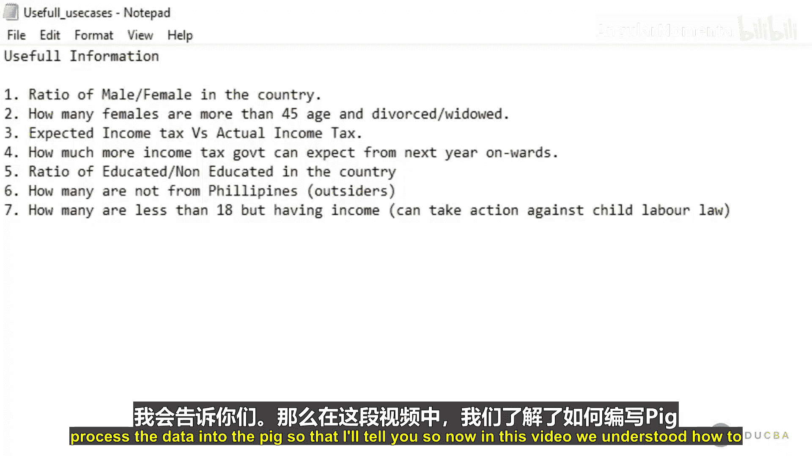

How to write pick function， what big pick function we have。And。平。Okay， what is big。

 what what big functions we have where we can use which pick function or we can write the function。

And then in the next video， we will export the jar file。We will。😔，Register that alpha jar file。

 and then we will use the。The code， the jar file which you have written。

 and we can process our scenarios。So。We are done until here pick function in the next video， we will。

We start with the Perform action part and then we will store the data output time to the LGFs。

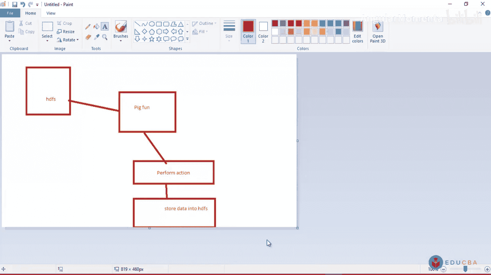