# 【EDUCBA】使用Hadoop处理大数据：应用MapReduce、Pig和Hive-｜-Big-Data-with-Hadoop：-Apply-MapRedu-p05-02_02_01_使用函数在Pig中处理用例--BV1KrFozQEPf_p5-

Hello friends， So in the last session we understood what is big。

What is the difference between pig mapuce and hive， and we have also understood， you know。

Where we can use reproduceduce where we can go with pig and where we can go with。はい。

So now we can we will start to work on these scenarios in pig that。

As we discussed in our last session。Big is。A data flow language。He here developers。

One who will who basically decide the flow of data。It's in our control。

 So here we will decide the flow。I mean， in first relations。

 what we want what we want to do in second what we want to process it。And third， and so on。So。

Now we are going to start with the p so here we can see my cloud machine is running。

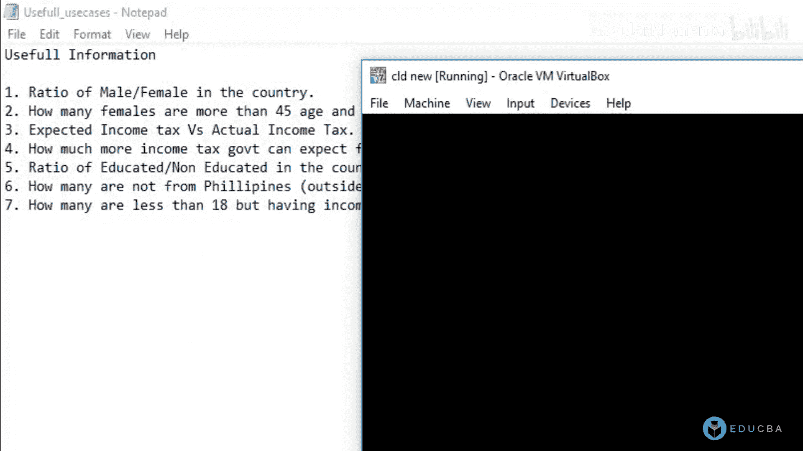

Okay。My clouder machine is running and I have connected with this machine through my pot。Session。

So in my last session。We understood this function。So we will use this function。Now， and we will。

Work on our use cases so you can see I have already exported the jar file。Of this function。

Here on this location。So I have already told you to export the jar file。

 you can right click on the project name。Right click on the project name。Click on export。

And then choose the jar file option from here。Click on next。And here we can give any name。

 so I have already exported it。By the name of pig Jason dot jar， and then you can click on finish。

So the same name name we can see here， pick Jason dot jar。

I copied this jar file here on my Hadop machine。

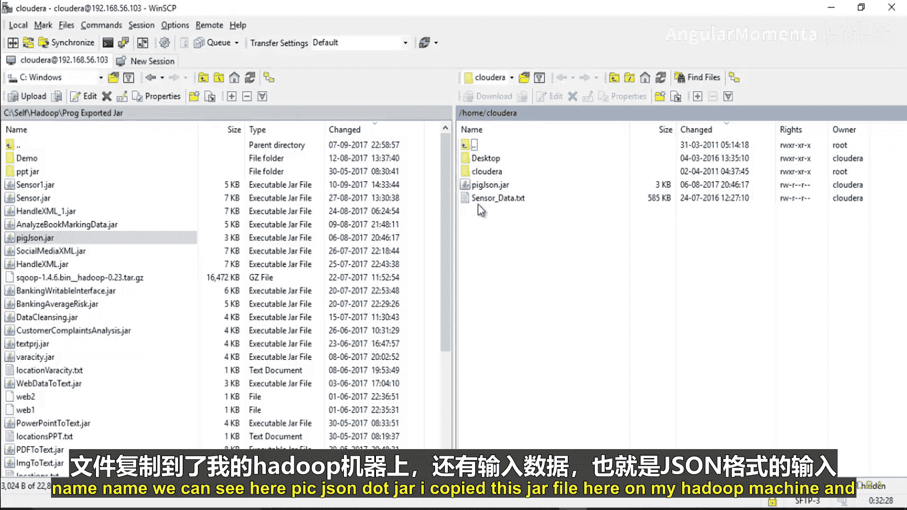

And the。Input data， which is the input file in the JN format。

Now we can start working on these things in pay。So here first we can check。What folder we have？

On my Hadoop machine。So I have one folder call Jason。So let us go inside it， we can see what we have。

We have sensor underscore data dot TxT file。

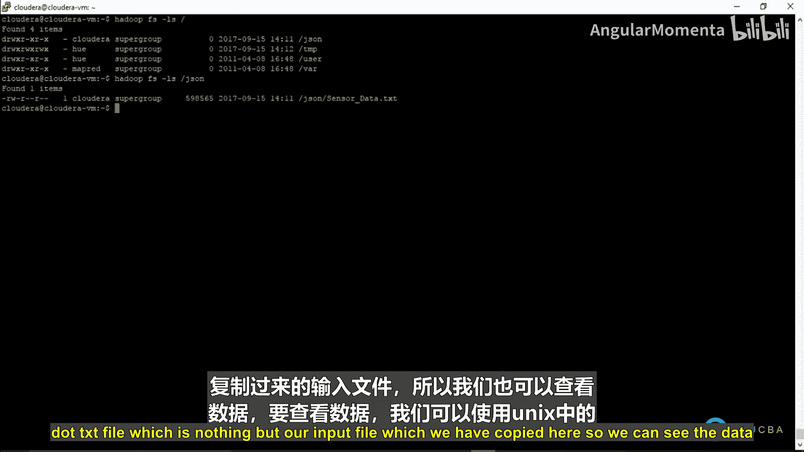

Wwhichhich is nothing but our input file， which we have copied here。

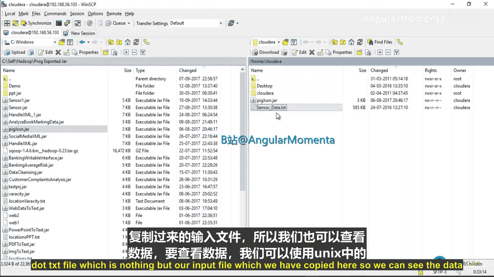

所以跟。See the data also。To see the data， we can use get command in Uni。

So here you can see we have all these data which we want to process and pick so to work on Hadoop we should have a basic idea about a Linux command。

So now I will start my pig shell， big grunt shell。So basically to start the pig on shell make to write pick and press enter okay。

So now here we can load the。Fil。オッケー。So in our first relation。

 so here I am giving the name called S1 S1 and this is a command this is a P Latin script language。

which I am writing here S1 load load what load then put data so here we need to provide the location where it is on Sgfs。

It's on adjacent directory。And the file name is。Censor。Undersco data dot Txt。So load this file。Using。

Bigest storage。So， these are the。Functions which is provided by the P Apache P。Okay。

So it basically load the text file in the green shellll。We have been storage also tax loader also。

 so we have few more functions。But here we are using quick storage because we want to store our text file into the grant shell and then we will process it further。

So here we are to provide a diameterlim。So here I am providing a star y star because I want to load all file。

In the single column。Single column is so whatever diameterlim I will provide here。So。

 all this this data will get extracted into the pixel shell by this delimit。😊，So if I use comma。

 comma is already there in our input file。you can see on my screen。Ege。Then value， comma。

 then education。So， it will be extracted into the multiple column if I use comma so here I am using star。

Because the star is not there in the enable input file。

 so all the data will get loaded into the single column I will tell you what I am saying here。

So s may S1 load this data using big storage。So this is our first relation。So， it's completed。还有。

We can see this structure also， let me see。Describe as1。嗯。Not describe。D E C。Explain。

I forward the command， but no issue。Yes， it is explained， it shows in our education plan。Okay。

But we have described also why it is not working。Describe。Its schemema for F unknown。Okay。

 so here we dont have any schema why because we did not provide any LEs。

If you can provide areas like load like this。Note file。S 4 0。And then we can see。

So here we can see now a schema for S1 is called 0， which is null is the type。And by default。

 it will take take care array。오케？So now we understood how we can see the schema So here I am loading a sample。

And now we can see the output of the first relation。

 so to see the output of any relation on the console， we can use dump command。

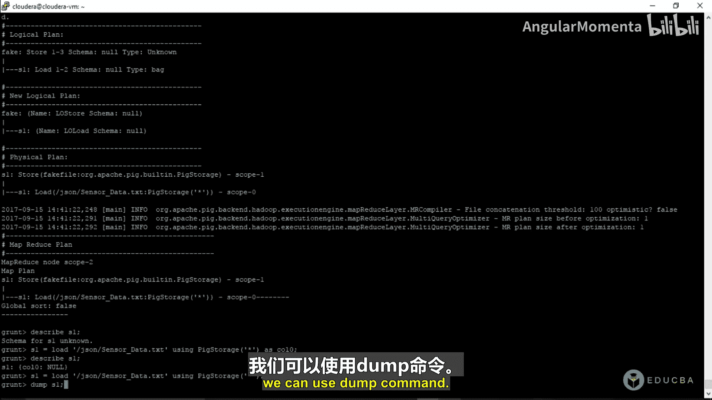

So， pick again。Execute the Meist program internally， we have already seen a difference。Pig。

 there is no difference between pig and mappeduce but。Pig is a higher level of abstraction。

 so lots of things are encapsulated from the user， lots of things are hide hide abstracted from the user。

So in Mareduce， we want to do the same thing， we need to write a lot of code。But here。We NP pay。

 we can get the same， we can achieve the same thing by writing a single simple statement。

Using P Latin script， so all of this complexity is hidden。

And payg so as an relation we have loaded the file into the grand shell。

 so we have already seen we have seen the output okay。So let's move to our next command。Asstrulation。

 I told you it is a data flow language， it is me， it is you who are deciding the flow of data。

So in S one relation we have loaded we ask big engine， load the file into the Grian in S2。

We are asking。To get the。Data from the key for the key edge。So， here。

So here we can see in age4 it age， we are value 73。For age in the second row we have 58。So。

 here we will pass key as an age and it will return the to value because we have written the pick function。

In that way， we have already understood the function。Okay， so we will see how we can use it。So。

For each for each means for all the data which we have in first relation so for each s1。Generate。

 generate work。Now here we will call the function because we want to data value。For thepon key。So。

 here。Always remember， we can call the function。In pig。By the package name， dot class name。

So you have package image。Jason for pig and class name is also same Jason for pig。

And which will take one argument。In the same argument， we will pass to value。

First will be the row which we want to process and the second will be the key。So。

 it will check that key value in that row and will return the corresponding value。So。

 one more thing which we have forward we forward here is which is very important。

We have exported the jar file， but we need to register it。Firstt。Okay。To to register the jar file。

我 need都。Write this command。Reistister n。Jaar file name。So this command we can write later。Re thised。

And this one， and then we can load the data。So， whenever we will log in on the pick session。

 we need to register the J file because Ja file contains our UDf user defined function which we have written。

And then we can make the use of it without without registering the function。

 we cannot call that function。Okay。Now in S2， we can use it function。So， generate what。For each。

For each row， which we have in asmal nation generate。Now we are calling that function， Jason。For P。

 this is our package name。The class name is same Jason。4。

Pig now here we will pass the single argument。Here will pass the two argument。

 but it will be treated treated as a single argument in the pick function。

So first argument will be the whole row and second argument will be the key value。

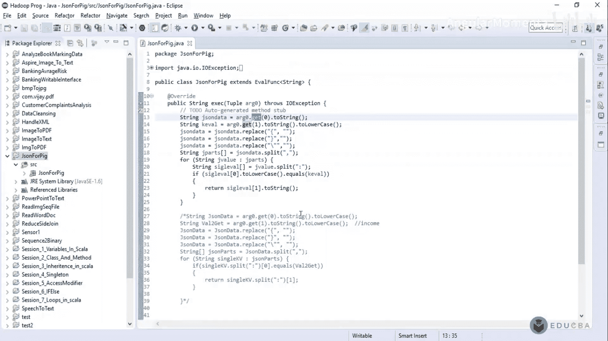

The key for the value which you want to extract。So， in pink。We can use。

Now you you understood we have loaded。The data with the demeter is star。

 so all these data is stored in a single column。And then big。

If we have not given any alllias to the columns so we can access those those columns by dollar0。

 12 and so on， but here we have only a single column。So we can access it by。Dollar0。Okay케。And then。

We will pass the key。K is a text because we are passing edge。😊。

Which is in the text format that is carryt。So it will come under the single code。

So for each as one generate。Edge from the rows which we have in S1 so now we can see the output for this dump as1。

 so now it should return the edge for all the rows which we have in the input file。

Because we have loaded。All the input file。We did some mistake， I think。😔，哦。I will turn them as well。

We need to see the output of e I have returned dump as1 okay so that is why we were getting all the records。

So now type dump S2 and it should return。The edge。It is executing in reproducereduce internally。

 which is hidden from us the complexity part。So now you can see we have age。

For all the records which we have in the input file。So now we can move on these scenarios。

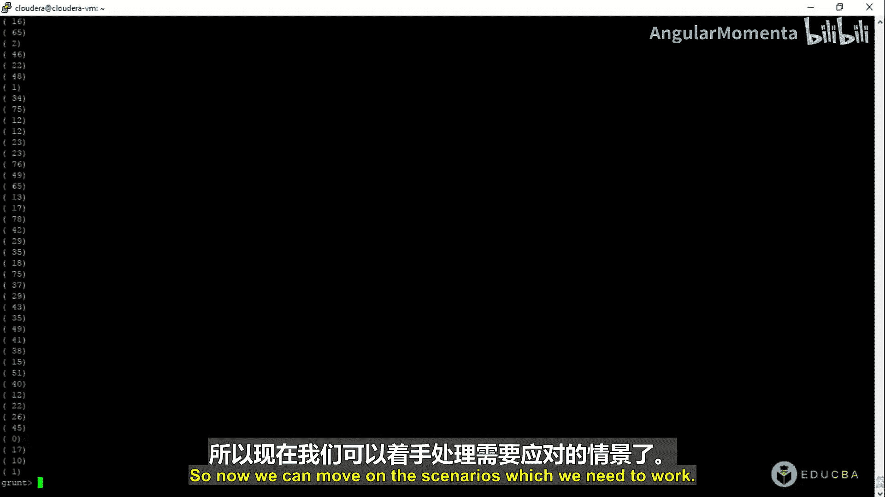

Which will to。So the first one is ratio of male， female in the country。

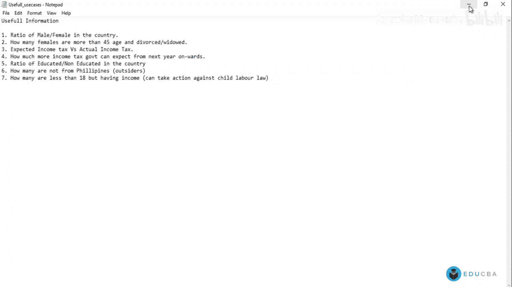

So， guess。What we need to pass here。We need to pass the gender。Right。So S1 command will be saved。

 load the data。And S 2。The state of age。We can pass。Gended。Now dump it。

 you can see we have gender or not。Yes， we have gender。We are getting a space also in the。

And they starting。So， we can remove it in the function， we can use stream function。But it' is okay。

 we don't need to bother about this thing now。

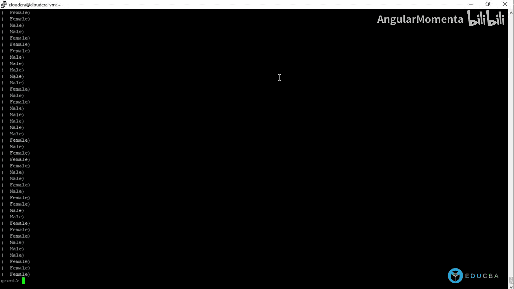

Okay。So what is the scenario？Get the ratio so we need to group it group on this。

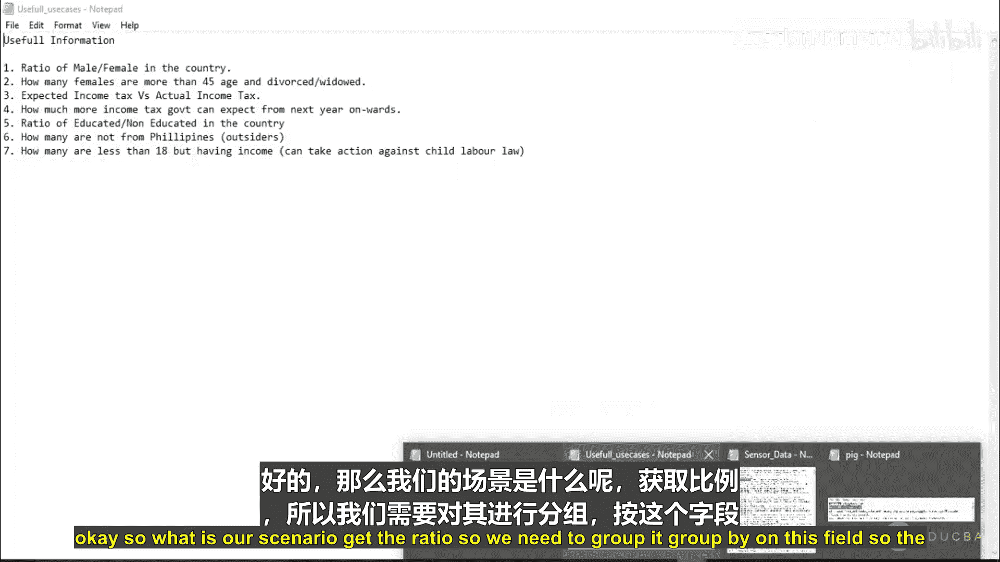

Field， so start。As soon as two。Now in S3。We will write group。As to before it。

 we can do one more thing。Next too， we can give alllias。Like gender。Now we can write S3。

We can write group。S3。S 2。没。Gender， because we did not give the earlier。

 so we again need write the dollar0 dollar1。So instead of writing dollar 01。

 we can write gender so now data is grouped。On。Gentral basis now you can get the count。

So what we can do。As4。For each。S 3。Genrate。What。😮，Group， group means。

The column which we have grouped in the S relation so group。And they count。So， based on the group。

 provide me count how many numbers of male we have。

 how many numbers number of female we have soon as for for each S through as3 generate not star。

It will basically be S to dot。Ger。Because in S3 we have group record and gender we have an S2 relation。

In S 2， we have gender。And as3， we have grouped it on by gender。Okay。

 so to get the count of gender on the basis of group column。We it to very will to provide from which。

What count we need on the pagess of this group？So， basically we need to get the count of gender。

 which is there in the assterlation and based on the group which we have done on。S T in S nation。

Let's see。Okay， now we can see the result。S 4。Here it will execute a reducer also。

So here we can see the count。We have 9， 39 males and 10161 female。What it。How we。

 how did we do in that in pig？So basically。Now you can recall it definition。

And then a pig is a data full language。So here we define flow data。In first relation。

 we loaded return to the Grian。In the second relation， we just。

Extracted the required column value based on that UDf which we have returned so before writing relations we need to register that UDf that the jar file name okay。

Then we can call that function by the package name。

 dot class name and we can provide the required parameter there。In the third。

 so once we have the required data in the third， we can execute the business logic because we have。

Required columns from the input file， so we did the group by on the basis of gender column。

Because we had to get the count。Of the we had to generate the ratio of males and females。

And then we can once we have group by group group data， we can get the count。So that is how we。

Bgged on the first use case and we this data。Now let's move on to the second。

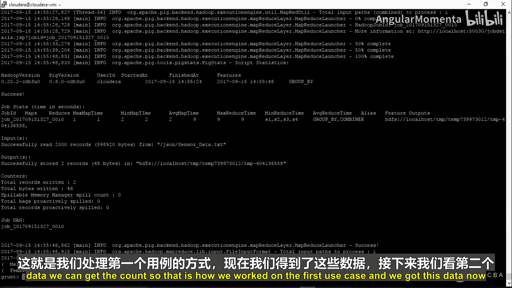

Second one is how many females are more than 45。And diverse widow。First of all。

 females then 45 and then div widow。

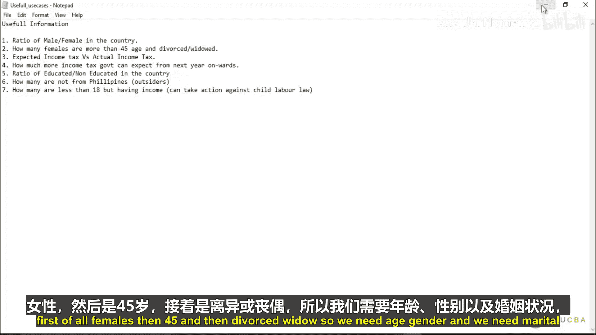

So we need age gender。And we need。Mial is status。Okay。So， here。First， we will load the jar file。

Second。We will generate the gender。Then。It。We can call this function。

Many times in the same statement。Big。Dot Jason 4。Pig now， from this same。Con， same data set。

We can get the edge。😔，We need to get the edge。And same thing。佛。Li status。Dot packaging。

 dot class name。Dollar0。And。Marital。Sttraightus。So， sometimes pe is case sensitive。

 sometimes is not so we can check the column name， key value key name。spelllling， basically。

Mary single or marital traiters。Okay。So， otherwise， it will。Return the error。

Now we can see the output。所然。In the last use case， we just extracted the value for gender。

What is time we need gender， age， and。Mitital the status and then we can then we will filter out the record。

Yes， we got gender agent。Medal status。O케。We loaded the file。We can read this column。Liter。

We can write。Filter as 2。唔系。Okay， before that， they can do one thing。We can provide the areaslias。

Otherwise， it will be dollar 01。It will be gender。It will be H。

And it will be merit status I am taping M for short form and then in S3。We can filter。S2。By。

Gender equal to。Female。Okay， so we can let me check this sentence。We will give it。

 we will work on the scenario in my next video。Hello， friends。So in my last session。

 we were working on the second use case that is how many females are more than 45 age and divorce widow。

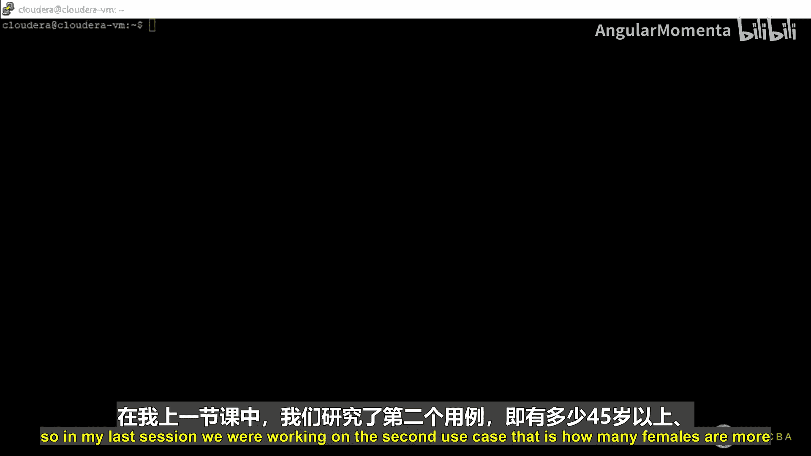

So we were getting some error， so let me tell you。What was the error and how we can fix it？你咩分你。

Big shellll。

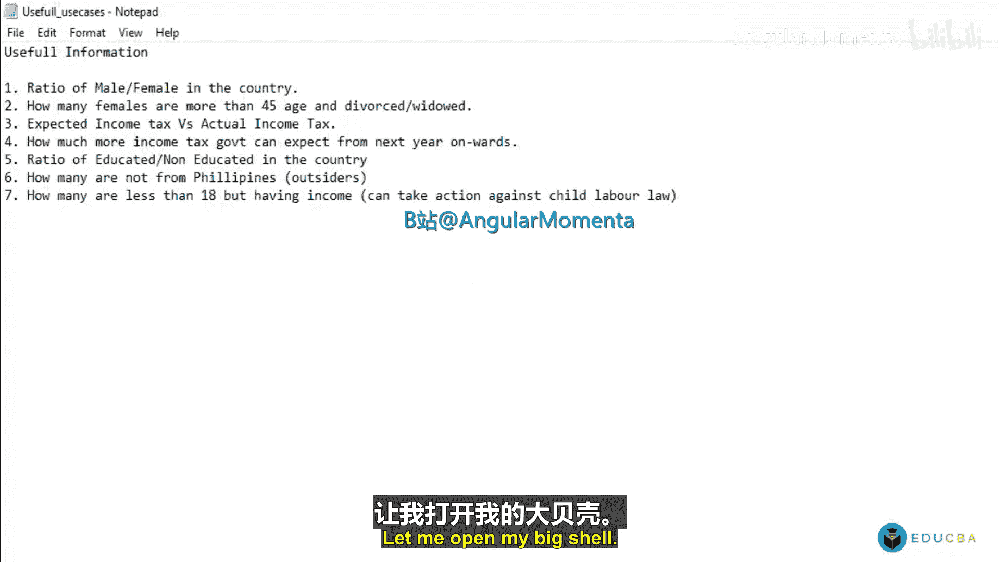

Okay。So first， we need to register the jar。So for that， we can copy this command。And we can paste it。

Then， in isolation。We can load input file。Which exist。In Jason directory。The final name was censed。

Data dot T X T。Using。Bigest storageage。And， you know。

Why we kept star because we want to load all the data into the single column。In S 2。

We can generate required data by using that UDf， which we have returned。

And we have already a a jar file。So， for each， S one。Generate what。Page name。Dot。Last name。

Both are same in our case， Jason for pig dot Jason for pig。And here we can provide dollar0。

 which is the first column。And。Gender， because we need female。Then we can type Jason。For big do。

Thereson for。Again， dollar0。And then。Age。And again， one more time。😔，Jsel for big dot。Different for。

Big。Dollar 0。And。Marital status。Okay。So， for each S1。

 whatever record we have in our first relation that is S1 generate gender， age and marital status。

So let us see the output of this。Yes， we got all these3 d cards。Work going further。😔，So。And S3。Wein。

Finter， the records， filter。S1， sorry， S 2。bye。😔，Now we can see we have a space in the female in the gender column。

As you can see we have a space here。This one is space。

So there are two things either we can remove this blank space in the function。Which we forgot。

 we did not do that。Okay， and we have a space with all the values with the age also。You can see this。

And you can see here also。So what we can do we can use trim function here to basically remove unwanted space。

From the data， So trim。Filter S2， we want to filter S2 on the basis of gender。But here before that。

We can do one thing。And S 2。We can give alllias。So it will be easy for us。

 we dont need to use donor0 again and again。Ege。And here I will give Ms short form military status。

And now in S 3 we can filter the record this is the pig letter which I am writing so if you want to filter the record in it。

We can use we need to write something like that filter by。Pter what。S 2 by。Gender。

But gender we have a space so we can use trim hair。Gender， the areaslia which you have given。

And last time we were getting around， because I was using。Single equals2。 And in comparison。

 we need to provide two equals 2。So it's a comparison operator。So I was doing this mistake。Female。我这。

Check the data。We are getting only female record or male also we have。If filter is working or not。

 we can check it。Yes， we can see we have all fulator here。It means。P is okay。So in this same clause。

We can filter。我。Maritital status。But here we cannot。Filter the data on the basis of age。

And why why is that？Because we are we have written。Evil function that returns is string。

And we cannot convert string 2 T。Because we need。The peoples who are model 45。

 so we need to compare the data。We are not using any equals to sign we need to use logical comparison operator like Gi and and less than。

Okay， so what we can do we need to write another function， another filter function。

 not evil function。Okay， so which we can use here， but though we did not red it。

 we did not write it so far。So here we are just only filtering the record， only basis of gender。

And middle illstrators， but now you have a basic idea how can you write the UDFs？Okay。If time permit。

 I light it for you and we can use it， but for now I am using。

I am filtering filtering the record on the basiss of。Gender and。Miital is statusus so trim。

MS equals 2。What was this scenario？

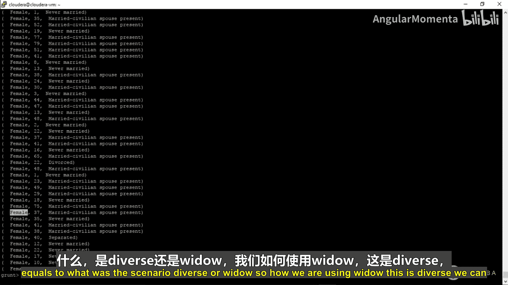

Diverse orbito。

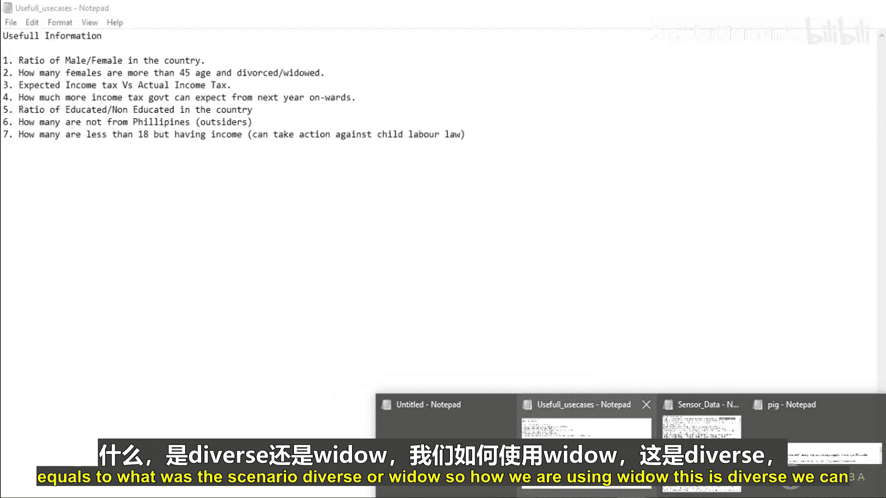

So how we are using widow。This is divorce。We can copy it。哦。对。Ms。Equals to。Widow。

Widow we can copy this spelling。Wdow。Now， check the data。

So here we are not filtering the record on the basis of age。Okay。

 so now we can see we have female who are divorce or widow。Okay， so let us do one thing。

So I'm removing the edge part for now。Because we。And if we have written the filter function。

 we can use it here like IV used E function。Okay。And。S3， we can。Filter it。

And then we need to get the count。So in S 4， we can write group。S 3。Bye。Okay。

So we can give an a also。2 S3。嗯。Fil。S 3。W S2。My dream。Engender。And。It goes to goes to。平咩。Okay。

So we can we cannot use earlier here， I was just checked。And。We can use。Dream。Of M。

It goes to close to。Wdow。呃。Jm。And that supposed to close to。Diverse。Okay。Dumper the record once。😔。

Okay。Numb past2。I'll tell you what I'm doing。Okay， it's our filter data。Lump past three。

So it will filter the data。We need female data。😔，Now we can filter It was。Some mismatch。Filed。

S3 equal2。分的。S 2。Goodbye。😔，Dream。Gender。It goes toく through。Female。Let us dump it。

I hope we have fixed mismatch issue。Yes。And in the same clause， we can use end。F。M。你个追个猪。Bvos。哦。Srim。

M equals3 equal 2。We do。And bracket course。Now you can dump it。So here you can see we have female。

Who are diverse and widows， but we are not using A here because we need to write a filter function for that。

So now you understood how we can write it。So we we have we can use this data and we can。

We give it to the Philippines government。We can get the count also we can perform the group on dollar0 and dollar1。

Though we did not give the aance but we can use dollar0 and dollar1。But。In this with this scenario。

 I want to tell you how this data， this output we can see on console。

But how we can write this data into SDdfs。So， instead of dumb。What we can do。ちっと？S 3。

Into ending location。Imagine is the same location where we have our input file， Jason。

And I'm giving the directory name out。So， it will create a directory call out in the same directory where we have our input file。

And it will。store the output。So you can see each' success。So we can go to Hadoop machine， Hadoop and。

And we can see now。The output directory is created or not。じさ。You can see we have our director here。

Okay。So go this director。And we have。B hyp an m。Before we did not use group by。

 it should executed only mapper internally。We can see the output。

 we have same output and we can get this output。To a local machine and they can use it further。

So now we will use another scenario。That is。First， let me let study geography。

Because we are using UDF Air。Okay。What is the next scenario。

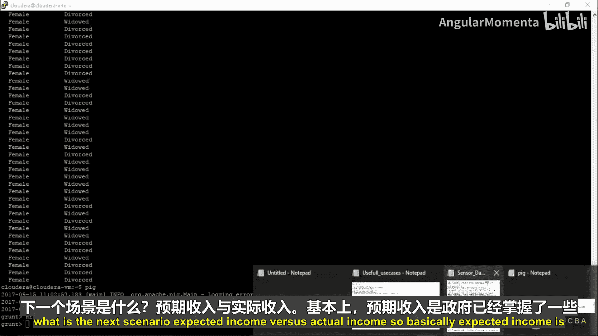

Expected income versus actualual income。 So basically。

Expected income is something which flip which government already have some data So in this same does if you can recall we process we executed this scenario in map produce in the same way we can execute it in。

Big。😊，So we can need the actual income。

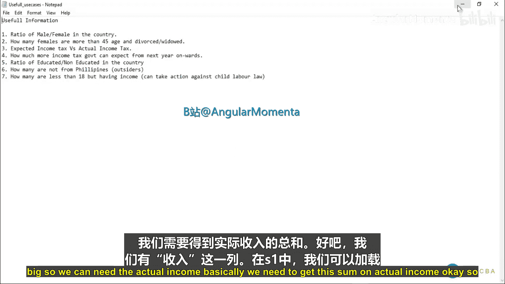

So basicallyically we need to get this someone actual income。Okay。そう。Income。

 we have problem called income。So， in essence。You can load the file。We have that command already。😔。

Let me check。Okay。We have the command。And， in S 2。A state of this， we can get income。你咁。S。Any。

And we can see the income。We have then。 we got the。Whether getting the correct result or not。

 we can check here。Yes。Was we of income？And let's see。We can group。I to buy。Dream。Any film。Okay。

And an as for。We can generate。For each。Let's see。We dont need to use group here。It the direct some。

So they can write directly。😔，For each。S do。Geneerate some of income。We can use stream。Don。S3。Okay。

 again， we need to convert it into the double or additional value。

Let me check if we can do it the right hair。As to income。As。Robert， no。So again。

 we will to write it a filter function for that。Okay， let us move on to the next scenario。

Once if we have idea， once we have the data to the。

We can use the filter function and we can convert it into into this， you know。

Double along I mean any additional value but then we can sum it。

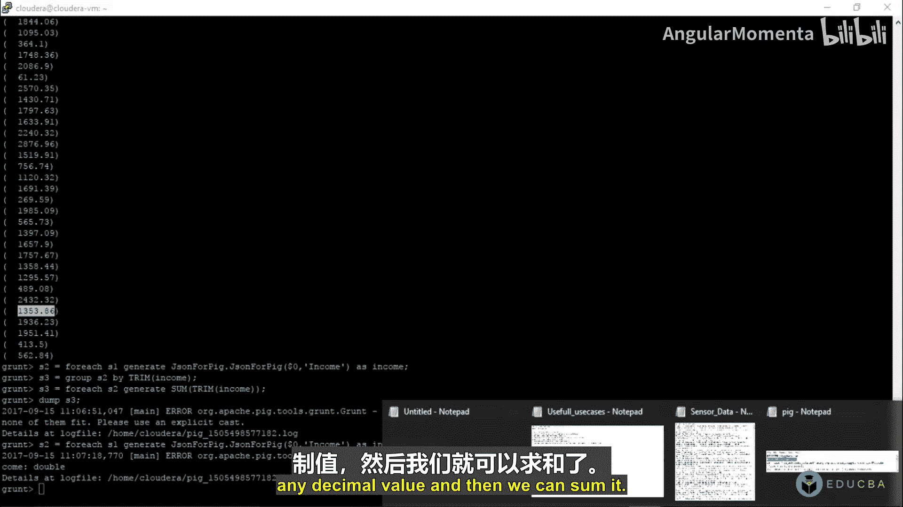

The next interview is。

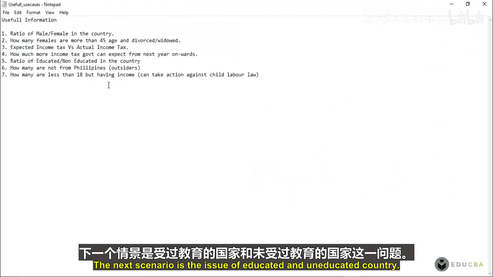

The issue of educated and uneducated country。So， we can。The load data。And。Here， we can use。Education。

你 ball。你 have got咁讲 education。Okay。this column long。So basically。

 we can work on the scenario where we need to filter on the string data carry array。

Because otherwise we need to convert it into the decal or into a format。We can use EduU education。

Okay， and S 3。唔见。Look as to by。Dream。Education， we can group it by。And then， S4。We can write。

For it S3。Generate rot group and。Co of。S to dot。E理 you。So next's say， basically， we have。

A group column。An account which you want to generate is there in the S2。Okay。

 and then we can dump it。Sday Meods， we have seen。The resource manager assign a unique ID。

 that is called job I， the same thing is happening here。So， as we can see children we have 452。

9th grade， we have 56， 10th grade， we have 81， 11，68 and so on。So。

 we can work all these scenarios where we are filtering or grouping or doing any operation on the basis of category column。

But on the in deim。For those column we need to convert into the in that format so you can you can write filter function。

And you can perform the these operation so now we have a basic idea how we can work on this kind of scenario in pig。

Okay。

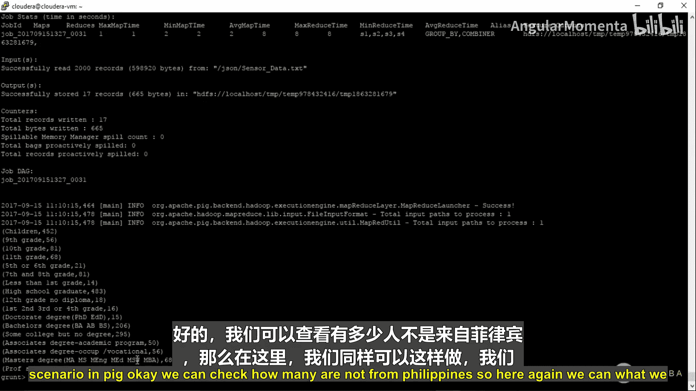

We can check how many a not from Philippines， so here again。We can what we can do。

 we can get the city we can use the city citizen sit what is the column name。

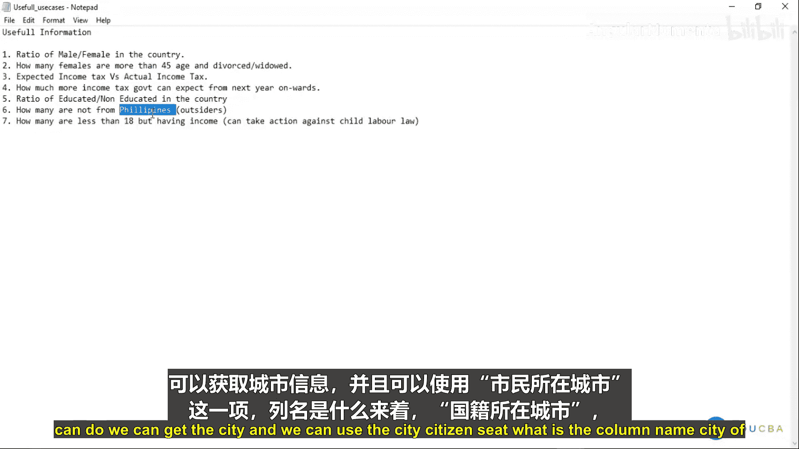

City of citizenship， we can use this column or country of birth now we can use country of birth column。

We use the same in Meuce and we can get it data like the people belong to US。

 the people belong to Philippines and so on。And then we can group it by in the same way we did group by on education。

And then we can get di so same thing we can do here， search easy。

Now how many are less than 18 so again 18 the number is coming so we need to convert into the integer and。

Interger value。So we need to light a filter function so we can filter it out on the base of 18 so filter function is same as a well function the value which you want to0 or1 it it is only2 or false。

So we can add the filter function， it's very simple。Okay。

So now we will work on this scenario and dehive。And then。

And hi we will can create we will create the table， we will load this data。

We will not convert this data into the flat file like we did in map produceduce。In pig also。

 we did not convert Japan to the。Flat file。We directly worked on the J format file。

So the same way in the hive also， we will work on the same file。

We will not convert into the flag file。Okay， and then。We will write a query to generate all this。

To perform all these scenarios。In hive。So my next session， we will start with dehive。

I' will give you the basic idea about height and then we can work on these scenarios。

