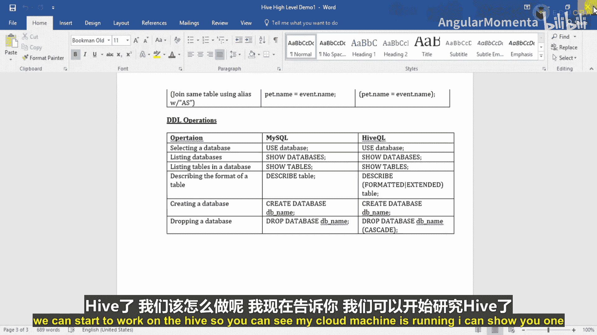
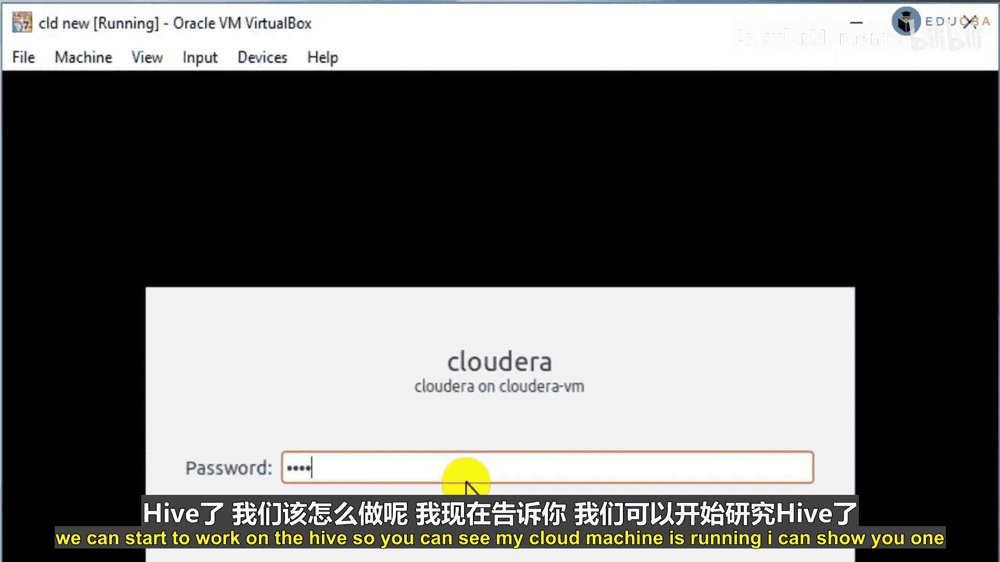
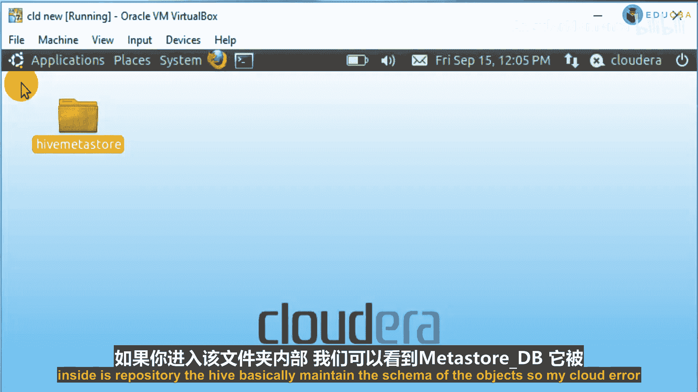
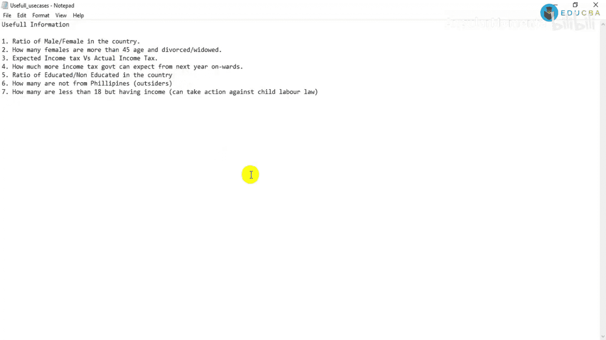

# 【EDUCBA】使用Hadoop处理大数据：应用MapReduce、Pig和Hive-｜-Big-Data-with-Hadoop：-Apply-MapRedu-p06-03_01_01_在Hive中处理JSON文件的方法流程--BV1KrFozQEPf_p6-

So now we have clear understanding。Where we can go with meoduce。In which scenarios we can use big。

And now。We will go with the hive。So hive before start the implementation。

 let me brief you about hive。Hive is basically a data analytics tool。

 it is not for data processing I initially developed by Facebook。And then。

It is one of the big project in Apache so that is it is known as and that is the reason it is known as Apache hive。

So why Facebook develop the hive because there are lots of folks working in the I industry。😔。

Who are not familiar with the coding language like Java donet。Python。

 Scala and they are more into the data analytics。So Facebook developed one tool called hive。

For their developers。Who are basically belongs to database background。And。

They are very good they are very familiar with the database queries， performance。

 how to write complex queries。And all this stuff。So basically， high is4。

Data analytics where user can load the data into the table and then they can generate a different different kind of reports。

According to the business logic， they can summarize the data。

 they can perform the aggregation on the data so high is for data analytics。And data analysis tool。

Where we can generate the reports for our clients or for the hiring management of our organization。

So they can look at those reports and take some precision in order to that form growth or in order order to improve the processes in other things in the organization or in the country or anywhere。

So it depends on the data which you are analyzing it belongs to which。A category。

The the data is belongs to country or the data is belongs to。Or organizationization。

 So here basically we are analyzing the data。Of Philipes country。So initially。

 when we got the raw file， performed the data scientist。A small I mean。

 we just perform this small role that data scientist or data analytics so we generated。

The seven useful scenarios， so we can provide the output of those seven scenarios to the to their country so they can。

 you know， make。This system better in that in their country。

 they can take some decisions by which they can develop the country in a better way and they can。😔。

Perform the different， different kind of。Actions。Like if we can take the example。

 like we perform one use case called how many are from Philippines Okay so in that in that use case basically we are providing how many people are from Philippines and how many are。

Outsiders then so that if they get this data so they can make the restrictions of the visa because if they are they all the countries have one quota。

 especially quota。If they go beyond to that threshold value so they can make the restrictions on the。

Vis。Because they can allow only。And few number of persons every year。So。

So we performed that role and we process the retire mappeduce peak。And we provide it。That later told。

Llanked。So in the initial in the very first video， they explain the architecture how it is working。

On the production。 So it is one of my life project on which I am working on。

So it is it is just a small part which I took it for the demo。

So if you can recall my first video we discussed about you know。

 final reports where where team is uploading data on one web portal， we are downloading that data。

 we are processing that data into the SDdF and then we are loading the data into the hi table。

And finally， how we can。How client is able to see that result。For all these radios。

So here there are a few， there are a few， I mean there are lots of channels specific news like we can send the output file to the client on the daily basis or we can share the files output files in some you know shared folder share directory so client can access it on on the daily basis。

 but here we are showing that data the output。In the form of a report。That is SQL server。

Reporting services， we are using SSRS S。 So we configured SS SRS S in my office machine in in our office server。

 and how did we do that， We downloaded the。Hve O DV driver we installed it and we configured it through DNS domain server。

 and then we created one link server in SqL server because SS R S we can easily connect through SqL server。

And in SQL server is connected with the hive through1 d buildinging you can see d buildinging called link server。

 So we are writing hive queries in SQL server， but those queries are getting executed on our hive machine hi engine hive server。

And then。That data is coming back to the sequL and then we are showing the return to the report。

So with the， with， with this data， I mean， with this approach。

 the client does not go to a in directory or they don't need to check any mails。Easily。

 they can log in from your from their mobile or from their， you know。

 machines laptop office machine from anywhere， and they can easily see that report on the URL which we have provided。

 So we are getting these files on the daily basis So it depends on the client requirement how frequently they are sending us the file input file。

So on the daily basis， the output is getting changed。

 suppose today they have 60% male and 40% female in the country and after processing tomorrow's data the count will be changed。

Like58% male on 52% female likewise so depends。When they want to see the output。And when they can。

 they want to。 and on the batches of that， they can perform the。Actions。At their end。

So now from 21ward。We are going。To implement a。The use7 use cases in the hive。 Okay。

 so we want to before move on， if want to。Discuss more about hive。

 So here I created few documents for。My friend， we can， I can open it。 I can show you。

And you can go to Google。 You can type hype tutorials， so you will get。The P high website。So where。

 you know。You can learn about it。 What data types we have。 So I basically have。

Integer is string in pig。 we have cat， but high， we have a string。 We have double。 We have float。

We have long gained small land and so on， so here we can see what is hive hi is seem like sQL that is a structure by language。

And it is known as SQl that is high query language。 So highway is nothing but language。

Where we can write a sQL kind of similar queries almost same So have is basically based on my sql database。

 so most of the syntax are very same with the My sql and we can see have is nothing but at tool built on。

Hadoop Hadoop means built on SgfS。So when we load data into the table。It does not go anywhere。

The data keeps reside in the SDFs。But in form of directory。

 the directory names are nothing but the objects which we create like we create a table call。Tam。

 so it will create a directory in the high warehouse by the name tempm and then it will store that。

File into that that the the file of data， which we have loaded into the time table so it will keep this input file into the temp directory and whenever we query it will。

Go to the directory。 It will。Read that file and will show the data。So internally。

 it again used the map produce， but as we can see when we when we were looking at the differences。

 it is again what we call。High level of abstraction， same as pig。

 So complexity is hidden from the users or developer so we can easily write a query but internally。

It is executing Me program， and it shows shows us the output。

In the form of table like we see the output in any early Bm so it is for data analytics and not for data processing which you have already discussed by the help of this tool we can easily generate reports based on business requirements by adding a smart queries。

It's very easy to use， and almost。Based on the same concept as mysql。

So initially I was developed by Facebook for their developers who does not own Java or basically belong to SQL background and later on a Paris software Foundation took over8 and developed it further。

As an open source， And then it is known as Apache hide。So who is the father of Have。Facebook。

 but now it is taken here by Apache。But why hi same thing。

Everyone wants to increase their business and generate more and more revenue and how they do that they do that by analyzingna its firm data deeply and taking the important decision strategic。

Acurate decision in order to enhance the forms's growth。 So how the industry is working。

 they take some， they start new new process new policies， how they are taking all these。

Decisions how they are initiating all these new things in the form because they are analyzing the old data。

oldd records court old。All data of the form and then according to Bill accordingly they take some decision。

So， before hive， how we were doing before hive organization was still running and analyzing the data by using any aBs like SQL server or A or anyone。

完 on。Any El tool So EL is nothing nothing but extract transform and load。

 So we take the example of E to like informatica like SQL server integration services like cognos。

So we have lots of tools in the market。So， initially the automation was using ETl tool or anyWBms to process data and to analyze the data。

 but it was like a pain for them because RWBs and ETl are good to handle data easily till some extent of volume so。

If any of you are working in the RDBMS， you can easily understand if。

We are processing millions of records， it' is okay。But it the keep all increasing。So y。

 we all know that Buetize basically depends on the four v。The volume， the velocity。

Volume means the current size of data and the velocity means velocity means retire keep on increasing。

So suppose today I am working on 100 Gb data。😔，But tomorrow， it will be hundred and 10。

 The day for tomorrow， it will be hundred and 20。It will keep on increasing。Okay。

So then in one day it will be a pain for us we will get our lots of issues like performance。

 the query will be slow。And the report will be slow。And， you know， so we will get a lot of issue。So。

 that is。别明 head。Earlier， our nation was using SL server or recall anyDB mass or El tool。

But it was like a pain because all these tools can handle relatively some extents of volume。

 but now our nations are dealing with huge volume。😔，High velocity a variety of data。

 which is increasing。Da by day。I hope you understood so if we we have to handle pagayte of data or giggayte of data data。

 then I think we should。H is a best toer。对。Features for hive features for hive is not built。

 so basically these are the features where we should not go with the hive。😔。

Hve is not a relationlaal database。 It's for data analytics。 If you want to perform。

 you want to store any transactional return to the hive， the data is， you know， getting inserted。

 updatedd。 I mean， we are performing any data manipulation languages。

We are performing DL operations on the data， on the daily basis。Then have is not for that。

Because we cannot not perform a role record level update instead of delete in the hive。

Because hi is a big tool and the big datata is based on。Write once and read multiple times。

 This is a philosophy。 This is not a philosophy。 this is。The paradigming of the big data。那梗是。

So we but how many。They will operation in hive， so hive is not built for transitional data。

Ive is not designed for real time person data。Rernational deposit， which we have already discussed。

Hive does not support real time queries and row level updates。

 so as I told you we should perform record level update insert or delete in hi hi is built for but I heard from users now in the latest version of hive we can do that。

But Im not sure about it， because I have never used it so far。

So because high we use for data pro analytics， not for processing。 So I do I'm not sure about it。

 we can。performform the record level update in hive。But， I heard from。Few people。

 few folks then there are buzz in the latest version of five that we can do that We to set some properties and permission。

 and we can do that。But I did not try that。It was so far。

 I know that have is not for record level update。Basically where we should go with the hive so highway is built for following features。

It is stores the data in Hadoop distributionfi system。

In distributed fashion and only store ischema heights center repository。It is high matters 2。

So we all know that hive is basically， I mean， any， any database。For other database。

 there is a central repository， which is called the heart of the database。So in the same way in hive。

 we have a central repository that is called high metaone。When we create a table， any of view。

 any object in hive。The high met store basically maintains the schema so。Actually。

 if we go more deep into the hive， we have two types of table here。

 external and internal so internal tables are managed by hive ische data both。But external。

 the managed only keep the schema nor the data。给。So it is designed for OL that is online analytical processing。

It provides equal type of language way language called highQ that is high query language。

It is familiar。Fast， scalable and extensible。So it is very easy to use if anyone。

Has worked on any database， Then they can easily work on this height。

It's not very tough to understand or tough to work。Now， it turned out not a very complex system。

So here we can see some similar sl。Ftching information is same like select column name from table。

 all values like star， some values we need to provide a column name or filter criteria。

Multiple gra we can provide with the end clause。Sp column we can select by putting it in the query。

Unique record we can use distinct。Sorting， we can use order by。Soing backward， descending。

Funting rows， count and so on。 maximum value max， minimum value min。

Did the operation is same as my SQL。Use database short， short database， short tables， describe。

We data ways。Draw database and so on。So I told you high is basically based on my sql。

 So most of the syntaxes are same。As my sql。 So now we have missing the standing。What is hike and。

Now， we I think we are good to work on hive how we can do that how I now， you know。

 we can start to work on the hive。So you can see my cl machine is running。

你经。So， you want more thing。

Here you can see where folder called high meta has2。

So this is a folder which we need to create when installed hive。

And I will to set this folder path into the hive dot hi side dot X file。Because个。

This will be the location which I will use while creating meta stored so here it will maintain the scheme of all the tables and。

Everything。If we go inside inside it， we can see metaone underscore the D which is locked。Okay。

So inside the database， inside is folder， inside is repitory。The hive basically maintain the。

schemeche of the objects。

So my cloud machine is running。 I have connected this machine with the。My unique box。Okay。

 so now we need to work on these scenarios。

Useful use caseses。Okay， so first we will create a table we I will tell you how we can create a database。

 then we will create a table。And then inside that table， we will load the data。Okay。And then。Maybe。

Work on it。work on this。 All seven use cases。So， that。In the next in my next video。

 you can work on these seven scenarios。So there are two things。 we are dealing with the jsson file。

 So we can there are two by two where we can， you know。Perform the operation， process the data。

One is we can write the UDF the same way which we written in big here in hi we can we can also write the UDf that is called hi。

User defined functions， okay。And。How you。 And then we can make a use of it。In another ways。

 we highway provided few functions by which we can directly access the J object。Soう。Here。

 instead of creating UDf because UDf we have seen in pay。So here we will。

 I will use the the functions， the method。😔，Provided by hive for the data processing。

So first I create the database， then table will load the data and then we will process with the seven use cases。

