# 【EDUCBA】使用Hadoop处理大数据：应用MapReduce、Pig和Hive-｜-Big-Data-with-Hadoop：-Apply-MapRedu-p07-03_02_01_基于Hive的JSON用例实践--BV1KrFozQEPf_p7-

呃那个。

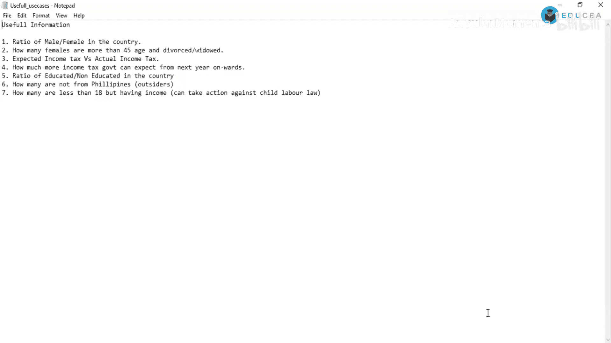

But on this。までまユニマし。It's connected to my cloud era。Okay。Let me check。What folder we have。

You know that to be created one for call Jason。And we kept the input good。yeah， okay。

But we don't have any input file here now， but we have a directory call out where we store the pig output okay so we don't need this here。

 but we need input file。Should we can copy。I want put here。你 name冇成。Sensor underscore data do THT。嗯。

Why we are getting this file。I mean， only with the file name because。

It exists on our route directory。We copied it from a local machine。Do a little directly。Okay。😊。

猫 begin。Would it here。Could not appear to0 instead of one。我特分。Al exist。So we can check。

I don't know why we get this error F iPhone。Alless。Okay， so we have an input file， okay。

 so now we can work on it。Let me start my hi。So to start thehive， we can write pseudo high。

It is asking for the password so you can provide the password。So now hi share started。Here first。

 I'll create one database。Pear database。Deも。So I told you the syntax is more or less same with the My S so my S。

 if you want to create a database， you need to write the same command。The same thing is here。

The database and database name。I'm giving a name demo。And in hive。Many term statement。

 any statement which we are writing by semi Colon。It's created。We can see the。Database。

小と show little別 come慢。So we can see default and demo default is a default database when installed hi。

When the install high， the default database is automatically automatically gets created。

And we created one more called demo。And inside the demo。 So make sure that。We do we are using。

The database which we have created to make sure that what we can do we can write。Use them。

So now from now onward， it will use this database only。So whatever object we will create。

 it will go inside this demo database。So here we can clear on table。别。夜文。你问你妹子来一个。夜身。表面。Dson， okay。

And here I'll only single column because we are storing all the files as a single column。

So then you can use。啊。你有唔打。Jacent method。Which is provided by high。So to work on this data。

So here I'm giving the column name is J data and the tie will be string。So if you can recall in pig。

The st is。We did not have string gen in pink。You can recall weha care array。But here。

 instead of category， we have a string。Okay， so create table。Table name， the column and the type。

Now we need to write a few statements。嚟。如。formmat。Delimitted。

You want't to be store that file as a text file， so it should be a row format。R by row。

 we will have row by row in the file should it should be row format delegatelimd。then。

How the fields will be stored in the file。So， feels。Einated by。By what。

We can't use comma here because comma is already being the file。

 otherwise it will create a just separate separate column。

And here we want to load all the data as a single column so we can use any delimit。

Whi we don't have in that fight， so we don't have a star。

 we don't have hash so here I'm giving star fields terminated by star。And one more last thing is。

storedd as what。Ex肺。St in this the data， which will load to the text file。Not tail is created。

You can write this left command。避面。杰son。Now we can see we don't have any record in it。

So it's a blank table。But table is created。If we， if we don't have this table。

 we would have got me like。Object does not exist or table does not exist， something like that。

We can check this if。If we start we select data from any table which we don't have。Where is。

 they will not found。Right， but we。Like dis query。Like we are executing successfully。

 but we don't have any data， so that is why it is。😊，Shui， blank。Now， we need to。

 we need to load the data。So Lord。出タ。In part。This is the command。To load the data。

 low data in part from there。From our directory where we had kept our input file。n b。废了。PD。In度。日本。

What table。b b人。Yes。Okay。Low data in path， path than in two table deviation。So。

The message was loading data to table。And okay， commence is's completed now。And we this select。

We did not get rain data。我系挖特斌。Load path。Com is same。b b。你杰生。屋企。Let us check if we had file or not。

I do breakfast。 I feel。唔杰信。We don't have fun。Soll copy this file here。

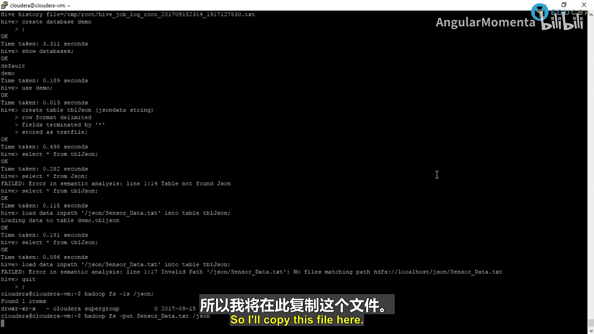

Let me connect， let me copy this file again。Toho I win SV software？We have some。In the file。

 maybe you don't have file on the part。We have this side。But it will delete it。

And we can cooperate again。帮冇录个冇先。No， not this product。

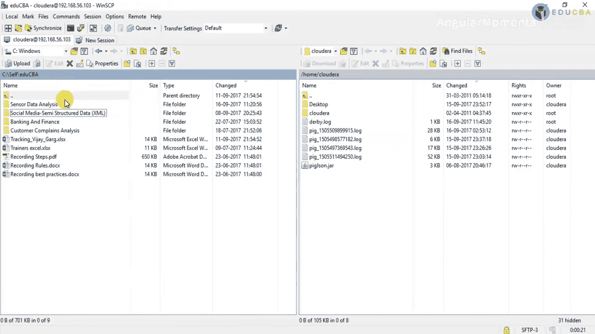

你说。Here we have file。no。It's already there。你嘅路稳啲。We have this file， but we can check。

We have better or not。Oh， the file was empty， maybe。What we can do。We can drop this folder。And then。

你点几呢得机。So to create the folder， we can type MKD IR。

So command is we should have a basic idea about Uni command to work on Hado。How we can I put command。

你喺食得现。显色。Report data dot TXt。What we can do， let me restart the machine。Maybebe。要嗰啲啊。

The node clusterster is， maybe。

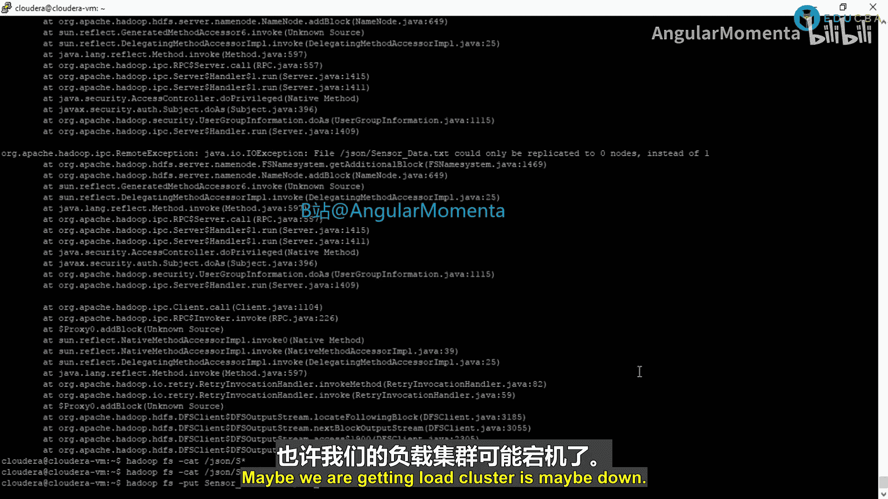

懂。Let me restart it。A little。And then we can start my machine again。

 so we'll have to wait for a few minutes。While it will be started。Sometimestime it happens。

 because it's a。Gus stuff。Some sometimes we get the issues in the cluster so no need to worry about you can restart them you can check。

Because in cloud error， if we will install the cloud error， we don't need to。

Instalall big and hi all these things before it's already installed。我你 machine先。

Can directly work on it。So while you set everything above， I hope that everything will be。

Sortted out。

早啲。So we， it's a good thing that we understand you will hear this music when it will start。

So it's a quo that we were moing here now like clicking that machine。Okay， next listening。no。

 I can open my session。爱情录园。We can you。Shorables。你同汤你接得。你唔要热身。Okay let me fix it。And。

We can work on it next with you。So I am doing one thing here， I am dropping this table。

Nic clusterster disturbed。b。Jason。So drop table1 is against same。

So it's a good thing that we are getting opportunity to。Double shoot the issues also。

Let us create it again。Creatable。Roow format。Delimitate。F。Aly goodbye。Start。And stored as。Text file。

So table gets create。We can see。Show tables。 iss there。Because that's like a statement。Yeah。D we in。

Jason。Okay。Now， let us load the data。Lutan path。减肺。The name we have kept J Capital in this time。

Swe saying， loading and loaded。

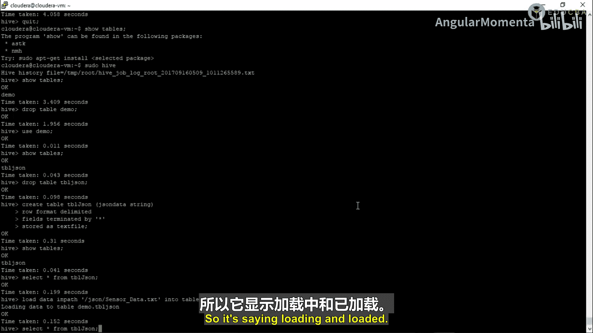

一样。So this time we have returned the table。So aclic cluster was disturbed。

 so if the same issue if you face。You you just restart your clouder machine so it reset everything。

I just restarted it。And it started working properly。So we noted data。No。

The first use case was ratio of male and female in the country。

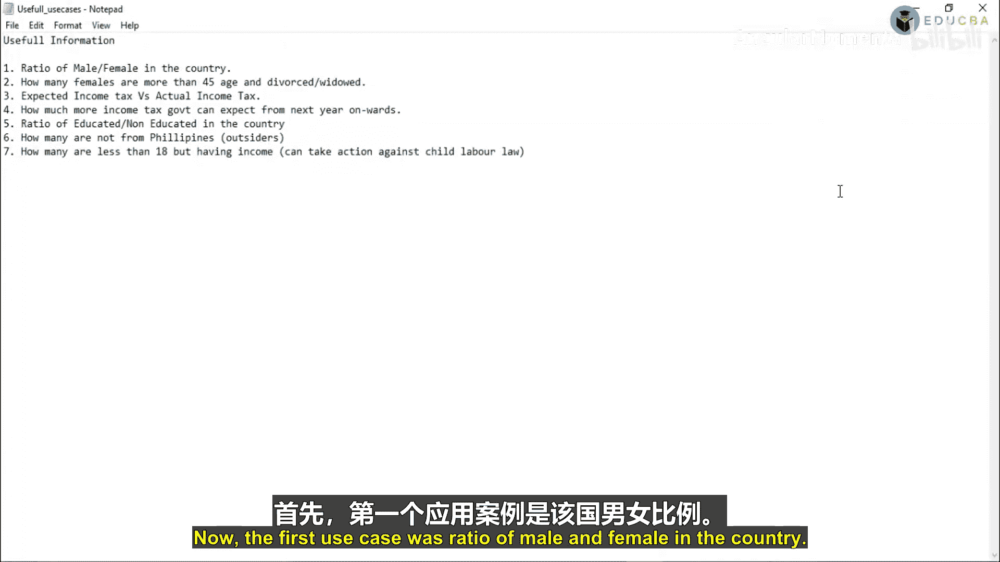

Okay， so here。We need to get。Be gender。So this is simple query。But here， instead of poll data。

 you can use JSO method。Which is provided by。have。Okay。So we can make a use of it。Get it a syntax。

Get Jason。Object。So it's the inbu method。We did not created it we are just making a use of it。Here。

 the column name。你知生 됐。And。What data we need。We need。简的。Okay。So basically it is set text。

 select get J object。Bracket column name， the column name in the table。

 so the column name is JSN data and the corresponding columns which you want to extract。The key。

 gender is the key。So， we can provide it by dollar dot so we need male and female for this input file。

So it started my's job internally。But we get null。口公。你咁整你食得。ok嘅。那 gender。G is in gap。Okay。

Will let us check it。야。This time we get a data because。Last time we kept these small。

 but in our input file g is capital in gender。And you can see one difference here in the qua。

We did not trim the de function because we forward so we were getting a space。

But but here all it is trimmed， we did not have any space， we don't have any space in it now。

So it's internally taking care of all this stuff。Okay。Now。Personaries need to get the。

So in this same query， what we can write。帮红。Stop。And grew by。

Because you can get the count on by using group wire。

Because here we are not finding the count of whole data we are final we need to find a male and female count。

 so we need to group it by one gender column。So how we can group it by same thing that。Yes生。Object。

Coollumn name。De send data。And then。Dollar。Dot。gender的。Make sure that if a case sensitive。

 columnium should be。Proper， whatever in this format we have in the input input file。

Select column name dot count from table group column name。Now let us execute it。

It will execute him effort his job internally。We can see map reduce。this time。

 it will execute reduce also。So as we can see the count female is manro 61。And me is 9，3，9。So。

 that is how we can use the adjacent method。Wwhich is the which are in built method provided by hive。

 we can write Udf also。But already， we have。Inward functionality。

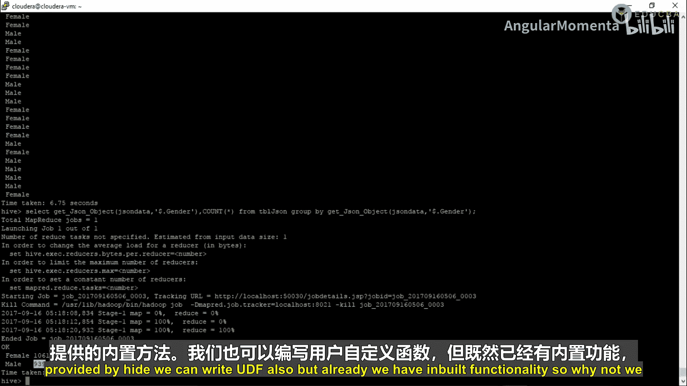

So why not we should use it okay。Now， let's work on the second one。 How many females are more than。

458 and divorce meow。

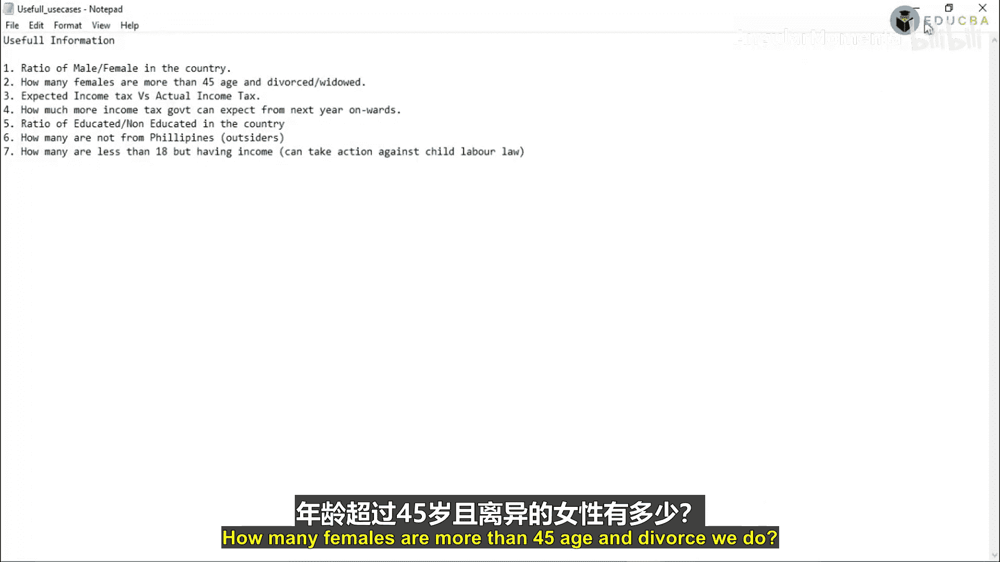

We need gender。We need。Object we need a also。Injacent data。It's pretty simple just data。攞了。嗯。

Let let's check。です。We should get gender and the age。Okay。So now we need to run more column call。

Miital status。Get。The son。Object。热身。出た。Make sure that this name is correct。Mal statusators。

Let us check it。Yes， we have。Now， we need female。We can write。There。给。jason。Oject。

Licent data dollar dot。Ger。Equals to。Female。Fm will come first。嗯。b b l。你杰算。Okay， let us check it。

Okay， so we can do one more thing。Okay。We cannot perform this operation like this。

This is giving correct result。Okay， so what we can do。You can give one more one more table， create。

你文。M。Here we can put gender。Other thing。Hge as int。And my material status as。This thing。Ro format。

The limited。Feel。From me goodbye。我吗。And。Astras。Text file， we can insert the return to this table。

Select star form。Tam， we don't turn return it。What we can do。诶 sir。Table。amam。Select。What worries。

This one。We can write insert statement。Here。And sir。比 will。对am。

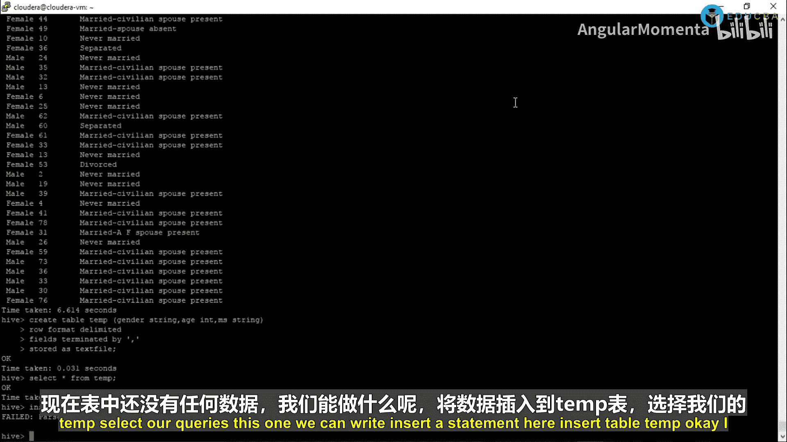

Okay， I saw this in one minute。Let me check it。你都系肺。Okay。And we have。

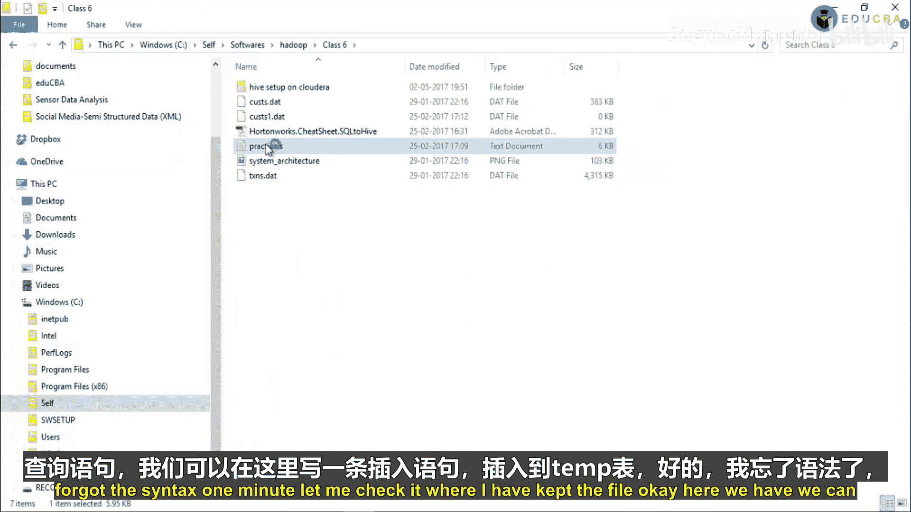

You can write overr in your table。Otherwise， it will load it again。 but here we can。Overr。

It is saying expecting overr。我。

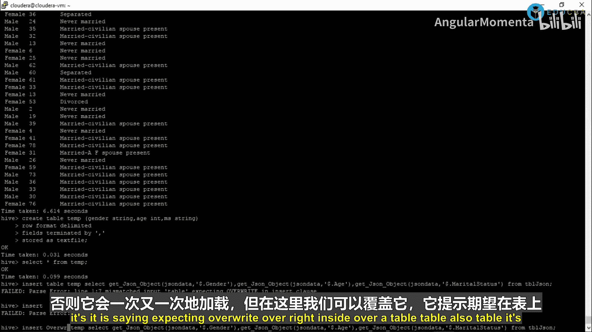

right。In over a table。

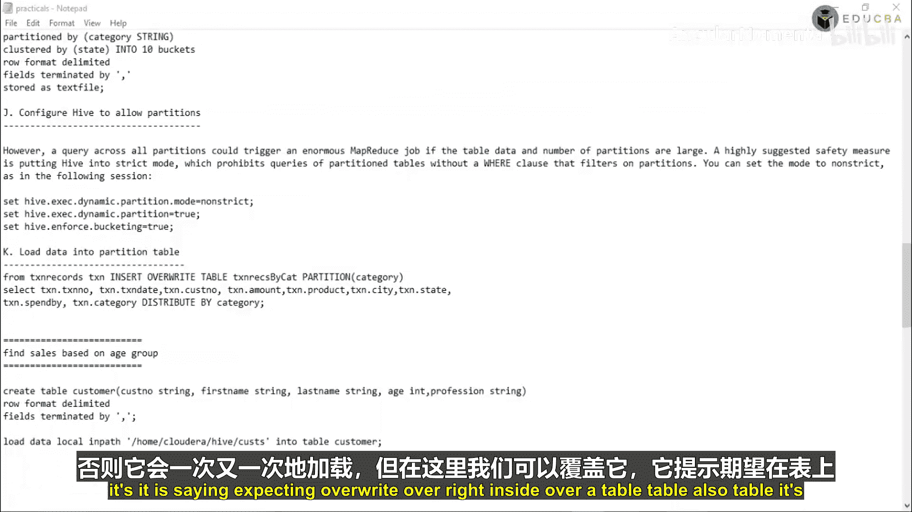

They would also。俾问。It's loading now。Syntax is almost same。

Now we can see we have this data in the table。Now， we can easily。Filter it。咩啊。Render to。email。Yeah。그。

Okay， we have a space in it also。I that wrong。Did not release it。Okay。And last time also。

 we don't need to put this load this table， we can directly we could directly get the output。

But we will。Not putting this in space。Age greater than 45。Maybe it will win in a string。Yeah。

We get all the record， which is more than 45。And。MSs。Go to。You can copy from here， window。哦，M。

It goes to divorce。This data。Because they to get the females who are more than 45 years and who are bit of and divorce so we get the data so now we get the core output and we can。

So this is how that is how we can。Filter this record， we loaded the temp table， but if I was wrong。

 we have space also。KNownowledge values have automatically did not tru to become use stream。

But automatically， its not getting。And that is the reason last time you were not getting the report。

Okay， so now we are done the second use case， we get this。Latertter。

Expectual income versus actual income。So， instead of。Here means here， we need to。Yeah。

We can get the income。Inim。我。And we can。Make a some of it。

So this is the total income for this input file so we can pass this to the Philippines government and they can calculate the income tax and they can match and they can compare it。

With their expected income tax。They can take the decisions。

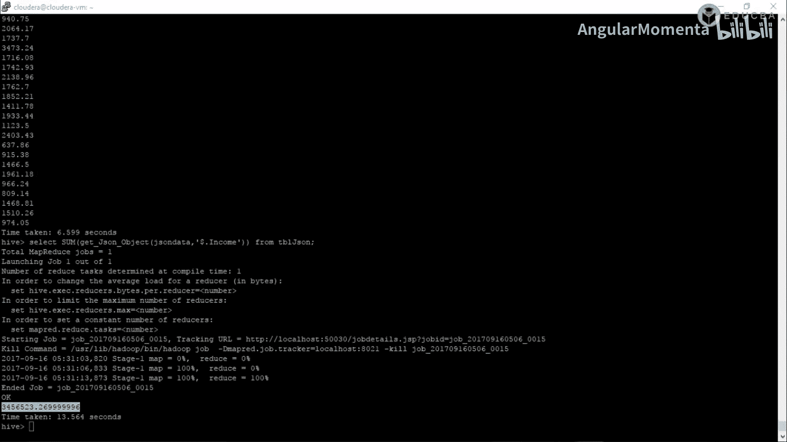

Next interview is。How much more income tax government can expect。

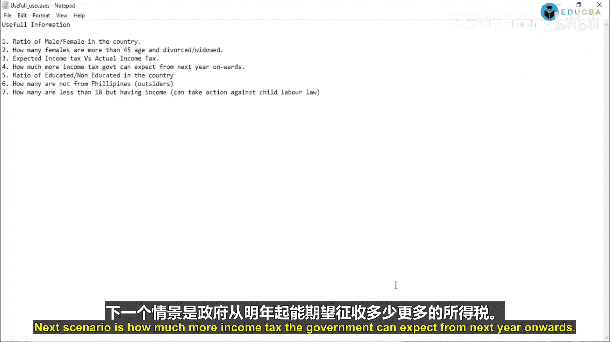

Some next， onwards。So I ready to get the age also。😔，Okay。jason。Object。Deson data。妈妈到了。Not age。Yeah。

And we need to filter the record by age equals to 18。The it。Get。唔杰信。Object。Decent data。冇吗。Dollar。

 got age。Could be greater than 18。Not greater equals to 18。Okay， because those guys will be。

Fulfilling their attacks。So these are the people who have income， okay and。They are 18 years。そう。

Second。What we can do， we can give this some。Goododbye。We can load the return temperature。

 also because。Every time we don't need to call this object， but。This matter。To make it simple。

But it is a demo， so I'm telling you。How we can do that。Gub by age。And。Yeah。We can produce some。Yeah。

ok。We to do a mistake， it's adjacent data。Now we will get the total income of all the person who are。

18 years of age now。So the government can。Expect， you know， this many people。

 they should be they can calculate the tax on the basis of this income and they can expect， okay。

 this much this much amount should be， they can expect this much tax in coming years。Okay。

Next interview is。The ratio of educated and non educated in the country。So we need education here。你需。

Education， so instead of income， we can use this column。Okay。We can remove this very cloth。Instead。

 we can put group by。On this。Because we need how much peoples are educated and how many are not。😔。

So they can open a school， they can open some other organizations。😔。

Who motivate those people to be educated。In group education。唔系啊。嗯。知た。

So we will get the education and corresponding count how many children are there。

 how many 10th grade， how many high school graduate and so on。So we have  it1 10th grade， 60。

 11th grade， 12th grade， no diploma 1 attain and so on。Next use cases。

 how many are not Philippines so here。Country， you can check the column name， country of birth。

 country of。😔，But。没gan。5个。by。Get。唔杰身。Object。Jason data。Doer。Dot。Cory。哦。But。Inha。你见。Baby。😔，帮。

Don' to stop。So we can get harmonia from US， howon are from India。

 howonia from Philippines and so on。So now we have count。Cambodia 1， Canada 2， China，6， Colombia。

9 and so on。They can make the restrictions on visa or they can open new quota harmon are less than 18 but having income。

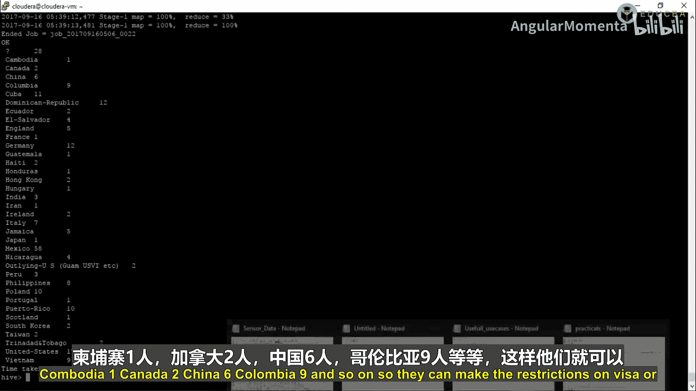

再见佢想听你见。Check the word less than last time we use equals2。

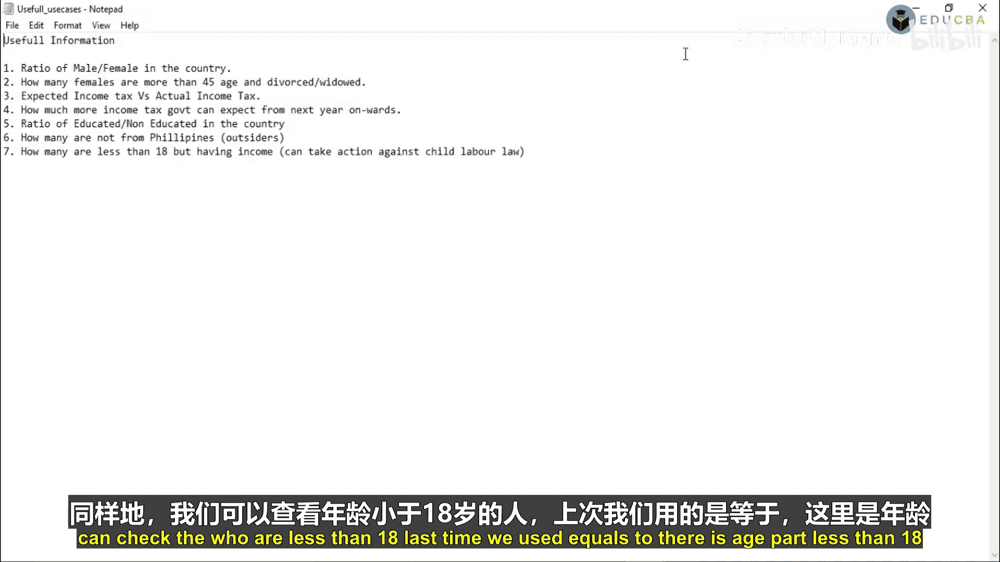

Here is each part。Leson 18。嗯金。And how many evening。Get。解身。Object。Deson data。But。诶。给。

Can I get how many are less in it in but having income。

So we can get all the recordss are less than a 10 years of each person。But they are having income。

we can get the account of those people and government can take the action。Again them。So。

 that is how we can work on the Jsson file in hive， we can restore it。

 we can use the in build functionality， we can use the inbu method that is get Jsen object。

And by use this method， we can。Perform the operations。

 we can analyze this data and we can generate some useful and meaningful information for the client。

So here we can or we can also write UDf if we don't want to use this function。

 we can write UDf and they can make a use of that user defined function the in our query。

So in the same way that we didn't pick。In big behavior and the UDF and we may may used it。

 but here we already have the functionality input functionality。Proroved by high。

 So we make the use of that。

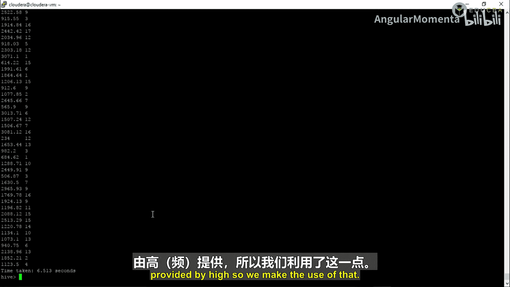

Started with this project。First we started， you know， looking at the overview。

 what is the what data we have。The data which we had in the JS format right and then we have looked all the columns。

 what data the age， the education and the rest of the columns。

 the data which we have then we generated the you know a few use cases。😔。

Very important use cases by which。Government of Philippines government can take some strategic decisions。

Okay， so in in order to get some country development。

So on that time we performed a like a data scientist and you know。

 data analytics kind of role and then。The use cases which we generated by looking at the input data we processed。

 we performed。Or we can say we executed those use cases in mapuce initially we understood what is big data。

 What are the basics component， the architecture。😔。

So the big data then it started with the map produce。😔，We understood what is reproduce produceuce。

And where we can。Think about perform from any transformation or data processing in reproducepeduce。

And then we performed， executed all these seven use cases。😔，Which we generate it。

And we map produceuce， and we。You know， then we。What the proper output， you know。

 and we have also discussed the output， how it could be。😔，How it can be useful for that country。

 how they can take some decisions。😔，In order to the company growth。Okay。

So then we understood what is big。Then they started with the pig。

 the basic differences between meuce， pig and hive， and we understood how we can。

 you know where we can use which beette tools because because for data processing。

 we can use either mappedduce or pig。😔，But where exactly we can go with which one。So。

 we saw the differences。How big is difference。Defer from mes and。

Ive also we compared all these three begin tools。😔，And then we can conclude， okay。

 with which we can go。In which scenario then then it processed all those use cases in P also。😔。

And then， finally in the hive。So basically we we here we processed a j format。

 which is a light weight of format。我就是。A very， you know。

 extensively is being used in the market because call it a lightweight。

And appliance appliance and you know， the other organization who are dealing with the data。

 they mostly prefer Ximl files or the adjacent format because it can easily transfer from one place to another over the networks it is a lightweight and same case with the XML by using the soap protocol。

Okay。It can a from anywhere。So basically this is the last video we are we are talking amid a kind of conclusion or summary so here we I started with what we discussed in this project and what we learn so here we learn how to perform a data kind of data scientist kind of role how we can get the meaningful information from the raw data okay so always try to think in that way whenever you get some raw data and someone ask you okay analyze this data and get some useful scenarios which could be helpful for that particular countryration or from wherever the data belongs to。

So always think in that approach that what meaningful of data we can， the information we can capture。

 we can extract from this input data so which could be helpful for。That particular。

Input belongs to okay， so we perform data kind of data scientist kind of role and then we process the data。

So basically if you can recall the first video we discussed because it is the one of the big project my current project on which I am working which was just a small part I took it out of that。

So basically， as we discussed， we have。V portal。We have look at the machine。

And we have we are extracting those json file through some Java utilities from web portal to the local machine and then we have client team who are。

Loading the data into that web portal and then we are loading the data into thetFs we are copying。

Okay， and then we are processing the data through map produceduce。

And then we are students that didn to hi table。And then we are showing the data into be the。

 but actually。Here。We process the data in me in fake， and in hive。But in real terms。

 we will go with the only only with the one tool， nor with the all the tools， right。So， here。Suppose。

 but how， how you have a question， I mean， how it is running in this format on the production。

 So basically in mapuce， we have it's a changing map in the first map we are。😔。

Removing the unwanted characters in the J file because the retires coming from the web portal。

 so some of the columns like age the key， age education are administrator status so some of the keys are prefixed by hash and colon。

So in Ma1， we are you know just removing that part and then that refresh。

 the fresh that a clean data is used by the mapper2。For the further processing。And then。We are。

 finally。We have written the Java code， you know， by which we are。We have， you know。

 a processing that data and generating。And useful information is told that it had to be hi。

And then we are showing the data into the report。finnitially， I mean。

 we can process the data only in in only in mapuce。

But the problem is here we need to show that data to decline in form of a reports and that is a reason we are storing that data into the hi tables so this is the approach which I design and we are using it is running on a production server。

But basically， approach can be different depending on the business requirement。

Suppose you don't need to show the door data in the home report。😔。

You you need to just send the output as it is， the output we are getting。

like part hyphen R hyphen a unique ID， so we are getting the output file in you know in the form of flat file。

 so client want that flat file as an output so you don't need to store the return to be high。

 you can process the return pig or in map produce or in hive。

Like get just an object which if you can recall， we used it。

So you can use any of the tool and directly you will get the output file。

 which you can share with the client。So。This is this is something how we can do that。

In the real scenario。So。OkayAnd how you can show all these things through Oz。

Oie is nothing but a framework It another we can say a big of tool。有。Scheduling tool， basically。

 like auto says or another。Rules which are running in the market。 So O Z。

Is because you do all this step。St through Oz and we procedure。So。

So now I hope you like this project and now you have a complete idea where we you can go with the medies。

 where you can go with the hive where you can go with the map。😔。

A pig and how we can process what are the different approaches we can use。😔，In different。

 different particular tools to process this inform data Okay， and how。

You can write a user defined functions in P。And how you can use how you can process the data and how we can。

 you know。

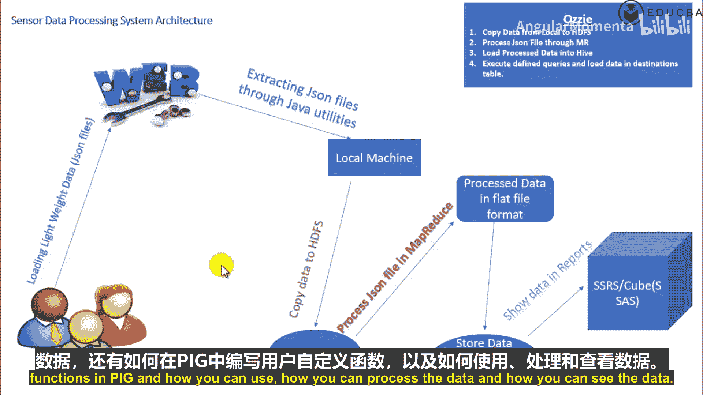

See the data。