# 【EDUCBA】使用Hive、Pig和MapReduce进行大数据分析-｜-Big-Data-Analytics-with-Hive,-Pig---MapRed-p01-01_01_01_Hive简介--BV1yCFozJEuE_p1-

Hi， let's discuss about Apache hi。 if we will discuss about what is hive Tea of hive， hive me store。

 hive architecture， hive working， hive data types and hive data model。 Now， what is hive。

 hive is a data warehouse built on top of her do for providing data summarization。

 query and analysis。So in Hve， we can store the data。 Basically， we can summarize the data。

 and then through queries， we can get the required data we want and can do the analysis on the data features of hype。

 H was started at Facebook in 2007。Apache hive supports analysis on large dataset sets stored in Hadop。

 HFS and H B。So if we want to analyze the data on hive， the data is stored in H T F S and H Pa。

 It is designed for O L A P。 O L A P is online analytical processing。

 This enables user to easily extract and view data from different points of view。 So in hive。

 we can extract the data from different sources， and we can save the data in H T F S and edge pace。

And we can analyze the data for analyzing the data， hive provides SQl like language called hive Ql。

With schema on read and transparently converts queries to map and reduced jobs。

 which are executed on Hadop cluster。So as we were talking that we can analyze the data。

 this can be done through Hiql。 It is a SQl like language。

 so we can write queries in Hiql and we can manage our data accordingly。 So when we run the queries。

The queries in the backend are converted to map and reduce chops。

 and these map and reduce chops are executed on herro cluster。

 Hve has the ability to bring structure to various data formats。

So Hive supports various data formats。The data formats are text sequence， O R C， R C file and Apache。

 partpoint。 I default five stores met data in an embedded Ay Dobe database and other client server database like my SQl。

 So hive has an embedded Ay Dobe database。 It can also be replaced by other client database like my SQl。

5 does not provide low latency or real time queries。

Even querying small amount of data may take several minutes。 So whenever we run any query。

 it would take several minutes。 So if the data is small， it would take a much longer time， rather。

 if we have， if we are querying on a large amount of data。

 So querying on large amount of data would take lesser time to run the query， high metters to。😔。

To support features like schema and data partitioning， Hy keeps its metadaina relational database。

 Hi is packaged with derby， a light with embedded SQL database。

Metal stored can be easily switched to another SQL installation such as SQL。

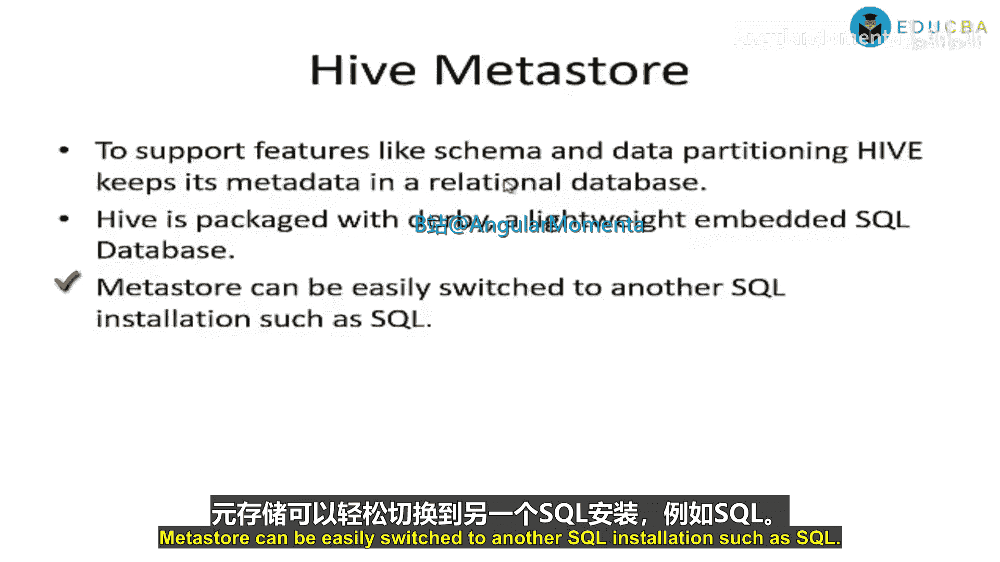

Let's discuss about high architecture。The components of high architecture are user interfaces。

In user interfacer， it can be Web Q I， hi command line or H T insight。Then we have metters，2。

HQl process engine， the execution engine， SFS or edge phase theta storage。

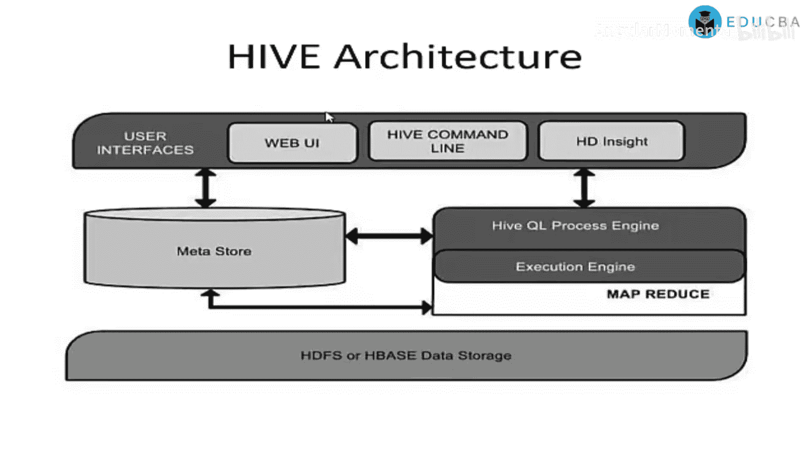

Let's discuss about these in deep。User interface Ivis a data warehouse infrastructure software that can create interaction between user and HDFs。

So the user interfaces that hive supports are Web UI hi command line and hi HD In。

 So on this user interface， we can write the queries which in the backend would interact with the videooop cluster。

Meters2。Ive chooses respective database servers to store the schema or metadata tables， databases。

 columns in a table， their data types and HDF S mapping。 So metastore tapes， the metadata of table。

 databases and other things。 It involves。 it includes buckets and parting also。I， if you will。

HQl is similar to Q SQl for querying on schema info on the metato。

It is one of the replacements of Mareduce program instead of writing long Mareuce programs in Java。

 we can write a query for Mareduce job and process it in Hy QA。

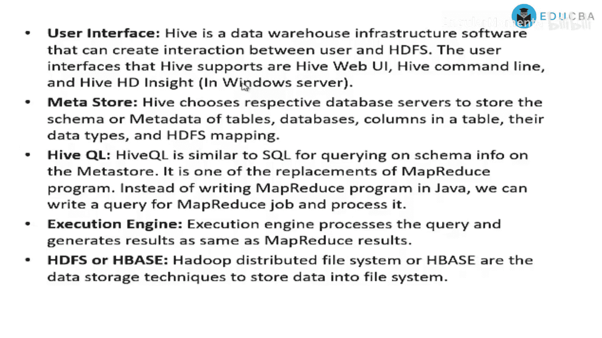

Execution engine， execution engine processes the query and generates results as same as matuce results。

HTFS or HP H TFS is Hadoop distributed file system that can store the data into the Hadop system。

Let's discuss about working off hyp。The components of hive are interface driver， execution engine。

 the compiler， metastore， and in the backend that is Hadoop clusterster。

 the Hadop clusterster as we all know comprises of job tracker， pass tracker。

 name node and the data node。

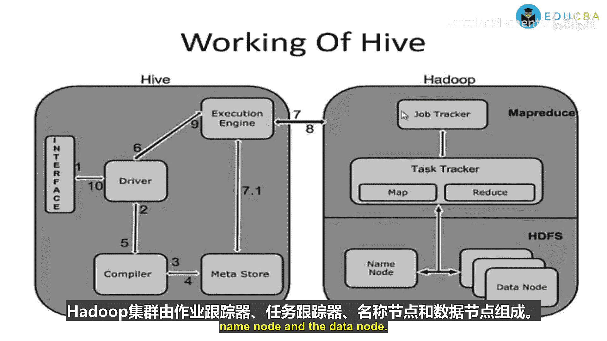

Let's discuss about the steps of the working of heaven， detail。

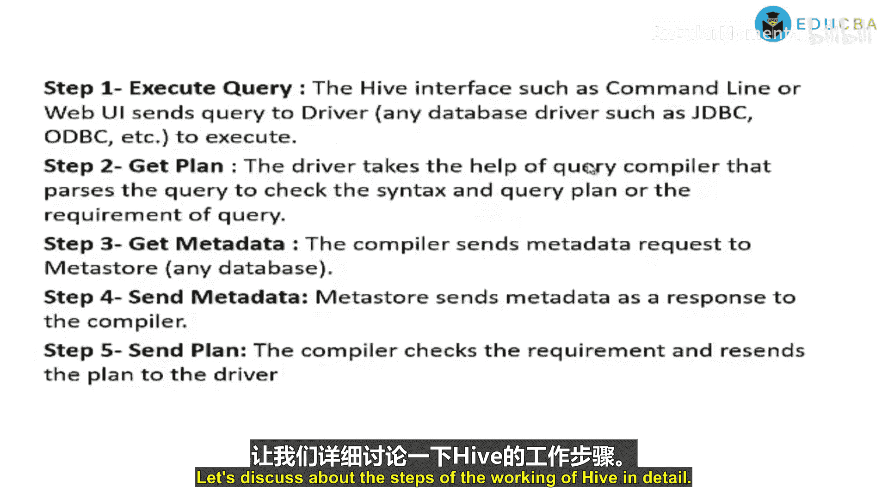

Now， in step 1。The hive interface， such as command line or Web Y。

 sends the query to the driver to execute。Now， in step 2。

 the driver takes the help of query compiler that passes the query to check the syntax and query plan or the requirement of the query In step 3。

 the compiler sends metadata request to meta to。In step 4。

 metatastore sends metadata as a response to the compiler。 Next。

 the compiler checks the requirement and resends the plan to the driver。 Step 6。

 the driver sends the execute plan to the execution engine step 7， As we know internally。

 the process of execution job is map and reduce job。

 The execution engine sends the job to job tracker， which is a name node。

 and it assigns this job to the task tracker， which is a data node。Here the query executes。

 map and reduce jobs。 Step 7。1。 Meanwhilewhile during execution。

 the execution engine can execute metadata operations with mettope。 Step 8。

 the execution engine receives the results from the data node。 Step 9。

 the execution engine sends those results to the driver。 And finally。

 the driver sends the results to the hive interface。

 So this is the whole working of the hive that runs in the backend。

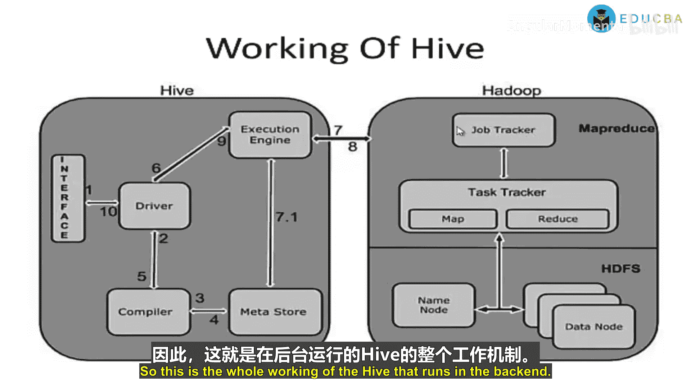

Whenever we run any query， let's discuss about the data types of hive， we have boolean type。

 the true or false integers tiny in small in in bigant。

 the string type string is the sequence of characters。 noting point numbers， the flow and the double。

 These all are primitive types data types。 Let's discuss about these the types are associated with the columns in the tables。

 the primitive types of data types are associated with the columns in the tables。

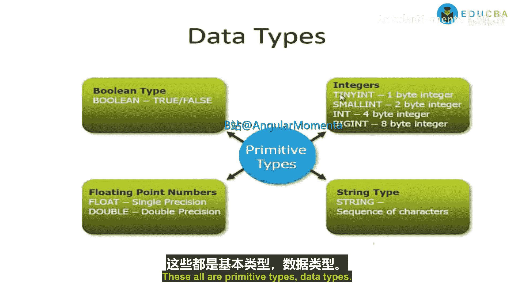

So the following are the primitive types that are supported by hive integers， the tiny in。

 It comprises of a 1 B integer， small in。 It is 2 B integer。 int is 4 B integer。

 Big int is 8 B integer。 boil consist of either true or false。Floating point numbers are float。

 That is single precision， double。 That is double precision answeringtys the sequence of characters in a specified character set。

These types are organized in the in the hierarchy and the hierarchy is number double float， big。

 inch， small ink。Dining in string and brilliantion。

This type hierarchy defines how the types are implicitly converted into the very language。

 The implicit conversion is allowed for types， from child to ancestor。

So when a query expression expects type 1 and the data is of type 2。

Type 2 can be implicitly converted to type 1。 only if type 1 is the ancestor of the type 2 in the type hierarchy。

So the type hierarchy allows the implicit conversion of string to double。

 and implicit type conversion can be done using the cast operator。 Also。

 those are shown in the built in functions。

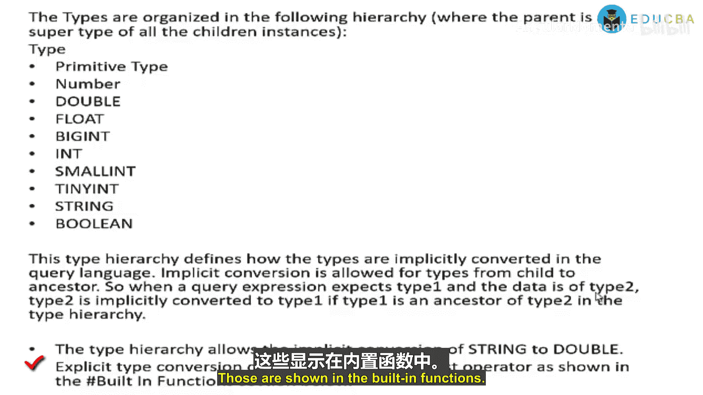

Let's discuss about the complex data types。The complex data types can be built from primitive data types and other composite types using the following three operators。

Sts。Maps and arrays are the complex data type， the struck data type。

 elements within the each type can be access using the dot notation in a struck data type。

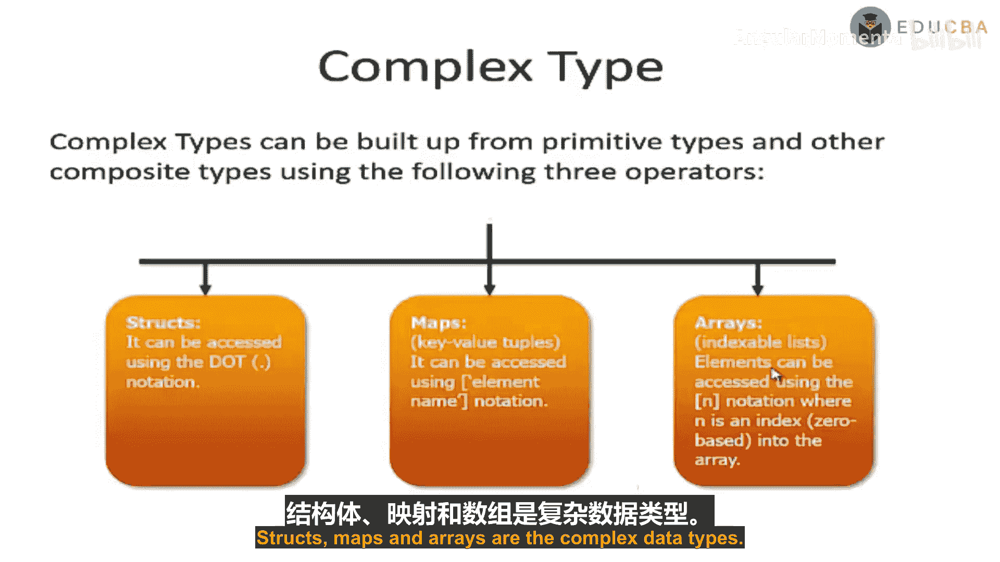

For example， for a column C of type struck。A in B in。The a field is accessed by the expression C do。

A maps maps has key value doubleples， so the elements are accessed using element name， not。

 For example， in a in a map am comprising of a mapping from group to G I D。

The GID value can be accessed by using。嗯。And in the element notation， we can write group arrays。

 arrays are indexable lists。 The elements in the array have to be in the same type。

 Elments can be accessed using the n notation where n is a index，0 based， and it is a0 base index。

 for example。We have an array A and the elements are A， B and C。 So if we want to access element a。

 so the notation would be a bracket0 and it would return a， if we would say a bracket1。

 it would return B， and if if we would say a bracket2， it would return C。

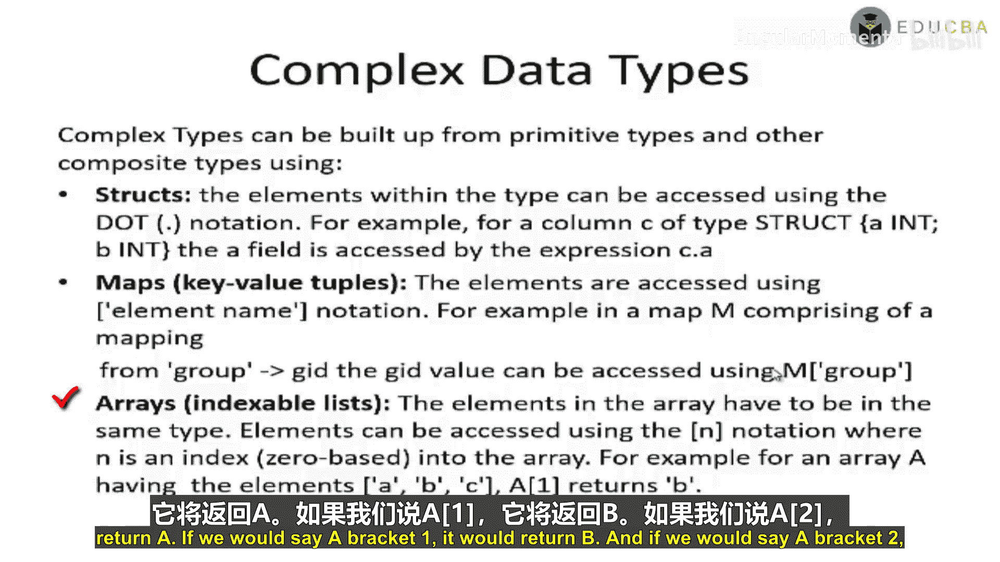

The hi data models， we have databases and。Tables inner a high data models。 Also。

 we have addition and bucket。 Let's discuss about these。The databases， the databases。

 the name spaces that separate tables and other data units from naming complexion。

So we can create our own databases and we can create tables in those particular databases。

 the tables， the tables are homogeneous units of data which have same schema。

An example of a table could be page view table。 For example。

 we are taking a example of page view table where each row could comprise of the following columns。

 the timest， which is of endt type， user I D， which is of big int type。Page URL。

 which is of string type， referral URL， which is of string type and IP again。

 which is of string type so we can create any table according to our requirement。

 whatever data we want to store in the data and we can mention the data type， according to our data。

If it is a number， we can give it a in begin and if it is a sequence of characters。

 we can give it string partitions。Each table can have one or more partition keys。

 which determines how the data is stored。 Partitions， apart from being stored units。

 also allow the user to efficiently identify the rows that satisfy a certain criteria。

So we can create a partition within a table for a primary key， any primary key or。That we want。

 for example， a date partition of type string and a country partition of type string。

Each unique value of the partition keys defines a partition of the table。

 so we can create a partition on the basis of a date partition on the basis of date and on the basis of a country。

 For example， if we have multiple countries in a table so we can create partitions according to those countries differently。

 For example， we can create a partition of country US。And date23，12，2009， Therefore。

 if we always run analysis on if we can will run the analysis on US data only and for the date 2000。

23，12，2009， the query would run， or the analysis would be done by this the Hadoop system only on that particular partition。

It will not take the data of the whole table， so it will take a less time to analyze the data and query the data。

 So this is the query。Tning or efficiency。 This is how we can in increase the efficiency。

Of querying the data， we have a note here。 Partition columns are virtual columns。

 They are not part of the data itself， but these are derived on load。Buckets。

 buckets are also called plasters。Data in each attach may be again divided into buckets based on the value of a hash function of some column of the table。

For example， if we are taking an example of page view table， it can be bucketed by user ID。

 which is one of the columns other than the partition columns of the page view table。

These can also be used to efficiently sample the data。

 It is not necessary for tables to be partitioned or bucketed。

 but these abstractions allow the system to prune large quantities of data during query processing。

 resulting in faster query execution。 So it is not necessary for tables to have partitions and buckets。

 but it is advisable to create these for faster query execution。

 So the advantage of partitions and buckets is that it helps in performance tuning of hi queries。

 the query that would have taken longer time by searching for data in whole table now will take less time by searching the data in the particular partitions and buckets。

Ne it for the session。 So it is not necessary for tables to have partitions and buckets。

 but it is advisable to create these for faster query execution。

 So the advantage of partitions and buckets is that it helps in performance tuning of hi queries。

 The query that would have taken longer time by searching for data in whole table now will take less time by searching the data in the particular partitions and bucket。

 method for the session。

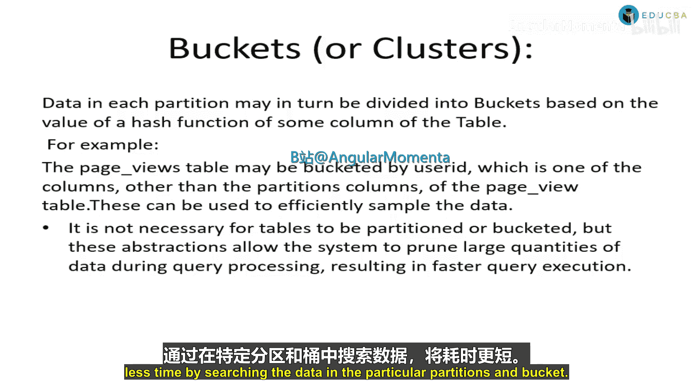