# 【EDUCBA】使用Hive、Pig和MapReduce进行大数据分析-｜-Big-Data-Analytics-with-Hive,-Pig---MapRed-p02-01_02_01_Hive中的数据库命令--BV1yCFozJEuE_p2-

Hi today we will discuss about working on database and tables we will discuss about the database commands and the table commands so the database commands consist of create database。

 show database， describe database Al database and drop database the table commands are create database create table command show table command。

 describe table command Al drop and we will learn about manage and external tables also let's learn about database commands so the first command is create database command so the syntax of create a databases create database。

We can add a name also， but if we would add this if not exists keyword。

 so if there is a database of same name it will not create similar database if there is no database of the same name then it will create the database you can also add a database on the preferred location any preferred location we want and for this we would have to add the keyword location and then well have to give。

Location wherever we want to make the database。 Let's learn about this database。

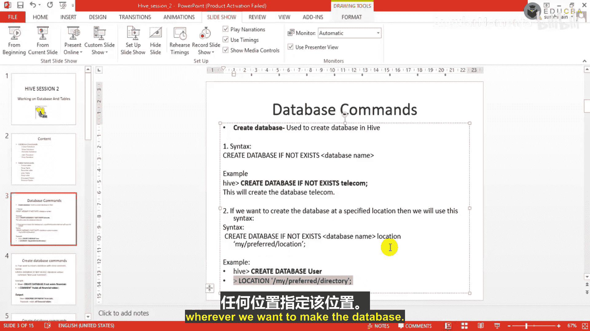

。嗯。Cre database support we want to create database user1。 you can also add if。啊。So。

 our database has been。Created we would refresh it and we can see here that our database has been created by a user similar we can create a database by adding location and we can mention the location in the end next command is we can create a database。

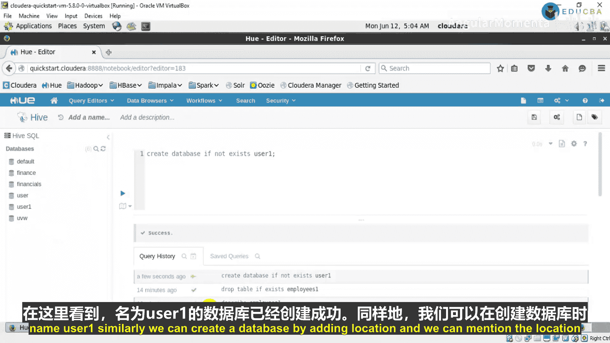

And we can give the comment whatever we want to give about our database next is describe database command This command shows the information about our database。

For example， we have mentioned a comment the above create database command。

 so by this described database command， this will show the comments that it holds all the financial tables thats loan this practically。

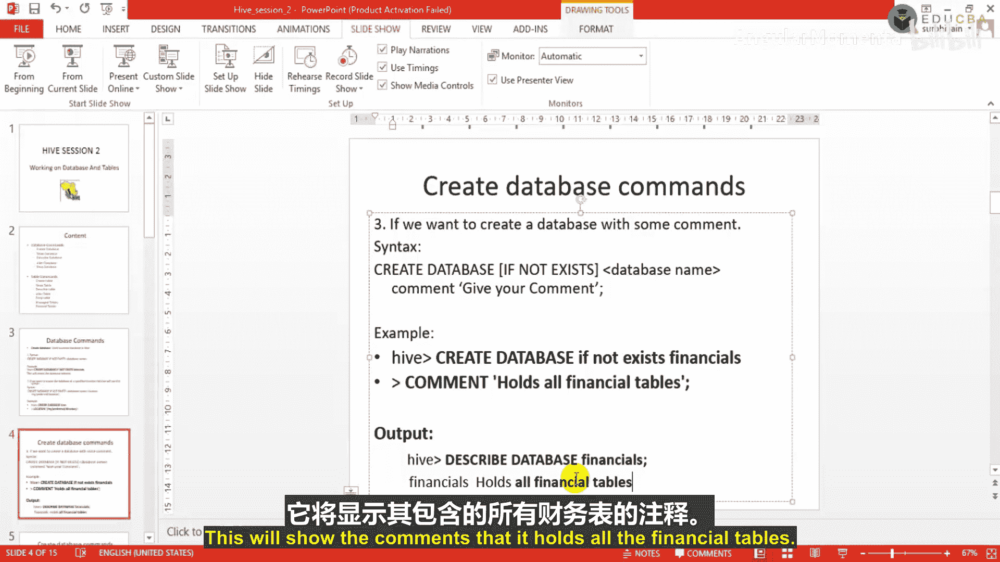

鱼。Database。If not exist。我 we吃呃。Use it to or safe financials。Finaancis is already there。

 We create financials one and。Add comment that it。Database。Yeah。Yeah。碗。我德。难 sure。也不知。Again。

 our database user financials one is。Created， if you would refresh it， it is showing financials1。

Let's see the describe command， how it works。Describe。你个。Finan shoes。

This shows the comment that the database holds all the financial tables and the location。

 this is the default location where are all the tables and databases in highva Road and the owner name and the owner its come to our next command。

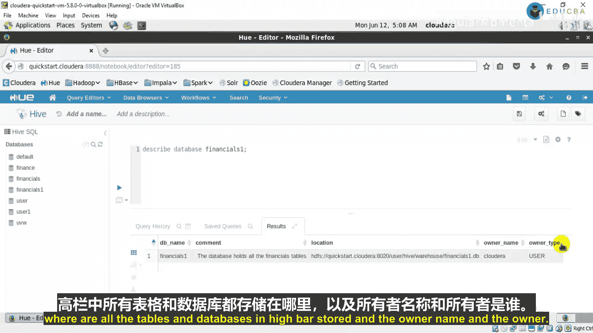

This is， again a create database command， but with this create database command。

 we can give the TV properties also。 and in these TV properties we have to mention the creator of the database and the date when the database was created。

 Next command。 the describe database financials described database command we have already studied and it shows the information of the database and we have another command also called described database extended command。

 So it will show the extended information of the database。

 So the extended information includes the creator and the date when art database was created。

 Let's see how it works practically。

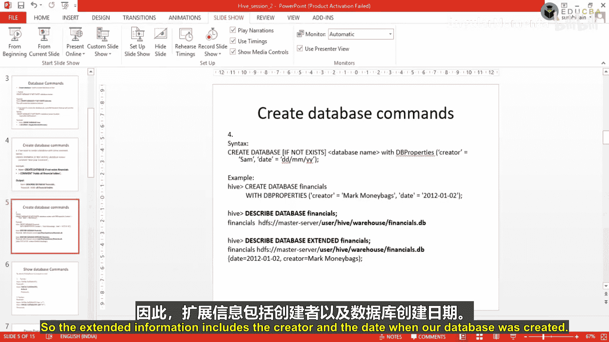

Good database。能。Exist。Suppose we won't。Uer库。Fth D B properties。有读。See。3。And the date。Say 2，0，1，7。

01 again， a database user2 is created。 it has been refreshed and we can see that user2 is created。

Let's see how extended describe extended query works。D great。Database。

Use is true if we would run just describe database。

It will show the user we have not mentioned any comment in here the location。

 the owner type and the owner name。If extended command。

It has shown as the date and the creator by which it was creator。

 So this is the working of extended command。

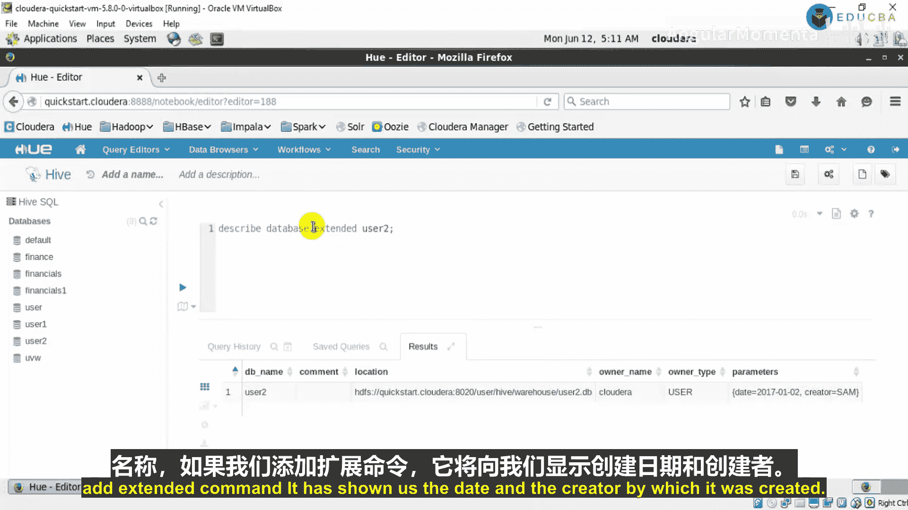

Let's come to another show databases command If you want to see all the databases that we have created so we can see it by show databases command you can also see some particular databases for example。

 if we have any database starting with alphabet a or starting with alphabet F so we can say it with this show databases like command lets look at this。

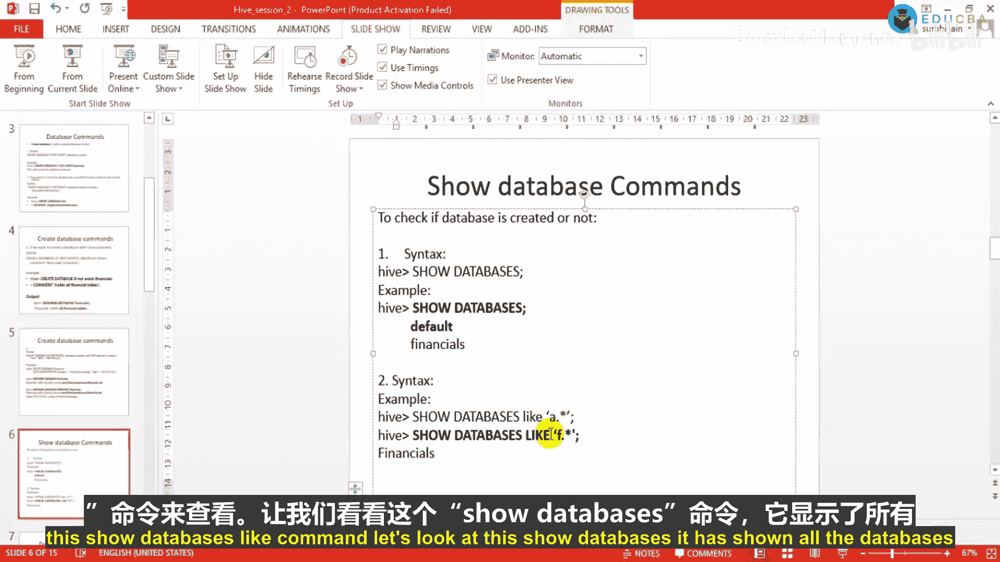

Sure。Yeah。一代没事实。It has shown all the databases that are created。

 We can see the list of here also in left corner that default finance financials financials one。

But if we， if we had dont， we are not able to see it from here because we have so many databases。

 we can see see it by show databases command。If you want to see。A particular database， say。

 we want to see。A database starting with alphabet U。你读。Stop。

We don't have anything with ado stuff if we want to see it with you。

Has turned up with four databases， user user1， user to1， U VW。

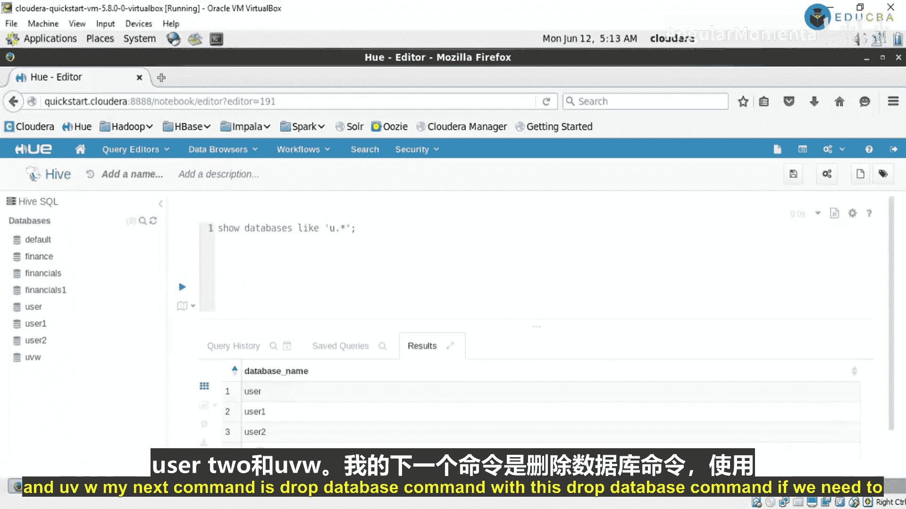

Our next command is drop database command with this drop database command if we need need to delete the database the syntax drop database and here we add the keyword if exists。

So if there is any database with a particular name that we have mentioned。

 then it would delete or drop the database。For example， if we have tables in the database。

 so it will not drop the database because it has tables in it。

 so in order to delete or drop the database that contains the tables we have to use the keyword cascade by the keyword by using the keyword it will delete the or drop the tables first and then it will drop the database let's see how it works。

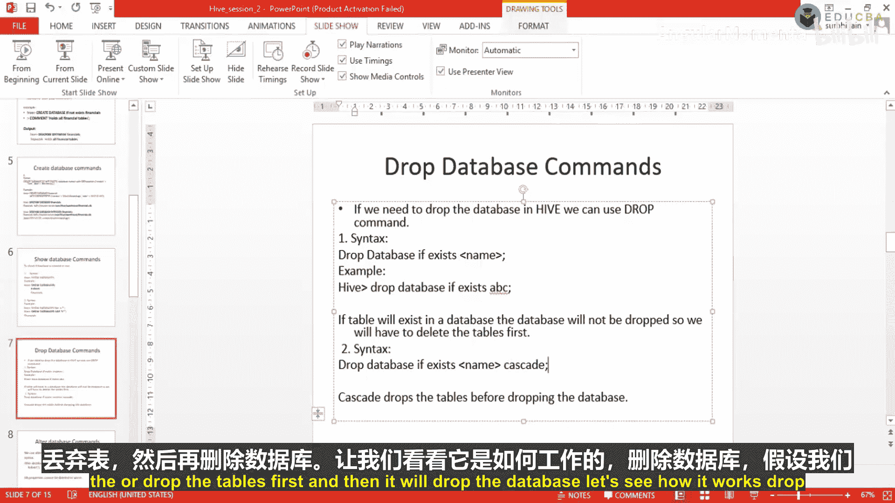

Drop database。 suppose we want to drop。U V W。 So it has been。

 there is no database with the name U V W。If he will add this。Drop database if exists again， U V W。

The data the database has been already deleted。You can delete this user。그 안。I been delete。

Let's see if we have any tables in any of our。嗯度。We don't have any table。

 Let's create a simple table， one column。Read table E。And we want it with name， and。

That this thing right PM table already exists。K key MP1。So what table has been created。

In which database it has been created。It is I default。 It is created in default。Database。

If you want to create a table， say in user so we could write use。有时。Now we are in this user database。

Createable。They can also mention user dot E2 name。That is string。

The table has been created because we have used it in user。

 We can see that E2 has been created and it has one column that name。 Let's drop database。说。

Read this。有者。It will not drop the database。 It would say that database user is not empty。

 One or more more tables exist。So， we reduce。Yeah。As you。And then， we were。About the table。

Or database。 now it is a success。We can see that there is no able and there is no user database here。

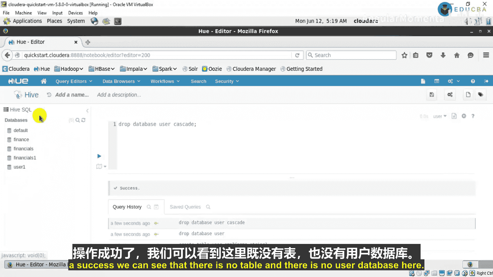

We can also alter database。In al database， what we can do is we can add the edited by in Db properties D properties cannot be deleted or answered said we can just edit it lets alter。

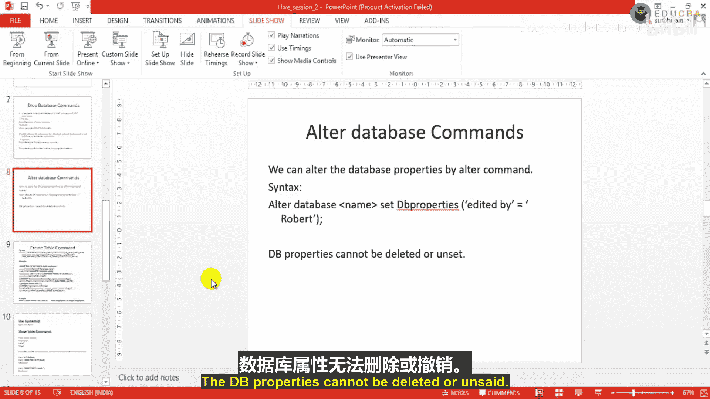

Mpa database。Suppose we need to alter the user one， and we need to set。BB。Properties。

We need to add and we need to add edited by robot。Yes， it's a success。 we have all taught。

The database， user 1。Thats see。If you have Walter to do not。We can go it by describe。Daabase。

Standard。Useer one yes， we can see in the parameters that edited by Robert is added。

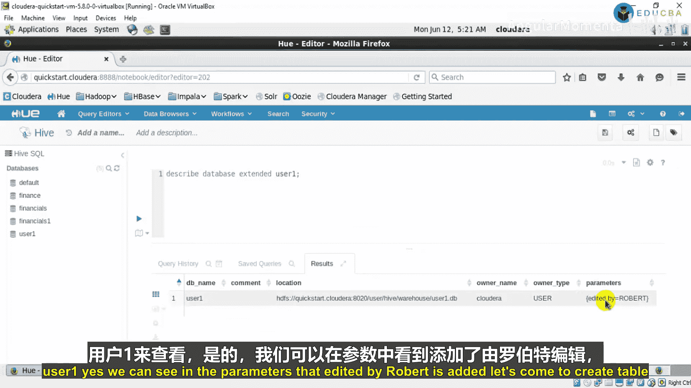

Come to create table command we can create tables in hive and the syntax for creating tables are create table here also just like database we can mention if not exists and then we can mention the database wherever we want to create the table and the table name After that we can mention what all columns we want as per our data for example here I am taking an example of employee table so what columns I am taking us name that is string type salary that is float type subordinates that array of string deductions that is map type and comment also we can give or columns address that is sh type yes and meanwhile we can also add comments for all the columns so that we would know that what all data。

Have entered on a for what purpose we are making these columns。

 You can also add the table properties and the location where we want to save the data。

 Let's create a table。

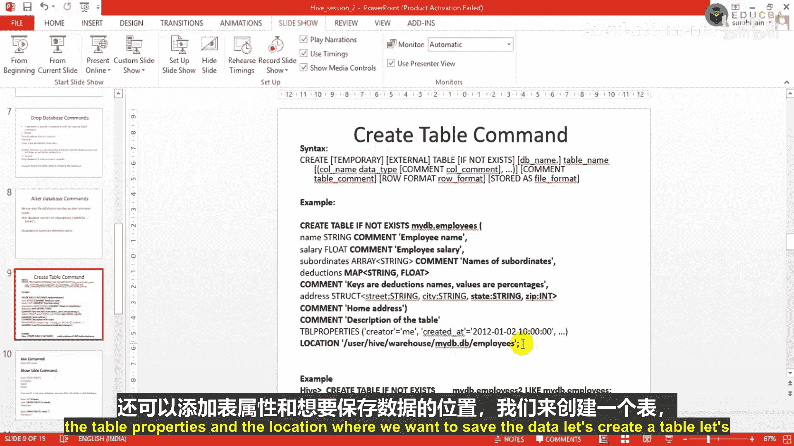

Let's create a table in financials。 So here we are in financials table database。 let's create table。

리액 앱。If not。Exist。Man shoes。好。嗯喂。We are taking name。That is string type。Weve mentioned。

Recom that is employee name。You are taking。Yeah。Salary， that is float type。And the common first。内。

we are taking sub。다 다리 어？Sring。And the commenter。This the old stuff。民。你 don。Orordinate。

 then we have deductions That is of。Map pipe， Xingan。有。And common that is are。

Deductions and what are values are percentages。Lastly， we will take an address。struct ba。Set name。

Yes we are taking string。6ity is。String。State is anticius。嗯。Andy go。W。嗯。

can also give able properties。行。面吃。Creator。3 some。And。8 say 20，1，7。 Let's create the table。

 Yes our table has been created。It's refresh it。Yes。

 we can see a table employee has been created and with all the columns that we have created name salary subordinates deduction address structure you can also create a table similar to this table employee that we have created by this command we can add a like keyword to this。

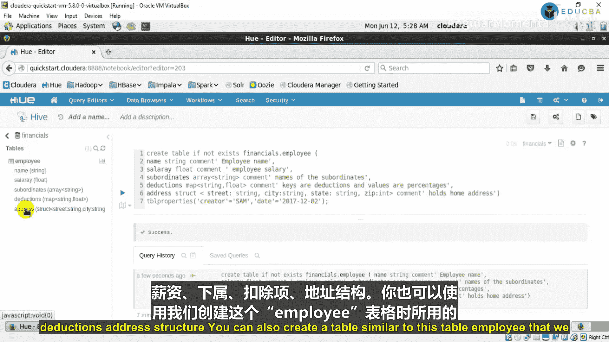

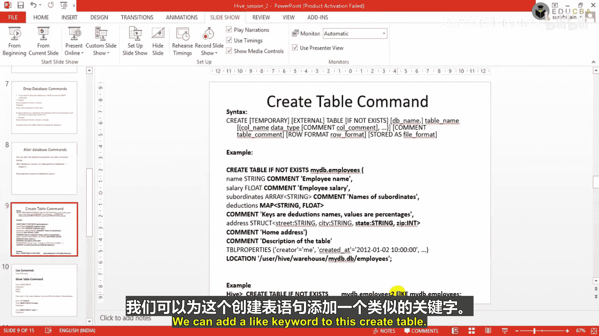

그。

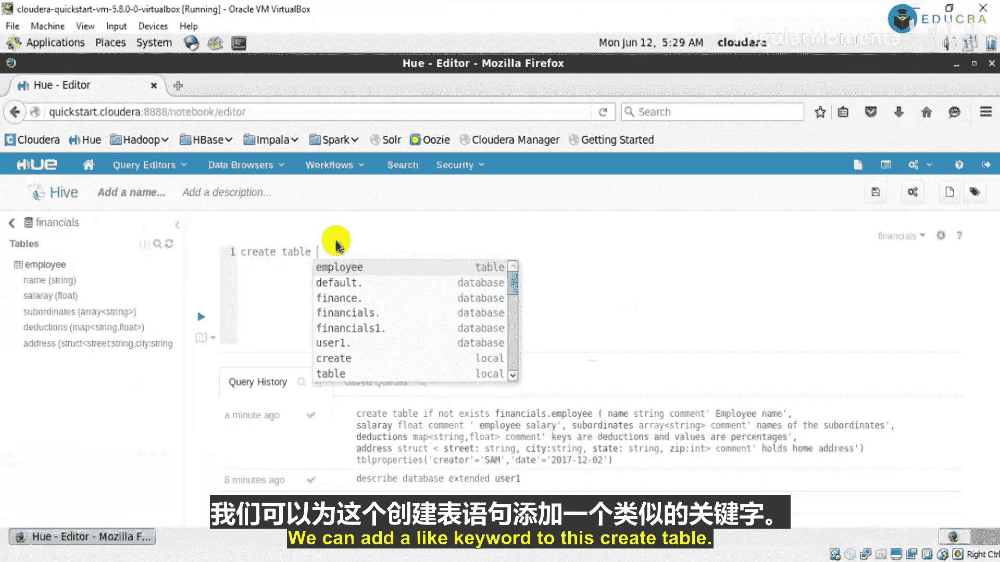

Let's come to next command as we have also already discussed。

 use my Db we can use any database we want we can see the list of tables that are created we can also see the list of tables mentioning that we want to see it in a particular database you can also see some tables like example we have employee tables and we want to see then we would show do is show tables Er dot。

Star， shortable。

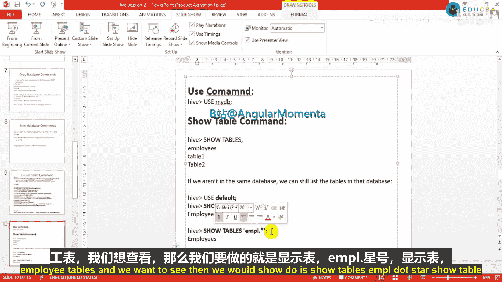

Se。Yes， we have a list of all the tables show tables like。You do。Start again。

 we have list of tables starting with alphabet next command there is a similar command describe command like we had for。

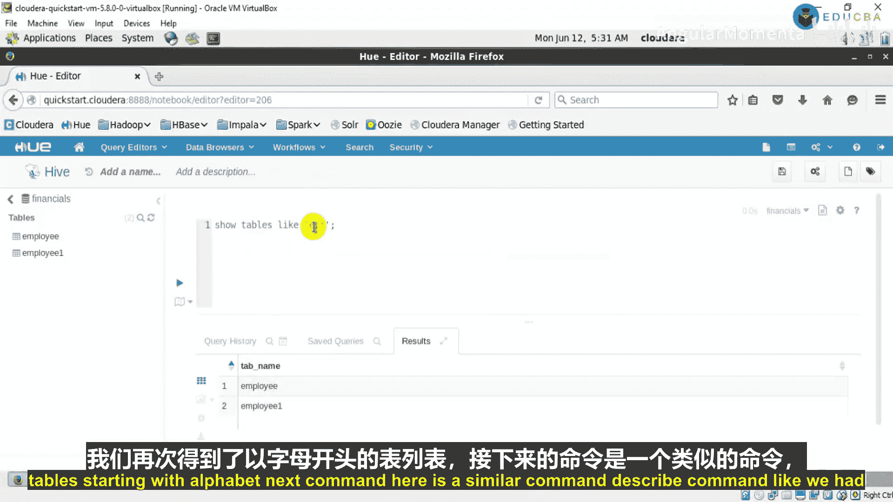

Database commands the describe and describe extended see what。

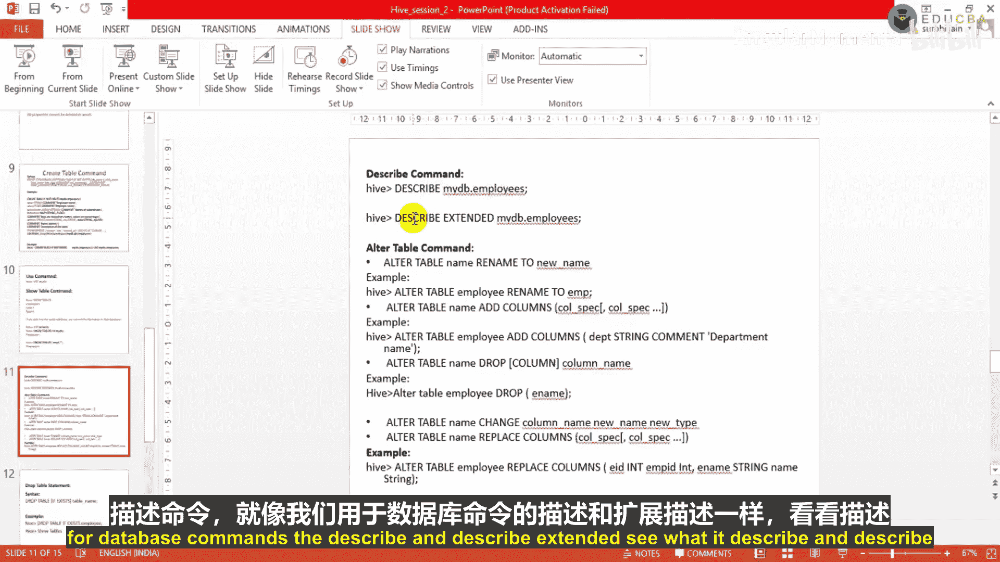

Describe and describe extended showsscribe as shown as column name。

 the data type and the we would write。Stripe extended employee。And it has shown us the。

Detailed table information。The Db name the owner， the create time last time access and can also alter the table we can alter table command。

 we can rename our table to new name we can add column specific column that we want。

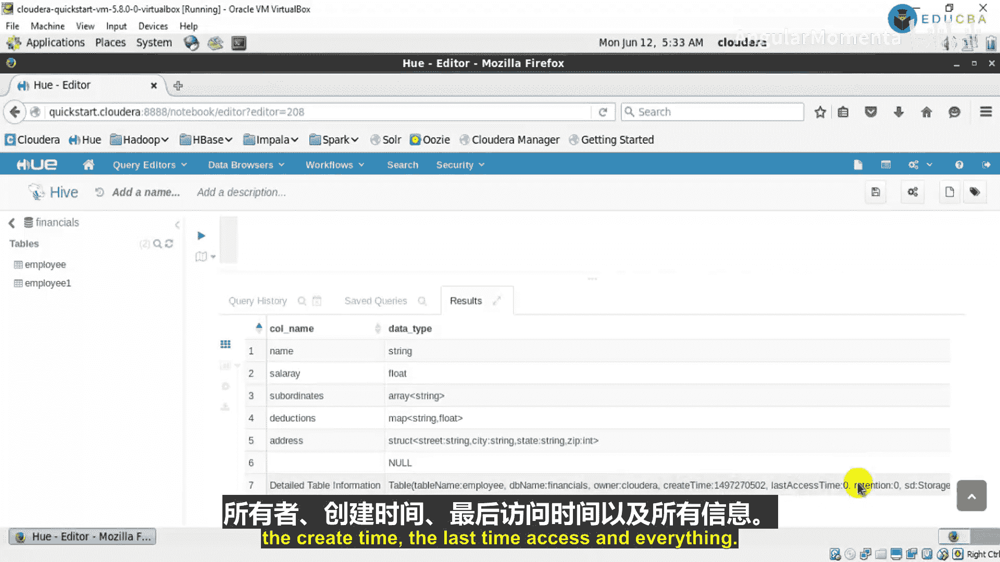

We can drop any column。And we can replace or change the columns that we want。

 Let's see how to change the name。

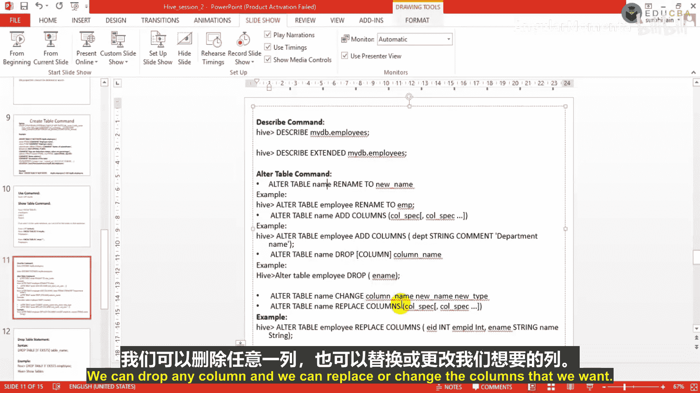

뭘 또。一本。We want to all able employee G name。嗯。EB。Sa you多지 인제。Yes， our name has been changed。嗯，好。

Refreshing， you can see that E2 name has been changed。 If you want to add any particular volume。

the command group be。我都。一部。Can你北部。网歌。Employee one。And columns the E P D that。String bay。

And the comment is。我。Adman。没有。Yes， it's a success。 let's see。

 we have added the column department string。 we have added the column department with string type you can see it through describe table。

Command with what changes we have Lo one。See here also department string and comment holds department name。

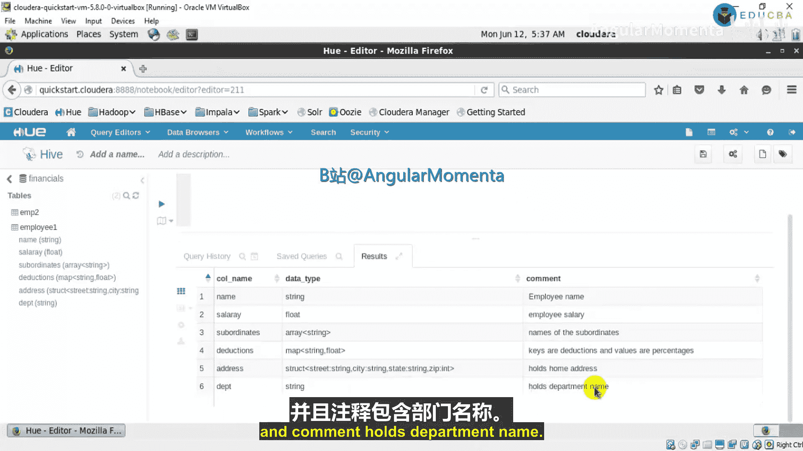

Similarly， we can drop the column， we can change and replace the columns over here。

 the drop table command。So drop table， if exists， will add a table name。 if we want to。

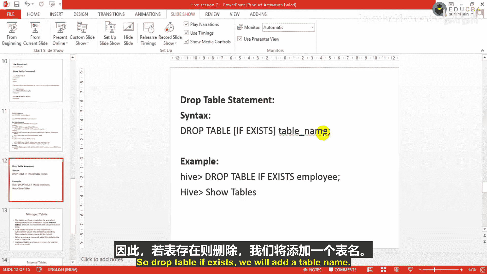

Drop table， A 2。Yeah。对。EMP we could have added if exists also。

 but here the table has been dropped now now we can see that we have only one table that is employed managed tables。

 so far the tables that we have created those are managed tables those are also called internal tables because hi controls the lifecycle of their data So this these tables these internal tables comes under ownership of hi So hi stores the data for these tables in a subdirecty under the directory defined by hive dot metastore do warehouse dot Tr by default So by default we checked in describe table command also so this is the default。

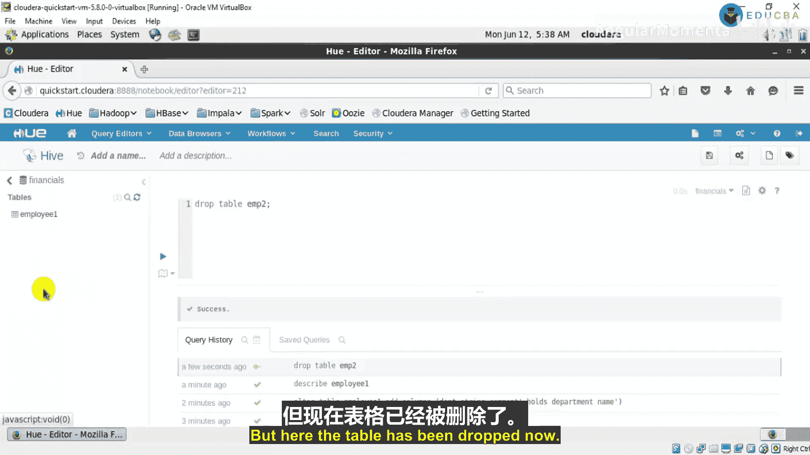

Location where the tables and the data are saved When we drop a managed table hive deletes the data and the table managed tables are less convenient for sharing with other tools。

 manage tables in managed tables， the data is owned by is in ownership of hive。

 So it becomes very less convenient for sharing the data with other tools like pig edgebase and other different tools for Huoop。

 So for that purpose， external tables came For example。

 we have data that is created and used primarily by pig and other tools。

 but we want to run some queries against it。But not give high ownership of the data so we can define those table as an external table so hi will not be the owner of that table。

 but we can describe it as an external table so how to create an external table as we can add external keyword when we are creating the table the external keyword tells hype that the table is external and along with this we have to mention a particular location clause which is required to tell hypve that where it is located because it is external hive does not assume it owns the data therefore dropping the table does not delete the data。

 but it deletes the metadata whenever the table has been dropped or deleted as an example of create external table it is similar to the table that we are created but just we just have to add。

External external keyword to make the table external along with it。

 we have to mention a particular location where we have to create the table。

 then only it would be an external table。 That's it for the session。 Thank you。

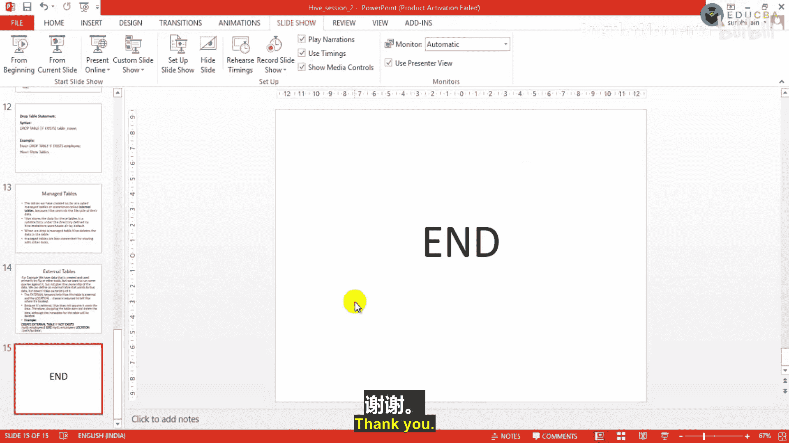