# 【EDUCBA】使用Hive、Pig和MapReduce进行大数据分析-｜-Big-Data-Analytics-with-Hive,-Pig---MapRed-p03-01_03_01_外部表--BV1yCFozJEuE_p3-

So the main difference between mans tables and external tables is that when Mans tables are dropped。

 it drops the data， as well as the metadata。 But when the external tables are dropped。

 it drops only the metadata。 The data that is stored in the location is intact and is not deleted when drop table is executed。

 We can also run these queries that we have read about on the terminal。

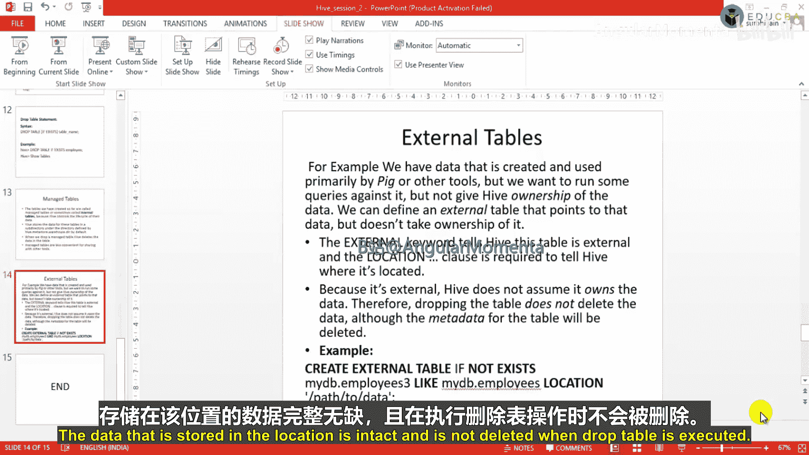

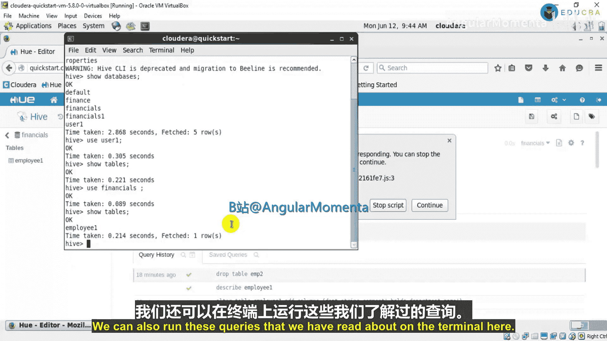

Here， so what we have to do is we have to write hive and enter on the terminal it will give take us to the hive environment and here we can run all the queries that we have learned in the hue browser in clouder environment This can be run on terminals as well example I have run the query use user one use user one I have used this database and also I have used。

Show tables that would show the tables in database user 1。As database， user1 has no tables。

 so therefore we did not get any output。Use this database。 Use financials。It had some tables。

Like employ1， so it came up with the output employ1 so in short we can use we can run all the queries that we have run on H browser on the terminal as well。

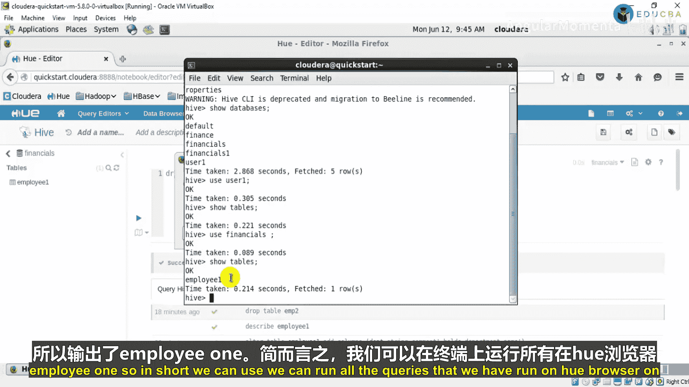

That'set for today。 Thank you so much。

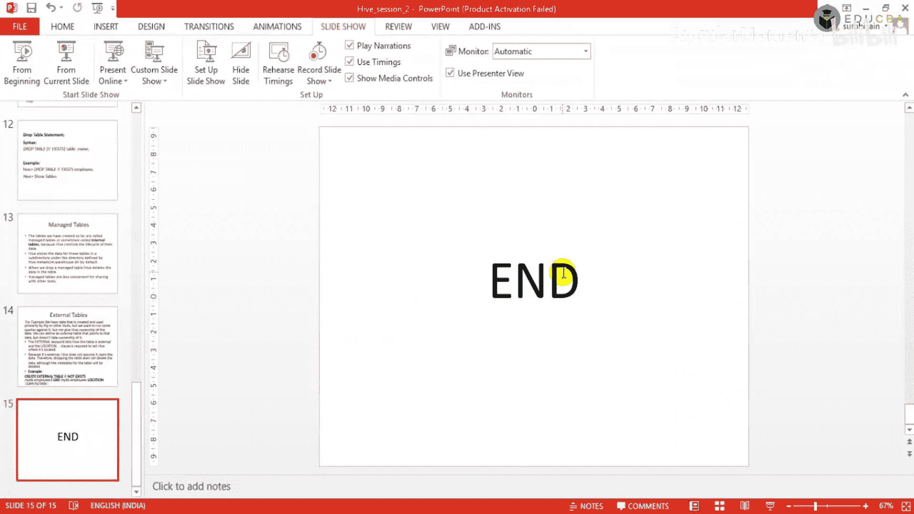

H， today， we will discuss about partitioning and bucketing partitioning and bucketing。

 we would discuss about。 We would learn about managed tables， the partitions in managed tables。

 the partitions in external tables。 The partition commands that is describe adding renaming and dropping partitions。

 bucketing and the case study based on telecom data， Partitions in managed tables。

 so we can create partitions， or we can add partitions in both internal or managed。

 as well as external tables。 So here we will learn about how to create a table and how to add partition in a table for better query for。

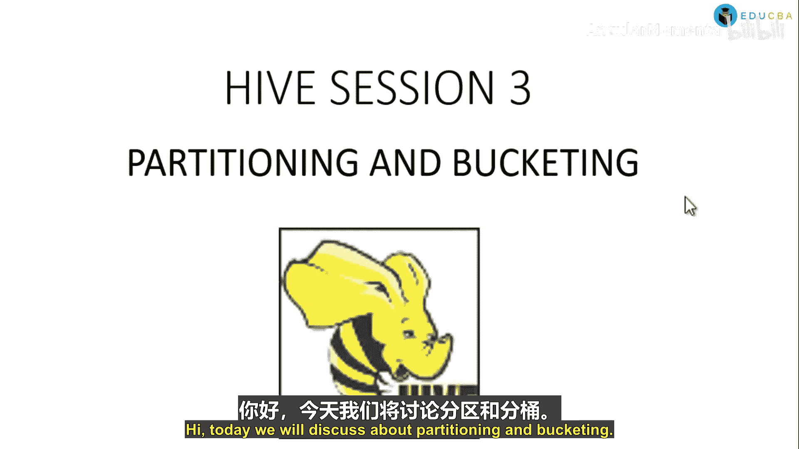

So here is a simple example of table employees that has the type， name， salary and age。

 And the partition by columns are country and state。 Let's run it。

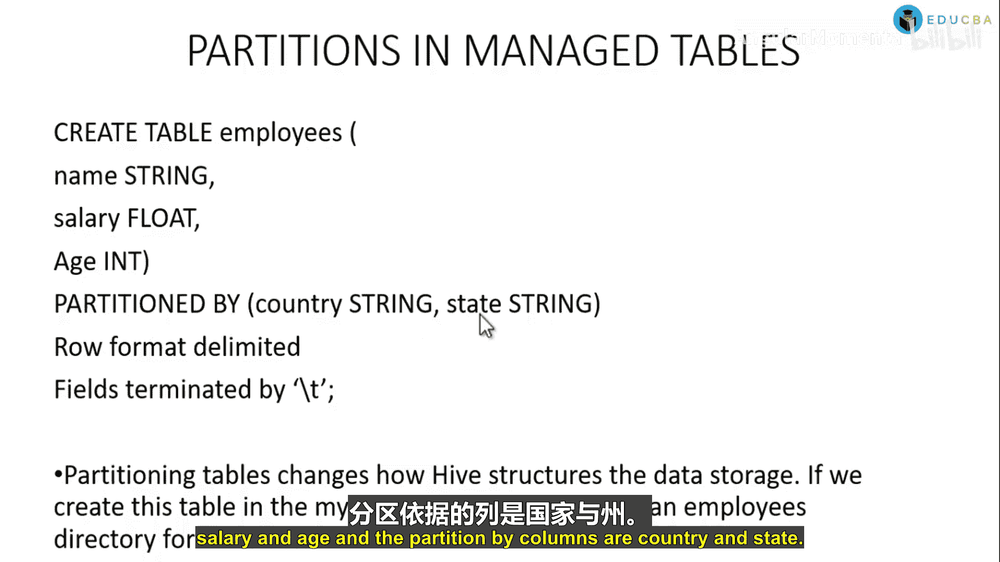

So， we will create。O give we are here on the query editor by and hive query editor here。

And we are running the queries。Create。Deer。Employees。Nim。String。Salary。😔，We can give float。Itch。

Small lint。And now， we will add。Partitioned by clause。And we will。And we will mention。The column。😔。

And the data type also， along with it， on which we are。Partitioning， though。デブ。

So it is also a string type。Yun。😔，See， add room format。Delimed。And we will also add。Fiels。Tinated by。

Here I have added fields terminated by tab so we can add this fields terminated by either a tab or a space we can give anything we want in whichever format our file our data file is being stored。

Then only we would be able to load data in the particular table。From the file， let's run this。Yes。

Success。Refreshing here， yes， a table employees has been created。 We can see that we added name。

 salary and age in the data types。But we did not add the data types in this。

 rather than we added country and state as partitioned。 So country and state are also added。

 That means partitions have been created。 We can also。Xi。If the partition has been created or not。

 so the default location where are where the directory is created for the table that we have created is。

Useer。hive。Wherearehouse。And yes， there is employees。Table directory that has been created。

We could see that。 There are no。😔，Partitionations for all the partitions。

Subdirecties are created for the partitions。In the employees directory so we can we could have seen that country and state subdiies should have been created。

 but these are still not there。 It is because we have not loaded any data。In度。Table。

 we have just created a simple structure of the table。

 So when we will load the data and when we would add the data and we would say that we are creating partition on the basis of some particular。

State and particular country， Then the subdirecties will be created。

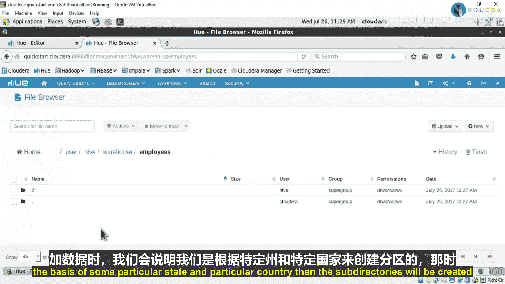

We will learn that in next session。 Yes， now partitioning table changes how high structures the data storage。

 If we create the stable in my Db database， there will be employees directory for the table。So。

 as we have seen， in。The hive deware house。So a directory of table employees was created。

I will also create subdirecties reflecting the partitioning structure。

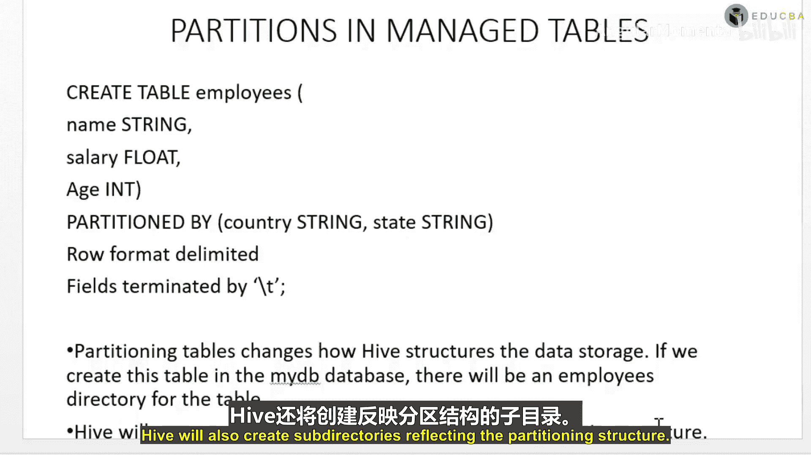

So he요。Is an example given of employees table。Partition on the basis of country， C A and state A B。

 So here we will add when we will add the data。 So here these type of partitions will be created。

So the most important reason to partition data is for faster queries that improves query performance。

 But if the partitioning scheme reflects common range filtering。

 we should have a common range in the column。 then only the partitioning is possible。

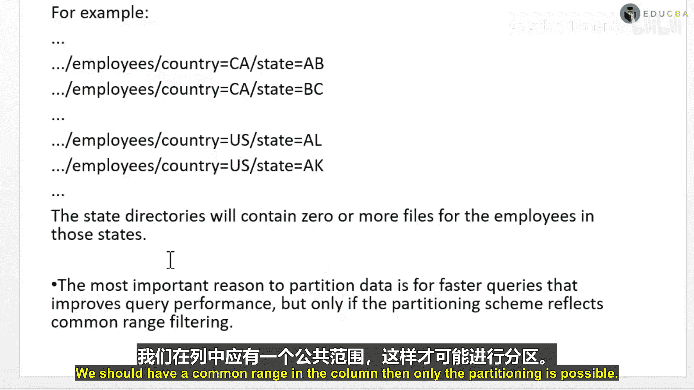

Partitions in external table while using partitioning with external tables。

 the combination gives the way to share data with other tools while still optimizing query for performance。

 As we all know that the external tables are created so that we can share our data with other tools also。

 So here it's a dual way。 It's a dual thing that we would be doing。

 we would be creating an external table that we will be able to share with other tools。

 A apart from this， we are also optimizing the table for query performance。

 We also have more flexibility in the directory structure。😊，As we have defined it ourselves。

 when we created the non partitioned external tables， when we learned it in previous session。

 a location clause was required， but in external partition tables instead。We will not use。

 We do not require any location。 We will not give any location。 Instead。

 an alter table statement is used to add each partition separate。 We will learn it。

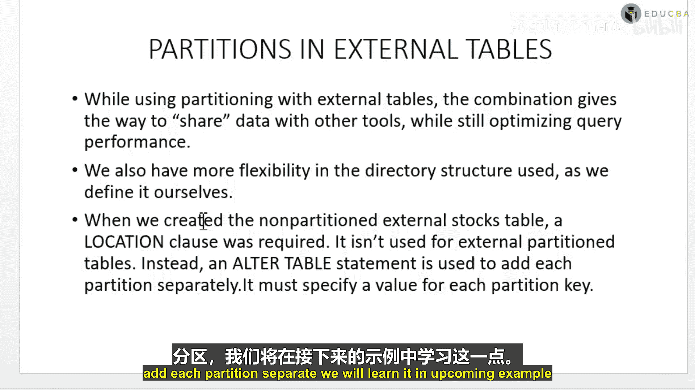

An upcoming example。 So here we have a simple example。Where external table is created。

Log messages is being created and the columns are server process ID and the message and the table is partitioned on the basis of year。

 month and day。Here also， we have added row format de， and the fields that are termd by tab。

So as we have read the particular line。In upper slide。

 it said that we will add partition through al table command。 So here is this command。

 the alter table log messages。 we are adding partition。

 and we are giving static values to these partition for here。

 we have mentioned 2012 for months is one。 day is 2。And apart from this。

 we will mention a location on which。The partition data is saved。Let's create an external table。

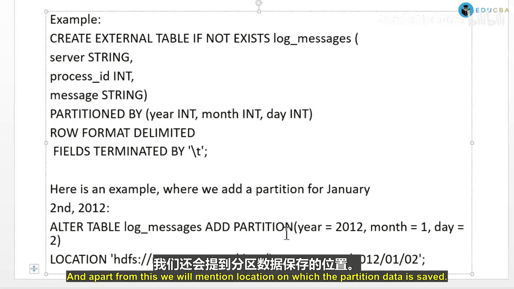

Create external。Table， if not。Exist log， underscore。Message。Our fields were。Server。

 that is string type。De。😔，Process， Id， that is。Enday。And。Message， that is。Sing。😔，对。

And we had partition。Bye。That is in。Meng。In。And they also。R format。Dlimitted。

Our fields are terminated by。嗯。Here we are creating an external table。

 but we are not mentioning any location。Yes， log messages has been。Created。You can see。Here， also。

The server process I message， these are all created an year month and。对。We would add the data。

In these partitions in our next session， where we would be adding a data， we would。

 we would learn how to add a data into the。

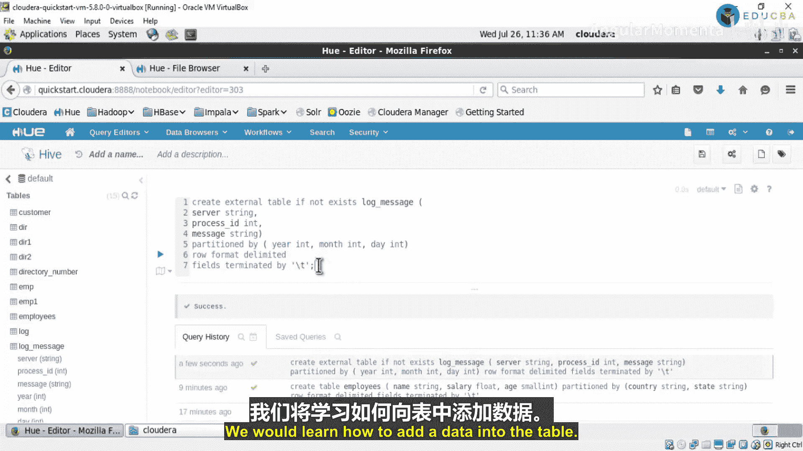

Table， now， let's learn about partition commands。If we want to see that if the partitions are created or not。

 we have show partitions command and with that we have the syntaxes show partitions and the table name。

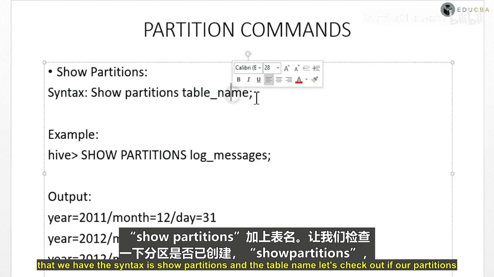

Let's check out。If our partitions are created or not。Shuo。😔，Partitions， let's check for employees。

You could see that。It is not showing any partitions， because we have still not added。

Data in the partitions。Let's try。For log messages。Here。

 we can see that table is not found in the log messages because it was an external table。

 So it is not part。 It is log message。 So here also。

We are not able to see any partitions because we have not created any partitions。

 We have not loaded the data in the tables。 We have another query。 Describe extended log messages。

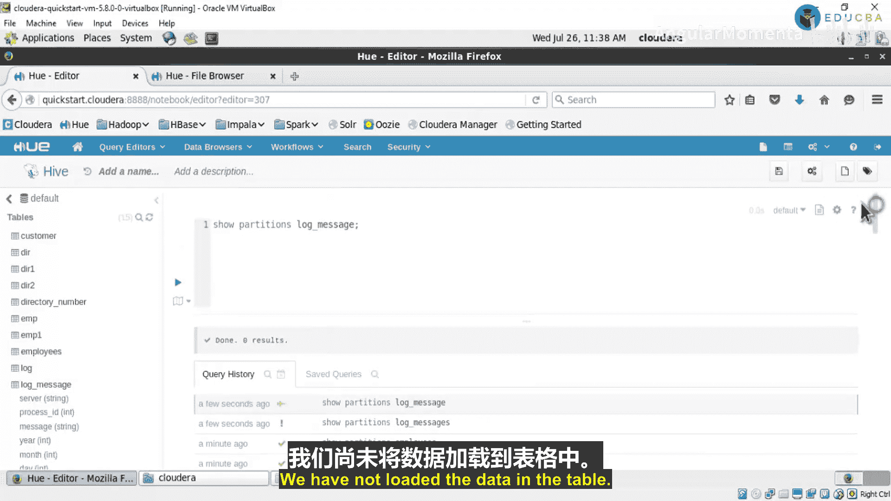

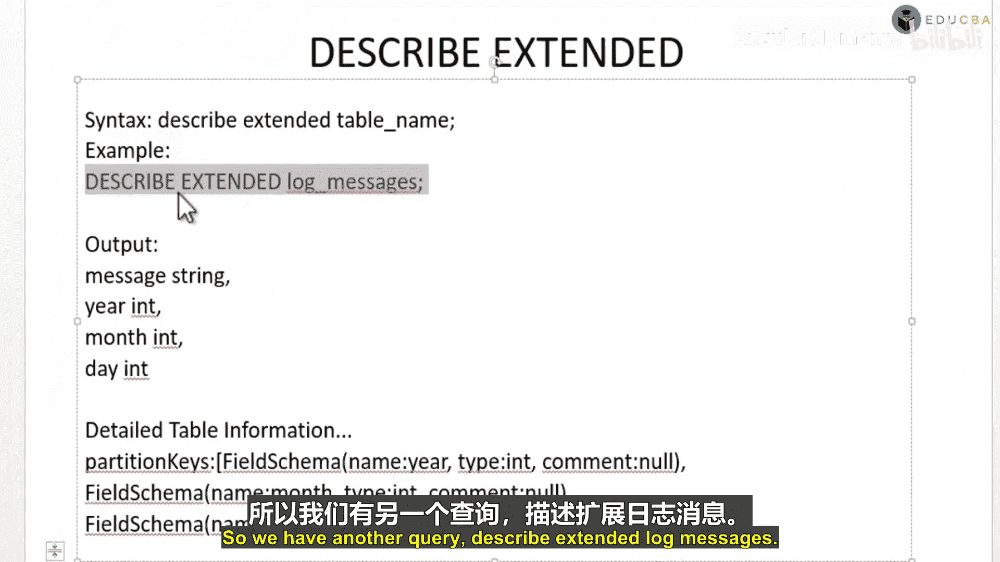

So here it is defined。C。We can see here is the partition information。

In describe extended through describe extended command， we could see that these are the column names。

 name， salary， age， country and state。 but the partitions are。Country and。

State partition information is given here in the detail。Format。Let's check for log messages also。

 So here also。😔，You can see that we have all these columns and the partition columns are year。

 month and day。

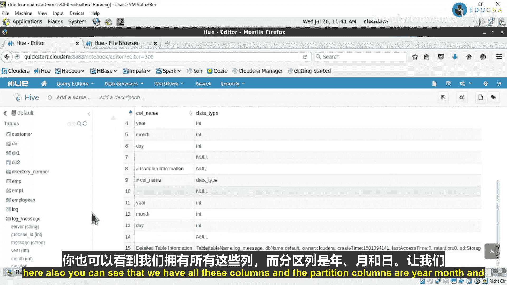

Let's learn about her another。Here are some missing information about external table that we created log message。

😔，It did not show any location where the partition was created， so。Now。

 also it will not show any location because we have not added the data。

 So the describe extended log messages and we can mention a particular partition。

That we added through all the table command。And check the location of the partition。

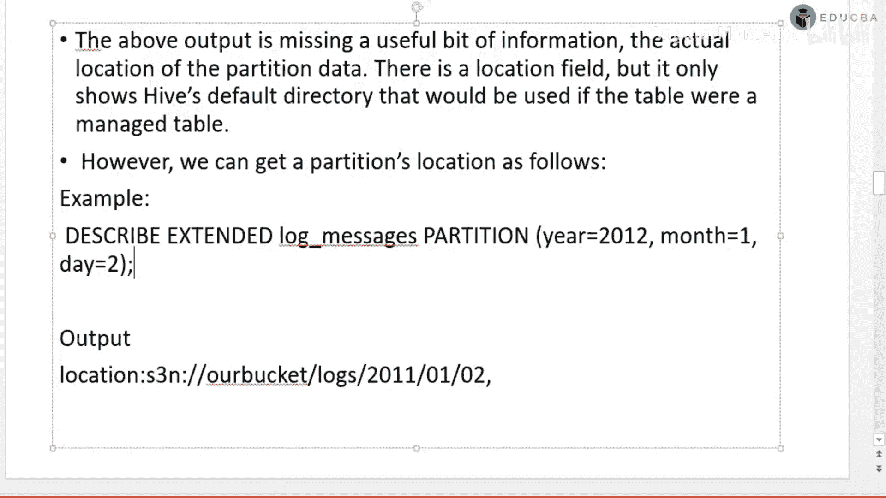

As we said， we can add partition through all the table command and we can add partition on the basis and we can give static。

Values to all the partition columns that we have chosen， along with the location。

We will We will learn all these in a next session， where we will add。The data to the tables。

 And then we will。

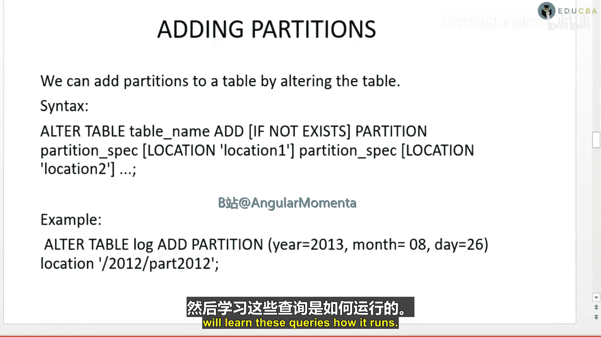

At loy squareries， how it runs。We can rename the partitions also all the table table name partition。

And the partition specification renamed2 partition partition specification。

 So it is alter table log partition year month and day。 So we want it to be renamed to。Y， O J 2，0，1。

3。He can also drop a particular partition。By drop command， alter table employed， drop if exist。

 and we can mention a particular partition。 Let's learn about bucketing。

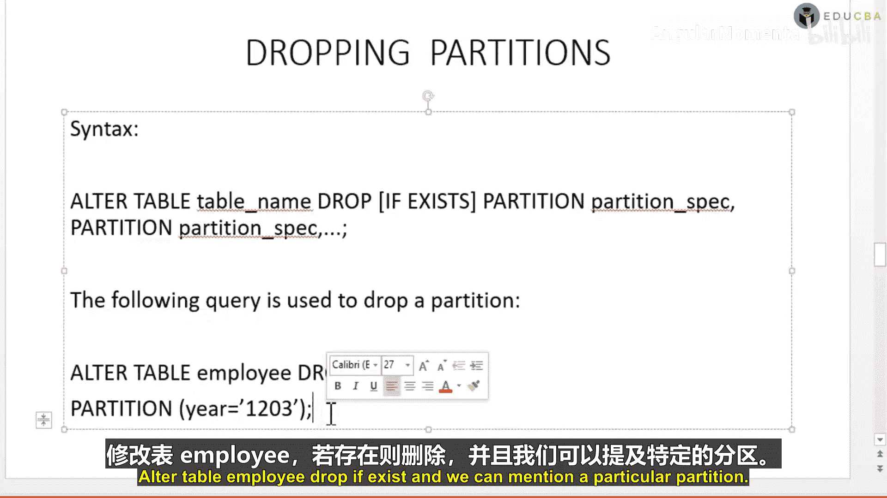

The partition gives effective results when there are limited number of partitions。

 and partitions are equally divided。But that is not possible in all cases。 Therefore。

 bucketing is used。Buckocketing is the technique to decompose the table dataset sets into more manageable parts。

 So bucketing， what bucketing does does is it。Buckets。

 it creates buckets as many buckets that we will mention in our table at the time of table creation。

 and it the data is dumped into those buckets Eal data segments are dumped into those bucket Fe of buckets bucketing concept is based on hashing function on the bucketed column。

We use clustered by clauses to divide the table into bucket。

Buckocketted tables will create buckets all of almost equal data。

 said here is an example of bucketing。

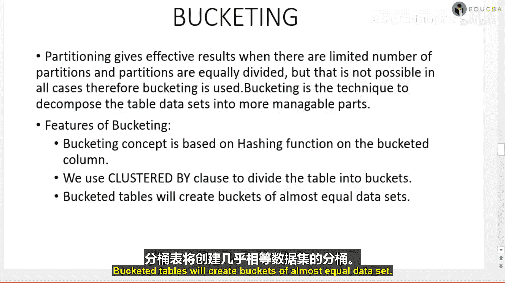

Create table bucketing example， and our data types are。data columns are name and the ID。

 and it is parted on the basis of location and is clustered by for bucketing we have used clustered by。

 and we are clustering it on Id into 50 bucket to enforce bucketing and load the data into buckets。

 we should have。Set hive and force bucketing is equal to。 Let's create a table。

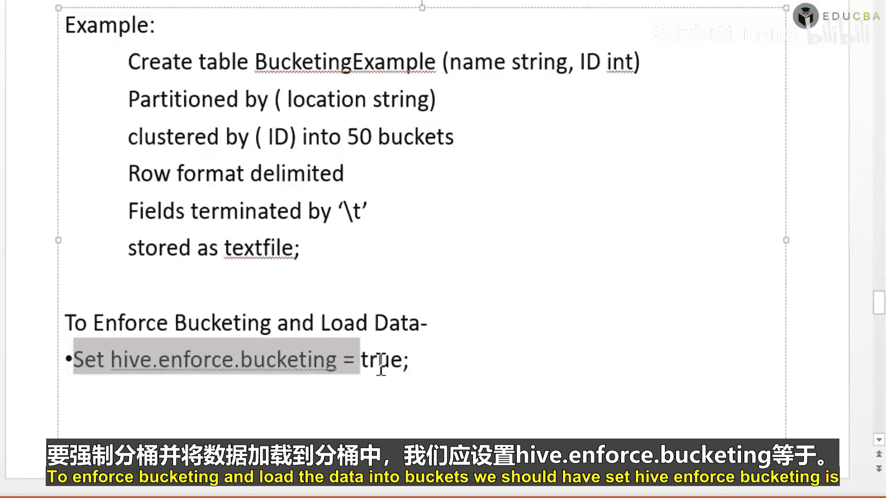

Of bucketing。Example。Create table。Bocketing example。Meor。Liter's name。And。Id。That are parted。By。

Location， that is。String type。And we have used clustered by。I D。In2， we want it into 50。

According to our data we can set our bucket size so we would know our how long is our data so accordingly we can choose a number of buckets。

Let's run this。😔，Yes， we have created the bucketing example table。😔，So the fields we have our name。

 I and。

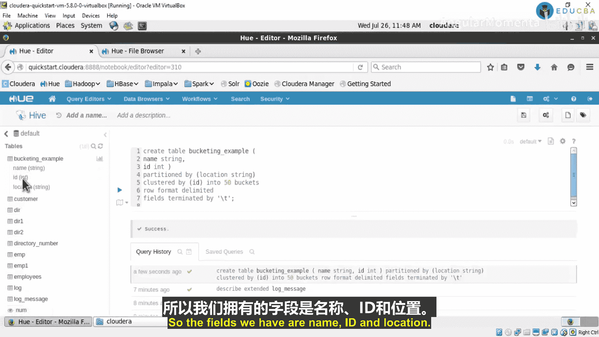

Location。Now， let's discuss about our case study。So we would learn the case study of telecom data。

So in telecom data， we know that we have。Customer numbers。 and according to。Those numbers。

 telecom industry have some data collected with them。

 So I have taken few tables and few columns on which we would be learning。😔，How to implement。

Hve on the data。 So here is the stable directory number。And the data fields are。DN I D。

 that is a unique number， I D。El code is， is the E R code。 DNum is the customer number。

Status is the status of the number Dn status mod date is the number status date change。

 It is the date on which the number status was changed。The dealer， I D。

Dealer I D tells whether the number is prepaid or postpaid。And the D end date。

It represents the number， the active date， end date of the number。And the DN mode date。That is。

The last change， the last modification of the number。So in this table。

 we will create pitions on the basis of dealer I and EL code。And we will create bucket on the end。

Stateates。Let's create a table。So here was lets discuss about all the tables and in this session we will learn how to create a structure of the data through tables。

 so we will learn how to create tables implement partitions and bucketing that we have learned in our above session。

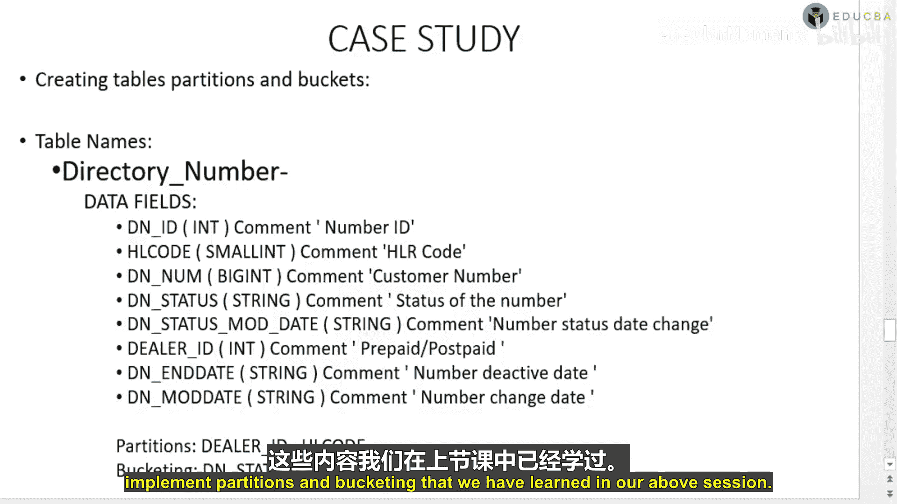

There is another table。Contra services cap。 So the data fields are Co I D。 This is again。

 a unique customer Id S in code is the services that are implemented on the number。

The sequence number。That is the sequence of the number of the change of the service on the customer number。

Dear I D。Is， again， a unique number。Cs status is the status of the number。

 Cs active date is the number。😊，Is the date on which。

The number was activated and C SD active date is the number deactation date。

C S request is the request number on which there was any change made to the number。

So here we will partition our table on the basis of SN code， the service code。

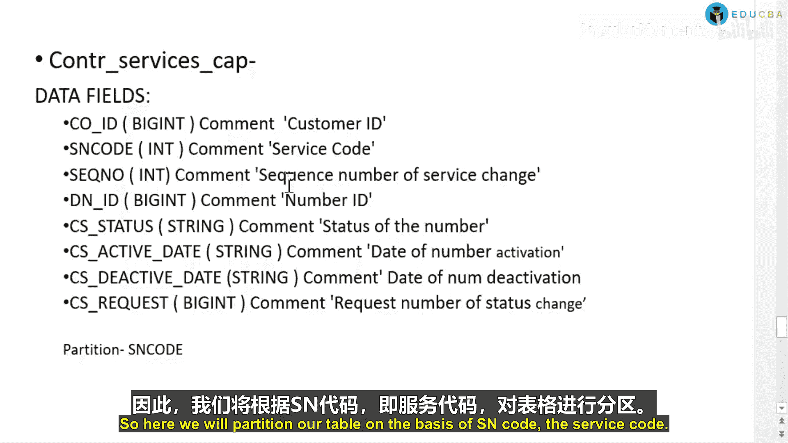

Now we have the stable Q services。

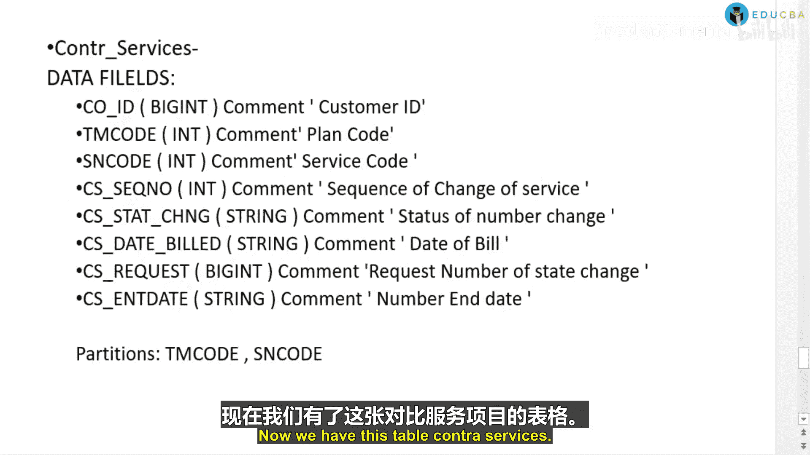