# 【EDUCBA】使用Hive、Pig和MapReduce进行大数据分析-｜-Big-Data-Analytics-with-Hive,-Pig---MapRed-p04-02_01_01_Hive-中的表控制服务--BV1yCFozJEuE_p4-

Now we have the table Con services， the data fields in the table are co ID that is again a unique customer ID TM code。

 TM code are the plan code， you all must have some plans in your network connection。

 so TM code is a particular plan code that has been assigned to a customer number。

S and code are the services that are being applied within the plan to the customer number。

C a sequence number is the sequence of change of a service on the customer number。

CS state change is the status number change。C， S date built is the date of the bill。

CS request request number of the state change CS end date is the number end date。

 so in this table we will partition on TM code and SN code。Because we have obedius。

Plans and services。 So we will partition our。Table on the basis of Tm code and S and code so that it will be good in whenever we search for in numbers within a particular table or within a particular service。

 Now we have table contract all。

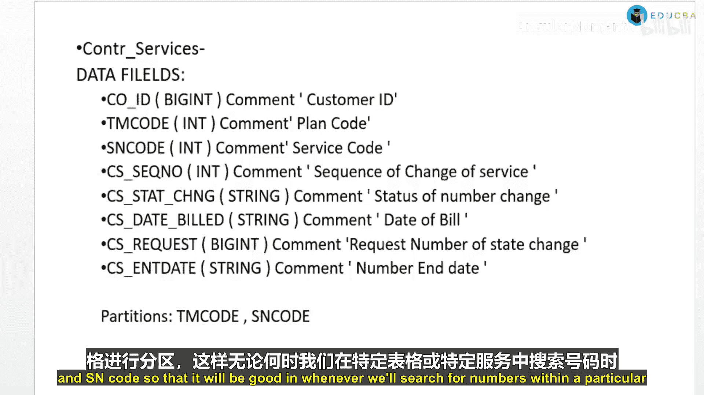

Kaii in previous。Table we read is a unique customer code customer ID also we read is unique customer ID Coact is the Co ID activation date Co ID end date is Co ID end date comod is the last modification date of the Co ID。

Quai the user last modification is the user who made the last modification。 So we have so many users。

 so many people working on changing the。Services of the customer number。

 so we are we keep so telecom keep the track of the people who actually do the any and everything thing that he has done on the customer number。

 so this is the core user last mode is the user who has made any modification in the customer number。

 any service or any plan。Tm code。Is the plan code and T code date is the plan assigned date so here we will partition our table on the basis of Co user last mode and T code。

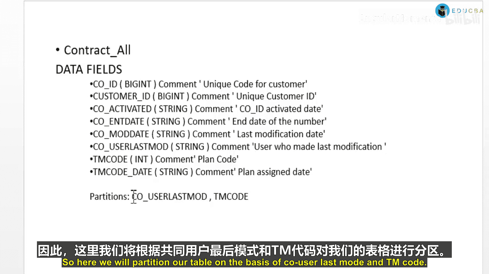

At last， we have our。Table customer all。 So here we have customer ID。

Customer ID cast code is the customer code again its unique code。

 we have different unique codes on the basis of Co ID and the number。

 So there are various levels on which on the basis of which we have the。Unique Ids。

CS type is the status type CS activated is the number activation date CST activated is the。

The activation date Tm code is the planned PRG code is again some code that is assigned to the customer number Cs cur ball is the current balance of the customer。

Number Bill cycle is the bill cycle date。Of the customer， every customer lies。

In the bill cycles or in bill cycle during the month。

 so this is the particular date that which the customer has。Birth date， the previous balance。

 if the customer has any previous balance user last mode is the user last modification date C mode date is the last modification date again I'm sorry Use last mode is the user who is last modified the。

Changes and CSs mode date is the last modification change。D。

So well partition on the basis of Tm code and PRG code lets。

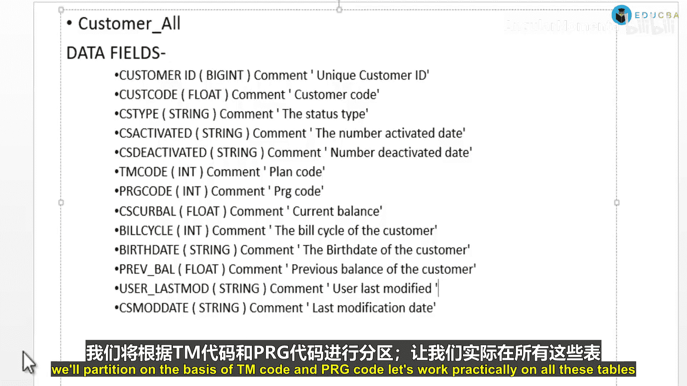

Work practically on all these tables and lets work on how we will create these tables on hive。

 let's create directory number table first we already have a directory number table。

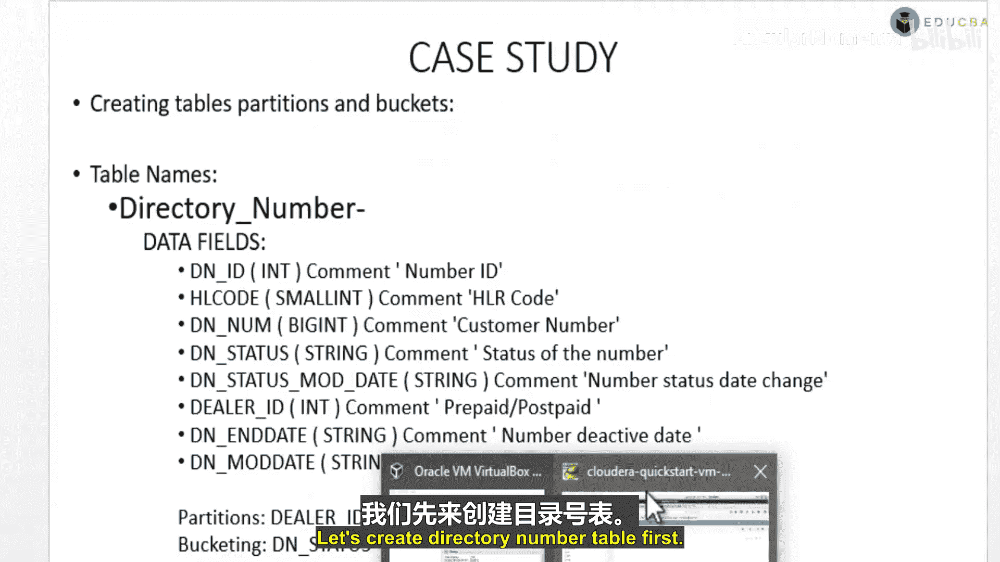

So we'll drop it first。😔，好。Okay， let's create the rey number。Create。Table。

Diirreecty number we will add， if not exists also。

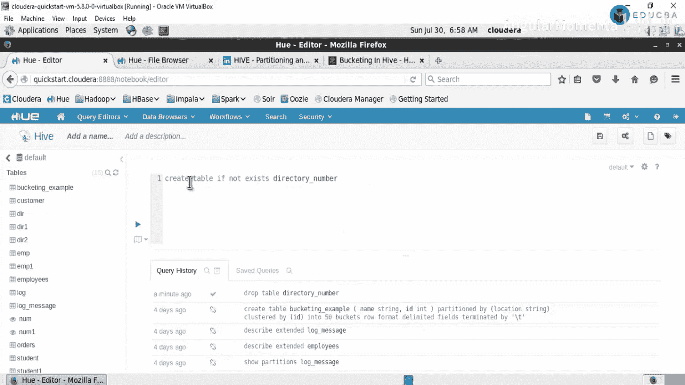

So。DN IDD that is end type HL code that is small end type。

We will not take H code here because it is the partition。 We take it in partition。😔。

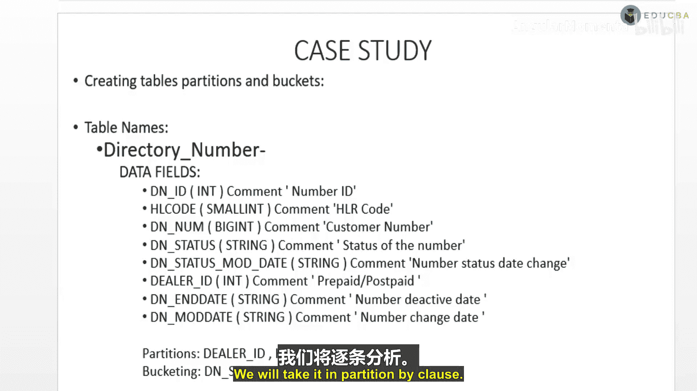

By clause。So， let's start here。DNID。That is int type， and we can add。

Comment adding a comment would be good because we have hundreds of tables within a system。

 so if you would add a comment then a layman user would know that what the column or what a table is about。

So we'll mention here is the number ID。Now， we have the nu。没是。D enum， that is big type。And。M Steve。

Customer。Number。Now， the end status。s。The instance status is string type。

I have not written comments here。Comment。Status。そった。Number。

They'll keep terminating the lines by comma。Now we have。D end status mode date。T n status。Mo did。

Dative string type。And want to comment。😔，Number。Status。Did change。Dan。De。That is again string type。

And we'll add a comment。😔，Number。The active date。Dan。Mar date。String。Again。😔，Comment。Number。

Chaanged it。End of the bracket。Now， we will add a comment。😔，And tell what the table is about。

So this is， you can write anything I'm writing this is the directory。😔，Number。TableNow。

 we will add partition。By clause。And we were to partition it on the basis of。😔。

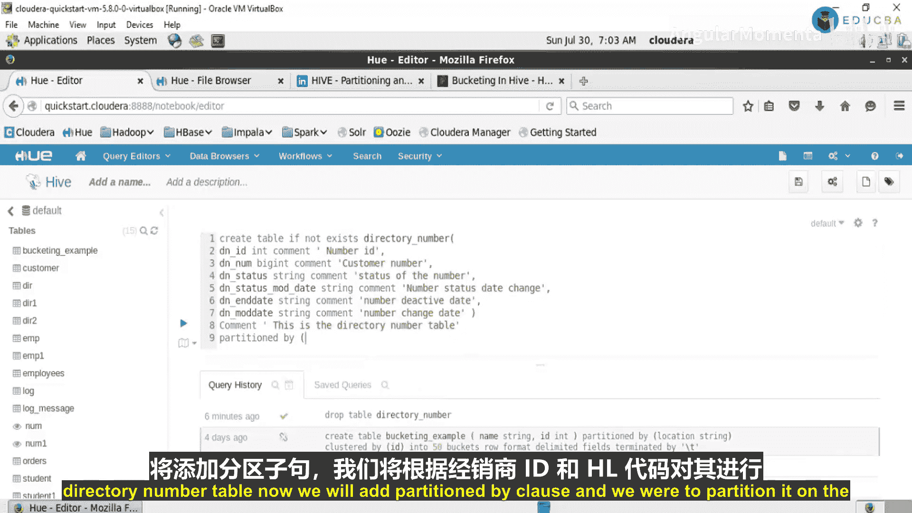

Dealer ID and HL code so。

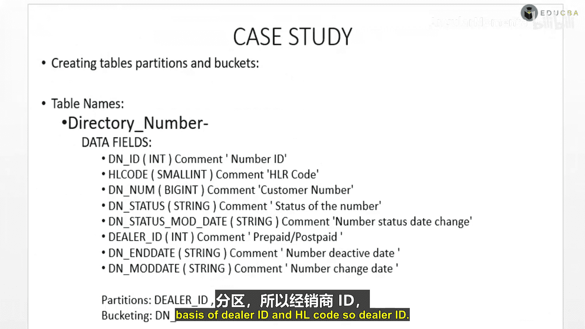

Dealer Id， dealer Id is in type。And a cell code is， again。😔，Small inter。Close the bracket。

And we have to partition it on the basis of。

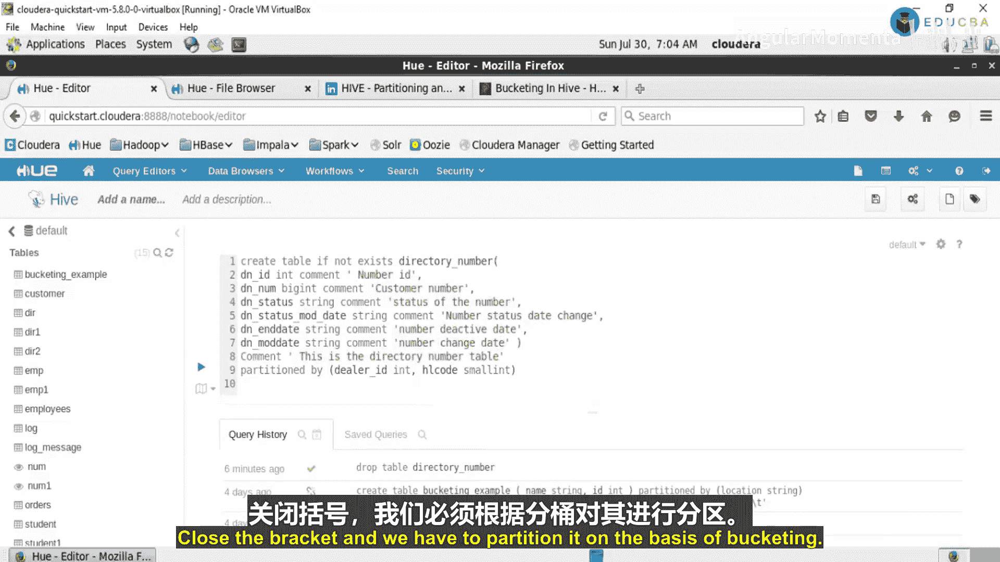

Beting we have to do bucketing also on the basis of DN status。

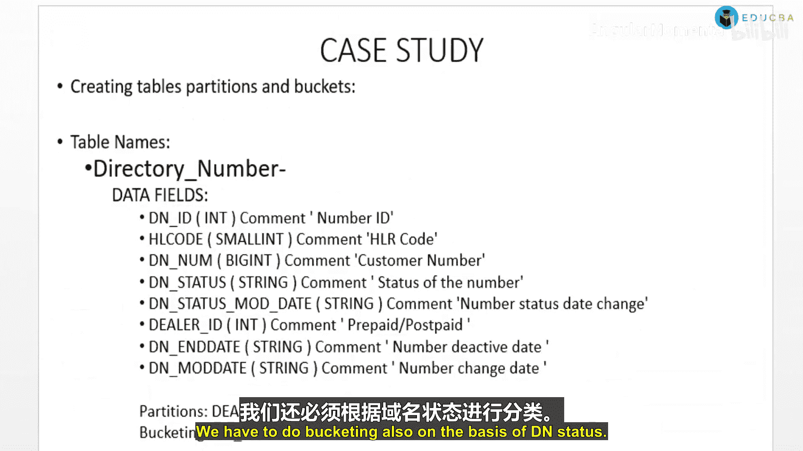

So it could be。G stood by。Dan。Status。In2， you can write。

Any number of buckets that you would feel is suitable for your data and2。

I' have written  hundred buckets。No， we will。Soact the data table or data type in which we want the data to be。

Thela format delim， and we will add。😔，Fields。Dominated by。Lines terminated by。Back slash in and。

In whatever file type。We want to store it， so I am mentioning it as a text file。Yes， this is the。

Structure offer。Diirectctory number， table。Let's create it。Yes， it is successfully created。So， now。

Here， we can see。DN I D， DN nu， DN status， DN status mode date， DNN date。

 DN mode and dealer ID and EL code are also added that we have attacheded。

Column these are also added in the table structure。That means partition partitions happy been。

Created。Let's create。Another table。

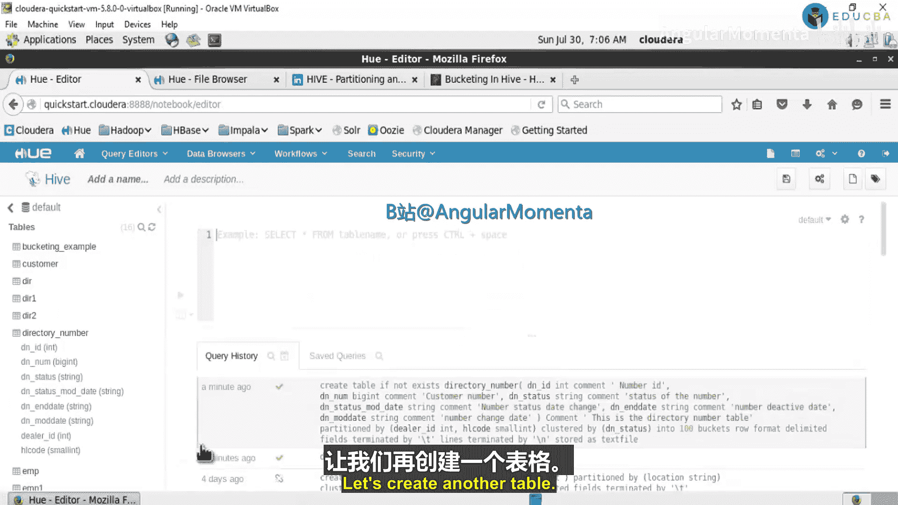

Now we have Q Services scam。CoI D S and code sequence number DNAID C S data C active date。

 the active date and request。

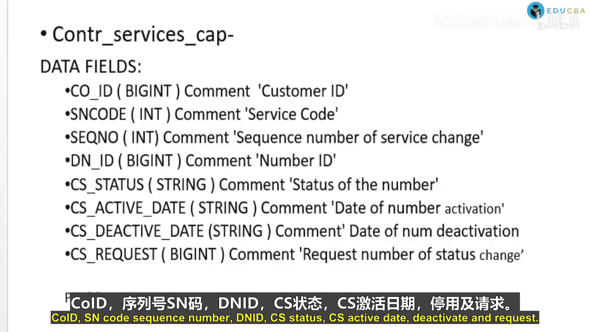

Create。De blue。If not。Exist。Control。Services。Yeah。Lopen the bracket。And well start mentioning。

Columns。Bigt。Will add a comment。😔，That it is a。Unique customer Id。Let's add unique， also。

Unique customer Id。搞嘛？And be。Sequence number。That is hint type。And we will add a comment。😔。

Sequence number of。Servicist change。Now we have D andID。That is big int type。And that。Comment。again。

 a unique。😔，Number 8。Now we have Cs。😔，Status。That is。String type。I me add a comment。😔，Status of the。

Number。CSTX。Tiff was his active Did him sorry。Comment would be。Activation did。Dff。Number。No。

C is the active date。Common would be。D duration。Da off。Number。C us。Request。Im so sorry。

 I have not mentioned the types here。C， his request is。Big in type。And the comment。Dequest number of。

State discharge。That we'll close the brackets。And we add a comment section for the table。This is。

Country services gap。De。Now， the。Row format。They limited。Fields dominateinated by。

If we would give fields terminated by an all。😔，Then it would be good because we know what in what format data is in。

 so it would be good。😔，And during the time of loading the data。We will be it will be easier for us。😔。

St load the data。Studs。Let's see if there is any mistake， if we have mentioned， not mentioned。😔。

Any type？We have mentioned all the types， and we have mentioned all the comments and。Everything。

 okay。Yes， the table has been created。Country services camp。So we have QID sequence number， DID。

 CS status， active date， the active date CS request。8。

That we have done a mistake here that we have not added。D。😊，Additions， so let's do one thing。

 Let's drop the table。Trop the。On to service scan。I'm really sorry， but we will have to。

Let's try if we can copy here。😔，Maybeive audio。Partitioned by。SN code， that is in type。😔，Now。

 we have not missed anything。Yes， now I send code is also there Okay， let's create another table。

 The next table we have is Con services。I hope you are understanding the table structures。

 the telecom data structure that we are creating， I told you earlier that we have we are taking five tables and we will are creating the structure of the tables we creating a data in hive and then we would work further with hive。

 creating table if not。Exists。Our next table is。😔，Con services。So， we will add。Cody。

That is big int type。We had a comment。ユニ。Customer ready。Now we have。C a sequence number。😔。

That is hint type。And we can add a comment。Sequence of。Change off。😔，Service。Deus。S。Dad。Change。

That is。String type。And we add a comment。😔，Status。Lo， number change。Cius。D。Bilt。That is。It is a date。

 That is， again。This is C state build is the data of。😔，B。No， you have。C，s。Thequest， that is。

Begin type。And the comment。😔，Number of。State change。Cs。And state， that is。S type。

And we add a comment。Number18。Okay， these are the number of。And we already comment。2。

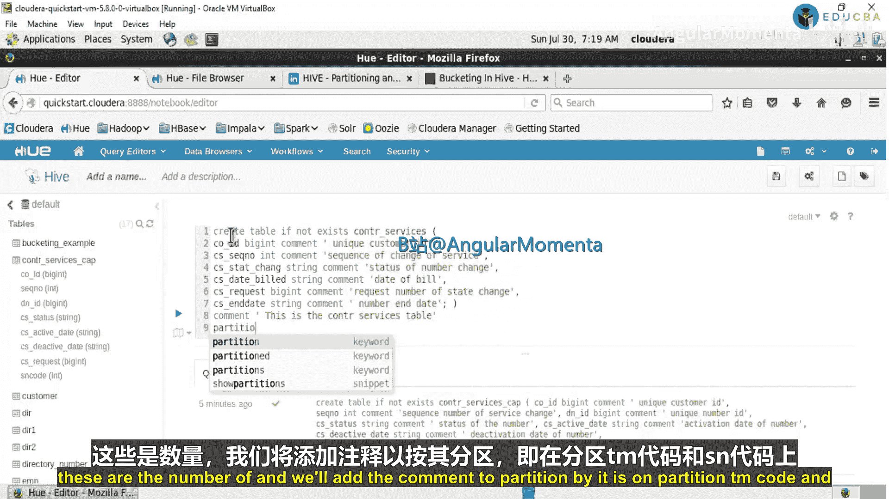

Partition by it partition。

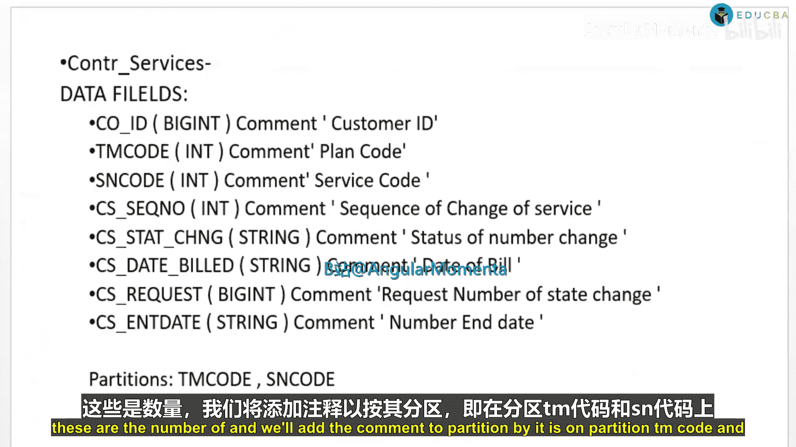

Tm code and S code。So， Tm code。This。Enint type。And encode this。En today day。那如。我们。Delimed。

Fears dominated by。db。Lients。Tinated by。Back slash in。Sted us。Next file。

 let's confirm If you have added partition。 Yes， we have added the。Data types to every。Column。Yes。

 lets。Make it。Okay。Turing by mistake Steve。So our third table is also created contrast services。

 CoI sequence number， change bills request and date the coordinate and S and quarterr also added data the partition tables let's create another table。

😔。

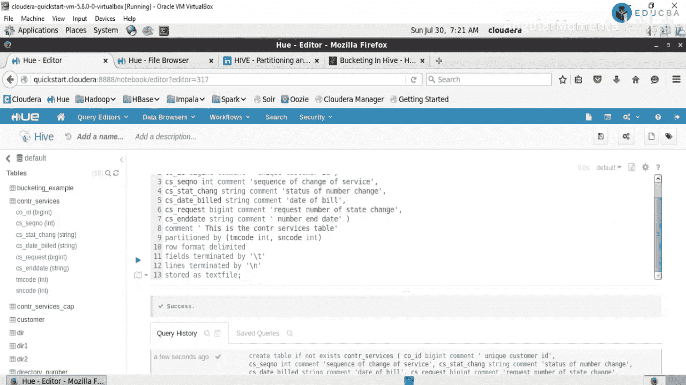