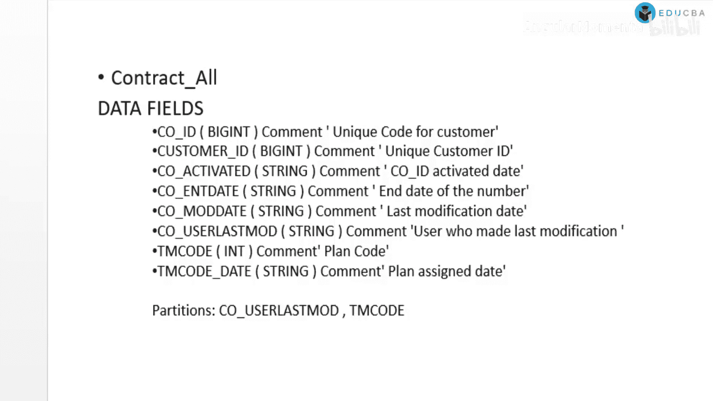
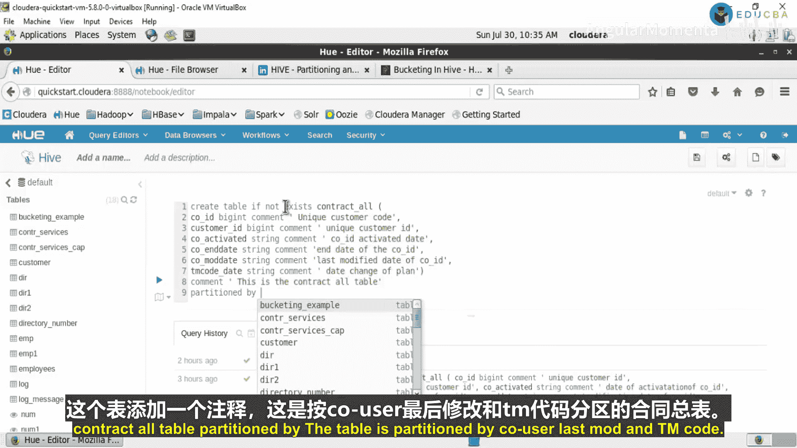
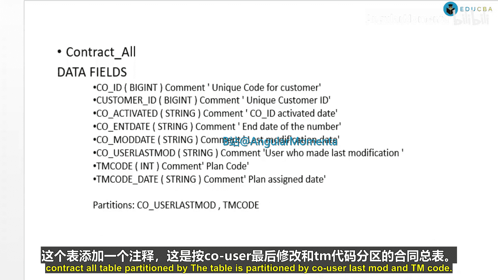
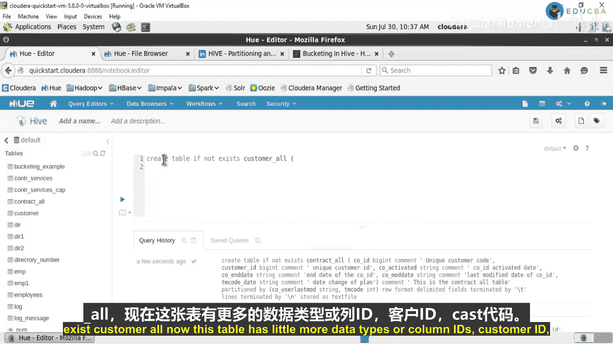
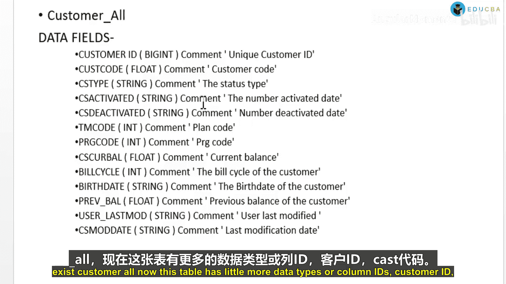
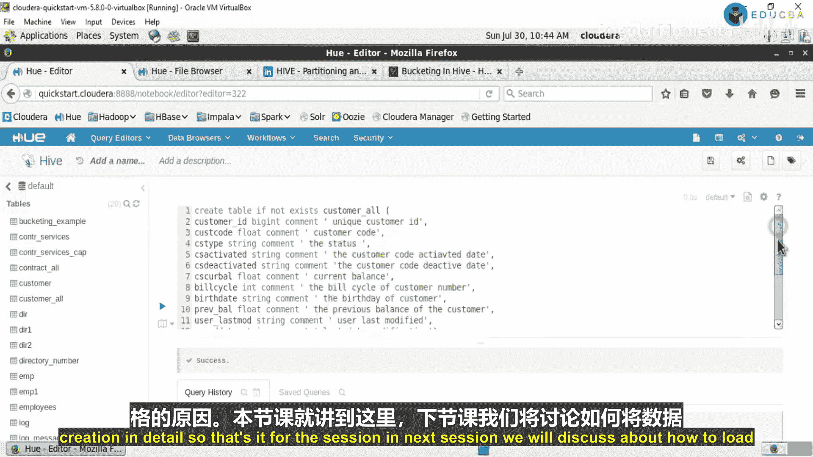
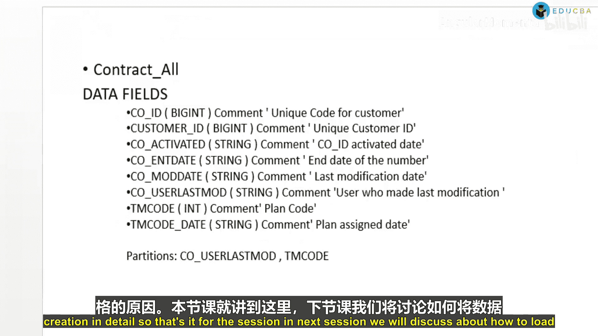
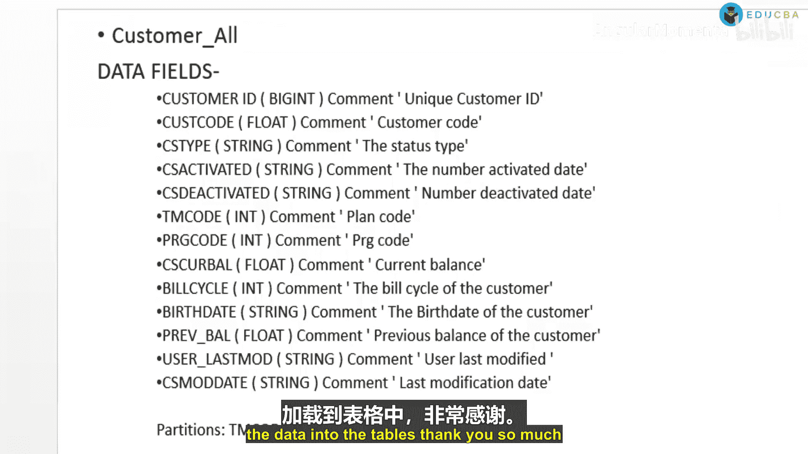

# 【EDUCBA】使用Hive、Pig和MapReduce进行大数据分析-｜-Big-Data-Analytics-with-Hive,-Pig---MapRed-p05-02_02_01_创建合同全表--BV1yCFozJEuE_p5-

Let's create the table contract all。

So， create。Table。If not。Tists。Contract all。Now the。Data types。The columns we have。Kaiude， that is。

Begt type comment。It is a。Unique。Customer quote。Next is。Customer I D。That does， again。

Bing begin type。And the comment。It is， again。A unique。Customer I。Now we have。Coactivated。

It is a string type。As it is a date。And the commives。Gdy。Activated date。Go and dead。T is string type。

To comment， would be。Indeed。Of the。Gady。是。Cool。Mad。Date that is， again， string type。

And the comment would be。😔，Last。Modified date of。God。And last is team code date。

It is again string type， and in common， we would add。Did you change off？Lan。

Lets add a comment to the table。This isて。Contractor。De。Partitioned by。

The table is partition by Co user last mode and T code。

G。User last more。That is string type。TM code， that is。Entertain。住 for mat。Interlimited。

Fields dominated by。Back slash D。Ls。Tinated by it。Max slash in。Sttored us。Next fight。Yes。

 we have created。The fourth table。Let's come to our。Last table。That is customer role。Creable。If not。

 exist， customer role。

Not this table has little。😔，Bs。Data types， a column Is， customer Id cast code。 Lets。

 let's create the table。

Customer I D。That was big int type。And that was that is a unique。Customer I D。Cast code。Tus。

Flod type。The comment is。It is the customer。Good。C S type。Is a string type。And it is the。Statish。

Then we have Css activated。Spring。Comments。Do。Customer code。Activated。De。Sius。D active。Activated。

That is， again， string type。Comment is。The customer。Good。D activeive。De。Next is。Ss girl bell。

This is float type。And the comment is。Current balance of the customer。

It's okay with right and short also。Bill Cy。That is int type。The comment is。Double cycle of。Customer。

Number。Then we have birth date。😔，Actually， this table has all the customer level information。

Previous balance。That is float type。The comment is。User。Last mode。This string type。And。User blast。

Moified。Last， but not least。C is more date。That is the string type。The comment would be。Last date。

Moification。This is。Customer role。对不？Partitioned by。Tm code that is in type。And。PRG code。😔，That is。

 again。In today。Rule format。Deally need did。Fields。Tinated by it。Yes。

 we have successfully created all the five tables。I've made you create all the tables。

And so that you could understand the details of how to create a table structure。Basically。

 and how we could use partitionition bucketing in all。

 And you should know in order to apply queries on the。Table。

 you should know the details of each and every column。

 So that is why we have done this table creation in detail。

So that's it for the session in next session we will discuss about how to load the data into the tables。

Thank you so much。