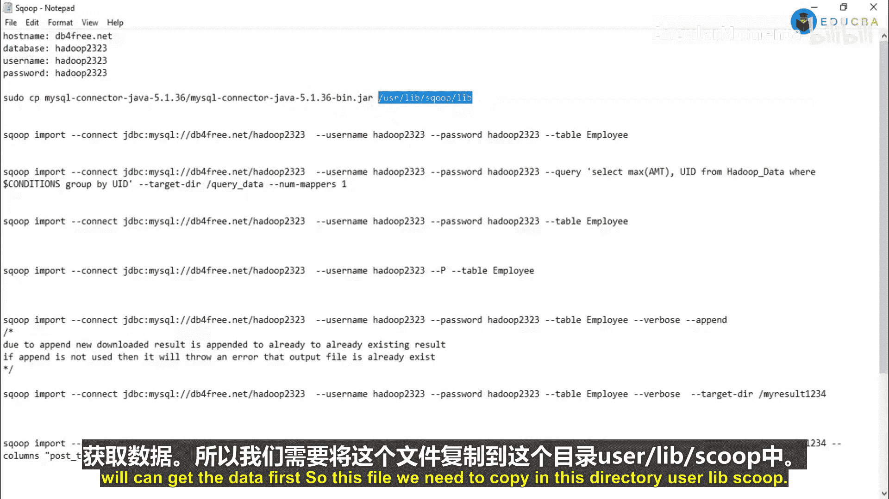
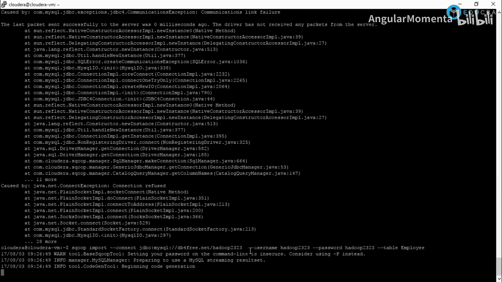
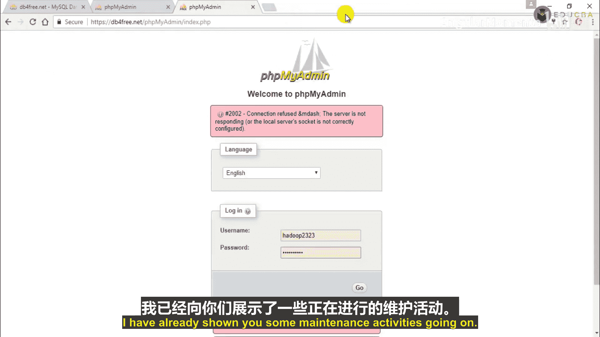
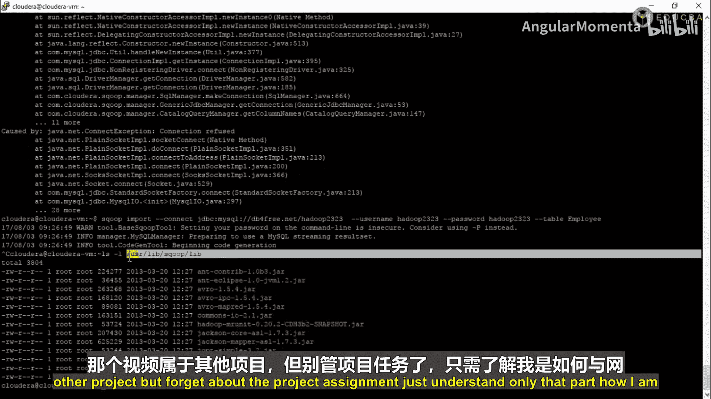
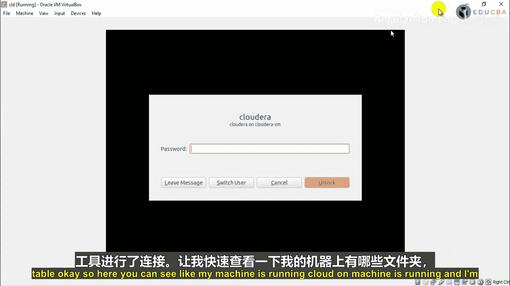
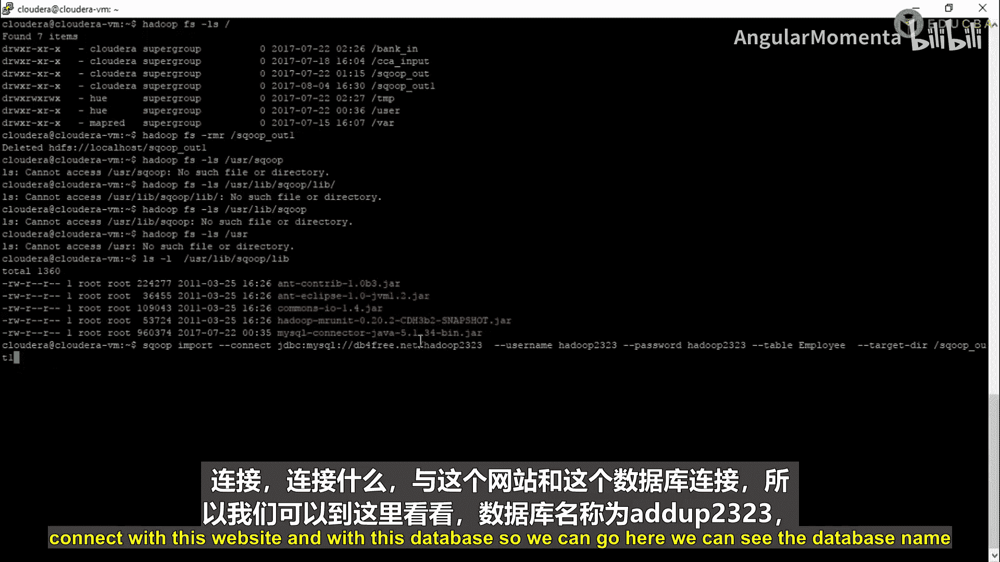
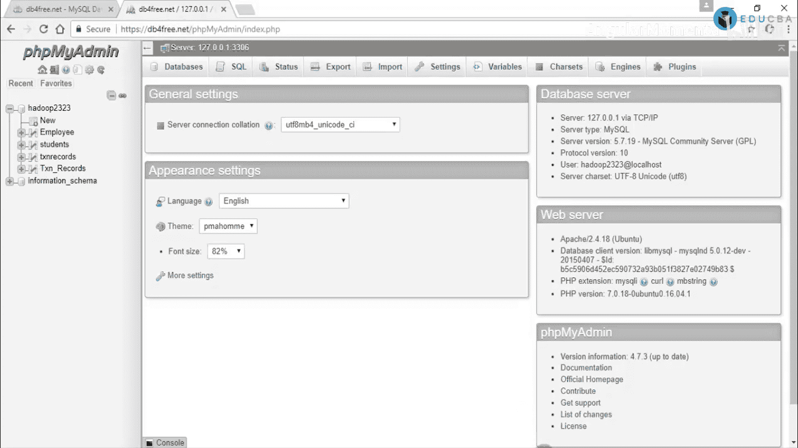
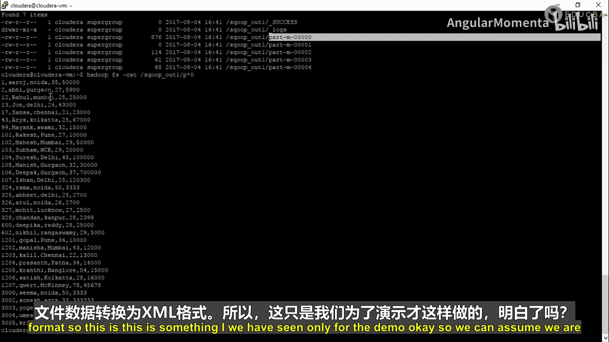
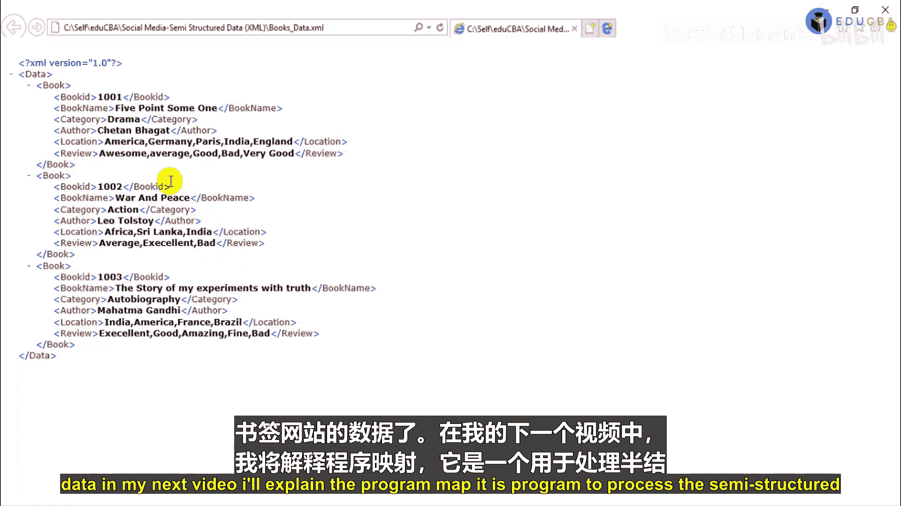

# 【EDUCBA】使用Hive、Pig和MapReduce进行大数据分析-｜-Big-Data-Analytics-with-Hive,-Pig---MapRed-p06-03_01_01_社交媒体产业导论--BV1yCFozJEuE_p6-

Hello friends and from today on thewards we are going to start on a new assignment and that it belongs to social media industry。

 So here we can see we have a problem statement， the scenario we have here so we can see there is a third party which used together bookmarking website data in RDBMS which contains book ID name review link comments ETC So basically what we need to do here is we need to analyze the data of any bookmarking website so if you bookmarking website means which contains the data related to a particular books it could be any audiobiography it could be a drama it could be an action So on this side user you know put their review commands how they are liking how the book So by analyzing this data we can see how the book is performing in the market What is the performance。

any particular book in the market Okay， so what is the sale of book， how many customers are you know。

 liking that book， how many customer are putting good commands， how many putting， you know。

 bad commands and how many just you know， writing average so so on。

So here we have to realize the data of any bookmarking website so basically there will be a one thirdpart tool which or maybe you can say we they are using flume that is again tool of big data so by using flu okay they are getting that data from website to SDgFS or or we can say with the help of any thirdpart tool they are fetching that data from the site into and and loading that data into and any RDBMS RDBMS nothing but a national database management system it could be a oracle it could be a DB2 it could be a swayase it could be a SQL server or anything any database so basically what we need to do here is we need to first get that data from RDB to SGfS that we will do with the help of a school so that well talk about later what is the school map。

Spig high， so first time will be we need to get data from Rdms 2。

SGFS and data will be in the Xl format， but I'm assuming that you have already basic idea about big tools so any of the big tools get the data from any system into a flat file format so if we use scope to get data from R to Sgs it will be will be the flat file or text file format so but here we are going to work on the semistructure data type that is Xml so we can convert that data with the Java code or with any El logic like we can use informmaticica or SSis or any El tool we can convert that data into Xl format and then we can analyze that data So basically here our motors we will process a semistructure data okay。

😊，And we will perform。The business requirement， whatever the problem statement we have。

 we will resolve that okay。We will solve those issues。

But here the input file will be in the X format， so we have to perform split the data into two parts like category and rating。

In pig so we will split data that will be done in pig only so we will do that later basically in the X format what we have we will have bo book name review laying commands ETC so this will be the data as an input format so let me open the input file。

Here is the input file and you can see the type is Excel document。😊。

If I open it so here we can see we have parent tag that is data and then we have child type that is book so under the child type we have book ID book name5 points someone the category which which this belongs to that is drama who is the author Chatenbergga location America。

 Germany Paris India England so here basically we can see the number of locations we have the same number of review comment we have and the next line okay so someone from America is writing awesome someone from Germany is writing average someone from Paris gave good as a comment someone from India gave bad someone from England wrote right very good okay so this is the location from there the users belongs to and this is the review comment which they have already put。

Okay so this will be the data we can have few more column but for this demo we are using this many column for now so second row we can see the book is is 1 double 02 the book name is war and piece its action。

😊，The author is Leo Tolstoy， location Africa， Sri Lanka。

 India command given by African people are average Sri Lankan users provided accident command the user which belongs to India provided bad as a comment okay because it is because it third detail the story of my experiments with truth that is the audio。

Autobiography。And which is written by Mama Gde himself okay this is the data so we will process this data in map produceduce first and we will。

Perform this many scenario。 So here I did not add to many scenario， but first thing is。

Before performing any scenario or any problem statement before work on any polymer statement we need to convert that semi structured file into this structure format so current input it tie in X format so we have to convert it into the flat file format and then we can process any problem statement okay。

So， the so that first step will be I will tell you how to get data from RDBMS SDdfs and in the second step we will convert Xml file into the flat file。

😊，Okay， with the help of Mauce program。And then we can perform perform any scenario like we can analyze this data on the basises of review commands。

 we can analyze this data on the basises of location。😊，Okay。

 we we can you know check how many positive command are there， how many negative comments are there。

 but here if we look at the input file， we don't have any column which mention its a positive command or it a good negative negative comment so where we will apply a logic like if the comment is like awesome。

😊，All very good。We can consider that that command as a positive one if the command is bad we can consider that as a negative one okay。

 if the command is average or good we can take it as a average so good is our choice we can take it in a positive category or we can take it in a。

😊，Aver category so that we will decide later average will will come in the average category accident will come in positive bed will come in negative so if we work on this scenario so once we have input file in the flat file format then we can read that file and we can we will check in the program if the comment is like awesome excellent or very good we will in positive counter by one okay if the command is like bad or not good then we can negative counter by one。

😊，And if the command is like average of fine， then we can increment the every counter by one so at the last we will have how many positive commands are there how many negative command are there and how many average so by looking at this data we will get to know how the book is performing in the market so how many users are there who are giving a positive commands how many users are there who are giving negative command。

😊，And same for average。So， this is just the introduction video so here we talk about the file format we have seen the input data so now next video will again be the introductory session we will more talk about this technology we are going use this technology and how we will use that we can add a few more scenario also。

So that we will see in the next video。Hello friends so in the last session we understood this scenario what we have to do What is the input file we have also seen the input file so here it is so in this assignment we are going to process a data which belongs to any bookmarking website okay so we will process the data in map produceuce in P and in height so basically we will have we are going to process a semistructured data type so semistructure means Xl document okay but as a first step we are going to get that data from RBm2 SDdfs so for that we will use a scoop but actually as we know when we get the data from RWB to Sdfs with the help of a scope it will be in the flat file format。

Okay， so we can assume we have any third party in between like any ETL tool or any Java program or anything okay which converted that flat file and in from which converted flat file into a X format okay so。

As then for this step， I will tell you how we can use the scoop。

 how we can get get the data from Rdms to SDgfs， and then we will process X file in mapduce in P and in height。

So， here I am assuming we all have a basic idea about this tool of big data。

 but if we dont have so let me brief you about it a scope is a kind of bridge okay which convert which get data from RBs to SDgfs or。

From SDdfS to RDBm so its a kind of middle layer which interact with the RDBm and Sdfs so we can get the data from RDB and we can store it into the Sdfs for further processing or we can store we can load the data from Sgfs the database via processed already and we want to store the data into R RdB so with the help of a scope we can also do that we can load or dump the data from SDgfs into RDBm so RDBm could be anything RDBm is relational database management system it could be anything it could be SQL server it could be orac it could be D to it could be side base or any RDB okay so as a first step we will use the scoop I will tell you how we get the data from RDBm to S dfs okay and then we will process。

Excellent fine。Okay in mappreduce so mapreduce basically a tool of big data which so in mappedduce we have three classes one is mapper class one is reducer class and the last one is driver class so driver is the main class where we define map class name reducer class name the output key type the map output key type map output value type okay number of reducer so that is kind of a main program of any language so if we you are aware about the Java program So in Java we used to write the main function and then main and program start from the main function so here we have driver class and mapduce program start with the driver class map class basically read the input file。

Okay， and。It performed the logic as per it performed that it process that input file as per our business logic okay it read data line by line。

 if we are using the default input format then it will read the it will the key format request will be a by of set so it will be in the longritable format type and when will be the text format so when it will be whole line。

Okay， but in mappedduce， we can also define our custom data type Okay so to process this Xml in mapduce。

 we will write our custom data type because mapreduce did not have any you know mapreduce does not have any inputbuilt type by which we can process Xl data So here we need to define our own custom data type so that I tell you while we will when we will start with the program in mapduce in mappedduce。

 we have another class called reducer class So when reducer class basically it's for aggregation we have to get this sum of input data or we have to get the count or we have to find out the average so that we can do in reducer class So reducer is nothing but aggregation Okay so this is simple predict of mapduce we have three classes Maper reducer and driver。

😊，The logic could be different， depends on our requirement。

 but the paradigmic will be same for any scenario。We will have these three classes。

If we are writing our custom data type then we can have more classes which we can write and we can use those classes in the mapper reduceer and driver pig so mapuce is basically for data processing okay now well talk about the pig P is nothing but the encapsulation or basically we can say it's an abstraction of mapduce so if someone wants to write a code wants to process the data in mapreduce so that person should have a good knowledge of any coding language like a scala like Java okay but someone who does not know the coding language is that that guy is not aware about the Java or a scala then they can go for a pig。

Pig is data flow language where user or a developer。

Developer and user means someone who is writing the P script so user or developer can define the flow of data。

Fluor vitamin is what they have to do in the relations。

So pig basically work on relations relation are nothing but these steps so data flow is they can define in the first step what they have to do in the second step what they have to do for example okay if we have to find the count okay of we have some input data set we have to get the count or we can make it more easy to understand we have four columns employee ID employee name salary and。

Able location so we here we have to get this sum of this salary for the employee who belongs to country India。

 So in the first nation we can load that input data set into the pig shell。

Okay so this is the flow of data which we are defining so as a first step just load the data into the picture okay in the second step we can filter that data on the basis of country because here we have to get the count on the basis of country we have to get the account for the account of the salary for the employees who belong who belongs to India。

So so in the second relation we can filter the。Data on the basis of country。

 we can get only those record those record whose belongs to。Cory India。And in in the third step。

 we can get the actual count because they have only filter the data and then we can some account whatever we have to perform then we can perform that operation so pig is very easy to learn okay so the person who does not know the coding language or the person who does not want to write a long code because the operation which you will perform in reproduceduce we need to lie we need to write hundreds lines of code but in pig we can get this get that done in few statements three or four statements。

Okay so someone who does not want write a long code then they can they can go for pay so mappreduce okay so we understood scope a scope is like a bridge between SDJfs and any RDBm okay we can transfer data from RDB to SDJFS and SDJfS to RDBm Maduce is for data processing。

Pig is again for data processing， but it is a section of meds so we can perform。

The operation in pig in three4 statements which for which we need to write are hundreds line hundred of hundred lines of code in mappedduce Okay now in hive what is hive hive is a is for data analytics so mappedduce and pig for data processing and hive is for data analytics so here we can。

Genrate or。Summarize the report for the users and users so high is for data analytics high is high is a SQL kind of language its very basically developed by the Facebook okay so the person who are who belongs to D background the person who are familiar with the SQL kind of queries they can hi is very easy for them to use okay so hive and pig there are lots of different between hive and P but the major differences hive is for data analytics we can't perform the rule record level update or delete and hive so it's for the analytics data analysis so we can generate count we can summarize the report so that all kind of task we can go for hi if we talk about the difference between pick and hive so pig is for data processing whereas high for data analysis pig stored the data only for that particular session。

So we are using P and and if we log out from that session so next time when we log in we cant get data again so we need to again execute the pig script。

 then we can get it。But hive once we have created any object or once we have stored any data so that will be forever in hive so next time when we log in we can get that again。

Okay the third one is pig as as I told you pig is data flow language whereas hive is data declarative language so in P we are the one who define the flow of data in the form of relations but in hive if we need to get the same if we take the same scenario even hive like we need to get this sum of the salary for the users who belongs to country India then we can get we can write a simple query like select some salary from table name where country goes to India and group by employee or whatever group by country。

Or employee， okay。So。We can write the simple statement。

 but it is all up to high vision how they want to perform internally。What they want。

 what they will do first， what hive Indian will do second and so on。So。

 we don't have any control on that thing， but in peak we definitely flow so here now we have a basic idea about these tools that we are going to use in this assignment。

Okay， so now we have so here I did not add this scenario so we can add the scenario。

We can add more value here， but first thing is I will tell you how we can get the data。

 how we can use this scope to get the data from RWms to SGfs。Okay。

 and second thing will be to process data and SJfs we need to have data in the flat file format。

 so then we will process X file and we will convert this data which is currently in the X format。

We will convert this data into a。Flat file。With the。

A proper diameterlimit of what we can say that that file will be proper。Okay。Like， we have。

Other files， okay， so I mean， we will have four columns like embo Ii comma book name， comma drama。

 comma Chatenberger and so on。 So that so that file will be proper in the。

Flalect in the text format so that file we can process it。

How do in Sdfs okay so and then we can use mapduce we can hype any tool of big data。

So initially now we will concentrate concentrate on these two part first we will use the scoop and then we will use mapduce to convert that the Xl file into。

Ft file format。Okay， so in my next video， I'll tell you how we can。

Use the scope to get the data from RWWm to SGfs。Hello friends so in this video we will understand how to get the data from RDBs to SGfS with the help of scoop so as we have already discussed that in this assignment we are going to process Xl file that is semi structured format。

Okay， but we know that with the help of a scoop， we can get the data in the form of flat file。So。

 here we need to assume we have some third party in between which is converting that thread file into the X format。

Okay， so because our input file in this case is Xm。

 but here just I am telling you how to use a scoop to get the data from RDBs to Sgfs or we can do vice vers we can load the data from Sgfs to RDB but here we will understand how we can get the data from RDBMS to SgFs。

So， here。I don't have any any database installed on my machine。

 so basically I use online database and the website name is Db43 dot net。So you， I mean， anyone can。

 you know， create their login on this website and they can use this database。

 It is basically a Myq database so anyone can use。For testing for even for production， also。So here。

 I'm using the same。And once you log in into this， you can create the login you can create your account。

Okay， you can。 you can click on， go to database， Click on sign up。

And you're gonna create your account。Once you are done with the account。

 you will get the mail to verify that it is to you who has created the account on this side so once you verify。

You can click on this link， PhP， my admin。Okay， so it will open the page like this。 Okay。

 it will ask you for the credential。 So here the credential is。A doop，2，3，2，3。And my password。

 which I have。Created while creating my account。 So once I put my user element password。

 you can click on go。And it will。Show you the database so there you can create database tables and any object。

 but here today this site is down even this site is down from last three， four days。 Okay。

 so some maintenance activity is going on so I'm not able to log in even today we will not be able to connect with this through a scoop we won't be able to get get the data but I have already recorded one session and that I am telling users how we can use scoop to get the。

RD be my data into2 as Gfs okay so we can take the help of that video that will that will be my next video after this so here I am just telling you if we don't have any database installed on this on your system you can make a use of this free site。

The website which provide the database free of cost we can create our login。

 we can sign up here okay and then we can create our object like table views and so this is something which you can use if you have already installed any database on your machine then you can use that。

O。So。Here we are just this this video is only for to understand scoop。

What is is scoop and how we can get the data but in this assignment we are going to process Xl file in the next session so but I am assuming that we all have a basic idea about this scoop so is scoop。

Get the data in the form of platform。It will be a plain text file so we can assume we have some third party tool like it an EL tool or we have some Java code which is converting that file into the external format which is lightweight and then that external file。

We will process in reproduce produceuce， big and high。Okay。So。

In the next session you will see how you can use the scoop just to understand it okay and you can hands on on your laptop okay you can install a scoop and you can hands on this and in the next session we will process this file in map produceuce else I will explain you the whole code okay。

How we can do that。So。I can tell you okay， so this is my scoop file I have created。

 so here I mentioned host name is。Db4 free dotnet， which is the name of website database， username。

 password。This connector， we need something。 scope needs something by which it can create it can connect with the database。

 So D B free。Db43 donet website is basically a Myql database So here we have Myql connector JDVC driver。

Which will。With the help of it we can connect school will connect with the database and we can get the data first。

So this file， we need to copy in this directory user leave scoop I can show you。

Even you can see if I execute this group command from the machine today。

 So I'm getting this error because server is not responding。 I have only。

Show you。Some maintenance activities going on。 so we can't use this database now。

 So here you can see I will get the error。

This is the command which I have executed it I import command because I am importing data from this website too。

SD F S and the time getting is。From the table employee。

So it is learning one more thing which is very important if you are using this website Db43 dotnet。

 make sure that you have proper internet connection on a machine。

 thenco will be able to connect with the help of connector with that website。

So here it's trying to connect， but it will fail。We will go to the directory。Okay。

 Im in the same directory。 user Li is scoop。You and the library name。User lip， scoop， lip。

 I am on the same directory， and you can see I have copied disconnector。So we can get this connector。

From the Google， you can download it and then we can really need to copy it from our local machine too。

The director。And then we can executeco command So today I' am not able to connect with that website but next video which I have already recorded when that website was working so you can we can make the use of that so just understand in my next video how I am connecting with the scoop and how Im getting the data from RDB M2 Sfs okay and that file is belong that video belong to some other project but forget about the project assignment just understand only that part how I'm connecting with the website and how Im getting the data okay so see my next video for that。

helello， friends， on the last video。I told you I am using this online database to get the data from R Bs2 SDdFS so you can go to this website and once you click on this it will prompt you with login and password window so you can put your login and password。

If you don't have any your login password， then you can use。Hadoop 2，3，2。

3 as a username and Hadoop 2，3，2，3 as a password。That is。Something which I created。

 So you can use the same。And once you put the。You got password。willform you。But this is。

 this is screen。 So here this is a database which I have created。 And these are the tables。

 So here what I'm gonna do， I'm gonna。Ftch the data from employable。So， here you can see。

My my machine is running like run machine is running。

And I've connected it with through。Myput unix。不。So let me check quickly what folder I have on。系咪先。

Okay， so here， I have a scoop out and a scoop out one。Okay， so let me delete it。Its school。奥运。Okay。

 so let's delete it。No。Let me write my scoop command。So to get the data。From。RD Bm。To SD G F S。

 I told you we should have one connector。Okay。Check and to check， we have connected or not。So to。

 so to check the connector， we need to go into this directory。What do not showing。Other picture。Okay。

 oh sorry， it's on the Uniix box。 Okay， so here we can't use Hadop command。

 We need to use Uniix command。So you can type L hyphen L， and you can go into this directory。So。

 here you can see。I have already copied my connector。

Through which my scoop will connect to the RDB and it will fetch the fetch the data from the required table。

 which I am putting in my command。So here is my scoop command。 so to get the data。😔，From our DMS。

 we we we need to write this command who。Import why import because this time we are getting data from RD B to Sgfs and suppose if we are loading data from Sgfs to RD B then we can write here export okay and hyphen hyp connect connect。

What connect with this。Website。

And with this database。So we can go here。 We can see the database name。Aoop 2，3，2，3。

 and the site name is D4， D43 dot net。

So Db43 donet forward slash a do。2，3，2，3 what database is name hyphen iPhonephon user name which is again the same Hadoop 23。

23 and the password is again same。 So if you don't have your login password you can use the same It is already created on this website。

You can create your own table and you can import the data into Sgfs so from this table we are going to extract the data from employee table and there so on which location on Sgfs we need to get that data so here for that we need we need to define the target directory so here I am defining。

Target directory is scoop out one。You can see that a directory was already exist， so I deleted it。

Now， if， if you will check。 we can check it。 We can check it quickly have to。F s。Iphone L S this one。

 we don't have a scoop out one directory so we can use our scoop command。Okay。

 so we are fetching data from Hadoop 2 3 to23 database，Employ table and in。School。

Andless score out one directory。 So let me execute command。

But make sure that you have proper internet connection because it will connect it through internet。

So here you can see we。We have one clause called limit one。

 So initially what happened limit one means only one record so while connecting if the connection is successfully done with their website it checks only for one record to get this schema。

Okay， so once it verify the schema then then it it start executing the Mareduce program。

 so I told you whether we use speak whether we use hype and whether we use map produceduce or scoop any tool or big data internally all executes map produceduce program。

So here we can see once it verifies the schema map is started map 0 percent reduce 0% then 20%408 and so on。

 so its job is completed now we can check。Dir is created or not。 Yes we can see。

 scoop out one is there。 So it's created。Now， we can go through。This directory。And here we can see。

 we have four files。Okay， so it means five files。 It means five mobile executed in parallel。Okay。So。

We can get checked right of one file。P0。 So the file， which is starting with P and ending with 0。

 So it means the data firm。That file。And to see the data， we we need to write Cat command。

So here we can see， we have data， right。So now get imported data from。R they be missed to SGFS。

 and I told you。A scoop。Import the data in the form of text file or flat file we can say in this assignment。

 we are going to process the Xl file so we can assume we have some third party in between which。

And what that flood file it into。Excl format。 So this is， this is something I。

 we have seen only for the demo， okay。

So we can assume we we were getting data in the flat file and there is one tool tool。

Third party tool which converted that file into Excel format and it produce this kind of output and which is input forever。

Program， okay， so now we understood how we can use is school。Okay， for importing。

 and you can export data in the same way。 Okay， and my next video。

 I'll explain you the method program。whichch will process this file X file and will convert the external file into the flat file format cause anything if you want to apply any business logic or if you want to process any data Hadoop。

 first we need to convert into a。Ft file。 So once we convert this file into a flat file format。

 we can execute our processable scenarios。Okayk， then we can analyze this book mark website data。

So in my next video， I will explain the program method program to process the same structure data that is XMl file。

