# 【EDUCBA】使用Hive、Pig和MapReduce进行大数据分析-｜-Big-Data-Analytics-with-Hive,-Pig---MapRed-p07-03_02_01_执行MapReduce程序以处理XML文件--BV1yCFozJEuE_p7-

Hello friends， so in the last videos in the last sessions we understood the program the code which we have written the custom input format。

 how we can process XL data， so this is our input file。Okay。As we have already seen it。

And this is the classes， which we have written。This is the mecos and this is the driver。

 so now we will execute this program。😊，So to execute it first need to export this program as a jar file so to export it。

Right click on the project。So， we can see。It belongs to external project Okay。

 so click on the right click on the external project。Click on export Jrafa is already selected。

Click next here you can give any name， so here I have given social media X dot jar。

Because this project， this assignment belongs to social media industry and we are processing X file。

So the name which I have given is social media accessible dot jar okay。So have already exported it。

So， here you can see。You can see social media Excel file we have already I have already exported it to my local machine now I need to copy this jar file to the root directory of the Hadoop system so here we can see my Hadoop machinery running。

Okay。So to here the IP address is 19216856123， so let me check if we are able to connect it through my local machine or not。

So， we can。Typeping and we can check if we are getting the response， it means。

We are able to connect it through local system， So here we can see we are getting response so I can connect so here I have connected my。

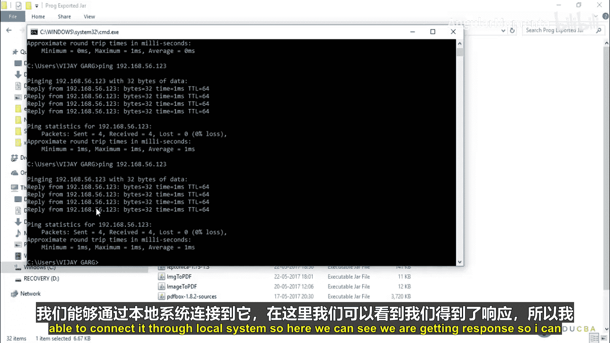

How do machine with my put Linux？Okay， so to execute it first need to check our all services are running in the Hadoopper north。

So， there are basically four services， a resource manager， node manager。

 name node and data node so to。Execute any program in the Hadoop。

 we should make sure that all four services are running up and running or not。But is not only。Then。

 we need to。Start them。Okay， so to check or learning or not， we can type Jps。Command。

 so here we can see。Data node is running。Not manual is running。

Name notice is running and source many many areas is running okay？

Now I have already copied this file。To my rule directory of the。Hroop system， I can show you。So。

 here you can see。Social media。Xml dot jar file， okay。So now we can execute it。So to execute it。

 we need to we need to have input file first to fall。Only Hadoop machine。

So let us check what we have。We have folder call in project。

In project we can see here we have folder call in project。So， here we have。File call books。

Undersco data dot X。Books。Underco。Data。Dot。Xml。So， we can see。Or what we can do。

 we can copy it again。 I can show you。

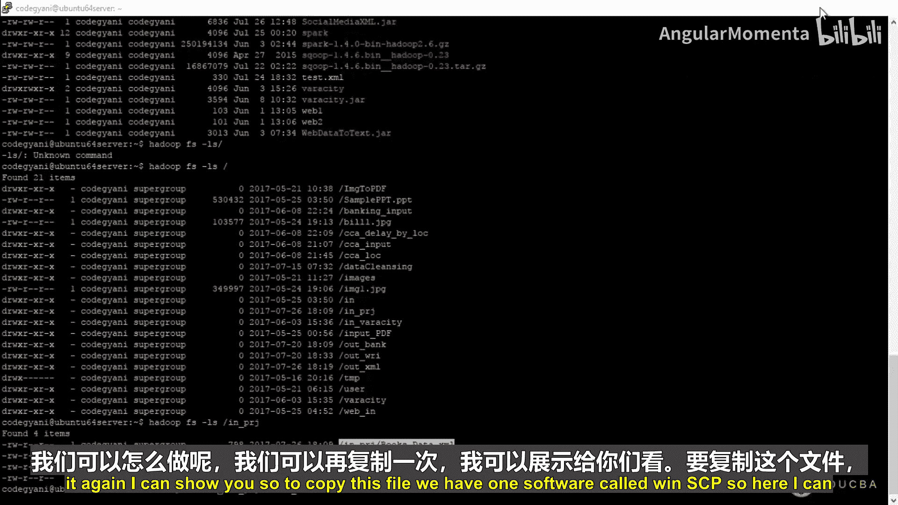

So to copy this file。We have one software call win SCp， so here I can connect。This one。

I am running this machine now。So， it's connected。And main file is。

So here we have we can see we have two part left part and the right part left part it is showing the。

Local machine and the right part is showing the Hadoop machine so I am on the home directory of the Hadoop machine here you can see I have copied this file social media X dot jar。

 but now I am copying input file again。So where is my this one is social media project this is my this is my X file。

😊，So， let me coop。It is saying that it already exists Do you want to overwrite it yes。

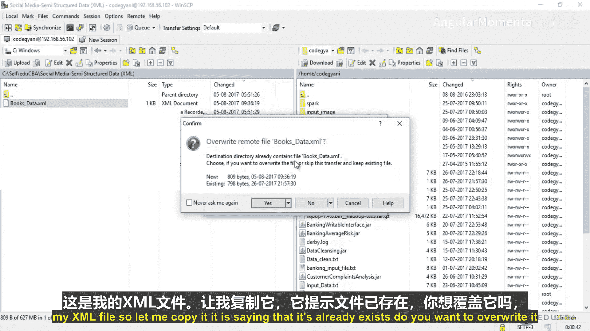

不。Now what I can do。I can delete this one。To delete the file， we can type RMr。Okay。

 books underscore data dot xml。So we can see it's deleted。Now we go in this folder。

We will not have that file。而这对这种。Whole food are not an issue。I can create again。In underscore PJ。

So to create the folder， you can type MDIr。It's created。No。To copy the file。

 we can use hyphen port command。And I'm going to copy books。So。

We copied that file to the root directory。And hair Ro directory is my present working directory。

So we can directly access this file by its name。So I am copying this file。In this folder。It's copied。

We can check now。This time I will delete RMr otherwise it will be deleted again。

So now we can see we have input file in this folder。No。We can delete one more folder。All。

Out underscore X S。So we can see we have。Already have this folder。

 so I'm glittering it because we will create the same folder and we will。

Insert our output file in this folder。So we can create create the new folder also。

 but I am deleting it otherwise it will be too much folder on my Hadoop machine， so I am deleting it。

Is deleted。Now I can execute now we can execute the program。So here is the command， Hado jar。

The jar file name so that file exists on my router route directory so we can access this file by its name。

 so social media Xml。 jar。Okay， the part of our input file。

 So here we copied this file in this folder。And this is the output director where you want to create the output。

Okay케이。So， this is the Had command， so when they execute this command it will it will process the Xl file and it will convert this file into the。

Flat file。So let us execute it。It will execute the Meies program。So。

 here we can see job somebody to resource manager， so resource manager provide a unique ID that is called job ID so the ID which is given to this job is this one。

Now it will launch the mapreduce program here we can see。Map is started and reduce is started。

So map completed。The reducer not completed because we do not have reduced class in our program。

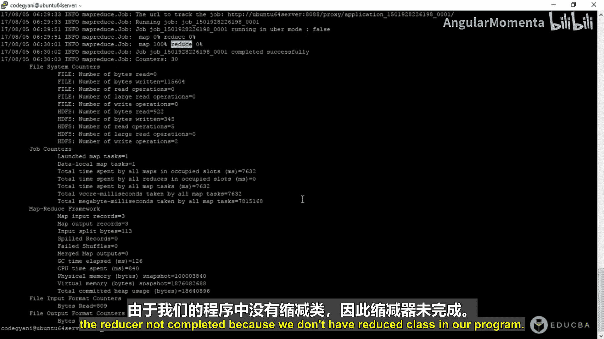

We only map and driver class so here we are not performing anygreg。

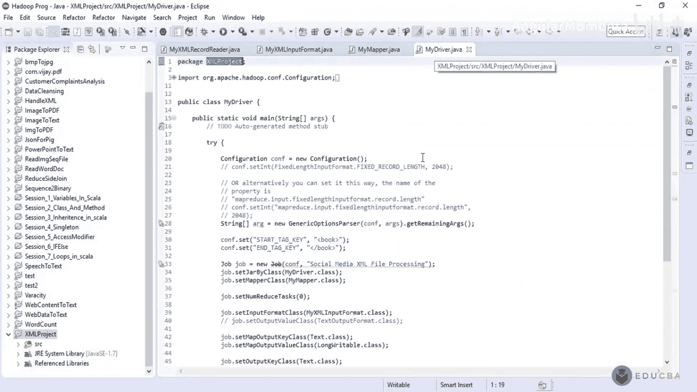

Hence， we did not have any。R a class in our program。It only map executed and job completed。So now。

 let us check。If out Xml folder is created or not because we deleteed it earlier。Yes， it's created。

And this is the name of our output file。Okay。So to see the output， we can type get command。So here。

Now， go back to the code。

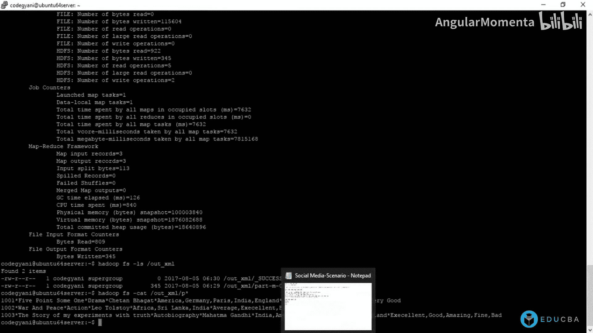

I told you。While adding this file output file， I eliminatelimd all the column value by star。

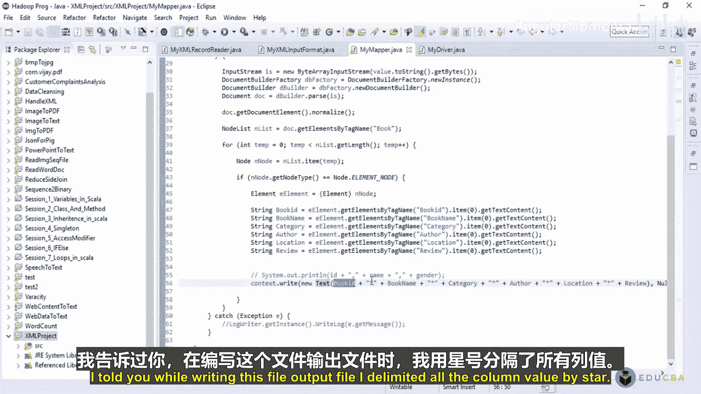

So， here you can see。Output book I。Star book name。Star category， drama， star author Ka Baer。Starttop。

Then countries are comma separated。Let me start。And they review。Someone given awesome。

 someone given average， someone given good and so on。So now we have3 input record。

And we have theer 3 output row。Okay， so now this file is converted into the。Flat file。

So what we can see do。Let us。Copy this。 let us copy me this file。To my。Root folder。Home court Gny。So。

 hello。F iphone。Get。ho。For Ghanni and from we need to copy this output files。Out underscore Xml。

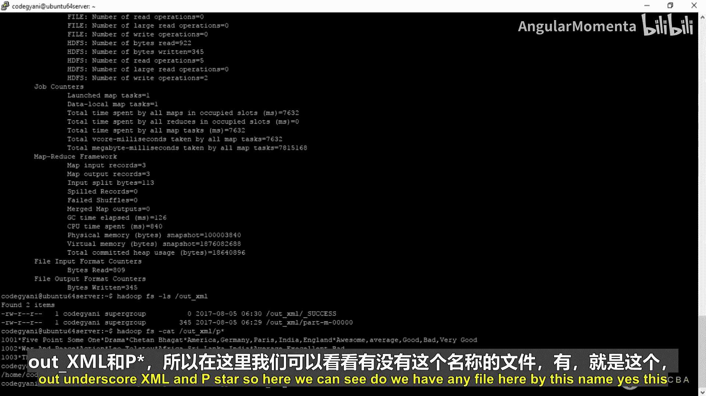

NB star。So here we can see the V any。F here by this name。Yes， this one。

I I copied it for some other program because it's a register file we can see part hyphen R。

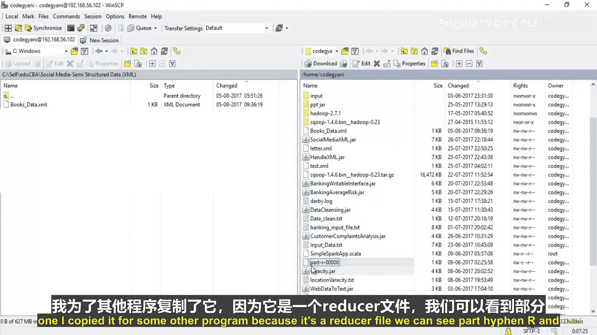

And here。It's a mapper file hiphone name we can see here。

Because we don't have reducer in our program。

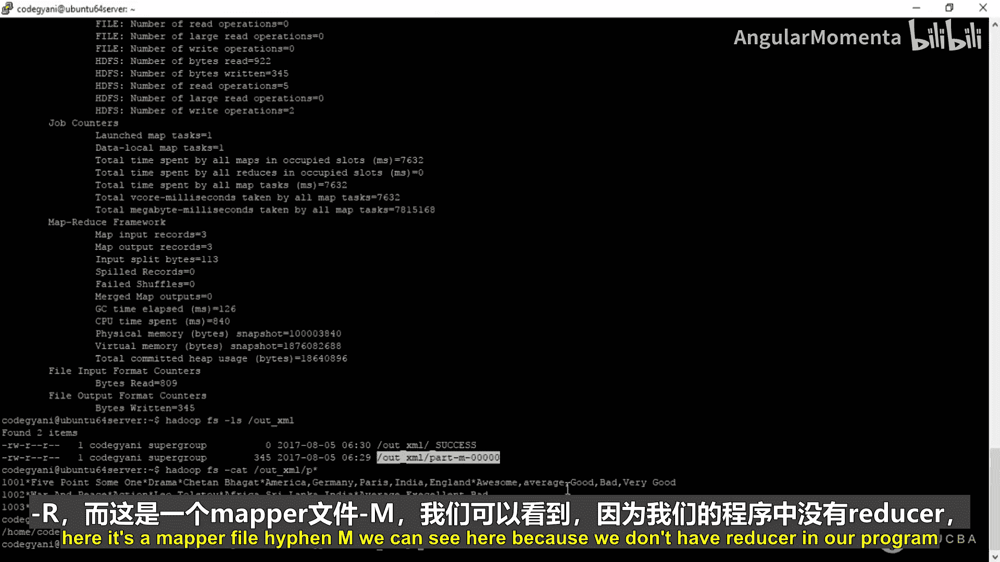

Okay， so let can delete this file。 otherwise it will be confused。Okay。

 delete it now we don't have any file by this name。

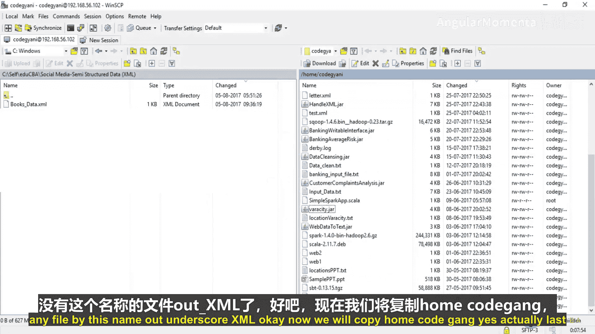

Out under collect S。Okay， now we copy from。Hgon。Yes， actually last time I did mistake。

Because the first part is the source path and the next part is the target path。Okay。

 so the but in our case， the source parties here our portfolio is。

Exist in out under the correctionmal folder and we need to copy it from here too。

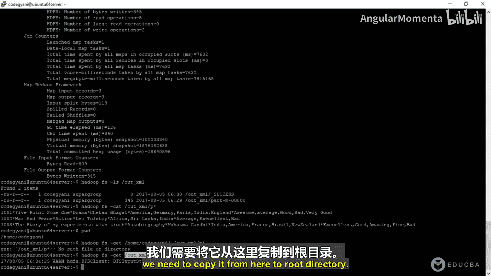

Good directory。So we can check file is file。Copular note。Go up。 Yes， its there。Now you can see， yes。

 So here we have five。So now we will use this file and we will process it further。

And we will analyze this data。 So in this video， we understood how to。Export the jar file。

 okay and how to execute the jar file in the。Hello。And how Maice program is execute。

And then we can see the output in the directory， output directory。

And we can copy support file to our local machine。To process it further。

Or anything with which we want to do， we can do that。 Okay， so now in the next video。

We will process this file。Okay， we will have some scenarios in our problem statement。

 so we will process this file and we will see how we can do that。

So we will again write a new medice program to process this file in the next video。Hello， friends。

So in the last video， we have。Process the Xl file and we have converted that Xl file into a flat file to process that further So if you can recall we got this output so if I can open it we can see that was our input file。

And it got converted into the flat file。记です。So， we process this data Xl data and we got this output in this form of flat file。

Okay， so all the load。Under the book tag， under the under the parent note that is book。

Are there with the star separated ID star， then book name， star， then category star， then author。

 then country and then reviews。Now， now we will process this output file， Okay， this one。

 and now we will see how many positive review we have for the book。

How many average review we have for this book and how many bad review we have with the。

With this particular book， so it's all up to us， awesome， excellent。Very good。

We are considering as a positive view。Everage。Good fine we are considering as a。I to the view。

And bad we are considering as a negative review。 So now I will show you。

We now Ill explain the program， okay。In which we will calculate。How many， how many positive。

 how many negative and how many average review we have。For a particular book， so this is my eclipse。

Here the project name I have given is analyze book marking data。Okay。

And in this I have created one map class okay and I did the aggregation in the map class itself。

 not aggreg exactly what we can say I am counting。😊，Okay， on the basis of review command。

 I am counting。And incrementing that variable accordingly。 So here I can show you。

This is the class name， my mapper， which extends the parent class that is map Now we have output as a。

The output of the first program is a。Flat file。 so now we will the that flat file will be。

Input for this program So now it will read that simple flat file this one okay this is a flat file so now this file will be the input for this program so the map key in disk will be long right table。

Okay， and the value it will read as a whole line so which will come in the text format。Okay。

 the output key again， it will be in the text format。 I will tell you what we are passing。

And output value will again be the text format。 So here， this is the map function。

Which will execute for all the records So here in the input file。

We have three rows so that map function will execute three times。

Here I have declared three variables one is review positive counter。

 another one is review negative counter and the last one is review every this counter。

These are the three global variable I have declared all the type all belong to the integer type。

 so it is kind of counter variable okay so on the basis of the review command we will implementcrement this counter variable。

Byuy one。So， if we get awesome then we will increment positive counter by  one。

 if we get fine or average we will increment every counter by one and if we get bad not good then we will we will increment negative counter by  one。

So you you have we have seen our input for it in the。The row in the input file is separated by。

The star not row， the columns value are separated by a star okay。So， here。For example。

 you can consider this row， this whole row。Is coming as an input。Okay。

 so I am splitting that row by this star。So， I could directly write like this。

 but a star is a escape sequence in Java， so we need to write it like this。Okay。Now。

 we split that row。By star， then on the0th。Index， we will have Bokadi。This will come。In the index 0。

The book name will come in the index 1， the category will come in the index 2 and so on。

 so here I have declared variable like Bokai。So I'm storing the book ID the0th。

Value from that array into the Buwa string。The first value from that array in the book name string。

 the second value from that array that is category Im doing that value in the category string the third variable is the third data is column is author author name is so I am doing that value in the author string。

The next is location， which is comma separated。 So I am again storing it in the。Location stay。

And the last one is review that is again a comm separated value some is doing that value in the review string。

So， here。What will it to count when it to count how many positive。

 how many negative and how many average reviews given by the users for a particular book。

 So as we know our。Reviews are comma separated。You can see your average come excellent， come bad。

Here as you can see， every awesome average， good， bad， very good， okay。

So here I am again explainting that。Review the string in which I restore the review comments。

By the comma I am spliting it by comma and storing it in the string array that is called multi multi review okay I have given the name mu review that is multiple review okay。

Now I am executing a loop okay on for whole all value。

 which is there in this multi review variable Okay， so for example。If first。

 if if the mapper class is reading the first record， then awesome average good， bad and very good。

Will be stored。In this。Variable multi view。 So for all the value I am checking if。

Review that is RV if RV dot2 lower case so。I am I am checking that I am converting that data into the lower case。

Because maybe some user can put the command in upper case。 some maybe some user can。

 you know might be can can put comment in， you know， upper case and some users can。Use both the。

 a per and lowercase。So。So， to be on the safer side。

 I am converting whole data which is there in this history。😊。

In the lower case and then checking if it not equals to very good。

Or if this one is equals to awesome or if this one is equal to excellent or if this one is equal to amazing。

Then。Increment d positive counter by 1 okay。So same thing here for the we can add multi more also if we have more combined。

 then we can add more okay。For negative Im checking。If user。

Has commented like bad then incremental negative counter buy so we can add more here。Not good at all。

Else， whatever whatever else is remaining for that increment the average counter。Okay。So。

 if someone has given the positive command this counter will get incremented by  one if someone has given a negative command that this counter will get increment by 1 else。

 the which counter increment will get incremented by。不问。

And finally I am writing the output in the output file， so here we don not need key。

So I am passing that key as an nu。Though it is in the text format so。I just kept it blank。

 so this is the output key and here you can see output key is text though it is text。

 but it is blank。Okay， output value is again text， so what I am passing the book ID。Okay， this one。

Book name category。And here have a hard quote， something like。Positive view。Bills， this variable。So。

 in this。We have all the positive comment， okay。For negative， I am showing negative counter。

For average view I am showing average counter so for a particular book we can have Bokai book name category and how many positive how many negative and how many average。

Comments okay user has given so so that this is a simple program I have written。

This is a driver class。Okay， here I have given the name of this job is analyze book bookmarking side data okay。

 and here I have set。The jar class name that is what is the name of our main class that is my driver。

What is the name of the map class that is my map。Set map output key that is the text format。

 though we are passing now， but it is in the text format。

Set map output value plus that is again in the text format okay when we execute this job。

So the first parameter will be the input file。And the next parameter will be the output directory where we want to store that data。

Okay。And then job will be completed once。systemystem will be it will come out when the job is completed。

 system not exit， okay。So， to。Execute it again， we we need to perform the same step export。

So that I have already done。I can show you。What I did。What name I have given to this program。

I have given analyzed book marking data。Okay。So I go here。

Here you can see I have already exported it analyze book marking data， okay， I copied this。

This is this is on my local machine so I copied this jar file to my root director of theoof machine here。

Okay， now we can see my Hadoop machine is running and I have connected this machine through my put session。

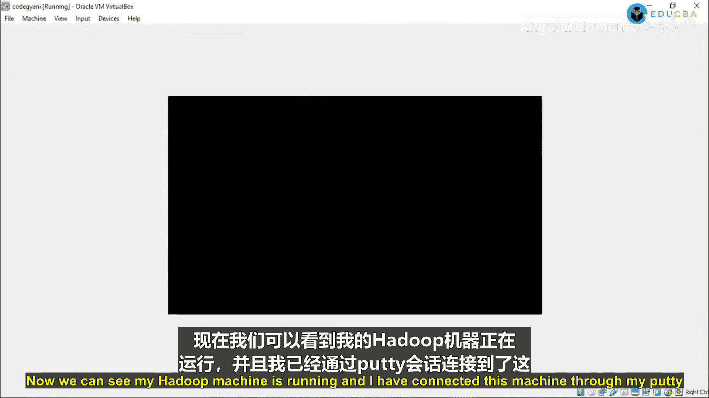

So last time if you can recall。We have output in the which folder out underscore Xml。

 we process the X file and we stored the output in this directory okay。So， now。

We can check our file if there or not。Yes， we have that file we can again see the data what。

We got as output。So here we can see we have the data， same data which we have processed last time。

Okay。So all X file get converted into the flat file。Okay。

 so now this output file will be the input for this program。Okay， so let us execute the program。O。So。

 here is the command Hado jar， our jar file name， what name we have given。Andly book marking data。So。

 analyze book marking data dot jar here the path， this is the input path okay so what was the output part for our last program。

Out under Xml。Hyhen part， hyp M， hyp， I D。Okay， so I provided the same。

Output file is an input file for this program and the output directory in which you want to store the data is out underscore book。

Okay， so we dont have we can see here， we don't have that folder。Out underscore book here。

 so let us execute it。So here we can see the resource manager provided a unique ID。That is job id。

Okay， to this particular program， now it will launch the map reduce program。If we can see here。

 map is started。Map completed。Another job is completed， okay。So， now we can see。

That out underscore book directory which we have given as the output directory is created or not。

Out on the scorebook， okay， it is created。So let us check what we have inside it。

We have our output file。Okay， so we can see the output。So now here we can see Bokadi pipe separated。

Book name category， then policy reviews to。Negative review 1， average review2。So， we can。

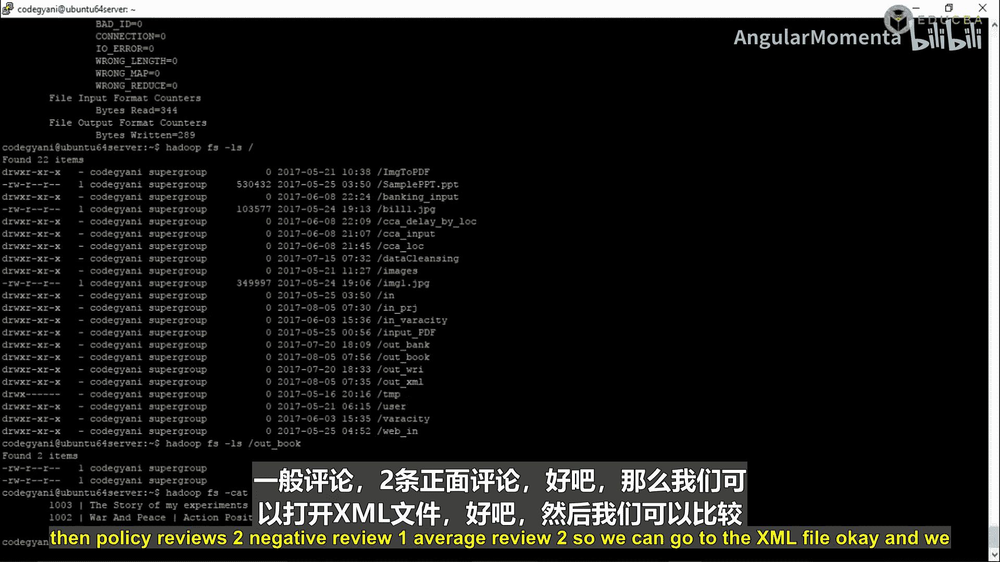

Go to the Excel file。Okay。And we can compare the output。Let me resize it。Okay。So for 5。

7 book name is 5。71。5。7 drama positive reviews are 2， so here we can see awesome。And very good。

 So policy reviews are two negative reviews well。Negative bad only bad is there the negative is1 average the is 2。

So good we are considering as average and we have one more review that is again average so count count will be2 so here we can see。

Pos review2 negative review 1 and average review2 for book 5。7。Okay， for warrant peace。

That is the action category。Positive11， negative1。A rich one for the story of my experiments with truth。

Autobiography。Poser view 2， negative v 1 and。

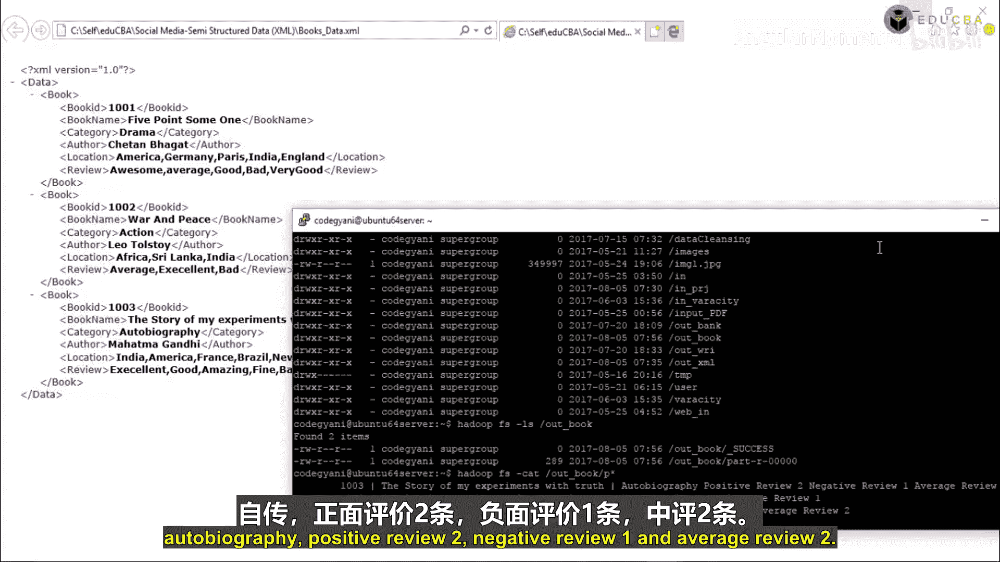

Average review to。So that is how we can calculate。We can be analyze the。

Book marking side data here for demo we have we have taken the only three record but we can have millions of record and we can process that data in the same way。

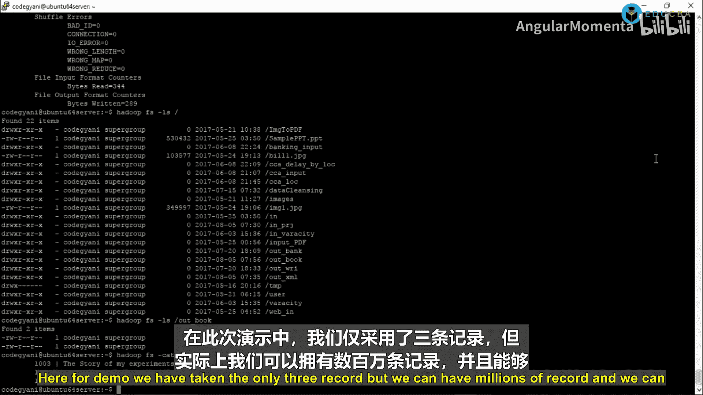

Okay。So here we understood how I I have written the program。We understood it step by step。Okay。

 so it was very easy。😊，And we have also seen how we executed it So in my next video we will take next scenario and I will explain you。

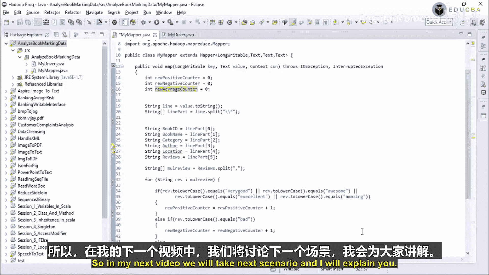