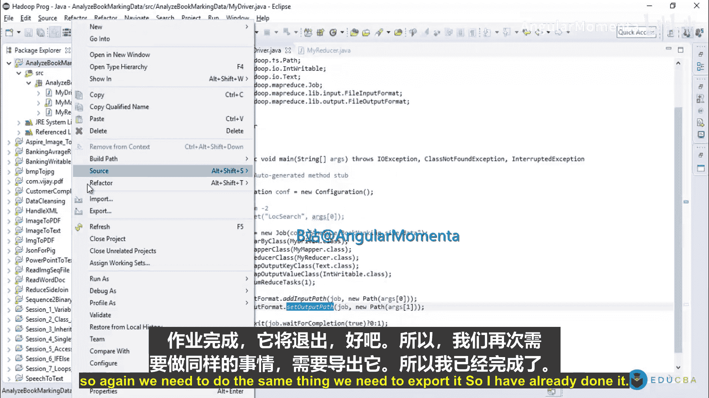
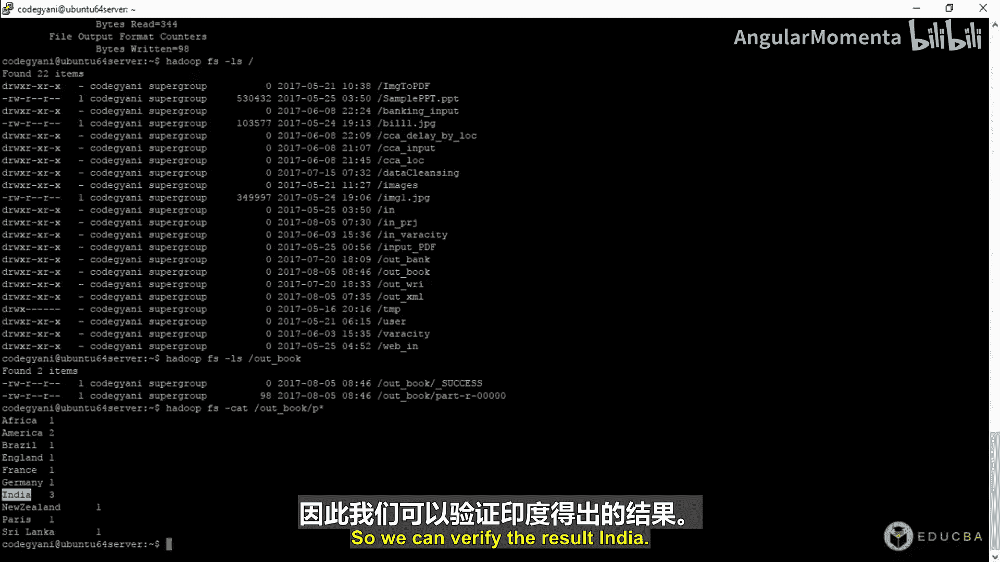
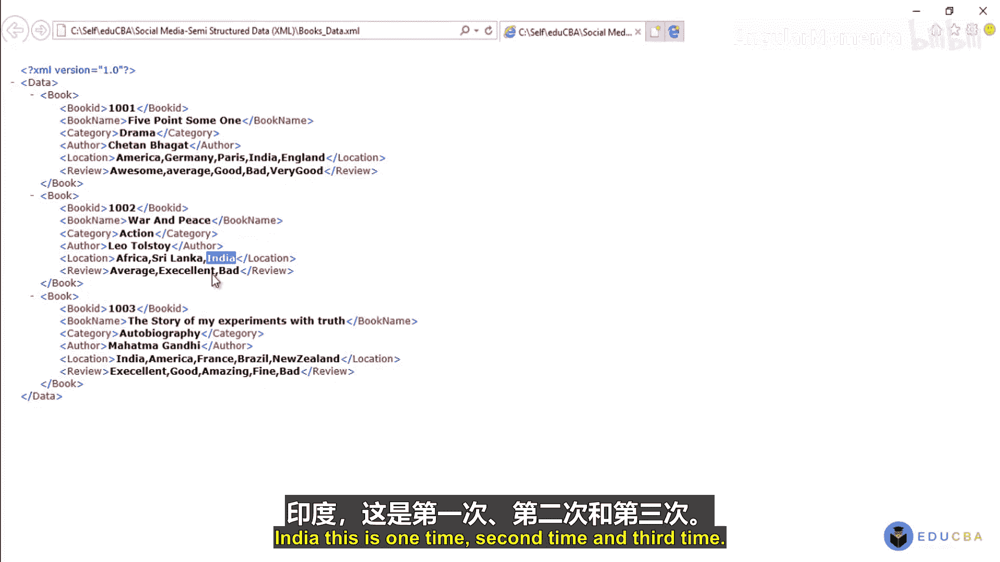
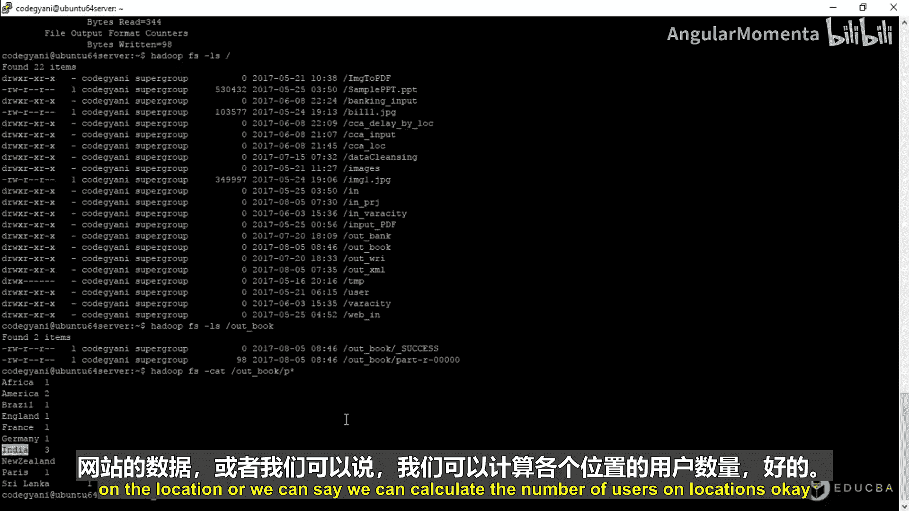
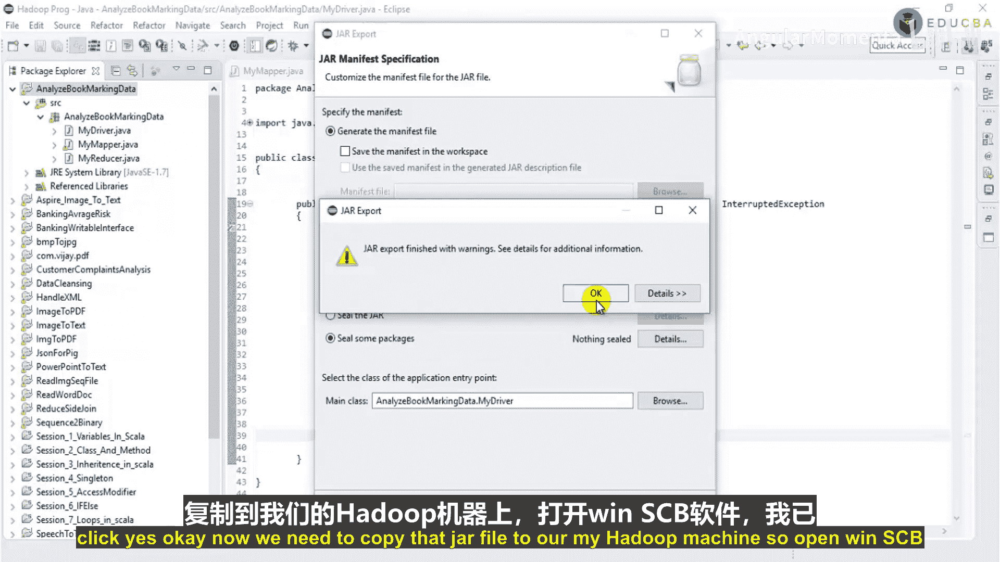
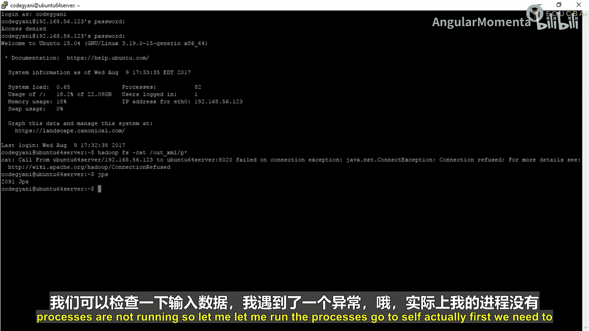
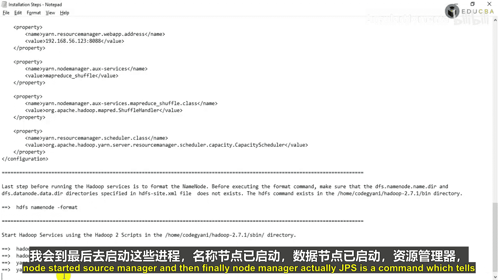
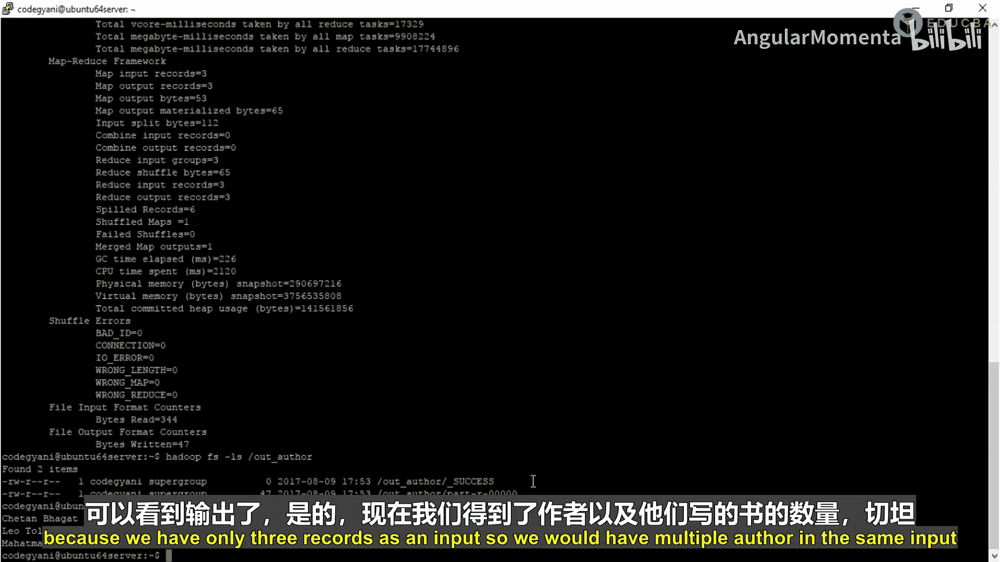
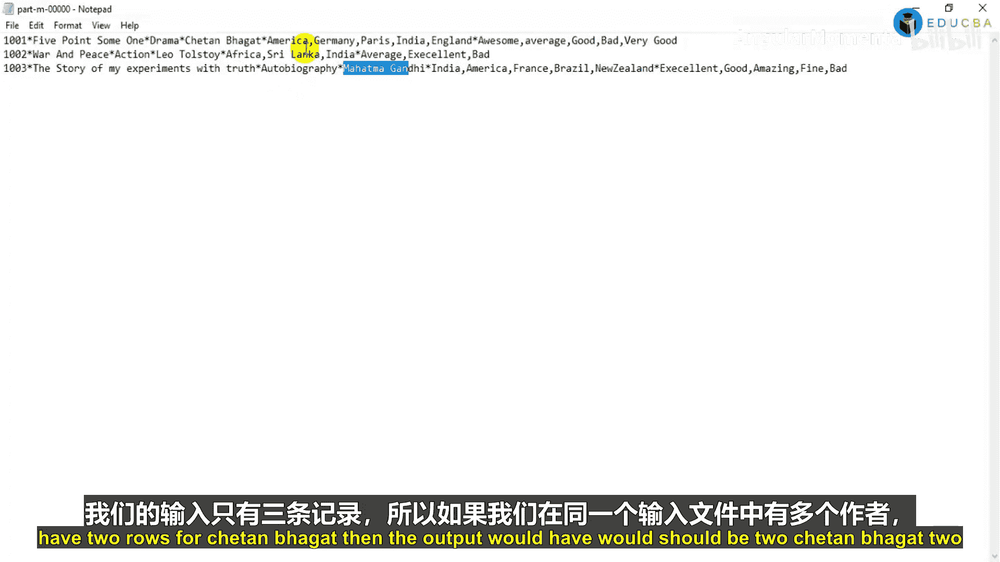
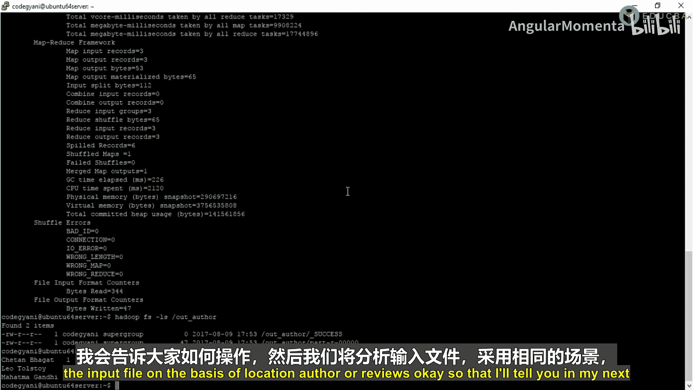

# 【EDUCBA】使用Hive、Pig和MapReduce进行大数据分析-｜-Big-Data-Analytics-with-Hive,-Pig---MapRed-p08-03_03_01_按地点分析书籍--BV1yCFozJEuE_p8-

Hello friends， so in the last session we analyze this data on the basis of review comments。

 how many positive review， how many average and how many bad reviews we have for a particular book。

 so now this video we will examine it。Based on location。So they will check how many users。

How many users， I mean， how many locations we have we have。In the input data。

 so here we are taking it as a generic example。We are not caulating the。Locationations。

On the basis of， you know， a particular book。But if suppose in the industry what happen。

 if the book marking site is。Showing the book， you know， for any particular publication。And they。

 they want to analyze it how many users are we have on a particular location。 Okay。

 particular country so okay， the publications want us to analyze the their data and found find out in which country they have users。

 So if they have users， they must be coming in this location tag here or here。

Or hell if the users are liking。The book， which are published by that publication。

Then we must have an entry for those users， for those location in any of the tag。

 if we are processing the data of millions of books， then at least one location will be there。

 We have at least one user so here。I is irrespective of the book。

 irrespective of the author and irrespective of the review comments。

We need to count how many users we have on a location。 So for that what we can do。Actually。

 what we need to do here we need to county the location。 supposeupp America， America is。

Only one entry in the first re for， for the first record。We don't have America in the second record。

 Now America America is here again。 so it means the that publication having two users or two readers。

In America。 So we need to count at how many users we they that publications have。

In the particular country。So， here。I have only program I have。Okay。

 the program is same just I have many changes。Okay。所以跟。Forget about this thing now。Okay， so here。

Now we have one reducer class also because here we are doing aggregation。

 we are counting the count Okay， so now again the map class name is my mapper。

Which extends the base class that is that is map class again。

 the input key for the map class will be longritable。 The value will be coming as a home line。

 So it will be in the text format。 Now here we are passing that location as a key because I am assuming that we all have a basic idea about mapreduce。

So map whatever data we pass as a key。In the the user class。

 we can perform the aggregation on this same key。So here we need to get the count of the locations。

 so I am passing the location irrespective of the book。

 but whatever location we have in that input file just just we are passing it。And we are， again。

 also passing。The value one。 So if America is coming two times。 so first time America will come。

 so it will passes America 1。 and next time again， it will passes America 1。

 and in the reducer class， we will count at count。We will sum that count。 So it will be2 for America。

 Okay， so again， the value will be coming as a。Text。

 so we are splitting that value on the basis of the star because we know the input file。

 which we have。Is the start unlimited。Okay。So， and is star is a escape sequence in Java。

 So we need to write two forward slash， okay。To make Java understand that its a delimit we are using for spreading the input data again。

 we are。Sting the value in the respective variable， which we have declared。

So book ID we are storing in book ID variable， book name， we are storing in book name variable。

 so category will be the third index of the element。

 so we are storing it in it into the third category variable author will be the fourth one。

 so we are storing author in the author variable。Then location， and then reviews。So。

 last time we worked on review part and we calculated positive negative and average review。

 but this time we will work on location because we need to get the count of location。Okay。So， here。

Now I'm spliting location by comma。So， you can see。

The location is in with the we have with the comm limited America， comma， Germany， comma， Paris。

Com my India， go my England， okay。So now we are splitting that location by comma and we are storing that value in the multi location variable。

That is array type string array type， okay。Now we are executing a four each loop。On this。

stringing a variable。And storing all the value1 by one in the L O C variable。Location variable。 Okay。

 and this four each loop will execute for all the data， which we have， for all the location。

 which we have， which we have in a particular row。Okay。

 and map function will execute for all the rows， right？ So from here， they can pass all the location。

1 by one。With the value as a one to the reducer。Okay。😊，So I hope you understood this。

So map function will execute for all the records we have in the input file， So we have three records。

 okay， in the input file and in all three records， we have location is comm separated。

 So for suppose if fast row is coming。So first row。

 for all the location which we have in the first row first record。

We are passing location from that row with the value1。

 so it will execute for second row also and same for third row so now here we are passing all the rows irrespective of the anything irrespective of book irrespective of what irrespective of reviews we are passing all the rows。

 all the locations with the value1 now so here。The output value will be intable because we are passing one。

And key will be text So because your passing location now go to the reduce class。M the user。

 we can see。The key from map is coming in the text。 The value from map is coming the inritable。Okay。

 and the value which we are writing， which will we are writing into the output file。

Will be in the text format， okay， and the value。Will be in the。Intertable format。Okay。

So now it is a reduced method and it like is good for all the records。

Which is coming from the mapper。 So I hope we all have a basic idea and reduce method。

 The value is a iterable type that is intertable。 So the value is coming 1，1，1，1。

And it will be itable type。 Okay， so here we declare one variable called sum that is。

 we assign it to 0。 Now we are。It's a table type variable。So we are counting it in the for loop。

 okay。So all the value， which is there in the。Well column。

Will come one by one in the out well column and from out well。

 we are getting that value out well dot get ready to write dot get to get the particular value。

For this， for that portable key。So if we take the example of America， okay， so first time America。

 the value for America will be one second time， second time， it will be one plus 1， it will be 2。

Okay。So in the same way， it will it will calculate the country for all the locations。

And then finally， we can write。😊，K， that is nothing but the location and this sum for that particular location。

So output output will be like for America the con will be2 for Germany and the con will be 3 likewise okay。

driver card the same as earlier。 Okay， the name I kept is same。 I did not change it。Okay， we can。

 but， but we can change it if we want the driver class name is my driver Maper class name my my mapper。

Rducer class name is my reducer。Okay。Output key class is text because this time we are passing location as a key。

 So text output value class is intable。Because we are passing 1，1 from the mapper to reducer。

 And here we define reducer class。 That is my reducer because we introduced。

Introduce that class in this program。And numbers we have set the number of reducer is1。

 the input it is very less， so we have set it only one。 We can set it2，3，4， also。

So here the input part will be the output of the first program in which we converted that actual file。

To the flat file。 Okay so the input which we have in the last program where we calculated review comments。

 okay。It's the same input。Will be the input for this programme also。

 And the next parameter parametermeter will be the output directory。

And system and system system dot exit。 So once the job is completed， it will be exit。Okay， so again。

 we need to do the same thing。 We need to export it。

So， I have already done it。Here you can see in the rise book matching data。

And I I have copied this file here also。审么。Go to here。First。In the last program。

 we kept the output in the output。Letsco book。Folder in this folder。

So this time I' am creating it because we'll keep the output in the same folder。

 I don't want to create more folder in the in my Hadop machine。 Okay， so we can delete it by。RMr。

Out underscore。Book。It will be deleted， so it's deleted。Okay。Now， we can check。

We have output file where we converted x data into the flat file， and we kept it in this directory。

So we can check here。 Yes， we have。That file。And we can again， see the data。

To make sure that we have data available。Yes， we have。

Now we can execute our program so the program will be this one。

 so the jar file name will be same because we did not change it。

 we made the change in the same program input file will be the this one which we have already seen out under XMl forward slash p star because we have only one file which which which is start with the name P。

And the outputor is out underscore book because it was already there， but I deleted it。Okay。

 now we can execute this program。So its started and its assign the unique job I。

 unique credit to this job。 So that is the job I for this program。So here map is started。

So this time， the file name will be hyphen R。Because we have a reduced class， also。

So map completed 100 percent。Redduce  hundred percent。 So the job is completed。Now。

 we can see this folder is created or not。Hao。Airfa， iPhone L S。Yes， this folder created。

So we can go inside this folder。We can check， we can check files created or not。Yes， far is created。

Now we can see Hadoop F iPhone gate。We can see the actual output。So now we can see。America。

 we have two times in the files。2 Africa， we have one Brazil 1， India， we have three times。

 so we can。Verify the result， India。

India， this is one time。Second time。

And thirdile。Okay。沈龙。Wegan。Show this data to to the to to that publication that you have two users in you two users in America。

2 readers in English11 reader in England，3 in India，1 in New Zealand and so on。 Okay。

 so this time we process three records， but we can process millions of the records。

 This is just a demo。 So that is how。They can。Count the locations。

 We can analyze the book marking site data based on the location。

 or we can say we can calculate the number of users on locations， okay。

Hello friends so in the last session we analyze the book data against the locations so now in this video we will analyze the data on the pageses of author so we can see how many book has been written by any author okay so this was our input file and how we get this input file in the first session we process the Excel file and we converted converted that Excel file into a flat file so this was the output of our first scenario so now this data we analyzed on the batches of location okay on the pageses of review now we are going to analyze this data on the batches of author so we look at thecode。

This was our code。Okay， and this code is something which we have written to implement the first scenario。

Where we， where we have county。Positive review， negative review and average review given by the users。

And this was the implementation， which we did。To analyze this data。Against the location。

 So now Ill copy this context because anyway。We going need to write it， okay。And we can comment。

This part of。C now we can write here problem3。 So here we need to analyze the data on the basis of。

Author so author we have in the string author okay and here we are splitting our input file by the delimit star because if we have look at our input file all fields are separated by star okay so here now we have author so。

As we know， whatever we pass。As a map key as a map key output and which goes as a key input to the reducer。

So， aggregation will be done by on the basis of that key so when we analyze this data on the basis of location。

😊，We pass we pass location as a key。So now this time we are going to analyze this data on the basis of author so we have to。

Passe authorizer。So author we are getting one author and a single row， so we don't need to okay。

As we can see our input file in this line， we have Chaan Bahar okay。In this line。

 we have Leo Tolstoy。In this land we have。Martma Gandhi so we have three records and for all we have independent author Okay so author is not comm separated I mean I mean a single book is not written by a multiple author if we have that cell then we can do the same thing we can split that author by the delimiter and then we can。

Pass for the you can write for each loop and you can pass author as a key。

 but here we are getting an abundant author so we can directly pass。Author here as a key to author。

We have author， okay。And here we need to count how many books have been written by any author。

 so we will pass1。With the one input chosenzen Baha two times then then one will get added with both Chizen Bah and then we can count we can count at some in the reducer class。

So， we can get two so we can get the output as a chickenburg have written。

2 books okay so here we are passing one we are app one as a value with all the author which which which will be coming as an input so go to register class。

We have text as a key in this project generates we don't need to change。

Because we are passing author as a key which is text and we are passing1 as a value which is entrytable here we need to get this sum so out sum so this code looks okay to me so we will get key as a text means Chatenberger or any other author of Chaanbergger and this sum。

O。So this class looks okay to me， we don't need to change anything here。

In driver class analyze book must data set against。Author okay。

 jar file is driver class is my driver member class is my map reducer is my reducer output key is text we are passing author。

After valley we are passing one。That is entable。Number of reduce reduced tasks we have less data so one will be enough the first parameter will be input data and and second parameter will be output directory and it will be exist when the job is completed so it is okay we can compile this code to compile this code go to project and click on clean。

And we can see when project is selected that is analyze book mark data and our project name is analyze book mark data。

 so click OK now export the file。😊，Ja file， so right click on the project， click on export。

 select jar file， select next。The name of the jar file， which was analyze rise book marking data。

So I'll keep the same name。Like on next。Next。Choose the one class， that is my driver。Click on finish。

Okay， okay， yes， we want toride it。Click yes。

Okay， now we need to copy that jar file to by Hadoop machine。

 so open win SV software I am connected with this machine Hadop machine login okay。

 so it open weancy we exported jar file here， this is the jar file and we can see the timing today's date 98。

2017 and time is 21，48。The time is same， so this is the jar file。Which we exported just now。

 so drag it on my adult system。Yes， if we want to writeride it， click OK now。

Open the pot it already running Okay， so before execute the command， we can check our。Input data。

 Okay， I got some exception。Oh actually why processes processes are not running。

 So let me let me run the processes go to self。

Actually fortunate willing to check our name node。Data node。

 the source manager and node manager is running or not。So I have written my steps here。

 I will go at the end。And let's start D。Processes name not is started。It all started。

Soce manager and then finally node manager actually JPS is a command which tells us processes are running or not。

 so now last time we did not get anything this time we can see name node source manager data node name node so means so it means all four processor are running okay。

So now we can see。The input file so now we should get the data yes。

 so now we can see input file is available and all are limited by star and we have author okay。So。

 this this input file was the output for our first program when we converted our Xl file into the flat file。

So that and that is the reason the output file path directory name is out under code Xml。

 which we have given in the first program。So now this is the input our for this program okay。

So now we can execute our actual code to analyze the data on the basis of author。

So this time I'll give our director name to。Out underscore author。

Okay this is a J file name which we have exported now this is an input file path and this is the output director so it is executed so now job will get submitted to the resource manager and the resource manager will provide a unique ID that will be a job ID here you can see so now map produce will run you can see map is started and reduce is started map completed 100 percent reducer is running reducer completed。

So now we can check our output directory。Out underscore author yes it is created and the file name is part hyphen R。

Because we have a reducer and now we can see the output。Yes。

 so now you get the author and how many books they have written so Cha Baga written one book Leot also to written one ama Maga written one because because we have only。

Sa records， other input。So we we would have multiple author in this same input file then we then we would have got the number of books written by any author。

 for example， if we have two rows for Chaberg then the output would have should be。

2 jaanberger2 okay so now this program is done and now on the from the next video we will start with the pig we will process the X file file into the in P we will I will give you a introduction about P then we will start processing X file into P and I will tell you how we can do that。

And then we will analyze that input file。In this same scenario。

 we will take the same scenario we will analyze the input file on the basis of location。

 author or views。Okay， so that I will tell you in my next sessions。

