# 【EDUCBA】使用Hive、Pig和MapReduce进行大数据分析-｜-Big-Data-Analytics-with-Hive,-Pig---MapRed-p09-04_01_01_如何在Pig中处理XML文件--BV1yCFozJEuE_p9-

Hello friends in the last sessions we process this XMl file in Mareduce and we performed we implemented few scenarios in Mareduce we analyzed this data on the basis of location reviews and author but initially we converted this Xml file into the flat file to process it further in Hado with the help of Mareduce program and I explained you everything how what I have done in the code what was the significance of each line in the code okay so we understood it well but now today we are going to start to process the same Xml file and pick so here in this project basically we are processing semi structure data and whenever we talk about semi structure we always think about XMl file。

Because Xl comes in this same structure format， so for pig then put it will be same but before move ahead first I would like to introduce pig what is pig so pig okay so pig basically a data flow language pig actually initially is a it is developed by Yahoo。

And later on it is taken here by Apache so now people call it Apache pig so big basically implemented for the users who who don't want to write a long code to process some input data or the person who does not know any coding language like Java is scalealar Python the was to write a med program。

The people the users or the developer should be well aware about Java or Python or Scala a few few people call it iscalala so but the person who is not belongs to a coding background so they prefer pig pig is nothing but data flow language they are basically users or developer defined find the flow of data so big basically what we call runs or maybe execute we can call it execute in the form of relations so if we have multiple relation in one process like S1 S2 S then all are related to each other so for example we want to process this X file then in the first we need to load the X file into the pixel in the second relation we can perform some operation like they can analyze this data on the basis of location and in the third step we can show the data output in the console so all。

A interrelated So pig basic works on relations and relations are defined by the users and that is the reason it is called data for language P is stored pig contains carry data only for that particular session。

 so suppose if you if you are working today on the pig。😊。

And you do did not save your output or the output。Then then next time when you will log in it will be lost。

 So pig carries data only for the particular session。 Okay。

 so these are the two million differences in the the quality of we can say the the definition of pig。

 So if you want to more if you want to learn more about pig， you can go to Google。😊，And type。边。

tutorialtorial。So you will get a link of Aache pi so once you will open it you will get complete list the function。

 the relations and the everything。How even installation they will tell you how to install the pig what is grand sale Okay。

 how we going use join operator， how we going use core group operator so all the basic functionality。

Which we can use in pink， we can learn from here。So anyone who is interested to learn people。

 they can go。To this tutorial。And it is well written by the Apache。And they can take a benefit of it。

 Okay， so now Ill tell you how we can process same is such time pick。 So for that。

 you can see my cloud machine is running Okay， and I'm connected with that machine through my Okay。

 and let me show you the command pick command by which will process our Xml file So as you know in map produceduce when we converted our Xml file into the flat file so we have written the program in the map produceduce and in that we。

😊，We。R the test input format。 Okay， so in this， because mepeduce。

Does not provide any input functionality by which we can use we can you know process Excel file it's the semi structure data a flat file we can process directly in the methodice but if we have data semi structure or anystructure format then then we we need to write about custom input format okay so which we have seen we implement we have written our custom input format that was text input input format and the parent class was a record reader if you can recall okay so here in the same way pig also does not provide any input functionality。

 but there is a bank biggie bank a patch created some functions okay。

And they stored all this function in the piggy bank even they invited users who are who are you know a code code level coding level developers are here in the market who like to write a complex code if they written some function and so they they are most welcome I mean theyre invited to you know send to add add their function in the piggy piggy bank jar other users can take a benefit of it so so to process Xl file into a pig we need Xl loader and to you to use the Xl loader we need to download the piggy bank dot jar file okay let me close it I will show you。

Okay， this machine， I'm connecting to this machine through my win SP software because I downloaded the piggy bank dot jar file。

And copy that this one， you can see anyone or this one Okay so basically this one piggy bank do jar you can download it from internet it is easily available just type download piggy bank do jar file on the Google you will get the link you can download it and then you can copy it copy that jar file from your local machine to Hadoop system and then they can once they have jar file available on the Hadop system so to use that jar file in pig when need to register that jar file so let me close my this input file So when need to register that jar file So to register that jar file we need to write a command like register piggy bank dot jar and for now forget about this thing that I'll tell you what is this and then I told you pig box in the form of relation So here S1 is nothing but the step one So that is the first relation okay。

And here I'm loading。 So basically in Sgfs and Hadop system， I copied my Excel file on this location。

 Okay， so Im loading。The Xl file from this location to my big grand shell with the help of Xl loader because we are purchasing Xml file and here there is the parent tag which you want to I mean the data which you want to load from the Xl which you want to extract from the done node the value under that node which you want to extract so we to pass that parent load and how it will be in which format we want to load it So obviously we have the data list string format。

 So we will load it into the carry because in pick we don't have data type list string we have carry instead of string now I told you all the relations are interrelated So here we can see S2 in S2 what we are doing for each S one So whatever data we have in S one relation okay so S contains all the data under。

你。Book tag， so whatever data we have in the Excel file。

 which is there inside this book book is parent tag Okay so in this book tag we have this data in this book tag we have this data and this book tag we have this data So whatever we have data under book tag So we we have loaded it into Excel and for each that data generate what generate we are using regular expression So we are matching data what whatever you have under book ID star means get all whatever you have under book name star means get all whatever you have in the category star means get all and in the same way author location and review So this is this in text to get the data from X file okay because Excel file we work on the Excel Excel file on the basis of notes。

And we have location author Bokai all our node here okay and this is this is this syntax first we need to load the parentax data into the grand she and then we can use the regular expression and for each data which we have loaded we can extract the data which is there under this tag under all tag whatever we have written and here this is the areas。

How we want book ID we want book ID as the type of inteer because if you look at our input data book ID is iner112103 and rest of it the data are in the text format book name category author location review are in the text format okay so here author location review and book okay book ID integer book name carry I told you we don't have string format in Ser type here we have carry so book name is a carry category as a carry author as a carry location is a carry review as a carry S3 here for each S to generate what okay for now forget this one I I'll tell you what it is just consider this is just a review soon as relation we are generating only book name category and review from the。

Sspiration because an S2 we have data which belongs to each node book id book name categories and we want to generate only book name category and review and then we are dumping the data dump means to show the output on the console Okay so now we can work on it So first let me show you we have input available on this location to F。

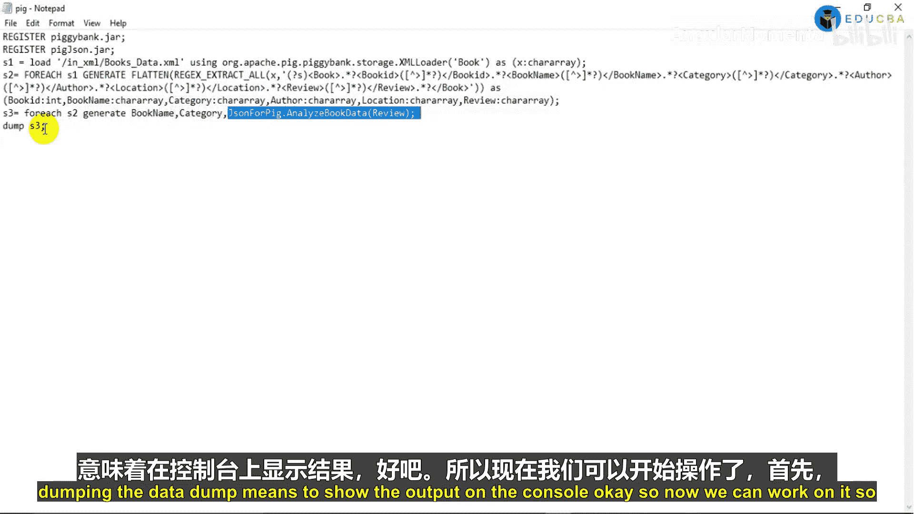

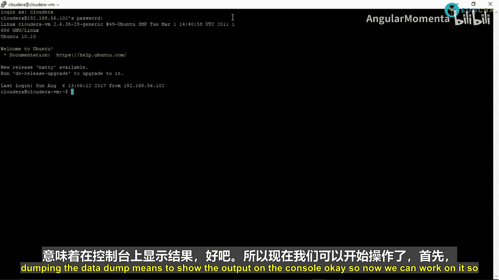

Ih L so we have in underscore Xl file directory in underscore x 7 Okay。

 so here we can see we have forget about this out this is the output directory which I created Okay earlier so we have this data books underscore data dot Xm。

Okay， so if we want to see the data， we can use Cat command so here we can see。

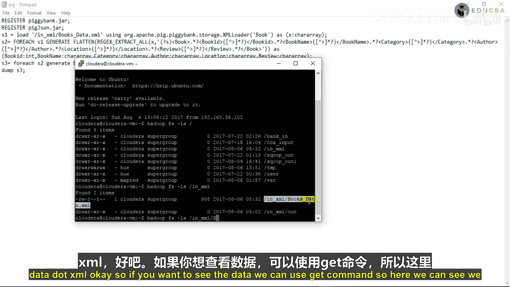

We have X file available in our input director so now we can start the pig grant shell so to start the pig grand shell just type pig and it will open the grand shell you can see the grant grant return here over here so it means it's a pig grant shell so first I told you when need to register the piggy bank dot jar okay and every time whenever it didn't mean that first time you have a human pigs you will register and second time when you log in you don't need to register it you need to register it every time so register okay its got a register。

Then in the first relation， I'm loading the data into the pig Gr shell in the form of cat it's the same command load the Excel file data okay and load load data which is there under book tag so we have all the three those data under the book tag okay into the pig shell in the form of ca So it's done and as to relation it's the same command we are loading that data we are extracting the data which is there in this tag book name book id location review okay so basically we in the first relation we load the data into the pig Gr shell and then second relation we are getting only required data required node data so here this I'm showing you so I'm extracting all load data okay so it's done and the last statement after as is it's areaslias which I've told you book ID we want in the form of entries book name。

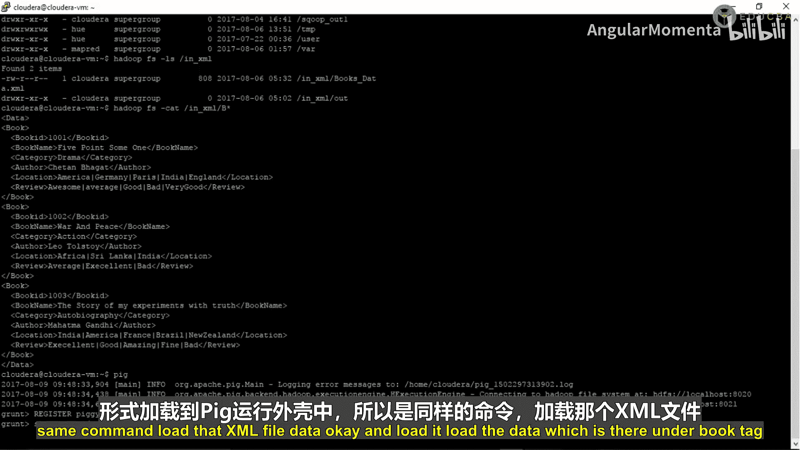

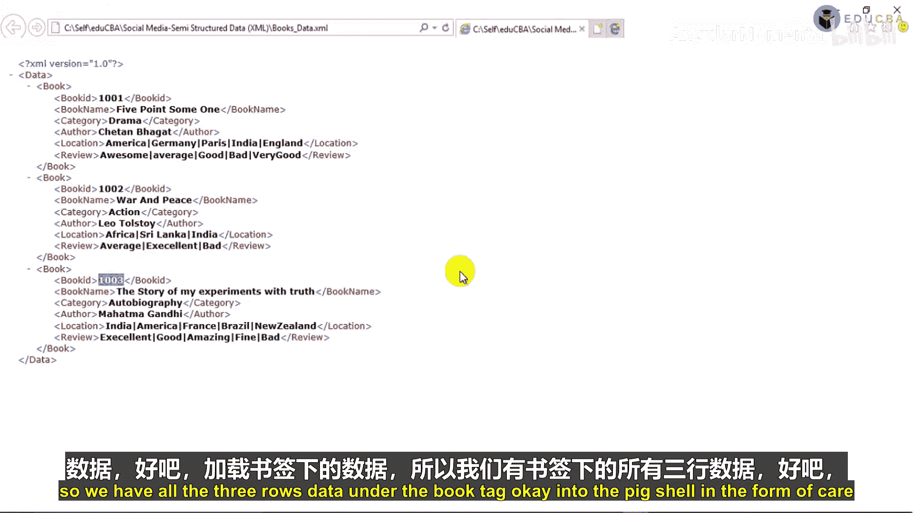

In the form of carry and rest of the data we want in the form of carry because all are in the type form of is string category author location review or are in is string format。

 Okay， so now in S 3 and S3， I will generate。Book name， or maybe we can get author， and we can get。

Review， okay， so for each as to generate book name author the review and how it will recognize the name because here we have given book name author and review and type this semicolon Now we can see the data on the console。

By typing term S3 sourceing it launch it launches in reproduce produceuce Okay so here we can see we got book name author and the review and the are the pipe separated because here we can see the views are the pipe separated and location also are the pipe separated but but I extracted only book name author and review so we got this three data Okay so in this video I told you how we can process the Xl file into pig how we can restore the piggy bank jar file into the pixel and how we can make a use of it how we can use the Xl loader and how we can extract the data which is there in this specified load in the Xl file and how we can show the data on the console So the next video I'll tell you analyze this data on the basis of location So in the last session we processed the Xl file in pig。

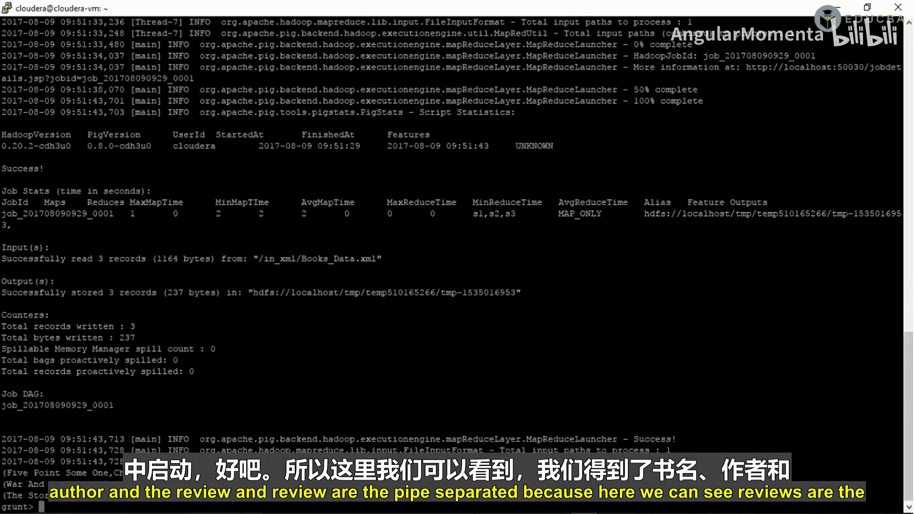

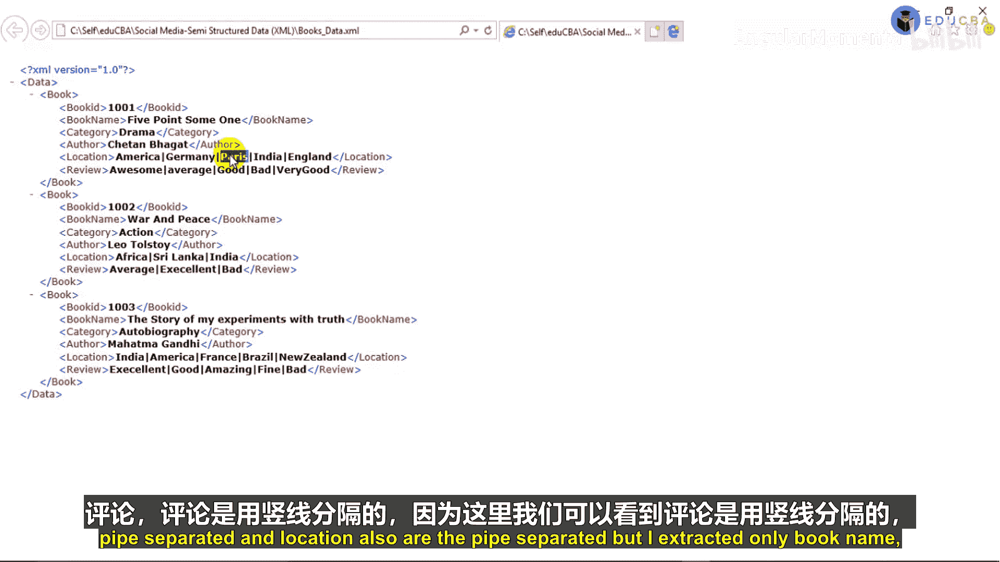

And we generated this output so we extracted only。Book name， author and review。 So in the same way。

 we can accept all the column。Okay。So the first step is2。Reister the piggy bank dot jar file。So。

 why we are why we need to register this file because it has all common function which we can use in our pig statements so here we are processing external file and in piggy bank ro jar we have Xl loader so with the help of it we can process our external file so so first step is to load the piggy bankro jar so we are doing the same。

So let us press the until it is registered。In the next step。In the relation1。

We need to load the Xl file into the pig grand shell。

So this is the input location where we have kept our input file。And here we are using Xml loader。

 which is in the piggy bang dot jar。Okay， and in the X order we have mentioned the parent tag。

So the tag under which all the data the the data which we have under this tag we want to load all the data into the pixel shell。

 Okay， so we need to mention that tag so here we need to get the。The letter。

 which is there in the book。Tag and we are loading the data into the pixel shell。

 So let me show you show you the input file again。

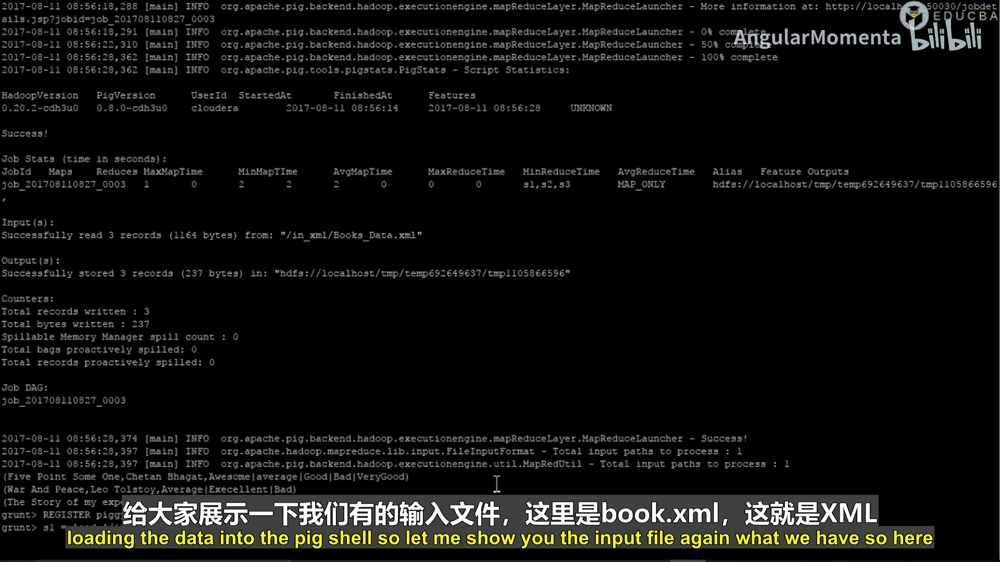

What we have。here book xl。So this is the Excel file。Okay。So here the parent tag is book。Okay。

And we have book I T book name and all the。Relevant column， all the relevant node in the book tag。

 so。

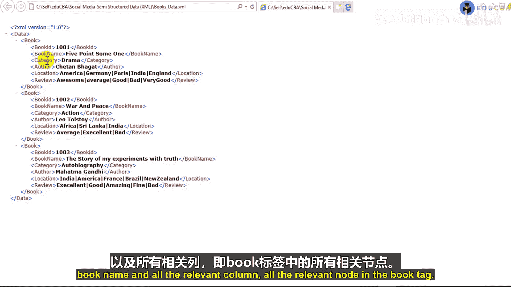

We are loading into the picture。All day。Relevant node and the data which we are loading into the pixel shell。

Will be stored in the variable x and in the form of and will be carried。

Because I told you we don not have string gen type in pig instead of a string， we have carry away。

So let us load it。And as2。Which is dependent on S1。We are generating all the columns。Okay。

And with the help of regular expression。So this is this in text。

We need to mention all the text in this index text so the red the data which we want to load we need to mention all the text block id book name category。

Review location and this is the areaslia which I have given Bokadi book name category author location。

And the you。So let us load it。 So last time we。A only this this value。So this time。

 we can expect more。So， I'm here I'm。Adding one more column call location。Okay。

 so the name of the column is wrong。It's capital L。So。

 we can see we can understand one more thing here pig in some places pig are pig is case sensitive and in some places pig is not case sensitive so here while mention the column name it is case sensitive。

When I mentioned a small in location， it failed， but when I。Mention captain in location。It loaded。So。

 let us dump it。So now we will have location data also in the output。So it execute the mepeduce。

Internally。Okay it is completed So now we can see location also India， America， France。

 Brazil and New Zealand。

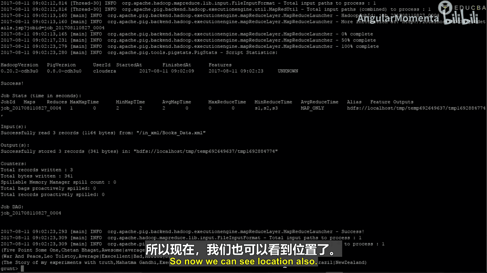

So the same we have here。India， America， France。

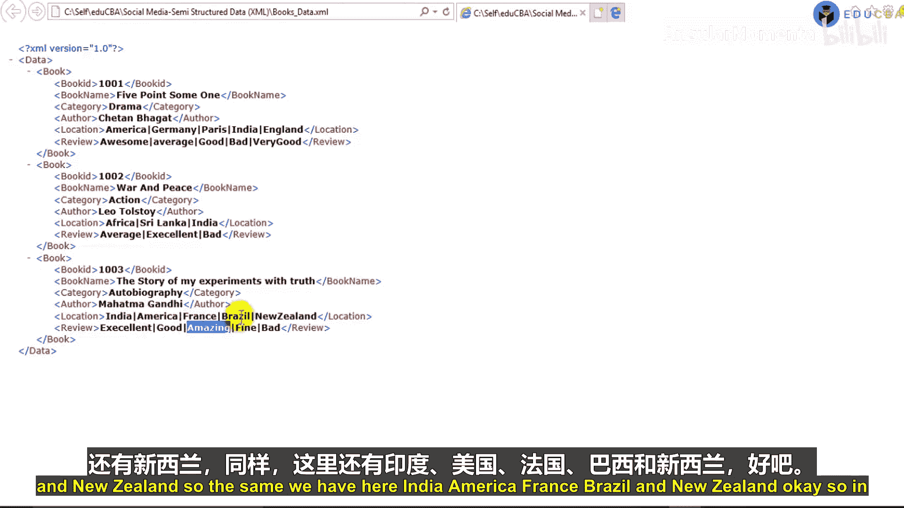

Brazil and New Zealand。O。So in the same way， we can。Extract all the columns。

 but if you can recall in the reproducepeduce we analyze the performance of the book。

Perform performanceance means how many users are giving positive comments。

 how many users are giving negative command and how many users are giving average command so by analyzing this data we can analyze the performance of the book so we can calculate the positive users are more or the negative negative audience is more or average okay so。

So to perform that activity in pig， we can write UDf that is that is user defined function。

Because in here in peak， we can we cannot directly calculate you know， all these things。

So here I have written one UDf。Let me I tell you how we can write the UDf in P， how we can export it。

 how we can compile it and how we can。Register that function in the pig and how we can use it。

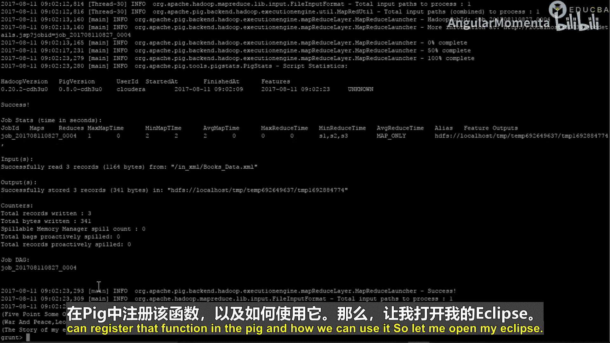

So let me open my clips， its opening， so I will tell you。It will take a while to load。

Just be patient and be with me。哎。Okay， it's loaded。So let me close this program。

 we don not need this rise book marking data program here。Now， here you can see。

One project called Jason for pig。So here I have created one project and in this project I used to write all the functions。

Which is。Related to pig。So here。I have created a package called Jason for P because initially I wrote this project。

都。rite a Udf to process Jsson file okay， so here you can see。One last call analyze book data。

So here when you write a function for pig。You need to export this jar in Meist program they exported only these jar Hadop core but for pig we need to export pig jar also。

And that is common logging jar， which is for exception handling if you want to log。

What errors or info of。Bebu for anything。We can export this and we can we can make a use of it。

But here the major thing is。We need to export import this jar pig the version is version I am using is pick 0 do 11。

1， but you can use any version which is compatible to your pig version， okay。

So here the package name is Jason 4 p。And here I have given the name of the classes analyze book data。

And which extends evil function So in pig basically we have two kind of function that is。

Filter function and evil function。 So filter filter function is basically to filter the data。

 for example。If we have a sensor data like any we want to load or we want to accept only those rows。

😔，Which belongs to the male candidate。Okay so we can add a function for that。

 we can check in the function， we can pass the gender string to that function and we can check if it is male then it turn true if it is female then it then false okay and we can use that function appropriately in our program so we can filter that data。

And in evil function， we can pass an input and make in and this function return a string。

So and when you will extend this base class， evil function。

There is an unimed method that is called exactec。So which will come automatically。

We just need to override it。It is a base class abstract class， we need to overwride it。

 so I am overriding it。So， here we define。3 variable the same which we did in the Meist program。

The row per counter， view Per counter， the view negative counter and the view average counter and all are。

In the types of integer， because here we are。Calculating how many positive reviews are there。

 negative reviews are there and average reviews reviews are there okay so reviews the count of reviews will always be in the integer format。

 so the variable type is integer。Here I if define one more string that is result。

And I realized it with the blank value。Now in this function you are passing one variable the name I have given default is argument 0。

 that is a 0。Okay。So in this variable， we will pass the。Review comments， so。Here you analyzing。

Pos negative and average review so we will pass the review column beta in this function okay and we can see。

The reviews are。Separate by pipe telemeter。Awesome average good bad very good。

 so all are separate separated by pipe diametermeter。So once we get the string into the a 0。오케이。

So but basically， it comes as a tuple。The pe is nothing but a row in here and in the P to pulls we we basically call。

To the row an atom we call to the column so that a string will come as a row okay and so we can convert it into that string。

And I stored that string into the command delim data which I defined。

And then I split splited that string by pipe because our input is pipe separated。Okay。

And here I am using double forward slash because it is the escape sequence in Java。Okay。

 so we need to write， we need to split the data in the in this way。볼게。And。Then。

If we take the example of first row。We have。 we have awesome average good bird。 Very good。So。

 the so the de pipe delim someone split once we split it in this array， we will get awesome。

 bad good， very good， okay。Andto the respective index like 0，1，2，3 and 4。So， for all the data。

 we are。We we are using the for each loop， so this is the same logic which you have written in the Medist program。

And here we are checking it is very good awesome excellence。Amazing。

 then increase the positive control by one。오케。Everything is bad means increasing negative control by 1 else。

It is a average counter so increase the average counter by one。

And then I am passing the result like what the review2。Poive counter， negative equal is2。

 negative counter and average week is2。A counter。And we are toing this data into this string result。

Which we have defined here and we in this slide does a string with the blank value。And finally。

 we are returning that data because it is a function， so obviously it will return some value。

So I as I told you， evil function evil function can return a string。 So here Im Im。Return the the。

Re counter。How many positive views we have， how many negative， how many average。So。

Here we need to always remember the class name because the big function。

 we can call it by the class name。Okay。So。Once we are done with it， we can compile it。

Choose project clean。And。The project name is Jason4 P， you can compile it。Okay， and once we are done。

 we can export the jar file。the same way。We did in the mereduce。

So here I I can show you I have already exported it。This is， this is like machine。

Which is currently running。So I'm connecting it with。Through my win S software， which used to copy。

My local machine data to the my Hadung machine。So， here。If Ill go to。

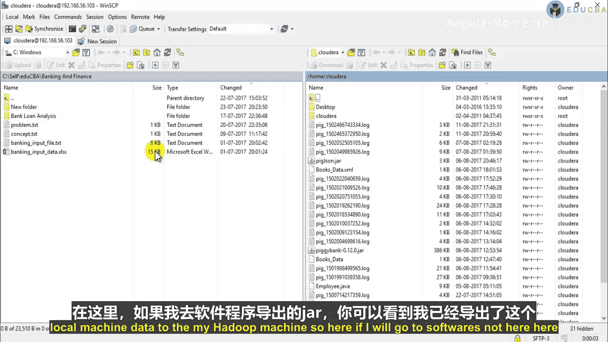

Softface。Not here。A program exported jar。So here you can see I have already exported this jar file。

And I drag this graph here。Big Jason Road jar。Okay。So now how we， how we can make a use of it。First。

 we need to load， they register the piggy bank or jar。Second。We need to register。Pick Jason Roadja。

was here。The jar file which we have created is pick J dot jar。And it's on our local。

The route directory so we can directly access it by name so it is registered。So if we do。

 if you don't have this this file on your local on the route directory， it you will get the error。

But here， we have。Drag it here。So， it's。Register successfully。And then。We can load our Excel file。

You can load all the data which are there under the book tag。And in S 3。I'll tell you how we can。

All that function。对。So， whatever data we have loaded in the relation to we are generating for each as to generate book name we are generating。

We are， we are expectinging。They review the book name and and their corresponding reviews。So。

 to get the reviews。With the help of logic which have which we have written in the function。

 we have to call that function。And that function is in the Json 4 p。J Jason4 pages is。

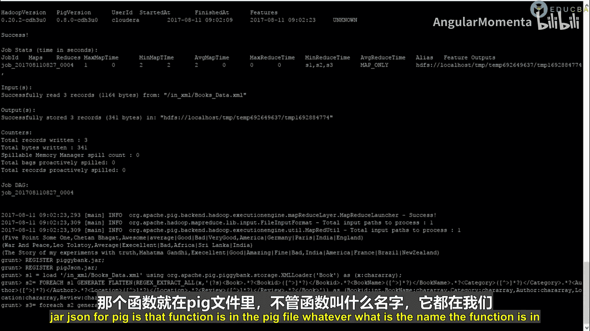

That function agenda。Big file。What， what is the name？The function is in the big ja ro jar。

 which we have registered and to call that function， we need to。Write the package name， dot。

 class name。

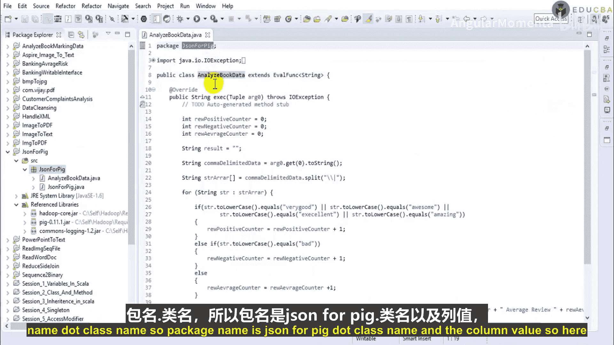

So practice image is for pick dot class name。And the column value so here here we are passing review because we need to get the count of positive negative and average review。

For that particular book。Okay。So let us press the enter， it's done。And later us show the data。

So now we will get the book name and deck corresponding reviews， how many positive reviews are there。

 how many negative how many average。So here we can see the book name is 5。71。

Po review is 2 negative is1， averages 2。So you can count here。

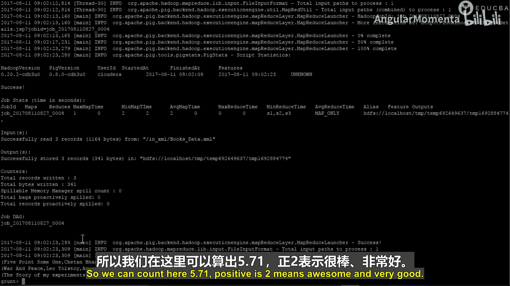

5。7 voice service2 means awesome and very good。Negative is one bad。

And average is one average and good。 So here are good we are considering as now average category。

So we can see the logic， we did not mention good in the。Poive counter。Okay。

 it is coming in the else part。

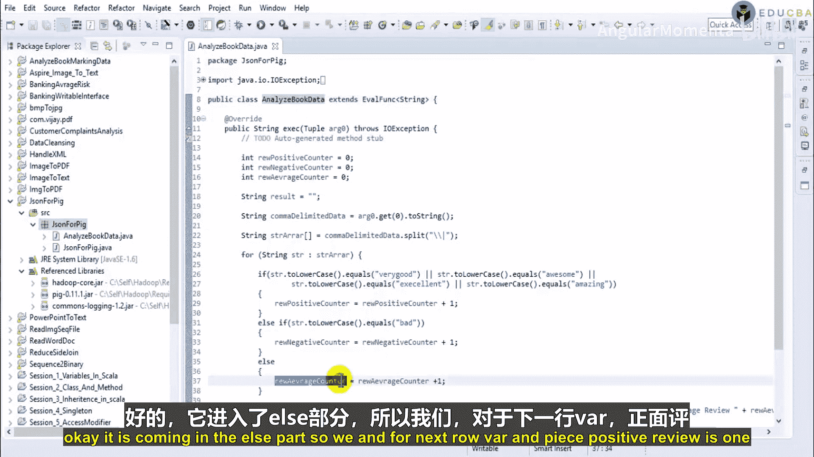

So and for next row war and peace。Poency review is one。 negative review is1。

 averageage review is one。So the story of my experiments with truth was 2 negative is1。😔。

It was the views， too。Okay， so that is how we can write the function in the pig。

And how we can export it， how we can compile it and how we can。

Register the jar file and how we can make a use of it in our Pe script。So。

 here we have seen the data on the console， but we can store it in the SGF also for the further processing。

So， to do that。Instead of dumb， what we can do。Store into where。In。Excellent。And out。Review。

So Im storing this output。store war。Store S3， store S data in 2。

This location in Xtml where we have our input file under this where we will here creating one directory call out underscore review view RV。

And inside it， it will store this data， so let me show you。It's executing。Okay。

 and we can see it success。So it meanss it's done。So now we can go to SGFS。I do per iPhone L。😔。

We have an underscore X folder。In underscore Xml。And here we created on directory call。

Out underscore。Review。And inside it we can see we have1 our profile con part hyphen M。So。

 we can see the output here， p star and to see this to see the output。

 we can use the cat command so we can see we have same output。Okay。Which we have。

Which we have seen by dumping the data on the console。So。

 same output we have restore into into the directory for further processing。

So here we understood one more thing how we can store the pig output into the Sgfs directory。オッケー。

So in the same way， we can create more function。

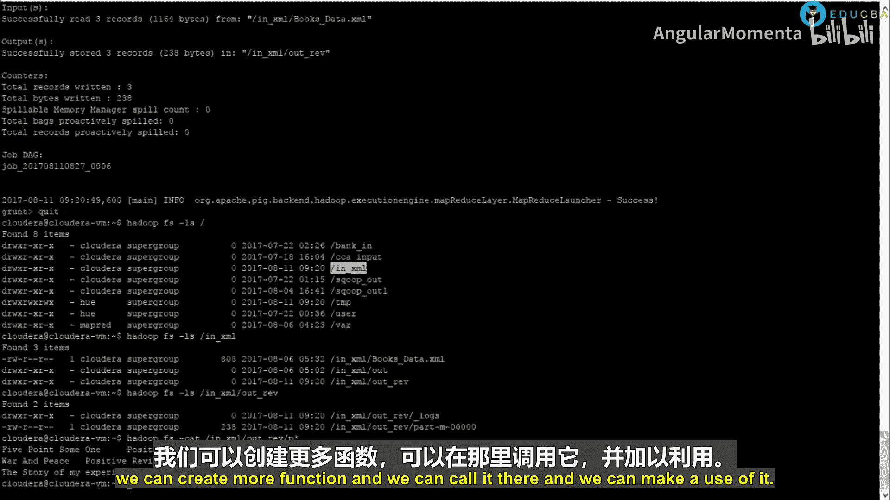

And we can call it there and we can make a use of it。

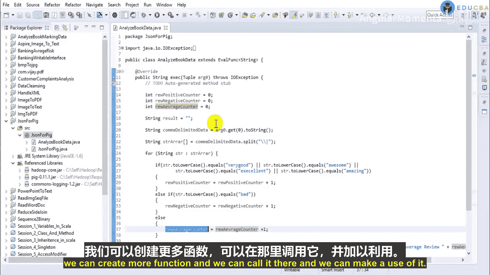