# 【EDUCBA】使用Hive、Pig和MapReduce进行大数据分析-｜-Big-Data-Analytics-with-Hive,-Pig---MapRed-p10-04_02_01_使用书籍生成的猪XML文件输出--BV1yCFozJEuE_p10-

Hello， friends。So in the last session， we process the Xl file in P。And we get this output。Okay。

 so we understood。How we can process the X file in pig， how we can。

Write the user defined function in P and how we can export it as a jar file and how we can register it in the pig shell。

 okay。And we understood how we can use the functions。

which we have returned inside this jar and how we can you know store the output into the text file in the pick because pick is only for this particular session so next time anyway will log in you wont see that result。

So if you want to see that result。Again， then we need to store it into the SDdFs。

 so we have seen how we can store the pig output into the SDdFs。So not today， we will work。

On this output， which we have got after process processing the Xml file。

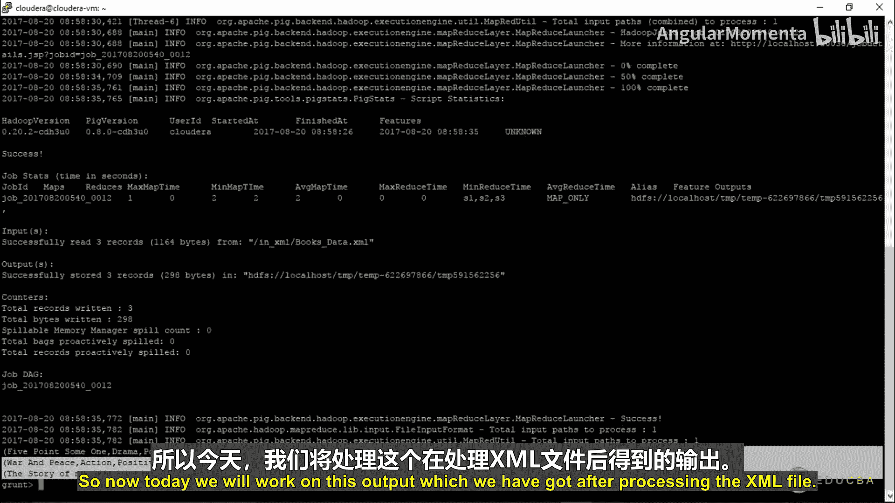

Okay， so I can open the Excel file for you guys。So， here， we can see。Let me reviseize it。

So here we can see we have book name。Okay， category and the reviews。

 how many positive reviews we have， how many negative， how many。Everyage review。But。

Instead of this data。

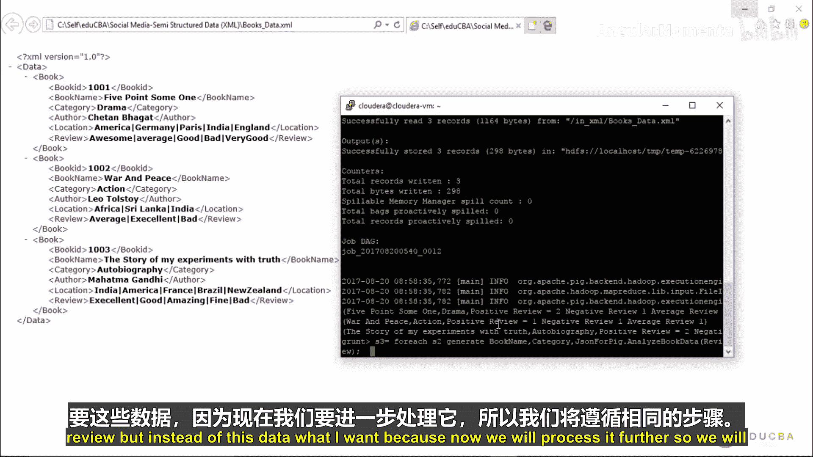

What I want。Because。Now we will process it further。So we will follow the same steps。First， we will。

Reister this pigy bang road jar。Then we will register our function。Then in as relation。

 we will load this Xl file with the help of Xl loader。

And this function exists in pigggy bentott jar file and we are loading it。In the x variable。

Wwhich is the Ket type and S2 relation which is dependent on S1。We are using。Rs there expressions。

And we are generating all the records， which we have in the Excel file。And here in S3。

 I will make a little change。Instead of。Review。What I can do。Now we will work on location。

Like instead of book name， we can get book ID。ok。Lets see the result dump it。Okay。

 so now we have book ID。Category。And locations。 So now you can see location is we have multiple location with this single record。

😊，Pippe separated so how we can work on this location part。Okay， so now we will work on this。

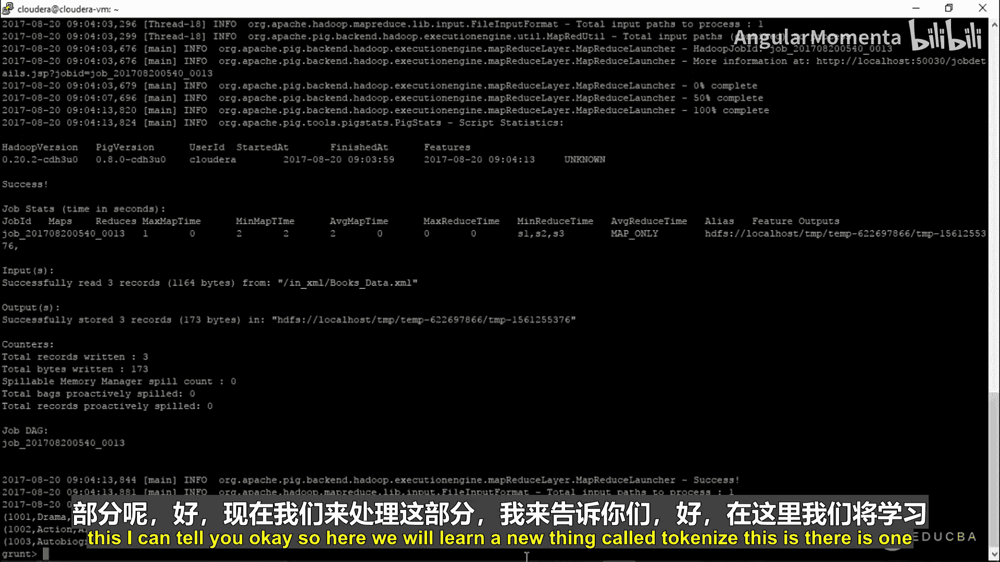

I can tell you， okay， so here we will learn a new thing called。

Tokenize this is the original one function called tokenize in pig。So what Tocoise does。Actually。

 tokenize， just tokenize the records。So what does it mean it basically。Take all the records。

 which we have in the single tu means。The single row there is called tus in the pig。

And the column is called atoms。So， tokenize what tokens does， it takes all the words。

 which is there in a single tuple。And convert all the words。In the form of purple。In this single tu。

😊，Little confusing now we can see what does it mean。

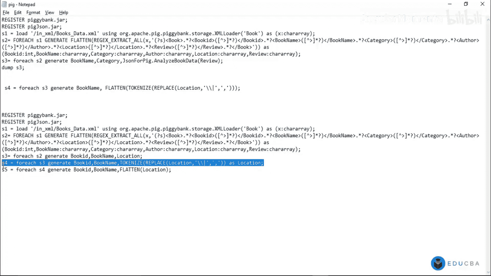

So， in S3 we have Bokai drama and locations now what I am doing in S4 relation which is dependent on S3。

I' am generating Bokadi that we have。Book name， we don't have。Init of book name。

I can write here category。Because called category we have in a。

And tokenize so first I am replacing this pipe symbol with the comma and tokens will work on this comma part so it will convert all the words in this which we have in the single row。

And I store it。In this single tuple。So， let us see the。Before see the output， we can。Describe it。

So here we can see。We have Boka， which is inger time。Category， which is category。Location is tokens。

 tokens of tuples。Okay， and。A single tu in which it is stored the restore all the words。

And what what we have here， we have location， India， America， France， Brazil and so on。

 So now let see the。Output of this。So， we will understand it better by looking at the output what coconut is doing here。

So， here you can see。We have Bokai drama as usual because we did not make any change。

And this is here we have。A curly bracket， Okay， it is started and it is ending at the。

And so that is called single tuple。Okay。And in inside we have all the location in the form of topal so that is what I told you it convertver it takes all thevols in a single row。

And it convert all the words in the form of tuple and is and it is stored in a single tuple so all the words also it is stored in the form of tu。

 but they all exist in the form of single tuple。😊，The same thing which we which we have in the with all zeros if you look at the second row that is 1 double 02 bo ID categories action。

😊，We have Africa。L y， yeah， here are 3 and length is you know， separate y because we have a space。

In between， so it basically it。Check the space or the limit which we have given so here we have given comma because we replaced that character5 character with the comma so she is the single top different apple and Lka is different。

😊。

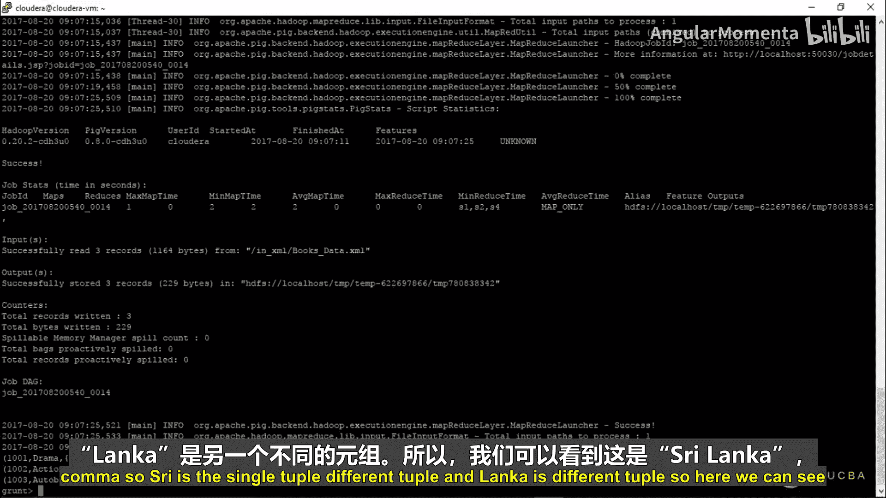

So， here we can see。Yes， this is Sri Lanka。And we have a space in this right。

 so it is taking two different words3。嗯冷か。

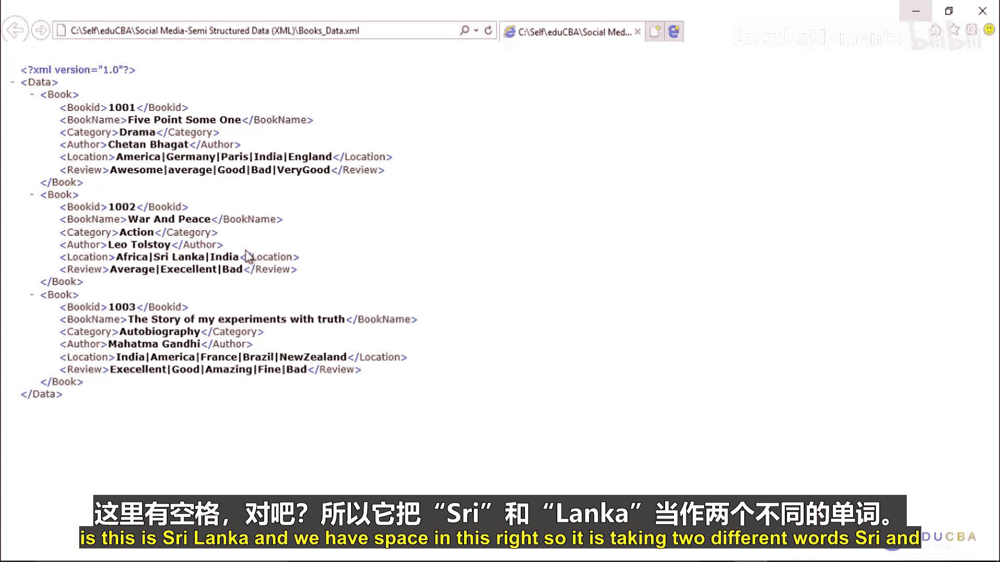

So this is just for demo， so just I am telling you。So， if you want to make。

She laa is a single temple。Make sure that we don't have a space in between that。Okay。Now。

We will use flatten。Flatten。What flat does。So whatever tus we have here。Fletten will。

Separate all the topples and convert in the form of separate row。

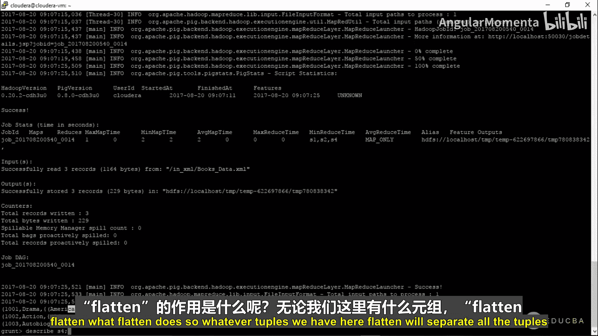

Let us say。

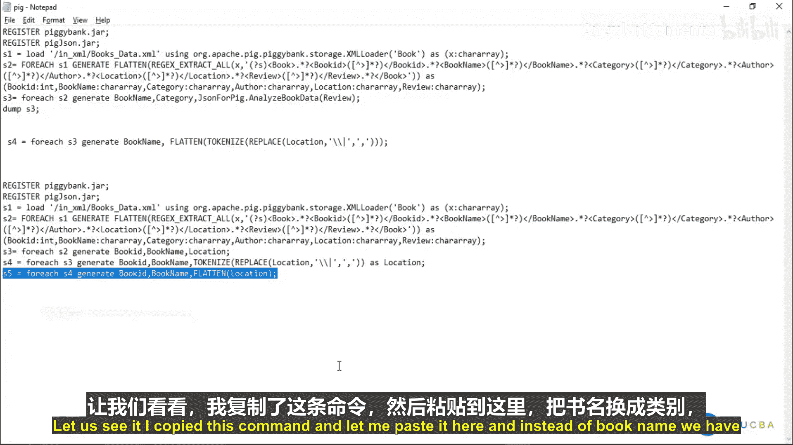

I copy this command。And。Let we paste straight。Yeah。And instead of book name。We have category。

A category。And。Flatten。Location。And the my location。Because if you look at the look at our command。

 I have given Elilia location。If we will not provide the layer location。

 then it will not recognize by this by its name。It will give us error。In the next election。Okay。So。

 let us execute it。Okay。So， let us see the。Let us describe it， let us see the structure of it。So。

 here we can see Boka integer category schedule location is again a token。

 but this time it is not the。😊，Tokens of tuples。It is a simple token the it will convert all the tus in the form of separate row。

😊，So that is a difference， let us dump the result。So now we will understand what it does。Now。

 we can see。

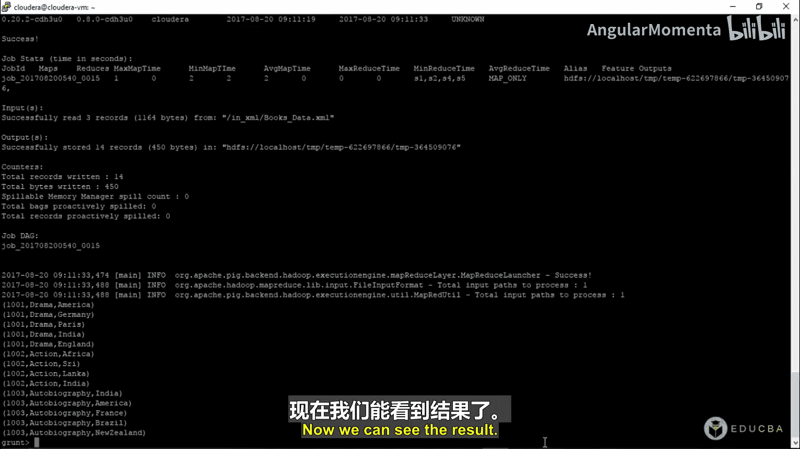

The result。Now， consider they。First record verify we have America， Germany， Paris India and England。

 England as a location with the first record。

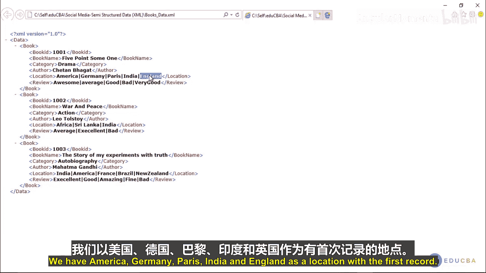

Okay。So now we have America， Germany， Paris， India and England。So。

 it converted all the tuples as a separate row。Okay， those are separate apples。

But Bocodi and drama will be same because all the all these values all these location were associated with a single record the Bokodi was 1 double01 and the category was drama so it segregated the records in the form of separate row so now we have separate row for all the locations for America we have separate row for Germany we have separate row for Paris we have separate row and so on for India and England and the same thing has happened for。

Book I 2 and book I 3。So now it's very easy。To process this data further earlier we had record like bokadi category and all the locations in a single row so now if we want to analyze this data on the basis of location we can do that easily。

Okay。Okay， so now what we can do with this data， we have this return the S formulationbrillulation。

 So thats an simulation S 6。And group S 5。Bye。Location。Over it is。Okay， sorry。We did not give Elis。

So here we need to give alllias。Okay， I told you if you will not give Elis we will get the error so you are the same invalid alias。

Okay， because it will not get recognized in the next relation。Now we can use as ne as 6。And group。

S5 by。Location。It's done。And now， in the next election， we can。Get the count。4age。S 6。Genrate。Group。

So group is the column。On which we have grouped so here in this time we have location column as a group。

Now I want to generate count how many records we have for America。

 how many records we have for England and how many for other locations。So， here， S 5。Dot。Location。

Or recol book I。Anything。Now， dump it。I'll explain you。Let us first see the result。Okay。

So now we get the output。So now what I did， let us understand it。

So now we have de this format and which is very easy for us to analyze it on the bridge of location。

 okay。So suppose someone ask us， okay， irrespective of the those， whatever we have this input file。

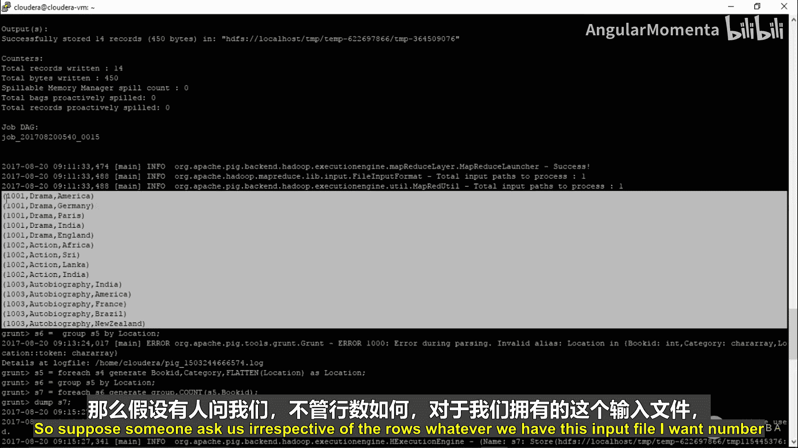

I want number of records which belongs to。Each country。So。

 it means what that that guy is asking for America how many records we have for Germany。

 how many records we have for Paris， how many and so on。

So here to to get this get this data first we need to convert。

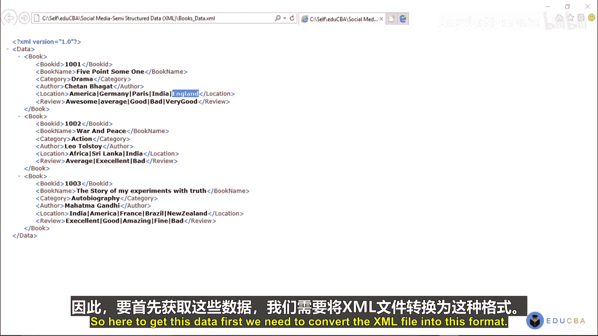

The X file into this format， so we have one record for all the location and then we can group it by the location okay。

Now the data these data get converted into the groups。Okay。

And then we we can generate the count so count we can we generate the group and the count count of what we can take any column。

Because it will it will give give us the count on the basis of group so I took it book id and y5 because in S 6 we have only we have done we have only grouped by the。

Data on the pages of location and we have all the data in the s F so I I did S 5 dot book ID so it will generate the group that is location in account of book ID。

On the basis of location。 So here we can see for America， we have two records for India1。都。3， India。

4。We have four records。So， here we can see the output。For India3， okay we have three records。

 I did mistake。南开说。Ss one， Paris is one， Africa is one， Brazil one， France1， America，2。

New Zealand one， Germany one， okay？So。That is how we can process this data further because it was very difficult for us if we have all the locations in a single row a comma or pipe separated and someone ask us give us the count irrespective of the records we have in the X file we won count of all the records in the X file on the bit of location so first we need to process that X file okay and we need to convert that file into the text format。

Because that is very readable， okay， and then。They can。Once we have processed the X file。

We got did Godend it simple text format， then we can separate the。

The ch which is there in a single row so in this example we have location so we separated a single do those location as a different。

Tuples which is nothing but a separate row and then we did take group by on the pages of location and we count the record so now same thing we can do for。

For leave you。So let us do that。How we can do。We can load the X file。They can。Use the Xl loader。X。

 okay， we can use the the level expression。To process the textal file。Now。

 necessary3 we will make change。Instead of location， this time。I want。Review。Okay。And S4。

I want to re you review this time， so we will。ItRe the location。By the review。

And we will use same function tokenize and flatten。Because process is same。

Location is pipe separated we have and we have review again。

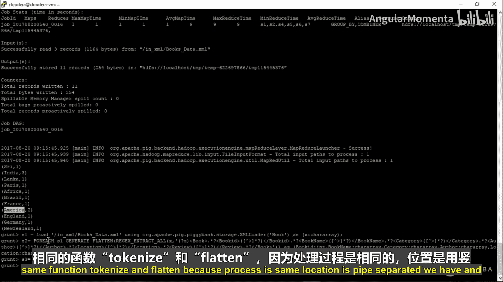

Ppe separated， we can see here。

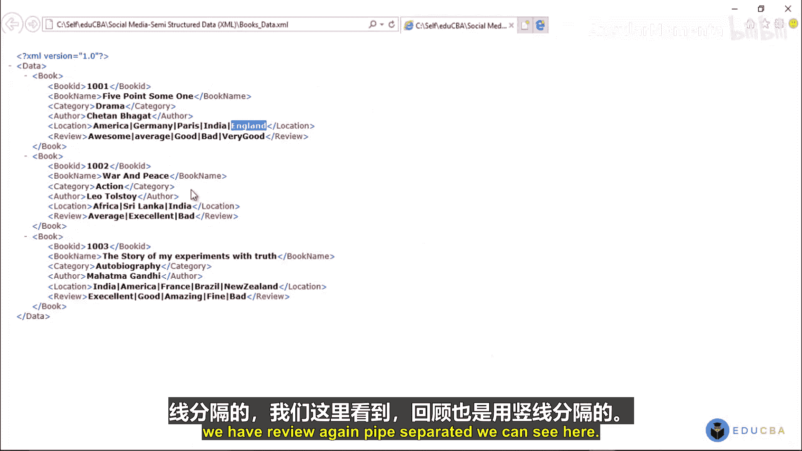

O。9， next 5。We will use the review。 We are flattening the record。The word will get flat。Review。Okay。

 let us see the result so far。So now this time we have book ID category and the review in the。

Separate line。Yes， so now as you can see we have111 drama awesome1 double1 drama average。

111 drama good bad and very good so here we can verify the legend。

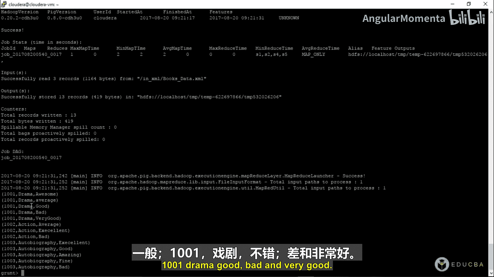

好心。Average， good， bad and very good。

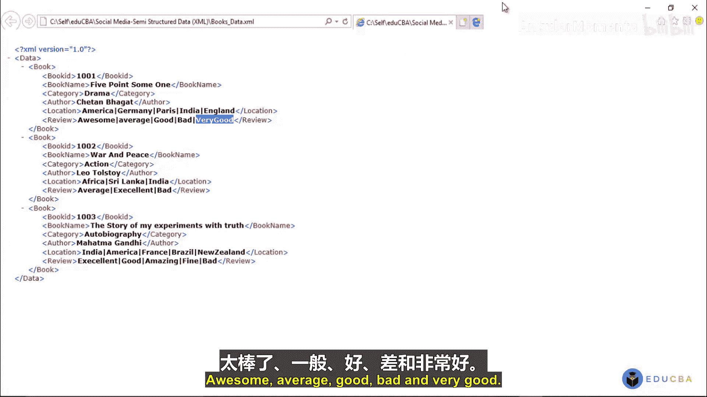

Okay， so we have same record for。Bookuckadi 2 and same for Bukadi 3。Okay。So now。

We got we get the data in a simple format now if someone asks us to analyze this data on the basis of the view although we have already created a UDf and analyze this data but this is again a second。

Another way， if we have if we don't want to write UDF， I mean。

 we don't want output like policy reviews， negative review reviews or average the counter which we have return in the UDF if you want to review if you want to someone ask us to give give us the data like how many awesome comments we have how many average comments we have and how many good bad comments we have in this Xl So that is how we can do that。

So now we are get in return in simple format。Now in X6 as we can write another nation。O。

So instead of location， you can use review。And in S7。We can generate the count。

So here I don't need to make any change because we are generating group that is review。

And we are taking count of Bokadi which exists in the s fibrillation so that gos that is good。

 we don't need to make any change。Now， here。We can see the output of this。

So now we can see up three bedroom bad we have three times fine we have one time good。

 we have two times amazing one time average one time also one time average。

Why every is okay so why we we have average two times because。Here we have caps， in caps。

 Here we have in average。So did it took it as a separate entity。Okay。

 so make sure that pig is case sensitive in。In this case。

 if we are doing group by and we have same column， same column value。But。

The characters are in upper or lowercase I mean both values are different in terms of uppercase a lowercase a characteror form then it will take in a separate entity okay so here we have every two times。

Now， very good and excellent so now if we can give this out to that guy。So it is pretty simple。

 but but we should know how we can use。How we can process the Xl file。

How we can use tokenize function， what is thus。How we going use flat function and what it does okay。

 and then we can。Take the advantage of all these things。So suppose if we want to analyze this data。

If you want to perform both the operationss in the single line。So， let us do that。

I have loaded the data。I use the regular expression。Now in S3。

In sheet of category we can use we can take category also。

 but here I am taking only bocadi location and review。

 so I am taking both the column which we have as a。A， you know。In all the tus， okay。

 we have multiples data in the single row， so I am taking all the both the data， both the column。

Mo S4。Okay。So we can use location also。

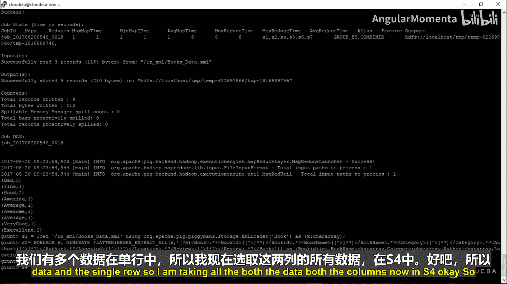

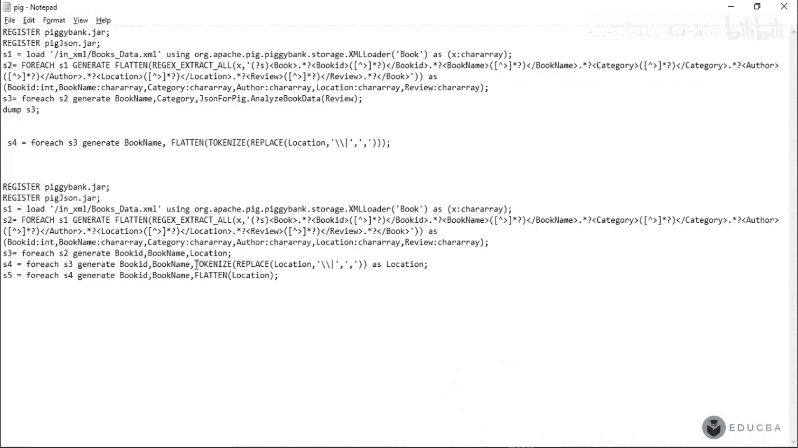

We have bookote。We can remove category here。Okay。And。We can add location。Okay。

 so now we have Bokadi review and location。Okay。那 let' see do。Okay， that is exactly flat。

Fren also let us write fn。And then， we will see。Output so。First， remove the category。

Because we have only book ID。And then。Flaten。Location。Let us see the output of this。S 5。What we get。

Okay， so its a kind of cross join， okay？Because we are flattening the record on the basis of both the column location and review so now it is a kind of cross join ro means it will be like a carteian product。

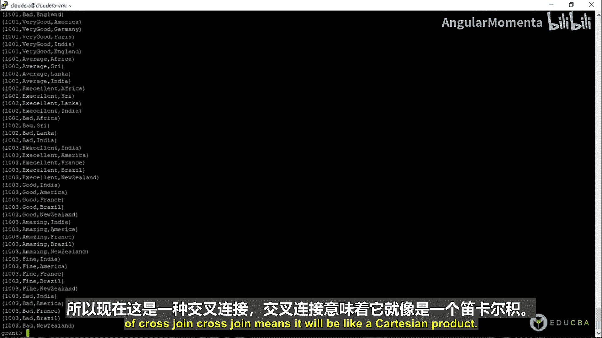

So us America will be with average。 America will be with awesome。 America will be with good。

America will be with bad America will be with very good and so on。Okay。

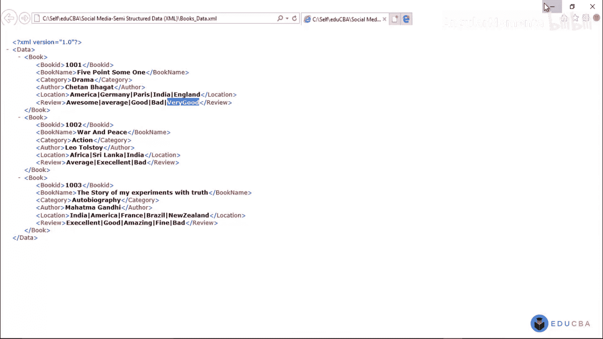

So we want to get the count on the basis of。😔，Suppose review。

 so this time we will get a different count。Re it by review， that is okay。And it's in S7。

Ju edit the count， the group column and the count that is okay。And now dump the record。

So here the count will be。Little more。Because we have more data。So。

 here you can see bad is 14 times fine is5 times wide is sa because you is a carteian products。So。

 it the review and location associated with each and every locations and review okay because you flatten the record on both the column simultaneously in parallel。

So I wanted to show this data how big perform the Kardian product if we are working。Two same column。

 which is。Of the same type like it it is in the form of array。Right。

 because the we have multiple values in a single。Tuple the weather pipe separated。什 now。

We have already seen how you can store the data， but I am again showing you。Location is this okay。

So what I am doing here。I am st this data。Store what S 7。Relation to S 7 output of S 7 and 2。

S GFs on which location？On。Same location， I'm creating director call。Out。周里。Okay。

 store as 7 into the directory。So we will restore this data into LdFs。

So we can use the data further next time when we log in。But if we will not save it。

 then we need to process it again。Okay， to get the save output here we can see if we got success message。

So now we can go to SDFs。Hoop， F S， iPhone L。We have an externalml folder here in underscore Xml。

And here we have electrical out underscore today， which we have created just now。And inside it。

 we have。Part hyphenr yr because reducer executed in this case。Because we perform the aggregation。

 we。Go the count out to the aggregate function。So， let us see the output so here we got the same output 145。

10 amazing 5 times and so on。So we can take this output outside the SDF also。Okay。

 by using the hyphen get command。Okay， so now we understood。How we can。Use the tokenize function。

 How we can use the filtered flated function and how we can separate。

The atoms which are there in a single tuple in the form of separate tuples。

 so it is easy for us to analyze the data。Only base of those columns。

So we in the pig we processed the data， we as file。When the last sheet。

 we have seen how we can add a UDf， how we can use it。And here we have seen how we can use。

The tokenize in function and how we can。But from this operation。

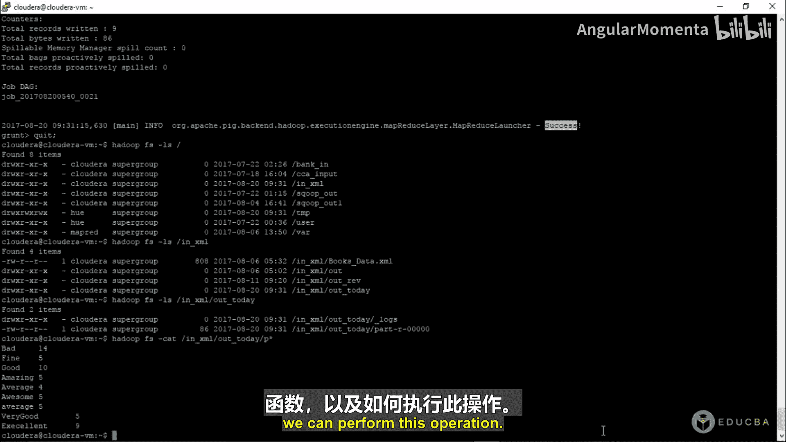