# 【EDUCBA】使用Hive、Pig和MapReduce进行大数据分析-｜-Big-Data-Analytics-with-Hive,-Pig---MapRed-p11-04_03_01_利用Hive理解复杂数据集--BV1yCFozJEuE_p11-

Hello friends so so far we we process this file in mappreduce we analyze this data set you know on the basis of location reviews command okay in mappreduce we process the same data in pigg and we analyze it but now we will use hi to analyze this data so basically as we know hi is basically a data analytics tool so here in this hive we are not going to process this Xl file rather we will use the output which is generated by pig and that output output will take it as an input for hi and we will process that output and we will analyze this data so if we can recall。

This was the output which is generated by pig okay， so here we have Bokai comma， the book name。

And if you can recall we generated only three column the Q book name and location so and so we can generate anything which you want to review suppose for example if you want to review if you want to analyze review then we can generate a review comment here and we can analyze this data so for now we have location so in hive we will analyze location data okay but here there is a little trick you can see we all can see we have a location multiple location in a single row okay so that we cannot consider as a single atom basically in hive row is called a tuple and the column is called a atom okay so in hive if we want to you know if we want to analyze this data in a well manner so output should be like this one。

Book name。America， again， book I D。Book name。Germanyery。

 so basically what I am doing just segregating those location in a separate tupper。

Though book ID and book name will be same for all the rows but if we have the data in this format then we can analyze it in a better way in hive so how we can do that how we can generate this data in this format so if you can recall we did the same thing in P right and then after that we did the group by so we generated we converted that data in a simple format and then we perform some operation on that so in the same way we need to do something in hive so we can get data in a simple and read format so then we can process the data and we can perform any operation on that data。

So， yes how we will do that in high so here is that trick so first thing which is coming in our mind。

😊，This we cannot consider as a string though it is a string column but we should not consider it instead we can consider it as a string array okay so if one thing what we can do if we can consider this data as a string array so what happened in this zeroth element of that array America can store in the first element of the array Germany can store and so on in the second element Paris third India and fourth England right so here we need to treat this column value as a。

Aray of a string So what is array in hive so basically before before processing this data in hive we need to understand the complex data type so here in hive we have three type of complex data type one is array so array is basically a multiple words you know in the form of single column value okay so that we can consider as an array okay and we can apply a complex array type in that column and we can segregate all the values which is there in that column in a separate tu that is array array data type in hive。

The second we have map map is basically take the value as a key and actually map basically work in a key and value pair okay so to get suppose we have a column called a and the key we have key a and the value of the key a is 50 so we can get the value of 50 by with the help of their corresponding key so basically here whatever I want to convey we can get the value of 50 we can easily fetch that value by using that key because here key is a and the value of a is 50 so map type is basically work in a key and value pair so with the help of key we can get the value the next and third complex type which is the last one we have3 complex type in hi array map andstruct sostructstruct is nothing but a structure so in thatstruct data type。

You can have any structure we can define and and accordingly the structure which is defined in the structure type when need to get the data so that I will tell you you can see one by one okay so before to work on this scenario further first we need to understand。

What is complex data and how we can work on that so here I am assuming that we all have a basic idea about hive if we dont have so let me brief you brief you about it hive is a data analytics tool which is initially developed by Facebook and now it is a big project in Apache so hive is basically work on simple data。

like flat file text type okay whereas mappedduce andp we can process structure same structure or unstructured data but in hive we hive can basically process same structure data also but it is recommended to use a structure data because it is a data analytics text tool okay so hive is kind of hive basically if we can rehab seen and mapduce we can write a Java code of Python or scala and P pig has its own language that is pig Latinin okay so here in the same way in hive hive is nothing having a language a sl kind of language that we call hiveql so hive query language so hive basically Facebook developer by keeping in the mind of their developer which basically belongs to the database background so is a person who does not know about coding who is。

Not familiar with the language like Java Scala Python so they can basically go to hive and they can analyze the analyze the data set because any tool big mappeduce hive anything they internally use mapuce job Okay so this is basically a hive okay so before move on the complex type。

I can show you。What。Is it difference。In。What is the comparison we can see comparison between meuce pig and hive。

 so we will have a basic understanding where we can use mepedduce。

 where we can use pig and where we can go with hive。Okay， so here I basically。

I have returned seven differences。So， the first one is low level abstraction what does it mean because if in Mepeddus we write Java Scala or Python code so here we write each and every line suppose data is coming in a text format so we converted a string and then we split the data on the bit of demeter okay so all this thing so here we are not hiding anything so that that means it is a low level abstraction okay。

Now， in big。Instead of writing the bunch of code we are just writing a few statements in the form of relations we have already seen and we have here we have we are hiding you know the complex logic which is running behind the scene so internally it uses the meist jobs okay so that is the higher level of section because we are hidden we are hiding all the complex logic all the complex classes like Maper reducer and driver because we are just writing a few statements and it is launching meist job for us。

Same thing in hive in hive， we don not need to write a Java Scalar Python code。

 we can write a simple kind of language and internally it will execute a methodist program for us。

Okay。First is low level abstractstruction in reproducepeduce。

 high level in pig and high level in height。Second thing is data processing language mapduce we have already seen in mapduce we can process structure same structure and unstructured data so there is basically a data processing language so structure data we have already workedgged okay so we can we have in my last last assignment okay we processed the flat file or maybe you must have seen in a word account pro program that is the first program which we teach to this event when when they start with the mepedduce so here we process this text file okay same structure we are already already processed external file there is semi structure an unstructure means like images pdf all these things so we can do that also。

P is a data flow language so y data flow because here we define the flow of data the control is not with us we can just define the flow what does it mean flow in the form of relations so what we want to do in the first like S1 S1 I have defined load blah blah blah data using storage so what internally it is doing we dont have any control on it we are just deciding the flow in the first in the first statement in the first we want to load the data into a grand shell in the second one we want to filter this data on this clause the third one we want to group this data on this column so on we just define the flow but internally how it is treated by you know p we don't have any control on it now hive hi is a data declarative language here in the we can write multiple statement to perform a single logic right but here in hive。

I have a sQL kind of language here we if we need to perform any operation we is write a single sQL kind of statement so we declare that query right and we define that okay select data from this table where put put where condition on this clause use group on this clause so we declare that query that is a declarative language。

The third and third one is。Mereice is compiled language。

 so if you can recall when we when we are done with the Meist program we compiled it and then we export the J file so it is a compile one whereas。

Pig is a scripting language okay because big Latin pig uses the big Latin language which is a scripting language and hi high is a simple kind of language which we have which we normally use in any RB must like oracle sQL or Db2 or anyone okay。

😊，The fourth one four difference is more lines of codinging is required so in Mepedduce if want if you are writing a program in mepedduce then will to write more lines of code right whereas in pig we just define simulations。

And we can get our work done in hive again less than line of query required okay because here we are heading all the complex logic。

5th difference code performance is high correct okay。

 so me is we the control is on control is with us。So here we define the code okay what logic actually it should execute okay so code performance is high high because code is the performance is the code is written by user that is a developer okay and we know what code we have to execute code performance is high they are in pig and hive I told you we don't have any control we just write the pig letter in script or the SQL kind of query and internal it launches their mappeduce job so what logic internet they are using we don't have any control on it okay the6 one is suitable for complex pieces logic as theyve already discussed it is map produceduce basically use to process is structure and structure and semistructure data so we can process images videos PDFdf all these thing in mappedduce okay whereas in pig pig is easy for adding joins okay。

Hve for aO analysis high data analytics tool so it for data analysis the several in the last differences suitable for processing structure unstructured data that we know images PDF videos come in unstructured data structured data is a F file also here one more thing is same structure data。

But yeah missing。Se me structure。Okay。suititable for processing structure and unstructure again whatever whatever things we can we can do in mapuce the same thing we can be done in big okay and hive is for structure data so that is why we are not processing X file though we can do that but it is not recommended so we are are processing Xl file in hive we are just using the big output okay as input to hive and then we will perform our operation so I hope that now we have a basic understanding about where we should go with。

Any of the bigger tools where we can go with reproduceduce。

 where we should go with pig and where we should go with hive。Okay， so now we can move on。Goodで。

Part okay， so first thing before going to this assignment we are understanding how we can perform the。

Complex gen in hype。Okay。So we will take one take one by one。 So here I have defined the。File。

 so here first we will take array file。So， here。This column a dollar B dollar C we are considering as a array as an array。

Okay， D dollar a we are considering as an array， so in the same way we will consider our location and review as an array okay so first we will process this data。

😊。

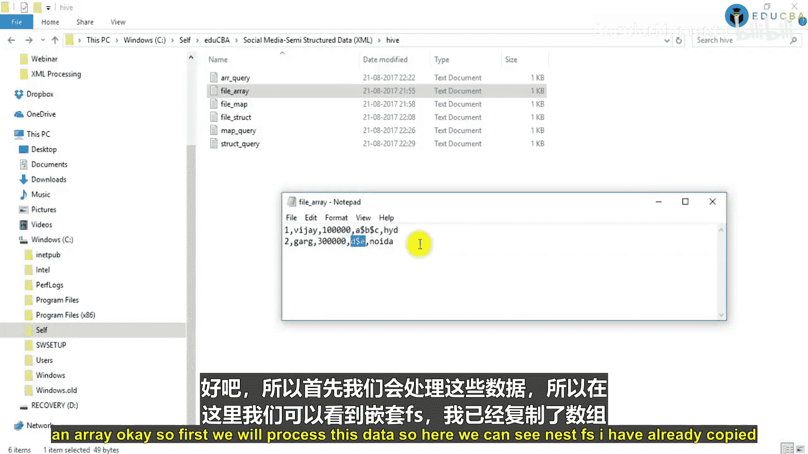

So， here。We can see。there's GFS。I have already copied。Aive file。Okay。So。

Where that file we have in Hadop machine。Let me check。In hive。Okay。So， let me cooperate。File array。

And we are able to copy because I have created one folder call in hi which is empty。算个呗。

This array file into this。It's copied。Let me copy。Map file， also。Okay。Ppried。

So now let me copy thestruct file。😔，Cpet。 So now we have all three file in our。Hello machine。

 you can say。Okay， so now we can go start with the hive and we can see how we can process complex data and hive so in the same way we will。

So in this same way， we will be able to analyze our。Data our input data。

 which is the output generated by pig。 So here I am creating a new database。For this demo。

 create database。Complex。Complex。Data okay， so I am giving a name it is a big name。

CML data will be fine， okay。

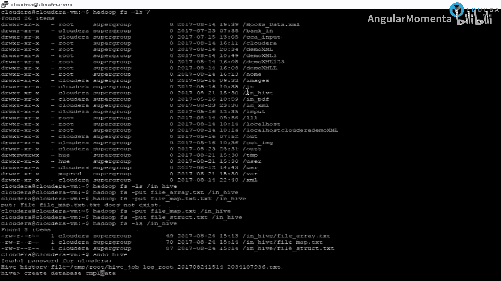

Okay， so database is created and how we can use this use this database。By writing the use command。

Which is very similar to the other R DBm。Now it will use this database。

So now to work on the array type。First， we need to create a table so here I have a createable statement you can see here。

So here how you can create table， create table table array。I is interior type， name existing type。

 cell is begin type here is the name of the。Aray column I have given the name sub type is array and array is a a string type。

Then we have city which is again a string type， so concentrate on this column。O。

 the column name is serve which is a red type and what type of array is string type。😊。

We form element field termd by commma that is same as usual。

But here collection item array is what a is collection item。

 so here we need to add one more line there is collection items term by dollar by dollar。😊。

Because our input file。This is the file array。In the input file， we have。

Dollar the element are separated by dollar diameter， okay。

So we are using collection item terminated by dollars。Okay， so let us execute this command。

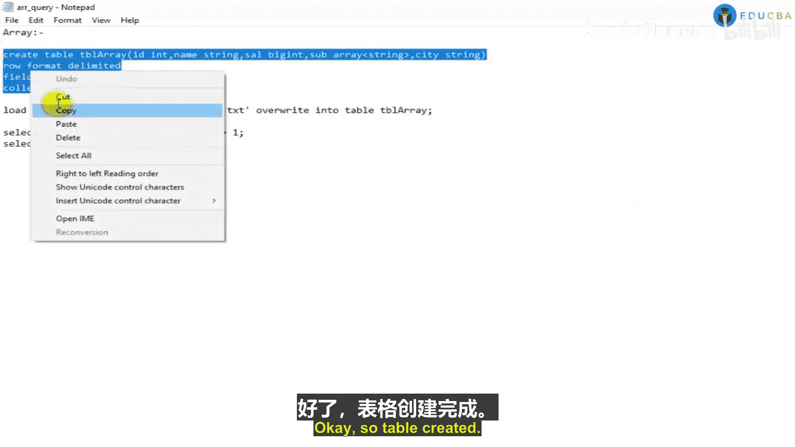

O or table created。Let us check。TBN。好的。Okay， so table is empty now。Okay。So。

 let us load data into this table。

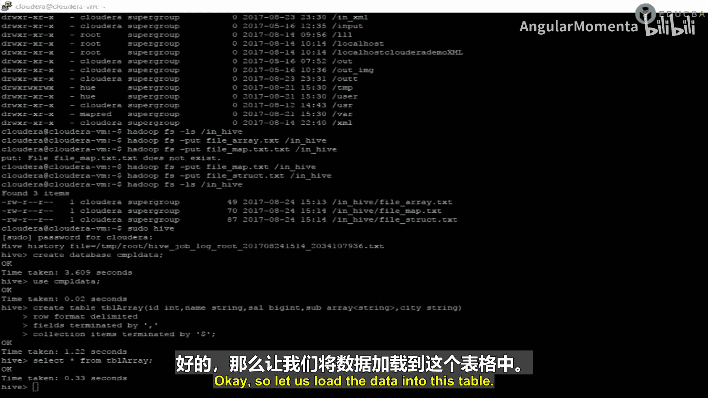

So， this is the path where we have kept our input file and hive directory and file dot txg。

Overright we are overright if we are loading it again and again so we want it to be overwr okay we do not want the duplicate data into table TbL array。

😊。

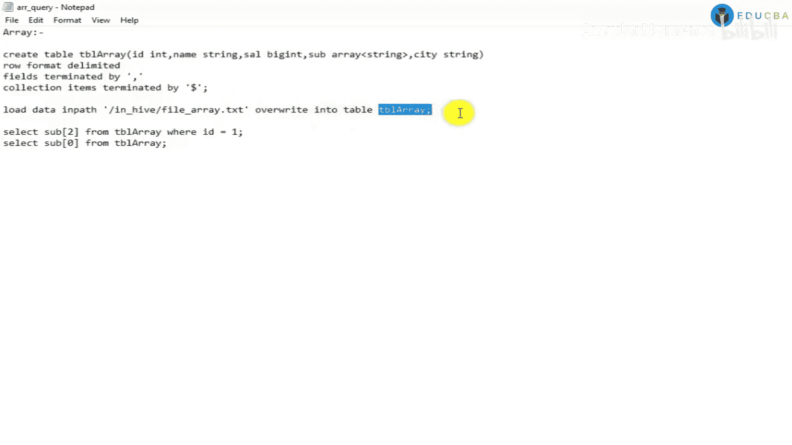

So let us execute it。Okay， so data are loaded， let us check now。So now we can see we have data。

1 Vija salary， okay， and。If we look at the input file here。😔，You can see A dollar B。

 dollar C was the data for that array column。So， here collection item was terminated by dollar。

 so a is a separate。Coectter in that column， B separating。

And C is separate because fields are terminated by comma。

 so is all the fields are terminated by comma。And then， we have city。So now another thing is how we。

Ftch this item。So， as you know they stored the element in the form of index so a will be stored on the0th index B will be stored on the first index and C will be stored on the second index so in the same way D will be stored on the0th index a will be stored on the first index。

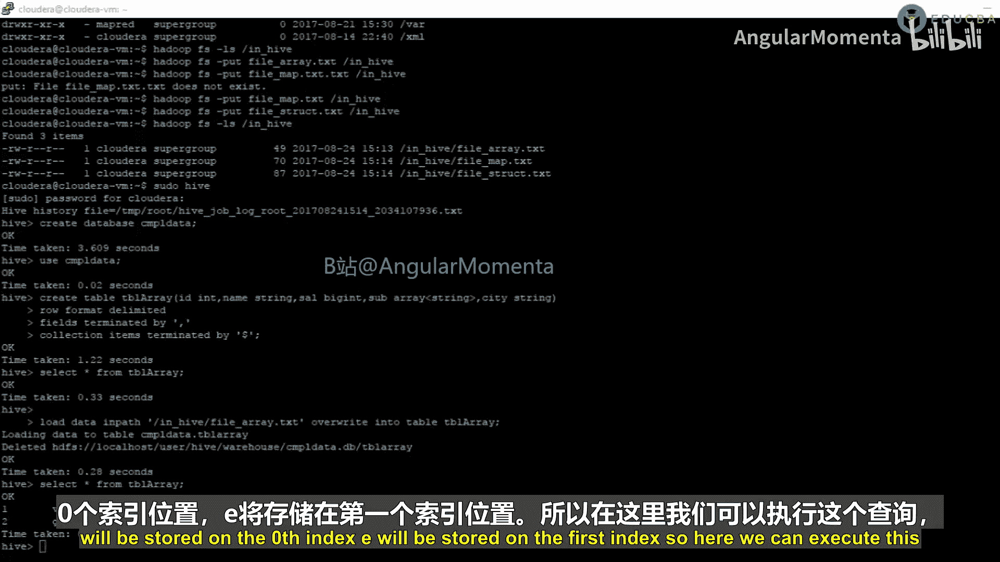

So here we can execute this query。

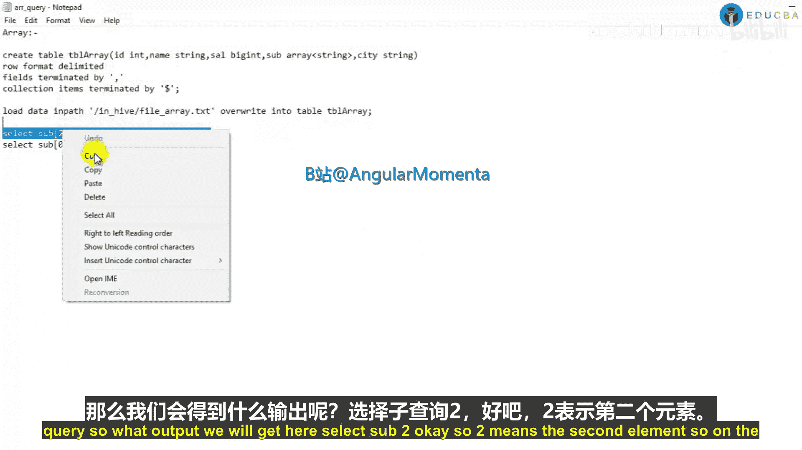

So what output we will get here。Select step 2 okay， so two means the second element。

 so on the zero we are add to one。So， I equal to1 means this row okay and sub to so on 0 through00 the index we have a first we have B C。

 we have one second。So， it will display the C。It so display the display is C。

So now we can see the output is c。Okay， so in the same way， if we execute this query。

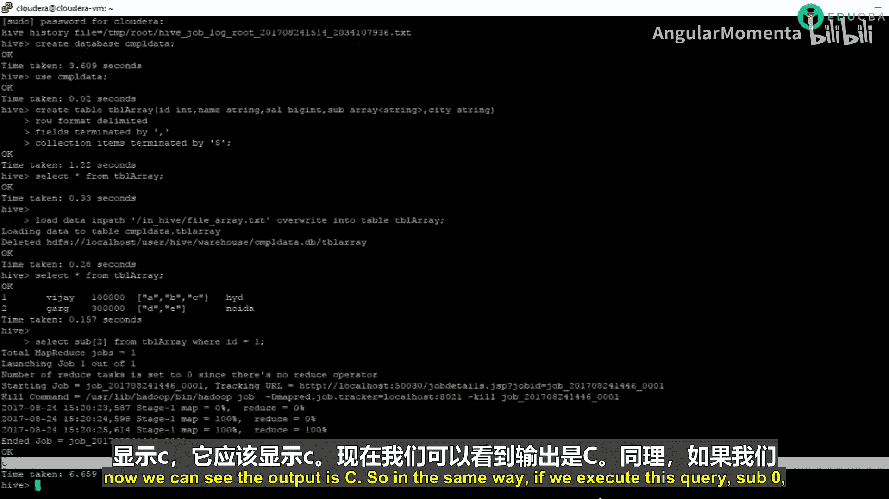

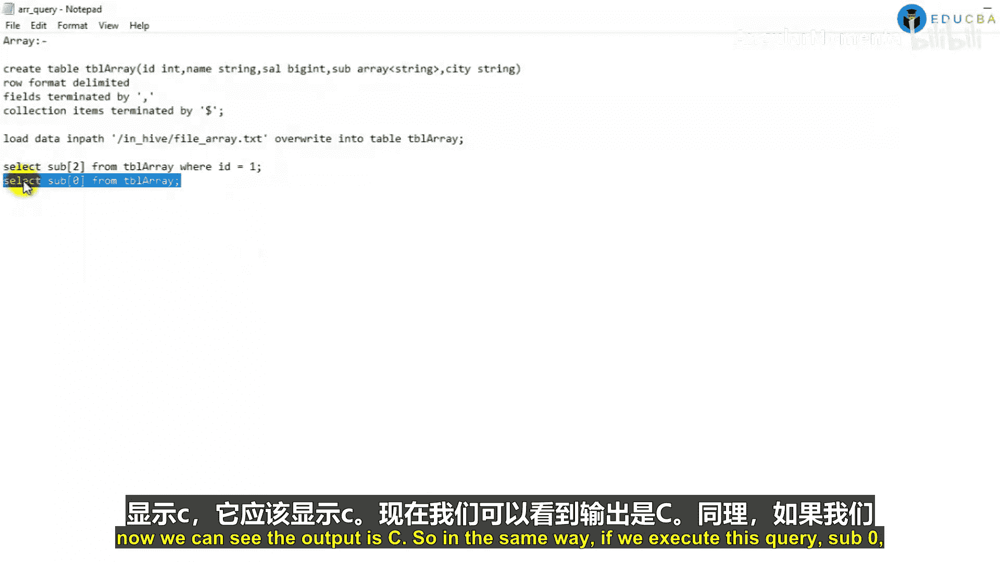

Sub0 is filled this with the A and D。A and D because a is on the zeroth position in the first row and d is again on the0th position in the second row。

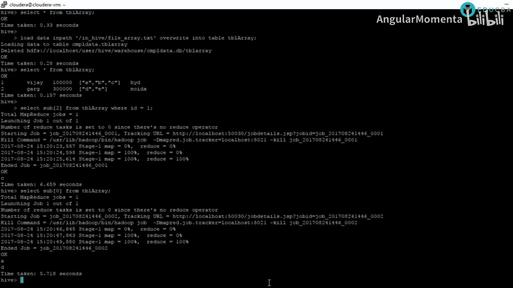

So， I I hope you understood this type okay， so now we can go on the second that is map so we can have a look of the map。

Data。So， this is again the array time this time you can concentrate on this。So。

 as I told you this work in a key value pair， so here Pf is a key。

The value for Pf is 50 for 500 so you can see the key and value are denlimd by hash and key value pair is delim by dollar。

😊，This is a second key value pair this is the first key value pair for the second one a Pf is a key and 200 is a value okay in the second row we have only one element so Pf is a key and 500 is the value。

So， how we create the map table？そ呀。Same create table table TL map。Aray is same string type of array。

Call map here I have given the map column name is call map。The type of map and string and end。

string is a key Pf EPF is a string which is key and integer is a value 55000 all these things are value we need to define in this type what type of key we have and what type of value。

😊，好的。Here。Collection items。So， array array if we use this thing for array and the same thing will be used for map because two key value pair are separated by dollar so one is a collection item another manager again another collection item and both are separated by dollar and map keys are term by hash。

Okay。So， let us create this。

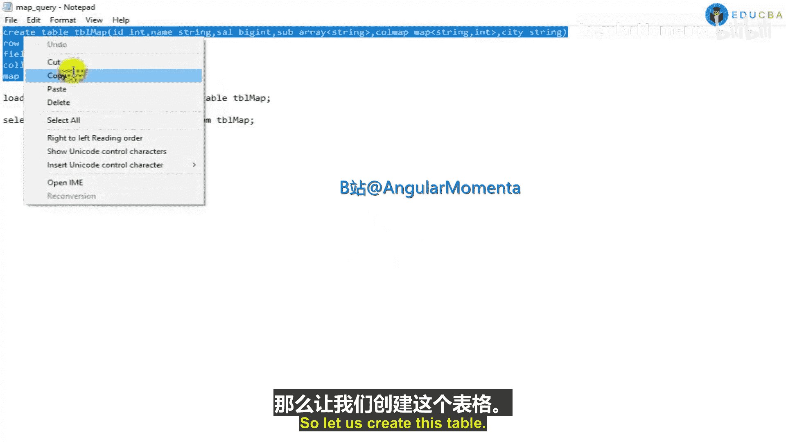

Travel。It's created。So， let us check。DBL。😔，Nap okay， it is empty now we can load the data。

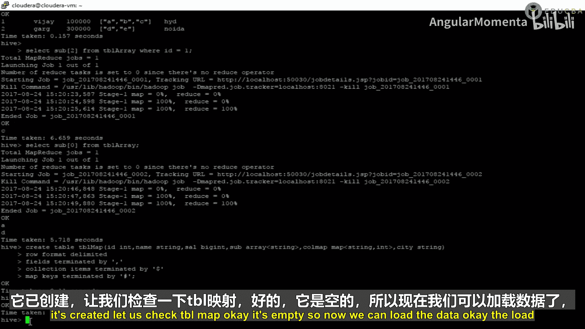

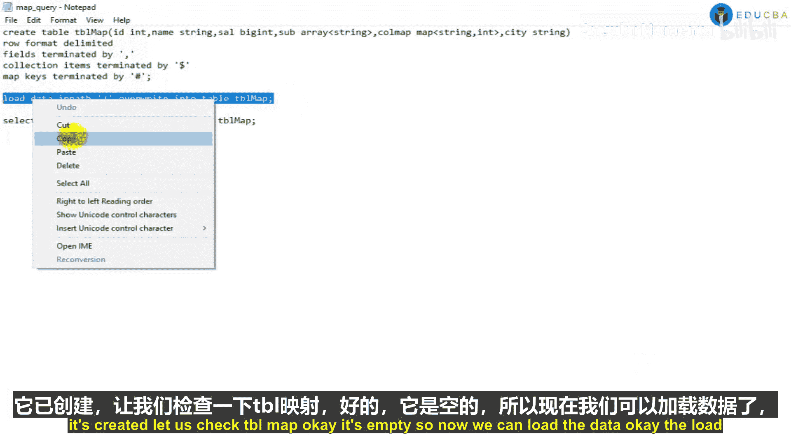

Okay。The load statement is same。Okay， here we need to define the parts。In。

Hve and file underscore map dot Txc because we have kept our input file here。Okay。

 and load data this path over and into this table， okay， so now we are go。

Okay data gets loaded now check yes， we can see。So here we can see a raise is you know de by comma。

And。Here you can see one key value pair is separated both the key value pair are separated by kcomma here。

 okay。So， now how we can exit this element， as I told you。

 we can use the key and we can get its value。

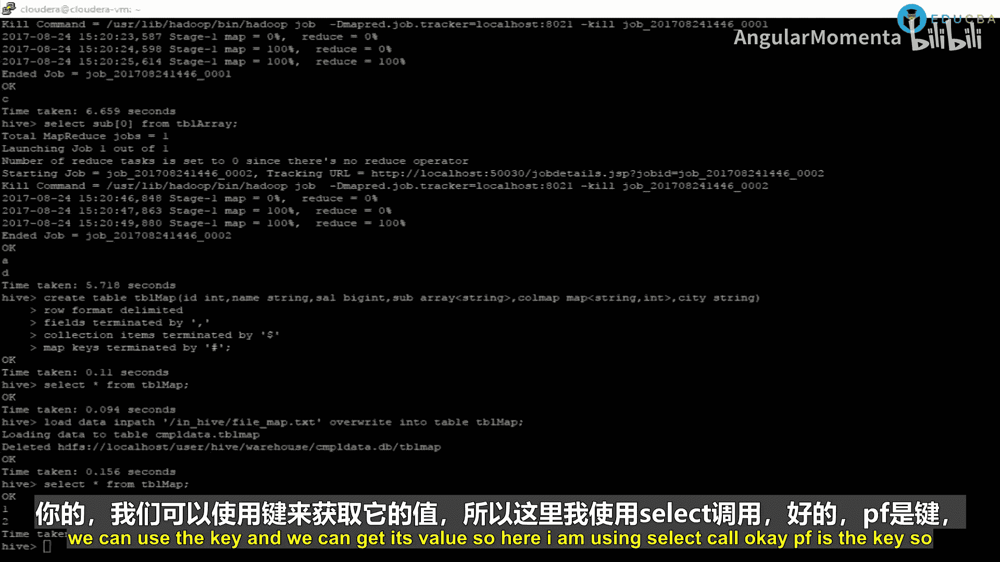

Where I am using Sal call。Okay。Pf is the key， so it will give us the value which is associated with the Pf key and here it will give give us the value which is associated with the APpf key。

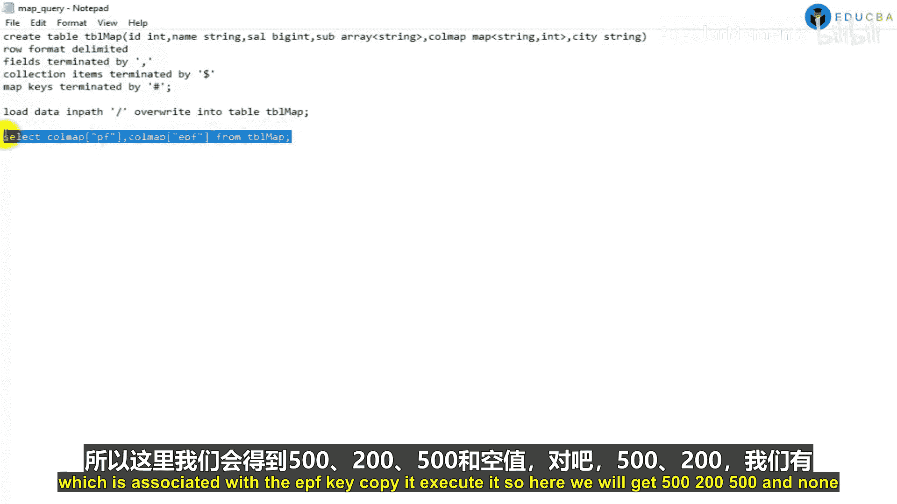

Copporate。Execut it。So we will get 500，200， 500 and none。Right。5，200。We have 500 Epf。

 we have 100 here for Pf we have 500 per we dont have EpF column here E Pf key。So， it will be done。

So， we have processed array and map now one type is remaining that is struck you can look into that also in this session so it struck so first look at district file。

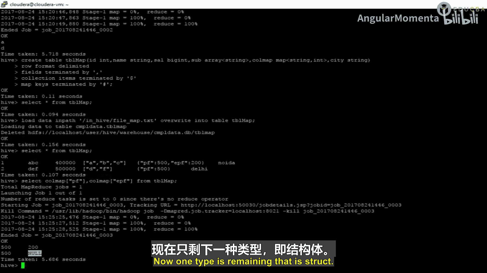

Okay， here array type。We map type and this is a structure。It is a structure。

 so here I am giving city dollar state dollar pin code。

Okay here I am giving Bangore then state then pen code okay so basically I have defined a structure so data will come in this format。

First it will be a city， then it will be a state and then it will be a pin code and all the elements will be delim by solar so this is structure is structure we have defined。

And we will store this data into astruct type。So let us create the table extractstruct query。Here。

 same thing a whole map。 And now I am defining a。Name of this drug column is Iiddia that is address。

which is thestruct type and here we have three things city is state and pain so city will be string。

So， here while defining astruct type， we need to define it type of each and every。Element。

City will be a string the state will again will be in a string and pain will be in begin。

Row format delim fields term by commma collection item term by dollar and map key。

Tinated by hash so this thing we have already seen。Map okay and here。Collection items。 So here again。

 array is storing data in。arrayray you know， in the array data is separated by dollar and again in a structure that is separated by dollar so both the collection items will be terminated by dollar。

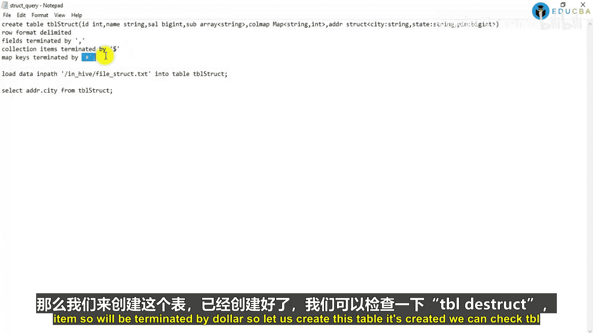

So let us create this table。It is created， we can check。TVl。That's truck。오케。

So table created it is same table。

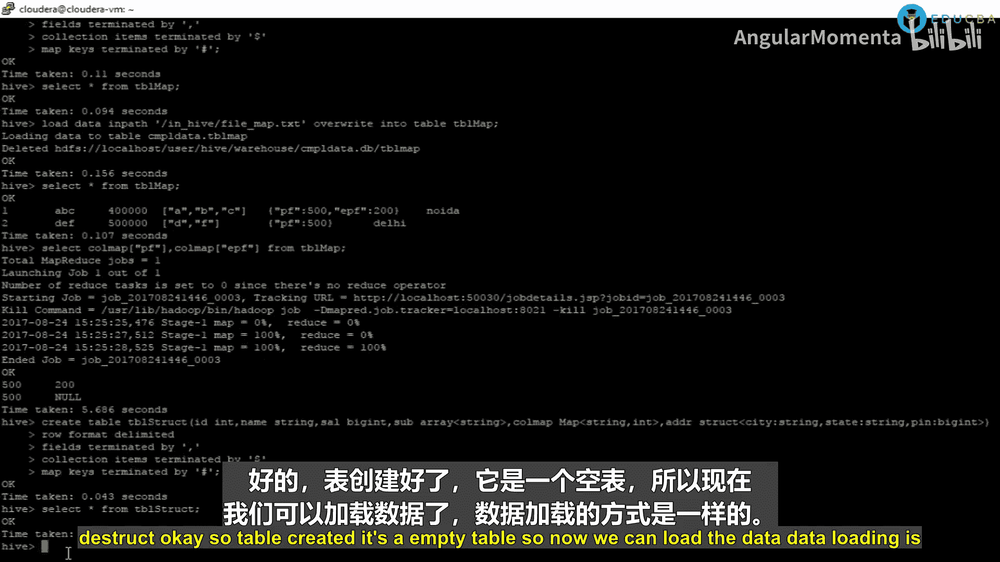

So now we can load the data。Data loading is safe。

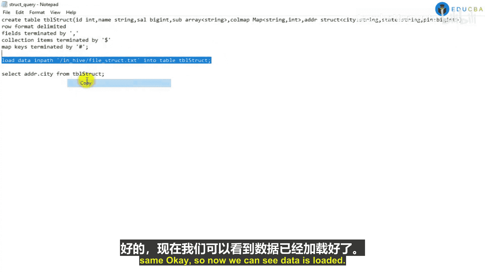

Okay， so now as you can see。It I loaded。我说你。Okay。

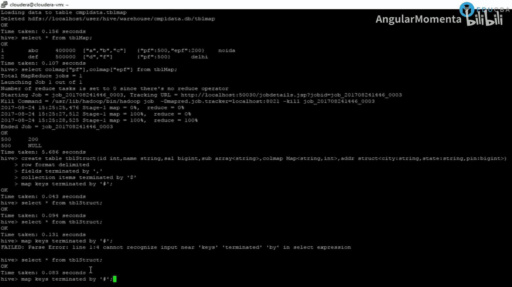

我的ible。

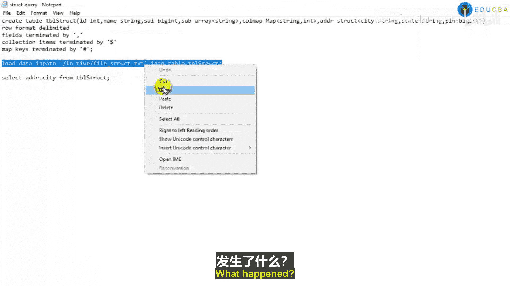

宝贝。😔，Okay。Now here we can see it loaded。And how we can exit this item here。

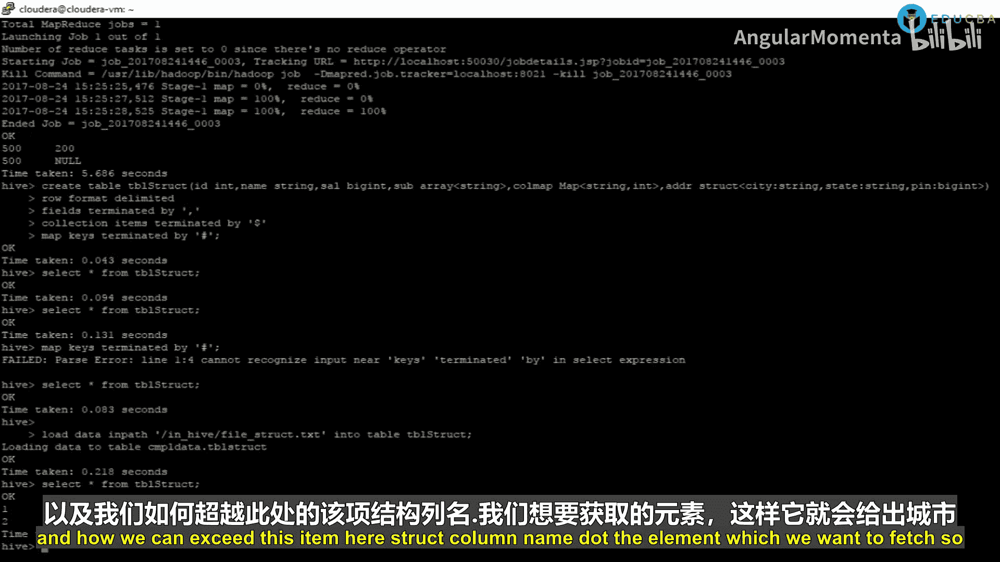

Ststruct column dot the element which you want to。

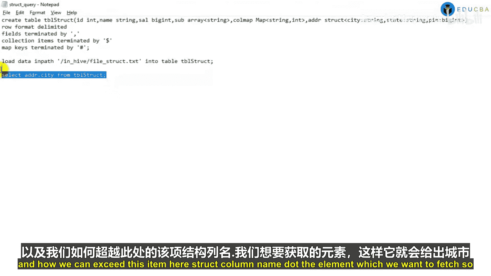

对。So it will give us the city。Heer our Magor， we can fetch the state in the same way。

So here we can see we can we now we face this state so in this video we understood what are the collection types。

Maybe we can say complex data type we have in hive。How to process data。

 how to store data in those types and how we can extract the data。From those types。So。

 this video was very important because in the next video， when we process our actual input file。

 this data。

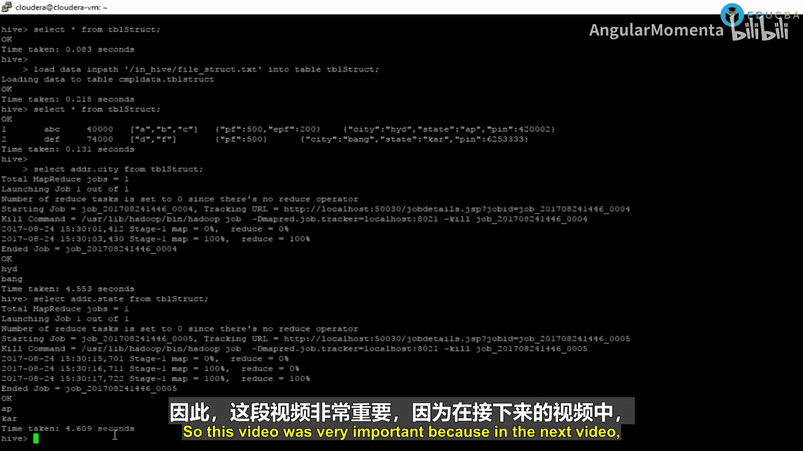

So， we are we are going to use the。A types。Because we need to get this data into a simple simple format so then we can analyze it。

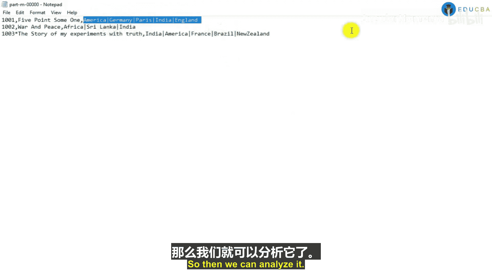

Okay。So in the next video， we will process the actual data now。

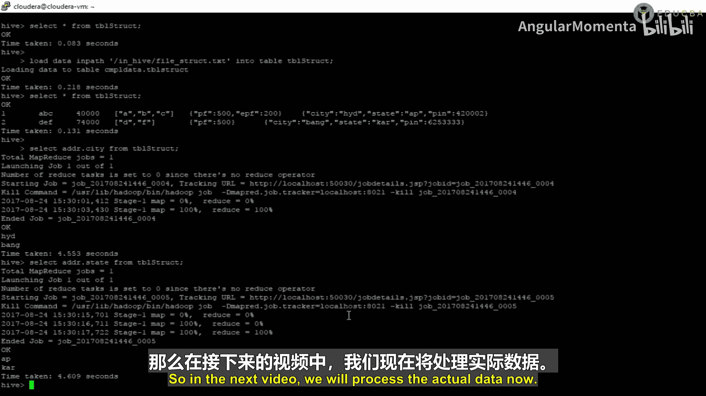

Hello friends so in the last session we understood complex direct type in hive we understood how to handle array type how to handle map how to handle thestruct types in hive so basically we have only three complex type in hive so now we have seen how we can handle those types okay we came across this type of types in the hive scenarios so here now we want to process the output which we have generated from page into the hive table and we know that we have a last columnies location right which is a kind of array because we have multiple values in a single tu okay so here we can see the output and then we we will process this thing in hive。

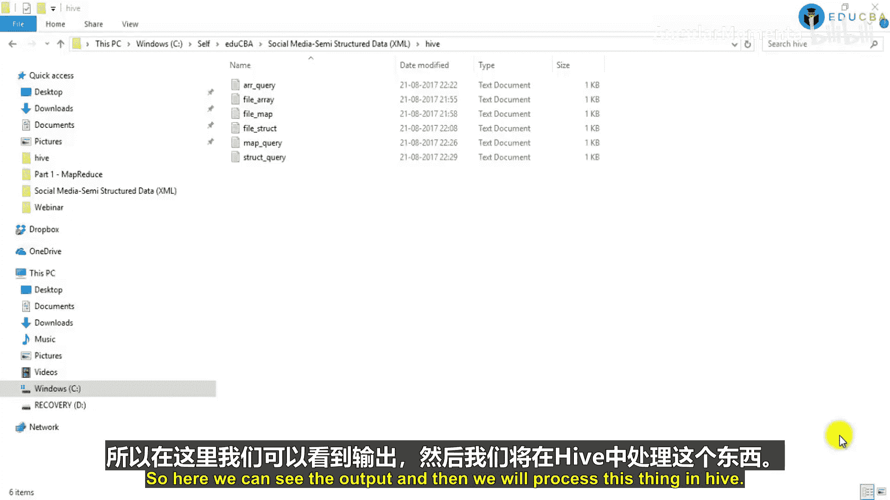

So here this file， part hyphen m， hyphen0，0，0，0，0 is output which we generated from page。

We can see that output。Okay， so here we can see we have three rows。Bookkadi book name。

And the location location is pipe separated。So， we have multiple location in a single row。

 so that is basically a at and if we have data in a simple format。😊。

Like all the all the location are in a separate row then we can analyze this data very easily okay and we can perform the aggregation and all these things but it is in a array time so first we need to convert into this simple type and then we can process this data so here to process this first to check we have。

File available in。Howoop or not there was currently it exist on our local system you can see executed command cat and the file name so it means it is on the Uni box so first we need to copy it to our SDGfs and then we can process it so here let us check what folder we have。

We have one folder call in underscore hive， so let me check。

We have something in this folder or it is empty， okay。

 it is empty so first we need to copy this file。So to copy the file we can use hyphen put or copy from local command so both are same but there is a difference in these two command hyphen put command okay let me tell you we we have。

We are bucking on it so let me brief you about it hyphen put and copy from local determine difference in this two command the difference is hyphen put we can copy the data from local to Sgfs or Sgfs to SGfs by using hyphen port but copy from local command is only used to copy data from local machine to Sdfs local means Uniix box to Sgfs hyphen port we can use from local to Sgfs or Sgfs to Sgfs okay so let me copy this file。

Bart。Okay。When in which folder and height。So now we can check。Yes， we have this file。

 we can see the data also。Yes， so that is same。 Okay。

 so now we have cop it now ready need to create the。Hve table okay。

 so for that first we need to execute the hive shell so to execute it when to write pseudo hive。

So now we have come up we have on the hive shell， we are on the hi shell now。

 so we can create a table。

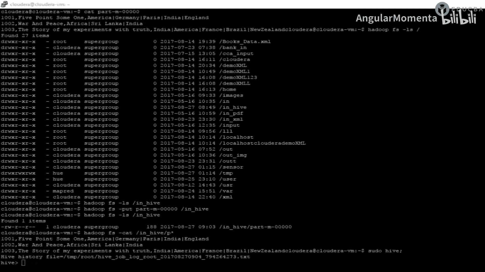

So here this is like creative statement， okay。

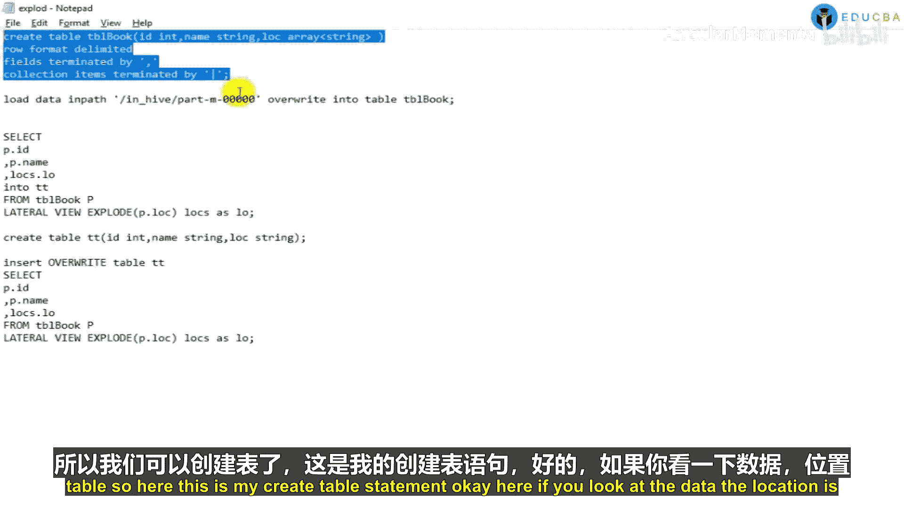

Here。If you look at the data。The location is。Pippe separated。America pipe， Germany， pipe， Paris。

 pipe， India pipe England， so all the locations in all the rows are pipe separated okay so here while creating table we need to put collection items terminated by pipe。

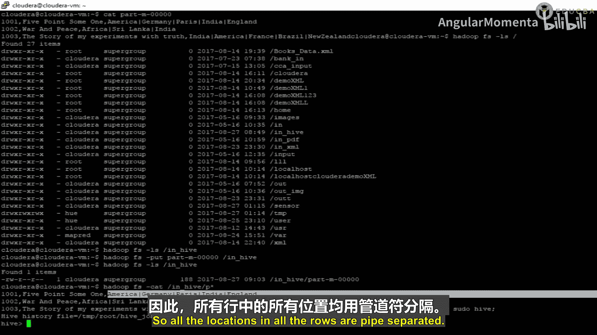

So， in the last session we processed the array type we understood map and in so if you can recall on that time whatever the delimiter was there in our input file we used that delimiter in the collection items termd by clause so here we have data separated by pi so we need to use pipe and rest will be same。

Okay， the row format elevated because fire is in the text format。And fields fragmented by comma。

 so when I will store this file into the SGFs in the high。

 the fields in that file will be separated by comma。

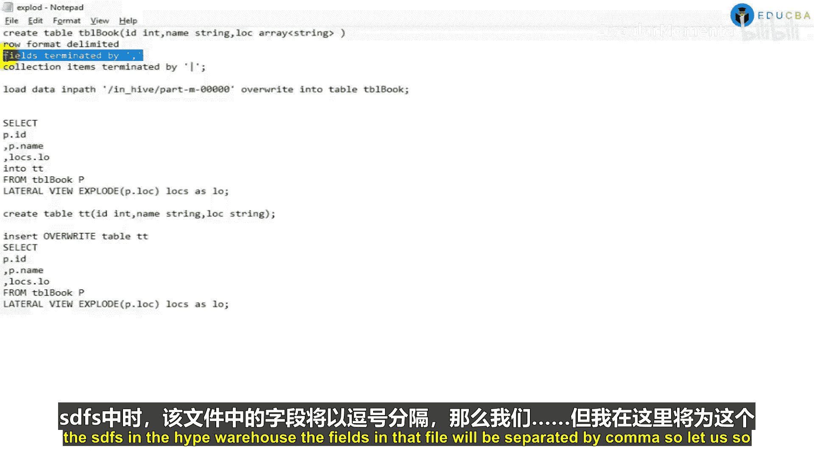

So let us so but I here I will get a。New database。For this demo your database， what we call it。Look。

analysis。오케이？So database is created。So we are going to use this database， so I will type use。

Book analysis。There are very simple commands in hi so anyone who belongs to database background or anyone who have a experience in any of the ADBms so it will be easy for them to learn hive so clear database is simple command clear database database name and use miss if we talk about SQL server。

And we want to use a particular particular database so we write use the database name so the same thing here we need to write use and the database so here our database name is book analysis so now whatever object we will create or we will look it will get or it will create those object object in this database only。

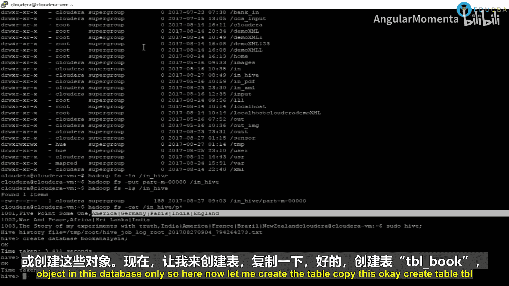

So he。Now， let me create the table。Hopy this。

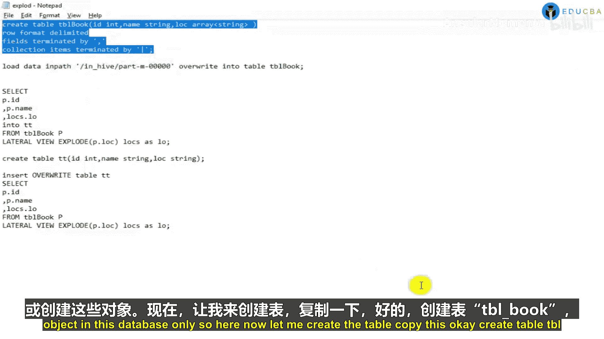

Okay， create table tL book the name of the table will be tL book column is ID because we have book ID the book name we have so ID will be interior type name will be a string location I am taking array array。

What type of array testinging type okay and there things we have already discussed row format delim fields term by comma and collection items term by pipe because locations are pipe separated。

😊，So table is created， let me check the table。Select the star from。Bvien。Book。

Here table is created but we don not have any error in this table so that is why it is empty for now so you so you know that we have copied this file our input file。

In this location， okay so our input file is the output of the pig is a script because we process x data into pick okay a high for data analytics so we are analyzing this data。

Okay， so the output we generated from p is input for our hive。

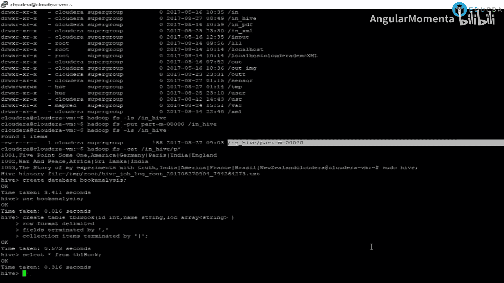

So now let me know the data。

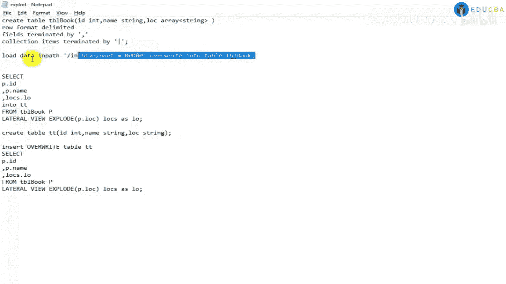

Copy it。And paste it， okay it's learning。So， here we can see load data in path the location where we kept our input file overr into table T book。

So， if we don not want to overwride the data and next time and we will execute this command and we have data label on our input location so so data will get appended so suppose first time if we add5 rows in a table so next time it will be1 but if we are using overwride so it will overwride our existing data okay so low data in path from the location overwride into the table and table name is tl book so it is a simple command。

Okay， so let us check。Yes， we can see data loaded so now here you can see the difference。

It comes in the form of array okay because it is a array type column so America is double coded that is a string which denotes it is a string comma next location because fill termd by comma okay Paris India England the next row we can see Africa Sri Lanka India and so on okay so now it comes into the array format and that is why we have a square bracket in this column so it denote that it is a single column but we have multiple data in it and that is why it is a array type so square square bracket denotes it is a array type okay。

Now， you want to segregate this data like。We want to segregate。

 we want all the locations in a separate row， so we have one。2，3，4。

5 locations in the first row so we should have five double means a five separate row for this data so every in every row we will have single location only though our book ID and book name will be duplicated because all the locations are associated only with one book ID and one one book name so that is okay but our location will be segregated so we will be able to analyze this data easily。

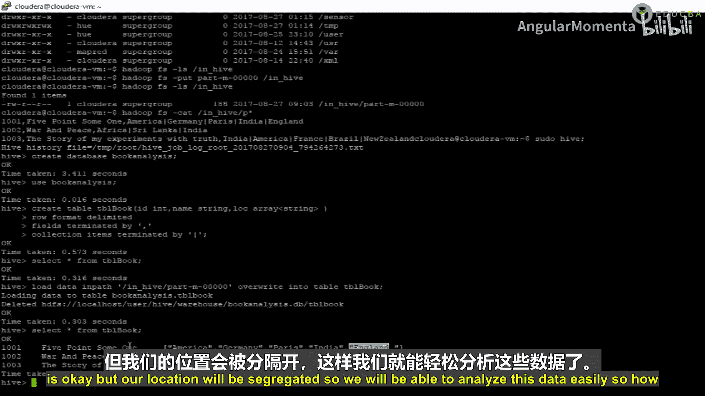

So how to segregate it。So， here we have function provided in the hive called explode so it basically explodes the array type of data in a single single row single single means in a separate separate row so be a five location so it will create the five separate row for that particular data and each location and each row it will have only one location。

So， basically it will explode so when the name is explode。

 that is why the name of this functionality is explode。So。

 it is basically a view that is why it it a syntax lateral view so how we will call it select P aliaas which have which we have given to this table name so period ID。

We don't name。Locations。Location here， I have given locks， while locks。Because。Into okay， whiles。

 because here。After exploding this data I am getting this data as a log okay and here while exploding we will put the actual column name that is LOC here you can see while creating table we defined a column name is LOC soon they explode。

Vi we need to pass this as a same name which we have given while creating table and it is the areaslia of this explode。

Okay。So locks dot L。Okay， so let us check the output。

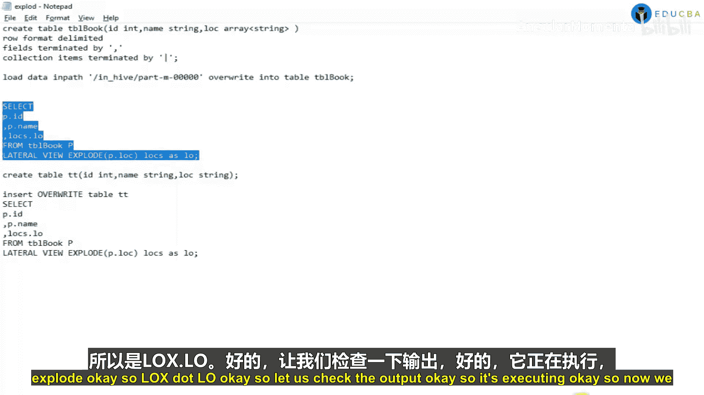

Okay， so its executing。Okay， so now we can see we have segregated all the locations now we have America。

 Germany， Paris， India， England。In a separate row for this particular。B。

 though we have Bokai same for all the five rows， book name is same for all the five rows。

 but now location is separated so now it is easy for us。

To read this data and it is easy for us to perform grouping or anything on this data as per the client client requirement because with the complex type we can。

Use the data easily so first we need to convert that complex type into the simple type and then we can process this data we can en this data。

Okay， so， but now it is a select part so first we need to insert this data into one table okay。

 so for that。

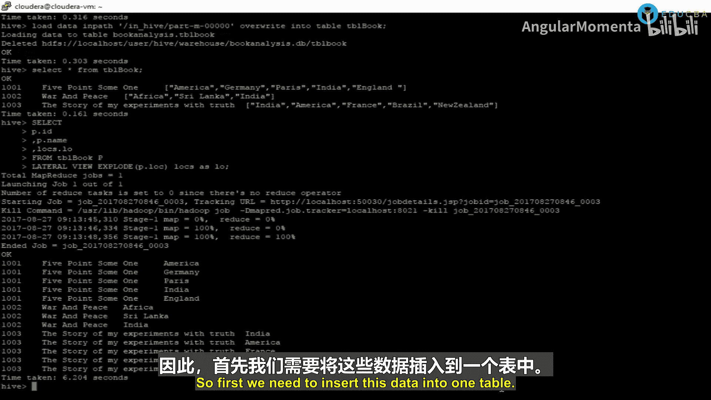

I am creating one table call。PBL。Intermediate。O。So integrity table and here while getting table I am not giving any。

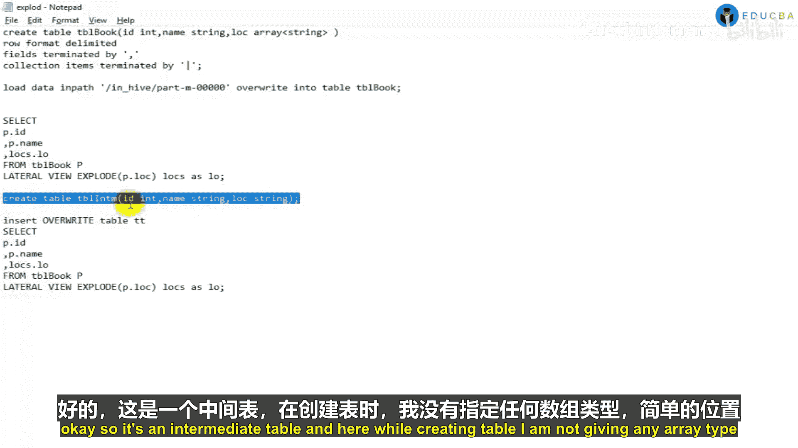

A red type， simple location is string type。So let me check table is created or not。Let start phone。

TBL。I am。DM。

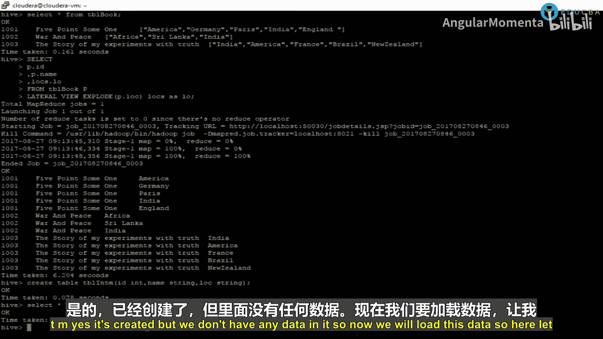

Yes， it' is created。But we dont have any data in it， so now we will load this data。

So here let me change the table name。It was3 T。Okay。

 so a statement is insert overwride table table name。And this same left statement。

Which we have used above to segregate the segregate all the locations。

 Okay so here this query will return。The separate separate row for all these locations and that data we are inserting into this table。

Okay。The copy。

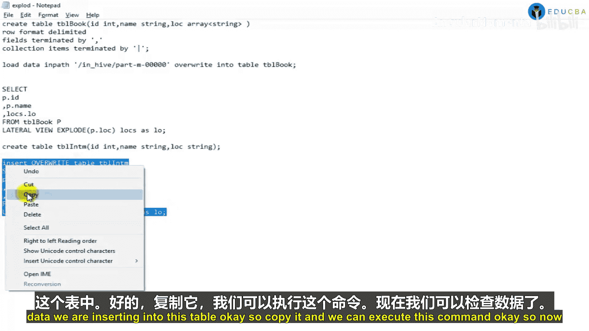

And we can execute this command。Okay。So now we can check the data。So。

 now we can see the data got inserted into our word table called TbN intermediate okay so now we can easily analyze this data as per our requirement so here。

Let me get the count on the basis of locations like for America we have two records respectivespective of book I and book name just only location so what I will do。

Select L O C。Count。The start。Rong。TBL。I am。PM from the stable。Goodby。Goodby。Location。Okay。

 so select LOC count star from table name global location。

 so it will provide us the count location voice count irrespective of Bokai and book name。

So here we can see。Now we have America is two times Brazil is1 in the3 times and so on。

 so you can think if we if we dont have data in a simple format， the data is。

We have data data exist in the complex type all always。

Then then it is very difficult to write this kind of query。

To perform this kind of execution right so first we need to convert this complex type into the simple type and then we can perform our analysis right and that is why the data science and data analytics comes into the picture that is a very big advantage of Hadoop okay。

😊，So， here this time we analyze this data only pages of location。

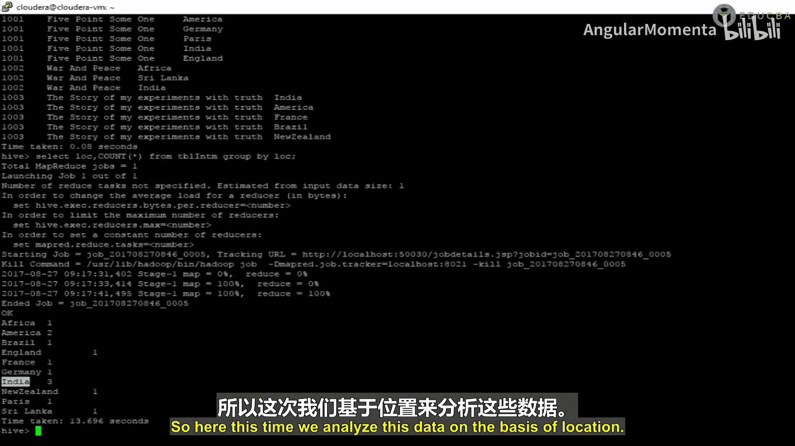

So， we have same scenario for reviews okay so we can also perform the same steps we need to follow the same steps for reviews also first we need to copy that big output to the SDgFS then we need to copy we to create a table by putting reviews column as as an as a complex type array type and then we can perform use the explode function which is provided by hive and then we can segregate that data and then we can count it easily or we can perform an aggregation on the basis of reviews any basis of book ID book name anything right？

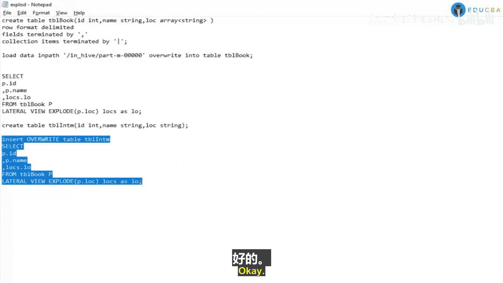

So so now this is in this scenario we came across a complex type array type so if in future if we came across a map typestruct type okay so you understood how we can do that so now you will it will be easy for us to analyze this data and it will be easy for you to use those functional plot by hyp we can use those types map typestruct type and array type and they can convert that complex data into the simple format and then we can use it and they can analyze this data。

Okay。

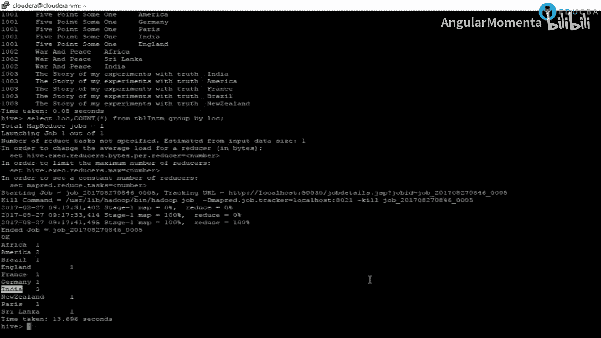

So， I hope。You understood everything here。