# 【EDUCBA】将生成式人工智能应用于辅导、研究与表现提升-｜-Apply-Generative-AI-for-Coaching,-Research,-p01-01_01_01_ChatGPT生成式AI个性化教练入门--BV1bwFSzNEAo_p1-

Introduction， welcome to this module on personalized coaching with chat GT and other generative AI technologies。

Today， we're diving into a new era of coaching， where technology meets personalization in a way that has never been possible before。

 in traditional coaching， whether it's career development， life coaching or fitness。

 there's always been a focus on the individual's unique goals， challenges， and learning style。

But the problem has often been scalability， how do we offer personalized。

 meaningful advice and guidance at scale， this is where generative AI， like chatGPT steps in。

Let's start with the basics， What is personalized coaching。

 it's essentially a coaching approach that tailors the learning experience。

 feedback and guidance to the specific needs of an individual。In personalized coaching。

 there's a focus on adapting content， pace and style to match the person's goals and preferences。

 generative AI technologies， particularly Chat GPPT。

 are revolutionizing this field by offering coaches the ability to deliver highly customized advice in real time without the need for constant human intervention。

 so what does chat GPPT bring to the table？ChatGPT is built on large scale language models that can interpret context。

 tone， and even subtleties in conversations。 It doesn't just spit out generic advice。

 It understands what you're asking for and can provide responses that are thoughtful and tailored to the situation。

Unlike traditional resources， ChatGPT offers immediate responses。

Whether it's a quick question about career goals or a deep dive into fitness routines。

 it can deliver valuable insights on the spot As users interact with chatGPT。

 it learns from the dialogue， this isn't learning in the human sense。

 but the AI can adjust its responses based on the user's input。

 guiding them in ways that feel more and more personalized over time。

Think about this coaching sessions that used to be limited by time。

 geography or availability can now be conducted anytime， anywhere。

 whether it's an individual looking for career advice or someone seeking fitness coaching。

 chat GPPT can deliver personalized support 24 by 7。And the best part。

 it doesn't just provide one size fits all responses。

 It can adjust its guidance based on your unique situation， personality and goals。

 We will continue the remaining part of the topic in the next video。 Thank you。 Hello learners。

 let's continue from where we left off in the previous video。 Master chat GPT in minutes。

 Access and configure with our quick start guide。 worried that getting started might be complicated。

 Don't be。 Our quick start guide is your VIP pass to mastering chat G in no time。

 from creating an open AI account to configuring settings for the best user experience。

 Well walk you through every step with ease。 Once you're set up。

 you can unleash the full potential of chat GPT。 making it your personal AI assistant for productivity。

 Cat and beyond。Step1， sign up for Open AI， visit the chat GT website， go to chat。openai。

com we can see the chatGT interface。

Click on the sign up button and you will be redirected to the sign up page。

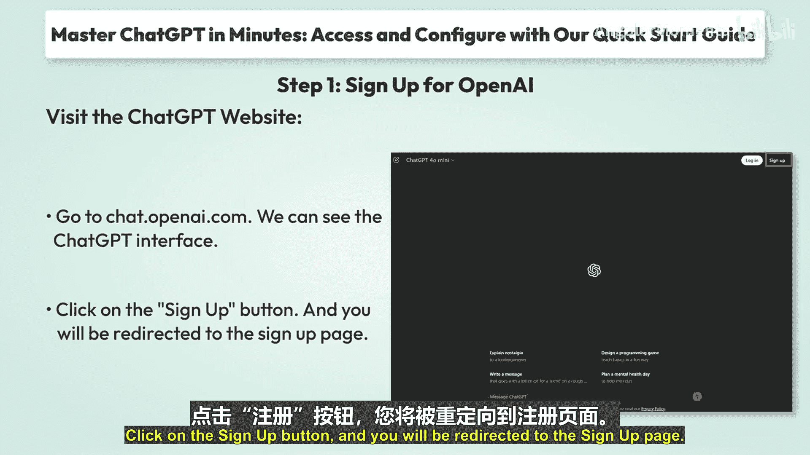

Create an account， Choose to sign up using your email address。

 Google account or Microsoft account if signing up via email， Open AI will send a verification email。

 check your inbox and verify your email to proceed。Step 2。

 access chat GT log in to OpenaiI Once your account is set up， visit chat。openai。com again。

 enter your account credentials and log in。

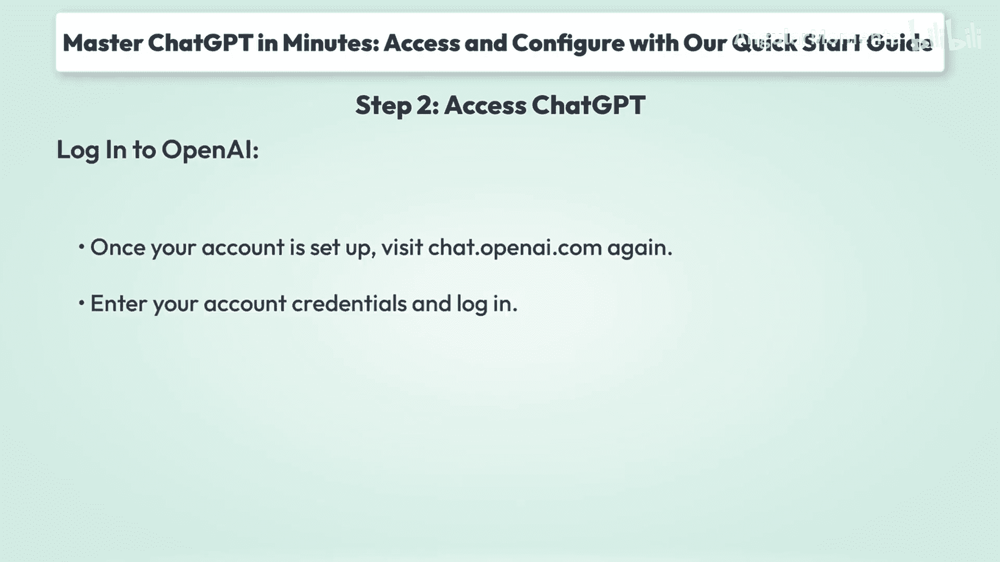

Start a new conversation Once logged in you'll be directed to the chat GPT interface。

 type your queries， questions or prompts in the chat box at the bottom of the screen。

 hit the enter key or click the sendend button to receive a response from chat GPT。

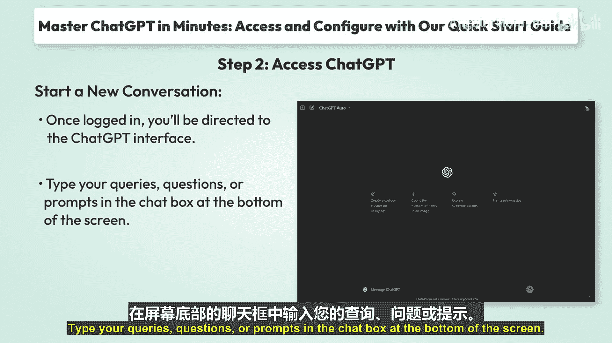

Step 3， start using chat GPT， Ask anything， begin by typing questions。

 seeking advice or testing out different commands， Cha GPT can assist with writing， brainstorming。

 coding and more， explore use cases， test chat GPPT's abilities by asking it to help draft emails。

 write articles， solve problems or even act as a learning assistant。Step 4。

 manage your conversations， Open AI saves chat history by default。

 you can revisit past chats from the dashboard to continue conversations or review them later。

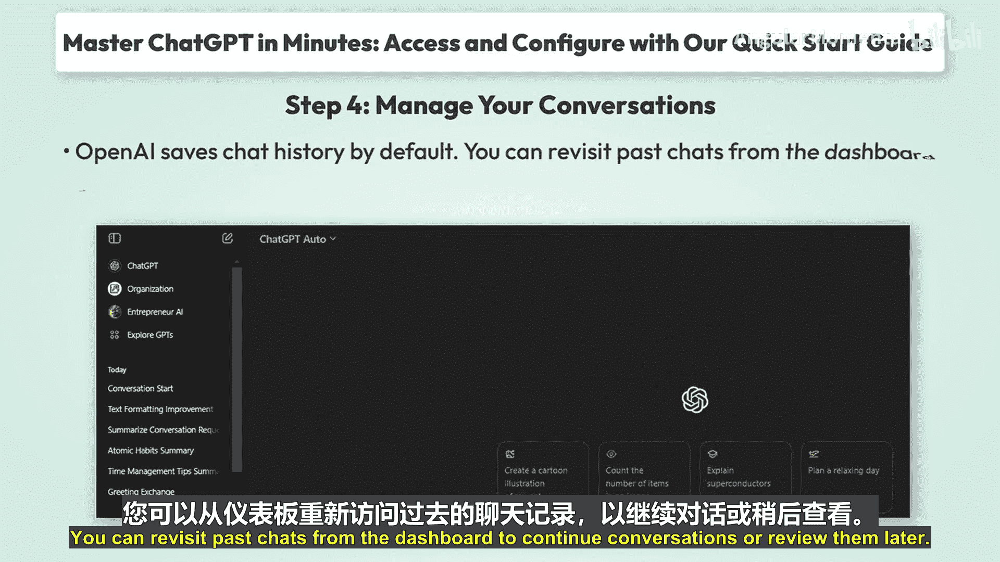

ChatGPT examples， writing assistance Let's say you have a task of writing an engaging introduction for a blog post on the future of AI and healthcare Here's how you could approach it using chatGPT。

You might ask， can you help me write an introduction for a blog post on the future of AI and healthcare care Chat GPT provides a response like the future of health care is being shaped by artificial intelligence。

 revolutionizing everything from diagnostics to patient care with AI powered tools。

 doctors are making more accurate decisions Surries are becoming less invasive and patients are receiving personalized treatments In this blog post we'll explore how AI is transforming healthcare care and what it means for the future of medicine。

See how it captures the essence of the topic while setting the stage for deeper discussion。

Coding help。 Now， let's move on to coding。 Suppose your task is to calculate the factorial of a number using Python。

 You can easily ask Cha GPT for assistance。 prompt。

 can you write a Python function to calculate the factorial of a number。

Chat GPT will then generate the Python code for you， which would look something like this。 Now。

 simply call this function with any integer， and it will return the factorial of that number。

 pretty handy， right？Brainstorming I Let's say you're trying to come up with ideas for a YouTube video on productivity hacks。

Chat GPT can help with brainstorming too prompt。 Can you give me some ideas for a YouTube video on productivity hacks。

ChatGPT might suggest top 10 productivity hacks you need to try today or how to organize your workspace for maximum efficiency。

 it could even propose ideas like morning routines of highly productive people or time management techniques to boost your productivity It's like having a creative partner at your fingertips。

Learning new concepts Next， imagine you're trying to understand a new concept like blockchain in simple terms。

Prompt， can you explain what blockchain is in simple terms？

ChatGPT would respond with something likeBlockchain is like a digital ledger that keeps a record of transactions。

Imagine a chain of blocks where each block holds information about a transaction。

 And once it's added， it can't be changed。 This makes it secure and transparent。

 as everyone one can see the transactions， but no one can alter them Str and easy to grasp， right。

 Personal development coaching。 Now， let's say you're looking for some guidance on personal development。

 like overcoming procrastination。Prompt， what are some tips to help me stop procrastinating？

ChatGPT could suggest breaking tasks into smaller manageable chunks。

 setting specific deadlines or using the five minute rule。

 committing to a task for just five minutes。Other advice might include eliminating distractions by turning off notifications or rewarding yourself after completing tasks。

 practical and effective advice you can apply right away。

Meal planningning Now let's say your task is to create a healthy meal plan for the week。

 covering breakfast， lunch， and dinner。Prompt， can you create a healthy meal plan for the week with breakfast。

 lunch and dinner ideas？Chat GPT can help you plan out your meals for each day。 For example。

 it might suggest Monday breakfast， oatmeal with freshberrries and almonds， lunch。

 quinoa salad with grilled chicken and veggies， dinner。

 baked salmon with steamed broccoli and sweet potatoes。 Tuesday breakfast。

 Greek yogurt with honey and granola， lunch， turkey and avocado wrap with a side of mixed greens。

 dinner， stir fried tofu with brown rice and snap peas。This way。

 you have a full balanced week of meals all planned out for you。Customer service simulation。

 Imagine you're handling customer service and you receive a complaint about a late delivery Chat GPT can help you craft a professional response。

 Pro， how would you respond to a customer who is upset about a late delivery。

Chat GPT could offer something like dear customer name。

 We sincerely apologize for the delay in your delivery。 We understand how frustrating this must be。

 and we're committed to making it right。 We are currently expediting your order and offering a discount refund as a gesture of good will。

 Thank you for your patience。 And please let us know if there' is anything else we can assist you with。

 Best regards your company。With this， you maintain professionalism while addressing the customer's concerns。

Creative writingri Now let's switch to something more creative。

 Suppose your task is to write a short poem about nature。A prompt。

 Can you write a short poem about nature。Chat GP T can generate a simple， yet beautiful poem。

 like in the whisper of the trees and the dance of morning breeze， nature sings her ancient song。

 invitinging all to come along with every bloom and rustling leaf。 She weaves a world beyond belief。

😊，A quick creative boost for your writing projects。

Fitness coaching let's say you need to create a 30 minute home workout plan that doesn't require any equipment。

ChatGPT is up to the challenge Pro， can you create a 30 minute home workout plan that doesn't require any equipment？

ChatGPT could recommend something like this， warm up five minutes， jumping jacks。

 high knees and arm circles。Work out 20 minutes， Circuit1，3 rounds of squats。

 push ups and mountain climbers，45 seconds each。 Circuit 2，3 rounds of lunges， planks and burpees。

45 seconds each。 Co down5 minutes， stretching exercises focusing on legs， arms and back。

With a plan like this， you can easily stay active without any special equipment travel planning Finally。

 let's say you're planning a three day trip to Paris and need an itinerary chat GPT can help create a detailed plan。

PromptCan you suggest a travel itinerary for a three day trip to Paris？

Here's an example of what chat GPT might provide。Day one， morning。

 visit the Eiffel Tower and enjoy a Senene River cruise After， explore the Louvre Museum。Evening。

 stroll through the Shasellise and enjoy dinner at a local cafe。 Day 2 morning。

 visit Notre Dame Cathedral and Il de late After。 wanderander through the Marre district and visit the Picasso Museum evening。

 experienceience Montmartra and the Scrour Basilica。😊，Day 3， morning。

 Discover the Palace of Versailles afternoon。 Re in Luxembourg Gardens or shop in Le Marre evening。

 enjoy a farewell dinner in a traditional Parisian restaurant。 With this itinerary。

 you can make the most out of your trip to the city of light。😊。

We will continue the remaining part of the topic in the next video， Thank you。Hello， learners。

 let's continue from where we left off in the previous video。 Pro engineering。

 Let's look at the prompt engineering， the way it is used。

 and it helps us to guide for the best practices。 Let's start with the basics。

 What is prompt engineering。At its core， prompt engineering refers to the art of crafting effective prompts to guide AI models like chat GPPT or other generative AI systems。

Think of it like giving instructions to the AI， the more precise and clear you're prompt。

 the better the AI's response。It's a process of trial and refinement。

 where the user asks questions or issues tasks in specific ways to achieve optimal results。

So why do we need prompt engineering Well， AI models are powerful。

 but they rely heavily on the prompts we give them a vague or poorly constructed prompt can lead to incomplete or irrelevant responses In contrast。

 a well designed prompt can lead to detailed， insightful and relevant outputs that meet the user's needs。

That brings us to an important aspect of prompt engineering， crafting effective prompts。

 to get the best results from an AI system， you need to think about your prompt carefully。

 an effective prompt is clear， specific and includes all necessary details to guide the AI。

 For example， if you ask， tell me about AI， you'll get a broad and generalized answer。

 but if you specify， can you explain the impact of AI on healthcare over the last decade。

 focusing on diagnostics。Suddenly， the AI is working with a much narrower scope。

 providing you with far more relevant information。

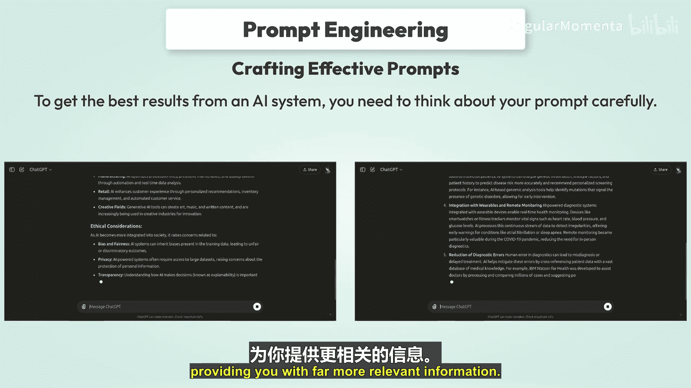

The key here is precision and clarity。Another critical aspect is understanding contextual prompts。

 AI models like chat GPT rely heavily on context to generate meaningful responses。 For instance。

 if you're discussing machine learning and then ask what are the benefits of M the AI will understand that your're asking about the benefits of machine learning。

 even though the term machine learning wasn't explicitly stated in the prompt。

 Conual prompts are valuable because they allow you to engage in a more fluid conversation like interaction with the AI。

 So prompt engineering helps you maximize the potential of generative AI。

 allowing you to craft instructions that the AI understands clearly。

 now that we've established why it's so important， let's explore the five Rs of prompt engineering。

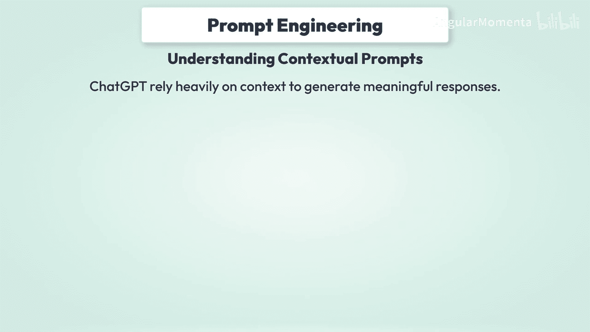

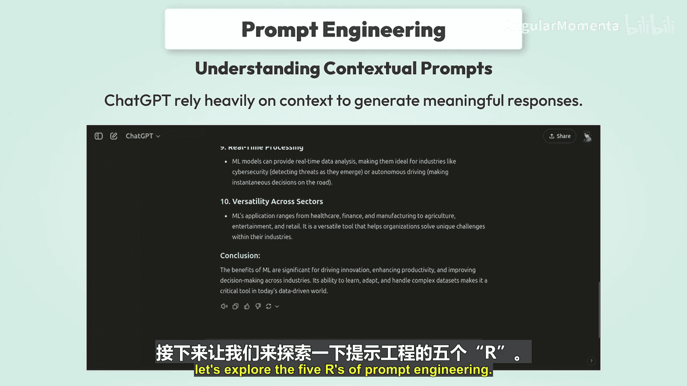

Prompt engineering is built on five guiding principles known as the5R's each R represents a crucial step to improving your prompts。

 and consequently the quality of your AI interactions。One。

 refine This is the practice of continuously adjusting and improving your prompts。 Remember。

 prompt engineering is iterative。 Often your first prompt might not yield the best result。

 so you refine it， add more detail， reword it， or even break it down into smaller parts。

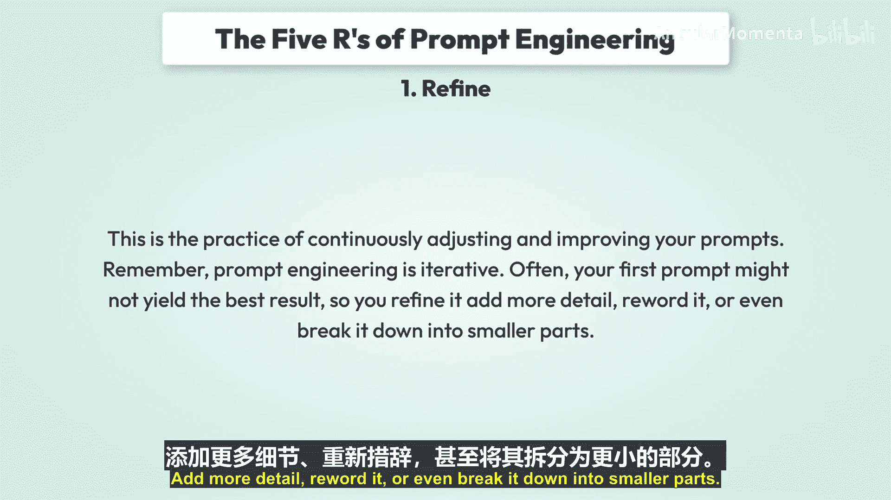

For example， instead of asking what's the history of AI， you might refine it to。

 can you explain the key developments in AI from the 1950s to the present。

 with examples of major breakthroughs？Notice how refining adds clarity and directs the AI to focus on specific time periods and events。

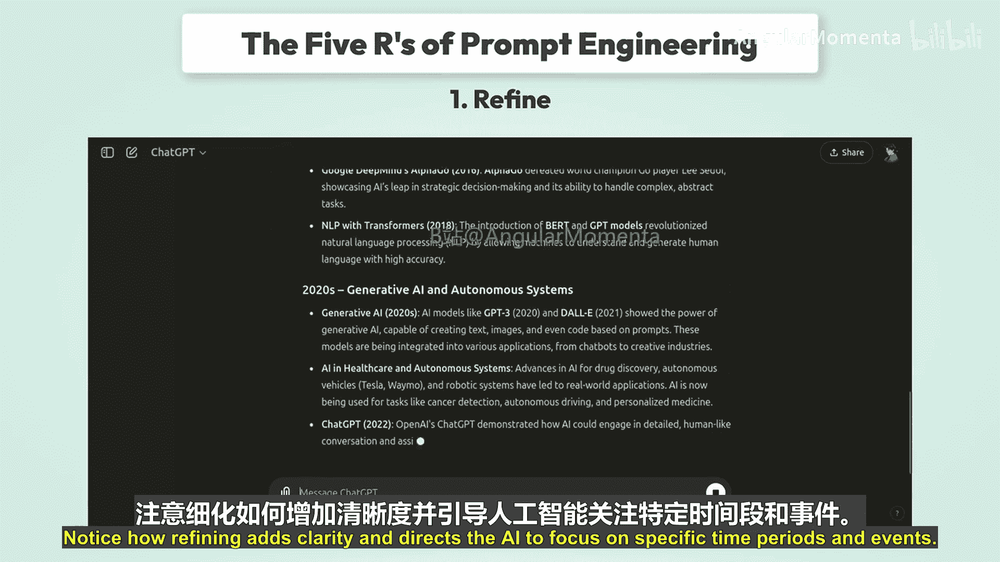

2 reframe Sometimes a question or task can be misunderstood by the AI In these cases。

 rephrasing or framing the question differently can lead to better results。

A simple change in wording can shift the AI's focus to deliver more accurate or insightful responses。

Say for instance， you ask，W is machine learning important？If the response is too generic。

 try reframing it。Can you explain the importance of machine learning and healthcare diagnostics using recent examples by reframing you're making the request more targeted。

 resulting in a more relevant answer？

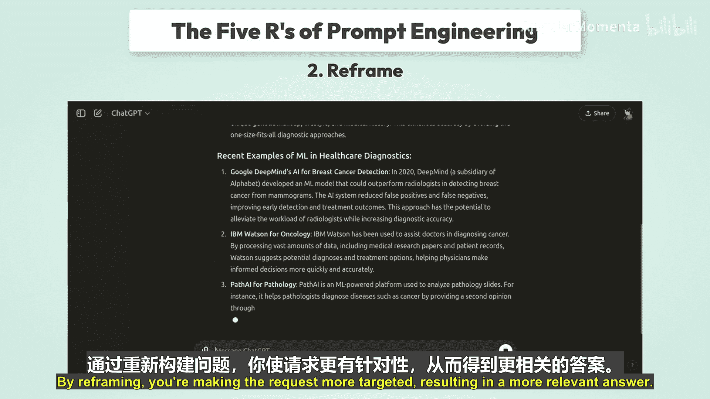

3 restrict This principle is about narrowing the scope of the prompt by limiting the focus to a specific area。

 you can avoid overly broad answers that may not be useful；

 restrictstriction ensures the AI provides concise targeted responses。

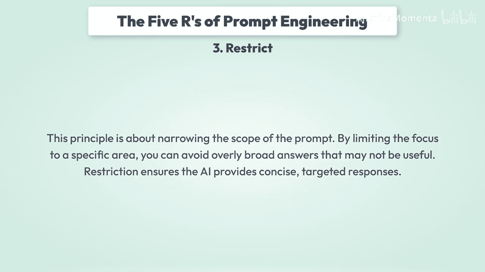

For instance， instead of asking what are the applications of AI。

 which could lead to an overwhelming amount of information， you might ask。

 what are the top three AI applications in financial technology by restricting the prompt。

 you get more actionable insights。

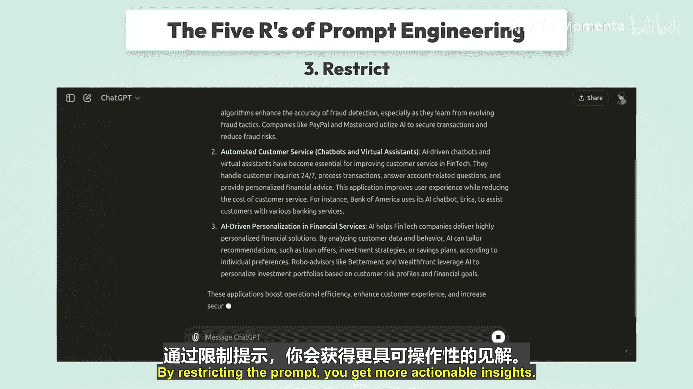

4 revise Sometimes after receiving an AI generated response。

 you realize that the output doesn't fully meet your expectations。

 this is where revising the prompt comes into play。

 revise your prompt to include more specific instructions or context based on the feedback you receive。

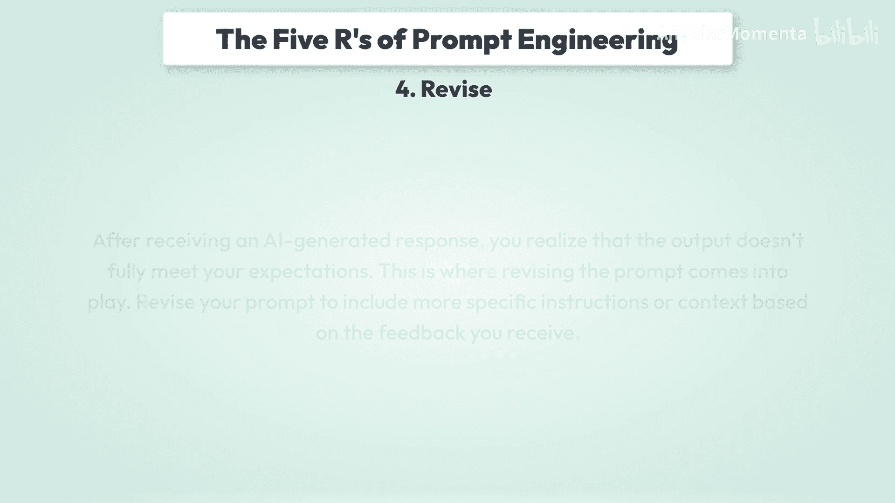

For example， if chat GPPT gives you an answer but leaves out key details， revise your prompt。

 can you expand on that answer， specifically focusing on the ethical implications of AI and financial technology？

Revision is about refining the AI's response step by step。

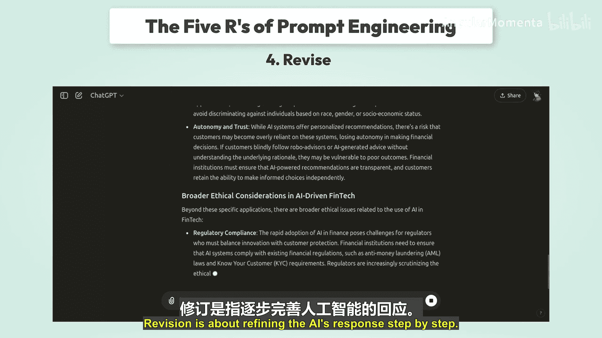

5 reinforceinfor Finally， we have reinforce This is the practice of reinforcing key elements of your prompt to make sure the AI focuses on what truly matters。

 Reinforcement often involves repeating critical information or using stronger language to direct the AI。

 Let's say you're writing a detailed report and want a comprehensive list you might re your prompt by saying provide an exhaustive list of AI applications in e-commerce with detailed examples by emphasizing exhaustive and detailed examples。

 your reinforcing the need for a thorough response。

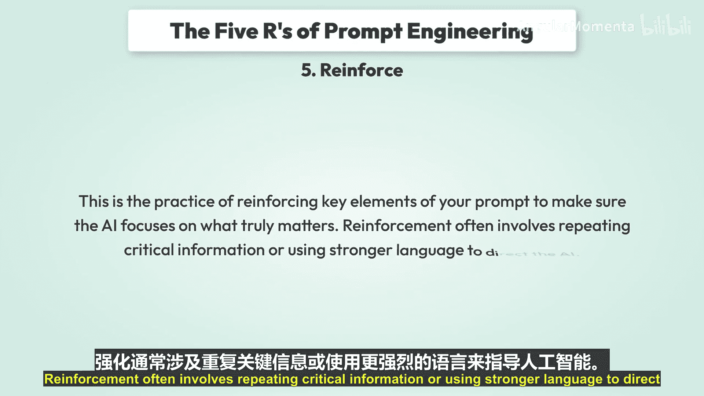

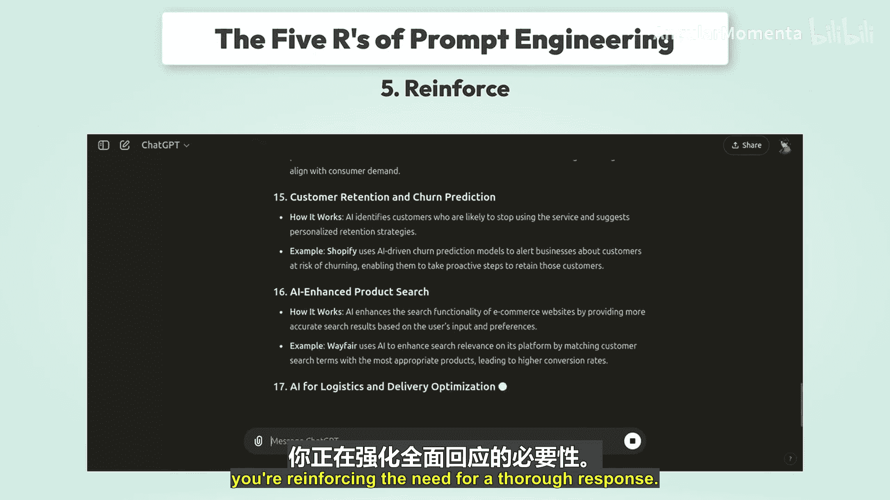

We all learn in different ways， Some of us are visual learners。

 while others prefer written instructions or hands on experiences， Traitionly。

 coaches have had to adapt their approach to suit these different learning styles。

 but what if an AI could do this automatically on the fly， That's exactly what chatt GPT does。

 and it's a game changer for personalized coaching。First。

 let's understand the different learning styles In educational psychology。

 there are commonly recognized types such as visual learners。

People who prefer to learn through images， diagrams and visual aids， Aory learners。

 those who retain information better when it's presented through speech or sound。Reading。

 writing learners， individuals who learn best by reading text or writing things down。

Kinesthetic learners， people who learn by doing through hands on practice and physical interaction。

Now， imagine coaching in any of these styles， a coach would need to identify which method works best for you and adjust their teaching accordingly。

 Chat GPT， on the other hand， can adapt to these styles almost instantly based on the user's interactions。

For visual learners。ChatGPT can provide explanations in a way that emphasizes visuals while chat GPT itself may not generate images directly。

 it can guide learners to use visual tools， charts and graphs to grasp concepts。 For example。

 if you're trying to understand a complex fitness routine。

 chatt GPT might suggest visual representations like workout diagrams or video links to help you learn visually。

For auditory learners。While chattGPT primarily communicates through text。

 its ability to summarize and simplify complex information can easily complement auditory learning tools。

 users compare chatGPT with text to speech tools， which can turn AI generated insights into audio format。

This makes it easy for those who prefer listening over reading。For reading writingrit learners。

 since chat GPT excels in text based communication。

 it's perfectly suited for learners who prefer to engage through reading and writing。

You can ask chattGPT to generate detailed explanations， outlines， or step by step instructions。

 which can be referenced and revisited as needed。For kinesthetic learners。

Here's where things get really interesting。While ChaGPT itself cannot physically engage users in hands on activities。

 it can provide instructions that guide kinesthetic learners through practical exercises。For example。

 in fitness coaching， Cha GPPT could deliver a series of actions you can try out in real time。

 adjusting based on your feedback and progress。But adjusting to learning styles isn't just about delivering information in different formats。

 It's also about pace and tone。 Chat GPT is highly flexible in this regard， Pacing。

 If a learner wants to take things slow， chat GPT can break down explanations into smaller chunks。

 allowing the user to digest each concept before moving on。For those who prefer a faster pace。

 ChaGPT can provide concise， high level overviews and only dive deeper if requested。

Tone and complexity ChatGPT can also adjust the complexity of its language if a user is a beginner in a certain topic。

 the AI can offer simplified， easy to understand explanations。For more advanced learners。

 it can provide technical in depth discussions。Let's look at a practical scenario Imagine you're seeking career coaching and you prefer a detailed step by step process In this case。

 ChaGPT can offer an action plan that includes clearly outlined steps， including resources。

 timelines and milestones。But for someone who prefers a more exploratory flexible approach。

 ChadGPT could provide open ended suggestions， ideas， and next steps。

 allowing the individual to carve their own path。This dynamic adaptability makes Chat GPT a highly effective tool。

 catering not just to learning styles， but also to individual preferences in how information is delivered and processed。

The AI tailor's responses based on user input， which creates a personalized experience that mimics the adaptability of a human coach。

But how does ChatGPT know which learning style to adopt the answer lies in its ability to analyze user interaction when you engage with chat GPT。

 the AI picks up on subtle cues， like the type of questions you ask and how you respond to the information it provides。

 for instance， if you frequently ask for diagrams， summaries or step by step instructions。

 it understands that you may prefer a more structured or visual learning approach。Additionally。

 Cha GPPT's flexibility means that you can directly instruct it on how to present information。

You can ask it to simplify concepts， provide examples， or even adjust its response style。

 This real time customization ensures that your coaching experience evolves with your preferences。

We will continue the remaining part of the topic in the next video， Thank you。

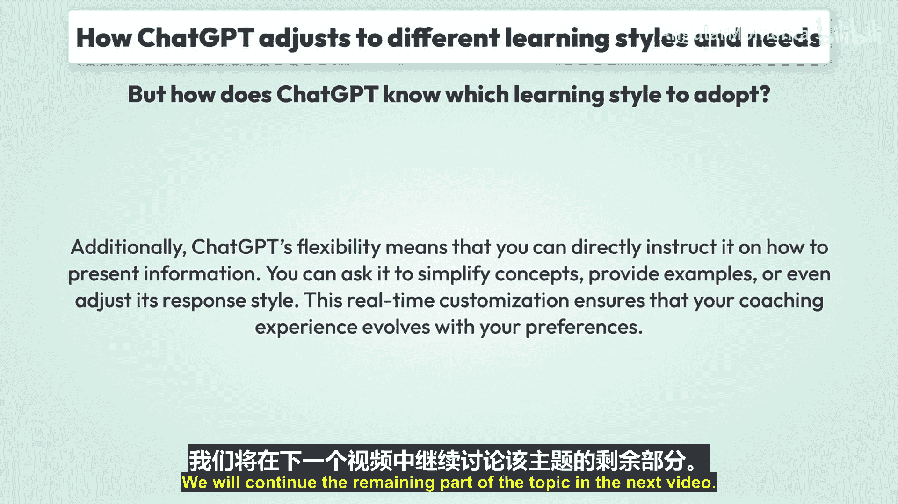