# 【EDUCBA】将生成式人工智能应用于辅导、研究与表现提升-｜-Apply-Generative-AI-for-Coaching,-Research,-p02-01_02_01_实时反馈与持续改进--BV1bwFSzNEAo_p2-

Hello learners， let's continue from where we left off in the previous video。

 real time feedback and continuous improvement。In traditional coaching， feedback is often delayed。

 you might have to wait for your next session to get feedback on your progress。

 reflect on your performance， and then make adjustments。

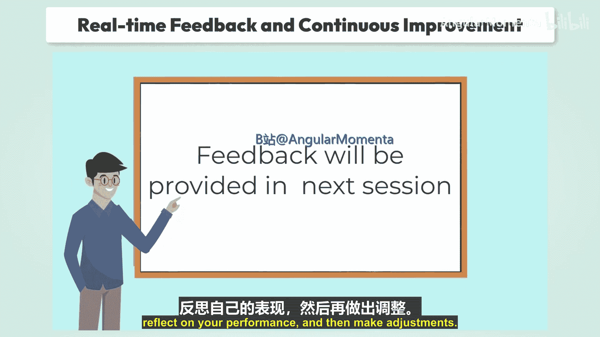

But with chat GPT， real time feedback changes the game completely。

What do we mean by real time feedback Real time feedback is about receiving immediate responses。

 corrections or suggestions as you engage in a task or activity。

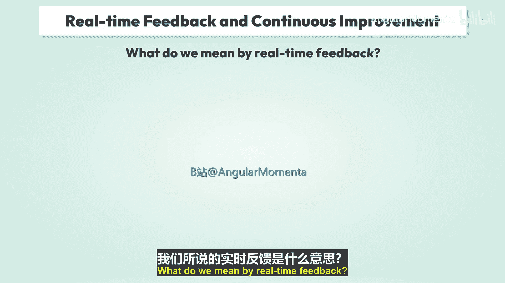

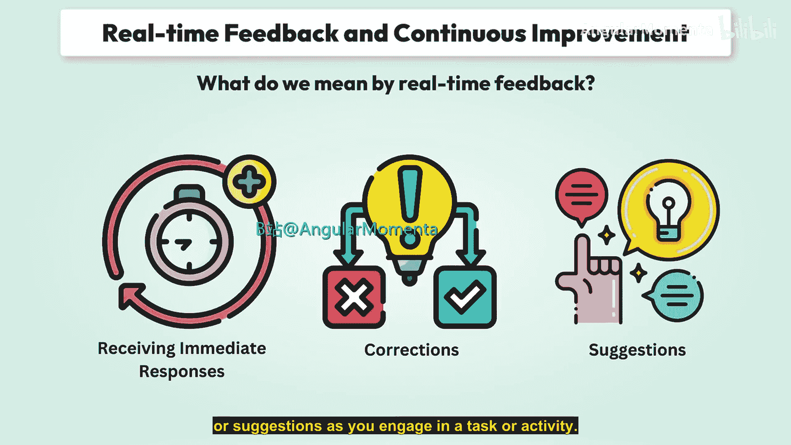

Whether you're practicing a new skill， working through a problem or seeking guidance。

Chat GPT can provide you with actionable insights instantly This immediate response system is particularly powerful because it allows you to make adjustments in the moment。

 rather than after the fact。For example， let's say you're seeking advice on improving your resume for a job application。

Instead of waiting for a career coach to review it days later。

 chat GPPT can provide detailed suggestions on the spot。

 such as rewording certain sections or highlighting specific skills。

 This means you can improve the document right away and continue refining it until you're satisfied。

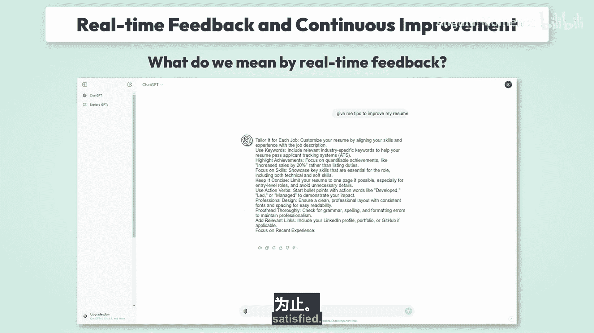

Why is this important when it comes to learning and growth。

 timing is everything the sooner you receive feedback。

 the faster you can correct mistakes and reinforce the right behaviors。

This accelerates the learning process and makes the coaching experience much more dynamic and effective。

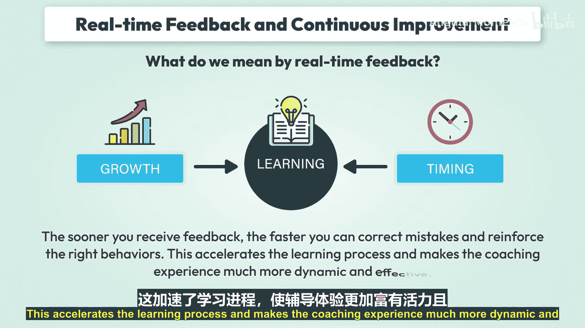

Imagine you're working on your fitness routine and you're unsure about your form or exercise technique。

 You can describe your workout to chat GPT， and it will immediately provide suggestions on how to improve your posture。

 breathing or technique based on the description。In real time。

 you're able to correct errors and improve your performance， leading to better results over time。

How does chattGPT facilitate continuous improvement one of the standout features of chat GPPT is its ability to offer guidance that adapts and evolves as you do。

 this leads to a coaching experience that is centered around continuous improvement。

Ongoing progress tracking as you interact with chat GPT， it remembers your past conversations。

 which means it can track your development over time。 For example。

 if you're receiving career coaching， it can reference earlier sessions。

 helping you reflect on progress and adjust your goals。

 This ongoing conversation means you're not starting from scratch every time。

Adaptive learning as you improve and become more skilled in a particular area。

 chatt GPT can raise the difficulty level or offer more advanced advice If you're learning a new language。

 for instance， chatt GPT can gradually introduce more complex vocabulary and sentence structures based on your proficiency level。

 This personalized progression allows you to continuously challenge yourself and grow without being overwhelmed or understimulated。

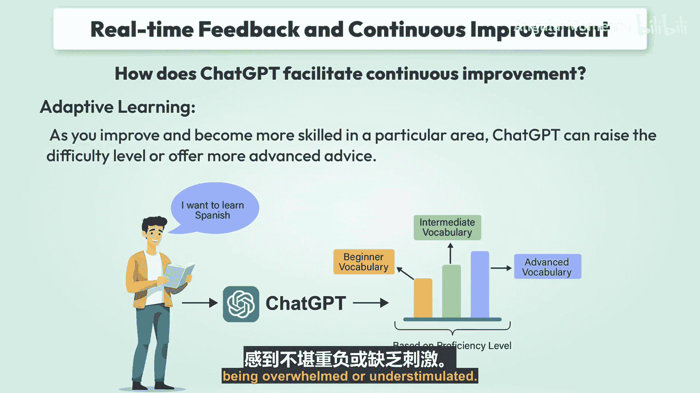

Error， correction Chat GPT is also highly effective in identifying mistakes and offering corrective feedback right away。

 If you're working through a math problem and make a small error。

 Chat GPT can point it out and guide you toward the right solution。

 This kind of immediate correction not only prevents bad habits from forming。

 but also helps solidify the right techniques。

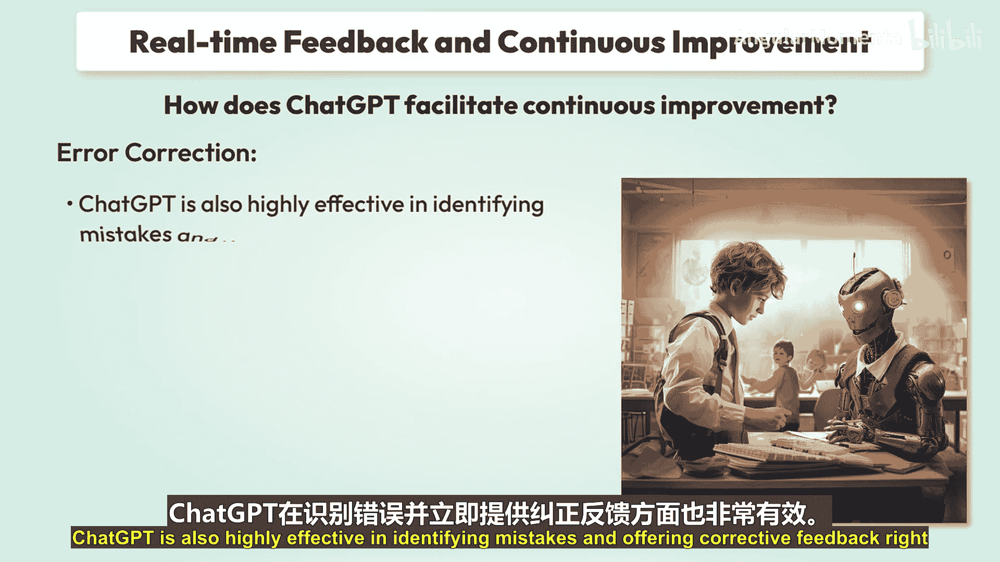

Let's break down how Chat GPPT's real time feedback works in a few common coaching scenarios。

Career coaching Sose you're practicing for a job interview and you give chat GPT a mock response to a common interview question like what are your greatest strengths？

ChatGPT will provide feedback right away， suggesting how you can refine your answer。

 highlight specific achievements， or phrase your response more effectively。

This instant feedback loop allows you to keep refining your responses until you feel confident。

Fitness coaching。If you describe your fitness routine or exercise goals。

 Cha GPPT can give you advice on how to improve your regimen in real time。

It might suggest changes in your workout intensity， recommend new exercises。

 or guide you on rest and recovery， all without waiting for your next in person session with a trainer。

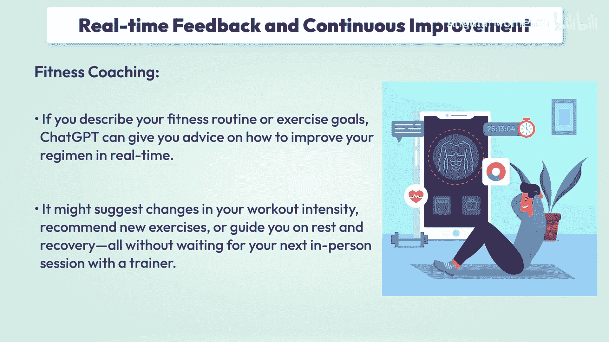

Learning a new skill。Let's say you're learning to code and you're stuck on a particular problem。

 Chat GPT can not only help you solve the issue， but also explain why certain approaches work better than others。

 As you continue learning， it can provide more nuanced advice， adjusting to your growing skill set。

What makes this continuous improvement process even more powerful is the fact that ChatGPT offers a personalized approach。

Based on your interactions， it adapts its responses to your learning pace and preferences。

Let's take fitness again as an example， if you're making great progress。

 Cha GPPT might suggest increasing the difficulty of your workout by adding more reps or incorporating new exercises。

If you're struggling， it can suggest easier modifications or new ways to stay motivated。

 This constant adjustment ensures that you're always progressing at the right pace for you。

But how does ChatGPT learn from feedback， chattGPT operates based on feedback loops that are built into your interactions？

As you provide more context or details， the AI refines its understanding of your needs。

If a particular suggestion doesn't work for you， you can provide feedback by telling chatt GPPT。

 and it will adjust its future responses accordingly。This creates a cycle of continuous improvement。

 where the coaching process becomes more and more tailored to your preferences and challenges。

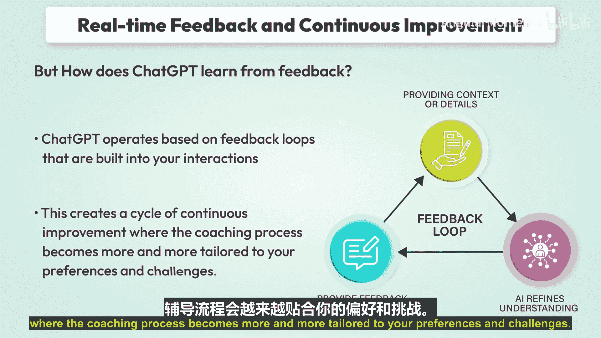

Scalability one to many verses one to one coaching with AI Scalability is a key benefit of AI driven coaching systems。

Traditional coaching models， whether it's career coaching， fitness training or life coaching。

 typically require a one on one relationship between coach and client。 This can be highly effective。

 but it's also resource intensive， there's only so much time in a day and a coach can only work with so many clients。

 but with AI， this limitation disappears。Let's start by looking at one to one coaching In a one on one scenario。

 Cha GPT serves as a personal， dedicated coach for a single individual。

 This approach closely mimics traditional coaching， but with several unique advantages。

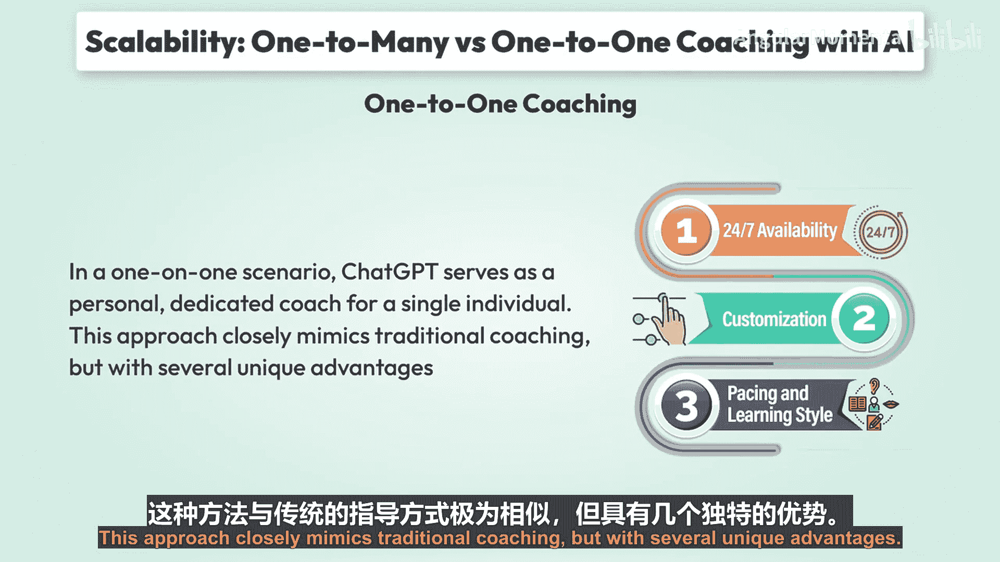

24 by7 A unlike a human coach， chat GT is available anytime。

 whether it's late at night or during a weekend， you can always turn to the AI for guidance。

 feedback or a quick refresher， this makes the coaching experience more flexible and adaptable to your schedule。

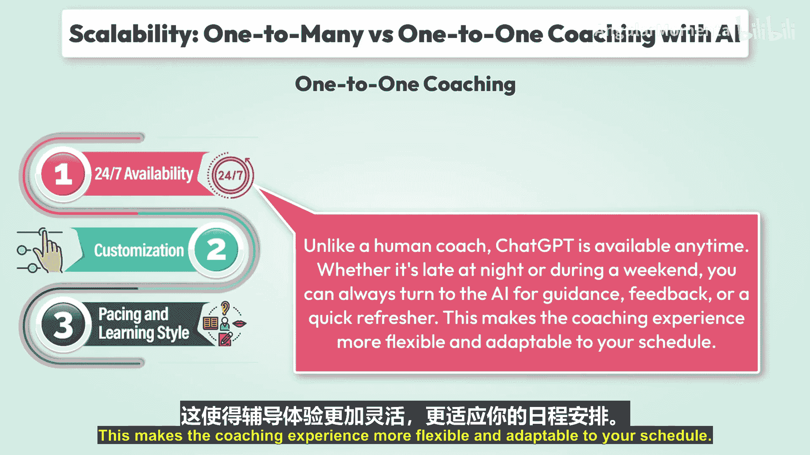

Customization In a one on one setting， chat GT tailors its responses specifically to your needs。

 preferences， and goals Over time as you interact with it more。

 the AI learns from your feedback and past sessions， it adapts its coaching style。

 offering personalized advice and creating an experience that feels unique to you。

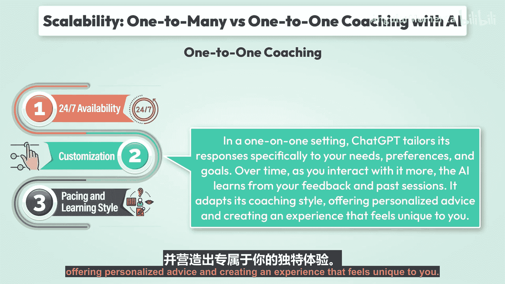

Pacing and learning style。As we discussed earlier， chat GPPT can adjust to different learning styles and pace its coaching according to your preferences in one to one coaching。

 this adaptability becomes even more focused， allowing for a highly personalized learning curve。

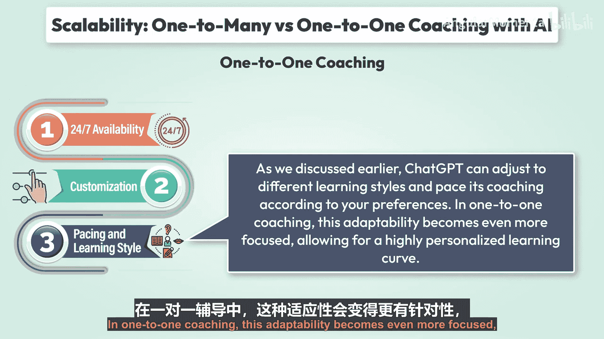

Now， let's talk about one to many coaching。 One of the most powerful features of AI based coaching systems like chat GPT is the ability to scale coaching from one individual to many without compromising on the personalized experience in a traditional coaching environment if a coach had to mentor a group of people they might struggle to provide individual attention to everyone with chat GPT。

 this limitation vanishes。Handling multiple users simultaneously。

 Chat GPT can provide coaching to hundreds or even thousands of people at the same time。

 and each person can receive tailored guidance based on their individual needs。

 whether it's a group of employees receiving career coaching or a class of students learning a new skill。

 the AI scales effortlessly without diluting the quality of coaching。

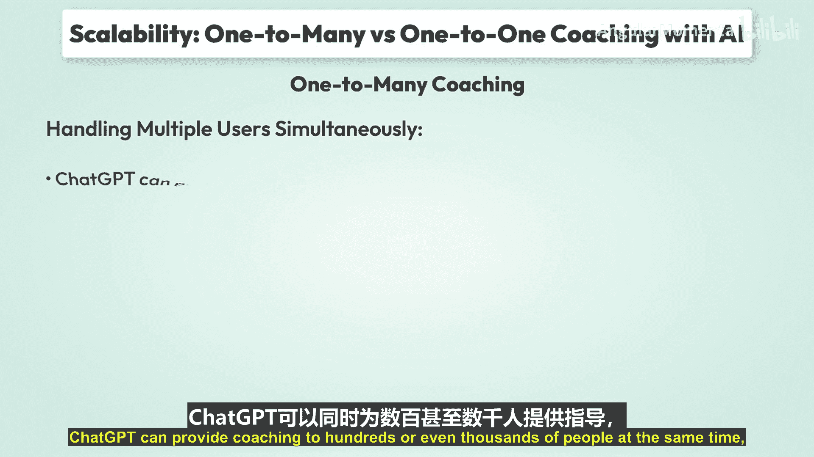

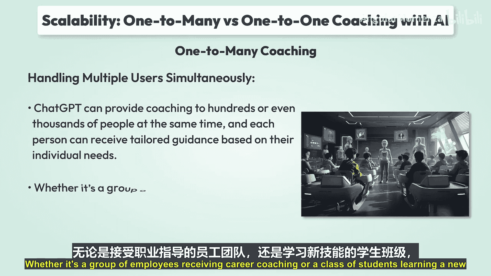

Consistency In one to many coaching scenarios， consistency is key Cha GPPT ensures that each individual receives the same high quality information and advice。

 removing the possibility of bias or human error。Everyone in the group benefits from the same coaching strategies。

 but they can also ask follow up questions and get personalized feedback based on their specific challenges。

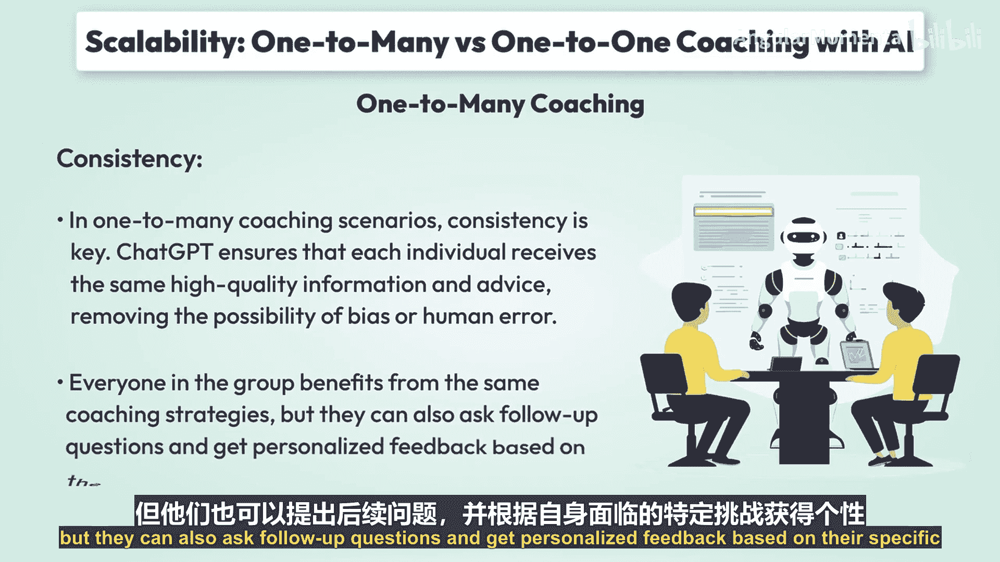

Group dynamicss and personalization。Even in a group setting。

 chat GPPT can provide personalized feedback to each participant。For example。

 in a corporate training scenario， an entire team could be coached on leadership skills while each member receives personalized feedback on their progress and individual development。

 Chat GPPT handles the macro levell coaching for the group while offering micro level insights for each participant。

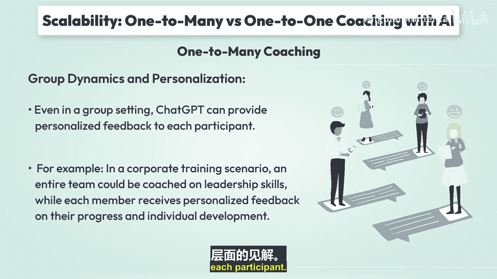

Let's look at a few examples to better understand how one to one and one to many coaching works with chat GPT Care coaching。

In a one to one coaching session， chat GPPT might help you craft your resume， prepare for interviews。

 and provide tailored career advice based on your industry and experience level。

It learns from your responses and refines its advice。

 but in a one to many setting like a company wide career development seminar。

ChatGPT could offer generalized tips and best practices。

 while also allowing individual employees to ask specific questions and receive personalized answers in real time。

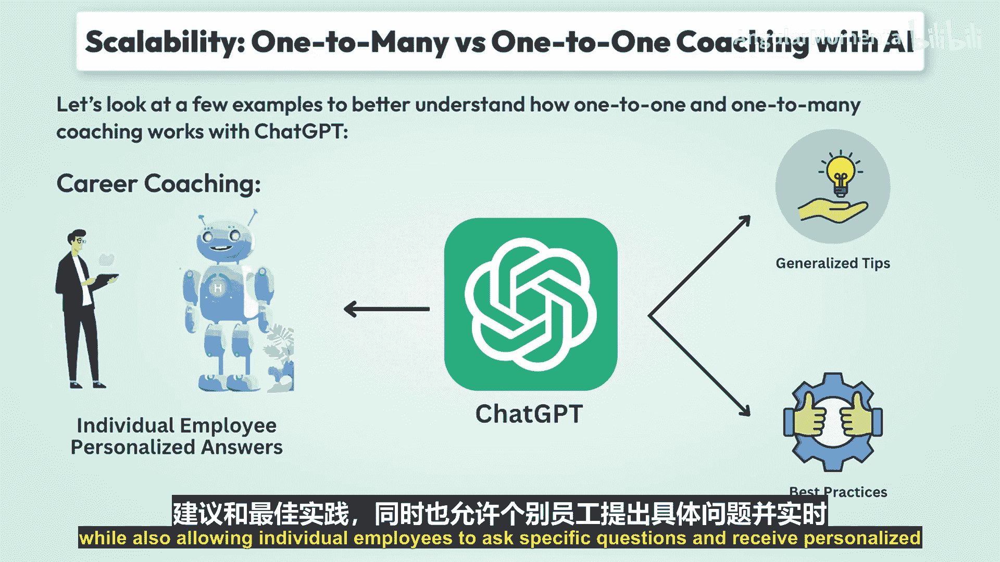

Fitness coaching in a personal fitness coaching scenario。

 chat GPPT could develop a workout plan that's just right for you， monitoring your progress。

 and making adjustments based on your feedback。

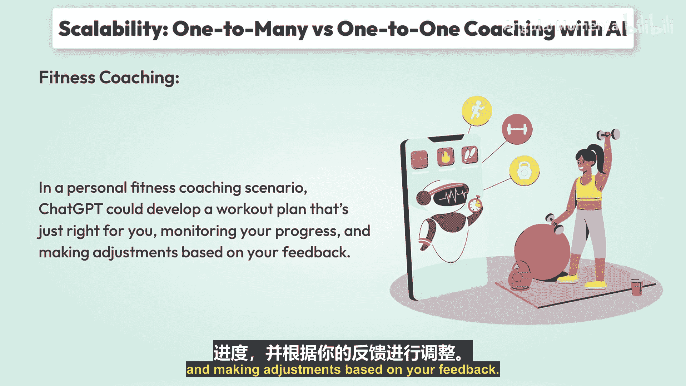

In a one to many setting like a virtual fitness class。

 Cha GPPT could guide the whole group through a workout while offering personalized advice to each participant about their form。

 pace， or diet。

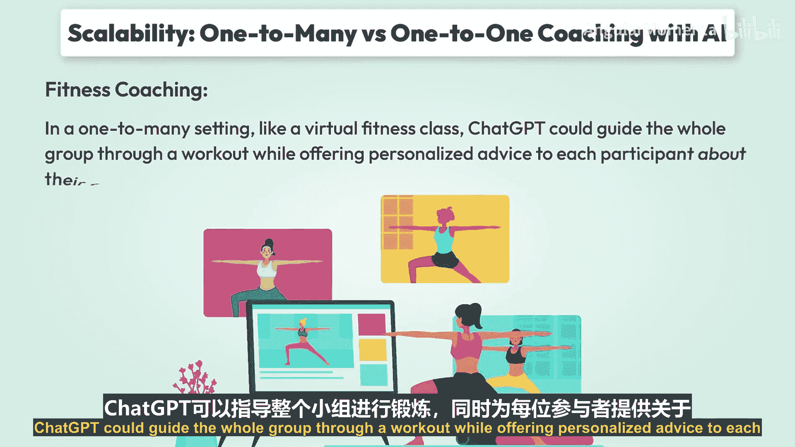

Education and learning。Suppose you're learning a new language with chat GPT in a one on one setting。

 it tailors lessons to your skill level， gives you real time corrections and tracks your progress。

But in a classroom setting with multiple students， chat GPPT can provide the same lesson to everyone while giving each student the opportunity to ask specific questions。

 get real time feedback， and receive tailored support based on their individual language proficiency。

What makes AI driven scalability so impactful， the ability to coach many individuals simultaneously without losing the personalized touch is truly transformative；

 here are a few reasons why scalability with AI is such a powerful concept。Cost effectiveness。

 Traditional coaching， especially one on one， can be expensive with AI。

 the cost barrier is significantly reduced， allowing more people to access high quality coaching at scale。

 organizations， educational institutions or even fitness trainers can use AI to reach larger audiences without incurring additional costs for human resources。

 or limiting the quality of the coaching experience。

Access and reach AI coaching democratizes access to personalized learning。

 whether you're in a remote location or don't have access to in- personson coaching。

 chat GPPT can step in and deliver the same level of expertise。

This opens the door for broader educational and professional development programs that reach people who might otherwise be left out。

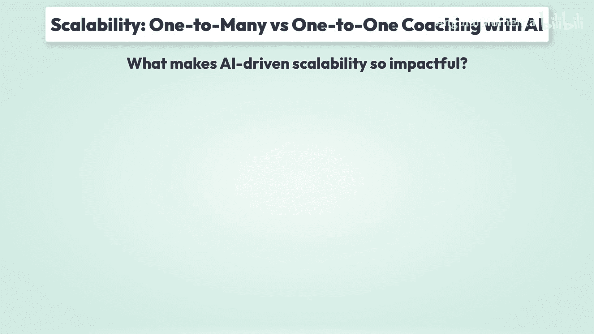

Consistency across the board in a one to many setup。

 everyone receives the same foundational coaching， ensuring consistency in messaging。

 learning outcomes， and advice。

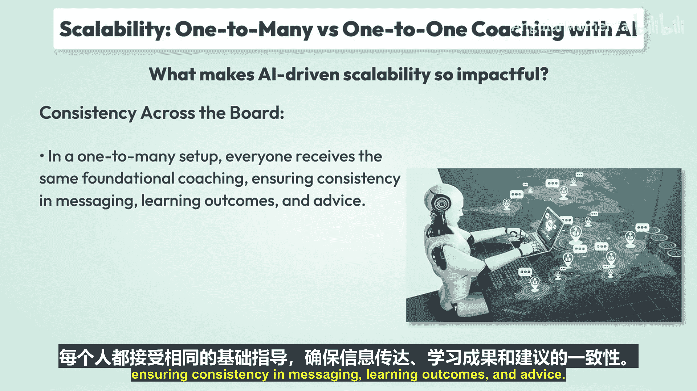

This is critical when scaling programs across organizations or large groups where uniformity of training is necessary。

 such as in compliance training or standardized education modules。

Flexibility for coaches and educators coaches can use chat GPT as a scalable tool to supplement their work。

 For example， a coach or educator could assign certain modules to chat GPT。

 allowing them to focus on more personalized higher level interactions with clients or students。

 This hybrid model makes it easier to scale their services while maintaining a human touch where it matters most。

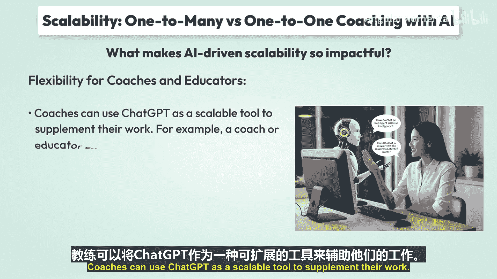

We will continue the remaining part of the topic in the next video， Thank you。Hello， learners。

 let's continue from where we left off in the previous video。

 How do chat GPT handle sensitive topics When we think of coaching。

 it's not just about offering advice on professional growth or fitness routines。 Many times。

 coaching conversations can touch on deeply personal or sensitive areas like job loss。

 stress management， emotional well being and life decisions。

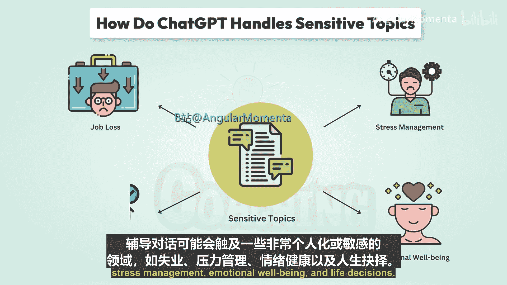

Human coaches often build rapport， use empathy， and provide a safe space for individuals to open up for Cha GPPT。

 ensuring a similar level of understanding and support is critical in maintaining trust and value in the coaching process Now let's explore how chat GPPT handles these conversations and ensures a positive。

 respectful experience。Neutral and non-judgmental language One of the strongest advantages of chat GPT in dealing with sensitive topics is its neutrality ChaGPT is trained to offer responses that are free from personal bias or judgment when a user brings up sensitive issues such as struggles with mental health or relationship challenges。

 chat GPPT responds with non-judgmental and neutral language。Example。

 if a user says I'm feeling stressed about my work performance。

Chad GPT might respond with It's understandable to feel overwhelmed。

 Sometimes it might help to take small breaks during your work day or organize tasks by priority。

 Would you like suggestions for time management techniques。

 or is there another area where I can assist you。This neutral tone helps maintain a safe and supportive environment。

 where users feel comfortable discussing personal issues， empathy through language modeling。

Though chatt GPPT is not a human being， it has been trained to use language in a way that mimics empathetic responses。

By carefully choosing words that show understanding and validation of the user's emotions。

 chat GPPT can acknowledge the sensitivity of certain situations。While Cha GPT doesn't feel emotions。

 it can still recognize emotional cues in a conversation and adapt its responses accordingly。

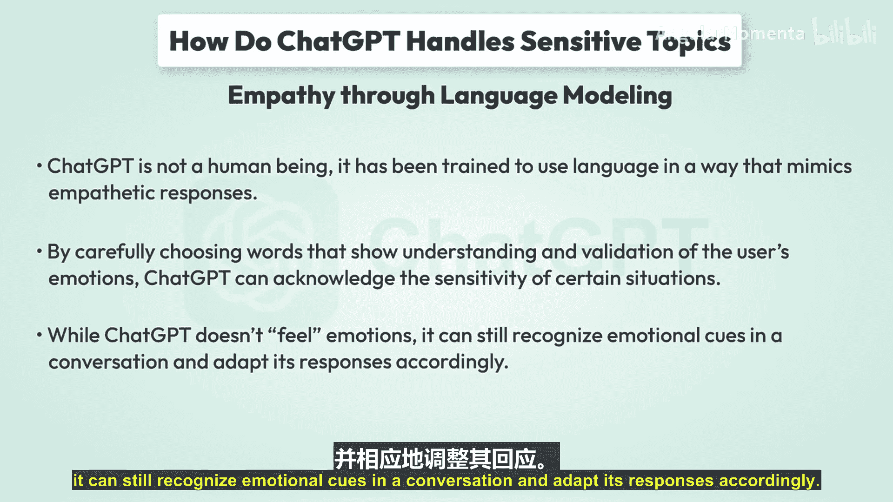

An example， if a user says I'm really worried about my future career path。

 chat GPT might respond with。 It's normal to have uncertainties about the future。

 especially when making important life decisions， taking small steps towards your goals can help clarify your path。

 Would you like to explore different career options together。

This empathetic language allows chat GPT to provide a response that feels supportive and considerate without being dismissive。

Encouraging users to seek professional help。Another key approach in handling sensitive topics is chatt GPT's ability to recognize when a situation might be beyond its scope for issues like mental health。

 trauma or highly emotional matters， Chat GPT can suggest seeking advice from qualified professionals such as counselors。

 therapists or legal experts。 The goal here is not to pretend that chat GPT can solve all problems。

 but to guide users toward resources that may be better suited to help them。Example。

 if a user expresses feelings of depression or discusses a personal crisis。

 Cha GPT may say it sounds like you're going through a tough time while I can provide general advice。

 it may be helpful to talk to a professional therapist who can offer more specialized support。

 Would you like information on how to find professional help。

 This approach keeps the conversation respectful and ensures that the user gets the right type of support when needed。

Avoiding harmful or triggering content， one of the most important safeguards built into chat GPT is its filtering of harmful or inappropriate content。

 When users bring up sensitive or potentially triggering topics。

 chat GPT is programmed to avoid giving advice that could be harmful or unhelpful。For instance。

 Cha GPPT avoids providing medical， financial， or legal advice。

 especially in situations that may lead to negative outcomes for the user。Instead。

 it focuses on offering supportive guidance while redirecting the user to professional services for more complex matters。

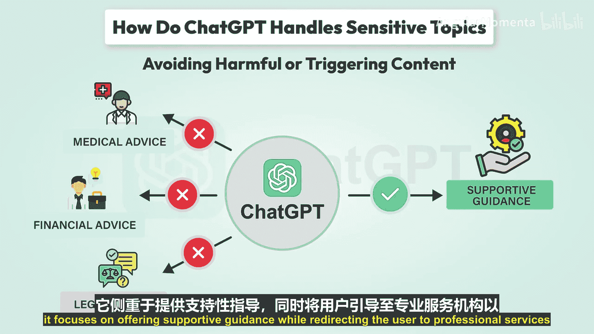

Example if a user asks should I quit my job because I'm unhappy。

 chat GPT might respond with deciding whether to leave a job can be a difficult choice。

 It might help to weigh the pros and cons of your situation if you're feeling unhappy。

 it could be useful to speak with a career counsellor or HR representative to explore your options。

In this way， chatGPT avoids rash conclusions and encourages thoughtful decision making。

 personalization and sensitivity based on context， ChatGPT's ability to adjust to user specific needs also plays a role in how it handles sensitive topics。

If it recognizes that a user has previously mentioned certain challenges or preferences。

 it tailors its responses accordingly， this helps create a more personalized experience。

 especially in delicate conversations。An example， if a user says I have a health condition that makes it difficult to exercise。

 chat GPT might respond。 It's important to take your health condition into account when planning a fitness routine。

 Have you spoken to a health care professional about the best exercises for your situation。

I can provide suggestions that focus on low impact activities if that's helpful。

This ability to personalize responses ensures that chat GPPT offers advice in a thoughtful context aware manner。

 especially when the situation involves sensitive information。

We will continue the remaining part of the topic in the next video。 Thank you。 Hello learners。

 let's continue from where we left off in the previous video， features of chat GPT and coaching。

 Let's dive into some of the key features that make chat GPT an effective tool for coaching。

 whether it's career coaching， fitness guidance or life coaching。

 chat GPT leverages advanced features to provide a personalized and supportive experience。

Let's start with conversational learning。Conversational learning conversational learning is at the heart of how chatt GPT delivers coaching。

 instead of following a rigid one size fits all approach。

 chatt GPT interacts with users through natural dialogue， adapting in real time to their questions。

 needs and learning pace。Engaging and interactive with chat GT。

 coaching feels less like a formal lesson and more like an interactive conversation。Wi。

 this helps keep users engaged and interested， which is particularly important when dealing with topics like career guidance or fitness routines Ex。

 imagine a fitness coaching session where the user asks what's a good workout plan for beginners。

 chat GT can respond with personalized suggestions and as the user follows up with more specific questions like exercises targeting certain muscle groups or routines based on time constraints。

 the conversation evolves dynamically。This makes the learning process seamless and intuitive。

Adjusting to the user's level， chatt GPPT can adapt its tone。

 complexity and recommendations based on the user's experience if someone is new to a topic。

 chat GPPT will simplify explanations and guide them through foundational concepts。

For more advanced users， it can provide deeper insights or more complex tasks。 An example。

 if a user is new to the job market， chatt GPT might explain basic resume building tips。

 but for someone looking for leadership advice， chat GPT can offer strategies on managing teams or enhancing communication skills。

Real time feedback and support。As users ask questions， chat GPPT can provide immediate feedback。

 helping them reflect， adjust and improve in real time This dynamic interaction simulates a live coaching session。

 where progress happens step by step， tailored to the user's pace。Personalized progress tracking。

One of the most valuable features of chat GPT and coaching is its ability to track and personalize the user's progress This is especially important in long term coaching scenarios like fitness programs。

 skill development or career coaching。

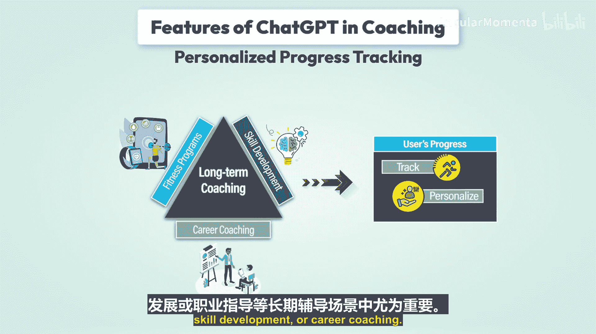

Remembering key milestones， chatt GPT can recall important points from past conversations。

 allowing it to keep track of your goals， achievements and areas of improvement over time。

 For example， if you're working on a fitness goal and mention your weekly targets。

 chatt GPT can follow up in future sessions to check on your progress and adjust the advice accordingly。

Example in a fitness coaching session， a user might set a goal to run 5 kilometersm by the end of the month In future interactions。

 chatt GPT can ask， how is your running progress， Have you been able to reach 3 kilometers yet。

 Let's adjust your routine to help you meet your goal。Customized plans。

Based on the user's feedback and progress， ChatGPT can continuously refine and customize recommendations；

 This makes the coaching process adaptive as users grow or encounter challenges。

 ChaGPT adjusts to provide more relevant advice or support。Example， in career coaching。

 if a user has been working on improving public speaking skills but is struggling。

 chat GPT might suggest alternative exercises like practicing with smaller groups or recording mock presentations before tackling larger audiences。

 tracking long term goals， Chat GPT isn't just about the immediate conversation。

 It's designed to keep users accountable over the long term by logging previous interactions。

 it helps users stay on course toward their long term objectives， whether that's career growth。

 fitness achievements or personal development。Example in life coaching。

 chat GPT could track a user's progress toward a mindfulness routine。

 offering regular check ins like last time we discussed the importance of daily meditation。

 how has that been going， Would you like tips on staying consistent。

Integration with external tools one of the powerful aspects of chat GPPT as a coaching tool is its ability to integrate with external platforms。

 making the coaching process even more effective。Data integration Cha GPT can connect with other tools such as calendars。

 fitness trackers， or task management apps。This allows the AI to offer coaching that is context aware based on real time data about the user's activity or schedule。

Let's say a user connects their fitness tracker。 Cha GPT can monitor their exercise data and use it to offer precise advice。

 Like， I see you've been consistent with your steps， but haven't met your weekly running target。

 Would you like me to help adjust your workout schedule。

Collaboration with productivity tools in career coaching or productivity management。

 Chat GPPT can integrate with platforms like Google Calendar， Trello。

 or Asana to help users manage tasks， deadlines and goals。This not only helps users stay organized。

 but also allows Chat GPPT to offer real time reminders and actionable advice based on their ongoing projects。

By example， if a user is juggling multiple work projects。

 chat GPPT can help prioritize tasks by sayingIt looks like you have two deadlines coming up tomorrow。

 would you like tips on managing your time effectively or should I help organize your to do list？

Expanding learning resources ChatGPT can pull information from external databases， research papers。

 or even learning platforms like Uudemy or Coursera。

 giving users access to a wider range of learning materials。

 this makes the coaching experience more robust， offering resources beyond just conversational advice example。

 if a user is learning a new skill such as coding， chat GPT can suggest additional online resources。

 coding exercises or video tutorials to support their learning journey。

Integration with communication tools for group coaching or corporate settings。

 ChatGPT can integrate with communication platforms like Slack， Zoom。

 or Microsoft Teams to offer seamless coaching experiences within a larger ecosystem。

This allows users to easily transition between individual coaching and team collaboration without losing context。

We will continue the remaining part of the topic in the next video。 Thank you。

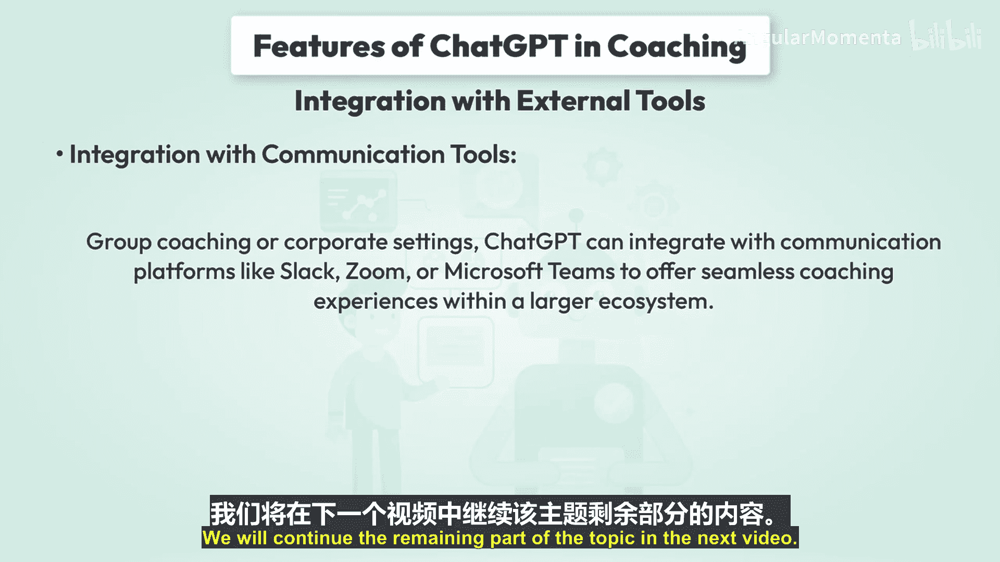