# 【EDUCBA】将生成式人工智能应用于辅导、研究与表现提升-｜-Apply-Generative-AI-for-Coaching,-Research,-p03-01_03_01_ChatGPT生活应用指南--BV1bwFSzNEAo_p3-

Hello， learners， let's continue from where we left off in the previous video。 Chat GPT for Life。

 Chat GPT for Life is your personal everyday assistant designed to simplify life's little complexities。

 whether it's managing your schedule， learning something new or improving your daily habits。

 Chat GPT can guide you every step of the way。 It's not just for work related tasks or technical questions。

 Chat GPT for life can enhance how you approach wellness， organization and self care。

 Let's explore an example of how chat GPT for life can simplify your routine through meal plan mastery。

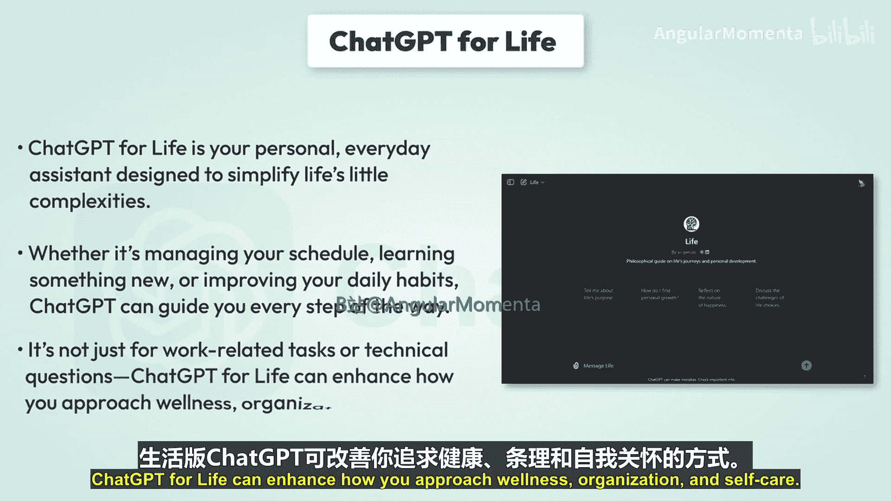

Say you want help planning your meals for the week to stay healthy and organized。

You provide a prompt to chat GPT that can you create a healthy meal plan for the week with breakfast。

 lunch， and dinner ideas？ChatGPT responds by displaying a seven day meal plan。

 providing the following different meals to consume at breakfast， lunch， and dinner each day。

Not only does Chat GPPT provide balanced meals for the entire week。

 but it can also simplify your grocery shopping。When you add a prompt。

 can you create a grocery list for this meal plan？ChatGptT will provide you with grocery list categorized each as per the meal requirement for a week。

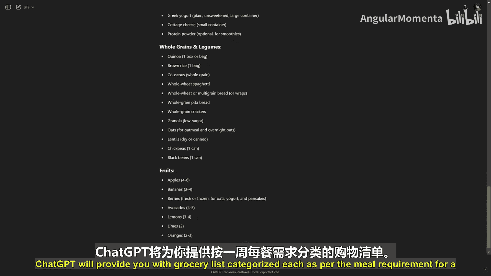

ChatGPT for Business and entrepreneurs ChatGPT is a versatile tool for business owners and entrepreneurs looking to enhance their productivity。

 develop strategies， or improve customer interactions。

From writing business plans to generating marketing ideas， ChaGPT helps with a wide range of tasks；

 it can save time， provide fresh insights， and help small business owners and entrepreneurs make more informed decisions。

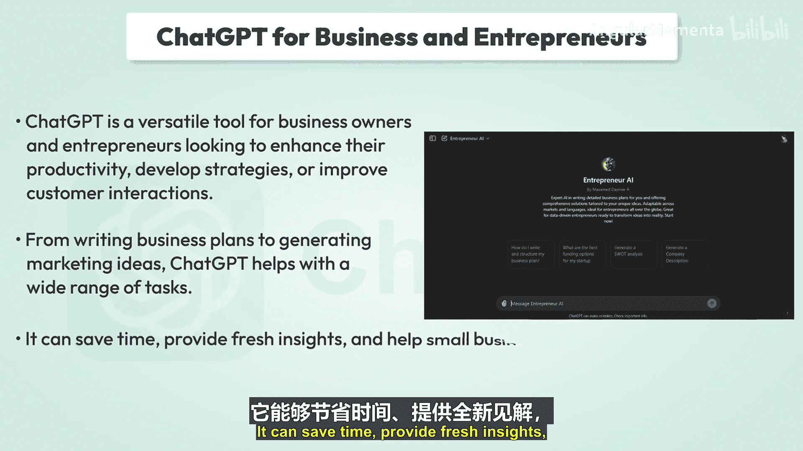

Let's see this in action with a specific example。 Let's say you are thinking of online fitness coaching services。

 but you don't know the business plan， so you provide chat GPT a prompt that can you help me create a business plan for a new online fitness coaching service？

ChatGPT quickly generates a detailed business plan。

 helping entrepreneurs save time and gain clarity on how to move forward with their business ideas。

By offering a structured approach， Chat GPPT ensures that nothing is left out in the planning phase。

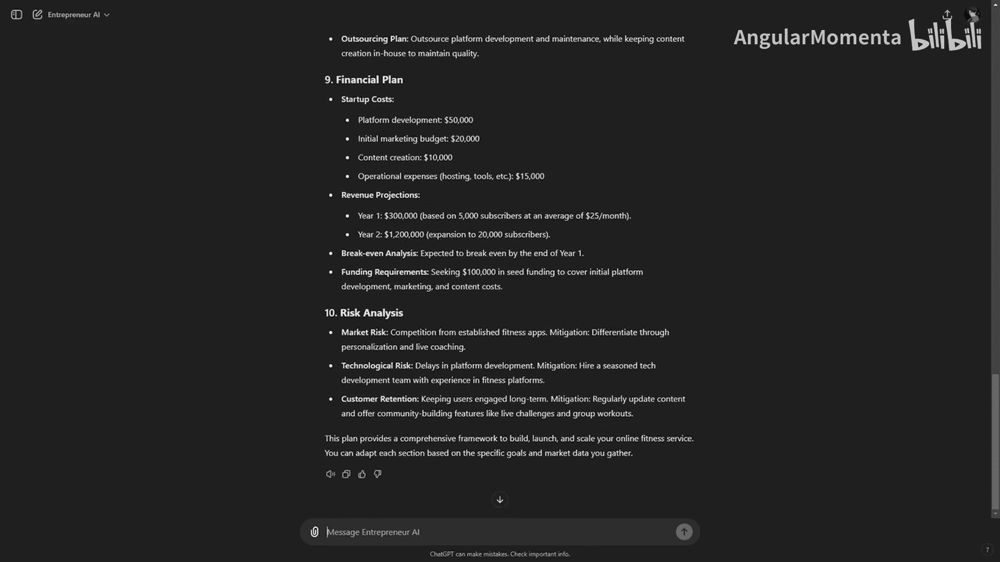

ChatGPT for organizations chattGPT can be a transformative tool for organizations of all sizes。

 whether it's automating routine tasks， enhancing internal communications。

 supporting decision making processes， or improving employee training。

 chat GPPT is a valuable assistant。By providing quick responses， generating insightful reports。

 and offering recommendations， it can help organizations run more smoothly。

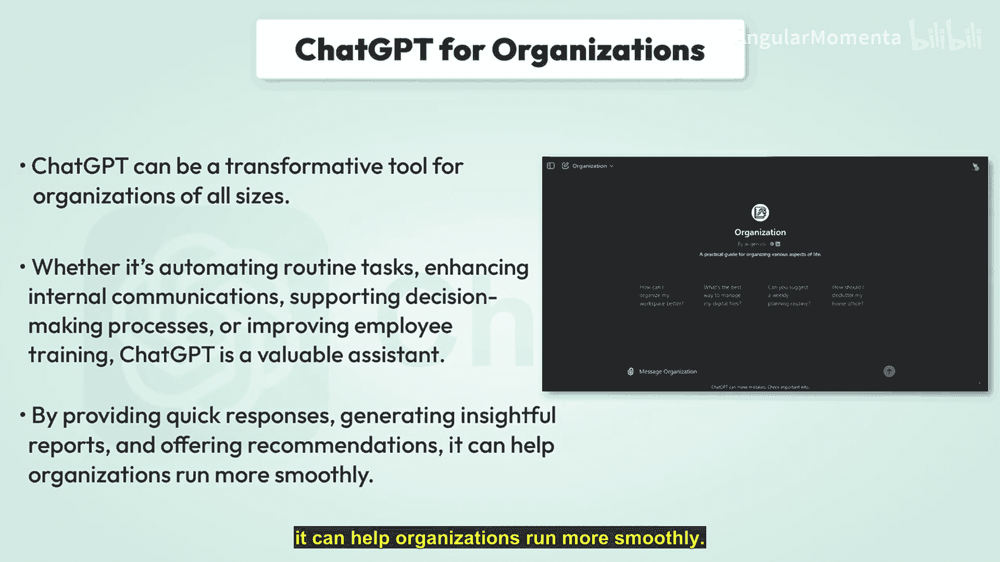

Let's take an example in action where in an organization you have to notify the marketing team about the upcoming product launch strategy。

 so you provide a prompt to chat GT that can you draft an internal email to the marketing team outlining our upcoming product launch strategy。

 chatt GPT can help streamline internal communications by drafting clear concise messages。

 It can ensure that important updates are communicated effectively and in a timely manner。

 allowing team members to stay aligned on objectives and tasks。

 how to use chat GPT to summarize books and YouTube videos。

 Imagine this you're preparing for a big project。 but you have several books to read or hours of YouTube videos to go through time is ticking and you need to get to the key points quickly。

 This is where generative AI comes in offering a powerful solution for personalized coaching by helping you summarize content efficiently。

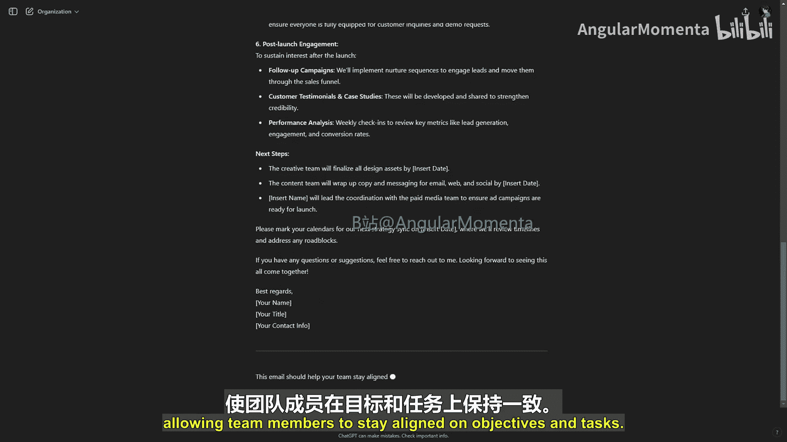

Summarization is a skill that's often overlooked， but it's essential in personalized coaching。

 whether you're trying to learn a new concept， review a book for professional development or simply stay informed with relevant YouTube content。

 Chat GPT can be your go to tool in personalized coaching summarizing plays a huge role in staying organized。

 saving time and focusing on the most impactful information。

 whether you're learning new skills or working on self improvement。

 Chat GPT helps you access the knowledge you need without the overwhelm。

Imagine using both book and video summaries to fuel your personal growth you could read the summary of a book on productivity while quickly reviewing YouTube tutorials on related techniques。

 fitting everything into your busy schedule let me show you how chat GPT can summarize books here's an example of how you can prompt it。

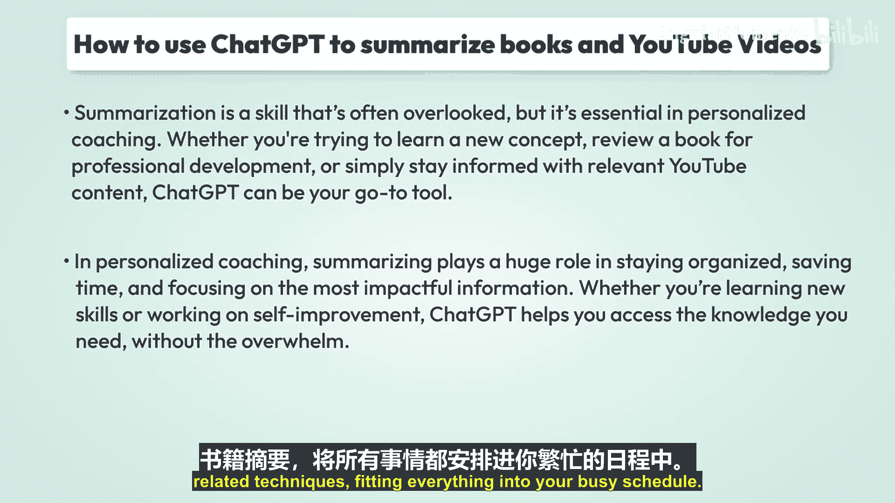

Once you enter the title， chat GPT scans through key themes of the book and delivers a concise yet comprehensive summary。

See how it pulls out the main ideas， giving you the essence of the book in just a few sentences。

This not only saves you time， but helps you quickly grasp core concepts for your coaching sessions。

But it doesn't stop there。You can also use chattGPT to summarize YouTube videos。

 perfect for when you're learning through tutorials or informational content。

 to summarize a YouTube video effectively， all you need is the video's title or description or even the transcript of the video ChatGPT can analyze it and deliver a concise version。

 focusing on the key techniques or lessons。

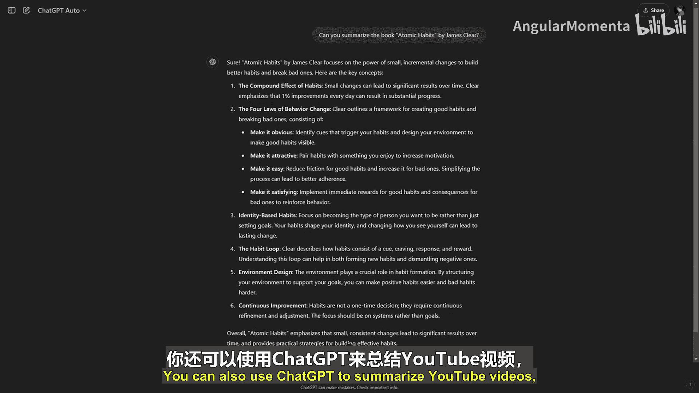

ChatGPT quickly extracts the main points from the video。

 saving you the time of watching it in its entirety while still providing you with the core techniques that can improve your time management。

 summarization with chat GPT isn't just about getting through content faster。

 It's about making the most of your time， gaining clarity on key concepts。

 and using that knowledge to take meaningful actions in your personal and professional life。

With chat GPT by your side， summarizing complex books or long YouTube videos becomes effortless。

 and in your personalized coaching journey， this tool can be a game changer。

 making sure you focus on what truly matters， learning， growing and achieving your goals。

How to use chat GPT to format and clean up files Let us now explore how chat GPT can assist you in formatting and cleaning up files。

 a task that can be tedious and time consuming whether you're working with documents。

 spreadsheets or simple text files Chat GPT can help you clean up content， formatted properly。

 and improve overall readability， Let's say you have a messy text file or document that requires formatting For example。

 imagine you've copied and pasted information from multiple sources。

 and the result is unstructured with inconsistent spacing。

 extra line breaks and random capitalizations。

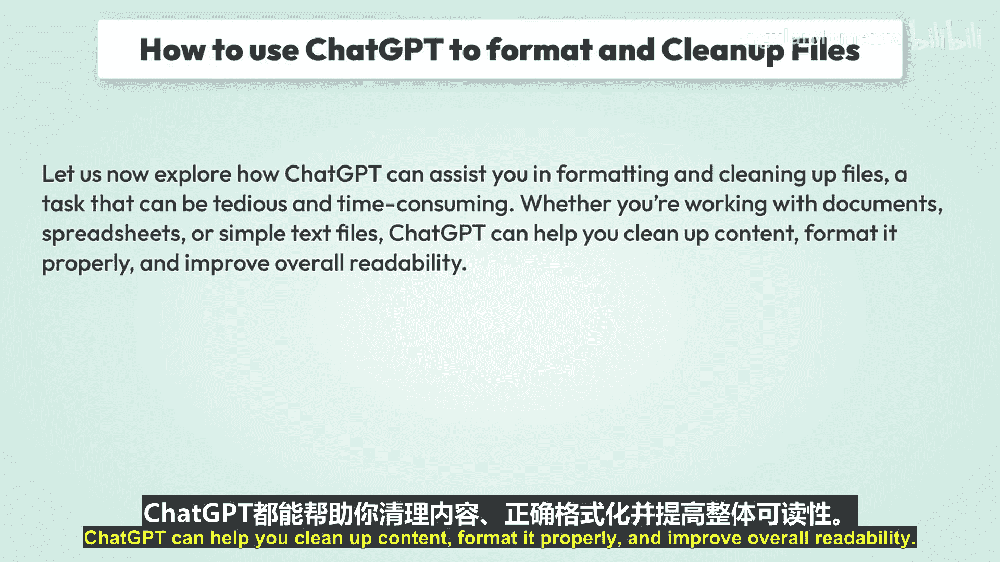

Simply paste the content into chat GPT and ask it to clean up the text。

 this could include fixing capitalization errors， removing extra spaces。

 or even improving the overall structure。As you can see。

 Cha GPT quickly and efficiently cleaned up the text by making it uniform and readable。

This feature is incredibly useful for people working with large documents。

 whether you're writing reports， handling customer data， or organizing research。

But chat GPPT can do even more For instance， if you need to format a document into sections。

 headings or lists， you can provide a simple prompt。

 can you format this text into bullet points for a presentation？

This will help convert large blocks of text into easily readable formats like bullet points or sections。

This feature can be a real time saver in tasks like preparing presentations， creating study notes。

 or cleaning up emails and reports， allowing you to focus on higher level tasks without getting bogged down by formatting issues。

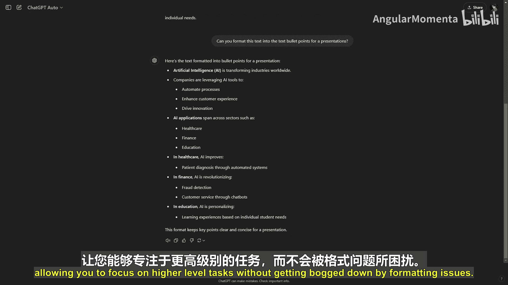

With ChatGT， the process of cleaning up and formatting files becomes smoother， faster。

 and much more efficient。It's a great tool to enhance productivity。

 allowing you to complete projects with greater ease and accuracy。

We will continue the remaining part of the topic in the next video。 Thank you。 Hello learners。

 let's continue from where we left off in the previous video。 Challes of AI driven coaching。

 while chat GPT and other AI tools offer incredible potential for personalized coaching。

 there are a few key challenges to be aware of。These challenges can impact both the effectiveness and the user experience of AI driven coaching。

Lack of human intuition one of the most fundamental limitations of AI， including Cha GPT。

 is its inability to fully replicate human intuition， empathy and understanding。

Coaches in fields like life coaching or mental health need to read between the lines。

 pick up on emotional cues， and offer guidance based on personal experience。

 while chat GPPT can simulate understanding， it lacks the true emotional depth that a human coach can offer。

Example， in life coaching， a human coach may sense hesitation or anxiety in a client's tone of voice and adjust their advice accordingly。

Chat GPT however relies purely on the textual content of the conversation。

 which can missunder emotions or context， handling complex， sensitive issues。

 while chat GPPT can provide advice on general topics。

 it may struggle with highly complex or sensitive issues， for example， coaching around mental health。

 personal trauma or significant life decisions often requires careful handling。

 empathy and nuanced understanding， there's a risk that AI could oversimplify these issues or give advice that may not be appropriate for the situation。

Example， if someone seeks guidance on coping with grief。

 a human coach might adjust their approach based on their relationship with the client and past conversations。

 Chat GPT can offer generic support， but may lack the depth needed for truly impactful emotional support。

 data privacy concerns。 with AI tools like chat GPT。

 There are always concerns about data privacy and security。

Users may be hesitant to share personal information with an AI。

 especially if they are uncertain about how their data will be used or stored。In coaching。

 where trust is critical， these concerns can create barriers to fully embracing the technology。

Example， a fitness client might be reluctant to share health related data or sensitive goals if they're unsure whether this information is being securely stored or potentially shared with third parties。

 dependence on AI。Relying heavily on AI tools can sometimes lead to overdependence。

 where users stop seeking human guidance altogether。 This might not always be the best approach。

 especially in areas where human insight， empathy or creativity is needed。Example。In career coaching。

 a client might over rely on chat GT for job search advice and fail to seek mentorship from real professionals in their industry。

 which could limit their growth， bias in AI models。

 AI models like chat GPT are trained on large dataset sets from the internet。

 which can contain inherent biases， these biases may surface in coaching。

 affecting the fairness or appropriateness of the advice given。

 especially when it comes to sensitive topics like career development。

 gender roles or cultural issues。Example in a professional coaching session。

 chat GT may inadvertently offer advice that reflects biases based on outdated gender roles or stereotypes。

 which could negatively impact the user's experience。

 how technology will evolve in the future while these challenges are real。

 the future of AI and coaching looks incredibly promising。

Let's take a look at how we expect AI driven coaching technology to evolve in the coming years。

Increased emotional intelligence Future advancements in AI are likely to include more sophisticated emotional intelligence。

 allowing AI models like chat GPT to better interpret and respond to emotional cues。

This would involve detecting sentiment， mood， and context more accurately through natural language processing。

 making interactions more meaningful and empathetic。

Example future versions of chat GPT might not only provide advice。

 but also adjust its tone and recommendations based on the user's emotional state， offering comfort。

 encouragement or even pausing to ask if the user is feeling okay。Hybrid coaching models。

We're likely to see the rise of hybrid models where AI assists human coaches rather than replacing them。

 AI could handle routine tasks， provide data drivenn insights or offer initial recommendations。

 while human coaches focus on the more complex， emotional or personalized aspects of coaching。

Exle In a career coaching scenario， chat GPT could generate data on market trends， job openings。

 or skill gaps， while the human coach provides personalized strategies based on the client's unique strengths and circumstances。

More personalization through data。As AI becomes more advanced， personalization will reach new levels。

 future AI systems will be able to integrate more complex data sources such as health data。

 performance analytics， or even biometrics， to provide highly individualized advice and plans。

Example， a future fitness coach could use real time biometric data from wearable devices to offer precise。

 personalized recommendations， like adjusting workout intensity or suggesting rest periods based on the user's physical condition。

Semless integration with everyday life AI tools will become even more deeply integrated into everyday activities through smart devices。

 wearables， and home assistances。This will allow for continuous real time coaching。

 making the experience more seamless and less reliant on dedicated sessions。Example。

Imagine your AI coach reminding you to hydrate after detecting a lack of water intake。

 based on your smart bottle， or suggesting stress relief exercises when your wearable senses elevated heart rates。

Imrovveed privacy and ethical standards as AI technology advances。

 we can expect stricter regulations and improved ethical standards surrounding data privacy AI systems will likely incorporate more transparent data usage policies。

 ensuring that users feel secure when sharing personal information。Example。

Future coaching platforms could offer end to end encryption for all interactions and allow users more control over how their data is stored。

 shared， and used， fostering greater trust。AI collaborating with other AIs。In the future。

 we might see AI systems collaborating with each other to offer even more comprehensive coaching experiences。

ChatGPT could work alongside specialized AI tools for fitness， mental health， career planning。

 and more， offering a truly multidimensional coaching service。Example。

 a fitness AI could track a user's progress， while chat GPT focuses on mental coaching， motivation。

 and encouragement， offering a balanced coaching experience that addresses both physical and mental wellness。

We will continue the remaining part of the topic in the next video。 Thank you。 Hello learners。

 let's continue from where we left off in the previous video。 Cha。

 GT and similar AI tools are revolutionizing the world of coaching。

 offering personalized on demand guidance across various fields like career development。

 fitness and life coaching。We explored how chat GPT tailorors its responses to different learning styles。

 provides real-time feedback， and continuously improves through user interactions。

 looking to the future， AI coaching is set to become even more personalized， emotionally intelligent。

 and seamlessly integrated into our daily lives， offering greater value with less friction。

 as AI evolves， the potential for chat GT and generative AI and coaching will only grow。

 bringing us closer to a world where personalized data driven guidance is available to everyone anytime anywhere。

Pplexity AI for research and writingri Introduction In our daily lives research and writing play pivotal roles across various domains。

 from academia to journalism and from business proposals to creative writing。

 these activities are the bedrock of knowledge creation， enabling us to analyze information。

 articulate ideas， and communicate effectively。However。

 the traditional methods of conducting research and writing are often time consuming and require sifting through vast amounts of data。

 this is where artificial intelligence steps in， transforming the way we approach these critical tasks AI has revolutionized research and writing by automating routine tasks enhancing accuracy and providing new ways to explore and organize information these AI tools help users navigate through extensive data sets。

 allowing them to focus on deeper analysis and creative expression。

One such tool that is making waves in the research and writing community is perplexity AI Unlike traditional search engines。

 perplexity AI offers a conversational approach that tailors responses to your specific needs。

 with features like Copilot which guides you through the research process by asking clarifying questions。

 Perplexity AI ensures that you don't just get quick answers。

 but also deep insights that are directly relevant to your query。

It's like having a research assistant who knows exactly where to look and how to present the information you need。

 whether you're working on a literature review， exploring new theories or simply looking for reliable sources。

 perplexity AI streamlines your research， making the process faster and more efficient in a world where information is abundant but time is limited。

 tools like perplexity AI are transforming research and writing， making them not just more efficient。

 but also more insightful， we will continue remaining part of the topic in the next video， Thank you。

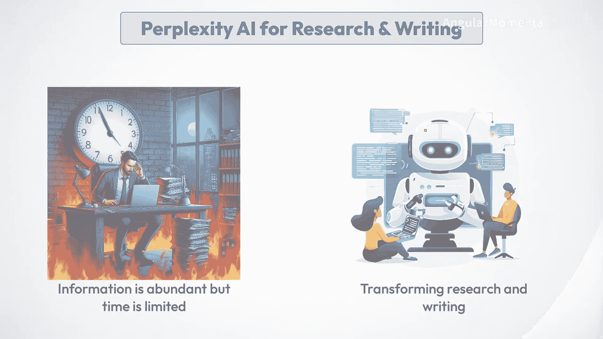