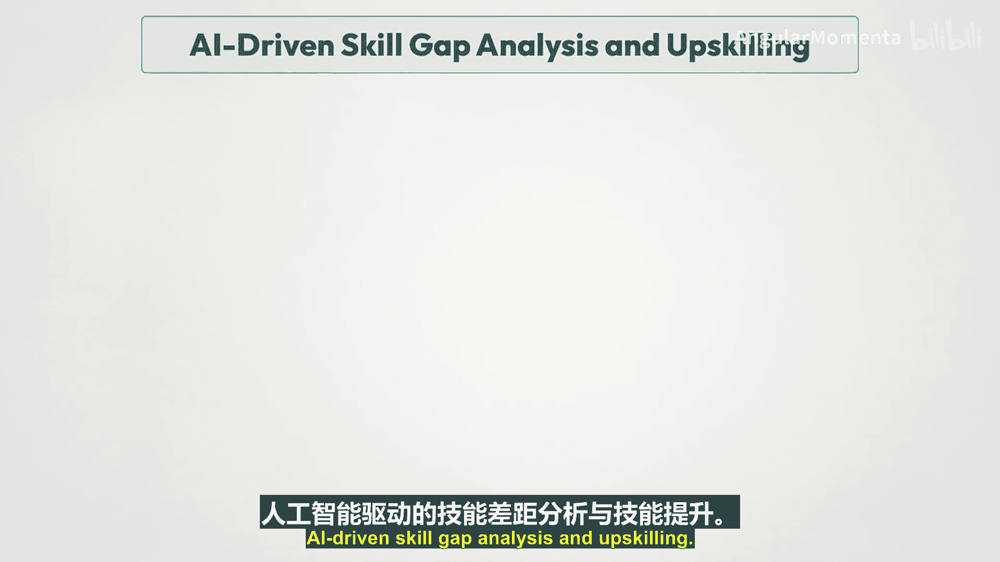
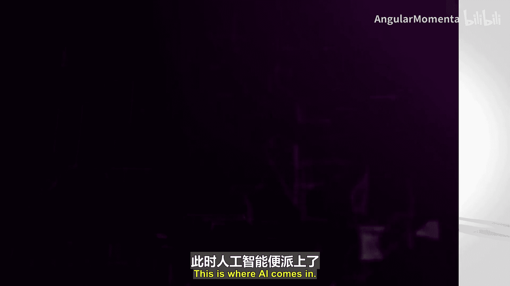
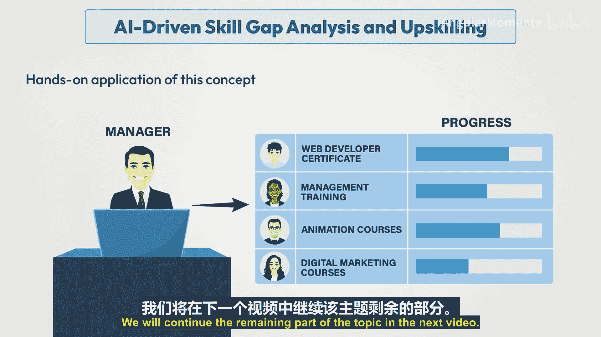

# 【EDUCBA】将生成式人工智能应用于辅导、研究与表现提升-｜-Apply-Generative-AI-for-Coaching,-Research,-p05-02_02_01_生成式人工智能绩效管理导论--BV1bwFSzNEAo_p5-

Performance management with generative AI generative AI is set to revolutionize performance management by significantly enhancing efficiency。

 fairness and the overall quality of feedback within organizations as companies increasingly integrate AI technologies。

 the traditional methods of performance evaluation。

 long criticized for their subjectivity in consistency and labor intensive nature are undergoing a profound transformation at the forefront of this change。

 generative AI leverages cutting- edge machine learning algorithms to automate and streamline various facets of performance management this includes crafting personalized development plans delivering real-time feedback and providing data-dven coaching insights by analyzing vast amounts of performance data。

 AI generates unbiased evaluations and actionable recommendations fostering a culture of continuous learning and growth this shift towards intelligent performance management not only alleviates the administrative burden on。

Managers， but also creates a more engaging and supportive environment for employees。

With the integration of generative AI， organizations can move beyond the traditional focus on completing paperwork to prioritize meaningful conversations and deeper relationships between managers and employees。

 however this evolution is not without its challenges issues such as data privacy。

 potential biases embedded in AI algorithms and the necessity for human oversight remain critical concerns。

 as organizations embrace AI drivenriven performance management。

 they must navigate these challenges thoughtfully to ensure that AI acts as a co-pilot。

 enhancing human capabilities rather than replacing them in this rapidly evolving landscape。

 the responsible deployment of generative AI will be pivotal in unlocking its full potential while upholding trust and integrity within the workplace the future of performance management lies in this delicate balance between leveraging AI's power。

 and maintaining the human touch that drives genuine employee engagement and development。

Integrating generative AI and performance management as organizations strive to optimize their performance management systems。

 integrating generative AI emerges as a powerful strategy to enhance accuracy， personalization。

 and predictive capabilities。This integration not only streamlines traditional processes。

 but also introduces innovative methods for evaluating and developing talent Below are key areas where generative AI is making a significant impact one AI powered performance reviews generative AI is redefining the way performance reviews are conducted by bringing precision。

 objectivity and consistency to the evaluation process Tra performance reviews often suffer from biases and inconsistencies。

 but with AI， these evaluations are grounded in data-dven insights。

By analyzing employee performance data in real time。

 AI can generate comprehensive and unbiased performance reports that highlight strengths。

 areas for improvement， and actionable feedback。This ensures that performance reviews are not only fairer but also more constructive。

 enabling employees to understand their progress and managers to make informed decisions。Two。

 personalized development plans。One of the most transformative applications of generative AI and performance management is its ability to create personalized development plans for employees。

AI can analyze an individual's performance metrics， learning styles。

 and career aspirations to generate tailored growth paths。

These plans might include specific training programs， skill development opportunities。

 and mentoring suggestions that align with both the employee' goals and the organization's objectives。

By providing a roadmap for continuous improvement， AI drivenn development plans empower employees to take charge of their professional growth while ensuring that their development is aligned with the organization's strategic needs。

Three， predictivetive analytics for employee potential generative AI extends beyond current performance to predict future potential。

 offering valuable insights into an employee's career trajectory。By leveraging predictive analytics。

 AI can assess an employee's likelihood of success in various roles。

 identify high potential individuals， and suggest optimal career paths This foresight allows organizations to engage in proactive succession planning。

 ensuring that the right talent is nurtured for future leadership roles。Additionally。

 AI generated predictions can help identify skill gaps early on。

 allowing for targeted interventions that enhance an employee's readiness for upcoming challenges and opportunities we will continue the remaining part of the topic in the next video。

 thank you。Value propositions of AI and performance management Art intelligence AI is reshaping how businesses operate across all functions。

 and performance management is no exception。In this section we will explore the key value propositions of integrating AI into performance management。

 we'll discuss how AI can mitigate human biases， improve the identification of high potential employees and provide a more granular analysis of employee strengths and weaknesses these AI capabilities not only make performance evaluations more accurate and objective but also ensure that employee development is aligned with organizational goals。

 so let's dive into how AI can drive value in modern performance management practices bias avoidance。

Let's start by discussing one of the biggest challenges in performance management。

 biasas Despite managers' best intentions， human bias inevitably creeps into performance evaluations。

 this can take the form of the halo effect， where a manager's overall positive impression of an employee affects their evaluation of specific skills or this severityity and leniency biases。

 where a manager tends to either rate everyone too harshly or too generously。

Now AI offers an impressive solution to these biases。

 by analyzing vast data sets and making objective comparisons。

 AI can detect patterns of inconsistency and performance reviews。For example。

 using scatterplot visualizations， AI can cross reference self assessments with managerial reviews and pinpoint discrepancies that may signal bias。

Imagine a scenario where a manager consistently rates a particular group of employees higher than others。

 despite there being no difference in performance according to objective metrics。

AI can flag this and prompt the manager to reevaluate。

 ensuring that performance is judged more fairly and consistently across the board。

By flagging potential biases early on， organizations can take corrective actions before these biases have a lasting impact on employees career progression。

As a result， performance reviews become not only more accurate but also fairer。

 which boosts overall employee trust in the system。High potential employee identification Moving on。

 let's talk about the identification of high potential employees or highpos Traditionally。

 identifying highpos has been a subjective process。

 often reliant on managers' gut feelings or their personal knowledge of an employee's past performance。

While experience and intuition certainly play a role， they can sometimes overlook key talent；

 AI offers a data driven systematic way to identify these high potential employees。

By analyzing an employee's past performance data， skills， competencies， and even feedback from peers。

 AI can make recommendations on who may be suitable for leadership roles or more challenging projects。

Imagine a large company with thousands of employees manually assessing each employee's potential would take an enormous amount of time AI。

 however can process all this data quickly， scanning for patterns that indicate a potential match for more significant responsibilities For instance。

 an AI system might recommend a junior employee for a leadership development program based on their high engagement。

 consistent performance improvements and strong peer feedback。

 even though their manager may not have immediately recognized these qualities。

This not only saves time， but also ensures that potential future leaders are recognized and nurtured at the right time。

 making talent management more strategic and inclusive， by eliminating some of the guesswork。

 organizations can be more confident in promoting the right people。

 improving both individual and organizational performance。Strengths and weaknesses analysis。

Traditional performance reviews often focus on a general overview of performance。

 but they may lack the granularity required for truly personalized development plans。

This is where AI can really shine using advanced data analysis techniques。

 AI can synthesize information from multiple sources， whether it's feedback from peers。

 project outcomes or even real-time performance metrics to give a much clearer picture of an employee's specific strengths and areas that need improvement For example。

 imagine an employee who consistently excels in project management but struggles with communication in team meetings。

AI can spot this trend by analyzing feedback from different projects and meetings。

 enabling managers to create a targeted development plan。

 rather than just telling the employee they need to improve communication。

The manager can now offer specific training and coaching sessions focused on public speaking or team collaboration。

 while also encouraging the employee to continue honing their project management skills。

By offering this level of detailed analysis， AI helps ensure that employees are receiving the right kind of support and development the more personalized and actionable the feedback。

 the better positioned employees are to grow in their roles this fosters a culture of continuous improvement not just for the individual but for the entire organization we will continue the remaining part of the topic in the next video Thank you Hello learners。

 let's continue from where we left off in the previous video I strategy for AI and performance management successfully implementing AI and performance management requires more than just choosing the right technology It's about creating a strategy that ensures seamless integration and long-term success In this section we'll focus on a phased approach that enables organizations to adopt AI incrementally manage change effectively and measure the return on investment or ROI as AI becomes embedded in performance processes by approaching AI adopt。

Strategically， organizations can minimize disruption， gain buy in from stakeholders。

 and maximize the benefits of AI and driving business performance Let's explore how this can be achieved step by step phased approach implementingplement AI and performance management is not a one size fits all process It requires careful planning。

 and this is where the phased approach comes into play a popular model that organizations often follow is the crawl walk。

 run model。This strategy emphasizes starting small with manageable projects and gradually scaling up AI capabilities in the crawl phase。

The organization begins with foundational tasks like identifying which performance management processes can benefit most from AI for instance。

 an organization might begin by automating routine administrative tasks like generating performance reports。

This phase is about testing the waters， ensuring that the organization has the necessary infrastructure and data quality for AI to work effectively。

Once comfortable with basic AI applications， the organization moves to the walk phase。

 here the scope of AI implementation broadens。Organizations might start using AI to provide more data driven insights like detecting patterns in employee performance or identifying skill gaps At this stage。

 AI is introduced into decision making processes， but human oversight remains a critical component Finally the run phase is where AI becomes fully integrated into performance management processes AI not only automates tasks and provides insights。

 but also starts to play a proactive roles such as predicting future employee performance trends or identifying high potential employees in real time。

By following this phased approach， organizations can gradually build their AI capabilities without overwhelming their systems or their teams。

Change management， a vital aspect of AI implementation。

 AI introduces new ways of working which can often meet resistance。

 especially when it comes to performance evaluations。

Employees and managers may feel uncertain or even anxious about how AI might affect their roles or decisions。

To manage this change effectively， organizations need a clear communication plan。

 it's important to explain why AI is being introduced and how it will benefit not just the organization。

 but also the employees。For example， AI can help make performance reviews more objective。

 reducing personal biases and ensuring a fairer evaluation process。

Training is another crucial aspect of change management；

 managers and HR professionals need to understand how to use AI tools effectively and how to interpret the insights these tools provide。

This helps them maintain a sense of control and confidence over the evaluation process for employees。

 it's important to clarify that AI is there to assist in decision making not to replace human judgment entirely by keeping people at the heart of the change organizations can mitigate fears and ensure smoother adoption of AI tools finally engaging employees throughout the process is key allowing them to provide feedback on AI tools and be part of the implementation journey helps build trust。

This participatory approach not only reduces resistance。

 but also encourages innovation as employees offer ideas for improving AI systems based on their experiences。

Measuring ROI one of the most immediate metrics to track is time savings AI can significantly reduce the time managers spend on repetitive tasks like filling out performance reviews。

 generating reports or analyzing data if you can quantify the time saved and translate that into productivity gains。

 you'll have a clear indicator of ROI。Another key metric is decision accuracy AI helps reduce biases in performance reviews。

 which in turn leads to more accurate assessments of employee potential。

Over time you can measure how AIdven insights have improved the quality of decisions regarding promotions。

 development plans， and even team structures， for example。

 has the organization seen better retention rates for high potential employees since using AI or are more employees receiving the right kind of coaching to improve performance。

 finally it's essential to look at employee engagement and satisfaction as a measure of AI's success。

 AI can support more personalized development plans leading to employees feeling more valued and motivated。

Surveys， feedback forms， and performance data can give organizations a sense of how AI has impacted employee morale and engagement。

Improved employee satisfaction not only increases productivity。

 but also enhances organizational culture and retention rates。

 which are critical measures of long termm ROI We will continue the remaining part of the topic in the next video Thank you Hello learners。

 let's continue from where we left off in the previous video。AI driven employee engagement。

Generative AI offers innovative solutions to enhance employee satisfaction。

 deliver real time feedback， and optimize recognition and reward systems。

 creating a more motivated and connected workforce。One。

 En employee satisfaction generative AI plays a pivotal role in understanding and improving employee satisfaction by analyzing vast amounts of data from surveys。

 feedback forms and even informal communication channels。

AI can detect patterns in employee sentiment， identify potential issues before they escalate。

 and suggest targeted interventions to boost morale by personalizing engagement strategies based on individual and team needs。

 AI helps create a work environment where employees feel valued， heard and supported。

This proactive approach to managing employee satisfaction not only reduces turnover。

 but also enhances overall productivity and organizational culture。Two， real time feedback loops。

Traditional feedback mechanisms often fall short due to their infrequency and the lag between performance and feedback generative AI revolutionizes this process by enabling continuous real-time feedback loops。

 through AI powered platforms， employees can receive immediate actionable feedback on their performance allowing them to make adjustments and improvements on the go。

This instant feedback mechanism fosters a culture of continuous learning and development。

 where employees are constantly aware of their performance and areas for growth； moreover。

 real time feedback empowers managers to address issues promptly。

 leading to more effective and responsive performance management。Three。

 AI and recognitiontion and reward systems。Recognition and rewards are essential components of employee engagement。

 and generative AI enhances these systems by making them more personalized and impactful；

 AI can analyze performance data， peer feedback， and employee preferences to generate tailored recognition and reward suggestions that resonate with individual employees。

Whether it's identifying the right time to acknowledge an employee's achievements or selecting rewards that align with their interests。

 AI driven systems ensure that recognition is timely， meaningful and motivating。

By automating and personalizing these processes， AI not only boosts employee morale。

 but also strengthens loyalty and commitment to the organization。

AI drivenri skill gapap analysis and upskilling In today's fast paceaced business world。

 employee development is key to staying competitive。

 but how do you know which skills your team needs to improve this is where AI comes in。

Let's explore how AI driven Ski gapap analysis is transforming the way organizations upskill their workforce。

First let's talk about identifying skill gaps AI analyzes employee performance data comparing it to both internal and industry benchmarks by doing this。

 AI can pinpoint where individual employees or even entire teams are falling behind。

 highlighting specific areas for improvement。This goes beyond simple evaluations。

 giving companies a data driven approach to talent development once those gaps are identified。

 AI helps craft personalized learning paths for each employee。

Using advanced algorithms it tailors learning recommendations based on each person's unique needs。

 career goals， and learning style， whether it's suggesting online courses， internal workshops。

 or on the job training， AI creates a targeted approach to upskilling。For example。

 companies like IBM have already implemented AI powered upskilling solutions；

 their system identifies skill gaps and recommends learning modules from their internal library。

 this not only boosts employee performance but also prepares them for future roles within the organization you can also use practical tools like Coursera。

 LinkedIn learning and skilloft， platforms that employ AI to recommend learning paths based on an employee's skill set。

These platforms help organizations ensure that their teams are always learning the most relevant and impactful skills。

 Now let's look at a handson application of this concept。

 Imagine you're a manager tasked with upskilling your team。By using an AI powered platform。

 you can input your team's current performance data and the system will recommend specific courses。

 certifications， or training programs you can then track their progress and adjust the learning paths as needed with AIdriven skill gapap analysis companies can ensure their employees stay competitive in an ever-changing market this approach doesn't just benefit the organization it empowers employees by providing them with the tools they need to grow in their careers the future of upskilling is personalized data- drivenriven and powered by AI。

We will continue the remaining part of the topic in the next video， thank you。

