# 【EDUCBA】将生成式人工智能应用于辅导、研究与表现提升-｜-Apply-Generative-AI-for-Coaching,-Research,-p06-02_03_01_基于生成式人工智能定制性能指标--BV1bwFSzNEAo_p6-

Hello learners， let's continue from where we left off in the previous video。

 customizing performance metrics with generative AI。

In an era where organizational agility and precision are key。

 customizing performance metrics through generative AI offers a new level of flexibility and accuracy in performance management by leveraging AI companies can develop dynamic and context specific key performance indicators。

 KPIs， benchmark performance against industry standards。

 and adapt metrics to suit diverse work environments。

 including remote and hybrid models One dynamic KPI generation。

Traditional KPIs are often static and may not fully capture the evolving nature of job roles and business objectives。

Generative AI enables the creation of dynamic KPIs that can adapt to changing circumstances in real time。

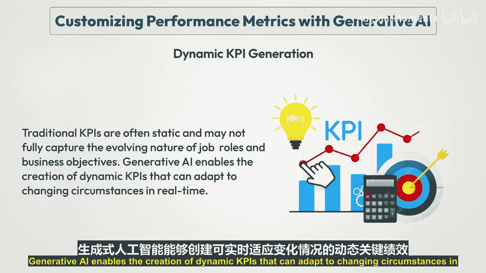

By analyzing various data sources such as project outcomes， market conditions。

 and individual employee performance， AI can generate and update KPIs that are both relevant and aligned with current business goals。

This dynamic approach ensures that employees are evaluated based on metrics that reflect the most critical aspects of their work at any given time。

 allowing for a more accurate and responsive performance assessment。t2。AI powered benchmarking。

Benchmarking is a critical aspect of performance management。

 allowing organizations to measure their performance against industry standards or competitors generative AI enhances this process by automating the collection and analysis of benchmarking data。

 providing insights that are more precise and timely。

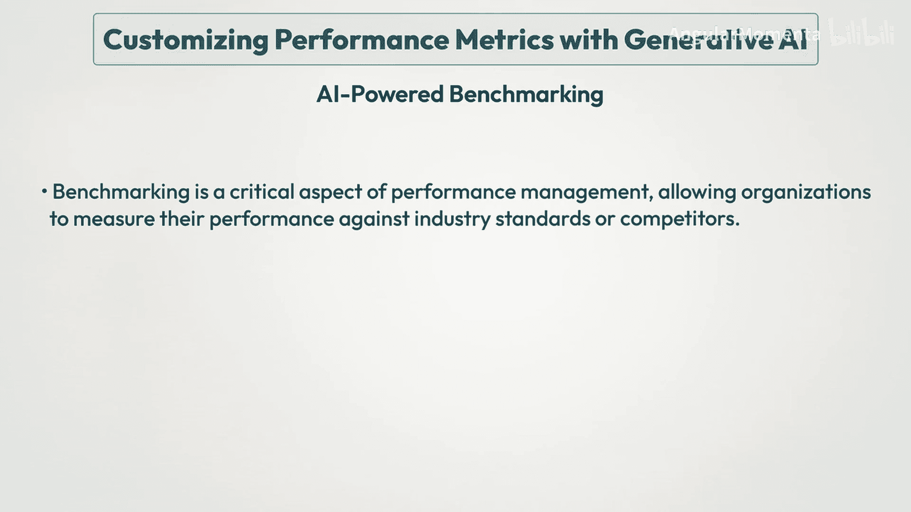

AI can generate benchmarks that consider a wide array of factors， including company size。

 industry trends， geographic location， and market conditions。

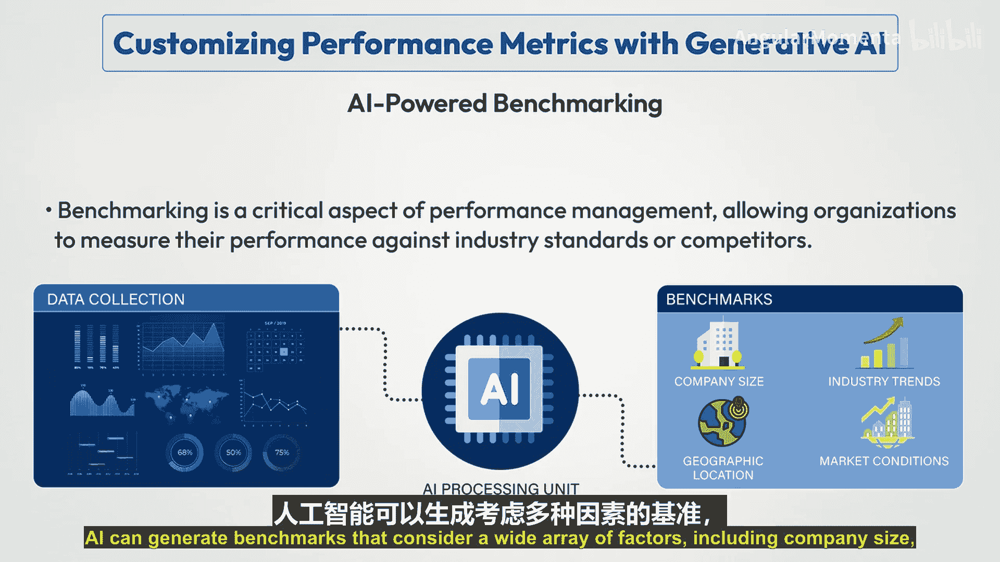

These AI powered benchmarks help organizations set realistic and aspirational performance targets。

 ensuring that their metrics are not only competitive， but also achievable； Furthermore。

 AI can continuously update these benchmarks as new data becomes available。

 ensuring that performance comparisons remain relevant over time。

Three performanceance metrics for remote and hybrid workforces The shift towards remote and hybrid work models has made it increasingly challenging to measure employee performance using traditional metrics。

Generative AI addresses this challenge by customizing performance metrics that are tailored to the unique dynamics of remote and hybrid work environments。

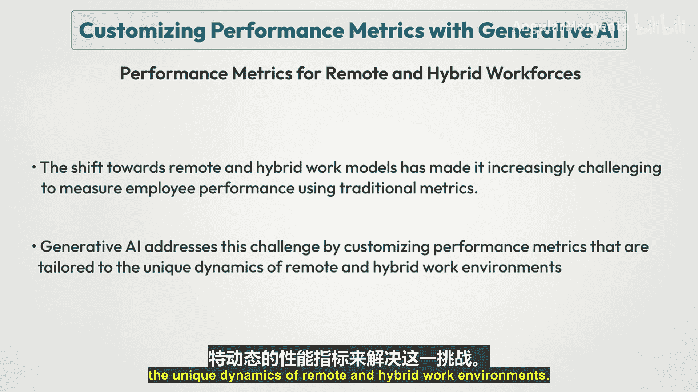

AI can analyze data from various sources such as digital collaboration tools， communication patterns。

 and project management software to create metrics that accurately reflect productivity， engagement。

 and collaboration in these settings。

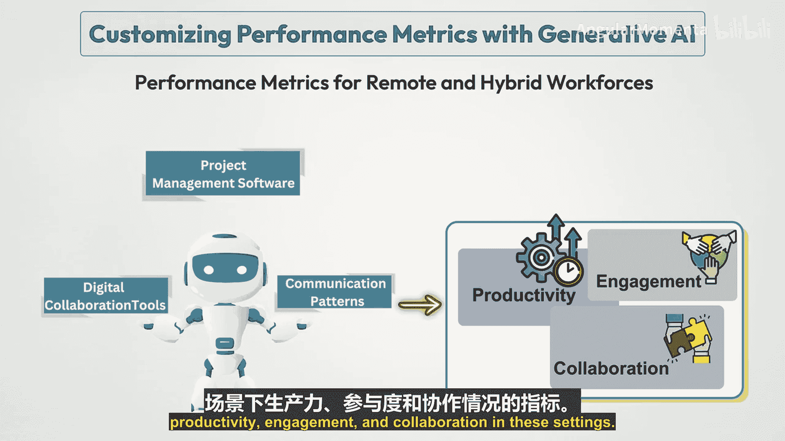

For example， AI can generate metrics that focus on the quality and impact of work。

 rather than merely tracking hours logged。

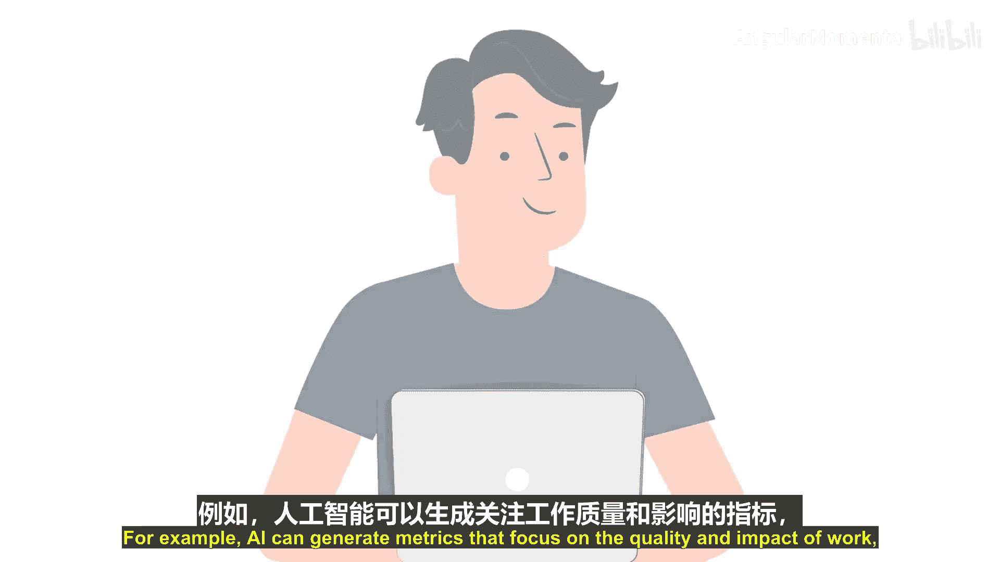

This ensures that employees working remotely or in hybrid arrangements are assessed fairly and effectively based on outcomes rather than presence。

We will continue the remaining part of the topic in the next video Thank you Hello learners。

 let's continue from where we left off in the previous video AI drivenrin performance calibration and benchmarking in today's diverse and rapidly evolving business landscape ensuring consistency and fairness in performance evaluations across departments can be a daunting challenge。

This is where AIdriven performance calibration and benchmarking come into play In this section we'll explore how AI can standardize performance ratings across different teams。

 generate industryspec benchmarks for more informed decision- making and identify inconsistencies in how employees are rated。

 Additionally we'll look at how AI can provide managers with real-time data-driven calibration recommendations to ensure that performance evaluations are both accurate and aligned with organizational standards。

Let's dive into how AI is transforming performance calibration into a more objective data backed process。

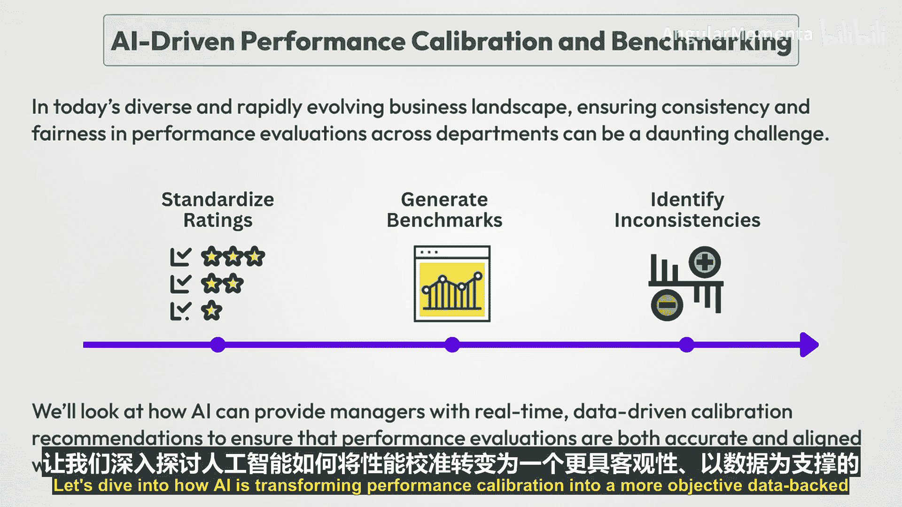

Standardizing performance ratings across departments one of the most critical challenges organizations face in performance management is maintaining consistency in performance evaluations across different teams or departments。

Different managers may have different interpretations of performance criteria。

 leading to discrepancies in how employees are rated。

This inconsistency can lead to feelings of unfairness among employees and make it difficult to compare performance data across the organization。

AI can solve this by introducing standardized evaluation frameworks。

 by analyzing large amounts of performance data， AI can help create a unified model for how performance should be measured across departments。

This ensures that all employees are rated against the same criteria using data driven insights rather than subjective judgments。

For example， AI can analyze historical performance ratings and identify patterns in how managers score employees in similar roles；

 it can then flag discrepancies， allowing HR teams and managers to adjust their evaluation processes this results in a more equitable system where performance is assessed uniformly regardless of which department and employee belongs to。

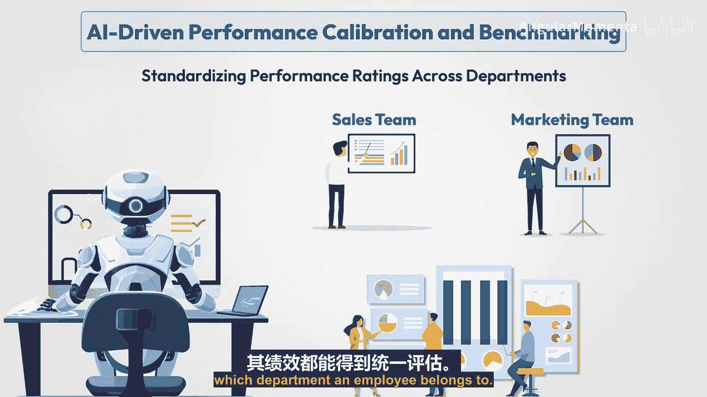

Generating industry specific performance benchmarks。

Performance calibration within a company is crucial。

 but how do you know if your organization is keeping pace with the rest of the industry。

 this is where AI's ability to generate industryspecific performance benchmarks becomes invaluable。

 AI can aggregate and analyze data from multiple sources such as industry reports。

 publicly available performance metrics or even third-party benchmarking services。

 to provide organizations with a clear understanding of how their performance stacks up against competitors。

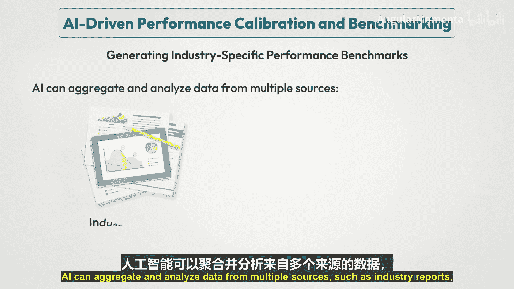

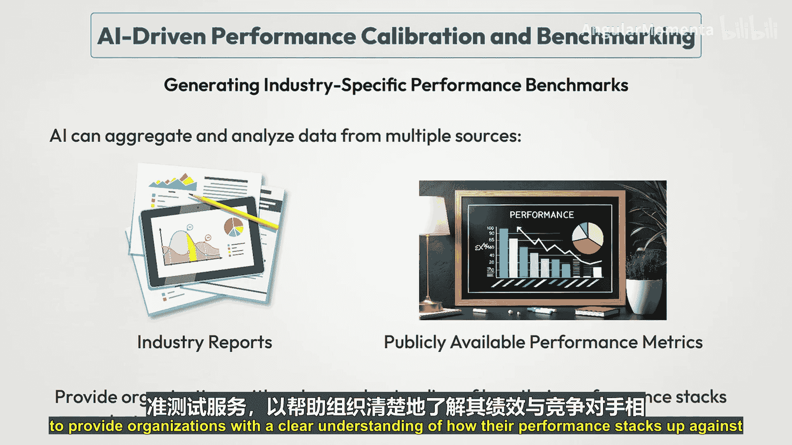

With AI driven benchmarking， companies can compare their employees' performance not only against internal metrics。

 but also against industry standards。This allows managers to identify whether their teams are over or underperforming in critical areas such as productivity。

 innovation， or customer satisfaction。For example， if you're in the retail sector。

 AI can gather industry performance data on customer service metrics and sales efficiency。

Then it can compare your team's performance to these industry benchmarks this kind of insight enables managers to set realistic yet competitive goals for their employees。

 helping the company maintain or gain a competitive edge。

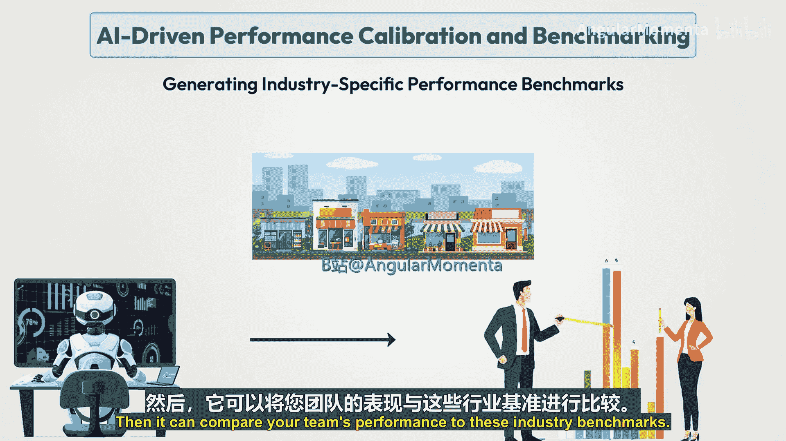

Identifying and addressing rating inconsistencies。Even with well established performance evaluation systems。

 inconsistencies in ratings are inevitable， particularly in large organizations。

Managers might rate employees based on their personal biases。

 or they may simply interpret rating scales differently。

 these inconsistencies not only create confusion but also undermine the integrity of performance evaluations。

 AI can play a key role in identifying and addressing these inconsistencies by analyzing ratings across different managers and departments。

 AI can pinpoint patterns that suggest rating biases， for instance。

 it may detect that a certain manager consistently rates their team higher or lower than other managers in the same department。

 even though objective performance metrics don't support these ratings。

Once these inconsistencies are identified， AI can alert HR teams or provide recommendations for recalibration this helps ensure that performance evaluations are fair and objective。

 with AI organizations can create a more transparent and consistent rating system。

 reducing the risk of employee dissatisfaction and fostering a culture of fairness。

Providing AI assisted calibration recommendations for managers。

 one of the most impactful ways AI can enhance performance calibration is by offering real time data- drivenn recommendations for managers during performance reviews AI can analyze individual and team performance data comparing it with historical performance trends and industry benchmarks。

It then provides managers with insights and recommendations on how to calibrate their ratings。

 For example， if a manager is evaluating an employee who consistently exceeds expectations in project execution。

 but has room for improvement in leadership AI can suggest a balanced calibration the system might recommend an overall high rating with specific coaching tips for developing leadership skills。

 this ensures that managers make wellinformed decisions based on objective data。

 rather than relying solely on personal judgment or incomplete information， Moreoverover。

 AI assisted calibration helps ensure that ratings are more aligned across the organization， if。

 for instance， the system notices that a manager's ratings deviate significantly from those of other managers in similar departments。

 it can prompt the manager to reassess their evaluations this leads to more accurate and fair performance reviews contributing to a culture of accountability and consistency。

 we will continue the remaining part of the topic in the next。

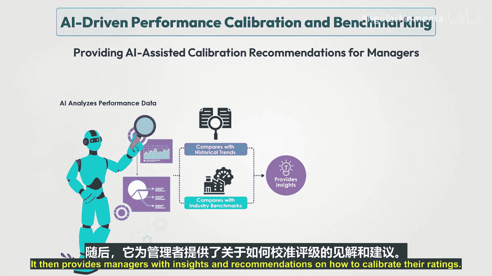

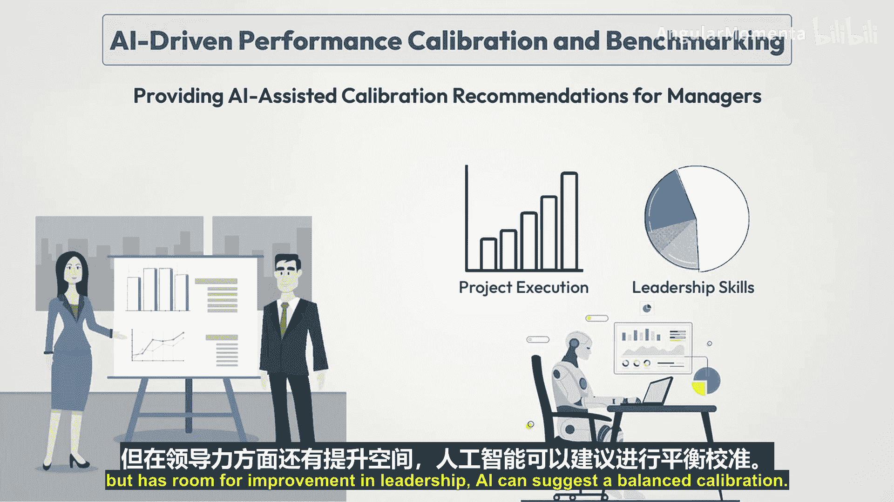

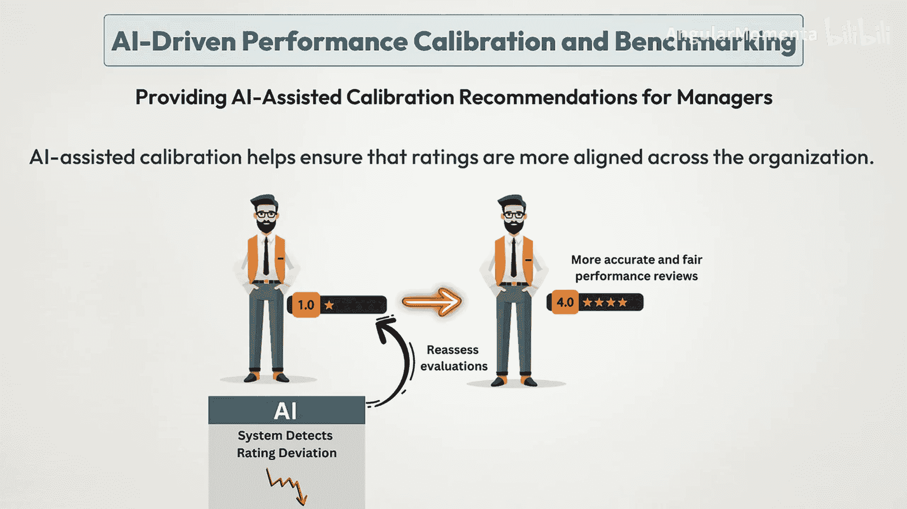

Video Thank you Hello learners， let's continue from where we left off in the previous video evaluating the ROI of AI driven performance management as organizations increasingly adopt AI driven performance management systems。

 evaluating the return on investment ROI becomes essential to understanding the value these technologies bring。

Assessing the success of AI integration involves not only financial metrics。

 but also qualitative benefits such as enhanced employee engagement and improved decision making。One。

 measuring success to evaluate the ROI of AI driven performance management。

 organizations must first establish clear metrics for success。

These metrics should encompass both quantitative and qualitative outcomes。

Quantitative measures may include improvements in productivity， reduction in employee turnover。

 time saved on administrative tasks and enhancements in overall employee performance。

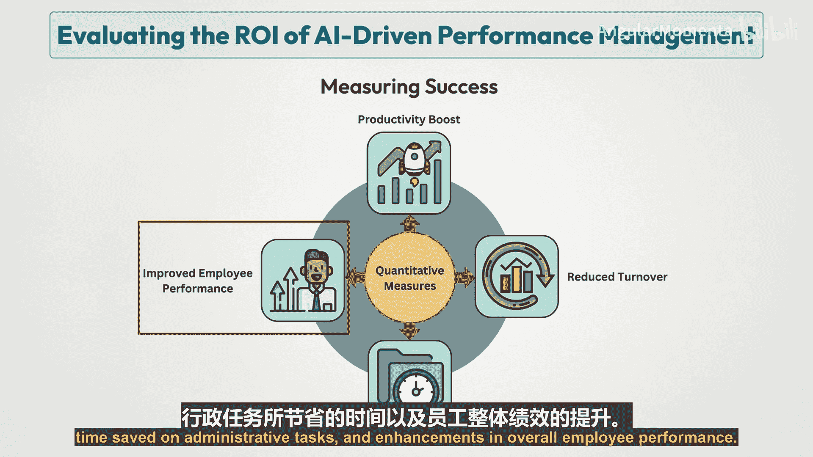

Qualitative measures could involve employee satisfaction， engagement levels。

 and the quality of feedback provided。

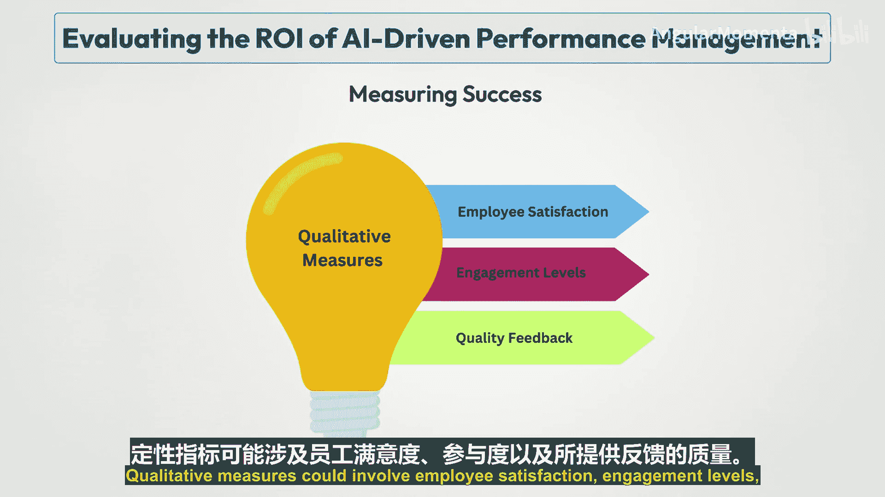

By comparing these metrics before and after the implementation of AI driven systems。

 organizations can assess the direct impact of AI on performance management。Additionally。

 it's important to track how AI driven insights translate into actionable improvements。

 such as more effective development plans or better alignment between individual and organizational goals。

2 costst benefit analysis a thorough costt benefit analysis is critical to understanding the financial impact of implementing AI in performance management。

This analysis should account for both the initial investment in AI technologies， including software。

 integration and training costs， and the ongoing expenses such as maintenance and updates。

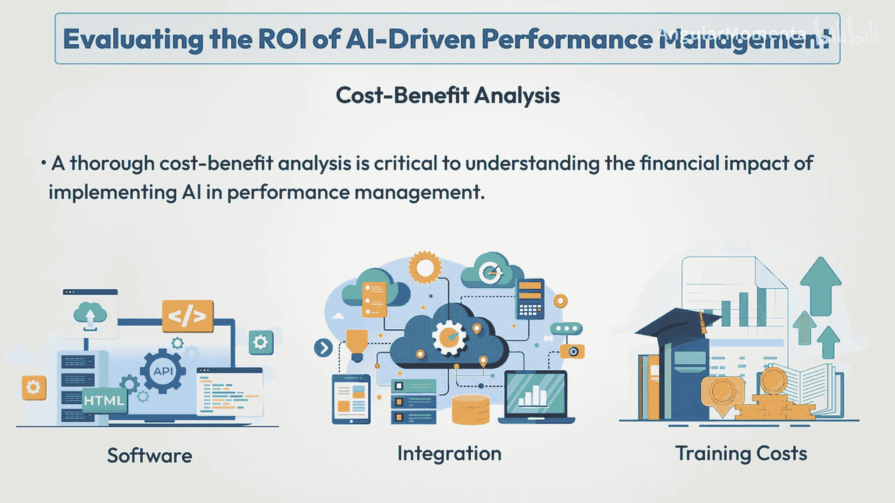

On the benefit side， organizations should consider both direct and indirect gains。

Direct benefits might include cost savings from automating manual processes。

 reducing the need for external consultants， and improving decision making efficiency。

Indirectect benefits could encompass enhanced employee performance， higher retention rates。

 and the long term value of building a more agile and responsive performance management system。

By weighing these costs against the tangible and intangible benefits。

 organizations can determine whether the investment in AI yields a positive return。Three。

 scalability and sustainability。When evaluating the ROI of AI driven performance management。

 it's crucial to consider the scalability and sustainability of the AI solutions in place。

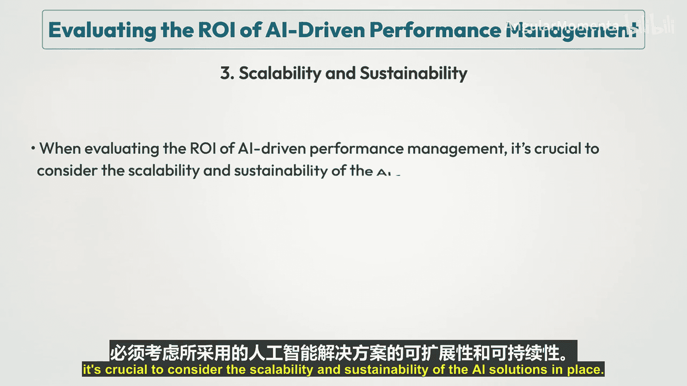

Scalability refers to the AI system's ability to grow and adapt as the organization expands。

 ensuring that the performance management processes can continue to support a larger and more diverse workforce sustainabilitytain involves assessing whether the AI solutions can be maintained over the long term without excessive costs or resource demands。

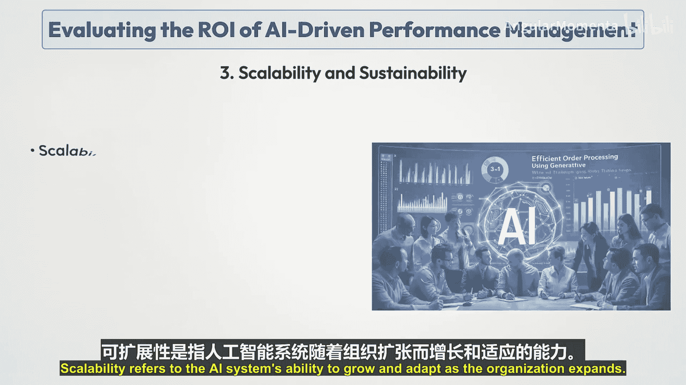

Organizations should evaluate whether the AI tools can be easily updated with new data。

 integrated with other systems， and adapted to evolving business needs。Additionally。

 sustainability includes ensuring that the AI drivenrin processes align with the organization's long- termm goals。

 such as fostering a culture of continuous learning and development。

 a scalable and sustainable AI solution is likely to provide a higher ROI by continuing to deliver value as the organization evolves。

We will continue the remaining part of the topic in the next video Thank you Hello learners。

 let's continue from where we left off in the previous video。

Integrating emotional intelligence in AI performance systems。

Emotional intelligence or EQ has emerged as a critical factor in determining workplace success。

It encompasses self awareness， empathy， social skills。

 and the ability to manage emotions in professional environments。Traditionally。

 measuring and enhancing emotional intelligence has been a human centric process。

 relying on interpersonal interactions and self-assessment， however。

 with the rise of AI drivenrin performance management systems。

 it is now possible to integrate EQ into these systems to provide a more holistic view of employee performance。

In this section， we will explore how AI can assess communication patterns to gauge emotional intelligence。

 provide AI powered coaching for EQ development， and incorporate EQ metrics into overall performance evaluations。

Analyzing communication patterns for EQ assessment。

One of the groundbreaking ways AI can assess emotional intelligence is by analyzing communication patterns。

 both written and verbal。AI tools are increasingly capable of processing large volumes of communication data。

 such as emails， chat messages， and recorded conversations to identify key indicators of emotional intelligence。

For example， an AI system can analyze the tone， sentiment and choice of words in an employee's communications。

 is the language positive or negative， does the employee use inclusive and empathetic phrases or do their responses come across as dismissive or detached？

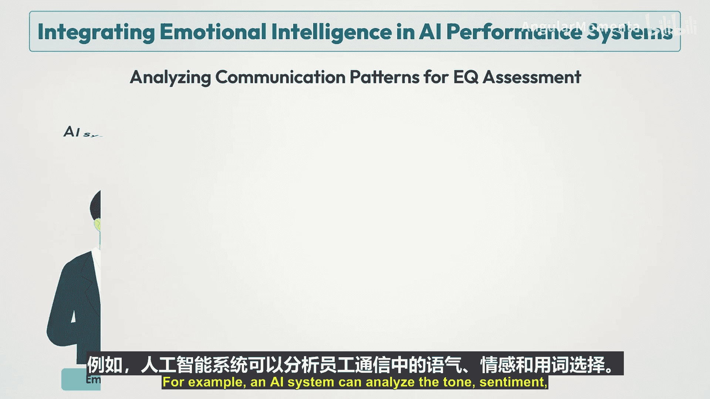

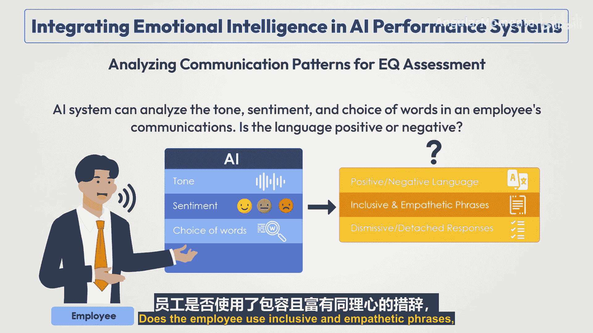

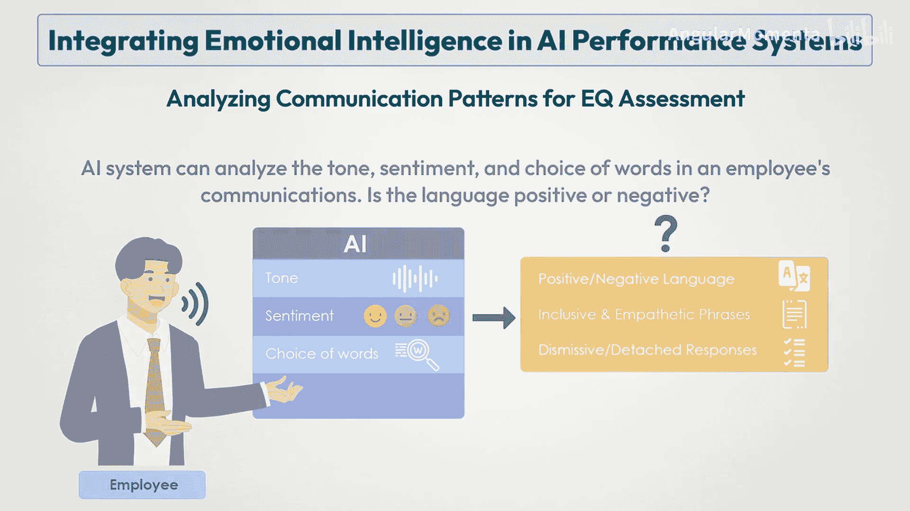

AI can detect nuances like empathy， frustration， or even adaptability by assessing how employees interact with colleagues。

 clients， and management。

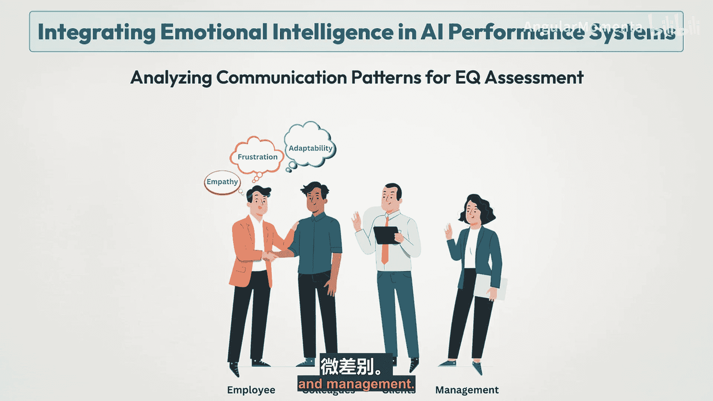

Additionally， AI can analyze response times and patterns to assess how well an employee manages their emotional state under pressure。

Quick， thoughtful responses to challenging situations may indicate a high level of emotional intelligence。

 while delayed or reactive responses could signal areas for development。

These insights provide a non intrusive yet effective way of evaluating EQ without relying solely on self assessment or subjective manager feedback。

AI powered coaching for improving emotional intelligence。

Once AI systems identify patterns and behaviors that indicate an employee's emotional intelligence level。

 they can take it a step further by offering personalized coaching。

 AI powered coaching platforms can provide realtime feedback and tailored recommendations to help employees improve their emotional intelligence。

For example， if the system detects that an employee frequently responds to feedback in a defensive manner。

 it can offer personalized resources， like articles， video tutorials。

 or even interactive simulations， focused on improving emotional regulation and openness to constructive criticism。

 these AI drivenriven coaching platforms can also use conversational AI to simulate difficult scenarios。

 allowing employees to practice responding with empathy， patience and composure。

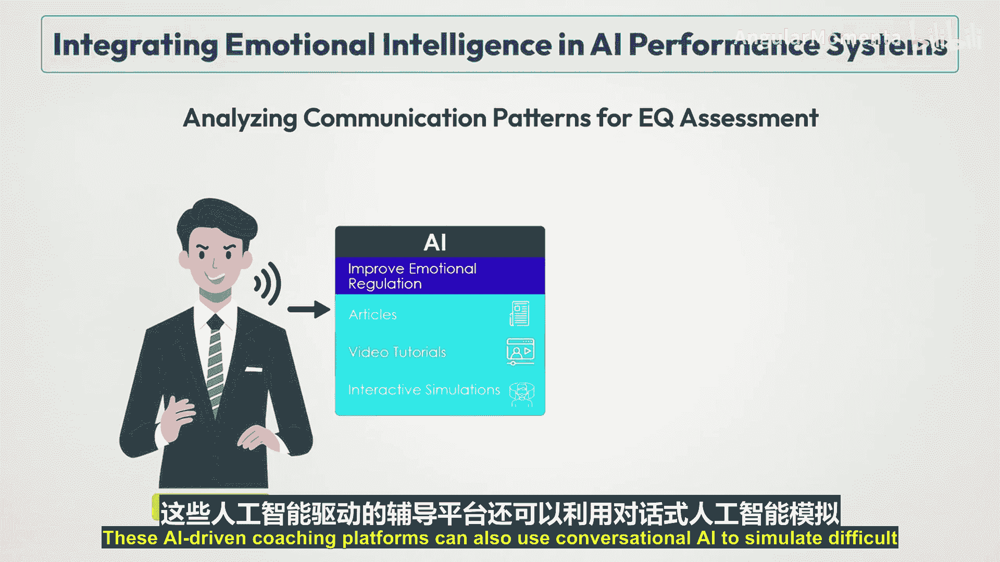

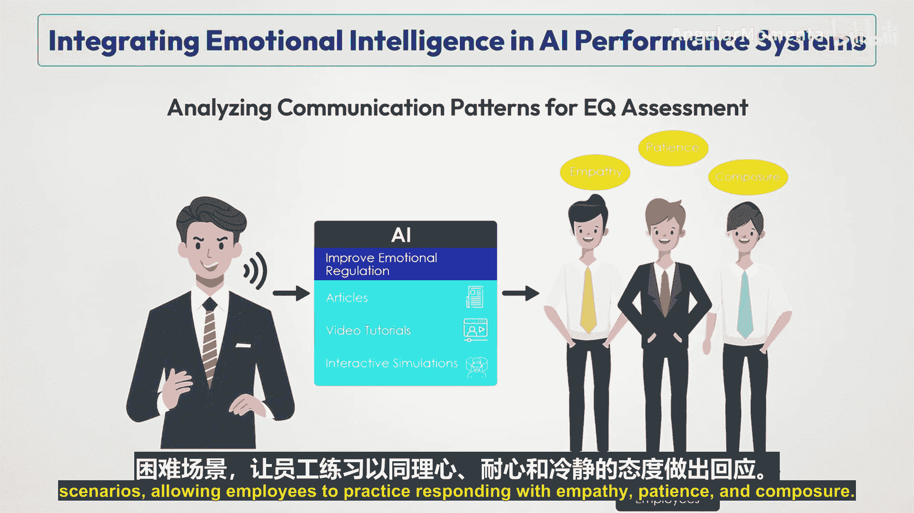

Moreover， AI can track progress over time， offering employees insights into how their emotional intelligence is evolving。

For instance， after undergoing coaching on active listening skills。

 AI can analyze future communications to assess whether the employee has become more attentive and engaged in conversations。

This feedback loop creates an opportunity for continuous improvement。

 where employees receive actionable tips that align with their specific emotional intelligence needs。

Incorporating EQ metrics and overall performance evaluations。

 Incorporating emotional intelligence into overall performance evaluations is the next frontier in creating well rounded fair assessments。

Traditional performance metrics often focus on hard skills and measurable outcomes。

 such as project completion rates or sales figures。However。

 emotional intelligence plays a critical role in an employee's ability to collaborate， lead。

 and contribute to a positive work culture， factors that are often overlooked in conventional performance reviews。

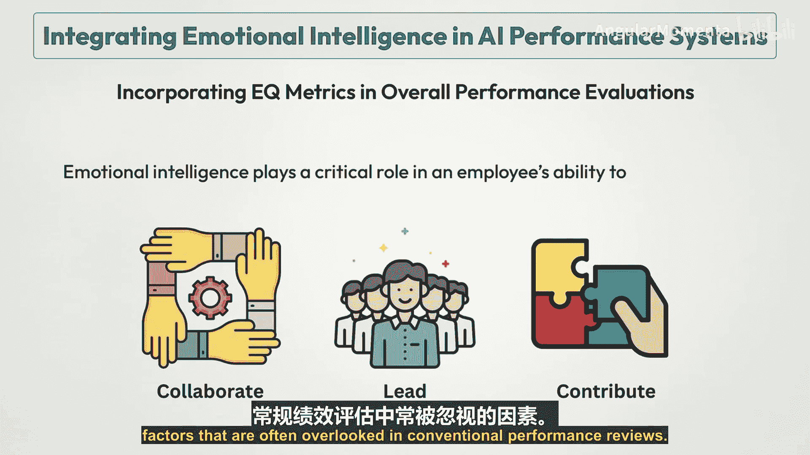

AI can quantify emotional intelligence metrics such as empathy， social awareness。

 and self regulation， and integrate them into broader performance evaluations。For example。

 if an employee consistently displays high levels of emotional intelligence。

 such as resolving conflicts with tact or supporting team members through difficult periods。

 these behaviors can be scored and weighted alongside technical skills and project results。

By combining EQ metrics with traditional performance measures。

 organizations can develop a more comprehensive understanding of an employee's overall contributions This holistic approach ensures that individuals who excel in interpersonal dynamics are recognized and rewarded。

 fostering a workplace culture that values emotional intelligence as much as technical expertise over time。

 incorporating EQ into performance evaluations can also help managers identify future leaders who possess not only the skills。

 but also the emotional intelligence to manage teams effectively。

We will continue the remaining part of the topic in the next video， thank you。

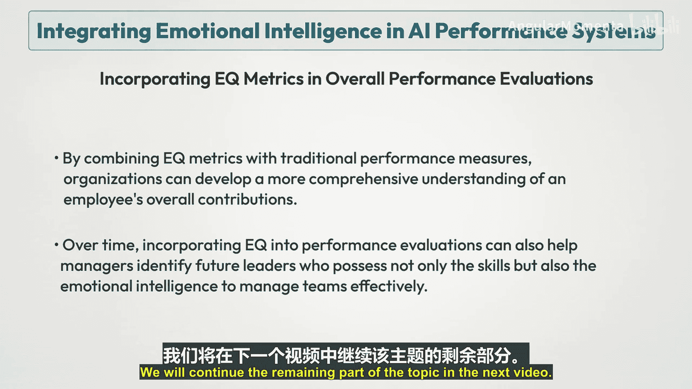