# 【EDUCBA】将生成式人工智能应用于辅导、研究与表现提升-｜-Apply-Generative-AI-for-Coaching,-Research,-p08-03_02_01_人工智能在绩效管理中的未来趋势--BV1bwFSzNEAo_p8-

Hello learners， let's continue from where we left off in the previous video Fu trends in performance management with AI One hyperperperization of employee development AI can identify individual strengths。

 weaknesses， career aspirations and learning styles。

This will allow organizations to create highly customized development pathways that align with both the employees' goals and the company's strategic objectives。

 AI drivenri learning platforms will offer personalized content and training resources。

 ensuring that employees receive the most relevant and impactful guidance for their career growth。

This hyperpersonization will lead to more engaged employees who feel supported and valued in their unique professional journeys。

Two predictiveictive analytics for Pro management Pretive analytics will play an increasingly vital role in performance management。

 allowing organizations to anticipate and address potential issues before they escalate。

AI will analyze historical performance data， employee behavior patterns。

 and external factors to predict outcomes such as employee turnover， burnout。

 or the likelihood of achieving specific performance goals。

Managers will be able to use these insights to take proactive measures such as offering additional support or adjusting workloads to optimize performance and employee wellbeing。

Three AI enhanced continuous feedback and coaching The traditional annual or biannual performance review process is expected to give way to more continuous and AI enhanced feedback mechanisms。

AI driven platforms will provide real time insights and recommendations to both employees and managers。

 facilitating ongoing dialogue about performance and development AI powered virtual coaches will become more prevalent。

 offering employees instant feedback and personalized advice based on their performance data。

This continuous feedback loop will promote a culture of ongoing learning and improvement。

 helping employees stay aligned with organizational goals and develop their skills more effectively。

Four Eical AI and fairness in performance management As AI becomes more embedded in performance management。

 there will be a growing emphasis on ethical AI practices and ensuring fairness in evaluations。

Organizations will need to implement robust frameworks to mitigate biases in AI algorithms and ensure that AI driven decisions are transparent and explainable。

Future trends will likely include the development of AI systems that can self audit for fairness and compliance。

 as well as increased regulatory oversight of AI in the workplace。

Ethical AI will be crucial in maintaining trust between employees and employers and ensuring that AI enhances rather than undermines fairness in performance management。

5 integration of AI with other emerging technologies The future of performance management will see greater integration of AI with other emerging technologies such as blockchain。

 the Internet of Things， IoT， and virtual augmented reality VR AR。For example。

 blockchain could be used to create immutable records of performance data。

 enhancing transparency and accountability。IoT devices could provide real time data on employee productivity and well being。

 feeding into AI systems for more comprehensive performance assessments。

VRAR could be leveraged for immersive training and development experiences guided by AI driven insights；

 these integrations will create a more interconnected and technologically advanced performance management ecosystem。

S focus on employee wellbeing and work life balance AI will increasingly be used to monitor and promote employee well-being as part of performance management；

 future AI systems will be capable of detecting signs of stress。

 fatigue or burnout by analyzing factors such as communication patterns。

 work hours and physiological data from wearables。This information will enable organizations to take timely action to support employee wellbeing。

 such as offering flexible work arrangements or mental health resources。

The focus on wellbeing will become a key component of performance management。

 recognizing that a healthy work life balance is essential for sustained high performance。

Seven AI driven diversity and inclusion initiatives diversityverity and inclusion D&I will become an integral part of AI driven performance management。

AI can help organizations track and analyze DI metrics more effectively。

 ensuring that all employees have equal opportunities for development and advancement。

Future trends may include AI tools that can identify unconscious biases in performance evaluations and suggest ways to address them。

Additionally， AI can help design more inclusive development programs that cater to the diverse needs of the workforce。

By leveraging AI， organizations will be better equipped to create a more diverse。

 inclusive and equitable workplace。We will continue the remaining part of the topic in the next video Thank you Hello learners。

 let's continue from where we left off in the previous video generative AI platforms for performance management Let's take a closer look at some of the tools and platforms leveraging generative AI to optimize performance management。

First， we have La La is a people management platform designed to automate the performance review process using AI。

 it analyzes employee feedback and offers insights to help drive personal development， key features。

 AI powered performance analytics， personalized development plans。

 AI driven feedback recommendations。Lapum is another tool that leverages AI to enhance performance reviews；

 It helps managers assess performance through AI powered reviews。

 one on one meetings and goal setting， key features， AI driven performance reviews and feedback。

 goal setting and tracking with AI insights， personalized learning and development。

Another excellent platform utilizing generative AI and performance management is HR1 HR1 is a comprehensive HR management platform designed to simplify various HR tasks。

 including performance tracking， employee feedback and performance appraisals， key features。

 AI powered performance management tools， real time employee feedback and engagement tracking。

 automated performance reviews and appraisals。

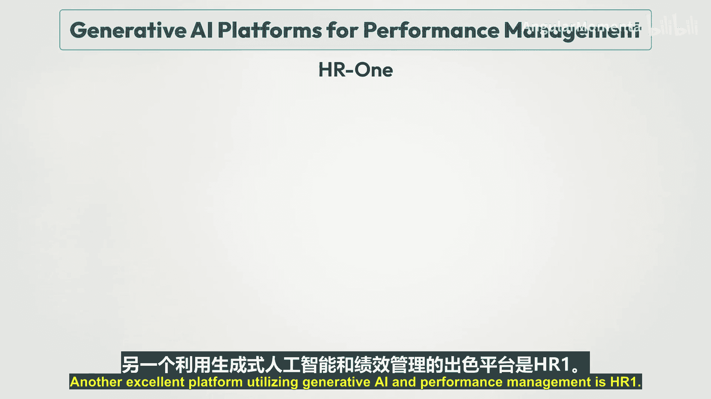

AI driven analytics for Ski gapap Ident and development HR1。

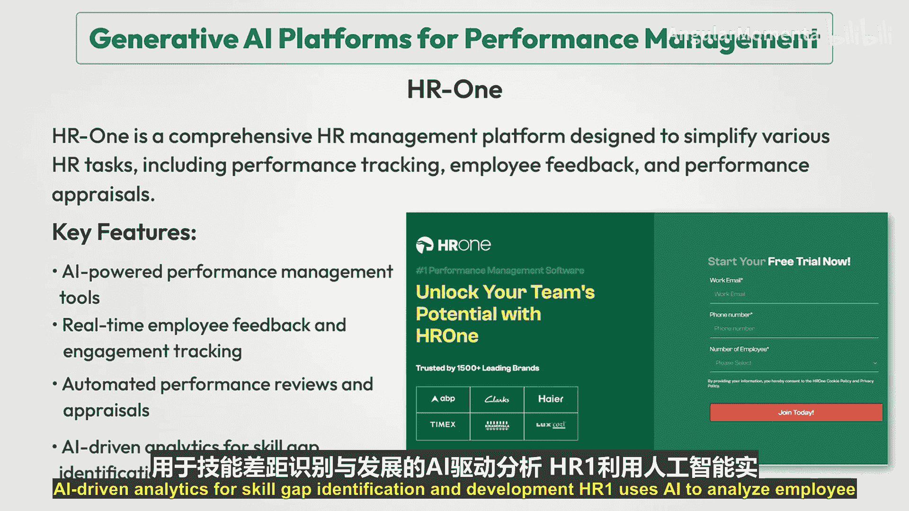

Uses AI to analyze employee performance data in real time。This enables managers to deliver timely。

 personalized feedback that helps employees stay engaged and aligned with their goals。

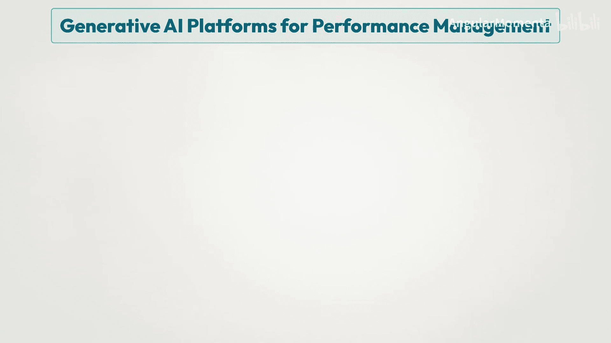

Next， betterworks。This platform uses AI to drive continuous performance management。

 automating feedback processes， and recommending actions based on employee data。

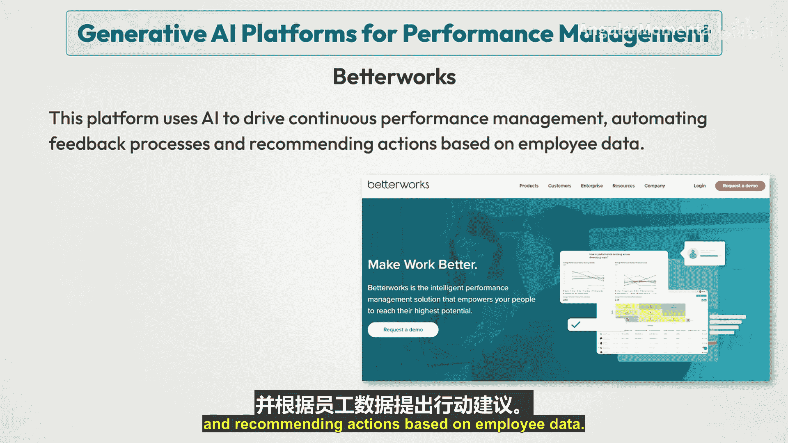

Key features， AI powered feedback and recognition， predictive analytics for performance trends。

 goal alignment and tracking。GTMHub is an OKKR platform that helps align team objectives with organizational goals using AI。

 it provides real time tracking and insightful analytics to ensure progress， key features。

 AI powered realtime OKKR tracking， insights for goal completion， automated performance reporting。

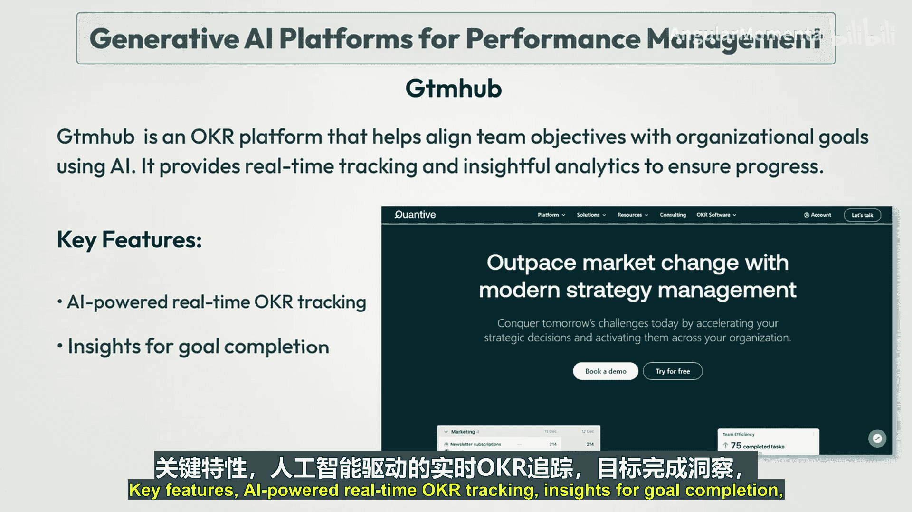

Workday is an enterprise management cloud solution that integrates AI for talent and performance management。

It provides detailed analytics and automates goal setting to boost employee success。

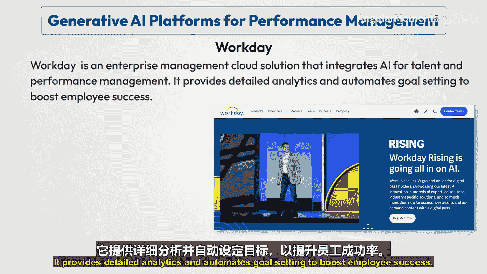

Key features， AI driven performance and talent analytics。Automated goal setting and tracking。

 personalized career development suggestions。KisFlow HR Cloud combines AI with HR management to handle employee feedback。

 performance and goals。 It offers a 360 degree feedback system powered by AI key features。

 AI powered 360 degree feedback， performance analysis with AI insights。

Personalized employee development paths。

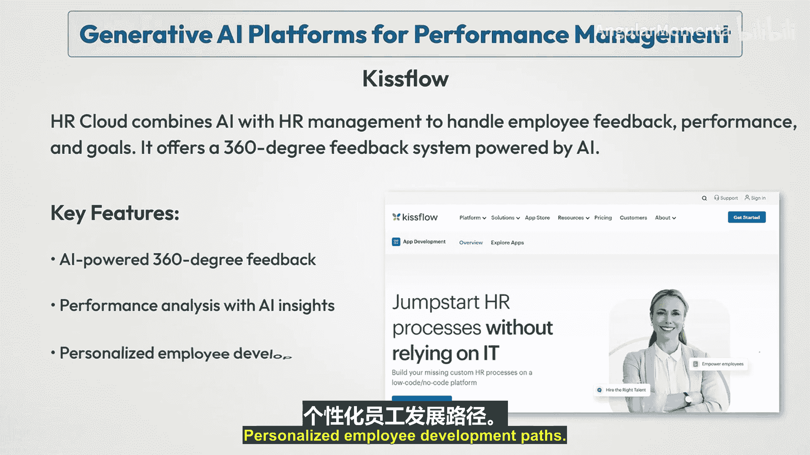

Eightfold。 AI uses AI to analyze talent performance and identify skill gaps。

 it provides predictions about employee success and makes recommendations for development strategies。

 key features， AI powered skill mapping and analysis， performance prediction using generative AI。

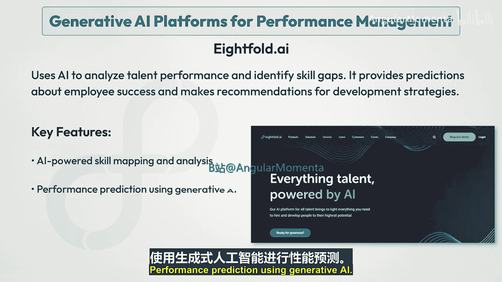

Personalized learning recommendations。CultureAmp is a platform that focuses on improving employee engagement using AI。

 it analyzes survey data and provides feedback and recommendations for team development。Key features。

 AI driven performance evaluation， predictive insights for engagement。

 AI based feedback and goal setting。Bamboo HR simplifies performance management by using AI to streamline feedback and automate assessments；

 it helps teams set and track goals effectively。Key features， AI powered performance assessments。

 goal setting with AI insightights， automated feedback suggestions。

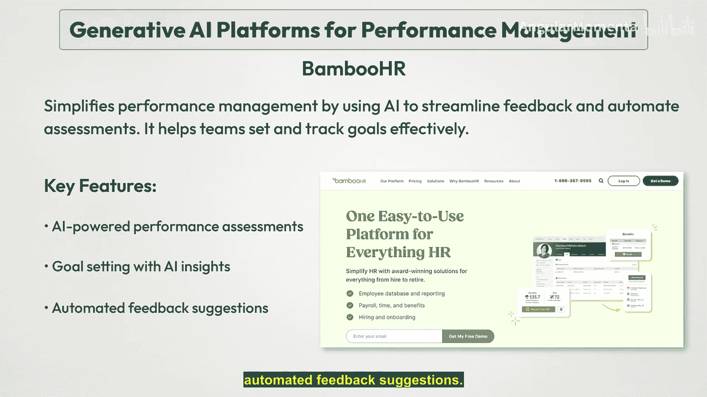

And finally， Jasper AI originally designed for content generation。

 Jasper AI is now used in performance management， helping managers generate insightful feedback and analyze employee output。

Key features， AI generated performance reviews， customizable feedback templates。

 automated productivity insights。 We will continue the remaining part of the topic in the next video。

 Thank you。 Hello learners， let's continue from where we left off in the previous video As we conclude our exploration of performance management with generative AI。

 It is evident that AI is not merely a tool but a transformative force in the realm of performance management。

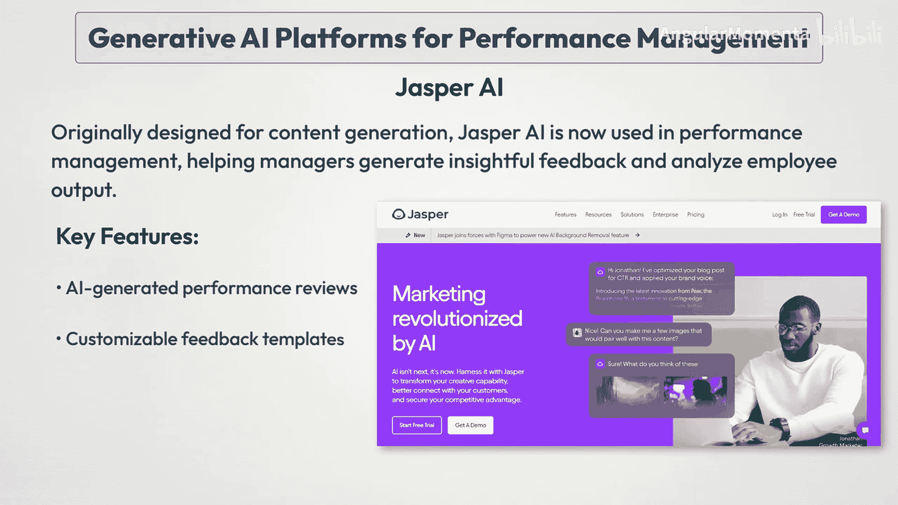

The integration of generative AI into performance management systems promises a paradigm shift。

 ushering in a new era characterized by enhanced accuracy。

 personalized development and proactive management。

Generative AI's ability to automate and streamline performance reviews。

 craft tailored development plans and predict future potential is revolutionizing how organizations approach talent management。

Organizations must navigate challenges such as data privacy， algorithmic bias。

 and the need for human oversight。Ensuring that AI complements rather than replaces the human element is crucial for maintaining trust and fostering a supportive work environment。

As you move forward， remember that the successful integration of AI into performance management is not just about adopting new technology。

 it's about harnessing its power to create a more engaged。

 equitable and efficient workplace by aligning AI initiatives with organizational goals and fostering a culture of continuous improvement。

 you can unlock the full potential of generative AI and drive meaningful progress in performance management。

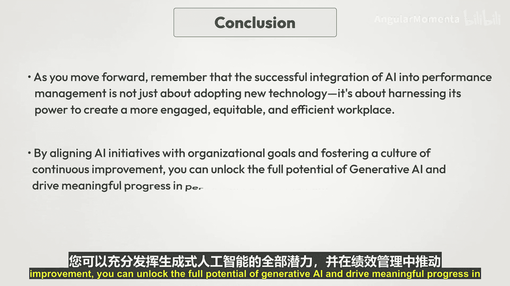