# 【EDUCBA】将生成式人工智能应用于辅导、研究与表现提升-｜-Apply-Generative-AI-for-Coaching,-Research,-p09-03_03_01_困惑度AI在研究与写作中的应用导论--BV1bwFSzNEAo_p9-

Pplexity AI for Research and Wing Induction In our daily lives。

 research and writing play pivotal roles across various domains。

 from academia to journalism and from business proposals to creative writing。

 these activities are the bedrock of knowledge creation， enabling us to analyze information。

 articulate ideas， and communicate effectively。However。

 the traditional methods of conducting research and writing are often time consuming and require sifting through vast amounts of data。

 this is where artificial intelligence steps in， transforming the way we approach these critical tasks。

 AI has revolutionized research and writing by automating routine tasks enhancing accuracy and providing new ways to explore and organize information these AI tools help users navigate through extensive data sets。

 allowing them to focus on deeper analysis and creative expression。

One such tool that is making waves in the research and writing community is perplexity AI Unlike traditional search engines。

 perplexity AI offers a conversational approach that tailors responses to your specific needs with features like Copilot which guides you through the research process by asking clarifying questions。

 perplexity AI ensures that you don't just get quick answers。

 but also deep insights that are directly relevant to your query。

It's like having a research assistant who knows exactly where to look and how to present the information you need。

 whether you're working on a literature review， exploring new theories or simply looking for reliable sources。

 perplexity AI streamlines your research， making the process faster and more efficient in a world where information is abundant but time is limited tools like perplexity AI are transforming research and writing。

 making them not just more efficient， but also more insightful we will continue remaining part of the topic in the next video Thank you Hello learners。

 let's continue from where we left off in the previous video why perplexity AI perplexity AI a better substitute for traditional search。

Pplexity AI is an advanced AI powered research and conversational search engine that fundamentally changes how users access information Unlike traditional search engines that return a list of links。

 perplexity provides direct comprehensive answers to queries。

 summarizing relevant information from various sources。This approach not only saves time。

 but also enhances the user experience by delivering concise， actionable insights。

The platform operates on a freemium model where the basic version utilizes a standalone large language model。

 LLM for free， while the paid version perplexity Pro offers access to more advanced models like GPT4 and Claud 3。

5， enhancing its capabilities further。

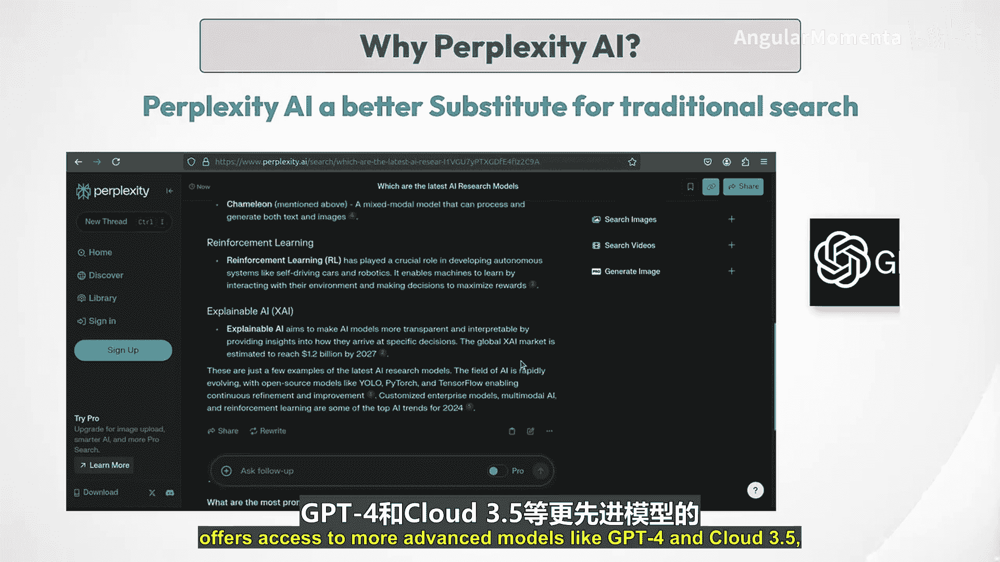

How perplexity AI differs from ChatGT and Gemini since perplexity AI is based on the OpenAI's GPT3。

5 model and a standalone LLM with NLP capabilities。

 but the only thing perplexity AI differs from both is that it provides a real-time generation chattGT and Gemini generate the following results through a pre-trained models。

 which will likely to end up giving you the outdated answers depending on the last update of its model。

 although GPT40 model and Gemini does use the live web search。

 but these tools first use the knowledge of the pretrained models and then only access the live web search or when they are specifically ask for that task。

Pplexity AI emphasizes providing real time， verifiable information with the inline citations。

 making it useful for academic and professional research。

Its unique features like the Copit for refining queries and the focus mode that allows users to tailor searches to specific domains like academic or creative writing。

 set it apart from competitors， Additionally， Perplexity's ability to summarize content and provide citations enhances its utility for researchers who require credible sources。

For example， when a user queries recent developments in climate change research。

 perplexity AI not only retrieves the latest studies。

 but also summarizes key findings and provides citations from trusted academic sources。

 this capability allows researchers to quickly grasp essential information without sifting through numerous articles。

 making the research process more efficient and effective。On the other hand。

 if the same query is searched on Google， then we have to surf into each link。

 reading each and every topics to find relevant information， and to gain full understanding。In short。

 here are the following key features of perplexity AI Realtime information Perplexity pulls data from the internet instantly。

 ensuring that users receive the most current information available， reliable sources。

 each answer is supported by citations from credible sources。

 enhancing the trustworthiness of the information provided， user friendlyly interface。

 the platform is designed for ease of use， allowing users to interact with it as they would in a conversation。

 making information retrieval In。Get started with Perplexity AI Before diving into the advanced features of perplexity AI。

 the first step is to get started by creating an account or logging in。

This simple process will unlock personalized experiences and allow you to access save searches。

 collections and more， so first let's go to the Perplexity AI website and we can see the chat interface where we can interact and write prompt。

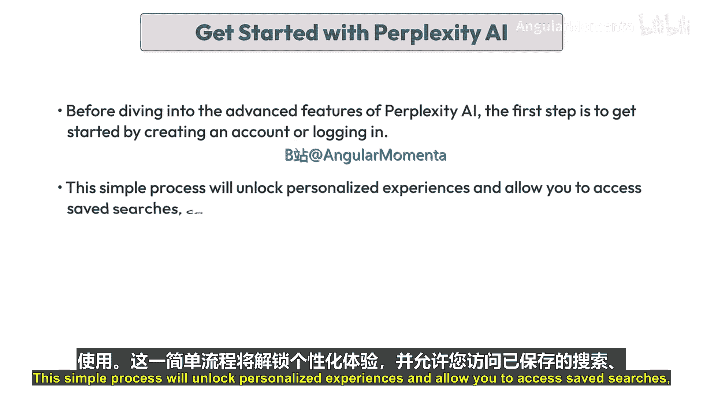

At the bottom left corner we can see the sign in options。

 whether you want to continue with your Google account or Apple。

 or you can simply create your own Perplexity account as per your choice let's continue with the Google sign in Once logged in。

 you'll have access to a host of features such as personalized search history。

 saved collections and focused research tools。Now that you're logged in。

 you're all set to begin exploring the vast resources that perplexity AI offers to support your research and writing endeavors we will continue remaining part of the topic in the next video Thank you Hello learners。

 let's continue from where we left off in the previous video research and writing with perplexity AI Perplexity AI operates as an interactive search engine that utilizes advanced algorithms to analyze and synthesize information from multiple sources in real time。

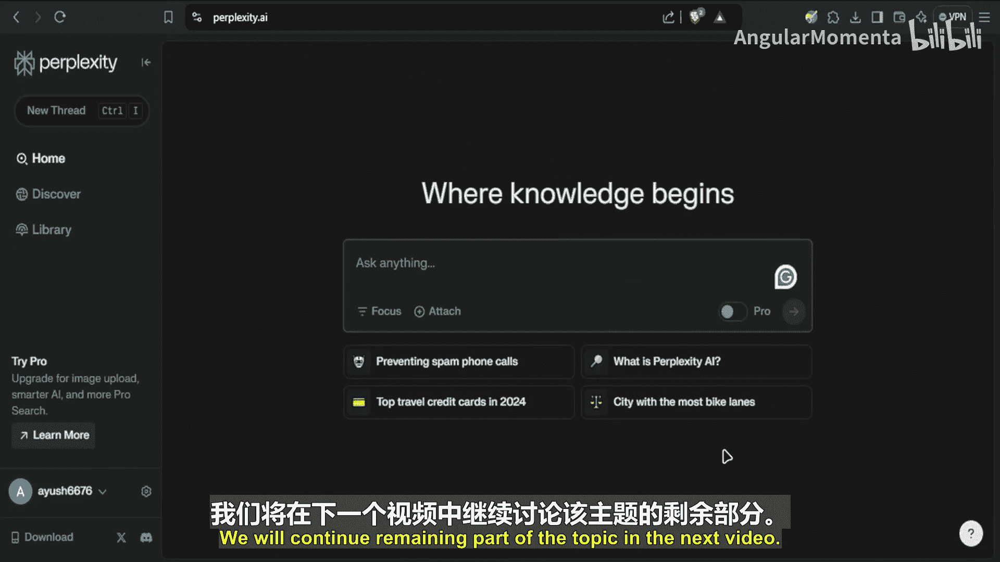

When users input queries， the AI processes the request。

 retrieves relevant data and presents it in a coherent format。

 this process involves understanding context， generating humanlike responses and ensuring that the information is accurate and up to date let's consider a specific example that we wantna information on how does LLM works。

Initial query a user begins by entering the query How does LLM really Work into the Perplexity AI search bar。

 Real time Information Retrieval。Once the query is submitted。

 perplexity AI processes the request and retrieves relevant information from a wide array of sources。

 which includes academic papers， articles and reports。

 It synthesizes the information into a concise summary that highlights the key findings related to the following query sources one of the standout features of perplexity AI is its ability to provide sources for the information it presents each answer is accompanied by numbered references。

 allowing users to verify facts and explore the original sources for deeper insights。

This feature is crucial for academic writing and research。

 where credibility and proper citation are essential。

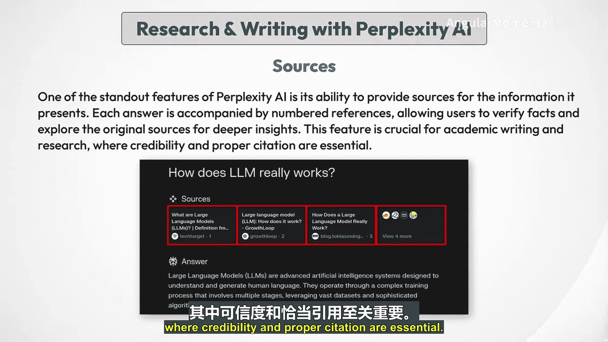

Let's take a scenario where a researcher working on a literature review for a thesis how Perplexity AI helps using Perplexity's Copit feature。

 the researcher can input broad questions and receive distilled concise summaries of various academic papers。

Instead of manually searching and reading through dozens of articles。

 Copit provides a focused set of sources， even offering summaries that can be cited later。

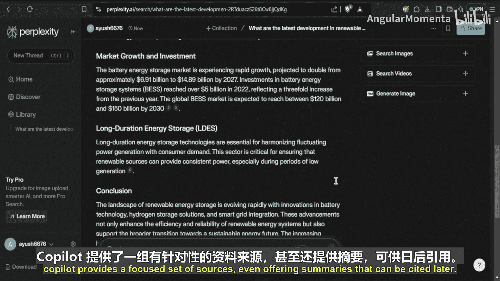

Citation。Pplexity AI automatically generates citations for the information retrieved。

 which is particularly beneficial for researchers and students who need to adhere to academic standards by simplifying the citation process。

 perplexity helps users avoid plagiarism and maintain the integrity of their work Let's look at the scenario where a journalist needs to write a news article on climate change and provide credible citations。

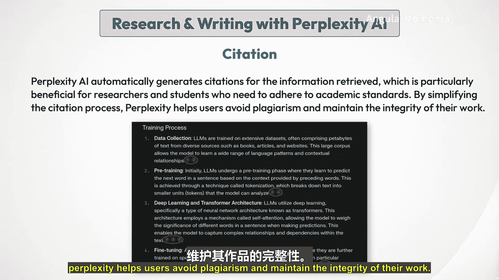

How perplexity AI helps。The citation feature ensures that every factor quote used in writing is automatically backed by a legitimate source The journalist can draft content directly within perplexity and include citations effortlessly search images and videos One of the impressing part of perplexity AI is beyond the text results。

 It also provides the relevant images and videos。

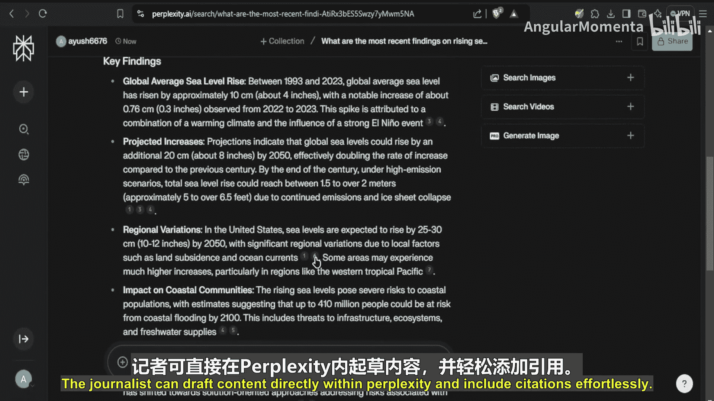

This feature enhances the research experience by providing visual context to the information gathered。

 offering diverse perspectives and explanations that can aid in understanding complex subjects let's say a designer writing a research paper on architectural trends how perplexity AI helps by utilizing the image search feature。

 the designer can gather relevant visuals directly from perplexity AI's filtered results speeding up the process of sourcing high quality images Fo Perplexity AI includes a focus feature that enables users to tailor their searches to specific areas such as academic research。

 creative writing or general knowledge this customization improves the relevance of the results allowing users to find exactly what they need more efficiently。

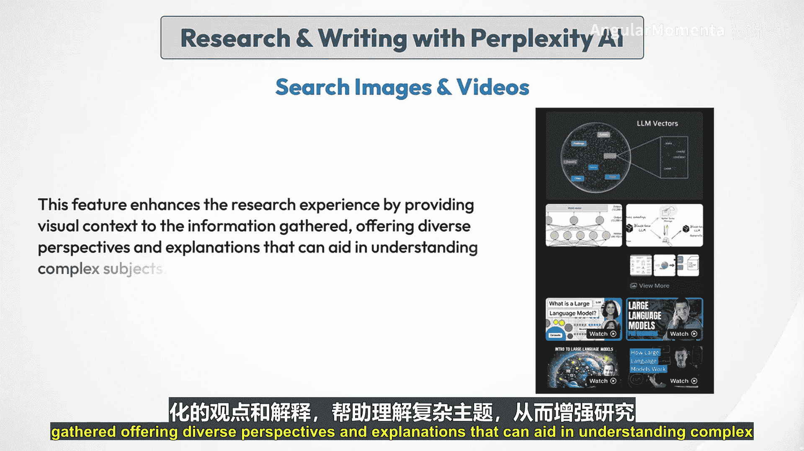

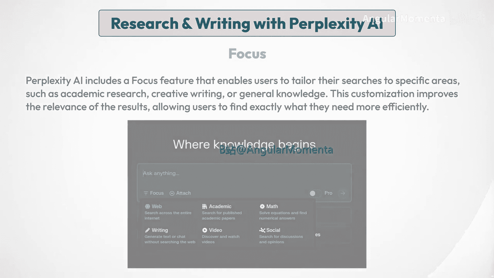

Let us take an example that a student writing an essay on the ethical implications of AI how perplexity AI helps with the focus feature。

 the student can limit searches to specific academic sources such as papers or journal articles This ensures that all information is scholarly and relevant we will continue remaining part of the topic in the next video。

 Thank you Hello learners， let's continue from where we left off in the previous video Now that we've covered the core features of perplexity AI let's take things up a notch with perplexity Pro perplexity Pro For those of you who are serious about taking your research and writing to the next level。

 Perplexity Pro offers enhanced tools that can drastically improve your workflow and results。

Pplexity Pro isn't just an upgraded version， it's like having a professional research assistant by your side。

Imagine working on a complex research project the standard perplexity AI does a good job providing answers and guiding your research。

 but with perplexity Pro， you're getting deeper insights。

 more context driven searches and enhanced responses that are customized to your specific needs。

 but then what's the key difference it's the pro's ability to clarify your queries before diving into the search instead of you trying to think of every detail in your initial question perplexity Pro helps refine your query by asking follow up questions This ensures that it understands your requirements fully and gives you a more tailored high quality response。

For example， if you ask how to build an effective marketing strategy。

Pplexity Pro may ask whether you're focusing on digital or traditional marketing。

 allowing it to give a more targeted response based on the specific approach you plan to take。

This extra layer of interaction ensures that you get actionable answers。

 not just general information key features of perplexity Pro Now let's talk about some of the unique features of perplexity Pro that truly elevate your research and writing experience。

 unlimitedlim pro search。Pro search transforms the way perplexity handles queries unlike the free version where you may encounter limits on the depth of answers。

 Pro search expands the scope， allowing for comprehensive refined results with every query。

It's akin to having a dedicated research assistant that asks follow up questions to get to the heart of what you need。

Whether you're working on a scientific paper， business strategy， or creative writing project。

 this feature helps narrow your scope while diving deep into the subject。

Upgraded AI models a significant perk of Perplexity Pro is the ability to choose between upgraded AI models。

While the free version mostly uses standard models， Pro offers the following cutting edge options。

 GP40 known for its deep reasoning capabilities， GPT40 helps break down complex topics into simpler。

 digestible information。Claude 3。5。Sonet this model is designed for high level language tasks and can provide more natural sounding responses。

SoNar ideal for data heavy research SoNar processes large volumes of information quickly。

 making it useful for analyzing complex data sets， Lama 3。14005B。

Lma is known for creative output and generates text that feels conversational。

 making it perfect for creative writers， switching between models can improve response quality depending on your needs。

 whether it's more technical accuracy or enhanced creativity。

Unlimited file uploads one of the standout features of Perplexity Pro is unlimitedit file uploads This is crucial for researchers dealing with extensive data sets or documents you can upload PDFs。

 research papers， or even code files for analysis。Once uploaded。

 perplexity maintains context ensuring follow up queries are directly relevant to the data you're working with。

APpiI credits With the pro version， you receive $5 per month in API credits。

 which allows you to integrate perplexity into your own apps or projects。

Whether you're building a new research tool or developing a business application。

 these credits let you experiment with API calls， leveraging the AI's capabilities for custom use cases Image generation Perplexity Pro also introduces image generation this feature allows users to create AI generated visuals based on textual prompts。

 making it a powerful tool for designers， marketers and researchers who need visual aids for their work in Pro we have the following models。

Playground V3 latest image generation model of perplexity， Dolly3。

 popular image generation model created by Open AI， stable diffusion X。

 a versatile fast image generation model， and in recent perplexity Pro has added Fl。

1 comm latest image generation model created by Blackforest Las to generate more qualitative image。

Pplexity Pro and A Research For A researchers Perplexity Pro is a game changer。

 the ability to upload academic papers， summarize complex texts and follow up with detailed questions about those texts makes it an indispensable tool for thesis work。

 journal articles， and research projects。Prosearch ensures more accurate data backed responses while upgraded models enhance the quality of language and analysis Perplexity Pro for creative writers Creative writers also benefit tremendously from perplexity Pro。

 with the ability to toggle between models like GT40 and Lama， writers can explore different tones。

 voices and styles， whether crafting a novel， screenplay or marketing copy。

 perplexity Pro adapts to your needs， helping you brainstorm ideas。

 refine your work and generate creative outputs。

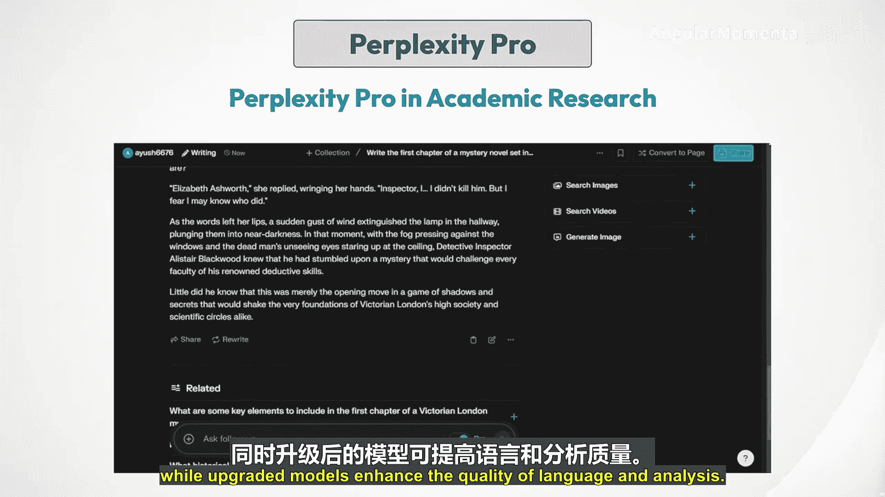

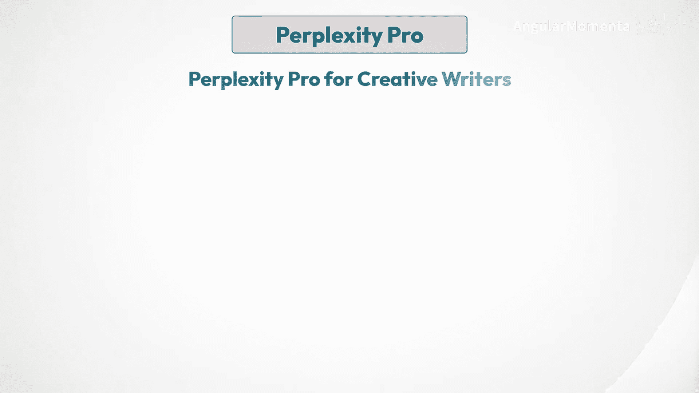

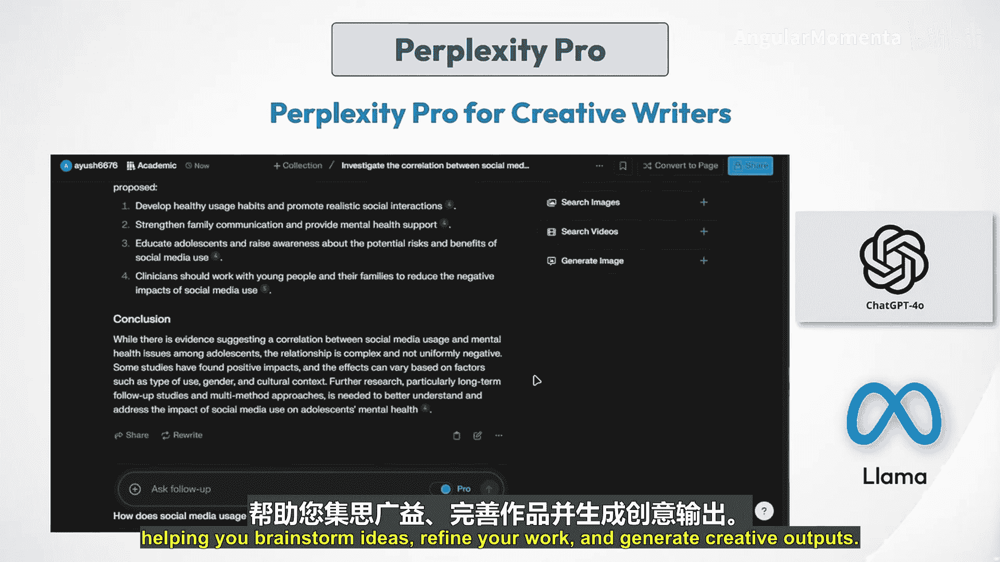

We have come so far exploring each details of perplexity AI with its proversion。

 but perplexity doesn't stop here， it offers a suite of additional tools designed to optimize your workflow and manage your research。

Discover this feature surfaces trending topics and the latest research perfect for staying up to date in your field。

 whether it's AI， literature， science or any other recently added topics on the page you can explore the following topics on the discover page as per you interest library a powerful tool for organizing your threads。

 documents and collections It is the backbone of perplexity AI for managing each and every threads and searches Under the library section we have threads which stores and can be revisited for your ongoing conversations and research questions One of the interesting tool under the library is page It can basically provide you by generating the whole blog page on the specific topic as per your need which can be then published on the social media platforms or even can be published on the discover page so others can see your blog post Another tool under library is collections Use can organize their findings into collections making it easier to manage research projects and collaborate with others This feature is particularly useful for group work。

Or ongoing research endeavors as it allows for better organization and retrieval of information。

We will continue remaining part of the topic in the next video Thank you Hello learners let's continue from where we left off in the previous video。

 limitationsations of Perplexity， AI in research and writing。

While Perplexity AI offers numerous advantages for research and writing。

 it also has some limitations when it comes to academic research specifically。

Reliance on online sources。Perplexity AI primarily draws information from online sources like websites。

 blogs and some academic papers available on the Open web； however。

 it lacks direct access to many scholarly journals， databases。

 and paywalled academic resources that are essential for in-depth research in many fields。

Lack of peer reviewed content。Much of the information provided by perplexity AI。

 even when citing academic sources may not be peer reviewed or published in reputable academic journals。

 peerer review is a critical quality check for academic research and perplexity's results may not always meet the standards required for advanced research projects。

Limited depth for complex topics While perplexity AI can provide overviews and summaries of academic topics。

 the depth of analysis may be limited， especially for highly specialized or complex subjects。

 researchers may need to consult primary sources and expert literature beyond what perplexity provides。

In consistentent citation formats the citations provided by perplexity AI are not always formatted consistently or in standard academic styles like APA or MLA users may need to reformat citations manually or use a citation manager to ensure proper formatting for academic papers。

Potential for outdated or unreliable information。Like any AI system。

 Perplexity's knowledge is based on data available at the time of its training。

 there is a risk that some of the information it provides could be outdated， biased or unreliable。

 especially on rapidly evolving topics researchers should always verify key facts and findings against authoritative sources。

Future of Perplexity AI。The future of perplexity AI in the field of research and writing looks promising。

 with the potential to revolutionize how information is gathered。

 synthesized and presented Adv features and capabilities Perplexity AI has been introducing innovative features that expand its functionality beyond a traditional search engine。

 perplexity Pro。The paid version offers access to more advanced language models like GPT4 and Cloud 3。

5， providing even more sophisticated analysis and generation capabilities。

Pages This new feature allows users to generate customizable web pages based on prompts。

 blurring the line between search tool and content creation platform。

Image generation Perplexity AI has added the ability to generate images from text prompts using advanced AI models。

 making it a multimedia research and writing assistant challenges， maintaining quality and accuracy。

As it scales， ensuring the accuracy and reliability of the information provided will be crucial。

 especially for academic research where credibility is paramount limitations in depth for complex topics。

 While perplexity AI can provide overviews and summaries。

 the depth of analysis may be limited for highly specialized or complex subjects。

 researchers may still need to consult primary sources and expert literature。

Conclusion It's clear that this innovative tool is reshaping the way we access and utilize information Perplexity AI stands out for its ability to provide concise。

 accurate answers and credible sources， allowing researchers and writers to focus on what truly matters。

 analysis and creativity as it continues to evolve we can expect even more advanced features that cater to the needs of researchers and writers across various fields。

 perplexity。AI is not just a tool； it's a game changer in the world of research and writing。

By embracing its capabilities， we can unlock new levels of productivity， insight。

 and creativity in our academic and professional pursuits。

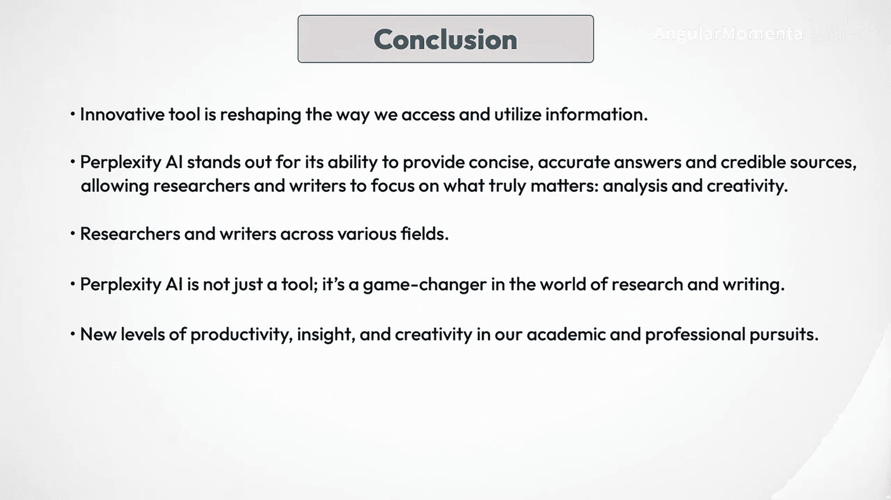