# 【EDUCBA】应用生成式人工智能集成与部署策略-｜-Apply-Generative-AI-Integration-and-Deployment-Strate-p01-01_01_01_生成式人工智能集成与部署导论--BV1dcF2zMENZ_p1-

Integration and deployment of Gen models。Introduction to generative AI。

We're on the cusp of a creative revolution， no longer confined to the human mind。

 the ability to generate art， music， text and even code is being harnessed by machines。

 This is the realm of generative AI。

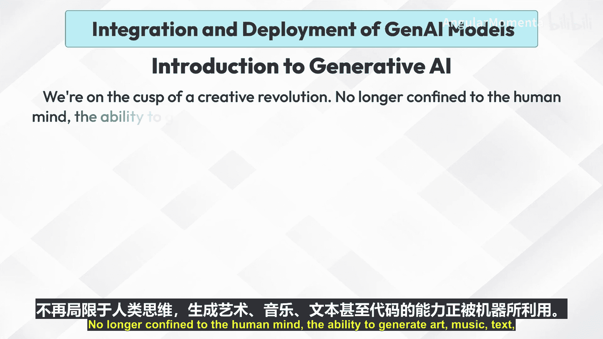

This cutting edge technology is learning from vast data sets to produce entirely original content。

 blurring the lines between human ingenuity and artificial intelligence。

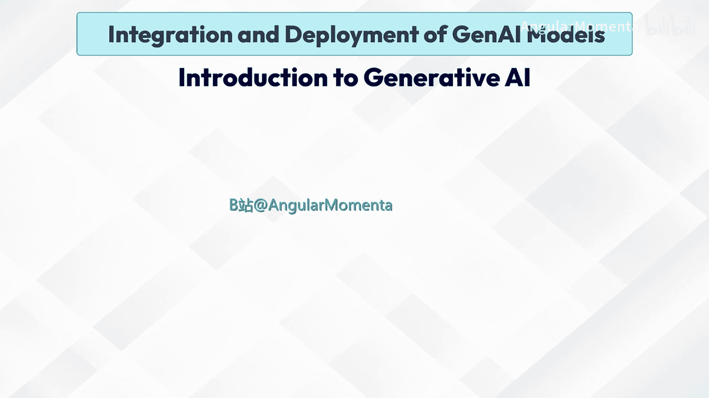

From crafting realistic images to composing symphonies。

 generative AI is reshaping industries and sparking a debate about the future of creativity。

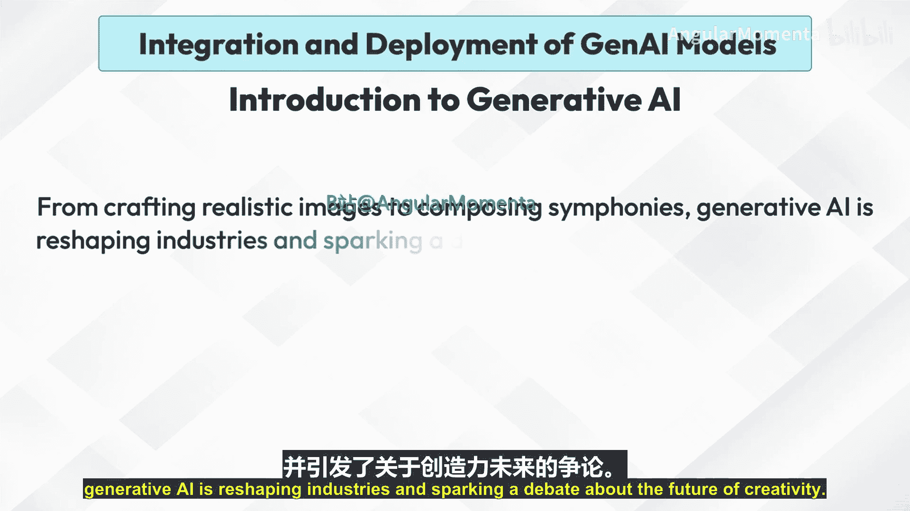

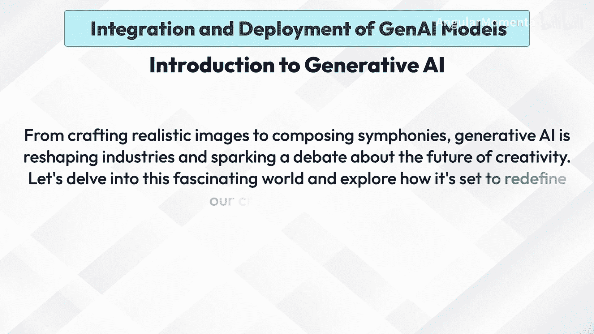

Let's delve into this fascinating world and explore how it's set to redefine our creative landscape。

How does it work Training generative AI models are trained on massive data sets of existing content。

 They learn the underlying patterns， structures and relationships within the data generation once trained。

 the model can generate new content by sampling from the learned probability distribution。

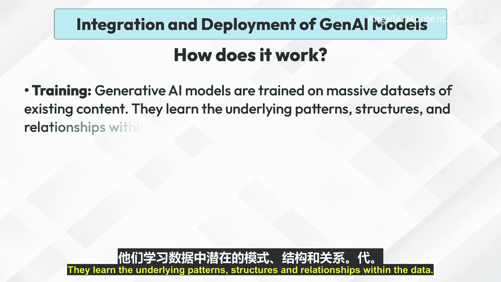

This means it creates outputs that are similar to the training data。

 but are entirely new and original。Key characteristics of generative AI， creativity。

 it can produce innovative and creative content， often surpassing human capabilities in certain domains。

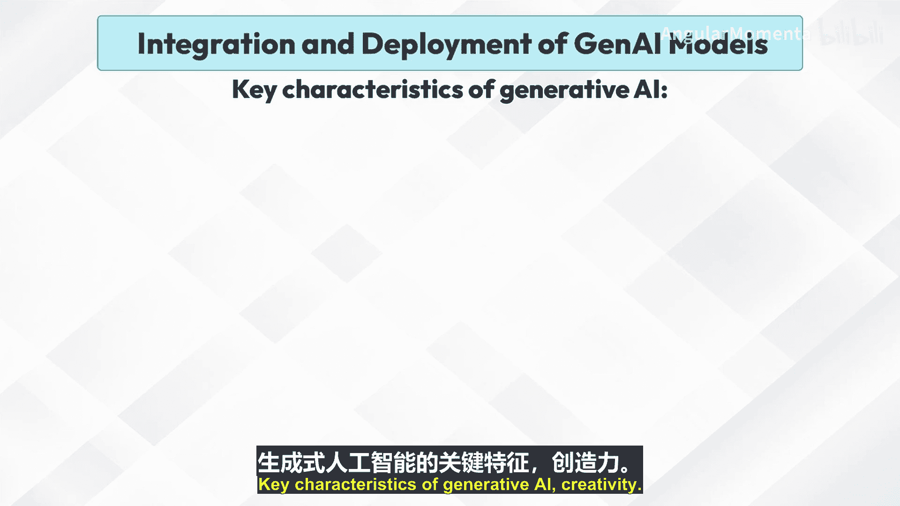

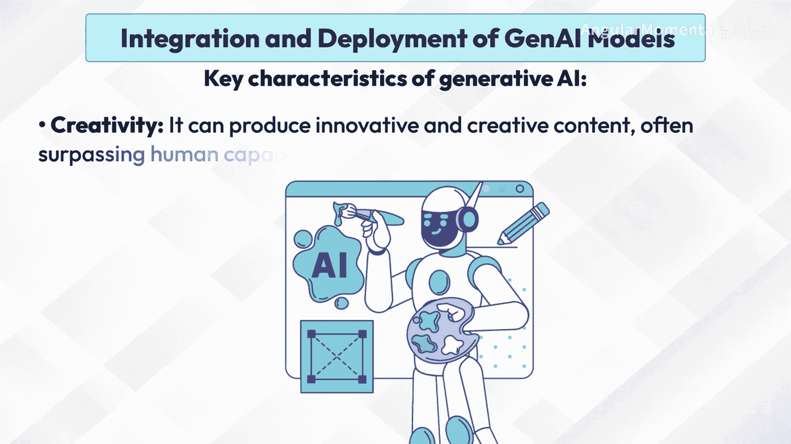

Versatility It can be applied to a wide range of tasks， from writing stories to designing products。

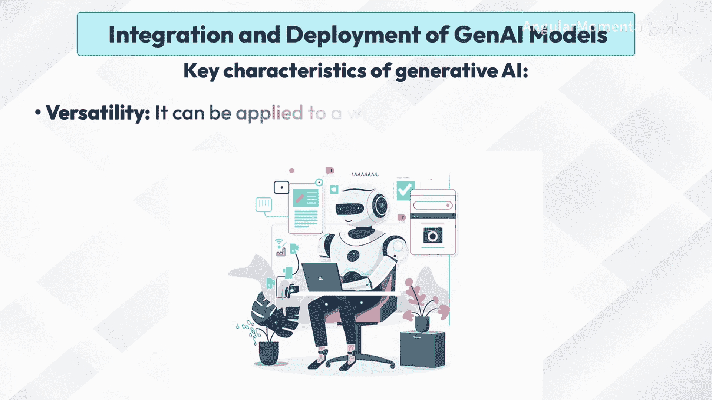

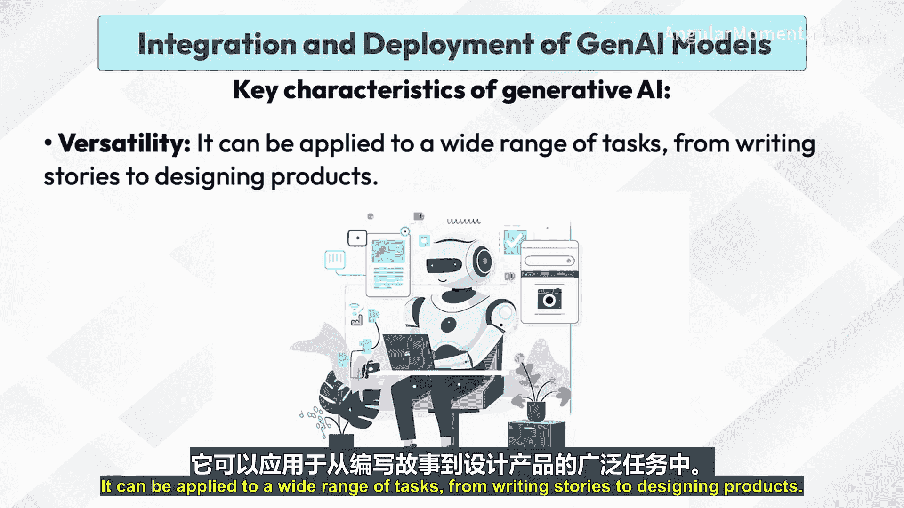

Efficiency。It can generate content much faster than humans， increasing productivity。

Customization It can be tailored to specific styles， preferences or requirements。

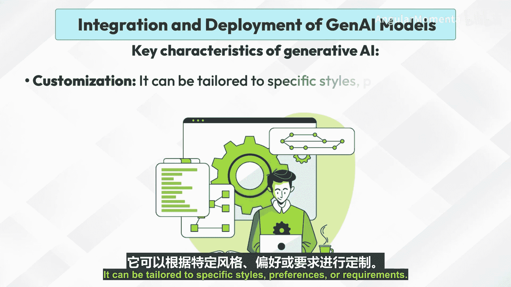

Examples of generative AI， text generation， creating articles， poems， scripts， code， and more。

 image generation， generating realistic images， art and designs， music generation。

 composing music pieces in various genres， video generation， creating videos。

 animations and special effects， drug discovery， designing new molecules for potential drug candidates。

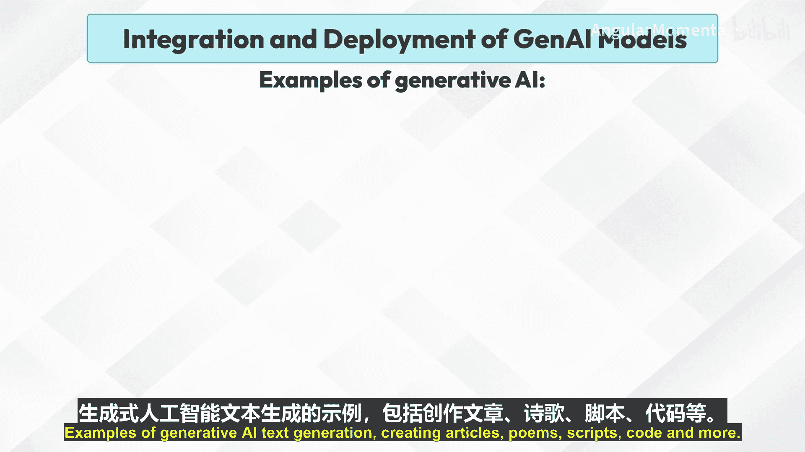

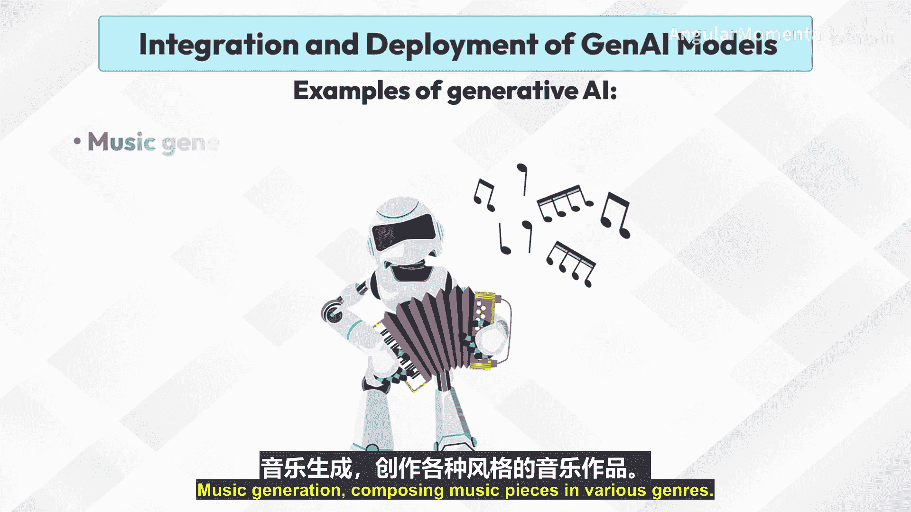

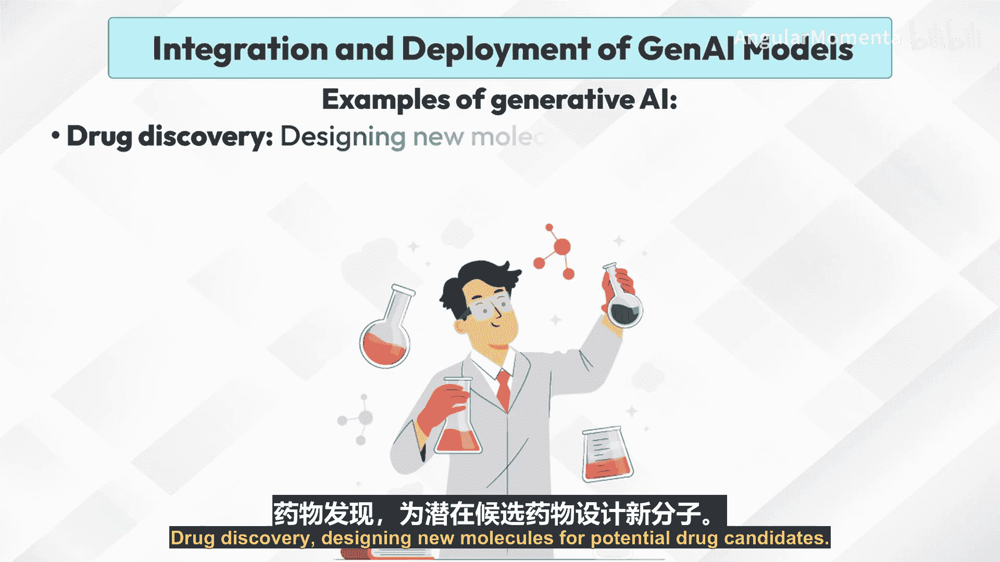

Potential applications， content creation， marketing， advertising， entertainment， design。

 product design， architecture， fashion， education， personalized learning， content generation。

 healthcare， drug discovery， medical image analysis， entertainment， game development。

 video game character creation。Challenges and considerations bias generative AI models can perpetuate biases present in the training data。

 ethical concerns， deep fakes， misinformation， copyright issues， computational resources。

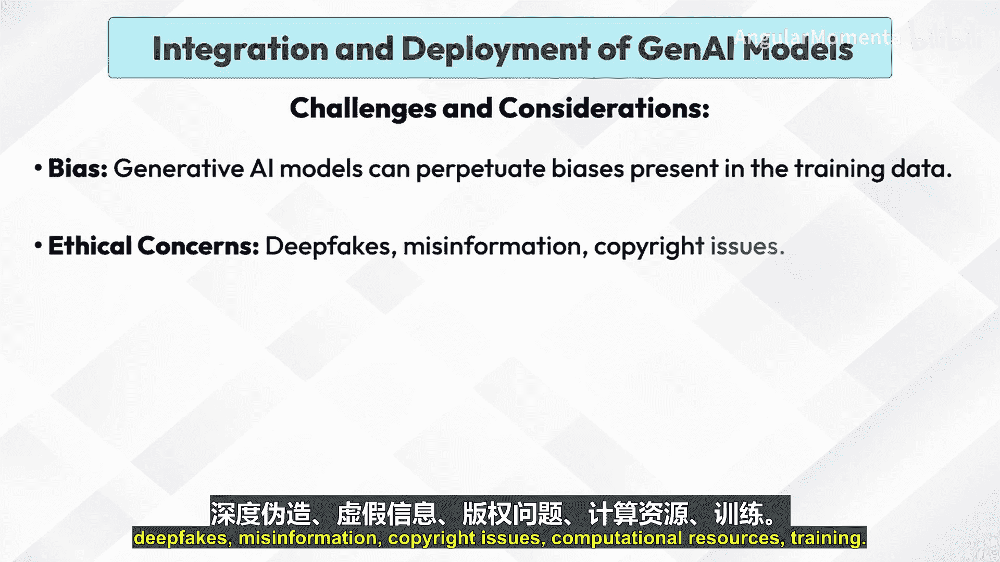

Training。

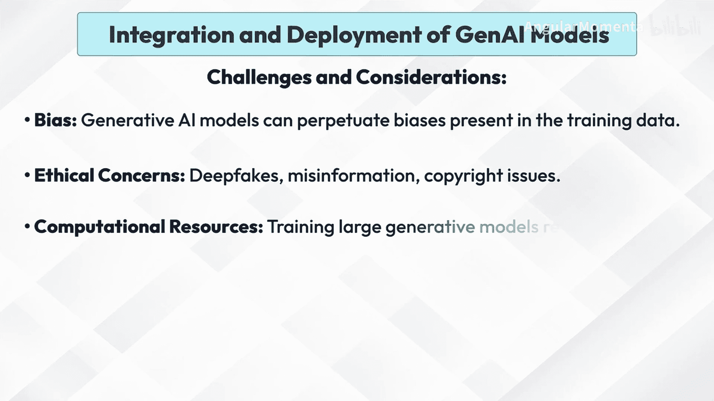

Large generative models requires significant computing power generative AI is a rapidly evolving field with immense potential。

As technology advances， we can expect to see even more groundbreaking applications and innovations in the coming years。

