# 【EDUCBA】应用生成式人工智能集成与部署策略-｜-Apply-Generative-AI-Integration-and-Deployment-Strate-p02-01_01_02_理解发展格局--BV1dcF2zMENZ_p2-

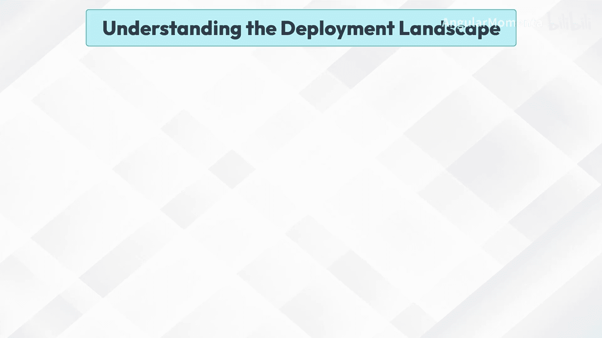

Understanding the deployment landscape。Behind the scenes of every AI powered application lies a complex web of infrastructure and processes；

 this is the deployment landscape， from training to serving models。

 countless factors influence an AI's performance and impact。

 let's unravel the intricacies of bringing AI to life。

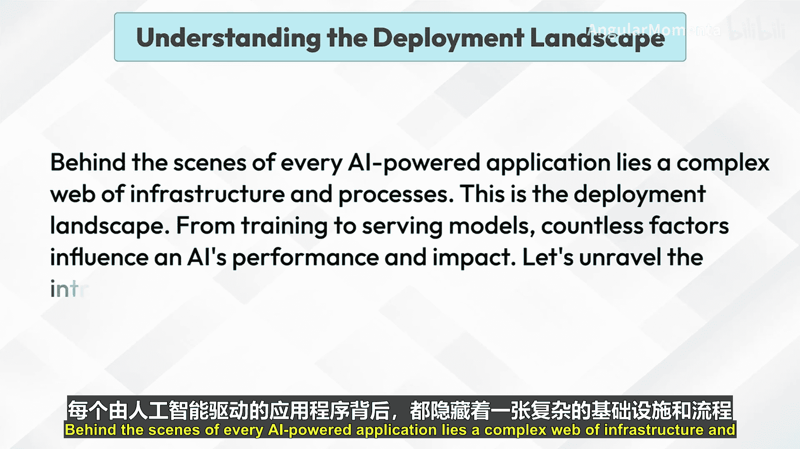

Cloud based solutions。Cloud based solutions leverage the infrastructure provided by cloud service providers like AWS。

 Azure and Google Cloud； they offer flexibility and scalability without the need for on premises hardware。

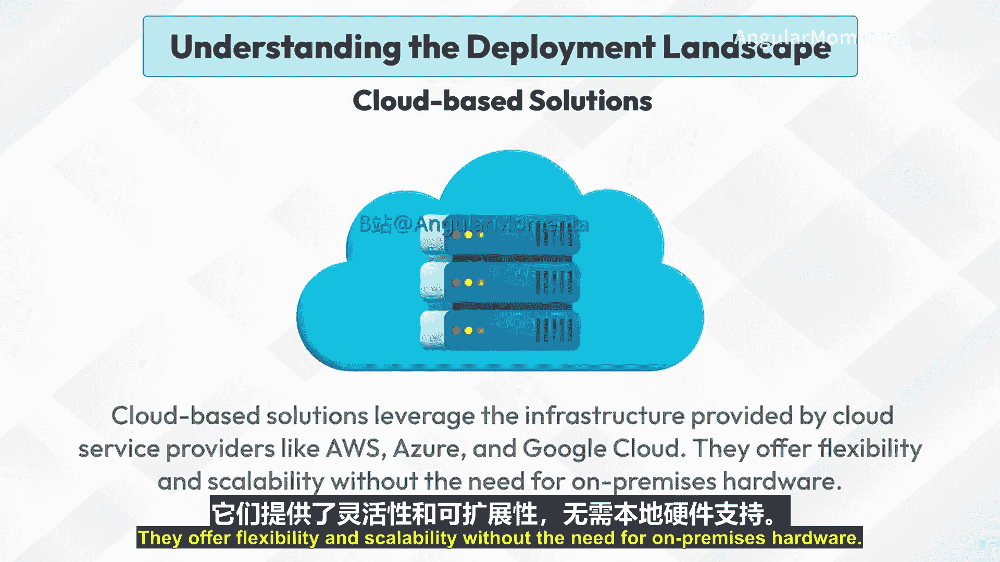

Advantages， scalability， easily scale resources up or down based on demand， maintenance。

 providers handle infrastructure maintenance and updates。

 accessibility models can be accessed from anywhere facilitating remote work and collaboration。

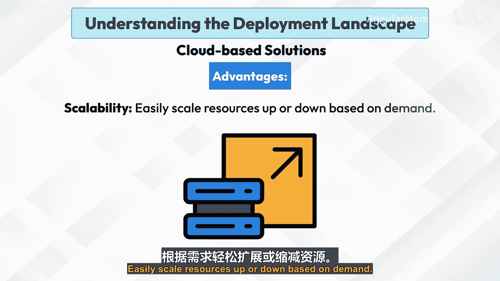

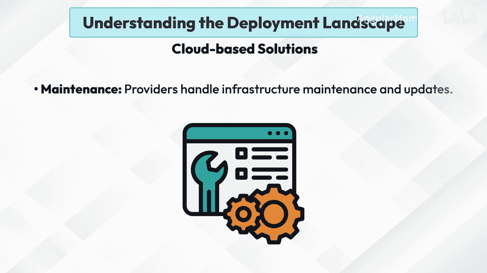

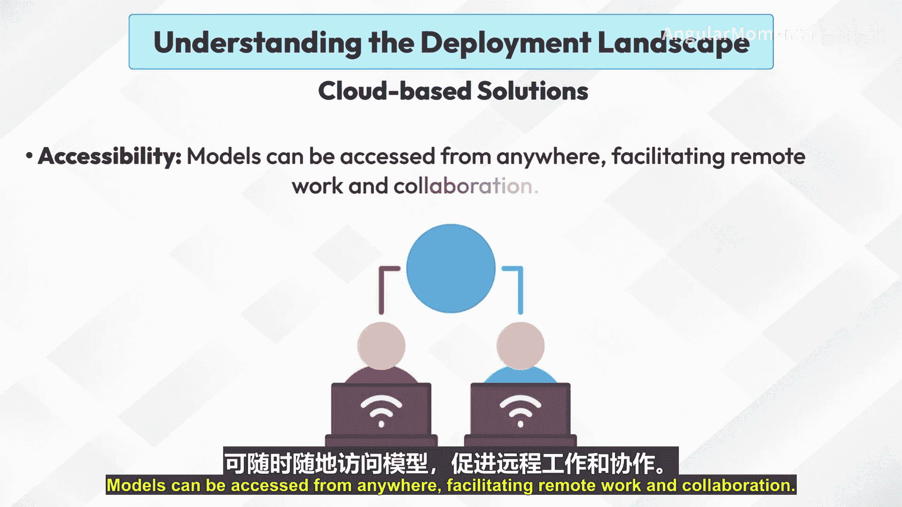

Use cases， ideal for applications requiring significant computational power or handling large data sets。

 such as real time language processing or large scale image generation。

Examples include AWS SageMaker， Google AI Pla， Azure Machine learning。

 on premiseises solutions on premises solutions involve deploying JenAI models on local servers within an organization's own data centers。

 advantages， control， full control over hardware and software configurations。

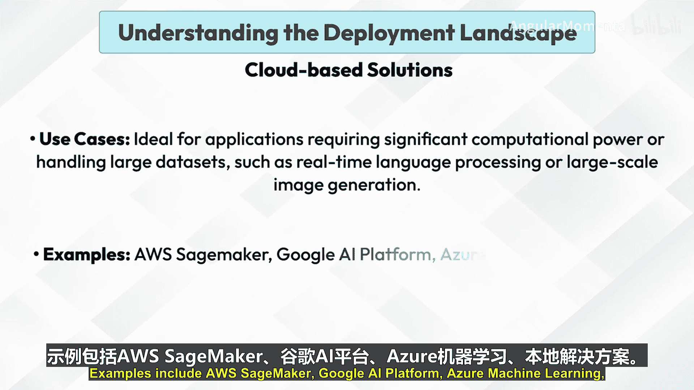

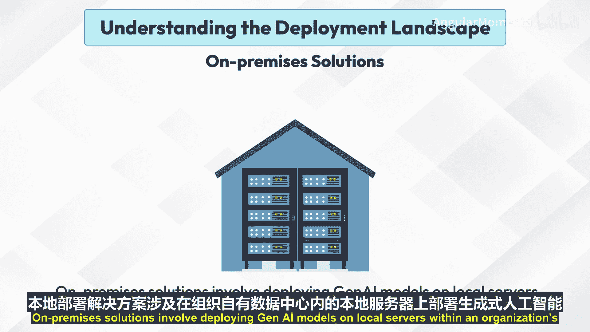

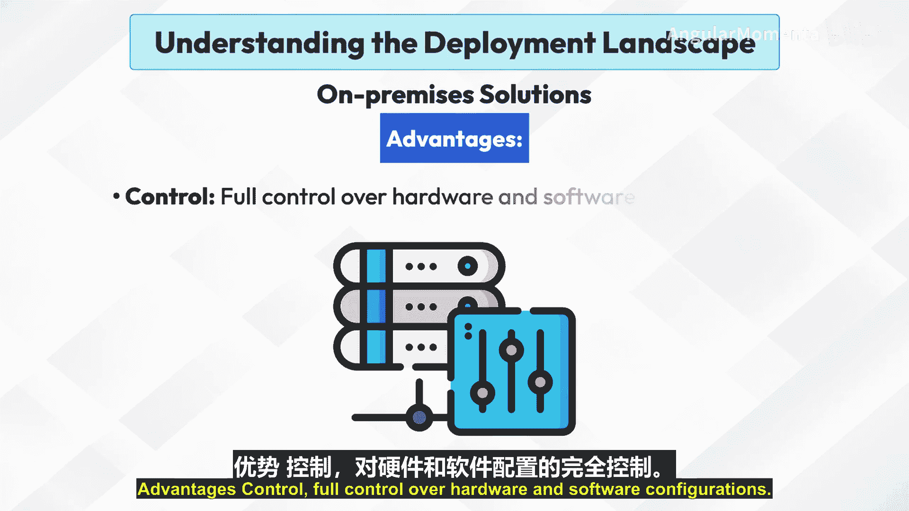

Data privacy， enhanced security and privacy for sensitive data。

 as everything remains within the organization's infrastructure。

Customization tailor the environment to specific needs and requirements。

 use cases suitable for scenarios where data privacy is paramount or where low latency performance is critical。

 such as in financial transactions or sensitive healthcare data。

Examples include custom built servers， dedicated AI hardware like NVIDdia， DGX Systems。

Hybrid solutions。

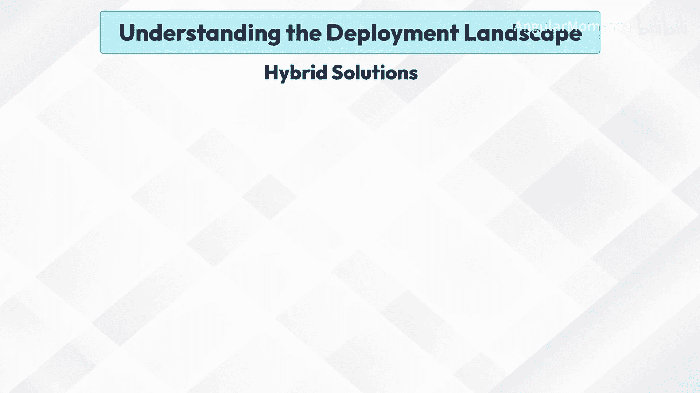

Hybrid solutions combine elements of both cloud based and on premises deployments；

 they allow for flexible resource management and can be tailored to specific needs。

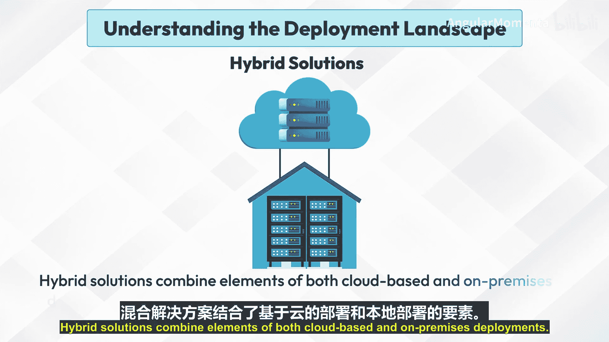

Advantages， flexibility， balance between cloud scalability and on premises control， optimized costs。

 use cloud resources for peak loads while maintaining critical operations on premises。

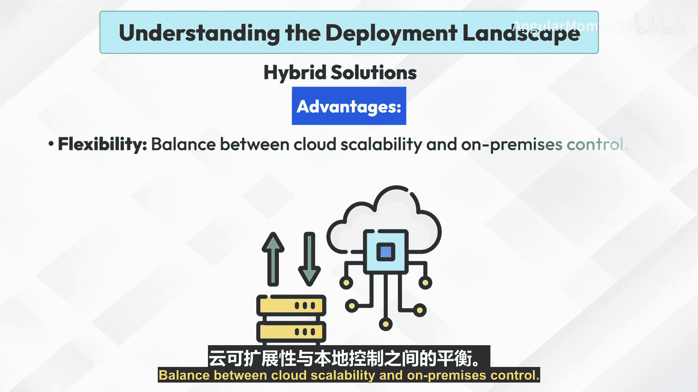

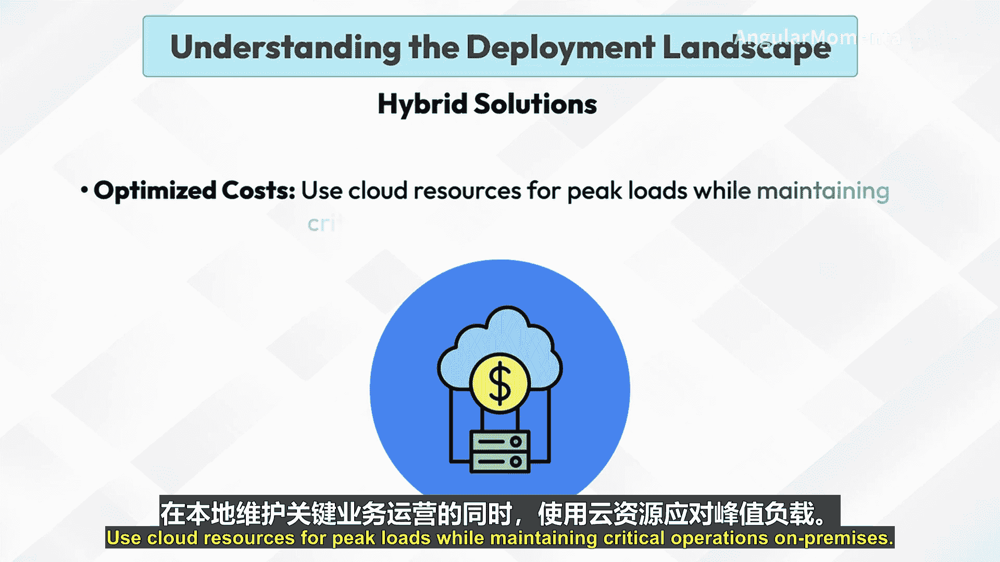

Disaster recovery Cloud can serve as a backup or failover option for on premises systems， use cases。

 beneficial for businesses needing to manage large scale workloads while maintaining critical data on premises。

 such as in retail with high transaction volumes and sensitive customer data。

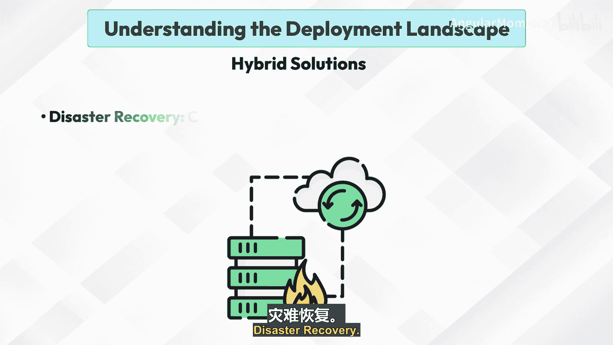

Examples， Azure stack， AWS Outposts。

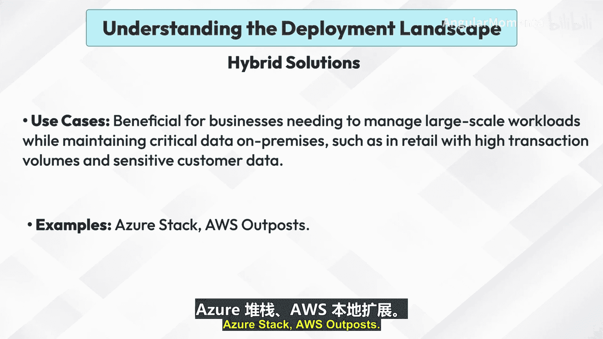