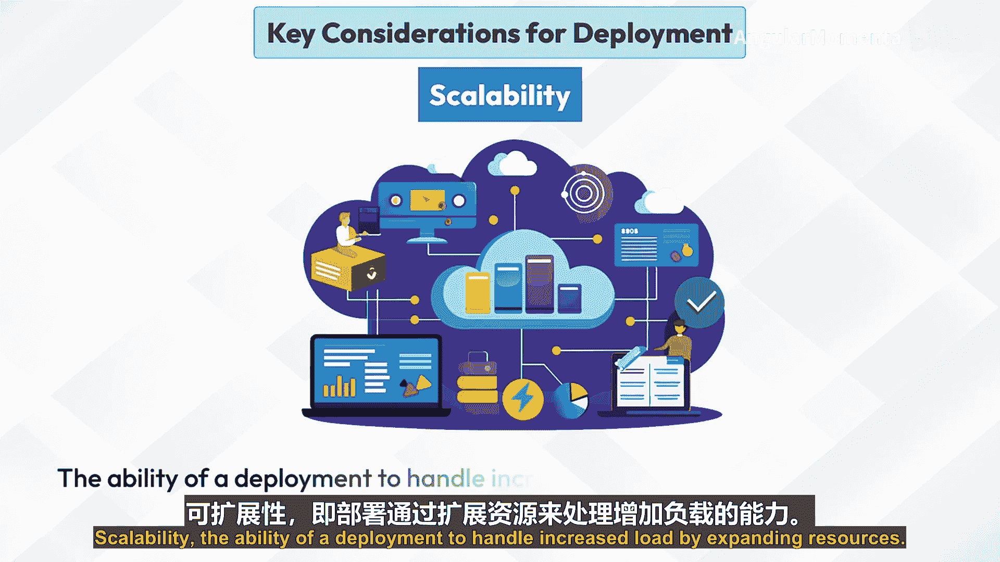
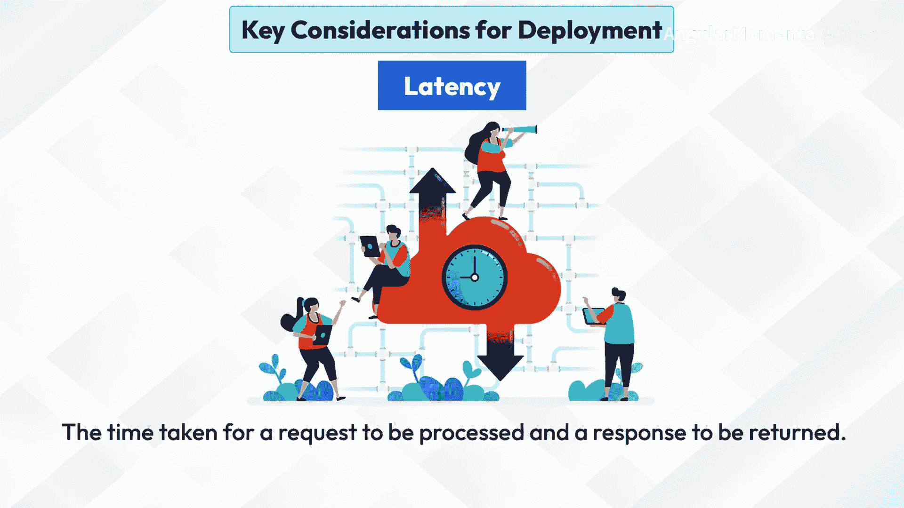
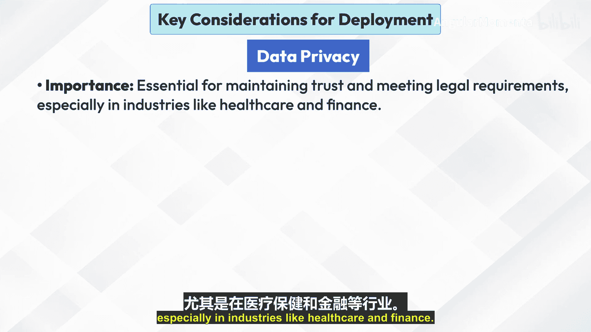
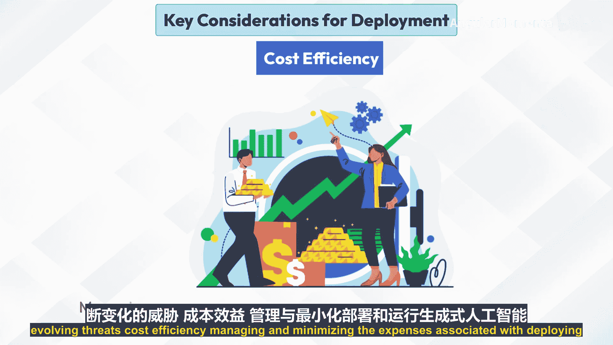
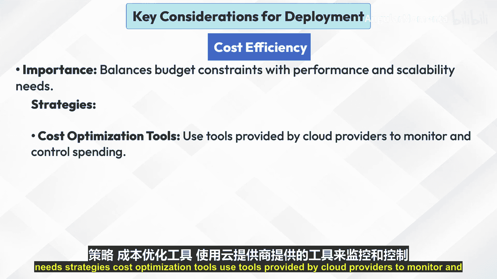

# 【EDUCBA】应用生成式人工智能集成与部署策略-｜-Apply-Generative-AI-Integration-and-Deployment-Strate-p03-01_02_01_开发的关键考量因素--BV1dcF2zMENZ_p3-

Key considerations for deployment Scalability， the ability of a deployment to handle increased load by expanding resources I。

 ensures that the GenI model can manage varying volumes of data and user requests without performance degradation。

Strategies， horizontalal scaling， adding more instances to handle increased load， for example。

 additional cloud servers， vertical scaling， upgrading the capabilities of existing instances。

 for example， more powerful hardware。Best practices。

 monitor performance metrics to anticipate and respond to scaling needs and use auto scaling features where available。

Latency， the time taken for a request to be processed and a response to be returned。

Importance， critical for applications requiring real time responses such as chatbots or interactive AI systems。

 strategies， edge computing， deploy models closer to end users to reduce latency， load balancing。

 distribute requests sufficiently across multiple servers to manage response times。

Best practices optimize models for faster inference and use caching mechanisms to speed up repeated requests。

Data privacy， protecting sensitive information from unauthorized access and ensuring compliance with regulations。

 importance， essential for maintaining trust and meeting legal requirements。

 especially in industries like healthcare care and finance。

Strategies encryptryion， secure data both in transit and at rest， access controls。

 restrict access to data and model outputs to authorized personnel only。

Compliance ensuresure adherence to regulations such as GDPR， HIPAA， etc。Best practices。

Regularly review and update privacy policies and security measures to address evolving threats。

Cost efficiency， managing and minimizing the expenses associated with deploying and running Gen AI models importance balances budget constraints with performance and scalability needs。

 strategies， cost optimization。

Tools use tools provided by cloud providers to monitor and control spending。

Resource management write size instances and use reserved or spot instances where applicable。

 efficient coding， optimize algorithms and models to reduce resource consumption。

Best practices regularly review cost reports and adjust strategies to avoid unexpected expenses。

