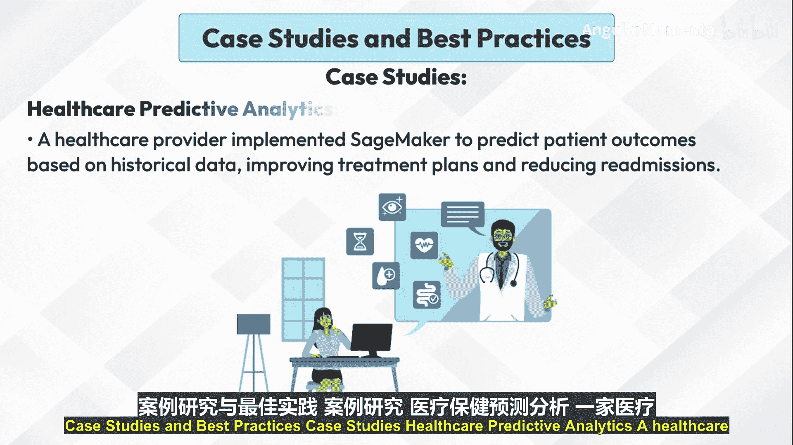
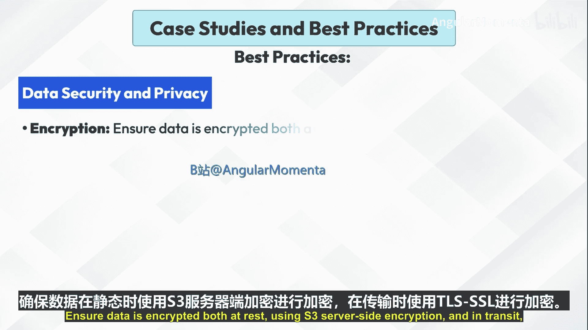
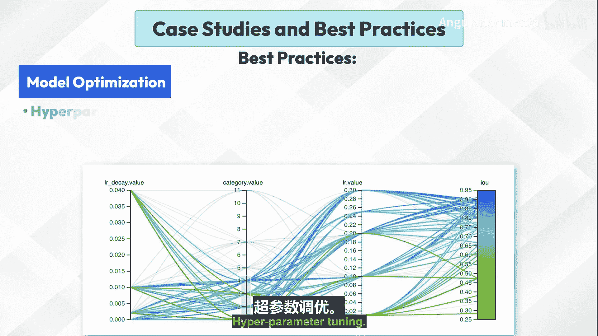
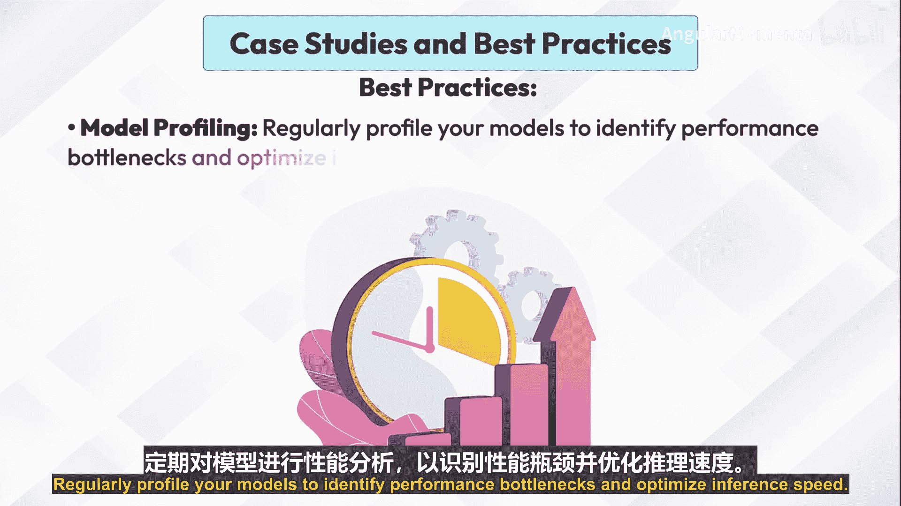
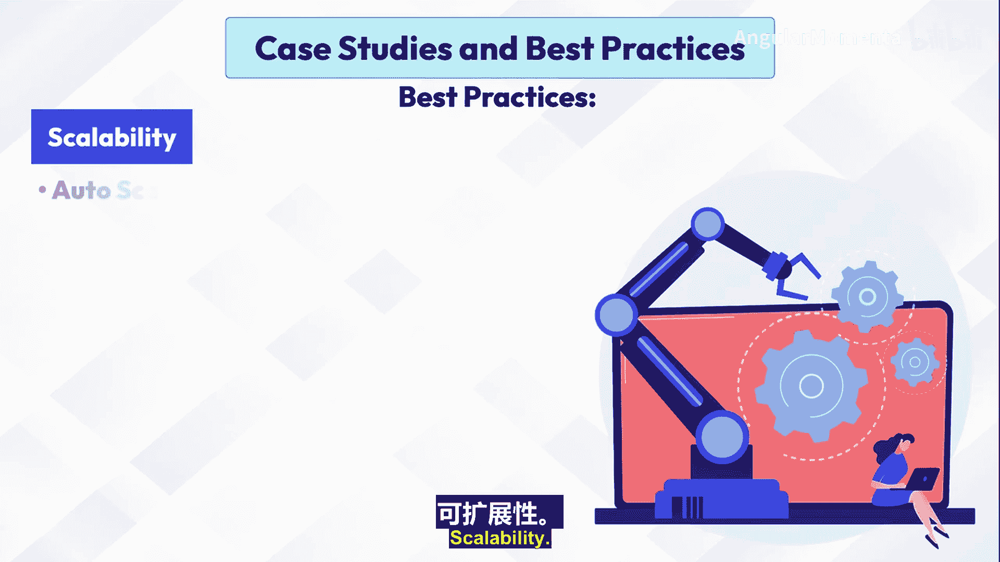
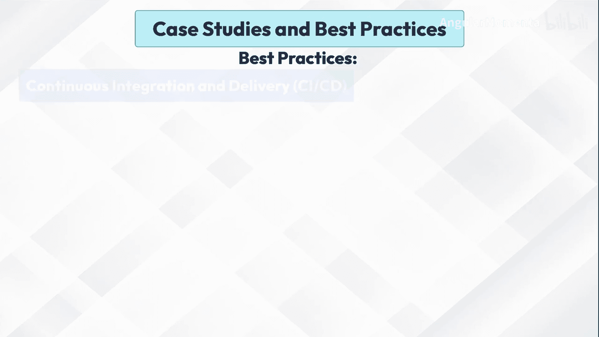
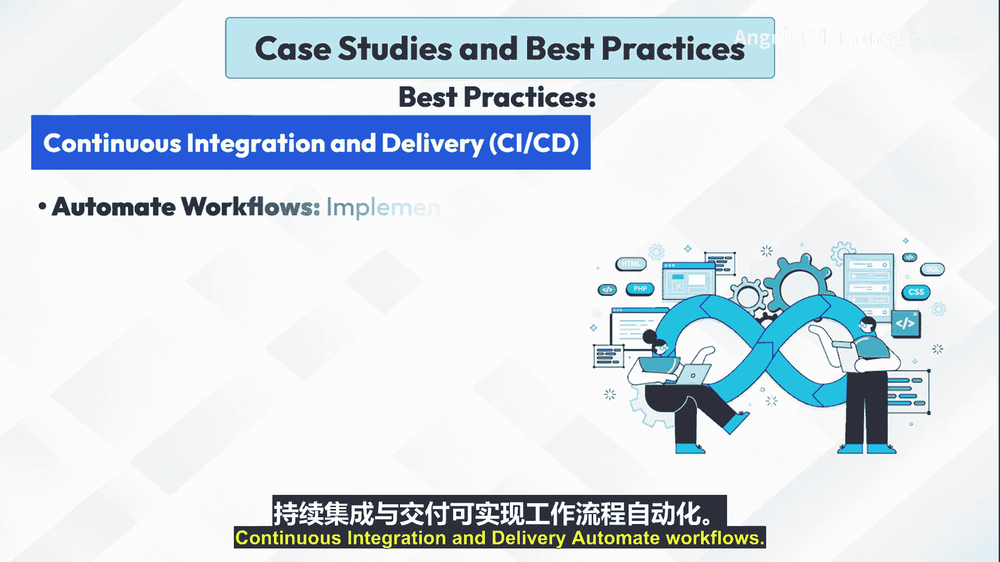
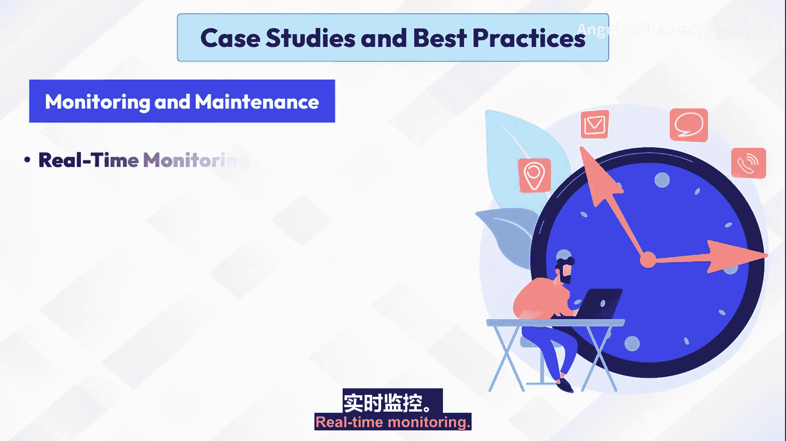
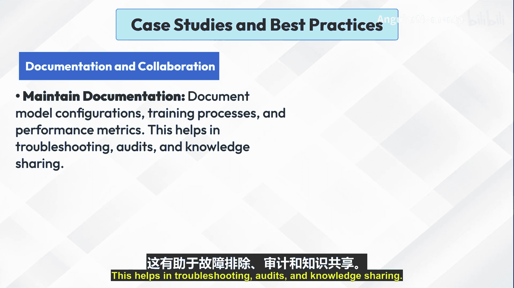

# 【EDUCBA】应用生成式人工智能集成与部署策略-｜-Apply-Generative-AI-Integration-and-Deployment-Strate-p05-01_03_01_案例研究与最佳实践--BV1dcF2zMENZ_p5-

Case studies and best practices， case studies， healthcare predictivetive analytics。

 a healthcare provider implemented sageMaker to predict patient outcomes based on historical data。

 improving treatment plans and reducing readmissions， E-commerce recommendation systems。

 and e-commerce business utilized sageMaker to build recommendation algorithms that adapted to user behavior。

 increasing conversion rates significantly， best practices， data security and privacy， encryption。

 ensuresure data is encrypted both at rest using S3 serverside encryption。

 and in transit using TlS SSL access control， implement strict IM policies to control access to data and sageMaker resources。

 Use least privileged principles and regularly review permissions。

Model optimization Hyparameter tuning， use SageMaker's automated hyperparameter tuning to find the best model configurations。

Utilize sageMakers built in algorithms for efficient tuning， model profiling。

 regularly profile your models to identify performance bottlenecks and optimize inference speed。

Scalability Auto scaling leverage SageMakes' auto scaling features to handle varying workloads and optimize resource usage。

Adjust endpoint instance types and auto scaling policies based on traffic and demand， Ins selection。

 Choose appropriate instance types based on model complexity and required computational power。

Continuous integration and delivery CICD。Autommate workflows。

 implement CICD pipelines for model training， testing and deployment。

 use SageMake pipelines for managing end to- end ML workflows， version control。

 maintain version control for model artifacts， code and configurations to ensure reproducibility and facilitate rollbacks if needed。

 monitoring and maintenance， real-time monitoring， use CloudWatch and sageMake model monitor to track model performance。

 latency and data quality， set up alerts for anomalies or performance issues， regular updates。

 periodically retrain models with new data to adapt to changing patterns and maintain accuracy。

 update model versions and deploy them with minimal disruption， documentation and collaboration。

 maintain documentation， document model configurations。

 training processes and performance metrics this helps in troubleshooting audits and knowledge sharing。

 facilitate collaboration， use SageMaker Studios collaborative features to enable teambased model development and review。

 share notebooks and。

Sites effectively within the team。