# 【EDUCBA】应用生成式人工智能集成与部署策略-｜-Apply-Generative-AI-Integration-and-Deployment-Strate-p06-01_03_02_AWS-Bedrock_1--BV1dcF2zMENZ_p6-

AWS Brock is a service designed to simplify the deployment and management of foundation models。

 particularly generative AI models， Brock provides a suite of pretrained models from leading AI companies like Anthropic。

 stability AI and others， as well as tools to customize and deploy these models at scale。

 key features of AWS Brock include pretrained foundation models。

 access to state of the art models for various applications such as text generation。

 image generation and more。

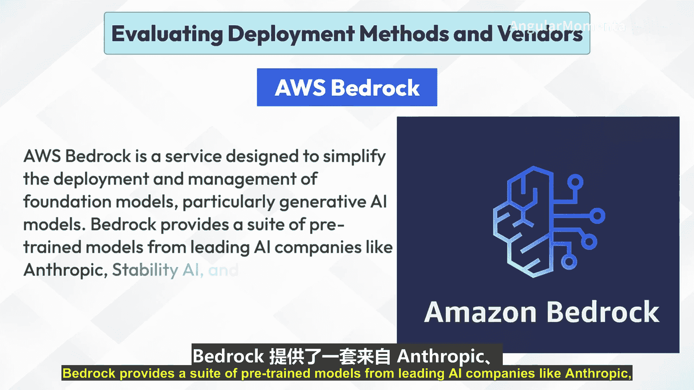

Customization and fine tuning， tools to customize models with your data to better fit specific use cases。

Scalable deployment In to deploy and scale models effortlessly， integration with AWS services。

 seamless integration with other AWS services like S3。

 Lambda and CloudWatch for enhanced functionality and monitoring。Setting up bedrock for GenII models。

 step1， create an AWS account sign up if you don't have an AWS account。

 go to AWS's official site and sign up。Provide necessary details like email address。

 password and contact information step 2， access AWS bedrock。

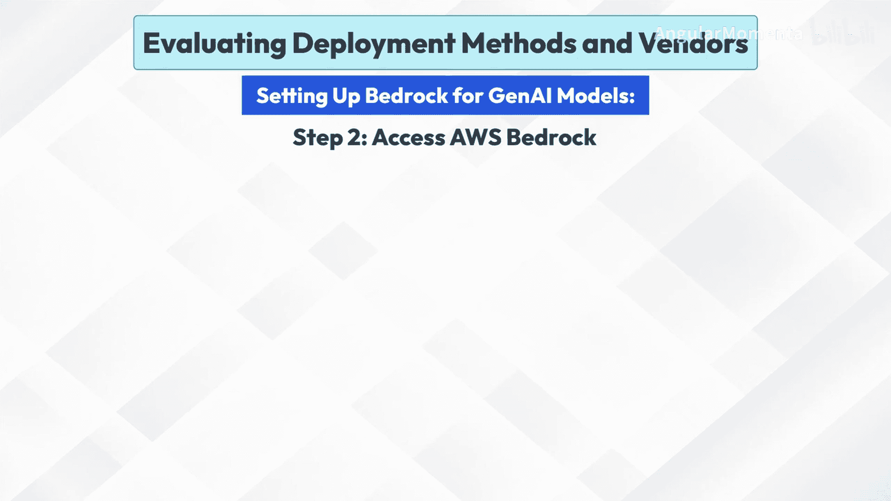

Navigate to AWS bedrock， log in to the AWS Management console in the Services menu。

 search for bedrock and select it。

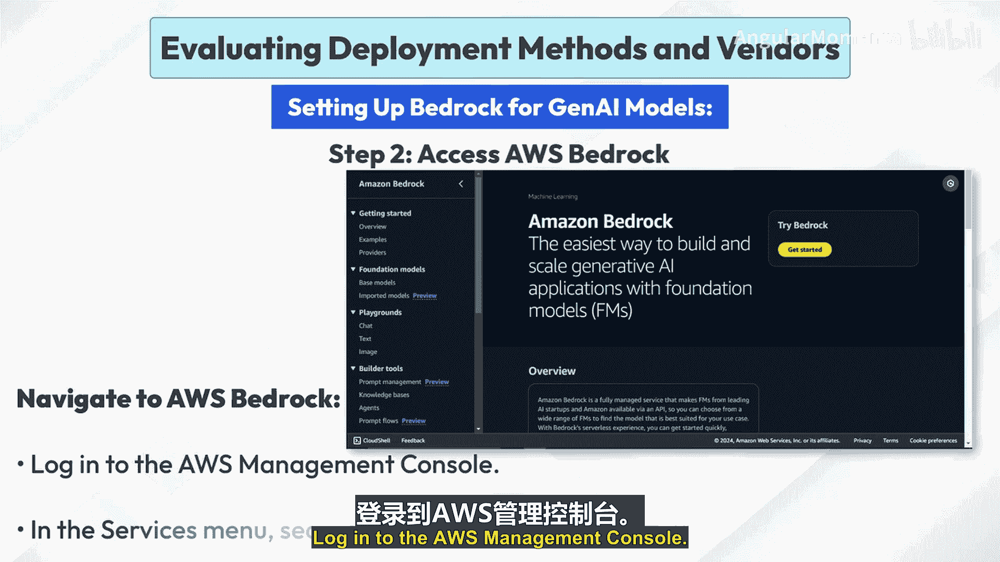

Step 3， set up IAM roles， create IM role， go to the IAM Identity and Access Management Service in the AWS Management console。

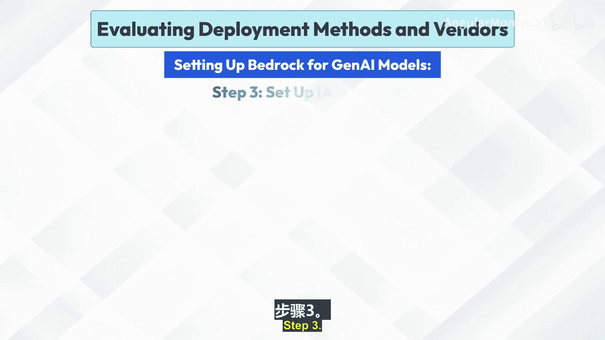

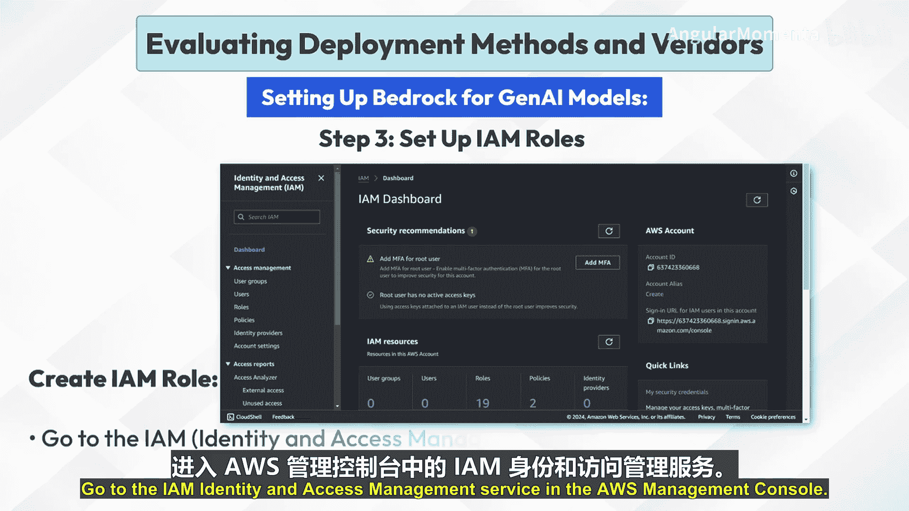

Click on Ros in the sidebar and then click Create Ro。

 choose AWS service and select bedrock as the service that will use the role。

Attach policies that grant necessary permissions such as access to S3 for data storage and CloudWatch for monitoring。

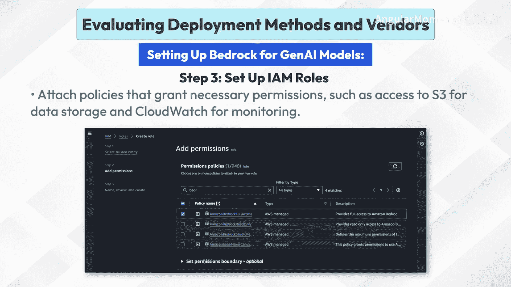

Name the role， for example， bedrock execution role， and complete the creation process。

 attach IAM Ro to bedrock go back to the bedrock dashboard during the setup of bedrock resources attach the previously created IAM role。

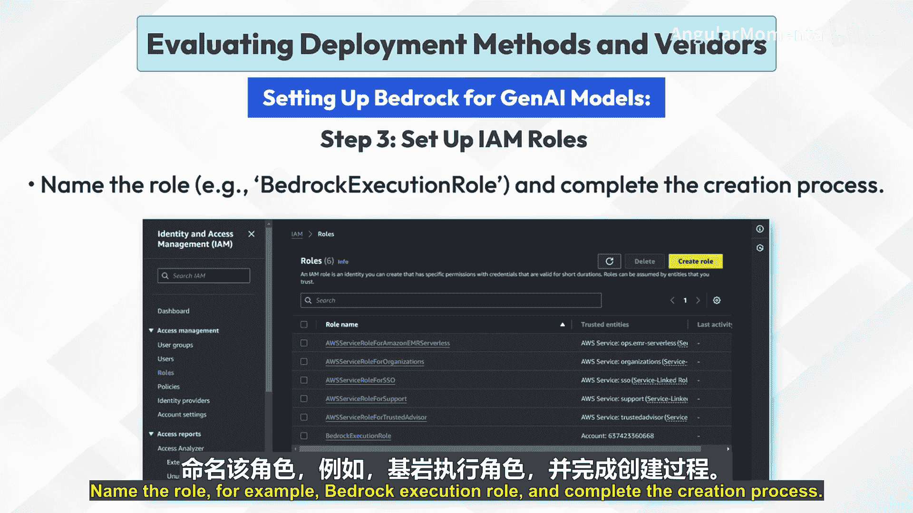

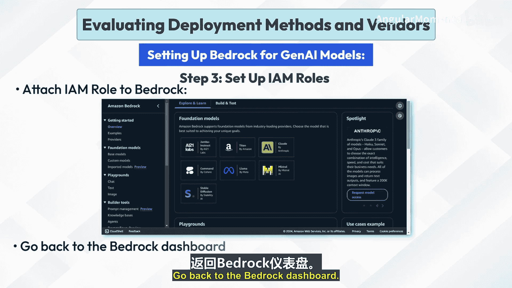

Step 4， select Pretrained models。Browse available models in the bedrock dashboard。

 navigategate to the section where pre traineded models are listed。

Review the descriptions and specifications of the available models to find one that suits your application。

 for example， text generation image generation。 select a model select a model by clicking on it。

 This will open a detailed view where you can see more information about the model's capabilities。

 training data and use cases。Step 5， preparere data for customization， upload data to S3。

 go to the S3 service in the AWS Management console。Create a new bucket or select an existing one。

 upload your data files to this bucket。Ensure the data is formatted correctly as required by the model you are customizing Data formatting ensure your data is cleaned and preprosed。

 Common formats include CSV， JSON or parquet， depending on the model requirements。

Label your data if necessary， especially for supervised learning tasks， step 6， customize models。

 initiate customization。In the bedrock dashboard， select the model you want to customize。

 choose the option to customize or finet the model， provide data for fine tuning。

 specify the S3 bucket and data files you uploaded earlier。

 configure any necessary parameters for fine tuning， such as learning rate， Es， batch size， etc。

 start the customization process。Launch the customization job and monitor its progress。

 This process might take some time depending on the size of your data and the complexity of the model validate customization。

Once the customization is complete， validate the performance of the fine tuned model using a validation data set。

 make necessary adjustments and repeat the fine tuning process if needed， Step7。

 Cho deployment configuration， select Ins types。In the bedrock Dboard。

 choose the deployment configuration select the appropriate instance type based on your model's computational requirements and expected traffic load AWS provides a variety of instance types optimized for different workloads。

Define endpoints set up the endpoint where the model will be deployed。

 this will be the interface through which your applications interact with the model。

Configure settings like end point name， scaling options and security parameters， step 8。

 deploy the model launch deployment， initiate the deployment process from the bedrock dashboard。

 monitor the deployment status and ensure that the end point becomes active。Test the deployment。

 send sample requests to the deployed model endpoint to verify its performance。Check for latency。

 accuracy and any possible errors， integration with applications。

 obtain the endpoint URL from the bedrock console。Integrate this URL into your application code to send inference requests。

 Typ this involves making HTTP post requests to the endpoint with the input data。

 ensure show your application handles responses and errors appropriately， step 9。

 monitoring and maintenance， enable logging， set up logging to capture detailed information about model inferences and endpoint performance。

 use AWS CloudWtch logs to store and analyze log data。

Configure log groups and log streams to organize the logs effectively， monitor performance。

 use AWS CloudWatch to monitor key performance metrics such as latency， throughput， error rates。

 and instance utilization。Create dashboards to visualize these metrics and set up alarms to receive notifications when certain thresholds are breached。

 Se up alarms and notifications， configure CloudWatch alarms to trigger notifications based on specific conditions such as high error rates or latency exceeding acceptable limits。

 use Amazon SNS， simple notification service to send notifications via email。

 SMS or other communication channels。

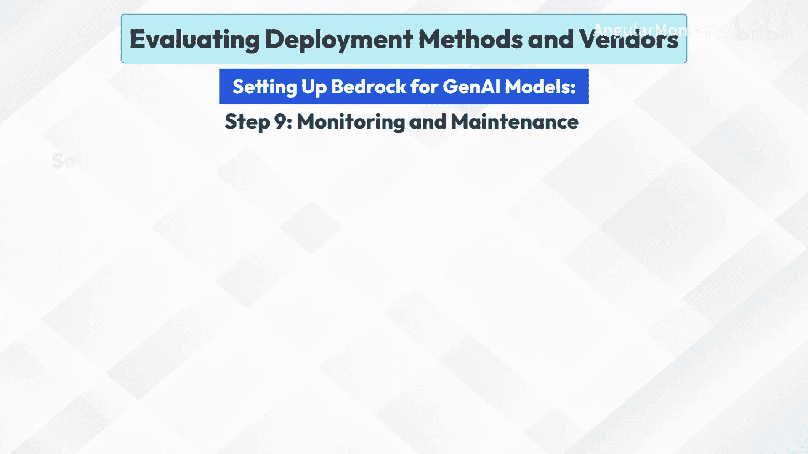

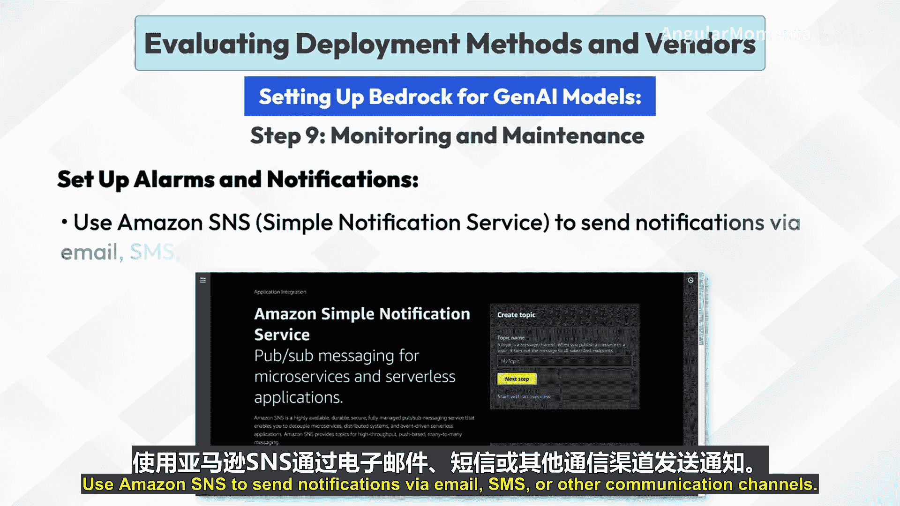

Step 10， Auto scaling configuration Def auto scaling policies。

 set up auto scaling to automatically adjust the number of instances based on traffic load。

Define scaling policies that specify conditions under which instances should be added or removed。

 for example， you can scale out when CPUU utilization exceeds 70% in scale in when it drops below 30%。

Configure scaling actions， specify the minimum and maximum number of instances for your deployment。

 set cool down periods to prevent rapid scaling actions that could lead to instability。

 test auto scaling， simulate traffic to ensure that the auto scaling policies work as intended。

Monitor how the system scales in response to varying loads and make adjustments to the policies if necessary。

 Step 11， maintenance and updates， regular model retraining。

 periodically retrain your model with new data to maintain its accuracy and relevance。

 Use bedrock's customization tools to update the model and deploy the new version with minimal downtime。

Endpoint management Manager endpoints by monitoring their performance and making adjustments as needed。

 decommission endpoints that are no longer in use to save costs。

Cost management monitor your usage and costs using AWS Cost Explorer。

Optimize your resource allocation to balance performance and cost This may involve choosing different instance types。

 adjusting auto scaling policies， or optimizing your model to reduce resource consumption。

 best practices， data security and compliance encryption ensure all data is encrypted both at rest and in transit compliance adhere to industry specific regulations and standards。

 for example， GDPR HPAA， model optimization， fine tuning。

 regularly fineted models with new and relevant data， performance tuning。

 Op model configurations for better performance and lower latency， scalability and flexibility。

 auto scaling， I auto scaling to handle peak loads。

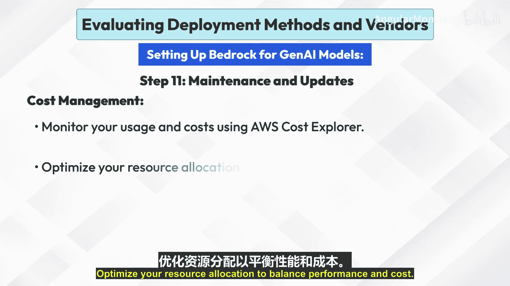

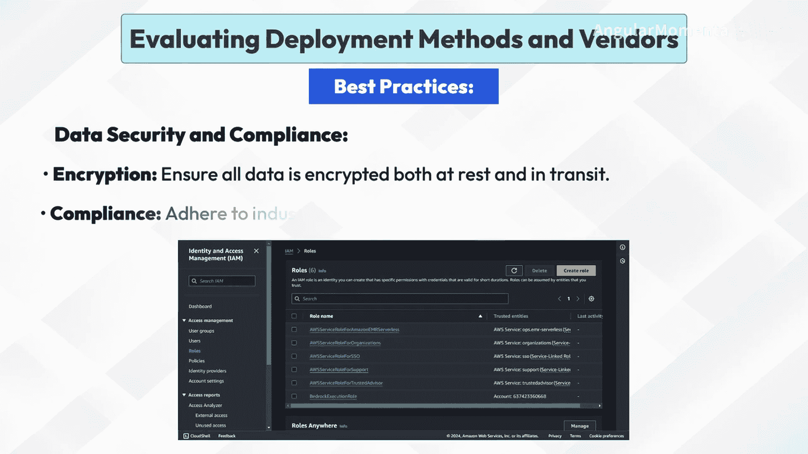

Flexible architectureitect Design your deployment architecture to be flexible and easily adjustable based on changing needs。

Continuous integration and deployment CICD Automate Pis use CICD pipelines for automating model training。

 testing and deployment。Version control maintainin version control of your models to track changes and facilitate rollbacks if needed。

Monitoring and feedback loops， real time monitoring。

 set up comprehensive monitoring to detect and address issues promptly， feedback loops。

 implement feedback mechanisms to continuously improve model performance based on real world data。

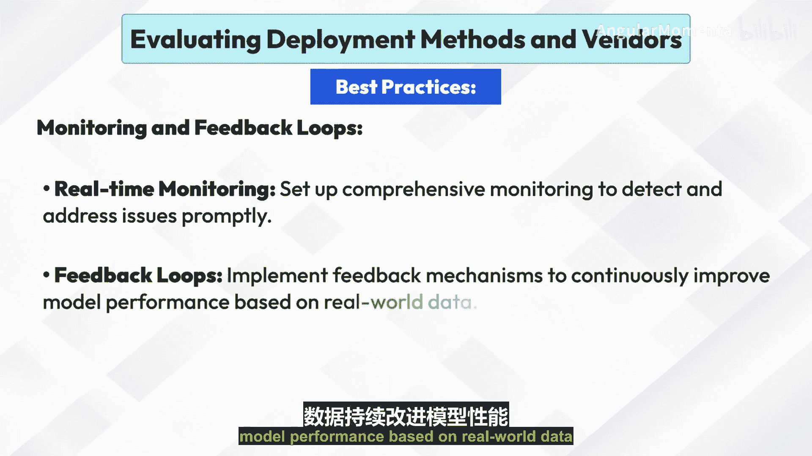