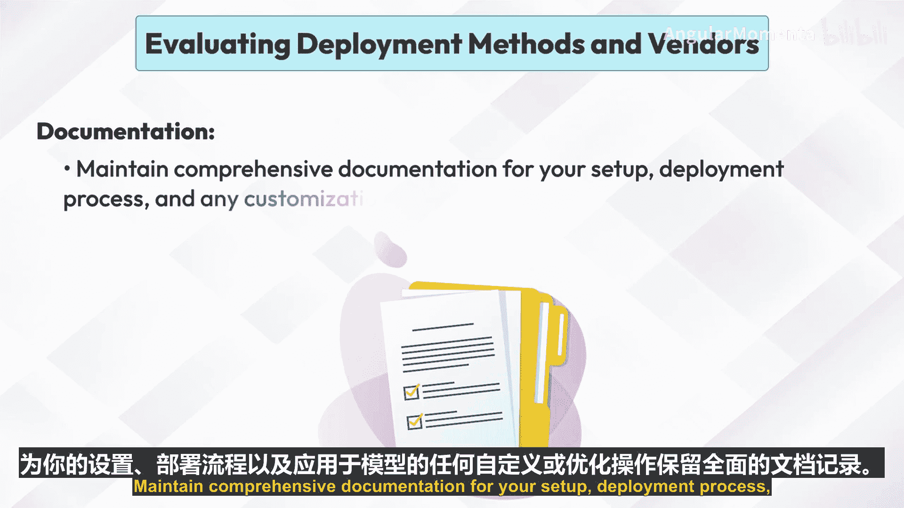

# 【EDUCBA】应用生成式人工智能集成与部署策略-｜-Apply-Generative-AI-Integration-and-Deployment-Strate-p07-02_01_01_Anthropic_1_1--BV1dcF2zMENZ_p7-

Anthropic Anthropic is an AI safety and research company focused on developing interpretable。

 reliable and steerable AI systems。Founded by former Open AI researchers。

 Anthropic aims to address the challenges and risks associated with advanced AI by prioritizing safety and alignment in their models。

They focus on building AI systems that can be easily understood and controlled。

 ensuring their deployment is beneficial and safe， key features of anthropic's AI models include state of the art performance。

 high quality language models capable of generating coherent and contextually relevant text。

Ethical AI emphasis on safety， reliability， and alignment with ethical guidelines。

Flexibility models can be adapted and fine tuned for specific use cases。

Setting up a local environment， setting up a local environment to deploy anthropic AI models involves several key steps。

Hardware requirements ensure your local machine has sufficient computational resources。

 Large AI models typically require powerful CPUs or GPs， substantial RAM and storage。

 recommended specifications include multico CPU， at least one high performance GPU NviDdia Couda compatible。

 16 Gb or more of RA， ample disk space， SSD preferred。Software requirements， operating system， Linux。

 Uuntu 20。04 or later， or Windows with WSL2。Python ensure Python 3。8 or higher is installed。

 use a package manager like Pianov to manage different Python versions。

Cuta and QDNN for GPU acceleration， install NviIDdia Qa toolkit and QDNN libraries， Enronment setup。

 create a virtual environment to manage dependencies， installing dependencies。

 install necessary libraries and frameworks， for example， Pytorrch。

 Tensorflow anthropic specific packages， deploying GenI models locally。

 deploying anthropics Geni models locally involves the following steps， model selection。

 Choose the appropriate GenAI model from anthropics model zoo。

This could be a pre traineded language model or a custom model you have trained， loading the model。

 load the selected model into your environment， inference pipeline。

 set up the inference pipeline including prepro， model inference and post processing。

Running inference， execute the inference pipeline to get predictions from the model。

 managing local deployments。Managing local deployments effectively is crucial to ensure performance and reliability resource monitoring use tools like NviIDdia SMI for GPU。

 and HTO， for CPUU and memory to monitor resource usage。Model updates。

 regularly update models and dependencies to benefit from the latest improvements and security patches。

 logging and debugging， implement logging to keep track of model performance and issues。

 backup and version control， use version control， for example， Git to manage code and model versions。

 regularly backup models and important data， best practices for local hosting。

Adhering to best practices ensures the optimal performance and reliability of your local deployments Enronment isolation use virtual environments or docker containers to isolate dependencies and avoid conflicts。

 security， implement security measures such as firewalls and access controls to protect your deployment from unauthorized access。

Performance optimization optimize model performance by using techniques such as model quantization and pruning。

 scalability， plan for scalability by considering the possibility of transitioning to a more robust infrastructure。

 for example， cloud-based solutions， if local resources become insufficient。Documentation。

Maintain comprehensive documentation for your setup， deployment process。

 and any customizations or optimizations applied to the models。

