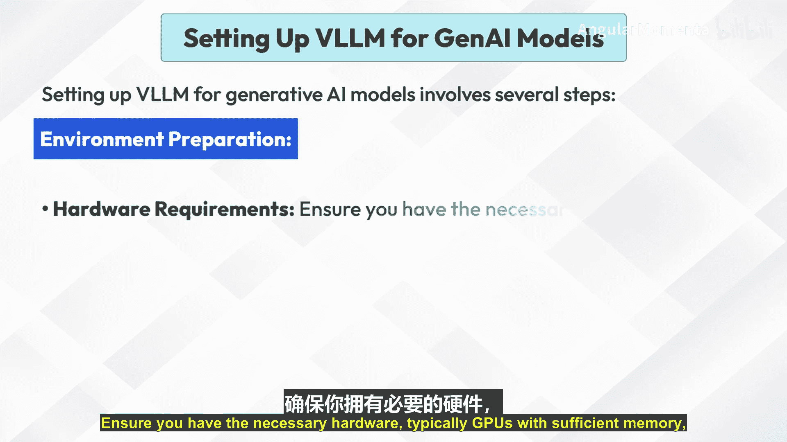
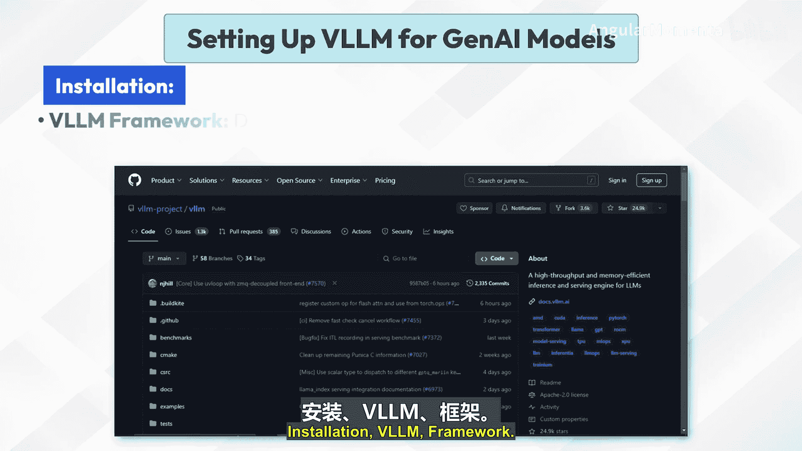
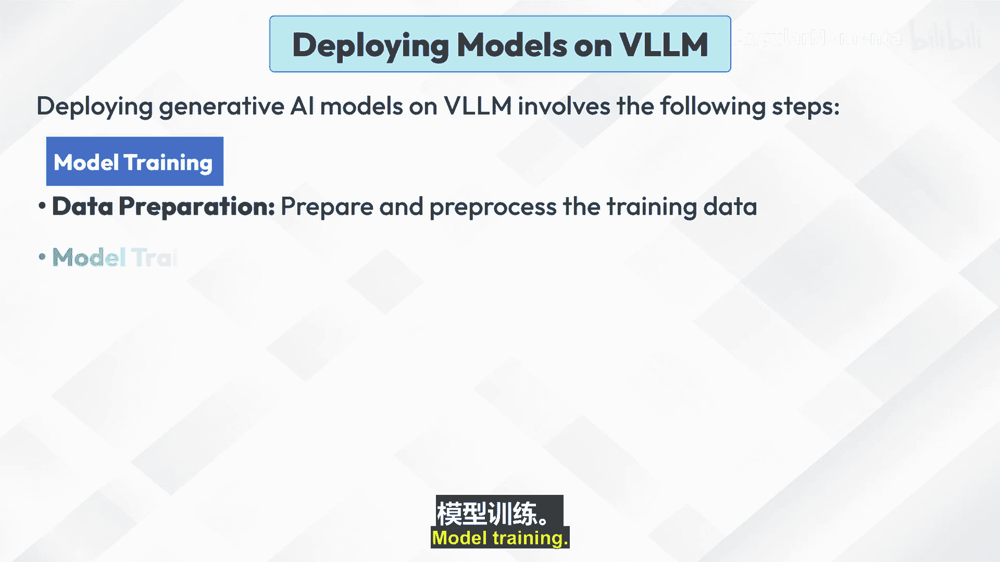
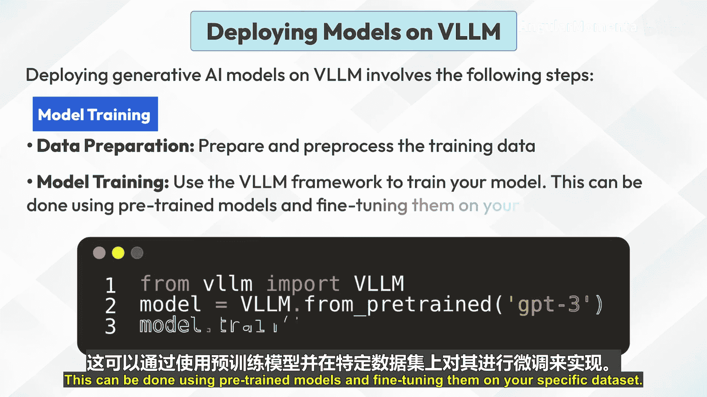
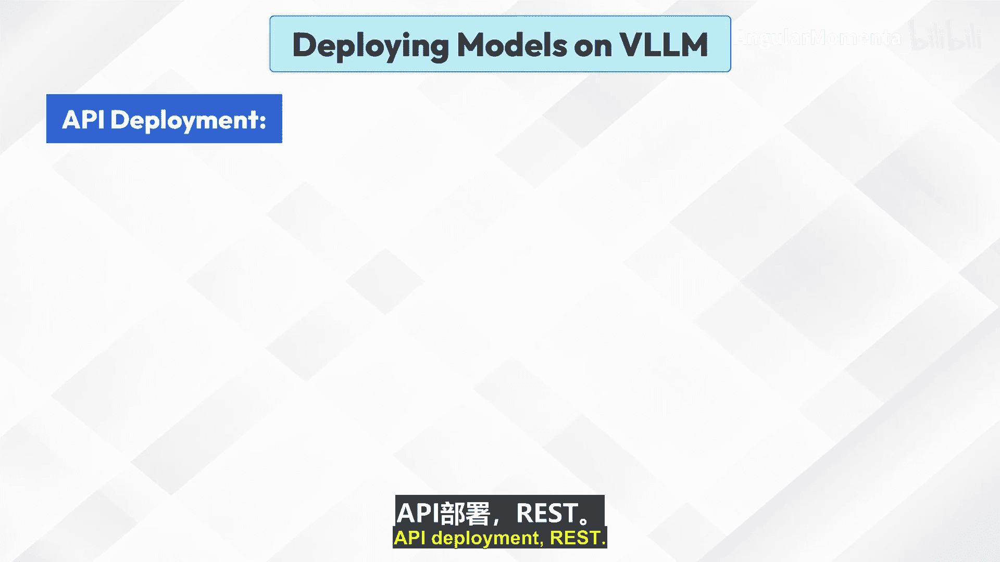
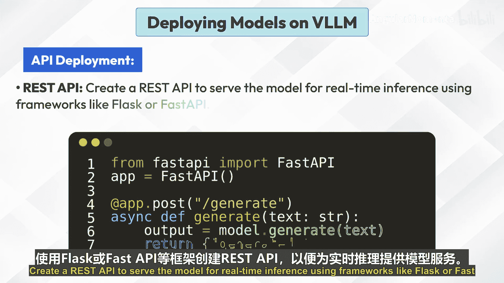
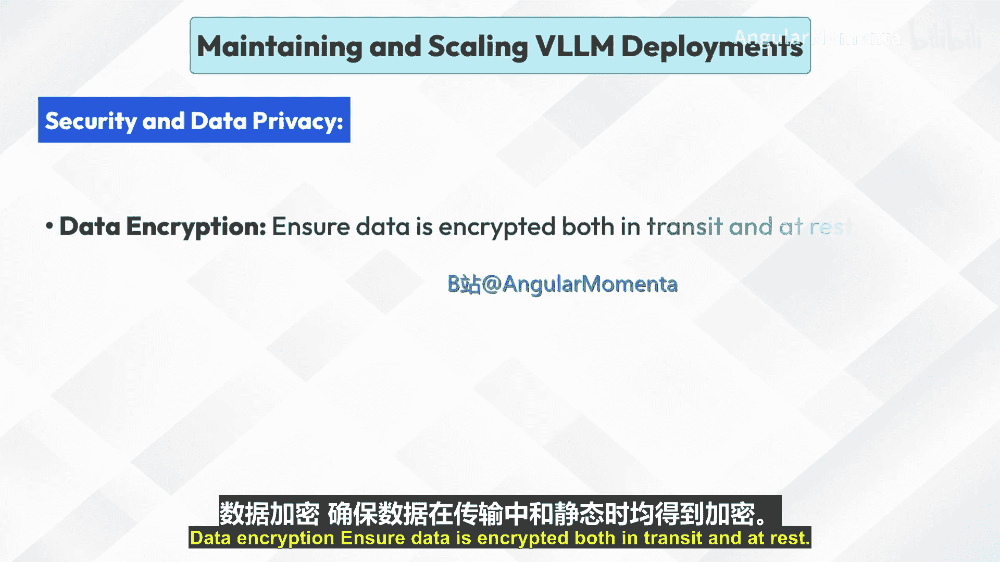

# 【EDUCBA】应用生成式人工智能集成与部署策略-｜-Apply-Generative-AI-Integration-and-Deployment-Strate-p08-02_01_02_vLLM_1_1--BV1dcF2zMENZ_p8-

VLM VLM， very large language models， refers to a class of AI models that leverage massive data sets and extensive computational resources to perform a variety of natural language processing NLP tasks。

These models are known for their ability to understand and generate humanlike text。

 making them useful in a wide range of applications from chatbots and virtual assistant to content generation and language translation VLLM frameworks are designed to efficiently handle the computational demands of these models。

 enabling both local and distributed deployment This allows organizations to harness the power of VLMs while maintaining control over their data and infrastructure。

 setting up VLLM for GenI models， setting up VLM for generative AI models involves several steps。

 Enron preparation， hardware requirements ensure you have the necessary hardware。

 typically GPUs with sufficient memory， for example NviDdia a100 V100 So dependencies。

 install necessary libraries and frameworks such as CUDa QDNN， Pytororch， TensorFlow。

 and VLLM specific libraries， installation， VLLM framework， Down and install the VLLM。

Framework from the official repository or through package managers like PIP additional tools install any additional tools required for model training and inference such as tokens and transformers libraries。

 configuration， configuration files， create configuration files， specifying model parameters。

 paths to pretrained models， and other relevant settings。Resource allocation。

 configure resource allocation such as the number of GPUs， memory limits and batch sizes。

 deploying models on VLLM， deploying generative AI models on VLLM involves the following steps。

 model training， data preparation， prepare and preprocess the training data， model training。

 use the VLLM framework to train your model， this can be done using pre-trained models and finetning them on your specific data。

 model inference， loading the model， load the trained model for inference， generating text。

 use the model to generate text or perform other NLP tasks API deployment RE API。

 create a RE API to serve the model for real-time inference using frameworks like flask or fast API。

 maintaining and scaling VLLM deployments， monitoring and logging， performance monitoring。

 use monitoring tools to track model performance， resource utilization and latency， logging。

 implement logging to capture。

Inference requests， responses and any errors， scaling， horizontal scaling。

 add more instances of the model to handle increased load this can be achieved using container orchestration tools like Kubernetes。

 load balancing， use load balancers to distribute requests across multiple instances， model updates。

 retraining， periodically retrain the model with new data to maintain accuracy and relevance。

 versioning， implement version control for models to manage updates and rollbacks。

 security and data privacy。Data encryption ensuresure data is encrypted both in transit and at rest。

 access control， implement strict access control measures to protect the model and data。

