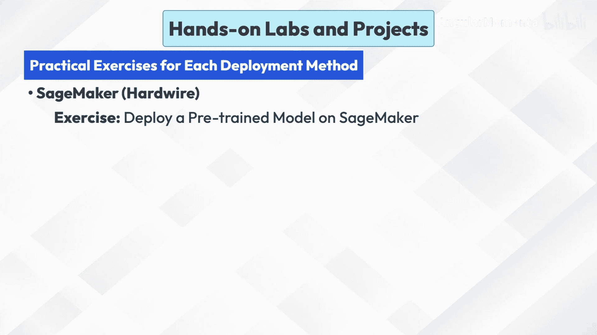
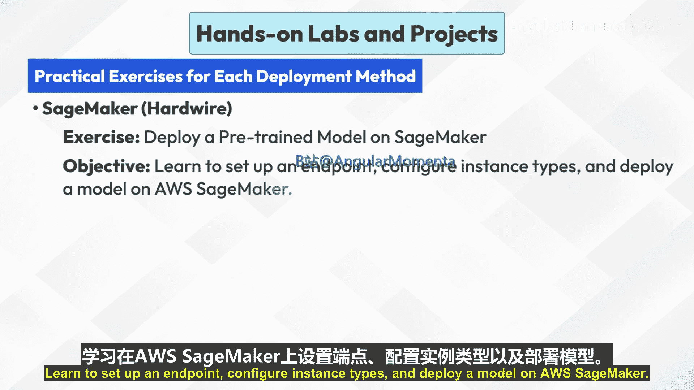
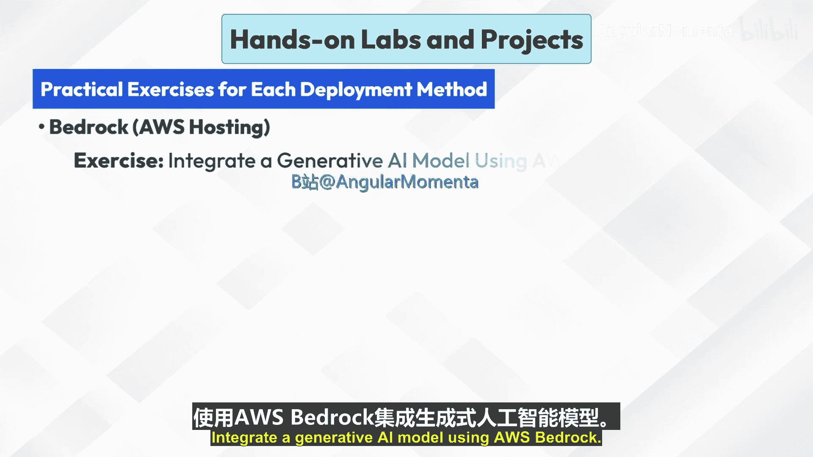
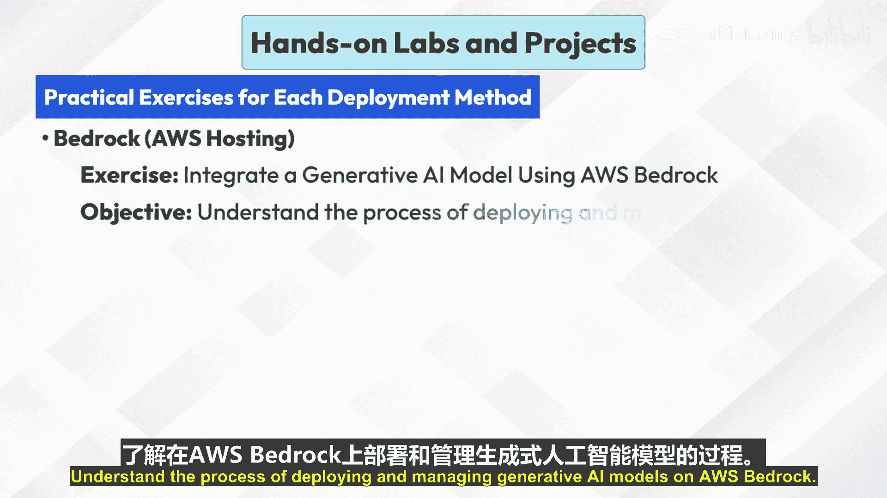
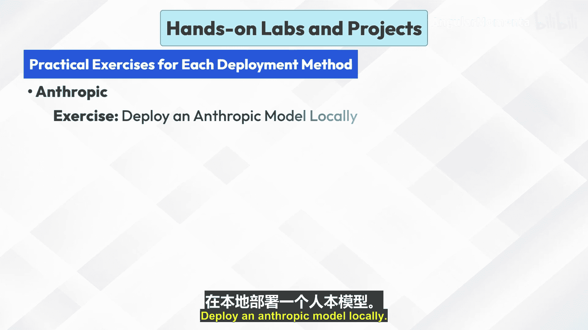
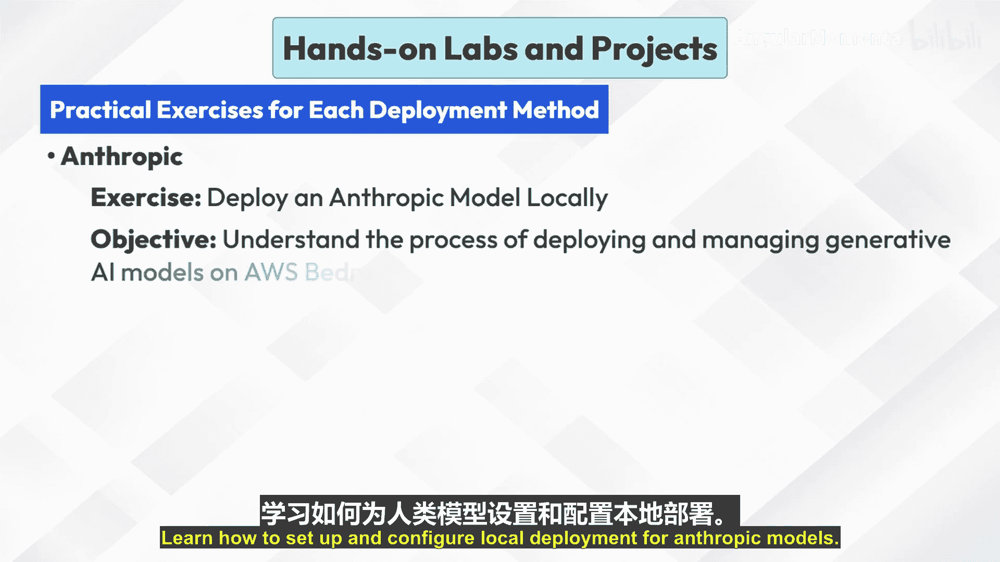
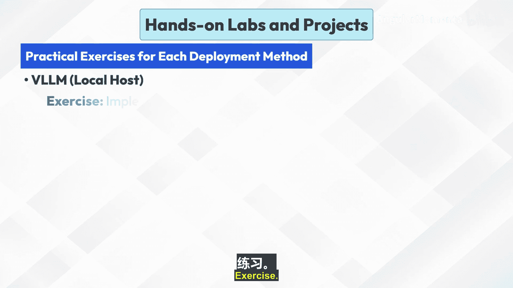
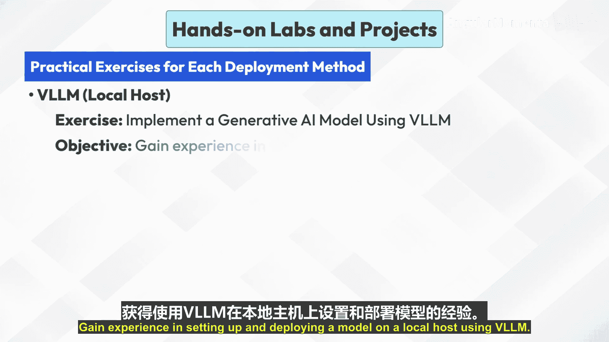

# 【EDUCBA】应用生成式人工智能集成与部署策略-｜-Apply-Generative-AI-Integration-and-Deployment-Strate-p10-02_02_02_动手实验与项目--BV1dcF2zMENZ_p10-

Hands on labs and projects， practical exercises for each deployment method， sageMaker， hardwire。

 exercise， deploy a pretrained model on sageMaker objectiveject， learn to set up an endpoint。

 configuregu instance types， and deploy a model on AWS SageMaker steps create a sageMaker notebook instance。

 use the sageMake SDK to deploy a pretrained model。

 Test the endpoint with sample data to ensure its functioning correctly。

 monitor the deploy model for performance and scalability bedrock， AWS hosting Ex。

 In a generative AI model using AWS bedrock objective。

 Under the process of deploying and managing generative AI models on AWS bedrock steps。

 set up an AWS bedrock environment， deploy a generative AI model to bedrock。

 In the model with a sample application。

Monitor and manage the model using AWS bedrock tools， anthropic， exercise。

 deploy an anthropic model locally。

Objective， learn how to set up and configure local deployment for anthropic models， steps。

 install necessary libraries and dependencies for anthropic models。

Configure the local environment settings， deploy the model locally and run sample inferences。

 troubleshoot common deployment issues and optimize performance， VLLM， local host， Ex。

 I a generative AI model using VLLM objective， gain experience in setting up and deploying a model on a local host using VLLM steps。

 set up the local development environment with VLLM， In the VLLM library into a project。

 deploy a generative AI model and validate its performance with test cases。

 optimize the model and local environment for better performance。

