# 【EDUCBA】应用生成式人工智能集成与部署策略-｜-Apply-Generative-AI-Integration-and-Deployment-Strate-p11-02_02_03_你以为你了解AI部署--BV1dcF2zMENZ_p11-

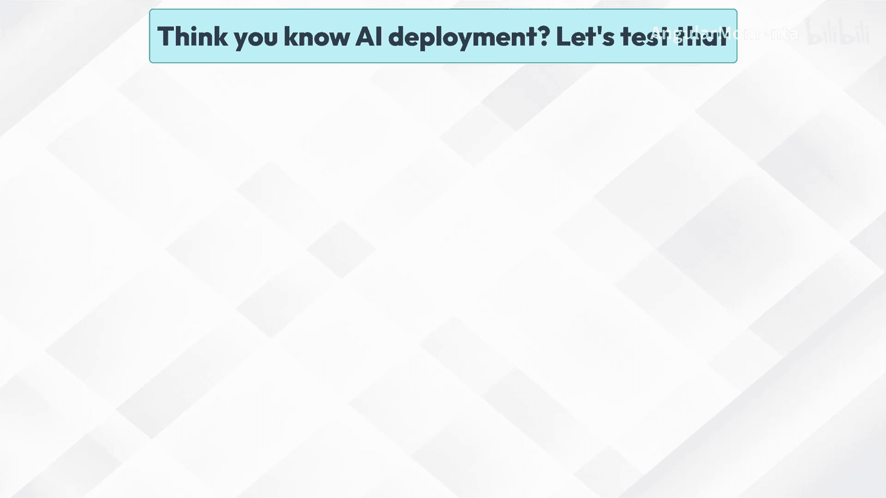

Think you know AI deployment， Let's test that。 What is generative AI Gen AI？

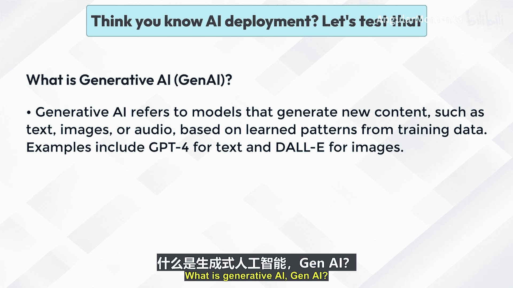

Generative AI refers to models that generate new content， such as text， images。

 or audio based on learned patterns from training data。

 Exles include GPT4 for text and Dll E for images。How do GenI models differ from other AI models GenI models focus on creating new content。

 rather than merely classifying or predicting outcomes based on existing data。

What are the key components of a GenI model？Key components include the model architecture。

 for example， transformers， training data， training algorithms， and hyperparameters。

What are the common use cases of Gen AI and industry？Use cases include content creation， for example。

 writing and art， customer support， for example， chat bots， and simulation， for example。

 generating synthetic data for training。

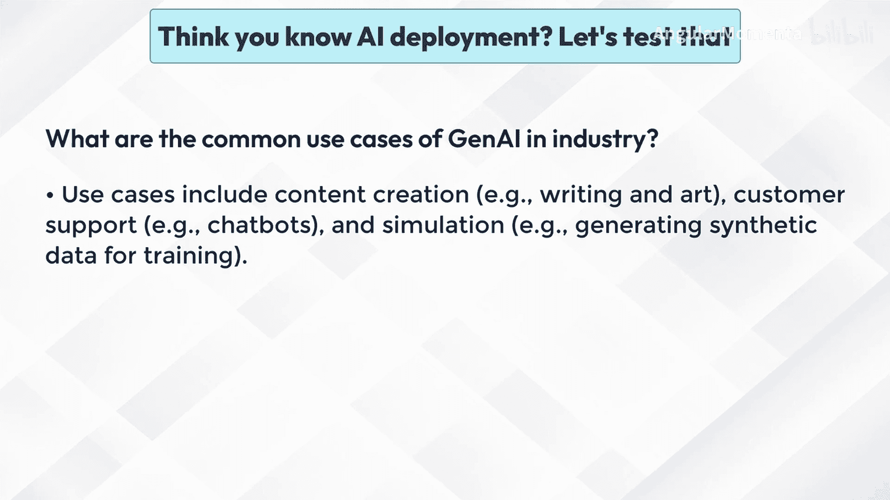

What are the main challenges in deploying GenAI models， challenges include scalability。

 performance tuning， data privacy， compliance and integration with existing systems？

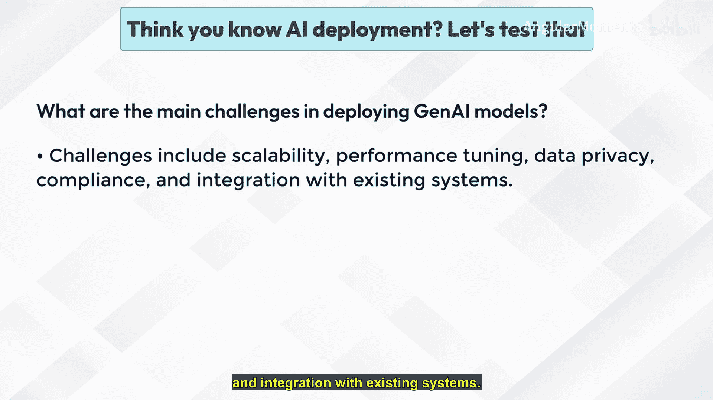

What is model integration in the context of GenAI？Model integration involves incorporating JenAI models into existing workflows or applications to enhance functionality or provide new features。

What are the benefits of integrating GenAI models into existing systems？

Benefits include enhanced capabilities， automation of content generation。

 and improved user experiences。

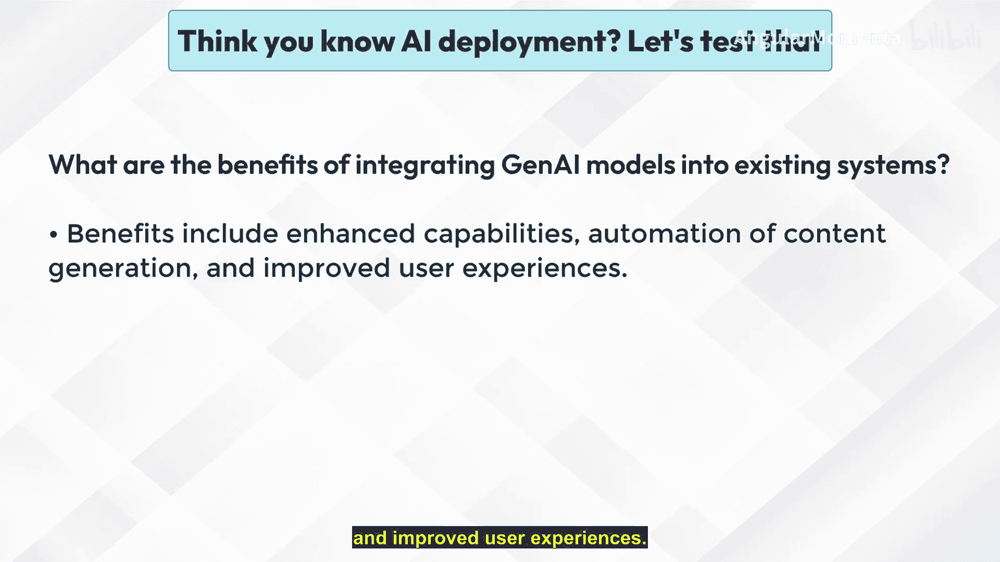

What factors should be considered before deploying a GenI model？Factors include model accuracy。

 scalability， performance， cost， data privacy， and compliance。

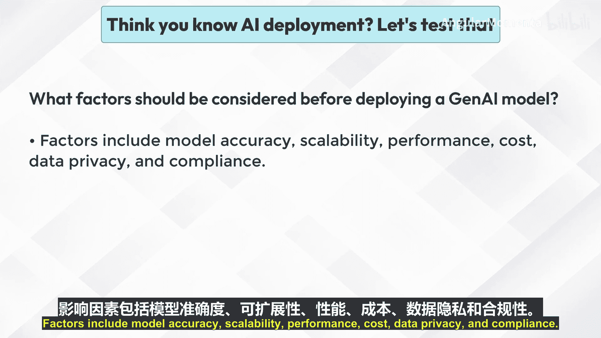

How do you assess the readiness of a GenI model for deployment？

Assess readiness by evaluating the model's performance on validation data， its robustness。

 and its ability to handle real world data； what is the importance of data privacy and compliance in GenAI deployment。

 ensuring data privacy and compliance is crucial to protect user data。

 adhere to regulations and maintain trust。

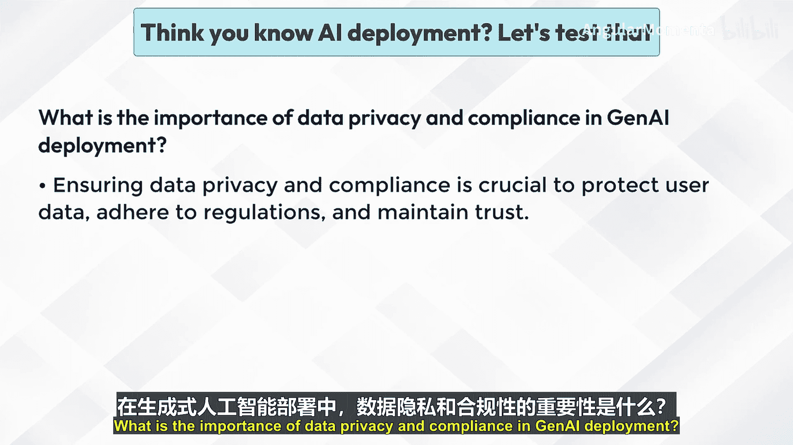

How do you evaluate the scalability requirements of a GenI model。

 evaluate scalability by testing the model's performance under various loads。

 and considering its ability to handle increasing data and user numbers？

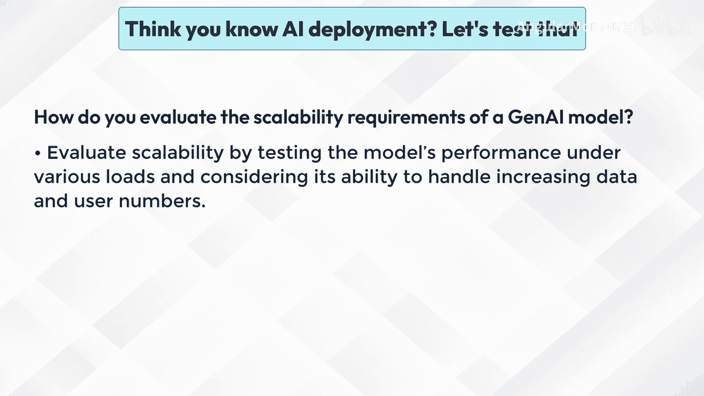

What are the cost considerations in deploying GenAI models costs include infrastructure。

 computational resources， storage and potential licensing fees。

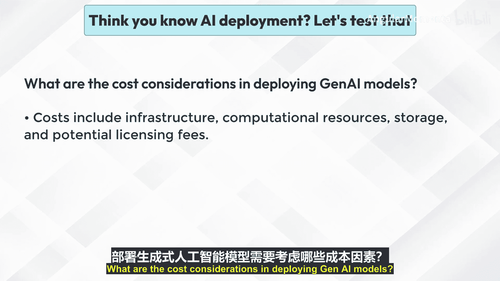

How do you determine the expected latency of a GenI model in production。

 measure latency by testing the model's response times under realistic conditions and optimizing it for efficiency？

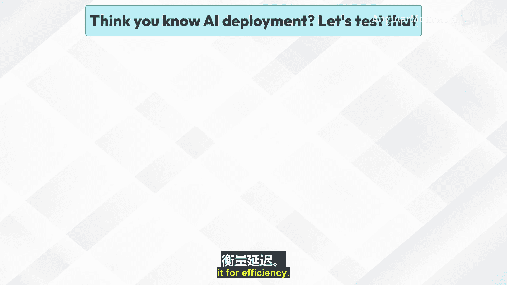

What are the security considerations when deploying GenAI models Security considerations include protecting the model from unauthorized access。

 securing data in transit and at rest and ensuring robustness against adversarial attacks？

What are the different methods of deploying GenAI models Me include cloud based deployment。

 on premises deployment and hybrid solutions。

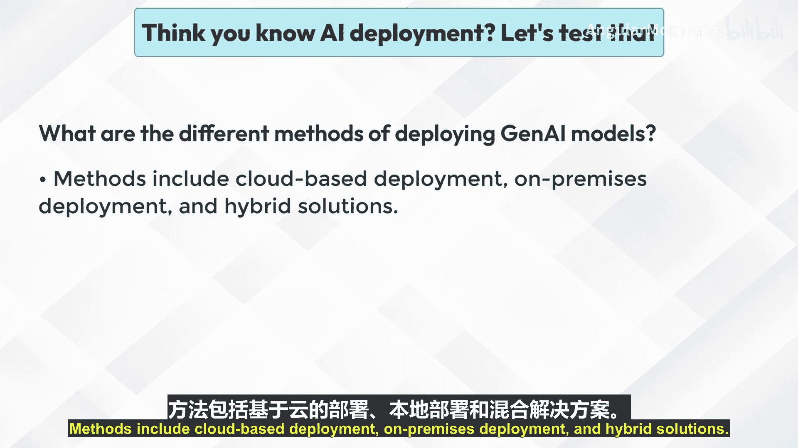

How does AWS SageMaker facilitate the deployment of GenAI models？

AWS SageMaker provides managed services for training， tuning， and deploying models。

 as well as integration with other AWS services。What is AWS Brock and how does it assist in hosting GenI models AWS Brock is a fully managed service that provides prebuilt GenI models and infrastructure。

 making it easier to deploy and scale GenAI applications。

How can Anthropic be used for local hosting of JenAI models Anthropic provides tools and frameworks for running GenAI models locally。

 offering control over deployment and data privacy。

What are the advantages of using VLLM for local deployment of GenAI models。

 VLLM provides efficient local model execution with low latency， scalability。

 and control over hardware resources。How do you choose the appropriate deployment method for a GenI model。

 choose based on factors like cost， performance， data privacy needs， scalability。

 and integration requirements？What are the common techniques for integrating GenII models into existing systems Tech include using APIs。

 embedding models into applications， and integrating with microservices。

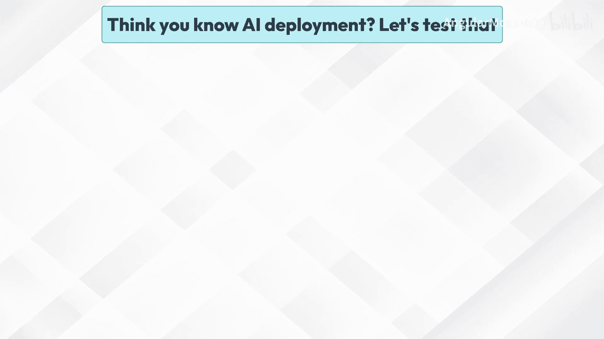

How do you use APIs to integrate GenI models？APpiIs enable communication between the GenNI model and other applications。

 allowing for seamless integration and interaction。

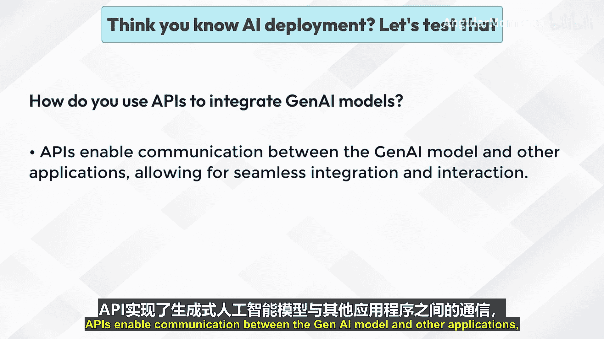

What is the role of microservices in GenAI model integration Microservices allow modular deployment and scaling of GenAI functionalities。

 facilitating easier integration and maintenance。How can containerization， for example， Docker。

 help in the integration of Gennai models？Containerization ensures consistency across different environments and simplifies the deployment and scaling of GenI models What are the benefits of using Kubernetes for deploying GenAI models Kubernetes provides automated deployment。

 scaling and management of containerized applications including GenAI models。

 how do you optimize the performance of a deployed GenAI model。

 optimize performance by tuning hyperparameters， optimizing code， and using hardware acceleration。

 for example GPUs， What techniques can be used to reduce the latency of GenI models？

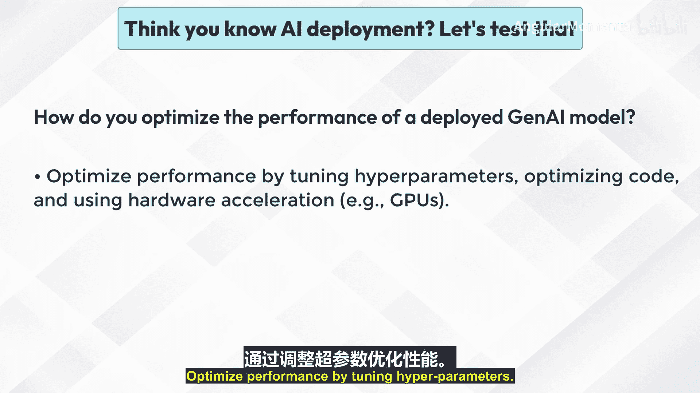

Techniques include model optimization， efficient data processing。

 and leveraging hardware accelerators。How do you handle large scale deployments of Gen AI models。

 use techniques like load balancing， distributed computing and efficient resource management to handle large scale deployments。

 What are some methods to monitor the performance of GenI models in production。

Methods include using monitoring tools， analyzing performance metrics。

 and setting up alerts for anomalies。 How do you perform load testing on Geni models。

 Lo testing involves simulating various loads on the model to evaluate its performance and identify bottlenecks。

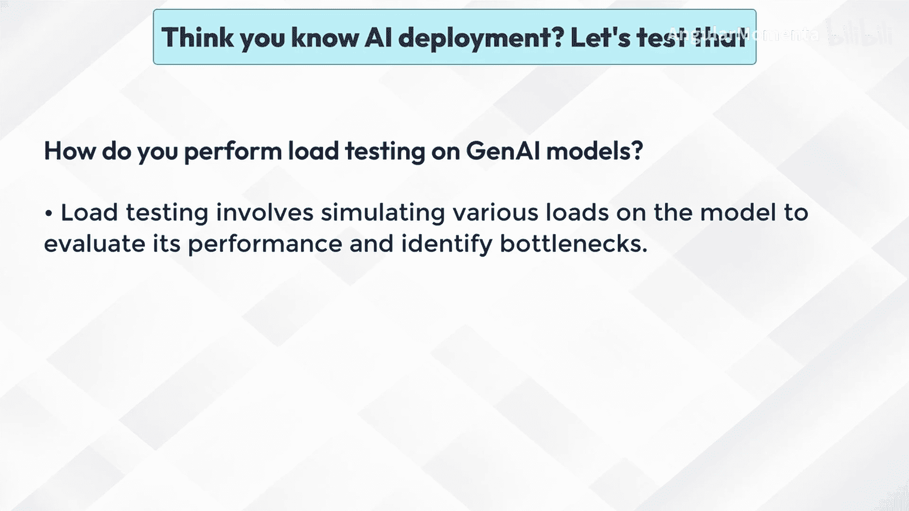

What are the key metrics to monitor for deployed GenAI models？

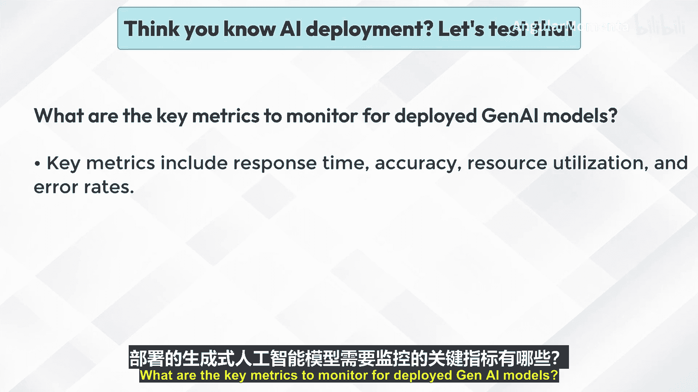

Key metrics include response time， accuracy， resource utilization and error rates How do you set up logging for JenAI models in production set up logging by integrating logging libraries or services and configuring them to capture relevant data What tools can be used for monitoring GenAI models tools include cloud monitoring services。

 for example， AWS Cloudwach application performance management APM tools， and custom dashboards。

 how do you handle errors and exceptions in deploy GenI models handle errors by implementing error handling mechanisms。

 logging exceptions and setting up automated recovery processes What is the importance of real-time monitoring in GenI deployments Real-time monitoring helps in detecting and addressing issues promptly ensuring continuous model performance and reliability。

How do you ensure the scalability of GenAI models， ensure scalability by designing models that can handle increased load。

 using scalable infrastructure and optimizing resource usage？

What are the challenges in scaling GenAI models， challengeses include managing resource allocation。

 maintaining performance， and ensuring cost efficiency。

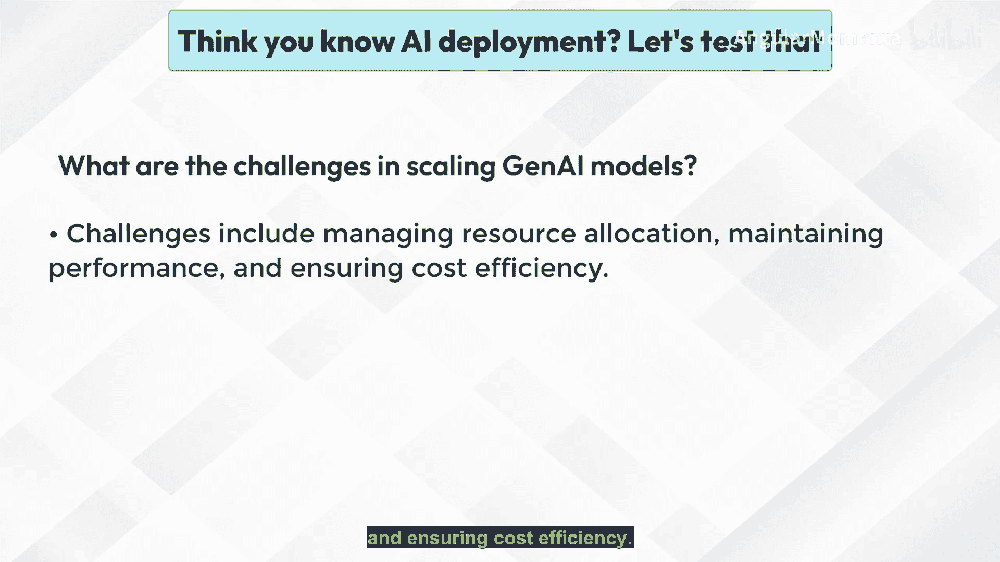

How can auto scaling be implemented for GenI models？

Auto scaling can be implemented using cloud services that automatically adjust resources based on demand。

What are the best practices for scaling GenAI models on cloud platforms？

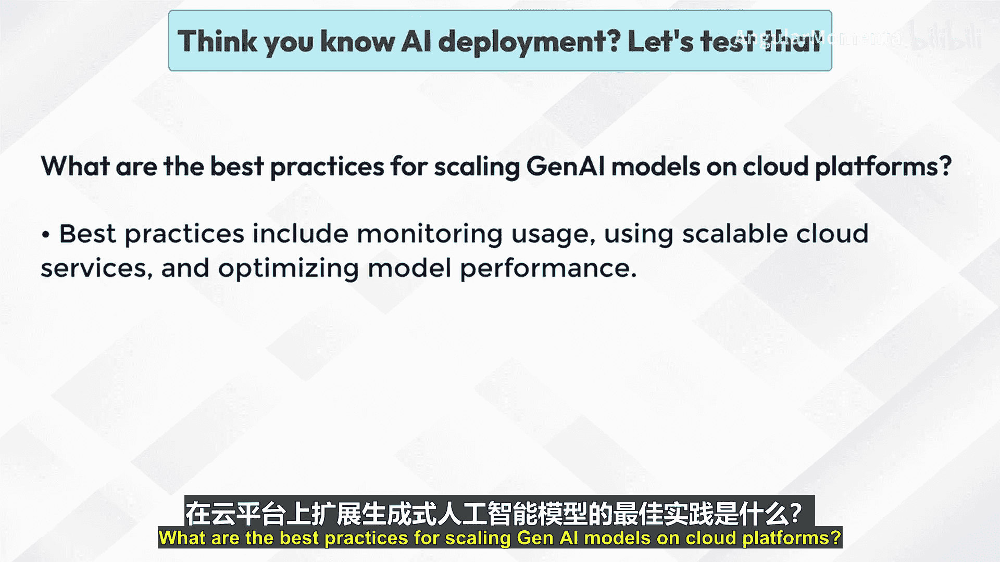

Best practices include monitoring usage， using scalable cloud services and optimizing model performance how do you manage resource allocation for scalable GenAI models。

 manage resource allocation by using cloud- based resource management tools optimizing resource usage and adjusting based on demand。

 what are the data privacy concerns in GenI model deployment Con include unauthorized access to sensitive data。

 data breaches and compliance with data protection regulations how do you ensure compliance with data protection regulations when deploying GenAI models ensure compliance by implementing data protection measures。

 Coning regular audits， and adhering to relevant regulations， for example GDPR。

What techniques can be used to anonymize data in GenI models Techs include data masking。

 aggregation and pseudomization to protect user privacy。

 how do you implement data encryption for GenAI models。

 implement encryption by using encryption algorithms to secure data at rest and in transit。

 what are the best practices for maintaining data privacy in GenI deployments。

 best practices include using encryption， anonymizing data and adhering to data protection regulations。

 how do you manage the costs associated with deploying GenAI models。

 manage costs by optimizing resource usage using costeff infrastructure and monitoring expenses？

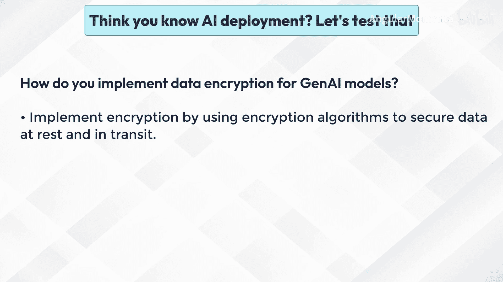

What are the cost saving strategies for deploying JenAI models on cloud platforms？

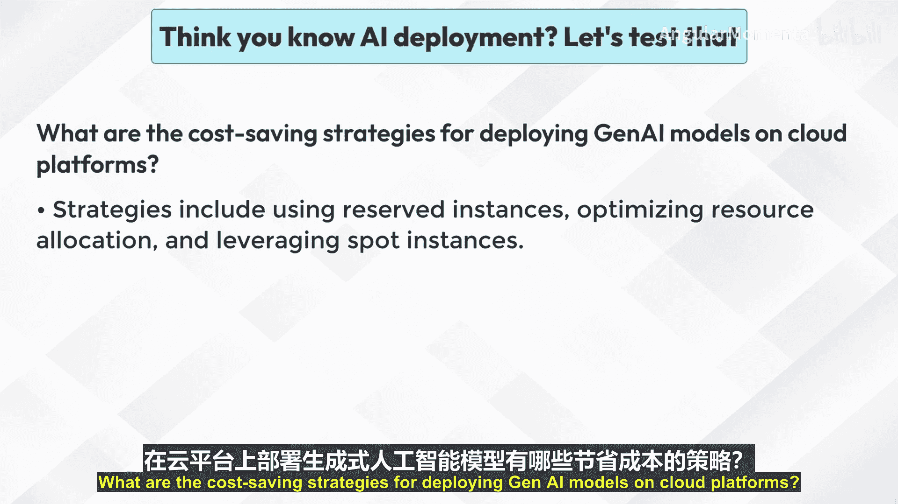

Strategies include using reserved instances， optimizing resource allocation and leveraging spot instances。

 How do you calculate the total cost of ownership for GenAi models。

 calculate total cost of ownership by including costs for infrastructure。

 maintenance and operational expenses What are the cost implications of different deployment methods for Geni models。

 cost implications vary based on infrastructure， cloud versus on premises。

 resource usage and licensing fees， how do you optimize resource usage to reduce costs in Gen Ai deployments。

 optimize resource usage by adjusting resource allocation。

 using efficient algorithms and leveraging cloud cost management tools What are the enterprise level considerations for deploying GenAi models。

 Considers include scalability， integration with existing systems。

 compliance and resource management how do you address the number of users in Geni model deployments。

 address the number of users by scaling infrastructure appropriately， ensuring the model can。

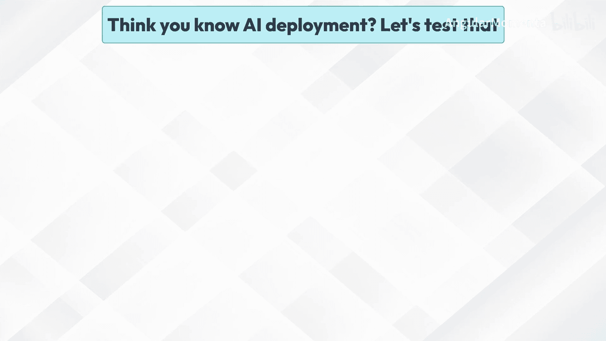

handandle concurrent requests and implementing load balancing What is the impact of user concurrency on GenAI model performance High user concurrency can impact performance by increasing latency and resource utilization。

 which may necessitate scaling and optimization efforts how do you ensure high availability for GenAI models in an enterprise setting ensure high availability by using redundant infrastructure。

 I failover mechanisms and employing distributed systems What are the best practices for disaster recovery in GenI deployments best practices include maintaining backup systems。

 regularly testing disaster recovery plans and ensuring data redundancy？

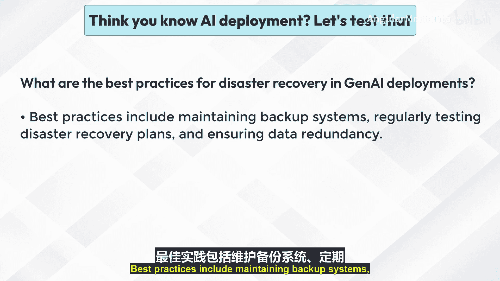

What are some practical exercises for deploying GenAI models on AWS SageMaker Excis include training a model using SageMaker。

 deploying it as an endpoint， and integrating it with a web application or API how do you set up a GenI model deployment using AWS bedrock set up by selecting a pre-built model on AWS bedrock。

 configuring deployment settings and integrating it with your application through the provided APIs What are the steps to deploy a GenI model locally using Anthropic steps include installing necessary software。

 configuring the model environment， and running the model on local hardware while managing dependencies and resources？

How do you integrate a GenI model into a web application using APIs。

 integrate by calling the GenI Models API from your web application。

 handling the API responses and displaying the generated content in the user interface？

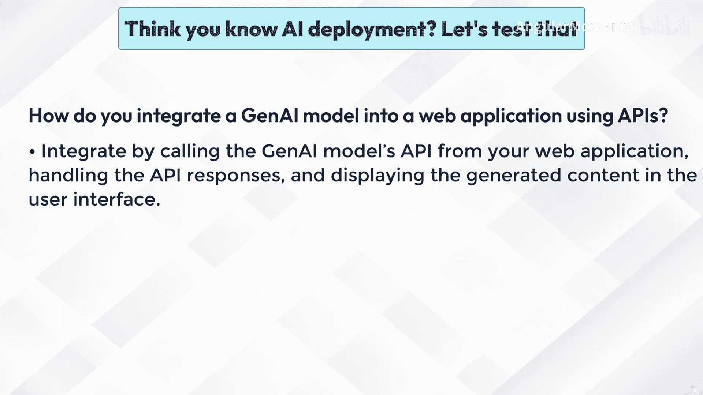

What are some real-world projects for hands-on experience with GenI deployment Project might include developing a chatbot for customer support。

 creating a content generation tool for marketing or building an image generation application for creative design Can you provide a case study of a successful GenI model deployment An example is open AI's GT3 integration into various applications for natural language processing including chatbots and content generation tools What are the lessons learned from a failed GenI model deployment lessons might include the importance of proper testing。

 scalability planning， and the need for robust error handling and monitoring How do different industries deploy and integrate GenI models。

Industries deploy GenAI models for various applications， healthcare care for patient data analysis。

 finance for fraud detection and entertainment for content creation What are some examples of innovative uses of GenAI in enterprise applications Ex include personalized marketing content generation Auto report writing and advanced customer service chatbots how do companies handle the maintenance of deploy GenI models。

 companies handle maintenance by regularly updating the models。

 monitoring performance and retraining them with new data as needed What are the emerging trends in GenI model deployment T include increased use of edge computing。

 advancements in model efficiency and the growing integration of GenAI with other AI technologies How is the future of GenAI in enterprise applications evolving the future is evolving with more sophisticated models。

 greater integration into business processes and enhanced customization capabilities What new technologies are impacting the deployment of GenAI models。

ologies include advancements in hardware， for example， GPUs TPUus。

 improved cloud services and innovative software frameworks How will advancements in hardware affect GenI model deployment Advments in hardware will enable faster training and inference。

 reduce costs and allow for more complex models to be deployed efficiently What is the role of edge computing in the future of GenI deployment Edge computing will allow GenI models to run closer to data sources reducing latency and enabling real-time processing and remote or mobile environments。

 How do you ensure continuous improvement of deployed GenI models ensure continuous improvement by regularly updating models based on user feedback。

 Incorporating new data and refining algorithms What are the best practices for updating Geni models in production Best practices include using version control。

 rolling out updates gradually and thoroughly testing new versions before full deployment How do you incorporate feedback from users into GenI。

Improments Incorpo feedback by analyzing user interactions。

 identifying areas for improvement and updating the model based on insights gathered。

 what are the challenges in continuously learning and adapting GenI models。

Challenges include managing data quality， avoiding model drift。

 and ensuring that updates do not introduce new issues。

 How do you leverage A B testing for Jen AI model optimization。

 leverage A B testing by comparing different model versions or configurations in parallel and analyzing their performance to determine the best approach What are the key takeaways from deploying and integrating Gen AI models。

Key takeaways include the importance of thorough testing， monitoring and optimization。

 as well as the need to address scalability and data privacy concerns。

What are the common pitfalls to avoid in Geni model deployment Common pitfalls include neglecting performance optimization。

 failing to plan for scalability and overlooking data privacy and compliance issues。

 How do you measure the success of a GenI model deployment？

Measure success by evaluating metrics such as model accuracy， user satisfaction。

 performance efficiency， and return on investment， what is the importance of continuous learning resources for GenI deployment？

Continuous learning resources are important for staying updated with advancements。

 improving skills and adapting to new challenges in GenI deployment。

 How do you stay updated with the latest developments in Geni integration and deployment。

 Stay updated by following industry news， participating in relevant communities and conferences。

 and engaging with ongoing training and educational resources。

