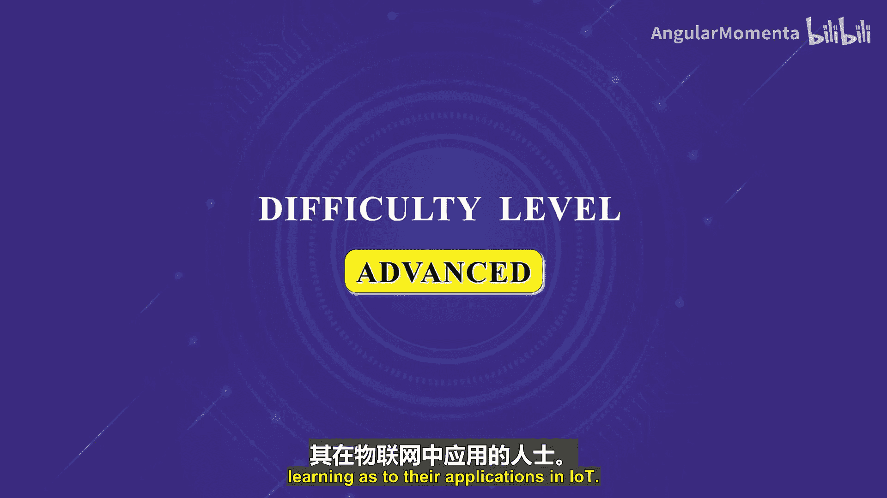

# 【EDUCBA】数据分析高级Python：构建与优化-｜-Advanced-Python-for-Data-Analysis：-Build---Optimize-p01-01_01_01_包与模块导论--BV1nmcKzBEU3_p1-

Welcome to section 2 of Python for IoT in the last section or in the last module that we did for Python for IoT or that was essential Python for IoT we did certain things like we had to go through basics variables looping and functions and then we went on to different other things or different other concepts that we needed basically for doing any program in IoT we had a look at different different instances which we had to work on and different programs that we worked on Now this module is not for beginnerness this one is for those who have a fair enough idea of Python and would like to go for advanced learning as to their applications in IoT。

For IoT when we talk about advanced learning and when we talk about advanced Python we need to learn things like packages which was covered partially in module 1 or we'll go to that packages or modules and then we will go on to things like importing importing modules you know standard built-in modules of Python which we will see in some time and then we go on to modules for data analysis and data science why are these involved for IoT these are involved majorly because say for example data which is collected from different IoT components that is from the sensors that is from different controllers which are being sent online to our servers need to be manipulated and they need to be used in a particular manner of course the data which which comes maybe huge amount of data which needs to be stored and then processed and then sent over to some other locations and stuff like that we need to understand different module。

which can be used for data analysis and for understanding stuff that we can do with Python for IoT of course things that we will be covering a few of them I'll mention right now which will add on as we go ahead few of them say for example the standard modules that we have the math the datetime and statistics then we have the modules that we are going to use or the third party modules that are there available for Python let's say anumpI。

Skypepi， pandas。Matlolib， of course there are few concepts which we didn't cover in section1。

 which we felt was not required when you do essential Python for IoT though that comes these concepts which I am going to mention right now。

 though that is part of core Python but still it wouldn't be absolutely essential at all times of course what are they they are exception handling and threading which of course for a programmer or for somebody who is developing applications in IoT you would any day use any of these handling it's not handline and then you have multithreading that is doing multiple threads。

 we use this many times on the raspberry pi when we have to do two3 processes together at the same time。

 say for example， wait for a button press and at the same time。

 you know send some information to the internet so you have to do two things at the same time which means you acquire two threads these are few things that we'll be covering in this module of course in order to store data we are going to use even the Sql Sqite my Sql modules and so。

One we will show how to cover them Also we maybe this is because of SQL we might also go on to how to make a Gy using Tta these are lined up for this particular module hope you will stay tuned with me throughout this module and we are going to use this IDE that is idL but I'm going to introduce another ID2 because this we had done in the earlier module we are going to introduce some IDs like yeah IDs which I'm going to introduce this time maybe Chipyter notebook and and even by charmm we' cover a few of these IDs and as and when whichever is convenient we are going to use them as and when it processes okay。

