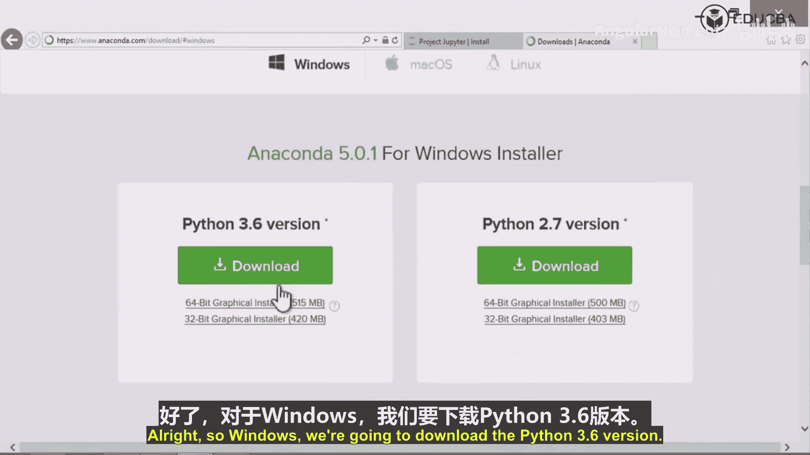
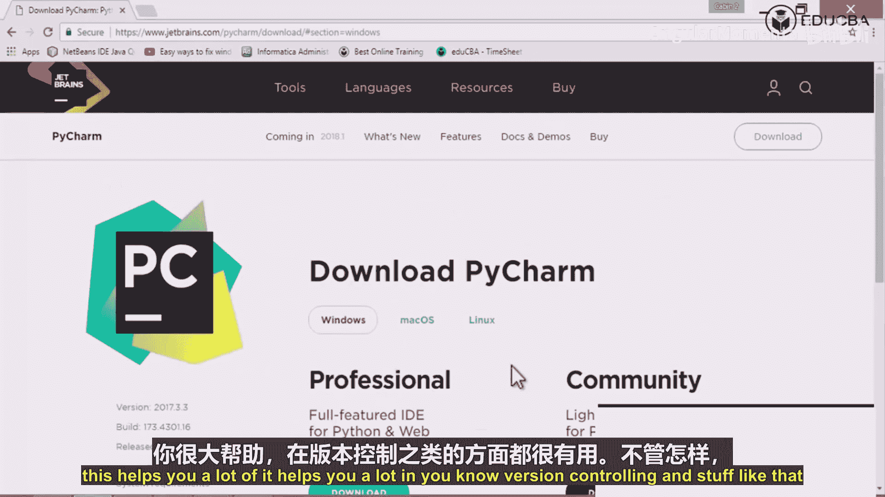
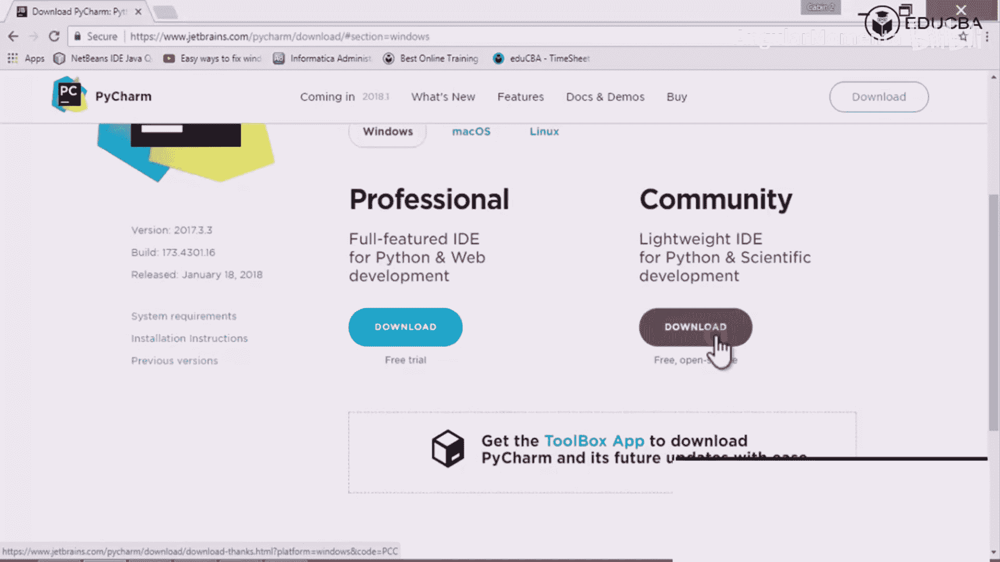
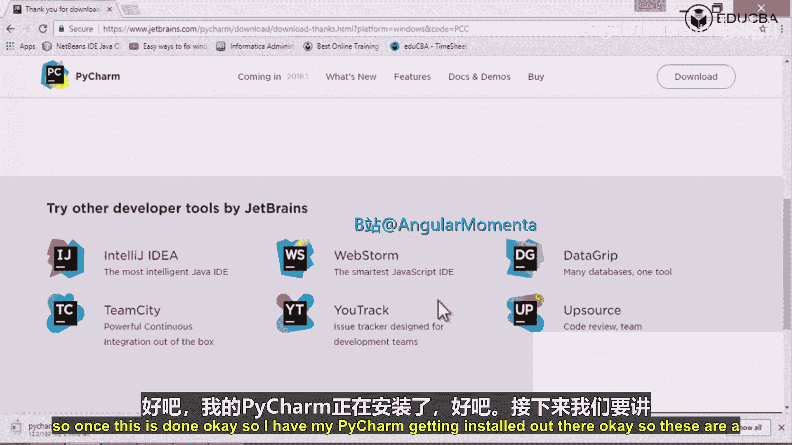
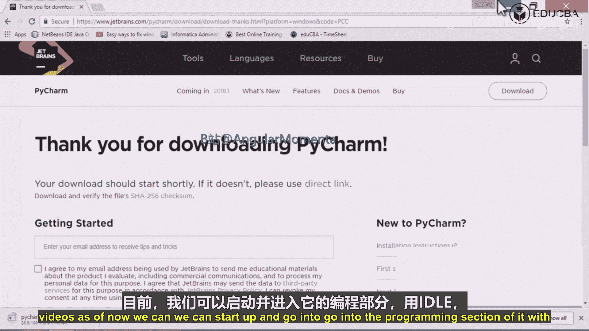
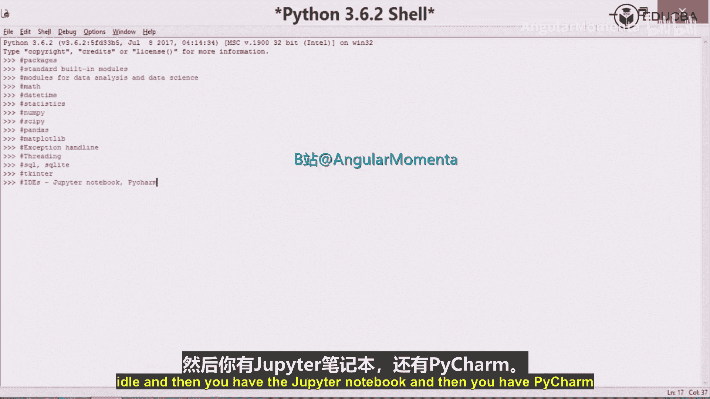

# 【EDUCBA】数据分析高级Python：构建与优化-｜-Advanced-Python-for-Data-Analysis：-Build---Optimize-p02-01_01_02_Anaconda发行版概念--BV1nmcKzBEU3_p2-

This is just to give you an introduction into the IDs that we will require。

 So I said we may be using Chipyter notebook or P charm or I now Ananaconda is is a version or you know it it helps in getting together。

All of you know Python as well as Jupyter notebook and and a lot of packages that we will be requiring it is it will be already installed。

 so this is going to be very useful for us and which we are going to use extensively。The Ny。

 the Skypi， the matlib pandas， many of them are already installed as part of the Ananaconda distribution。

 so it is a distribution in which involves Python along with the different packages that we're gonna to use along with along with Jupyter notebook and and so on so data science you know it it's very rapidly used and widely used for data science we are going to use this Ananaconda so you can go to Ananaconda do co and you can go to download so when you click on download it will take you to Anacon do co s download you can download for windows for Mac as well as for Linuxux alright for Windows there it is for Mac here it is and for Linuxux here it is Allright so Windows we are going to download the Python 3。

6 version 64 bit graphical installer if you have a 64 bit computer so just just download and then things are gonna be very simple it's just gonna be a graphical。

You know， interface where it says next， next and so on。 So currently I am getting my Ananaconda。

3 installed out here I download and just run the dotty X once its get installed。

 the distribution is done and we can start off with different different applications in Jupyter notebook。

 which I will show you to you another another IDE which I would want you to use is let's say Ill just show you that another I which we will be using。

4。For quite a few of our applications are here another IDE is Pychm so we can use the Pychm download we can just go to Pych so download Pychm which is there by chat brains so this gives you this helps you a lot of it helps you a lot in you know version controlling and stuff like that anyway for now I'm just going to download it it's similar to eclipse for other programming languages okay so I'm going to download the free open source version that is the community version you can pay and download the professional the full feature IDE。

For Python and web development， if you're using it for scientific development。

 it's going to be the community version， if you want to go for the web development part of it。

 you download this a professional version， it's going to help you a lot in that particular sense we are fine with this we'll download this and we'll install this up so once this is done。

Okay， so I have my P charm getting installed out there。Okay， so these are a few things that。

We're going to go into。We understand the setup in detail in the next few videos as of now， we can。

 we can start up and。Go go into the programming section of it with iddL。

 and then you have the Jupyter notebook and then you have Pche。

