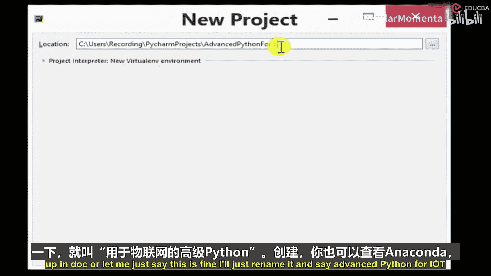
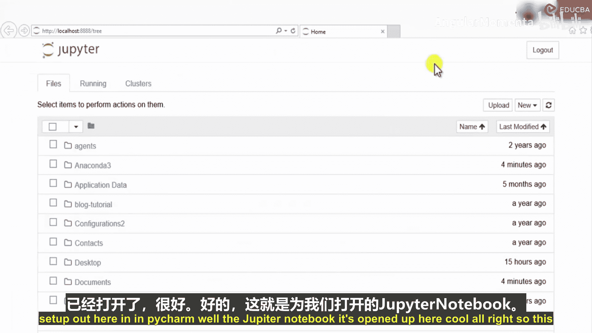
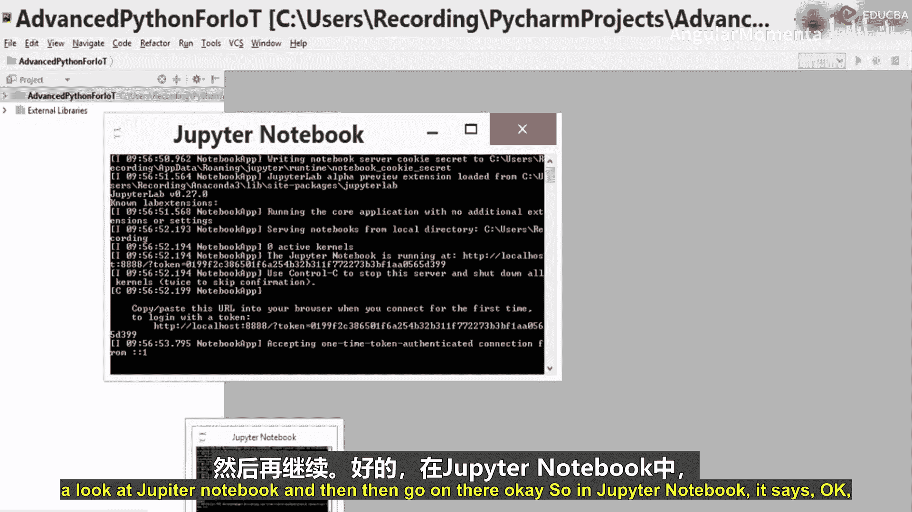
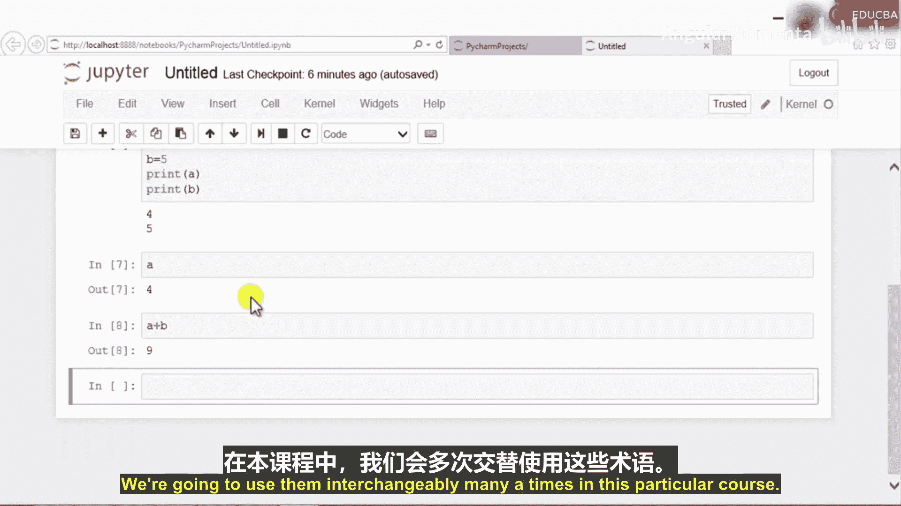

# 【EDUCBA】数据分析高级Python：构建与优化-｜-Advanced-Python-for-Data-Analysis：-Build---Optimize-p03-01_01_03_PyCharm安装--BV1nmcKzBEU3_p3-

Let's understand the P charm installation， So start up with the dott X。Guse run。

So we are installing by Ch， yes。Community Ed。Cool， this is fine。So we're going to have a 64 bit。Next。

O， Che drainin。Cate the program shot goods。 All right。 fine， that's okay。 install。

 So we have our installation of Pchan community edition happening up。at the same time。Its I。

At the same time， we are also installing Ananaconda。

So these are two things which are going on together， which we will have a lookcus to。

How to use both of them。Okay， once this is done。The new shield setup is so we can run the pie charm community edition。

 finish it up once that is done to。Open up by Cham Community Edition。All right， at the same time。

 Anaconda is also done Ananaconda 3， which。Okay， so custom location。

Contract folderer and Solly shouldn homework of previous version or something like that。ok。

Finished his up。This is also we done move from the ship with Bon， Serrianconra。Okay， we have。

By ch here。Which were customized by charm。 skip remaining， said default faults this about by charm。

 for now， we can configure it。All right， so we have settings which we can configure。In the settings。

 we need to see the project interpreter。Whi is going to be there。 What do we have。Right。

 we'll come to that in a minute。Okay， so okay， and let's say。

So we can create a new project so we can create a new project and just name it as。

So it's going to be there in this particular location。

Let me just put it up on the desktop stop for me out here。ok。Okay， I'll for now。

 I'll put it up in duck。 or let me just say this is fine。 I'll just rename it and say。

Advanced Python。For Ity。

Create。You can also check Ananaconda， you can just write it down and then you will see the Ananaconda prompt and the Anaagonna navigator Navigator is something like a Gy which you can use for Anaconda or you can just use the Ananaconda prompt out there Another thing that you can just open up is the Jupiter notebook so you have the Jupiter notebook you can just open that up and so we are just getting both of these opened up for now the Jupiter notebook and the bychm Okay so we don't need it need this for now。

Okay。It's going to be take some time for the initial setup out here。In， in Baicch。Well。

 the Jupiter notebook。 It's opened up here。Cool all right。

 so this is Jupyter notebook which is opened up for us。

Okay， so before we go into Pychm， we can just have a look at Jupyter notebook and then then go on there。

 Okay， so in Jupyter notebook it says， okay， where do you want to start up it。

 that's where you can you can go there in that particular location Okay。

 let's go to the same location that we are having our you know we are having this thing let's say that was。

Py cham was somewhere。 C users recording Py cham projects， C users recording Py cham projects。

 So what I'm going to do is I'm going to plot it here。I'm going to stop up here， see users。그。

Recording。Where by chambras。Okay。So I'll just open that up。In advanced open。Okay。Os。嗯。Oh。Oh。

 so that's swear you have to。😔，Okay， or let's just do it here。 So you have your byche projects。

 Can you see that right， So this is where we are going to use this particular folder to save our new files in Jupipyter notebook。

Let me just write something new。A new file just to understand how topyter notebook will work。

 Let's say a new file， new Python 3。Just a second。 it will。 It will come up just a minute。

 So we have our Chipyter notebook opened up once it is done。All we have to do is， let's see。

We need to write a simple program， let's say print。Hello Wood， okay。嗯。Well。

This is one part of the program， but I want to write another program， let's say A is equal to4。

 B is equal to 5。I want to print A。 I want to print B。 I want to see。So I have something out here。

 so I want to print hello world， I want to run this now， but I don't want to run them together。

 I want to run them separately。 Can I do that， Yes。

 I can just click on this and let's say run this hello world。Whereas in this case。

 if I say run a is equal to 4， B is equal5， print A， print B， it printed。Four and five。

Now is this a accessible from this particular code segment I it accessible in the bottom code segment。

 Let's see a yes， it is。Okay， so you can have something like a plus B of course you can。

 so the advantage of using a Jupyter notebook is you can have multiple lines of code in one segment if you want to run all of them you can run all of them together if you don't want to run all of them you just want to run part of it you can even run part of it which is going to be completely different。

Secondly， you can also it's just like a notebook， that's why it's called Jupyter notebook where let's say I want to write something here。

 I want to say， okay， after this， I want to say something like I'll write here markdown in a markdown。

 I didn't want code to be written， I want to say hi， this is a Jupyter notebook。

And we are using it to document。A to document our programs。

 so we can just we can just write this particular part and let's say so I want to have a title also。

 let's say I can put a hash and say you know。Advanced。I can。For a Iot。Alright。

 so this particular thing I want to put it above， I can just push it up and this is below。 Okay。

 now all I need to do is I need to， you know， I can take all of them。

 I can take all of them together and run it out。Okay， so when I run it。

 can you see it's just like a notebook。 You have advanced Python varietyilty， hide is juvenard。

 We can be using the document our programs。 You have our program written here and you have the output written out there。

 This is as simple as using Jupyter notebook。 Qui， quite good， though。

For packages or though we're using if you want if you want to have things like you know。

 putting them in folders and utilizing modules from different folders and stuff like that。

 we can use of course bych to to make our project well so you can say let's say new new Python file okay so we can just say here okay so let's say test。

It will append a test our Py and all we need to say is you know print hello world。Of course。

 we need to configure it for now we need to configure， let's go back to。hel。😔，Filile settings。

We need to go to the project interpreter。 We can say， is it。Pice and3。 sake。No in。 All right。

 Python 3。6， that's fine。 see recordings。 All right， that's fine。 That's cool。 Okay。

 and let's say we can run this out， run， run。😊，Test。Cool hello world， right。So you can。

 you can keep creating new files here。So you have all your files together in one document。

 let's say taking input。So we can take input from the user， let's say， input。And through a number。

 of course， whatever input you take。You need to convert it into N integer， store it in a nu。

 and let's say I print the nu。Race 2 3， which means I'm going numb cubed。 All right。

 Control shift F 10， control shift F 10 will run the program enter a number。 I can just say 25。

25 cubed is 1，5，6，25。 You can check it。Al right， so with this we are done with installing P charm as well as we install Ananaconda which contains the Jupyter notebook we are going to use them interchangeably many at times。

In this particular course， okay？

