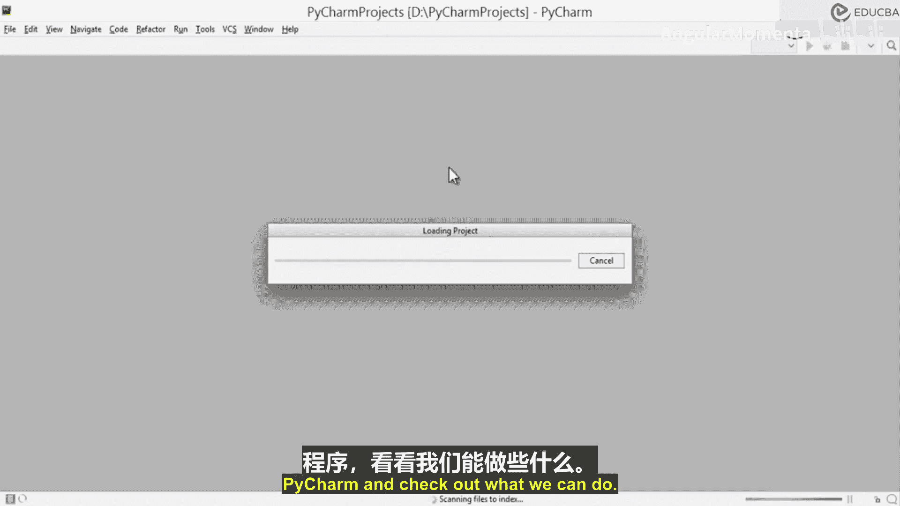
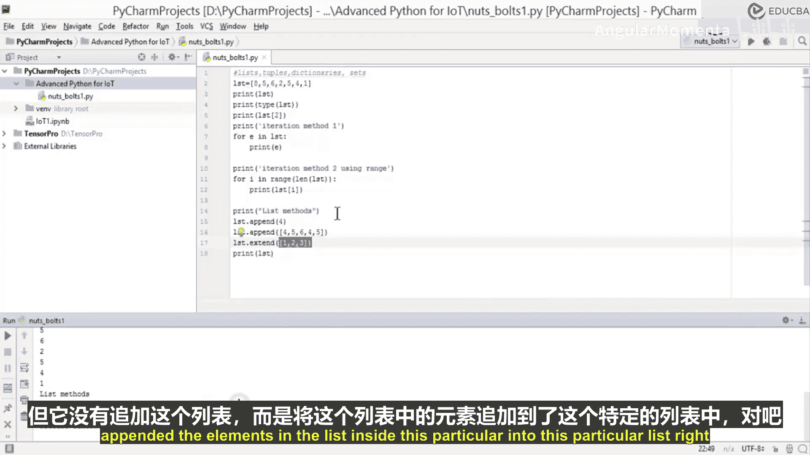

# 【EDUCBA】数据分析高级Python：构建与优化-｜-Advanced-Python-for-Data-Analysis：-Build---Optimize-p04-01_01_04_在PyCharm中执行程序--BV1nmcKzBEU3_p4-

We need to have a simple recap of。Of a few things about。Python and the nuts and bolts about Python。

 maybe， maybe a bit of basics， but it's going to be a quick recap。

Assuming that you already know the basics out there hence but those which are essential for core Pythonic concepts。

 we going go we just going go a quick recap of them and then go on to the then go on to the higher topics for now we're going to start up with Pychm and we're going to execute a few programs out here in Pychm and check out what we can do right so here we have the first I mean so I just create a folder out here advanced Python with Io and I just started with the nuts and bolts one print and hellello worldl and just check out whether you get the output out here right of course we're not going to go into a lot of specifics but if you remember in Python there are there are four data structures。

Right there are four data structures or there are major major a few data structures like lists topples。

 which of them include lists， topples， dictionaries and sets okay these are the four data data structures which are there in Python and they are generally used。

 Of course we are going to see a lot of data structures in this particular costs which are much more advanced and which are much more much more used for data analysis like say for example。

 Ny Ny pandas which we are going have a look these are the libraries of course and the data structures of the Ny arrays and we' are going to have a look at the panda cities and the data frames which are there in pandas so we are going to have a look at each of these data structures which are going to build up on these data structures which are going to be further So as you know a list is defined with a square bracket It's a quick recap where you can have different values in a particular list you can print the LS。

You can print the type of LSD。Right you can print the type of LSD and if you want you can access elements of the list by saying LSD of LSD of a particular index where the index starts from0 LSD of particular index you can itrate over the list in two different itrations where you can say for every element in LSD this is one kind of itration for every element in LSD print the element this is number one itration another itration that you can have so I can just print your itration1 itration method1 and I can just print ittration method 2 in over here which is going to be using the range using range function so over here I in range I' am going to say range from where to where start will be from zero that's by default I need to go up till the lens of the LSD I need to go up to the end of LS。

and print。Print the LSD of I right so this is where control shift F 10 will give you run the code so this is your list it says it is class list and of course you have each element of that list list LSD of two is this is0。

 this is one， this is two， This is a second index This is how you access a list element then you have ittration method1 where you get for every element in LSD itself and this is ittration 2 right you can use list methods there are different list methods which can be there print I'll just print the list methods a few of them which you can use sometimes right which you might which you might use if you remember LSD dot append you could append a particular value let's say four or you could even append。

LSD dot append， you can append a list itself， another list itself you can have 4，5，6，4。

5 Okay you can do an LSD dot extend which is not going to append a list。

 you need to give a list but its not going to append it append a list but it is going to append the elements inside the list let's say one comma2 comma 3 yeah one comma 2 comma 3 and then now if I print the LSD let's see what happens。

😊，Function F10 see what happens this the normal list normal list was01 and then you appended a4 can you see the four has been appended and then you appended another list altogether 4。

5，64，5 is a list altogether it is an inner list and finally when you did an extend though you gave a list it did not append the list but it appended the elements in the list inside this particular into this particular list right。

